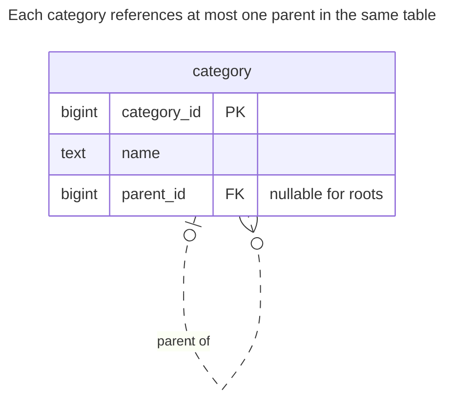
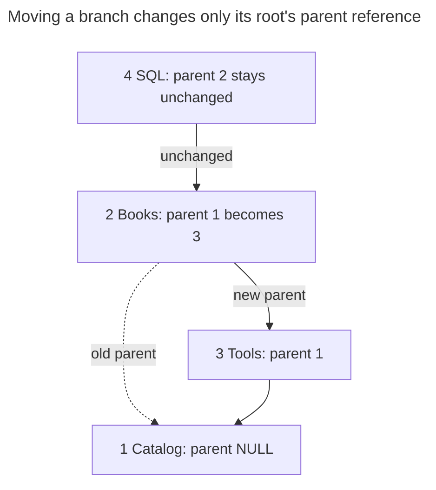
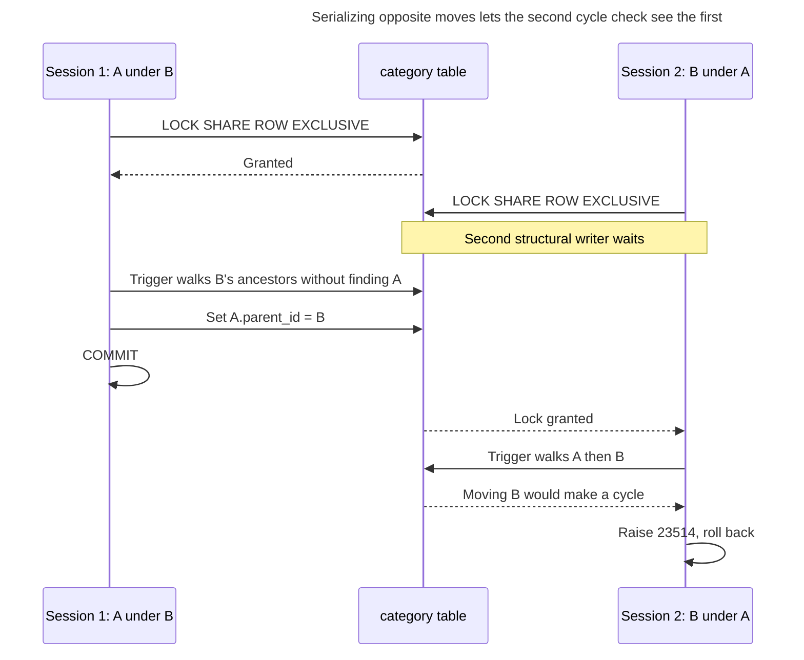

# Adjacency List

## Intent

An adjacency list stores a tree by giving each row a reference to its parent in the same table. It is the simplest structure to write and keep consistent: moving a subtree changes one value, and a foreign key guarantees that every parent exists. The chapter shows how recursive common table expressions read descendants, ancestors and paths in one query, how to prevent cycles, and at what depth and read volume the alternatives start to pay off. PostgreSQL's [recursive-query examples](https://www.postgresql.org/docs/18/queries-with.html) show traversal over parent links.

## Also known as

Parent/child model; parent references. [Microsoft's hierarchy guide](https://learn.microsoft.com/en-us/sql/relational-databases/hierarchical-data-sql-server?view=sql-server-ver17) uses “parent/child”; [MongoDB's tree tutorial](https://www.mongodb.com/docs/manual/tutorial/model-tree-structures-with-parent-references/) calls the same direction of reference “Parent References”.

## Problem

You organize a catalog into categories. Each category has at most one parent, but you do not know how many levels editors will create. You need to list a category's immediate children, show breadcrumbs and occasionally move a whole branch. A column for each level makes the schema depend on today's depth. A fixed number of self-joins puts the same limit in the query; see [Fixed-Depth Queries](fixed-depth-queries.md).

The harder invariant is that following parents must eventually reach a root. A foreign key rejects a missing parent, but two existing rows can still reference each other. You need to treat parent existence and cycle prevention as separate checks; PostgreSQL's [constraint documentation](https://www.postgresql.org/docs/18/ddl-constraints.html) explicitly supports self-references but does not turn them into trees.

## Solution

Store one immutable category ID and one nullable `parent_id` per row. A null parent identifies a root; this example permits several roots, so its precise shape is a forest. Index the parent column for child lookup. Traverse as far as the data requires using a [recursive CTE](https://www.postgresql.org/docs/18/queries-with.html#QUERIES-WITH-RECURSIVE): start at the selected category and repeatedly join children to the current frontier.

For a move, change only the moved node's parent. Before doing so, walk upward from the proposed parent and reject the move if you encounter the moved node. Serialize structural writers before that check. The implementation uses a trigger for the walk and an explicit transaction-level table lock for serialization. The lock is part of the write contract; the trigger alone is insufficient under concurrent moves.

## Alternatives and selection

| Sibling | Relationship | Deciding requirement |
| --- | --- | --- |
| [Materialized Path](materialized-path.md) | Replacement; complement as a maintained read representation | You repeatedly read whole subtrees or breadcrumbs and accept rewriting descendants on moves |
| [Nested Sets](nested-sets.md) | Replacement; complement as a published read representation | A mostly static hierarchy needs range scans and dense-number descendant counts |
| [Closure Table](closure-table.md) | Replacement; complement as a reachability index | Both ancestor and descendant joins justify storing all reachable pairs |

See the [Decision Atlas](decision-atlas.md) for the full family comparison. Recursion is an implementation option for reading this schema, not a competing storage pattern. There is no universal depth at which you must switch: compare your branch sizes, move frequency and measured query latency.

## Structure



The self-reference permits many children per parent and zero or one parent per child. Moving Books under Tools leaves SQL's reference to Books untouched.



Arrows follow stored parent references upward; only the solid new link from Books is written by the move. SQL follows Books to its new location without any update to SQL's row.

## Tables and invariants

- **`category`** stores nodes, keyed by `category_id`. `category_parent_fk` requires every non-null parent to exist. Its default delete action prevents deleting a parent while retaining its children.
- **`category_not_self`** rejects a direct self-reference. The trigger rejects longer cycles by inspecting the proposed parent's ancestry.
- **Write protocol** keeps IDs unchanged, changes one parent per operation and takes the structural lock before any tree reads. Neither the foreign key nor the row-local check enforces that protocol.
- **Ordering** is explicit. The example sorts by an ID path; IDs do not express an editor's preferred sibling order.

## When to use

- You mostly create nodes, read immediate children or move branches.
- Variable depth is a real requirement, but subtree reads do not yet justify redundant storage.
- You want a compact source of truth from which another hierarchy representation can be rebuilt.

## Consequences and trade-offs

- ➕ A move updates one stored reference regardless of subtree size; cycle validation still reads ancestors.
- ➕ You keep one node row rather than storing paths or every reachable pair.
- ➖ Subtree and breadcrumb reads perform traversal at query time.
- ➖ A foreign key proves parent existence, not acyclicity or a single-root policy.
- ➖ The simple lock protocol serializes all structural changes, even on separate branches.

## Implementation

The [complete PostgreSQL 18.6 script](../assets/adjacency-list/adjacency-list.sql) creates the tree, reads both directions, moves Books and deletes that subtree. Its exception block verifies the expected cycle diagnostic. Start with these tables and the trigger:

```sql
CREATE TABLE category (
    category_id bigint PRIMARY KEY,
    name text NOT NULL,
    parent_id bigint,
    CONSTRAINT category_parent_fk FOREIGN KEY (parent_id)
        REFERENCES category (category_id),
    CONSTRAINT category_not_self CHECK (parent_id <> category_id)
);
CREATE INDEX category_parent_idx ON category (parent_id);

CREATE FUNCTION reject_category_cycle() RETURNS trigger
LANGUAGE plpgsql AS $$
BEGIN
    IF EXISTS (
        WITH RECURSIVE ancestors AS (
            SELECT category_id, parent_id FROM category
            WHERE category_id = NEW.parent_id
            UNION
            SELECT c.category_id, c.parent_id
            FROM category AS c JOIN ancestors AS a
                ON c.category_id = a.parent_id
        )
        SELECT 1 FROM ancestors WHERE category_id = NEW.category_id
    ) THEN
        RAISE EXCEPTION 'category cycle' USING ERRCODE = '23514';
    END IF;
    RETURN NEW;
END;
$$;
CREATE TRIGGER category_cycle
BEFORE INSERT OR UPDATE OF parent_id ON category
FOR EACH ROW EXECUTE FUNCTION reject_category_cycle();
```

The trigger's `UNION` removes repeated `(category_id, parent_id)` rows, so its validation walk terminates even if legacy data already contains a cycle. It does not repair that data. All writers use the lock shown below, at PostgreSQL's default [Read Committed isolation](https://www.postgresql.org/docs/18/transaction-iso.html#XACT-READ-COMMITTED); acquire it in a separate statement before validation reads:

```sql
BEGIN;
LOCK TABLE category IN SHARE ROW EXCLUSIVE MODE;
INSERT INTO category VALUES (1, 'Catalog', NULL);
INSERT INTO category VALUES (2, 'Books', 1), (3, 'Tools', 1);
INSERT INTO category VALUES (4, 'SQL', 2);
COMMIT;
```

Read the root and its descendants and compute a path for display order:

```sql
WITH RECURSIVE subtree AS (
    SELECT category_id, name, ARRAY[category_id] AS path
    FROM category WHERE category_id = 1
    UNION ALL
    SELECT c.category_id, c.name, s.path || c.category_id
    FROM category AS c JOIN subtree AS s ON c.parent_id = s.category_id
)
SELECT category_id, name, path FROM subtree ORDER BY path;
```

This returns IDs `1, 2, 4, 3`, with paths `{1}`, `{1,2}`, `{1,2,4}`, `{1,3}`. The final `ORDER BY` determines presentation order; PostgreSQL's [search-order documentation](https://www.postgresql.org/docs/18/queries-with.html#QUERIES-WITH-SEARCH) distinguishes this from the order in which recursion executes. Reverse the join for breadcrumbs:

```sql
WITH RECURSIVE ancestors AS (
    SELECT category_id, parent_id, name, 0 AS distance
    FROM category WHERE category_id = 4
    UNION ALL
    SELECT c.category_id, c.parent_id, c.name, a.distance + 1
    FROM category AS c JOIN ancestors AS a ON c.category_id = a.parent_id
)
SELECT category_id, name FROM ancestors ORDER BY distance DESC;
```

Before the move, the breadcrumbs are Catalog, Books, SQL. Move Books, including its SQL descendant, under Tools:

```sql
BEGIN;
LOCK TABLE category IN SHARE ROW EXCLUSIVE MODE;
UPDATE category SET parent_id = 3 WHERE category_id = 2;
COMMIT;
```

Books now has parent `3`; SQL still has parent `2`. This attempted move would close the loop Tools → SQL → Books → Tools:

```sql
BEGIN;
LOCK TABLE category IN SHARE ROW EXCLUSIVE MODE;
UPDATE category SET parent_id = 4 WHERE category_id = 3;
ROLLBACK;
```

PostgreSQL 18.6 raises SQLSTATE `23514`, `ERROR: category cycle`. The trigger deliberately supplies this message and code through [PL/pgSQL `RAISE`](https://www.postgresql.org/docs/18/plpgsql-errors-and-messages.html). Roll back the failed transaction. For deletion, the script first selects the entire subtree recursively and deletes all its nodes in one statement; deleting only Books is a different policy and leaves its children to be handled explicitly.

Delete the moved Books subtree in one transaction:

```sql
BEGIN;
LOCK TABLE category IN SHARE ROW EXCLUSIVE MODE;
WITH RECURSIVE subtree AS (
    SELECT category_id FROM category WHERE category_id = 2
    UNION ALL
    SELECT c.category_id FROM category AS c
    JOIN subtree AS s ON c.parent_id = s.category_id
)
DELETE FROM category WHERE category_id IN (SELECT category_id FROM subtree);
COMMIT;
```

## Engine support

- **PostgreSQL 18:** the recursive queries above use arrays for display paths. [`CYCLE`](https://www.postgresql.org/docs/18/queries-with.html#QUERIES-WITH-CYCLE) is an additional read-time guard when inspecting untrusted data; it does not prevent invalid writes.
- **MySQL 8.4:** [recursive CTEs](https://dev.mysql.com/doc/refman/8.4/en/with.html) support traversal, but `cte_max_recursion_depth` defaults to 1000. Set an intentional limit and translate PostgreSQL's array expression rather than copying it.
- **SQL Server 2025 (17.x):** [recursive CTE syntax](https://learn.microsoft.com/en-us/sql/t-sql/queries/recursive-common-table-expression-transact-sql?view=sql-server-ver17) uses `WITH` without `RECURSIVE`; `MAXRECURSION` controls its recursion limit. The parent/child schema remains the same choice.
- **Oracle AI Database 26ai:** [`START WITH ... CONNECT BY PRIOR`](https://docs.oracle.com/en/database/oracle/oracle-database/26/sqlrf/Hierarchical-Queries.html) traverses parent links. `NOCYCLE` reports through cyclic data; it is not a write constraint.
- **SQLite 3:** [recursive CTEs](https://www.sqlite.org/lang_with.html) read this structure. Enable [foreign keys](https://www.sqlite.org/foreignkeys.html) on each connection so parent existence is enforced.

## Failure and concurrency

Suppose A and B are roots. One transaction moves A under B while another moves B under A. Each can see a valid old tree and pass its own ancestor check. Locking only the moved row does not serialize those checks. The example takes `SHARE ROW EXCLUSIVE` before any structural read; PostgreSQL documents that this mode [conflicts with itself and ordinary writes while permitting plain reads](https://www.postgresql.org/docs/18/explicit-locking.html#LOCKING-TABLES). Every insert, move and delete must follow that protocol. Put these operations behind controlled routines or a single application write path rather than granting unrelated writers unrestricted structural updates.



The second trigger runs after the first move commits and finds B in A's ancestry. The table lock protects the validation read, including rows other than the moved node.

Keep validation and mutation in one transaction. If it fails, roll back both. Re-read the current parent after an uncertain commit before retrying a move; the intended state may already exist or another editor may have changed it. A larger system can replace the global lock with carefully designed per-tree locking or [Serializable transactions with complete retries](https://www.postgresql.org/docs/18/transaction-iso.html#XACT-SERIALIZABLE), but must prove that inserts, cross-tree moves and deletes all participate.

## Migration

Add nullable parent IDs while the existing representation remains authoritative. Backfill by stable node IDs; resolve missing parents, multiple-parent ambiguities and cycles before switching writers. Start new writers on the lock-and-validation protocol and compare recursive results with the old representation. During backfill, bound diagnostic traversals or use `CYCLE` so bad legacy links cannot run unchecked.

If readers need uninterrupted access, retain the old representation while you validate the new one and switch readers in stages. Schedule a short structural-write pause for final reconciliation and enabling constraints; ordinary readers can continue using the old data. Keep the old representation maintained through the rollback window. Reversing a move later requires its old parent, so record it in the migration log rather than attempting to infer it from the current tree.

```mermaid
---
title: Parent links become authoritative only after validation and reconciliation
---
stateDiagram-v2
  state "Old representation authoritative" as Old
  state "Parent IDs backfilled and audited" as Validated
  state "Structural writes paused" as Paused
  state "New lock protocol and constraints enabled" as Ready
  state "Readers switched; old form maintained" as Switched
  [*] --> Old
  Old --> Validated: Resolve missing parents and cycles
  Validated --> Paused: Begin final reconciliation
  Paused --> Ready: Reconcile final edits
  Ready --> Switched: Resume writes; switch readers in stages
  Switched --> Old: Revert during rollback window
  class Old muted
  class Validated,Ready,Switched accent
  class Paused warn
```



Readers can use the old representation while structural writes pause for final reconciliation. The rollback arrow depends on continuing to maintain that old representation.

## Anti-patterns and common mistakes

- Replacing recursion with a fixed number of self-joins; [Fixed-Depth Queries](fixed-depth-queries.md) explains the silently truncated result.
- Assuming a self-referencing foreign key prevents cycles, or treating a query's cycle detector as a constraint.
- Moving several nodes with one bulk update while relying on a trigger designed for individual moves.
- Applying an arbitrary “three levels means nested sets” rule without measuring the actual reads and writes.

## Known uses

- Microsoft's [parent/child organization example](https://learn.microsoft.com/en-us/sql/relational-databases/hierarchical-data-sql-server?view=sql-server-ver17) stores `ManagerId` as a self-referencing foreign key.
- MongoDB's [Parent References tutorial](https://www.mongodb.com/docs/manual/tutorial/model-tree-structures-with-parent-references/) stores a parent ID in each category document. It illustrates the representation; it does not provide this relational schema's foreign-key guarantee.

## Related patterns

- [Materialized Path](materialized-path.md) stores ancestry in each node for path-based reads.
- [Nested Sets](nested-sets.md) turns subtree reads into interval scans.
- [Closure Table](closure-table.md) materializes reachability separately from nodes.
- [Fixed-Depth Queries](fixed-depth-queries.md) identifies the traversal mistake without condemning parent references.
