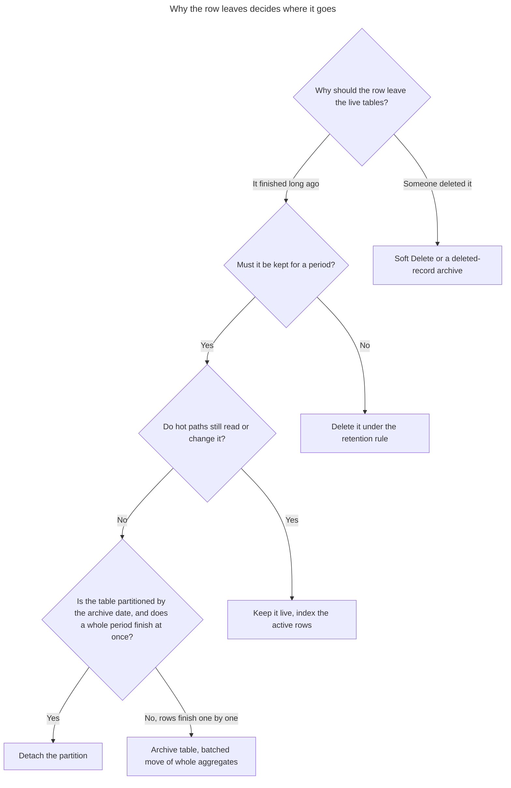
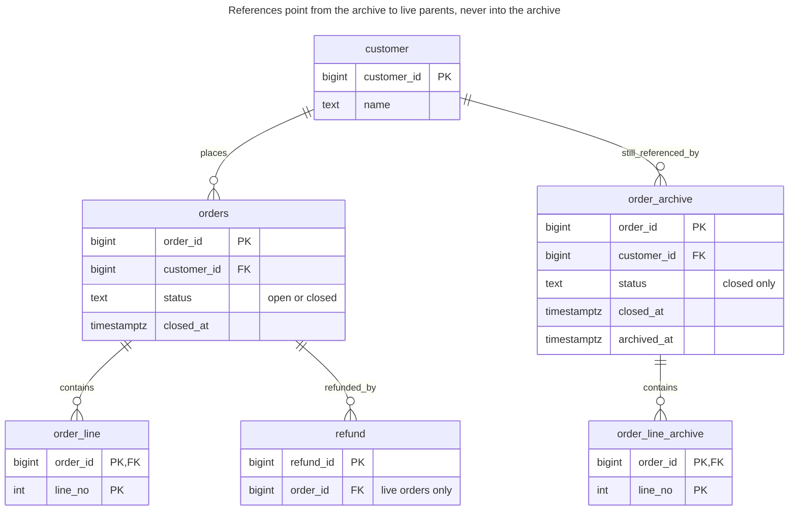
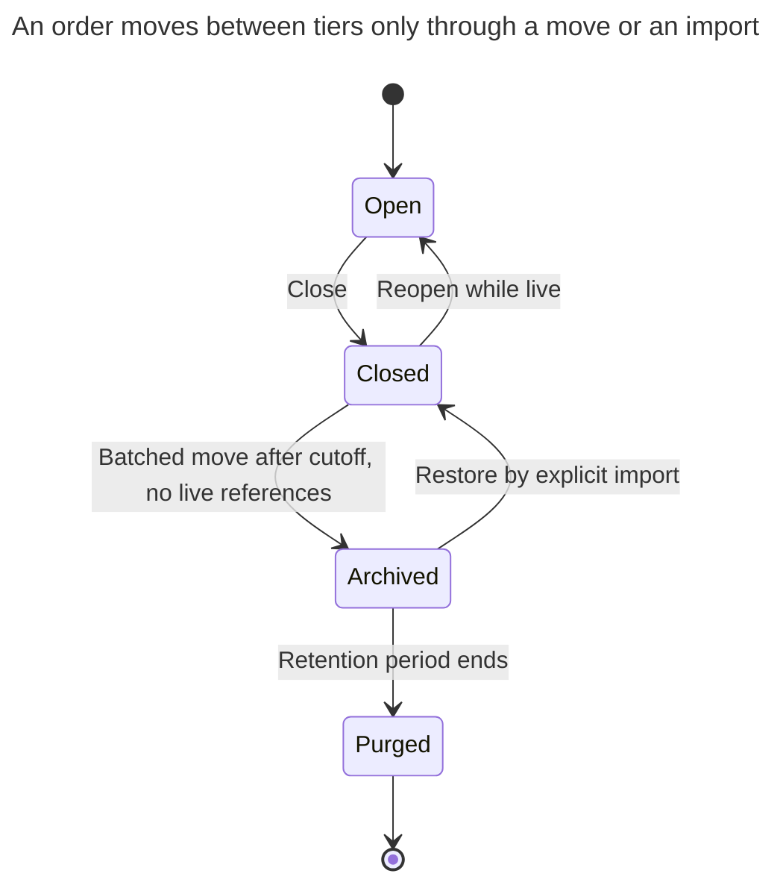
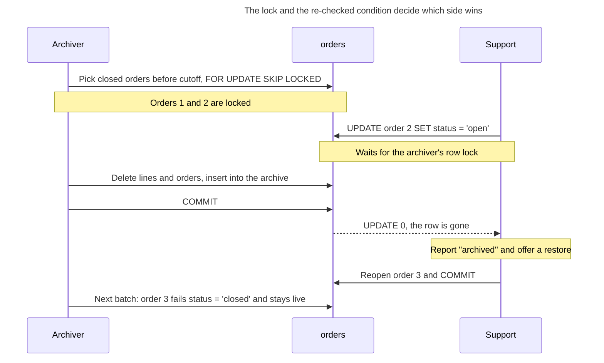

# Archive Table

## Intent

An archive table holds rows that are finished but must be kept, such as orders closed more than two years ago, outside the live tables and under their own retention and access rules. The live tables and their indexes then hold only the working set, while old data stays queryable for support, audit and legal requests. The chapter shows two mechanisms: a batched move that deletes a whole aggregate from the live tables and inserts it into archive tables in one statement, and detached partitions for tables already partitioned by the archive date. It covers the cut that keeps foreign keys valid, a view that spans both tiers and what it costs, restore as an explicit import, retention, and the race between the archiver and a late reopen. The move is built from PostgreSQL's [`DELETE ... RETURNING`](https://www.postgresql.org/docs/18/sql-delete.html) and [data-modifying CTEs](https://www.postgresql.org/docs/18/queries-with.html#QUERIES-WITH-MODIFYING).

## Also known as

Archive tier, cold table, online archive. Oracle's [information lifecycle management guide](https://docs.oracle.com/en/database/oracle/oracle-database/26/vldbg/time-based-info.html#GUID-AC2B567F-14EF-4E7A-9992-076A2A820305) calls retained old data that stays queryable an online archive. Oracle's [In-Database Archiving](https://docs.oracle.com/en/database/oracle/oracle-database/26/vldbg/time-based-info.html#GUID-BD1D524E-A55F-4CD4-911E-092E596F0D80) uses the word for something else: it adds an `ORA_ARCHIVE_STATE` column, and rows marked archived stay in the same table but are excluded from ordinary queries. That is a visibility flag close to [Soft Delete](soft-delete.md), not a move.

## Problem

A shop has kept every order since 2015 in `orders` and `order_line`. Almost all of them have been closed for years, but they still sit in every index, every vacuum pass and every table rewrite a migration causes, and every working query has to filter them out. Deleting them is not an option: tax rules require keeping sales records for years, and support looks up a four-year-old order when a warranty claim arrives.

The first archive job is usually two statements in one long transaction: `INSERT INTO order_archive SELECT ... WHERE closed_at < cutoff`, then `DELETE FROM orders WHERE closed_at < cutoff`. It holds locks on millions of rows, writes a burst of WAL, and keeps vacuum from cleaning anything newer while it runs. It moves orders without their lines, or fails on a refund that still refers to an old order. If someone reopens an order between the two statements, the second statement no longer matches the first. And afterwards the support tool, which reads only `orders`, reports that the order does not exist.

## Solution

Decide what moves and when it may move, then move it in small atomic batches:

- **The unit is an aggregate.** An order moves with its lines in the same statement, so foreign keys inside the aggregate stay valid in both tiers.
- **The archivable state is explicit:** status `closed`, closed before the cutoff, and no live row outside the aggregate (a refund, a support ticket) refers to it. The archive table repeats the state as a `CHECK`, so an order that is open by the time it moves is rejected.
- **References only point out of the archive.** Archive rows may refer to live parents such as `customer`; live rows cannot refer to archived rows, because a foreign key names one table and the archived order is no longer in it. Choose the cut so that no live reference crosses into the archive, or keep the referenced rows live.
- **Each batch is one statement:** pick candidates with `FOR UPDATE SKIP LOCKED`, `DELETE ... RETURNING` the lines and the orders, and `INSERT` what was returned into the archive tables. Every batch commits on its own.
- **Reads that need both tiers go through a `UNION ALL` view** with an `archived` flag. Writes go only to the live tables.
- **Restore moves the aggregate back with an explicit column mapping**, and **retention deletes from the archive** once the retention period ends.

For a table that is range-partitioned by the archive date, a period leaves the live table as a whole with `DETACH PARTITION`. [Table Partitioning](table-partitioning.md) shows detach and reattach; this chapter adds only the foreign key rule for it.

## Alternatives and selection

| Choice | Relationship | Deciding requirement |
| --- | --- | --- |
| Archive table with batched moves | This chapter | Each row becomes archivable by its own state and age, and must be kept for a defined period |
| [Detached partition](table-partitioning.md) | Implementation option | The table is partitioned by the archive date, and a whole period becomes archivable at once |
| [Soft Delete](soft-delete.md) and its deleted-record archive | Replacement for a different question | The row leaves because someone deleted it, not because it finished |
| Keep finished rows live, with partial indexes on active rows | Replacement | Table size does not hurt yet; the hot queries filter on open rows |
| [Summary Table](summary-table.md) | Complement | Reports on old periods need totals, not rows: keep the totals live and archive the details |
| [History Table](history-table.md) | Complement | You need earlier versions of a row; history grows too and can be archived the same way |

Exporting the archive to files in object storage, for example as Parquet, is a further tier outside the database: it gives up constraints, transactions and joins with live data, and is out of scope here. See the [Decision Atlas](decision-atlas.md) for the full comparison.



Orders do not finish by calendar period: an order placed in March can be closed in March or reopened in May. That is why they move row by row, while an append-only log partitioned by day can leave a day at a time.

## Structure



The archive tables mirror the live aggregate with typed columns and the same keys. Notice the missing edge: nothing live refers to `order_archive`. `refund` refers to live orders only, so an order with a refund stays live until the refund itself can go. `customer` is referenced from both tiers and therefore stays live while any archived order of that customer is retained.

## Tables and invariants

- **`orders`** holds live orders. A `CHECK` ties `status = 'closed'` to a non-null `closed_at`. A partial index on `closed_at` over closed rows lets the archiver find candidates without reading open orders.
- **`order_line`** refers to `orders` with the default `NO ACTION` foreign key. PostgreSQL checks it at the end of the statement, so one statement can delete lines and their order together. `ON DELETE CASCADE` would be wrong here: a move that forgot the lines would delete them instead of archiving them.
- **`refund`** is a live row outside the aggregate. Its foreign key makes a referenced order unarchivable: deleting that order raises `23503`.
- **`order_archive`** has the same primary key as `orders`, an `archived_at` stamp, a foreign key to the live `customer`, and the `order_archive_closed` check that only closed orders enter. The two primary keys are separate constraints: nothing in the schema stops one order from being in both tiers. The move keeps the tiers disjoint because one statement deletes from one table and inserts into the other.
- **`order_line_archive`** refers to `order_archive` with `NO ACTION`, for the same reason as the live lines. Retention must delete lines and orders together.
- **`order_all`** is a `UNION ALL` view over both tiers with an `archived` flag. It is read-only.

## When to use

- Most rows of a table are finished, rarely read, and must still be kept for a defined period.
- The finished state is final or rarely reversed, and a reversal can go through a restore procedure.
- Rows become archivable one at a time by their own state, so a partition key cannot express the cut.
- Old data needs other rules than live data: fewer people may read it, it has its own retention, or it belongs in a cheaper [tablespace](https://www.postgresql.org/docs/18/manage-ag-tablespaces.html).

## Consequences and trade-offs

- ➕ Indexes and vacuum work on the live tables scale with the working set, and migrations on live tables touch fewer rows.
- ➕ Access and retention are set per tier: the support role can read the archive without being able to change it, and retention deletes only from the archive.
- ➕ Each batch is atomic and small, so the job can stop at any point and resume.
- ➖ Every reader that might need an old order must choose: live only, archive only, or the view. A key lookup through the view probes both tiers.
- ➖ Every live migration must decide what happens to the archive, and a restore must map old rows to the current shape.
- ➖ Uniqueness across tiers is a property of the procedure, not a constraint.
- ➖ Moving rows is a `DELETE` plus an `INSERT`: it writes WAL and leaves dead rows in the live tables. Plain `VACUUM` makes that space reusable but [does not return it to the operating system](https://www.postgresql.org/docs/18/routine-vacuuming.html), except for empty pages at the end of the table. A detached partition avoids both costs.
- ➖ Archive tables in the same database still count toward its size and backups. Moving them to another database gives up the foreign key to live parents and the single-statement move.

## Implementation

The [complete PostgreSQL 18.7 script](../assets/archive-table/archive-table.sql) checks the blocked move of a referenced order, the stale candidate list, batch sizes, the references between tiers, the view and its plans, both restore failures and the import, retention, and the blocked partition detach. The archive tables mirror the live ones:

```sql
CREATE TABLE archive_example.order_archive (
    order_id bigint PRIMARY KEY,
    customer_id bigint NOT NULL REFERENCES archive_example.customer (customer_id),
    status text NOT NULL,
    closed_at timestamptz,
    archived_at timestamptz NOT NULL DEFAULT now(),
    CONSTRAINT order_archive_closed CHECK (status = 'closed' AND closed_at IS NOT NULL)
);
CREATE TABLE archive_example.order_line_archive (
    order_id bigint NOT NULL REFERENCES archive_example.order_archive (order_id),
    line_no integer NOT NULL,
    sku text NOT NULL,
    amount numeric(12, 2) NOT NULL,
    PRIMARY KEY (order_id, line_no)
);
```

One batch is one statement. It picks the oldest archivable orders, locks them, deletes their lines and the orders, and inserts what the deletes returned:

```sql
CREATE FUNCTION archive_example.archive_closed_orders(cutoff timestamptz, batch_size integer)
RETURNS bigint LANGUAGE sql AS $$
WITH picked AS (
    SELECT o.order_id FROM archive_example.orders AS o
    WHERE o.status = 'closed' AND o.closed_at < cutoff
      AND NOT EXISTS (SELECT FROM archive_example.refund AS r WHERE r.order_id = o.order_id)
    ORDER BY o.closed_at, o.order_id
    LIMIT batch_size
    FOR UPDATE SKIP LOCKED
), moved_lines AS (
    DELETE FROM archive_example.order_line AS l USING picked AS p
    WHERE l.order_id = p.order_id RETURNING l.*
), moved_orders AS (
    DELETE FROM archive_example.orders AS o USING picked AS p
    WHERE o.order_id = p.order_id RETURNING o.*
), archived_orders AS (
    INSERT INTO archive_example.order_archive (order_id, customer_id, status, closed_at)
    SELECT order_id, customer_id, status, closed_at FROM moved_orders
    RETURNING order_id
), archived_lines AS (
    INSERT INTO archive_example.order_line_archive (order_id, line_no, sku, amount)
    SELECT order_id, line_no, sku, amount FROM moved_lines
)
SELECT count(*) FROM archived_orders;
$$;
```

All parts of a statement with data-modifying CTEs see the same snapshot and commit or fail together. The script calls the function with a cutoff of `2024-11-27`: with a batch size of `1` it moves exactly one order and both of its lines, the next call moves the remaining candidate, and the third returns `0`. A driver calls it in its own transaction until it returns `0`, pausing between batches if replicas fall behind.

Leave out the `NOT EXISTS` and try to move order `4`, which has a refund, together with order `1`. The whole statement fails, and order `1` stays live as well. PostgreSQL 18.7 raises SQLSTATE `23503`: `ERROR: update or delete on table "orders" violates foreign key constraint "refund_order_id_fkey" on table "refund"`, with `DETAIL: Key (order_id)=(4) is still referenced from table "refund".` Without the `NOT EXISTS` in the cut, every run would pick the same order first and fail again.

The other direction fails too. A refund for archived order `2` raises `23503`: `ERROR: insert or update on table "refund" violates foreign key constraint "refund_order_id_fkey"`, `DETAIL: Key (order_id)=(2) is not present in table "orders".` Reopening order `2` with an `UPDATE` on `orders` reports `UPDATE 0`; the application must treat that as "archived" and offer a restore. Deleting customer `1`, whose orders are all archived, is rejected by `order_archive_customer_id_fkey`, which keeps the parent live as the structure promised.



There is no edge from Archived to Open. Reopening is a live operation, so an archived order is first imported back and only then reopened.

Queries that span both tiers read through a view:

```sql
CREATE VIEW archive_example.order_all AS
SELECT order_id, customer_id, status, closed_at, false AS archived
FROM archive_example.orders
UNION ALL
SELECT order_id, customer_id, status, closed_at, true AS archived
FROM archive_example.order_archive;
```

The view has a cost. A lookup by key cannot know which tier holds the order, so `EXPLAIN` of `WHERE order_id = 2` shows two probes:

```text
Append
  ->  Index Scan using orders_pkey on orders
        Index Cond: (order_id = 2)
  ->  Index Scan using order_archive_pkey on order_archive
        Index Cond: (order_id = 2)
```

Adding `NOT archived` lets the planner drop the archive branch, because the flag is a constant in each branch: the plan is a single index scan on `orders`. Every index a query relies on must exist in both tiers, and a sort or aggregate over the view reads the archive too. The view is not automatically updatable: an `UPDATE` through it raises SQLSTATE `55000`, `ERROR: cannot update view "order_all"`, with `DETAIL: Views containing UNION, INTERSECT, or EXCEPT are not automatically updatable.` That is the behavior you want, since writes belong to the live tables. See [updatable views](https://www.postgresql.org/docs/18/sql-createview.html#SQL-CREATEVIEW-UPDATABLE-VIEWS).

Restore is an import, not a flag flip. Copying order `2` back into `orders` without deleting it from the archive leaves it in both tiers: the view returns it twice, and the next archive run fails with `23505`, `ERROR: duplicate key value violates unique constraint "order_archive_pkey"`, `DETAIL: Key (order_id)=(2) already exists.` The live schema also changes after archiving. Here a migration added `channel text NOT NULL` to `orders` and a nullable `channel` to `order_archive`, because orders archived earlier never had one. A restore that copies the archived columns as they are fails with `23502`: `ERROR: null value in column "channel" of relation "orders" violates not-null constraint`. The import moves the aggregate and maps the old shape to the new one:

```sql
WITH restored_order AS (
    DELETE FROM archive_example.order_archive WHERE order_id = 2 RETURNING *
), restored_lines AS (
    DELETE FROM archive_example.order_line_archive WHERE order_id = 2 RETURNING *
), live_order AS (
    INSERT INTO archive_example.orders (order_id, customer_id, status, closed_at, channel)
    SELECT order_id, customer_id, status, closed_at, coalesce(channel, 'unknown')
    FROM restored_order
)
INSERT INTO archive_example.order_line (order_id, line_no, sku, amount)
SELECT order_id, line_no, sku, amount FROM restored_lines;
```

A restored order that is still closed and older than the cutoff qualifies again: the script shows the next run archiving it. Restore it for a reason, such as reopening it in the same transaction, or exclude it with a hold column the archiver checks.

Retention deletes archived aggregates whose retention period has ended, again in one statement per batch. Deleting only the orders fails with `23503` on `order_line_archive_order_id_fkey`, which is the reason to keep `NO ACTION` rather than `CASCADE` in the archive:

```sql
WITH expired AS (
    DELETE FROM archive_example.order_archive
    WHERE closed_at < '2019-11-27 00:00+00'
    RETURNING order_id
)
DELETE FROM archive_example.order_line_archive AS l
USING expired AS e
WHERE l.order_id = e.order_id;
```

For a range-partitioned table, the same rule about references holds at partition level. The script partitions `invoice` by `issued_on` and lets `payment` refer to it. Detaching the 2023 partition while a payment still refers to an invoice in it raises `23503`: `ERROR: removing partition "invoice_2023" violates foreign key constraint "payment_invoice_id_issued_on_fkey_1"`, with `DETAIL: Key (invoice_id, issued_on)=(100, 2023-05-01) is still referenced from table "payment".` Once those payments are gone, the detach succeeds and `invoice_2023` stays readable under its own name. The lab uses plain `DETACH` because it runs inside a transaction; `DETACH PARTITION ... CONCURRENTLY` cannot run in a transaction block, and [Table Partitioning](table-partitioning.md) covers it.

## Engine support

- **PostgreSQL 18:** [`DELETE ... RETURNING`](https://www.postgresql.org/docs/18/sql-delete.html) inside [data-modifying CTEs](https://www.postgresql.org/docs/18/queries-with.html#QUERIES-WITH-MODIFYING) moves rows between tables in one statement. [`DETACH PARTITION ... CONCURRENTLY`](https://www.postgresql.org/docs/18/sql-altertable.html#SQL-ALTERTABLE-DETACH-PARTITION) takes a weaker lock on the parent, and the [partitioning chapter](https://www.postgresql.org/docs/18/ddl-partitioning.html) notes that detaching or dropping a partition avoids the vacuum overhead of a bulk `DELETE`.
- **MySQL 8.4:** [`DELETE`](https://dev.mysql.com/doc/refman/8.4/en/delete.html) has no `RETURNING` clause, but a single-table delete accepts `ORDER BY` and `LIMIT`. Lock the candidates with `SELECT ... FOR UPDATE`, run `INSERT ... SELECT` into the archive and `DELETE` the same keys in one transaction. [`ALTER TABLE ... EXCHANGE PARTITION ... WITH TABLE`](https://dev.mysql.com/doc/refman/8.4/en/partitioning-management-exchange.html) swaps a partition with a standalone table; that table must have no foreign keys and no table may refer to it.
- **SQL Server 2025 (17.x):** `DELETE ... OUTPUT DELETED.* INTO archive_table` moves rows in one statement, but the [`OUTPUT INTO` target](https://learn.microsoft.com/en-us/sql/t-sql/queries/output-clause-transact-sql?view=sql-server-ver17) cannot have enabled triggers, cannot be on either side of a foreign key, and cannot have `CHECK` constraints. To keep this chapter's archive constraints, output into a temporary table or table variable and insert from it in the same transaction. [`ALTER TABLE ... SWITCH`](https://learn.microsoft.com/en-us/sql/t-sql/statements/alter-table-transact-sql?view=sql-server-ver17) moves a partition into an archive table.
- **Oracle AI Database 26ai:** the [`RETURNING` clause of `DELETE`](https://docs.oracle.com/en/database/oracle/oracle-database/26/sqlrf/DELETE.html) returns values into host or PL/SQL variables, not into another table, so the move is `INSERT ... SELECT` and `DELETE` in one transaction. [Partition exchange](https://docs.oracle.com/en/database/oracle/oracle-database/26/vldbg/partition-admin.html#GUID-E08650B4-06B1-43F9-91B0-FBF685A3B848) turns a partition into a standalone table. In-Database Archiving marks rows in place, as noted above.
- **SQLite 3:** [`RETURNING`](https://www.sqlite.org/lang_returning.html) exists since 3.35.0 but only on top-level statements and cannot feed a subquery. Use `INSERT ... SELECT` and `DELETE` in one transaction. SQLite has no native partitioning.

## Failure and concurrency

The archiver races with people who still work on old orders. Support reopens an order to handle a warranty claim; a refund arrives for an order closed two years ago. The move must check the archivable state at the moment it moves the row, not when it built a list. In the script, the archiver collects the candidates `{1,2,3}` first, then support reopens order `3`, and a move by that stale list tries to archive an open order. The archive check stops the whole batch with SQLSTATE `23514`: `ERROR: new row for relation "order_archive" violates check constraint "order_archive_closed"`. Without that check, an open order would have disappeared into the archive. The function above is correct because its `WHERE` clause and its lock are part of the move itself.



Under `READ COMMITTED`, PostgreSQL [handles both orders of events](https://www.postgresql.org/docs/18/transaction-iso.html#XACT-READ-COMMITTED). If the archiver locks first, support's `UPDATE` waits, then ignores the row because the archiver deleted it, so the application must check the row count. If support's change commits first, a waiting `FOR UPDATE` re-evaluates the `WHERE` clause on the new version and drops the reopened order. With [`SKIP LOCKED`](https://www.postgresql.org/docs/18/sql-select.html#SQL-FOR-UPDATE-SHARE), the archiver does not wait at all: rows someone else holds are skipped and picked up by a later batch, if they still qualify.

The foreign keys close the remaining gaps. A refund or a new line for an order the archiver has locked checks its foreign key with a key-share lock on that order, waits for the archiver to commit, and then fails with `23503` because the order is gone. A refund that commits after the archiver's statement has started but before it locks the order is caught by the move itself: the foreign key check at the end of the move fails with `23503`, the batch rolls back, and the next run skips that order.

A crash or a `lock_timeout` cancels only the current batch, which rolls back completely; nothing is half-moved. Keep batches small enough that each transaction is short. One long transaction holds row locks, delays vacuum on every table, and makes a cancelled run expensive to repeat.

## Migration

Introduce the archive in steps, in the spirit of [Expand and Contract](expand-contract.md):

1. Create the archive tables with the live columns, the same keys, `archived_at` and the archivable-state check. Put them in their own schema or tablespace if they need other grants or storage.
2. Create the `order_all` view and move the readers that need old orders to it: support lookup, audit exports, customer order history. Readers that serve live work stay on the live tables.
3. Make every path that changes old orders check the affected row count, so `UPDATE 0` on an archived order turns into a restore offer instead of a silent no-op.
4. Run the archiver with small batches and a conservative cutoff, watch replication lag and lock waits, and then raise the batch size. Expect live tables to keep their file size after the backlog moves; the freed space is reused by new rows.
5. Add the retention job last, once you have agreed how long archived data is kept.

From then on, every migration of a live table also covers its archive. Add new columns to the archive as nullable, update the archiver's column lists in the same release, and teach the restore import how to fill values that old rows never had. To back out, import every archived aggregate with the same restore statement and drop the archive tables.

## Anti-patterns and common mistakes

- Moving the whole backlog in one transaction, or as an `INSERT ... SELECT` followed by a separate `DELETE` with the same condition evaluated twice.
- Building a candidate list and moving it later without re-checking the state: an order reopened in between is archived open.
- Moving orders without their lines, or relying on `ON DELETE CASCADE`, which deletes the lines instead of archiving them.
- Dropping a live foreign key so that live rows can keep pointing at archived ones. That is [Missing Foreign Keys](missing-foreign-keys.md) with an archive as the excuse.
- Restoring by copying a row back, or by flipping a flag, which leaves the order in both tiers and fails on columns added since archiving.
- Storing the archive as a JSON snapshot when support and audit must query it. A snapshot suits a recovery copy of deleted records, as in [Soft Delete](soft-delete.md); a retained business record needs typed columns and constraints.
- Keeping an archive without a retention job, until it is a second live table nobody can shrink.
- Calling an archive a backup, or calling archived data erased.

## Known uses

- Percona's [pt-archiver](https://docs.percona.com/percona-toolkit/pt-archiver.html) "nibbles" old rows from a MySQL table into another table or a file in small chunks, so that the job does not disturb OLTP queries much. It is the batched move of this chapter as a tool.
- PostgreSQL's [partitioning chapter](https://www.postgresql.org/docs/18/ddl-partitioning.html) detaches old partitions so that their data can be backed up or processed before it is dropped. That is the partition variant.
- Oracle's [information lifecycle management guide](https://docs.oracle.com/en/database/oracle/oracle-database/26/vldbg/time-based-info.html#GUID-AC2B567F-14EF-4E7A-9992-076A2A820305) assigns data classes to storage tiers, including an online archive tier for data that is seldom accessed but stays queryable, and adds access, migration and compliance policies.

## Related patterns

- [Soft Delete](soft-delete.md) keeps deleted rows in place and shows the deleted-record archive, which Brandur Leach [argues for](https://brandur.org/soft-deletion) instead of soft deletion.
- [Table Partitioning](table-partitioning.md) detaches and reattaches whole periods; its detach is the partition variant of this chapter.
- [History Table](history-table.md) keeps earlier versions of rows; an archive keeps whole finished rows, and history tables need the same retention work.
- [Summary Table](summary-table.md) keeps totals for archived periods available in the live tier.
- [Expand and Contract](expand-contract.md) introduces the archive and its view, and every later change to both tiers.
- [Status History](status-history.md) records the reopen and close transitions that the archiver must respect.
