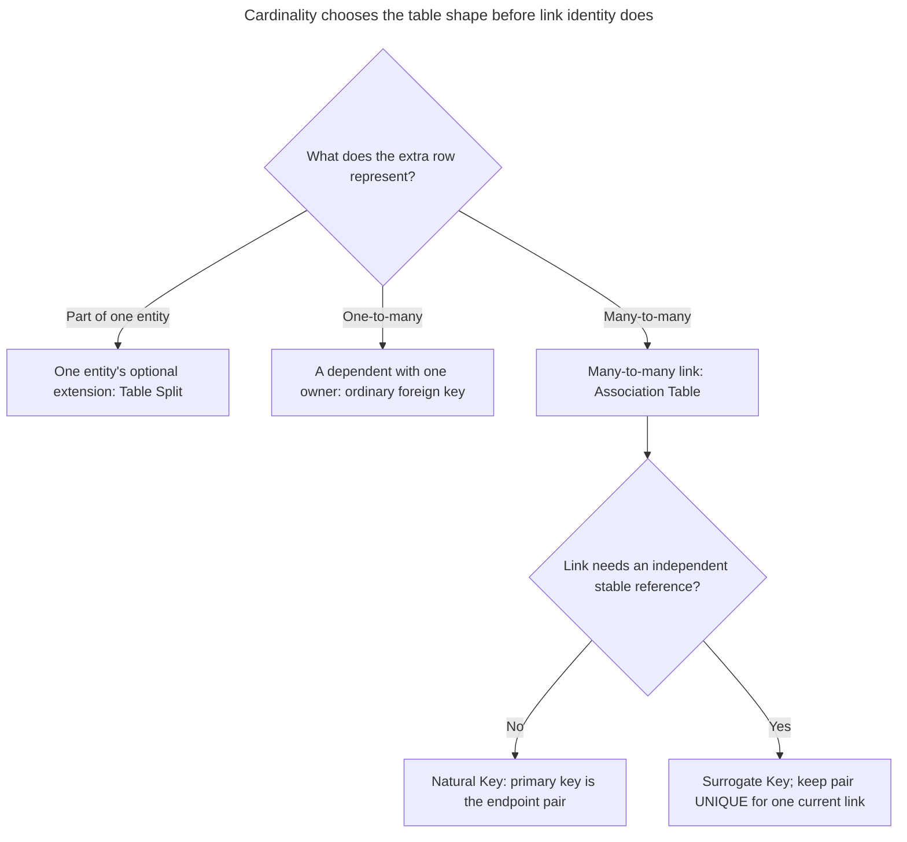
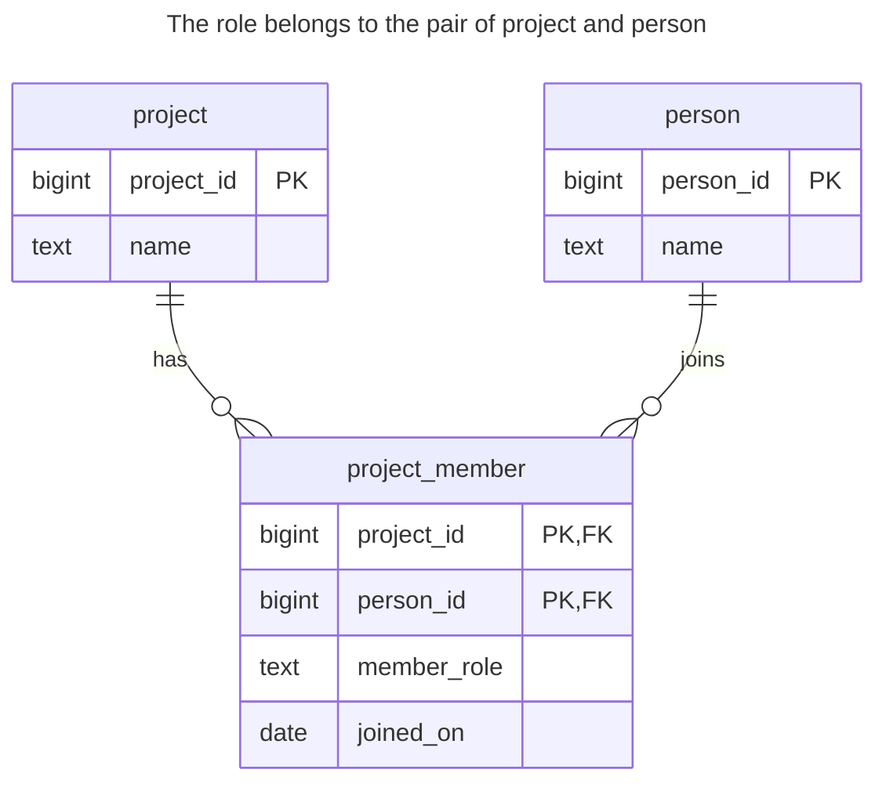
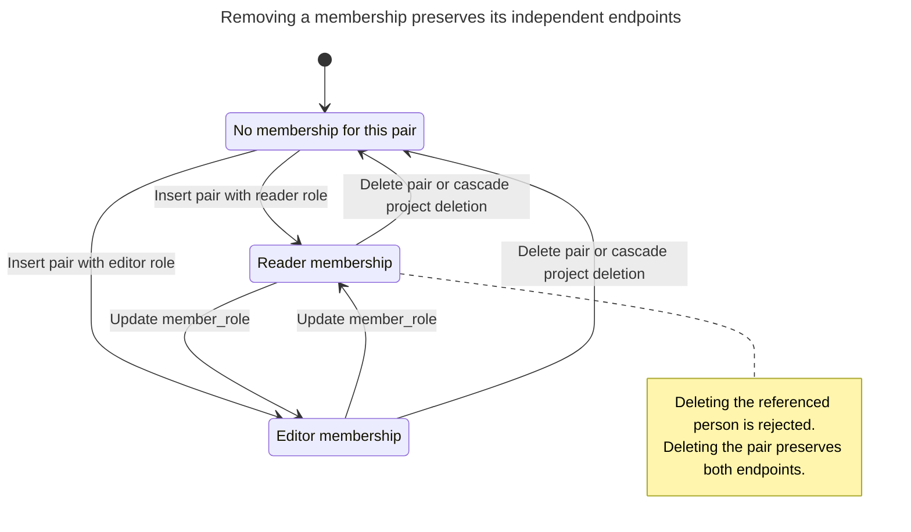
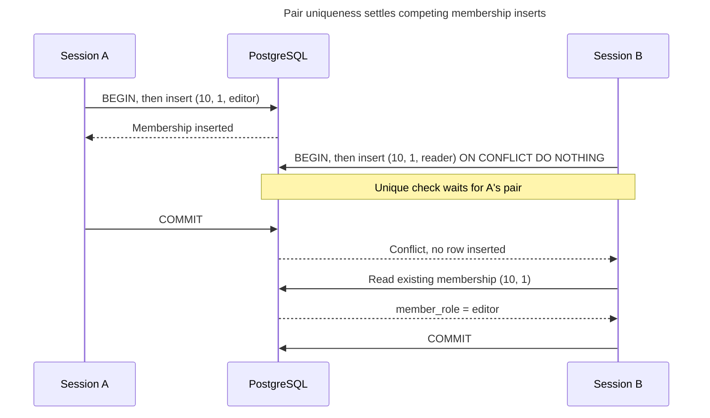

# Association Table

## Intent

An association table turns a many-to-many relationship into rows: each row links one record on each side through two foreign keys, and the pair is the key. As soon as the link has facts of its own — the quantity on an order line, a member's role in a project, the date a tag was added — they become columns of the association table, and it grows into an entity in its own right. The chapter covers choosing between a composite primary key and a surrogate, the indexes each direction of navigation needs, and keeping links unique.

## Also known as

Join table; junction table; link table; associative table. Fowler calls the mapping [Association Table Mapping](https://martinfowler.com/eaaCatalog/associationTableMapping.html); Ambler's [many-to-many mapping](https://agiledata.org/essays/mappingObjects.html) introduces an associative table between the two entity tables.

## Problem

A project has several members, and a person can join several projects. Putting `member_id` on the project permits only one member; putting `project_id` on the person permits only one project. Numbered member columns make the maximum membership count part of the schema. A comma-separated list gives you nowhere to put the member's role without inventing another encoding.

The role belongs to the membership. Making Ada an editor of one project must not make her an editor everywhere. Before choosing the key, decide whether a person can have one current membership per project or several distinct engagements. Those are different identities.

## Solution

Create `project_member` with a foreign key to each endpoint and a primary key over `(project_id, person_id)`. Store `member_role` and `joined_on` there. This design means one current membership per pair. If you need repeated engagements, give each engagement its own identity or include an agreed discriminator; do not accidentally permit duplicate current memberships.

Use a surrogate primary key when other records need a stable reference to the membership itself, especially if its endpoints may change. Retain `UNIQUE (project_id, person_id)` whenever the one-current-membership rule still applies. Attributes alone do not require a surrogate: the composite key identifies the role-bearing row just as well.

## Alternatives and selection

| Sibling | Relationship | Deciding requirement |
| --- | --- | --- |
| A foreign key on the dependent table | Replacement for a genuinely one-to-many relationship | Each dependent belongs to only one parent; no link table is needed |
| [Natural Key](natural-key.md) / [Surrogate Key](surrogate-key.md) | Implementation options for link identity | Use the pair directly, or add an ID for independent references while retaining pair uniqueness |
| [Ordered Collection](ordered-collection.md) | Complement | Membership has a user-defined order within its owner |
| [Table Split](table-split.md) | Replacement for a different cardinality | A second row extends one entity rather than connecting two sets |

See the [Decision Atlas](decision-atlas.md) for the full comparison. [Delimited Lists](delimited-lists.md) and [Repeated Columns](repeated-columns.md) are migration starting points when individual members need references and constraints.



Link attributes do not determine cardinality or force a generated key. The one-current-membership rule requires pair uniqueness even when a surrogate identifies the membership.

## Structure



Each project and person can appear in many memberships. Each membership names exactly one of each. Neither endpoint is required to have any memberships; requiring at least one is an additional rule outside this schema.

## Tables and invariants

- **`project`** identifies a project independently of its membership list.
- **`person`** identifies a person independently of the projects they join.
- **`project_member`** has one mandatory pair of existing endpoints. Its primary key prevents duplicate pairs; its foreign keys prevent orphans. `member_role` is a small example vocabulary enforced by a check.
- **Deletion policy** removes memberships when their project is deleted, but rejects deleting a referenced person. PostgreSQL documents these [foreign-key actions](https://www.postgresql.org/docs/18/ddl-constraints.html#DDL-CONSTRAINTS-FK); choose them according to ownership, rather than applying cascades everywhere.

## When to use

- Both endpoints can participate in multiple links.
- A link carries facts such as a role, quantity or effective date that belong to neither endpoint alone.
- You need to query or constrain individual links rather than retrieve an opaque list.

## Consequences and trade-offs

- ➕ Pair uniqueness expresses the membership rule directly.
- ➕ A role correction changes one relationship without changing either endpoint.
- ➖ Fetching endpoint attributes requires joins, and each additional index adds write work.
- ➖ The pair becomes a wider reference if many other tables need to identify the membership.
- ➖ A set of current links does not retain past membership changes; introduce history deliberately if departures and rejoining matter.

## Implementation

The [complete script](../assets/association-table/association-table.sql) exercises both navigation directions, a role change, duplicate rejection and endpoint deletion:

```sql
CREATE TABLE project (
    project_id bigint PRIMARY KEY,
    name text NOT NULL
);
CREATE TABLE person (
    person_id bigint PRIMARY KEY,
    name text NOT NULL
);
CREATE TABLE project_member (
    project_id bigint NOT NULL REFERENCES project (project_id)
        ON DELETE CASCADE,
    person_id bigint NOT NULL REFERENCES person (person_id),
    member_role text NOT NULL CHECK (member_role IN ('reader', 'editor')),
    joined_on date NOT NULL,
    CONSTRAINT project_member_pkey PRIMARY KEY (project_id, person_id)
);
CREATE INDEX project_member_person_idx
    ON project_member (person_id, project_id);
```

The primary-key index starts with `project_id`; the reverse index starts with `person_id`. PostgreSQL's [multicolumn B-tree rules](https://www.postgresql.org/docs/18/indexes-multicolumn.html) favor restrictions on leading columns. PostgreSQL 18 can sometimes use skip scan for later columns, but that is no reason to assume one index serves both directions equally well. Foreign keys [do not create child indexes automatically](https://www.postgresql.org/docs/18/ddl-constraints.html#DDL-CONSTRAINTS-FK).

```sql
INSERT INTO project VALUES (10, 'Catalog'), (20, 'Checkout');
INSERT INTO person VALUES (1, 'Ada'), (2, 'Lin');
INSERT INTO project_member VALUES
    (10, 1, 'editor', DATE '2026-11-10'),
    (10, 2, 'reader', DATE '2026-11-10'),
    (20, 1, 'reader', DATE '2026-11-10');
SELECT p.name, m.member_role
FROM project_member AS m JOIN person AS p USING (person_id)
WHERE m.project_id = 10 ORDER BY m.person_id;
SELECT p.name FROM project_member AS m
JOIN project AS p USING (project_id)
WHERE m.person_id = 1 ORDER BY m.project_id;
UPDATE project_member SET member_role = 'editor'
WHERE project_id = 10 AND person_id = 2;
```

The queries return `(Ada, editor), (Lin, reader)` and then `Catalog, Checkout`. A second membership cannot silently introduce a second role for the same pair:

```sql
INSERT INTO project_member VALUES
    (10, 1, 'reader', DATE '2026-11-11');
```

On PostgreSQL 18.6 this raises SQLSTATE `23505`: `ERROR: duplicate key value violates unique constraint "project_member_pkey"`, with `DETAIL: Key (project_id, person_id)=(10, 1) already exists.` To remove a membership, delete the pair. Deleting its project instead removes all that project's memberships:

```sql
DELETE FROM project_member WHERE project_id = 20 AND person_id = 1;
DELETE FROM project WHERE project_id = 10;
SELECT count(*) FROM project_member;
```

The final count is `0`; both people remain. IDs are supplied explicitly to keep the example focused on relationships; [Surrogate Key](surrogate-key.md) covers allocation.



The state belongs to one project/person pair, so changing its role has no effect on the person's other memberships. Project deletion removes the link, while person deletion is blocked as long as a membership references it.

## Engine support

- **PostgreSQL 18:** the composite primary key, foreign keys and reverse index implement the example directly.
- **MySQL 8.4 / InnoDB:** a suitable child [foreign-key index is created automatically if absent](https://dev.mysql.com/doc/refman/8.4/en/create-table-foreign-keys.html). Inspect existing indexes before adding a redundant reverse index.
- **SQL Server 2025 (17.x):** a foreign key [does not automatically create a corresponding index](https://learn.microsoft.com/en-us/sql/relational-databases/tables/primary-and-foreign-key-constraints?view=sql-server-ver17). Keep both navigation directions in the index review.
- **Oracle AI Database 26ai:** [composite primary and foreign keys](https://docs.oracle.com/en/database/oracle/oracle-database/26/sqlrf/constraint.html) express the same pair invariant; use Oracle column types when translating the example.
- **SQLite 3:** enable [foreign keys per connection](https://www.sqlite.org/foreignkeys.html#fk_enable). Keep the explicit `NOT NULL` declarations because ordinary SQLite tables have [primary-key nullability exceptions](https://www.sqlite.org/lang_createtable.html#the_primary_key).

## Failure and concurrency

A pre-insert lookup cannot settle competing joins. Let the primary key arbitrate: PostgreSQL's [uniqueness checks](https://www.postgresql.org/docs/18/index-unique-checks.html) wait for conflicting uncommitted writers and recheck their outcome. Ordinary read committed transactions suffice for the pair invariant.

For a command meaning “ensure membership exists,” [`ON CONFLICT (project_id, person_id) DO NOTHING`](https://www.postgresql.org/docs/18/sql-insert.html) is a possible retry policy. Read the existing role if its value matters; ignoring a conflict does not prove it equals the requested role. For role edits, use a [Version Column](version-column.md) or a conditional update if overwriting a concurrent correction is unacceptable. A rule such as “every project has an editor” requires additional serialization and validation; neither endpoint foreign key enforces it.



The pair can exist only once, but ignoring the second insert does not apply its requested role. B must inspect the existing row if “reader” was part of the command's meaning.

## Migration

From lists or numbered columns, first define which tokens identify people, resolve missing endpoints and decide how to merge duplicate pairs with conflicting roles. Create the association table, then route all membership edits through a transaction that writes both representations. Backfill one project at a time under the same project lock used by those writers, so a stale snapshot cannot restore a membership just deleted by a request.

Compare sets in both directions before switching reads. Add foreign keys to an already populated table with PostgreSQL's [`NOT VALID` and `VALIDATE CONSTRAINT`](https://www.postgresql.org/docs/18/sql-altertable.html) stages if needed; allow a planned DDL lock window. Retain the old representation until all readers switch. Rollback is possible while it still represents every new relationship fact; if it cannot represent roles, first preserve those facts separately. See [Expand and Contract](expand-contract.md).

## Anti-patterns and common mistakes

- Adding `membership_id` and removing pair uniqueness: [Mandatory Surrogates](mandatory-surrogates.md) describes this loss of business identity.
- Indexing only by project when people-based navigation is frequent.
- Putting `member_role` on `person`, which turns a per-project fact into a global one.
- Cascading a membership deletion to its person or project: the link is dependent, while the endpoints have independent lifecycles.
- Replacing real constraints with ORM validations; see [Missing Foreign Keys](missing-foreign-keys.md).

## Known uses

- PostgreSQL's [many-to-many example](https://www.postgresql.org/docs/18/ddl-constraints.html#DDL-CONSTRAINTS-FK) uses `order_items` with a composite product-and-order key and a quantity.
- Rails' [association guide](https://guides.rubyonrails.org/association_basics.html#has-many-through-vs-has-and-belongs-to-many) recommends `has_many :through` when the join model needs attributes, validations or callbacks. Its simpler HABTM mapping expects a join table without a primary key; that framework convention does not remove the need to enforce pair uniqueness.

## Related patterns

- [Natural Key](natural-key.md) explains composite business identity.
- [Surrogate Key](surrogate-key.md) supplies an optional independent link identifier.
- [Ordered Collection](ordered-collection.md) adds order within a parent without changing link identity.
- [Delimited Lists](delimited-lists.md) and [Repeated Columns](repeated-columns.md) show the representations this design replaces.
- [Version Column](version-column.md) protects competing edits to link attributes.
