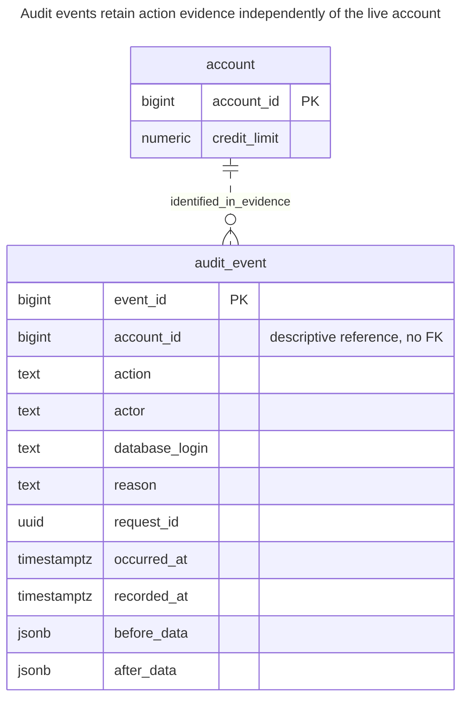
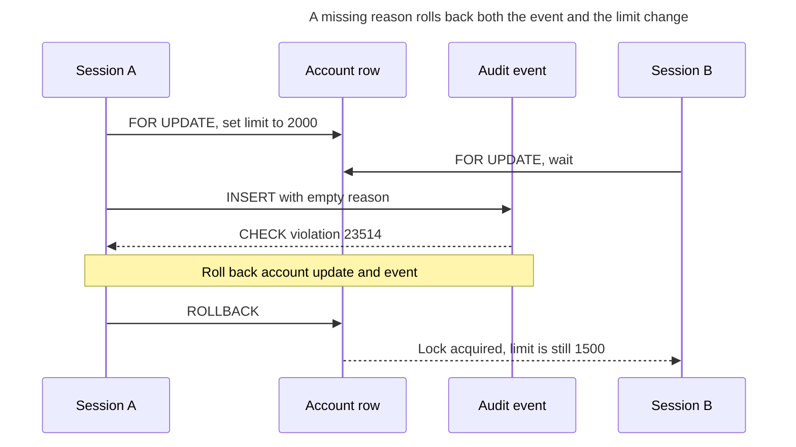
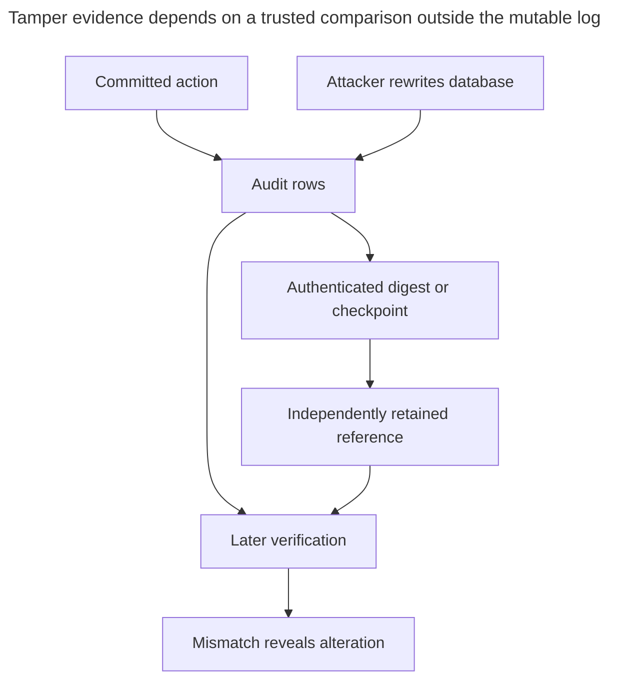
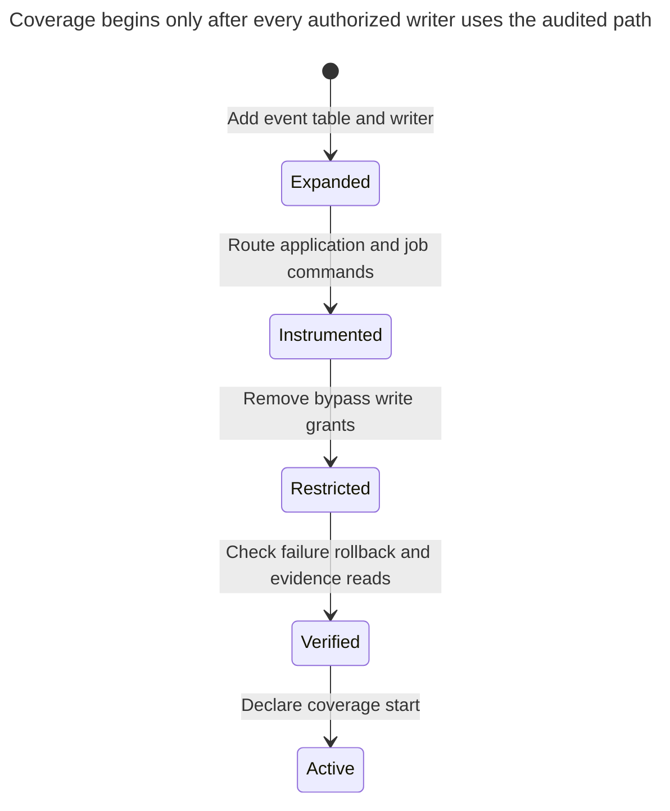

# Audit Log

## Intent

An audit log is an append-only record of actions: who changed what, when, from where and why, often for many tables in one place. Unlike a history table, its purpose is not to rebuild past states but to account for each change, so it records the actor, the reason, and a correlation ID that ties the change to a request. The chapter covers what the database can capture and what only the application knows, how permissions make the log append-only, and what tamper evidence such as hash chains or ledger tables adds, and against which threat. Fowler describes the action-recording approach in [Audit Log](https://martinfowler.com/eaaDev/AuditLog.html).

## Also known as

Audit trail. Fowler calls the pattern [Audit Log](https://martinfowler.com/eaaDev/AuditLog.html) and distinguishes the ease of recording changes from the work of interpreting them later. This chapter implements a table of accepted application actions, not a claim that every database statement is audited.

## Problem

A customer's credit limit changed from 1000 to 1500. The current row tells you the new limit; a history table could tell you the old one. Neither explains which authenticated user approved the increase, why it was approved or which request ties it to a support ticket. Those are action facts you must record at the write boundary.

A pooled database connection usually represents your service. The service knows the end user and authorization decision. If you store only the database login, you can identify a service account while losing the person who submitted the action. Conversely, accepting an arbitrary actor from an untrusted caller lets the caller choose the explanation you later rely on.

## Solution

Use one controlled operation that locks the target account, changes the limit and inserts an audit event in the same transaction. Record the authenticated application actor, database login, reason, request ID, occurrence time, processing time and the selected before/after data. Grant the application execution of that operation and reads, with no direct account or audit-table writes. Append-only is a statement about that role's capabilities, not about an all-powerful administrator.

The example uses typed `account_id` and action fields for one command family. To audit many entity types centrally, define a versioned event envelope with an object kind, stable object identifier and payload contract, or retain typed per-domain logs and combine them for search. An object-kind/ID pair in a generic log is a descriptive reference, not an enforceable FK to several unrelated tables; see [Polymorphic Associations](polymorphic-associations.md). Do not mistake a searchable envelope for schema-enforced referential integrity.

## Alternatives and selection

| Sibling | Relationship | Deciding requirement |
| --- | --- | --- |
| [History Table](history-table.md) | Complement; replacement for repeated state queries | You repeatedly need whole-row values at a past instant |
| [Bitemporal Table](bitemporal-table.md) | Complement | You need earlier beliefs about business dates as well as correction attribution |
| [Status History](status-history.md) | Specialized replacement | The audited action is an accepted lifecycle transition with typed source and destination |
| [Transactional Outbox](transactional-outbox.md) | Complement | Events must reach another system after commit; delivery progress is a separate concern |
| [Idempotency Record](idempotency-record.md) | Complement | Repeating a request must return the original result rather than perform it again |
| Engine ledger | Implementation option for tamper evidence | You must detect later alteration against independently retained evidence |

See the [Decision Atlas](decision-atlas.md) for the full comparison. A correlation ID groups events; it does not become idempotency merely by being present.

## Structure



The dashed relationship is descriptive: audit events deliberately have no FK to a live account, so retaining evidence does not require retaining the live row. The account ID remains part of the event's evidence. Prevent ID reuse in the account lifecycle if later interpretation depends on it.

## Tables and invariants

- **`account`** is the current write target. Its check rejects a negative credit limit.
- **`audit_event`** requires the action, both times, actor, reason, correlation and before/after payloads. Nonblank actor and reason are checked; the table cannot verify that the supplied identity or explanation is truthful.
- **Append-only for `audit_example_app`** comes from grants: the role has no insertion, update, deletion or truncation privilege on the log and cannot write the account directly. Only the trusted owner routine inserts events.
- **Atomic completeness** covers successful calls to this operation. It excludes owner repairs, other uninstrumented commands, reads, login attempts and rejected operations.
- **Ordering** uses `event_id` for navigation, not proof of commit order. PostgreSQL [sequence allocation is not rolled back](https://www.postgresql.org/docs/18/functions-sequence.html); missing numbers do not prove missing events.

## When to use

- Operators need an attributable explanation of accepted changes.
- One request may change several objects and you need a common correlation handle.
- You can authenticate callers before invoking the trusted write path and restrict bypass writes.
- Your retention policy defines the evidence you may store, who may read it and when it expires.

## Consequences and trade-offs

- ➕ The action's reason and request context remain available alongside the changed values.
- ➕ A failed event insertion prevents the business change from succeeding silently.
- ➖ The log increases write volume and can duplicate sensitive data. Capture selected fields rather than copying secrets merely because serialization is easy.
- ➖ Generic payloads need schema-version interpretation after the application changes. The example's payload contract is just the account ID and limit.
- ➖ Successful-change evidence does not record denied or aborted attempts. Those need a separate channel with different transaction semantics.

## Implementation

The [complete PostgreSQL 18.6 script](../assets/audit-log/audit-log.sql) creates a temporary application role inside its transaction, verifies denial of log editing and proves that missing context rolls back the limit change. Run in a disposable database as a role allowed to create and assume that test role:

```sql
CREATE SCHEMA audit_example;
REVOKE ALL ON SCHEMA audit_example FROM PUBLIC;
CREATE TABLE audit_example.account (
    account_id bigint PRIMARY KEY,
    credit_limit numeric(12,2) NOT NULL CHECK (credit_limit >= 0)
);
CREATE TABLE audit_example.audit_event (
    event_id bigint GENERATED ALWAYS AS IDENTITY PRIMARY KEY,
    account_id bigint NOT NULL,
    action text NOT NULL CHECK (action = 'change_limit'),
    occurred_at timestamptz NOT NULL,
    recorded_at timestamptz NOT NULL,
    actor text NOT NULL CHECK (btrim(actor) <> ''),
    database_login text NOT NULL,
    reason text NOT NULL CHECK (btrim(reason) <> ''),
    request_id uuid NOT NULL,
    before_data jsonb NOT NULL,
    after_data jsonb NOT NULL
);
CREATE INDEX audit_event_account_idx
    ON audit_example.audit_event (account_id, event_id);
CREATE INDEX audit_event_request_idx ON audit_example.audit_event (request_id);
CREATE FUNCTION audit_example.change_limit(
    p_account_id bigint, p_limit numeric, p_actor text,
    p_reason text, p_request_id uuid, p_occurred_at timestamptz
) RETURNS void LANGUAGE plpgsql SECURITY DEFINER
SET search_path = pg_catalog, pg_temp AS $$
DECLARE
    before_row audit_example.account%ROWTYPE;
    after_row audit_example.account%ROWTYPE;
BEGIN
    SELECT * INTO STRICT before_row FROM audit_example.account
    WHERE account_id = p_account_id FOR UPDATE;
    UPDATE audit_example.account SET credit_limit = p_limit
    WHERE account_id = p_account_id RETURNING * INTO after_row;
    INSERT INTO audit_example.audit_event
        (account_id, action, occurred_at, recorded_at, actor, database_login,
         reason, request_id, before_data, after_data)
    VALUES (p_account_id, 'change_limit', p_occurred_at, clock_timestamp(),
            p_actor, session_user, p_reason, p_request_id,
            to_jsonb(before_row), to_jsonb(after_row));
END;
$$;
REVOKE ALL ON FUNCTION audit_example.change_limit(bigint, numeric, text, text, uuid, timestamptz)
    FROM PUBLIC;
CREATE ROLE audit_example_app NOLOGIN;
GRANT USAGE ON SCHEMA audit_example TO audit_example_app;
GRANT SELECT ON audit_example.account, audit_example.audit_event TO audit_example_app;
GRANT EXECUTE ON FUNCTION audit_example.change_limit(bigint, numeric, text, text, uuid, timestamptz)
    TO audit_example_app;
```

The routine's owner is a trusted maintenance identity distinct from the application login. The [security-definer rules](https://www.postgresql.org/docs/18/sql-createfunction.html#SQL-CREATEFUNCTION-SECURITY) explain the fixed search path and revoked public execution. Grant no owner membership to the application. The lab uses `SET ROLE` only to exercise the privilege boundary; deployment uses its normal login and role configuration.

PostgreSQL's [`session_user`](https://www.postgresql.org/docs/18/functions-info.html#FUNCTIONS-INFO-SESSION) records the session identity, while `current_user` inside a security-definer routine is the function owner. Neither identifies an end user behind a pooled service. Obtain `p_actor` from authenticated server context and authorize the limit change before calling; the database role in this example is a trusted backend, not a credential handed to browser clients. Capture an origin or client IP separately if useful, identifying who supplied it; the database connection address may identify a proxy rather than the user.

```sql
INSERT INTO audit_example.account VALUES (1, 1000);
SET ROLE audit_example_app;
SELECT audit_example.change_limit(
    1, 1500, 'user:42', 'Approved review',
    '550e8400-e29b-41d4-a716-446655440000', '2026-03-01 12:00+00'
);
SELECT actor, reason, before_data ->> 'credit_limit' AS old_limit,
       after_data ->> 'credit_limit' AS new_limit
FROM audit_example.audit_event WHERE account_id = 1 ORDER BY event_id;
```

The result is `(user:42, Approved review, 1000.00, 1500.00)`. The request's occurrence time is March 1; the recording time is the actual processing time. [`clock_timestamp()`](https://www.postgresql.org/docs/18/functions-datetime.html#FUNCTIONS-DATETIME-CURRENT) does not claim when the caller's transaction commits. Here before/after JSON contains only the account ID and limit, because that is the entire account schema.

Under `audit_example_app`, this attempt to rewrite the explanation fails:

```sql
UPDATE audit_example.audit_event SET reason = 'Rewritten' WHERE event_id = 1;
```

PostgreSQL 18.6 raises SQLSTATE `42501`: `ERROR: permission denied for table audit_event`. The authorized routine also rejects missing context:

```sql
SELECT audit_example.change_limit(
    1, 2000, 'user:42', '',
    '550e8400-e29b-41d4-a716-446655440001', '2026-03-02 12:00+00'
);
```

This raises SQLSTATE `23514`: `ERROR: new row for relation "audit_event" violates check constraint "audit_event_reason_check"`; the account remains at `1500.00` and the log retains exactly one event. A table owner can still alter it: PostgreSQL's [privilege model](https://www.postgresql.org/docs/18/ddl-priv.html) reserves control over objects to owners and superusers.

## Engine support

- **PostgreSQL 18:** explicit routines can capture application meaning; [row triggers](https://www.postgresql.org/docs/18/plpgsql-trigger.html) are an implementation option for capturing all instrumented row changes through ordinary DML. Trigger payloads still need trusted actor and request context from the application.
- **MySQL 8.4:** [`CREATE TRIGGER`](https://dev.mysql.com/doc/refman/8.4/en/create-trigger.html) supplies `OLD`, `NEW` and definer-based privilege checking. Preserve an atomic transactional write and the distinction between service identity and end-user identity when porting.
- **SQL Server 2025 (17.x):** [ledger tables](https://learn.microsoft.com/en-us/sql/relational-databases/security/ledger/ledger-overview?view=sql-server-ver17), available since SQL Server 2022, add cryptographic tamper evidence. Database digests must be retained for subsequent verification; ordinary temporal history is a different facility.
- **Oracle AI Database 26ai:** [PL/SQL triggers](https://docs.oracle.com/en/database/oracle/oracle-database/26/lnpls/plsql-triggers.html) react to database-defined events. Use a controlled application operation when the record must express a business approval or reason that the database event alone cannot supply.
- **SQLite 3:** [triggers](https://www.sqlite.org/lang_createtrigger.html) can insert evidence with row changes. SQLite [does not implement `GRANT` or `REVOKE`](https://www.sqlite.org/omitted.html); establish a separate access boundary around the database file and the application interface.

## Failure and concurrency



The [row lock](https://www.postgresql.org/docs/18/explicit-locking.html#LOCKING-ROWS) serializes before/after capture for the account. It does not detect a stale caller's intent; add a [Version Column](version-column.md) if a change must be conditional on the value the caller saw. Never acknowledge success before the caller's transaction commits.

An audit insertion in the same transaction disappears when that transaction aborts. That is correct for accepted-change evidence, but unsuitable as the only record of malicious attempts. A separate logging service can record attempted commands, with explicit labels for outcome and correlation. If you export accepted events, use a [Transactional Outbox](transactional-outbox.md) or another committed delivery mechanism; an external send before commit can report a change that never happened.

Tamper evidence needs an attacker model. The example stops its application role from rewriting rows. It does not stop an owner, superuser or compromised backup administrator. A design based on a hash chain would also need a precise serialization rule for concurrent appenders and an independently retained checkpoint: a party able to rewrite both rows and the only stored chain root can manufacture a self-consistent replacement. Microsoft's [ledger design](https://learn.microsoft.com/en-us/sql/relational-databases/security/ledger/ledger-overview?view=sql-server-ver17) uses database digests retained for later verification. Adopt a reviewed implementation if that stronger threat matters; this chapter does not implement cryptography.



Keeping the comparison reference under the same attacker's exclusive control removes the reason to trust a later match. Verification also needs retained evidence and an actual verification process; a digest column alone supplies neither.

## Migration

Define the action vocabulary, actor source and payload contract before creating a generic event table. Add the log and controlled writers, route each old writer through them, and remove direct grants before claiming completeness. Include maintenance jobs and imports in that inventory. Use a planned cutover and record when coverage began; a current row cannot reveal the reason for an earlier change.



During [Expand and Contract](expand-contract.md), you can retain old read interfaces while changing writers. Avoid recording the same action from both a routine and a trigger unless the two event meanings are distinct. Rolling back the read interface can preserve auditing; rolling back to unrestricted writers ends completeness and needs an explicit coverage-gap record. Decide retention and access for event data and exports together, so deleting one copy does not leave an accidental second archive.

## Anti-patterns and common mistakes

- Trusting a user-supplied actor without authentication or treating a pooled database login as the end user.
- Logging only after committing the business change, leaving a crash window with no explanation.
- Calling an ID gap proof of tampering or treating an identity value as global commit order.
- Granting log inserts broadly and assuming “cannot update” also prevents fabricated events.
- Storing passwords, tokens or unrestricted row snapshots in a long-lived log.
- Using a generic object reference as an FK, or deleting evidence through a cascade from the current object; see [Missing Foreign Keys](missing-foreign-keys.md) for the distinction between deliberately independent evidence and unenforced live relationships.

## Known uses

- Fowler's [Audit Log](https://martinfowler.com/eaaDev/AuditLog.html) records significant changes and recommends distinguishing actual and recorded dates.
- PostgreSQL's [trigger-function audit example](https://www.postgresql.org/docs/18/plpgsql-trigger.html) writes a change table from a trigger. It illustrates capture mechanics, not this chapter's authenticated actor contract or stronger tamper evidence.
- Microsoft's [ledger documentation](https://learn.microsoft.com/en-us/sql/relational-databases/security/ledger/ledger-overview?view=sql-server-ver17) documents a cryptographically verifiable implementation option with retained digests.

## Related patterns

- [History Table](history-table.md) stores previous row states for repeated as-of queries.
- [Status History](status-history.md) types and validates lifecycle moves.
- [Bitemporal Table](bitemporal-table.md) preserves both business facts and earlier knowledge.
- [Transactional Outbox](transactional-outbox.md) commits export work alongside the accepted change.
- [Idempotency Record](idempotency-record.md) resolves retries rather than merely labelling them.
- [Version Column](version-column.md) makes the command conditional on a previously observed version.
