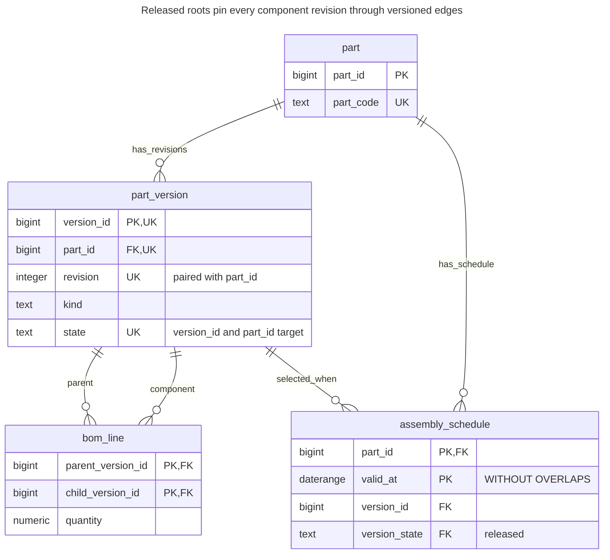
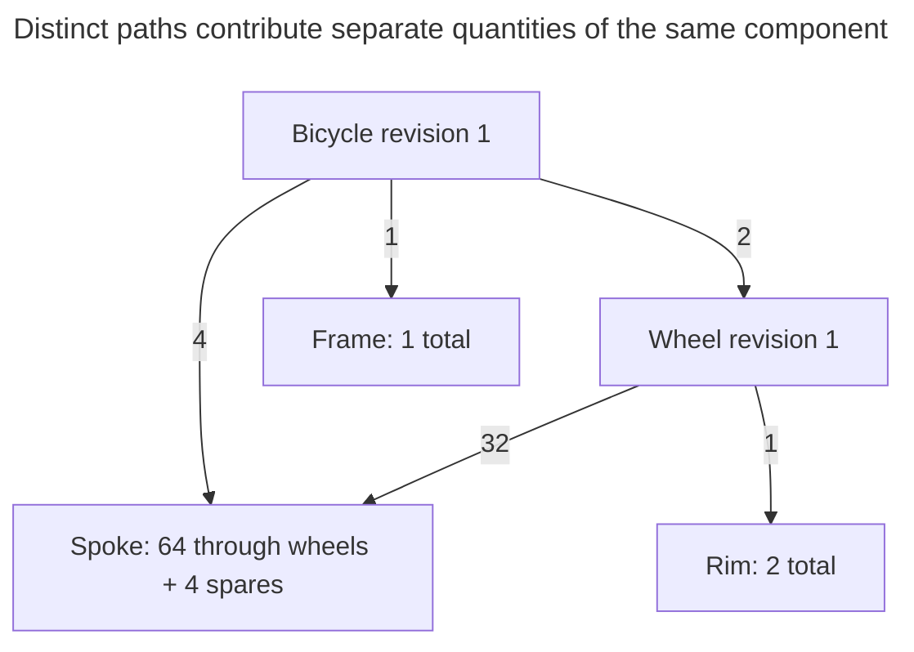
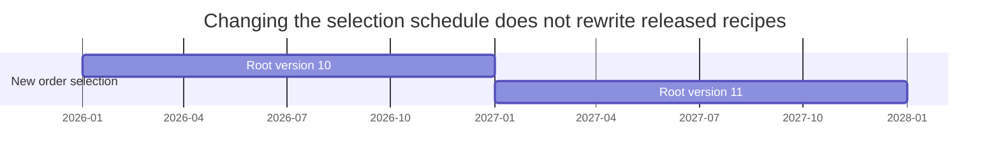
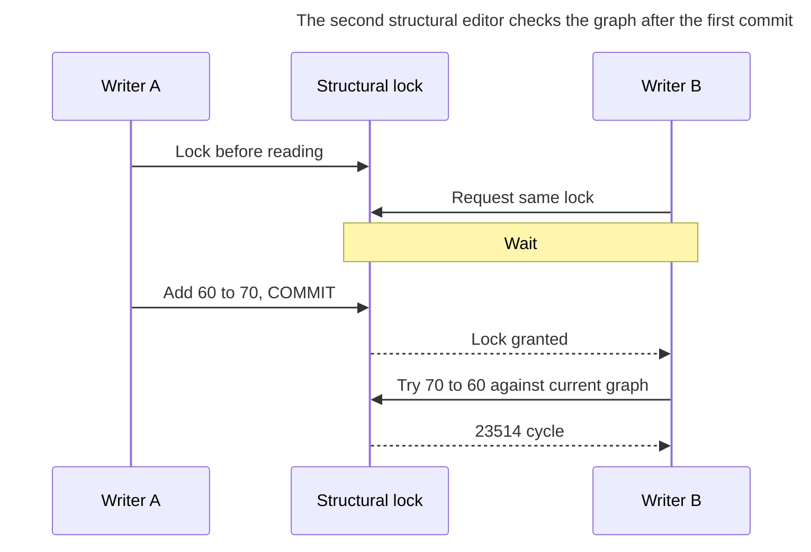
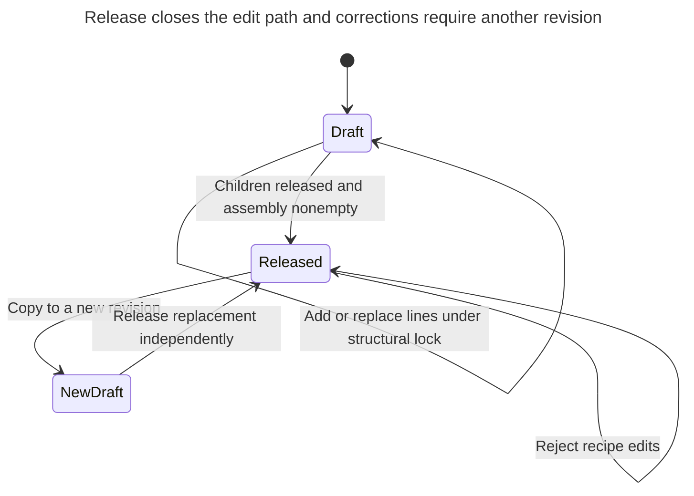

# Bill of Materials

## Intent

A bill of materials describes products made of components that may themselves be assemblies: a bicycle has wheels, a wheel has spokes and a rim. It is a graph in which one component appears in many assemblies, and each link carries a quantity and often a validity period. The chapter shows the parts and structure tables, how a recursive query explodes an assembly into total quantities of base parts, how to prevent cycles, and how versions of a structure change over time.

## Also known as

Product structure; assembly–component graph. PostgreSQL's [recursive-query documentation](https://www.postgresql.org/docs/18/queries-with.html#QUERIES-WITH-RECURSIVE) demonstrates multiplying quantities through a parts graph and summing requirements. The released-revision design below is this chapter's extension of that mechanism.

## Problem

A bicycle needs two wheels, and each wheel needs 32 spokes. You also pack four spare spokes with the bicycle. Counting distinct reachable parts finds spokes once; multiplying quantities along each path and then summing gives 68. A shared component is not an exceptional tree node: the same spoke can belong to several assemblies and appear through several routes.

An editable edge table creates another problem. If you change the wheel recipe after accepting a manufacturing order, re-exploding that order can produce a different requirement. The order needs a reproducible root revision whose children also identify exact revisions. Selecting each child's latest revision at query time does not freeze a recipe.

## Solution

Separate stable parts from immutable released part versions. A `bom_line` connects a parent version to a child version and carries the quantity required per one parent. Draft assemblies can be edited; release requires nonempty assemblies with released children. Once released, the version and its outgoing lines cannot change. Corrections create another version.

Explode the selected root with a recursive `UNION ALL`, multiplying the accumulated requirement at each edge. Sum only leaves for procurement totals. Keep every route: deduplicating a component before aggregation loses legitimate demand. This follows the multiplicative mechanism in the [PostgreSQL parts example](https://www.postgresql.org/docs/18/queries-with.html).

Add an independent effective-date schedule if “which revision should a new order use?” depends on a business date. Save the selected version ID on the order. A later schedule change then affects selection for new work without rewriting the recipe already selected for existing work.

## Alternatives and selection

| Sibling | Relationship | Deciding requirement |
| --- | --- | --- |
| [Adjacency List](adjacency-list.md) | Replacement for a one-parent hierarchy | Every item has only one parent and edges do not represent shared recipe requirements |
| [Closure Table](closure-table.md) | Complement as a reachability index | Frequent where-used queries justify precomputed ancestry; reachability alone cannot supply path-sensitive quantities |
| [Quantity](quantity.md) | Complement | Component amounts use mass, length or other compatible units rather than the example's pieces |
| [Effective Dating](effective-dating.md) | Complement | Business dates select released revisions for new orders |

See the [Decision Atlas](decision-atlas.md) for the full comparison. Version pinning is an implementation choice for reproducibility; effective dating chooses a version and does not replace pinning.

## Structure



A version can have many parents and many components. `kind = 'leaf'` identifies a purchased or otherwise unexpanded part; an empty assembly is not silently treated as one. Composite schedule references require the selected version to belong to that part and already be released.

## Tables and invariants

- **`part`** owns stable part identity; **`part_version`** identifies one revision, unique within its part. The example freezes identity and kind even in draft.
- **`bom_line`** stores one positive finite quantity per parent/child version pair. Repeated uses of the same component in one assembly are consolidated into that quantity; separately identified positions need an additional line key.
- **Cycle prevention** uses a recursive trigger plus the structural lock protocol. Endpoint foreign keys prove existence only. The trigger walks from the proposed child and rejects a path back to the proposed parent.
- **Release** checks that assemblies are nonempty and every referenced child is released. Released versions and their outgoing edges are immutable under the guards.
- **`assembly_schedule`** rejects overlapping root-selection periods per part using a PostgreSQL 18 [temporal key](https://www.postgresql.org/docs/18/sql-createtable.html). It does not require gap-free scheduling.
- **Unit policy** is component pieces per one parent piece. Fractional planning quantities are allowed by the numeric type; add an integral-count rule if your domain permits only whole pieces. Scrap, yield and substitutes are deliberately outside this recipe.

## When to use

- Components are reused across assemblies and each inclusion has a quantity.
- Requirements must be accumulated across every path, including shared descendants.
- Orders or quotations must retain the exact recipe they selected.

## Consequences and trade-offs

- ➕ A shared component has one identity while each assembly specifies its own requirement.
- ➕ Released revision pinning makes an old recipe reproducible after new releases.
- ➖ A graph can have many more paths than distinct parts. Explosion cost follows the traversed paths, not just the number of reachable nodes.
- ➖ A new child revision does not silently update parents. You must release affected parent revisions deliberately.
- ➖ The simple global structural lock serializes edits to unrelated recipes too.

## Implementation

The [complete PostgreSQL 18.6 script](../assets/bill-of-materials/bill-of-materials.sql) verifies explosion, release, a second root revision, date selection, cycle rejection and frozen edges. Define the tables with [`btree_gist`](https://www.postgresql.org/docs/18/btree-gist.html) installed for the temporal key's scalar equality:

```sql
CREATE EXTENSION IF NOT EXISTS btree_gist;
CREATE SCHEMA bom_example;
SET search_path = bom_example, public;

CREATE TABLE part (
    part_id bigint PRIMARY KEY,
    part_code text NOT NULL UNIQUE
);
CREATE TABLE part_version (
    version_id bigint PRIMARY KEY,
    part_id bigint NOT NULL REFERENCES part (part_id),
    revision integer NOT NULL CHECK (revision > 0),
    kind text NOT NULL CHECK (kind IN ('assembly', 'leaf')),
    state text NOT NULL DEFAULT 'draft' CHECK (state IN ('draft', 'released')),
    UNIQUE (part_id, revision),
    UNIQUE (version_id, part_id, state)
);
CREATE TABLE bom_line (
    parent_version_id bigint REFERENCES part_version (version_id),
    child_version_id bigint REFERENCES part_version (version_id),
    quantity numeric NOT NULL CHECK (quantity > 0 AND quantity < 'Infinity'::numeric),
    PRIMARY KEY (parent_version_id, child_version_id),
    CHECK (parent_version_id <> child_version_id)
);
CREATE INDEX bom_line_child_idx ON bom_line (child_version_id);
CREATE TABLE assembly_schedule (
    part_id bigint REFERENCES part (part_id),
    valid_at daterange NOT NULL CHECK (NOT lower_inf(valid_at)),
    version_id bigint NOT NULL,
    version_state text NOT NULL DEFAULT 'released' CHECK (version_state = 'released'),
    PRIMARY KEY (part_id, valid_at WITHOUT OVERLAPS),
    FOREIGN KEY (version_id, part_id, version_state)
        REFERENCES part_version (version_id, part_id, state)
);
```

These guards are essential to the model. The cycle query uses `UNION` on visited IDs so validation terminates even when inspecting corrupt legacy data; the quantity explosion later uses `UNION ALL` for a different purpose.

```sql
CREATE FUNCTION guard_bom_line() RETURNS trigger LANGUAGE plpgsql SET search_path = bom_example, pg_temp AS $$
DECLARE
    parent_id bigint;
BEGIN
    IF TG_OP = 'UPDATE' THEN
        RAISE EXCEPTION 'replace a draft line with delete and insert' USING ERRCODE = '23514';
    END IF;
    parent_id := CASE WHEN TG_OP = 'DELETE' THEN OLD.parent_version_id ELSE NEW.parent_version_id END;
    IF EXISTS (SELECT FROM part_version WHERE version_id = parent_id
               AND (state = 'released' OR kind = 'leaf')) THEN
        RAISE EXCEPTION 'BOM parent must be a draft assembly' USING ERRCODE = '23514';
    END IF;
    IF TG_OP = 'DELETE' THEN RETURN OLD; END IF;
    IF EXISTS (
        WITH RECURSIVE reachable(id) AS (
            VALUES (NEW.child_version_id)
            UNION
            SELECT b.child_version_id FROM bom_line AS b JOIN reachable AS r
                ON b.parent_version_id = r.id
        )
        SELECT FROM reachable WHERE id = NEW.parent_version_id
    ) THEN
        RAISE EXCEPTION 'bill of materials cycle' USING ERRCODE = '23514';
    END IF;
    RETURN NEW;
END $$;
CREATE TRIGGER bom_line_guard BEFORE INSERT OR UPDATE OR DELETE ON bom_line
    FOR EACH ROW EXECUTE FUNCTION guard_bom_line();
CREATE FUNCTION guard_part_version() RETURNS trigger LANGUAGE plpgsql SET search_path = bom_example, pg_temp AS $$
BEGIN
    IF TG_OP = 'INSERT' THEN
        IF NEW.state <> 'draft' THEN
            RAISE EXCEPTION 'create versions in draft' USING ERRCODE = '23514';
        END IF;
        RETURN NEW;
    END IF;
    IF OLD.state = 'released' THEN
        RAISE EXCEPTION 'released version is immutable' USING ERRCODE = '23514';
    END IF;
    IF TG_OP = 'DELETE' THEN RETURN OLD; END IF;
    IF (NEW.version_id, NEW.part_id, NEW.revision, NEW.kind)
        IS DISTINCT FROM (OLD.version_id, OLD.part_id, OLD.revision, OLD.kind) THEN
        RAISE EXCEPTION 'version identity and kind are immutable' USING ERRCODE = '23514';
    END IF;
    IF NEW.state = 'released' AND (
        (NEW.kind = 'assembly' AND NOT EXISTS
            (SELECT FROM bom_line WHERE parent_version_id = NEW.version_id))
        OR EXISTS (SELECT FROM bom_line AS b JOIN part_version AS c
                   ON c.version_id = b.child_version_id
                   WHERE b.parent_version_id = NEW.version_id AND c.state <> 'released')
    ) THEN
        RAISE EXCEPTION 'release children before their nonempty assembly' USING ERRCODE = '23514';
    END IF;
    RETURN NEW;
END $$;
CREATE TRIGGER part_version_guard BEFORE INSERT OR UPDATE OR DELETE ON part_version
    FOR EACH ROW EXECUTE FUNCTION guard_part_version();
```

All structural writers take the two table locks in the shown order, before reading or changing recipes, at Read Committed. Create and release children before their parents:

```sql
BEGIN;
LOCK TABLE part_version, bom_line IN SHARE ROW EXCLUSIVE MODE;
INSERT INTO part VALUES (1, 'bicycle'), (2, 'wheel'), (3, 'spoke'), (4, 'rim'), (5, 'frame');
INSERT INTO part_version (version_id, part_id, revision, kind) VALUES
    (10, 1, 1, 'assembly'), (20, 2, 1, 'assembly'),
    (30, 3, 1, 'leaf'), (40, 4, 1, 'leaf'), (50, 5, 1, 'leaf');
INSERT INTO bom_line VALUES (10, 20, 2), (10, 50, 1), (20, 30, 32), (20, 40, 1), (10, 30, 4);
UPDATE part_version SET state = 'released' WHERE version_id IN (30, 40, 50);
UPDATE part_version SET state = 'released' WHERE version_id = 20;
UPDATE part_version SET state = 'released' WHERE version_id = 10;
COMMIT;
```

The sample includes four spare spokes directly under the bicycle, in addition to those inside its two wheels:



Spokes are one version with two routes from the root. A distinct-node traversal would erase one contribution. Multiply before grouping:

```sql
WITH RECURSIVE explosion(version_id, required) AS (
    VALUES (10::bigint, 1::numeric)
    UNION ALL
    SELECT b.child_version_id, e.required * b.quantity
    FROM explosion AS e JOIN bom_line AS b ON b.parent_version_id = e.version_id
)
SELECT p.part_code, sum(e.required) AS pieces
FROM explosion AS e JOIN part_version AS v USING (version_id)
JOIN part AS p USING (part_id)
WHERE v.kind = 'leaf' GROUP BY p.part_code ORDER BY p.part_code;
```

The result is `(frame, 1)`, `(rim, 2)`, `(spoke, 68)`. Filtering leaves avoids adding intermediate assemblies to a procurement list. To ask where a part is used, reverse the edge traversal and keep the relevant version and schedule filters.

Create revision 2 by copying the root lines, adjusting its wheel count to three and releasing the new root. The original still requires two wheels:

```sql
BEGIN;
LOCK TABLE part_version, bom_line IN SHARE ROW EXCLUSIVE MODE;
INSERT INTO part_version (version_id, part_id, revision, kind) VALUES (11, 1, 2, 'assembly');
INSERT INTO bom_line
SELECT 11, child_version_id, CASE WHEN child_version_id = 20 THEN 3 ELSE quantity END
FROM bom_line WHERE parent_version_id = 10;
UPDATE part_version SET state = 'released' WHERE version_id = 11;
COMMIT;
INSERT INTO assembly_schedule (part_id, valid_at, version_id) VALUES
    (1, '[2026-01-01,2027-01-01)', 10), (1, '[2027-01-01,)', 11);
SELECT version_id FROM assembly_schedule
WHERE part_id = 1 AND valid_at @> DATE '2027-02-01';
```

The date lookup returns version `11`. It is a selection result to persist on new work, not a dynamic expression to re-run whenever you read an old order.



The chart illustrates adjacent selection periods; the actual second period is open-ended. Orders already pinned to version 10 keep using it after January 1, 2027.

For cycle rejection, the script creates draft versions `60` and `70`, then adds `60 → 70`. The reverse edge is invalid:

```sql
BEGIN;
LOCK TABLE part_version, bom_line IN SHARE ROW EXCLUSIVE MODE;
INSERT INTO part VALUES (6, 'draft-A'), (7, 'draft-B');
INSERT INTO part_version (version_id, part_id, revision, kind)
VALUES (60, 6, 1, 'assembly'), (70, 7, 1, 'assembly');
INSERT INTO bom_line VALUES (60, 70, 1);
INSERT INTO bom_line VALUES (70, 60, 1);
ROLLBACK;
```

PostgreSQL 18.6 raises SQLSTATE `23514`: `ERROR: bill of materials cycle`. Run this attempt under the same transaction and structural locks as other edits. Deleting the released root's wheel edge instead raises `23514`: `ERROR: BOM parent must be a draft assembly`.

## Engine support

- **PostgreSQL 18:** recursive CTEs implement the explosion; the temporal schedule uses ranges and `WITHOUT OVERLAPS`. The guards are application-specific trigger functions.
- **MySQL 8.4:** [recursive CTEs](https://dev.mysql.com/doc/refman/8.4/en/with.html) infer column types from the nonrecursive term. Cast the anchor's accumulated quantity wide enough for multiplication, and choose an intentional recursion limit. Port the schedule to explicit bounds and coordinated overlap checks.
- **SQL Server 2025 (17.x):** [recursive CTEs](https://learn.microsoft.com/en-us/sql/t-sql/queries/with-common-table-expression-transact-sql?view=sql-server-ver17) omit `RECURSIVE` and prohibit `GROUP BY` and scalar aggregation in the recursive member. Accumulate paths there and aggregate in the outer query, as this design does.
- **Oracle AI Database 26ai:** [recursive subquery factoring](https://docs.oracle.com/en/database/oracle/oracle-database/26/sqlrf/SELECT.html) requires column aliases and `UNION ALL` between anchor and recursive member. Translate the cycle-validation query separately rather than copying its PostgreSQL `UNION` form.
- **SQLite 3:** use [recursive CTEs](https://www.sqlite.org/lang_with.html), choose exact arithmetic deliberately and coordinate edits under its [single-writer transaction model](https://www.sqlite.org/lang_transaction.html). A read-time cycle guard does not enforce an acyclic stored graph.

## Failure and concurrency

Two draft assemblies can each be made a component of the other by racing writers. Each recursive check can pass against an old graph. At Read Committed, acquire [`SHARE ROW EXCLUSIVE`](https://www.postgresql.org/docs/18/explicit-locking.html#LOCKING-TABLES) on `part_version`, then `bom_line`, in a separate statement before any validation reads. Every structural insert, delete and release must use that protocol. Put it behind a controlled write path; unrestricted direct writes are not protected against this race by the trigger alone.



A lock on just one parent cannot protect a graph-wide cycle check. Keep publication on the same protocol so a child cannot change while its parent is being released. An uncertain release response is resolved by reading the existing revision and state; do not create another revision solely because the response was lost.



The old release remains a valid target for pinned work. Publication and effective-date selection are independent decisions.

## Migration

From unversioned component links, first audit missing components, cycles and ambiguous units. Resolve repeated uses according to whether they are consolidated quantities or distinct positions. Copy a consistent recipe snapshot into draft versions, preserving every direct edge, then release bottom-up. A root cannot be released before its descendants.

Backfill each existing order with an evidenced root revision. If historical recipes were overwritten, label a baseline honestly rather than claiming you recovered them. Switch new-order selection to the schedule, reconcile dual writes and compare leaf totals for representative roots before retiring old links. Keep the old representation synchronized through the rollback window; after new revisions exist, retain their pinned identities even if old readers temporarily return.

## Anti-patterns and common mistakes

- Giving each component one `parent_id` and losing shared-component relationships.
- Deduplicating reached parts before summing path contributions.
- Joining every child to its latest revision and silently changing old orders.
- Treating an empty draft assembly as a purchased leaf.
- Assuming foreign keys, a query depth limit or a cycle detector on reads prevents invalid concurrent writes.

## Known uses

- PostgreSQL's [included-parts example](https://www.postgresql.org/docs/18/queries-with.html) multiplies quantities recursively and aggregates by component. It demonstrates the core explosion mechanism; it does not claim to implement release or revision policies.

## Related patterns

- [Adjacency List](adjacency-list.md) covers one-parent hierarchies and coordinated cycle checks.
- [Closure Table](closure-table.md) accelerates reachability but needs additional path-aware information for quantities.
- [Quantity](quantity.md) supplies dimensional interpretation when pieces are insufficient.
- [Effective Dating](effective-dating.md) explains selection schedules, overlap rejection and gaps.
