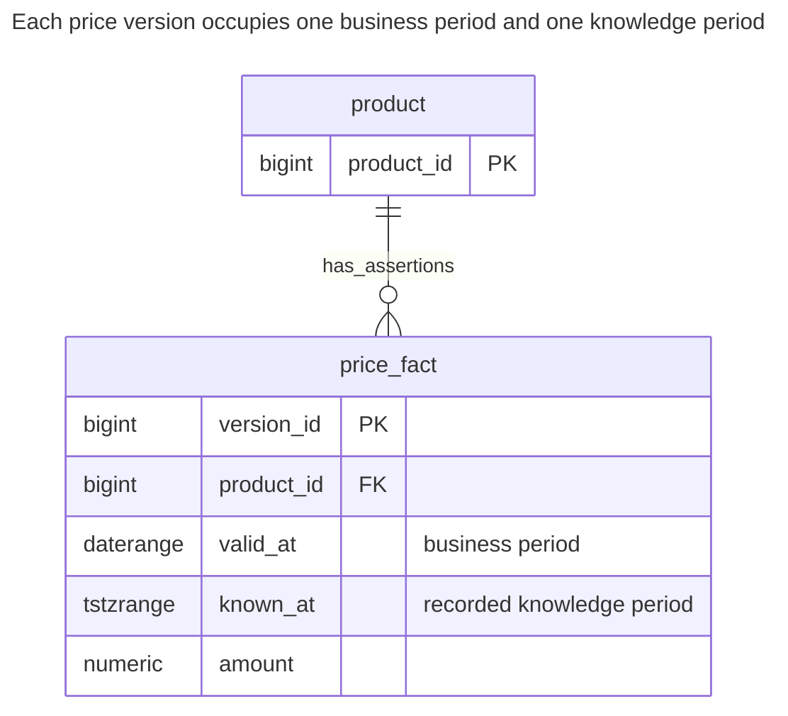
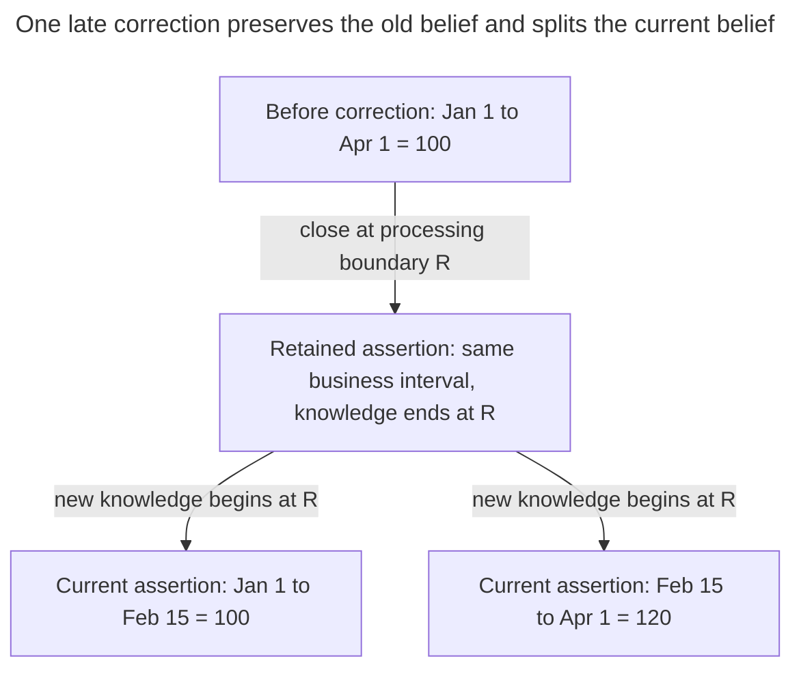
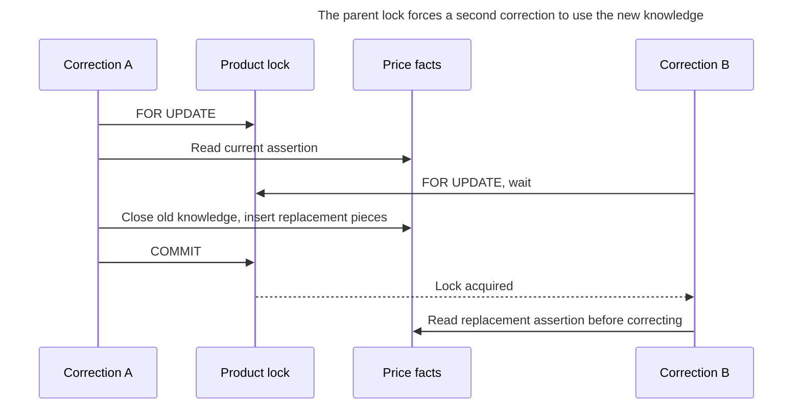
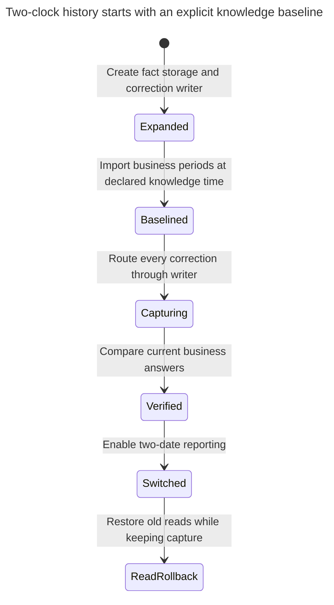

# Bitemporal Table

## Intent

A bitemporal table records two independent timelines on the same rows: when a fact was true in the business, and when the database knew about it. It answers questions neither history nor effective dating answers alone, such as what the system said on March 1st about the price valid in February — exactly what corrections, audits and recalculated past reports need. The chapter shows the structure and its two periods, how a retroactive correction closes and opens rows, and why the complexity pays off only where past answers must be reproducible. Fowler explains the two dimensions in [Bitemporal History](https://martinfowler.com/articles/bitemporal-history.html).

## Also known as

[Bitemporal History](https://martinfowler.com/articles/bitemporal-history.html) in Fowler's terminology: actual time and record time. The [SQL:2011 temporal-features paper](https://sigmodrecord.org/?download_id=3338&smd_process_download=1) uses application time and system time and describes tables combining both. Name your columns by meaning rather than using two indistinguishable pairs called “from” and “to.”

## Problem

Your March report used a February price of 100. A correction received later says the price should have been 120 from February 15. An effective-dated table can now answer “120 for February 20,” but an in-place correction loses the answer that justified the report. A history table can retain what you entered on each day, but without business validity it cannot identify which February dates the correction changes.

You need two parameters: the business date being evaluated and the knowledge cutoff used for the evaluation. “What is now believed about February 20?” and “What did we believe on March 1 about February 20?” must remain distinct queries. Fowler's [retroactive salary example](https://martinfowler.com/articles/bitemporal-history.html) motivates exactly this separation.

## Solution

Represent each price assertion as a rectangle: one interval on the business axis and another on the recorded-knowledge axis. For one product, reject two assertions whose rectangles overlap on both axes. At a correction boundary, close the previous assertion's knowledge interval and insert the corrected business pieces with open knowledge ends. Preserve the old amount and business interval in the closed assertion.

This example stores both generations in one `price_fact` table. A controlled routine serializes corrections on a stable product row. Its deliberately narrow command changes a price from a supplied date to the end of the one currently believed interval containing that date. It does not silently rewrite all later scheduled prices. A correction spanning several intervals needs a larger, explicitly defined rewrite under the same product lock.

## Alternatives and selection

| Sibling | Relationship | Deciding requirement |
| --- | --- | --- |
| [Effective Dating](effective-dating.md) | Simpler replacement | Only the latest corrected business history matters |
| [History Table](history-table.md) | Simpler replacement; implementation component when applied to dated facts | Only recorded state matters, or native system versioning can archive business-dated rows |
| [Audit Log](audit-log.md) | Complement | You need who authorized the correction and which request caused it |
| [Status History](status-history.md) | Replacement for a narrower question | You need accepted transitions, not revised facts about earlier dates |
| Native bitemporal table | Implementation option | The engine supplies both periods and suitable correction operations |

Use the [Decision Atlas](decision-atlas.md) for the full family comparison. Choose two clocks only for facts whose earlier interpretation you must reproduce; unrelated descriptive columns need not inherit this complexity.

## Structure



The product ID identifies the continuing entity; `version_id` identifies a stored assertion. A conventional FK to the product does not specify either date or guarantee that a fact exists at the requested pair of dates.

## Tables and invariants

- **`product`** supplies stable identity and the serialization point for correction commands.
- **`price_fact`** requires nonempty business and knowledge ranges, bounded lower ends, half-open knowledge bounds and a nonnegative amount.
- **`price_fact_no_overlap`** excludes pairs with equal product IDs and intersecting ranges on both axes. Business overlap alone is allowed across disjoint knowledge periods; otherwise earlier beliefs could not coexist with corrections.
- **Historical immutability** depends on the writer and privileges. The exclusion constraint does not forbid an owner from rewriting a closed row or manufacturing backdated knowledge. Restrict direct DML and reserve imports and repairs for trusted maintenance.
- **Coverage** is preserved by the demonstrated correction within its selected business interval. The exclusion constraint itself enforces at most one answer at a point, not that every point has an answer.

## When to use

- Late corrections must coexist with reproducible earlier decisions or reports.
- A caller can state both a business date and a knowledge cutoff.
- You can distinguish “correct the business fact” from “change what a previous report knew,” and retain the latter without rewriting it.

## Consequences and trade-offs

- ➕ A corrected present view and an earlier recorded view remain queryable together.
- ➕ You can explain why the original decision differed from a recalculation.
- ➖ One correction may create several rows, and each query needs both temporal predicates.
- ➖ Correcting source facts does not recalculate dependent invoices or reports automatically; those need their own correction policy.
- ➖ Recording times and report inputs become part of the data contract. Retention that removes old knowledge also removes reproducibility at those cutoffs.

## Implementation

The [complete PostgreSQL 18.6 script](../assets/bitemporal-table/bitemporal-table.sql) verifies both answers, rectangle rejection and rollback of a failed correction. PostgreSQL [exclusion constraints](https://www.postgresql.org/docs/18/sql-createtable.html) reject a row when all specified comparisons conflict; [`btree_gist`](https://www.postgresql.org/docs/18/btree-gist.html) supplies bigint equality alongside range overlap:

```sql
CREATE EXTENSION IF NOT EXISTS btree_gist;
CREATE SCHEMA bitemporal_example;
CREATE TABLE bitemporal_example.product (
    product_id bigint PRIMARY KEY
);
CREATE TABLE bitemporal_example.price_fact (
    version_id bigint GENERATED ALWAYS AS IDENTITY PRIMARY KEY,
    product_id bigint NOT NULL REFERENCES bitemporal_example.product (product_id),
    valid_at daterange NOT NULL CHECK (NOT isempty(valid_at) AND NOT lower_inf(valid_at)),
    known_at tstzrange NOT NULL CHECK (
        NOT isempty(known_at) AND NOT lower_inf(known_at)
        AND lower_inc(known_at) AND NOT upper_inc(known_at)
    ),
    amount numeric(12,2) NOT NULL CHECK (amount >= 0),
    CONSTRAINT price_fact_no_overlap EXCLUDE USING gist
        (product_id WITH =, valid_at WITH &&, known_at WITH &&)
);
CREATE FUNCTION bitemporal_example.correct_price(
    p_product_id bigint, p_from date, p_amount numeric
) RETURNS timestamptz LANGUAGE plpgsql SECURITY DEFINER
SET search_path = pg_catalog, pg_temp AS $$
DECLARE
    old_fact bitemporal_example.price_fact%ROWTYPE;
    boundary timestamptz;
BEGIN
    PERFORM 1 FROM bitemporal_example.product
    WHERE product_id = p_product_id FOR UPDATE;
    SELECT * INTO STRICT old_fact FROM bitemporal_example.price_fact
    WHERE product_id = p_product_id AND upper_inf(known_at)
      AND valid_at @> p_from;
    SELECT greatest(clock_timestamp(),
                    max(lower(known_at)) + interval '1 microsecond')
    INTO boundary FROM bitemporal_example.price_fact
    WHERE product_id = p_product_id;
    UPDATE bitemporal_example.price_fact
    SET known_at = tstzrange(lower(known_at), boundary, '[)')
    WHERE version_id = old_fact.version_id;
    IF p_from > lower(old_fact.valid_at) THEN
        INSERT INTO bitemporal_example.price_fact
            (product_id, valid_at, known_at, amount)
        VALUES (p_product_id, daterange(lower(old_fact.valid_at), p_from, '[)'),
                tstzrange(boundary, NULL, '[)'), old_fact.amount);
    END IF;
    INSERT INTO bitemporal_example.price_fact
        (product_id, valid_at, known_at, amount)
    VALUES (p_product_id, daterange(p_from, upper(old_fact.valid_at), '[)'),
            tstzrange(boundary, NULL, '[)'), p_amount);
    RETURN boundary;
END;
$$;
REVOKE ALL ON FUNCTION bitemporal_example.correct_price(bigint, date, numeric)
    FROM PUBLIC;
```

The function closes only `known_at`; it never rewrites the old assertion's amount or business interval. It inserts a left remainder when needed and the corrected right piece. Missing business coverage makes `SELECT INTO STRICT` fail rather than fabricate a price; PostgreSQL documents [the strict single-row check](https://www.postgresql.org/docs/18/plpgsql-statements.html#PLPGSQL-STATEMENTS-SQL-ONEROW).

Deploy under a trusted owner. Grant the application read access and execution of this exact routine, with schema usage, but no direct writes to facts or products. Supply product creation through another controlled operation. The [security-definer search path](https://www.postgresql.org/docs/18/sql-createfunction.html#SQL-CREATEFUNCTION-SECURITY) excludes caller-writable schemas, and public execution is revoked. The lab's owner inserts a declared import baseline; normal correction callers cannot supply `known_at`.

```sql
INSERT INTO bitemporal_example.product VALUES (1);
-- Trusted import baseline: this example's knowledge begins on January 10.
INSERT INTO bitemporal_example.price_fact (product_id, valid_at, known_at, amount)
VALUES (1, daterange('2026-01-01', '2026-04-01', '[)'),
        tstzrange('2026-01-10 00:00+00', NULL, '[)'), 100);
SELECT bitemporal_example.correct_price(1, DATE '2026-02-15', 120);
SELECT amount FROM bitemporal_example.price_fact
WHERE product_id = 1 AND valid_at @> DATE '2026-02-20'
  AND known_at @> TIMESTAMPTZ '2026-03-01 00:00+00';
SELECT amount FROM bitemporal_example.price_fact
WHERE product_id = 1 AND valid_at @> DATE '2026-02-20'
  AND upper_inf(known_at);
```

Run after March 1, 2026, as in the November 2026 verification. The trusted fixture says knowledge began January 10. The correction returns its actual processing boundary. The March 1 knowledge query returns `100.00`; the current-knowledge query returns `120.00`. For current knowledge about February 1, the left remainder still says 100. The fixture is a documented import assumption, not evidence that running this script creates genuine January database history.



At a knowledge cutoff before `R`, you select the unsplit old assertion. At `R` and later, you select the appropriate new business piece. The shared boundary makes the change atomic in the model.

A fourth assertion that competes with existing knowledge is invalid:

```sql
INSERT INTO bitemporal_example.price_fact (product_id, valid_at, known_at, amount)
VALUES (1, daterange('2026-02-20', '2026-03-01', '[)'),
        tstzrange('2026-01-10 00:00+00', NULL, '[)'), 90);
```

PostgreSQL 18.6 raises SQLSTATE `23P01`: `ERROR: conflicting key value violates exclusion constraint "price_fact_no_overlap"`. The script also attempts a negative correction; `price_fact_amount_check` raises `23514`, and the old open knowledge interval and original row count remain intact after rollback.

## Engine support

- **PostgreSQL 18:** two range columns and a multidimensional exclusion constraint implement this model. [`WITHOUT OVERLAPS`](https://www.postgresql.org/docs/18/sql-createtable.html) checks overlap in its final column; using it for business dates alone would wrongly reject archived beliefs that share those dates.
- **MySQL 8.4 / InnoDB:** port the periods to bound columns and serialize every rectangle rewrite through a [locking read on the parent inside a transaction](https://dev.mysql.com/doc/refman/8.4/en/innodb-locking-reads.html). The PostgreSQL exclusion rule is not present in the [MySQL table grammar](https://dev.mysql.com/doc/refman/8.4/en/create-table.html); a controlled writer must enforce the equivalent comparisons. MariaDB's [native bitemporal tables](https://mariadb.com/docs/server/reference/sql-structure/temporal-tables/bitemporal-tables) are a separate implementation option.
- **SQL Server 2025 (17.x):** [system-versioned tables](https://learn.microsoft.com/en-us/sql/relational-databases/tables/temporal/overview?view=sql-server-ver17) can archive rows that also carry business bounds. They supply recorded history; you still need your business-period split and no-overlap policy. Account for their transaction-begin period semantics.
- **Oracle Database 21c:** [Temporal Validity with Flashback](https://docs.oracle.com/en/database/oracle/oracle-database/21/adfns/design_basics.html) supports business-validity and historical query concerns. Choose retained flashback history and enforce your business ambiguity rule explicitly; valid-time visibility alone is not the rectangle constraint shown here.
- **SQLite 3:** use explicit bound columns and a controlled rewrite under [`BEGIN IMMEDIATE`](https://www.sqlite.org/lang_transaction.html), plus overlap validation. The single-writer limit trades row-level concurrency for database-level writer coordination; handle busy failures before changing any pieces.

## Failure and concurrency



At Read Committed, take the parent lock before selecting facts, so the next statement sees the winner's committed rewrite. PostgreSQL explains [statement snapshots](https://www.postgresql.org/docs/18/transaction-iso.html#XACT-READ-COMMITTED) and [row locks](https://www.postgresql.org/docs/18/explicit-locking.html#LOCKING-ROWS). At stronger isolation, a conflicting transaction may need a full retry. Acquire several product locks in a consistent ID order for multi-product work.

The routine chooses one processing boundary after acquiring the lock, advancing it beyond prior knowledge starts for that product. [`clock_timestamp()`](https://www.postgresql.org/docs/18/functions-datetime.html#FUNCTIONS-DATETIME-CURRENT) is wall time during execution, not commit time. Consequently this hand-built model records an application's processing knowledge, not an exact reconstruction of which rows every concurrent session could see at a wall-clock instant. A reproducible report must also retain the chosen cutoffs and any non-temporal inputs. A consistent report over many entities may require a stored report snapshot rather than assuming that independent processing clocks form one global snapshot.

Return success only after commit. A lost response needs an [Idempotency Record](idempotency-record.md) if a retry must not create another recorded correction. Do not use `request_id` merely as a label and assume that it prevents replay.

## Migration

Identify which existing dates are business validity and which are trustworthy recording evidence. An effective-dated table gives you the first axis, but cannot reveal earlier beliefs you already overwrote. Import its currently accepted business history with a declared knowledge baseline. If you also have reliable recorded versions, map their boundaries separately and validate each rectangle for ambiguity; do not equate event occurrence with database knowledge by convenience.



Coordinate baseline and live writers so no correction falls between them. During [Expand and Contract](expand-contract.md), keep the old read model as a projection of current knowledge, then compare business dates at boundaries before switching. Backing out readers is possible while retaining capture; dropping the recorded axis destroys accepted reproducibility.

## Anti-patterns and common mistakes

- Overwriting the old business range or amount when a correction arrives, then calling the result bitemporal.
- Applying exclusion to business overlap alone, which forbids storing earlier beliefs about the same dates.
- Filtering only by business date and returning every historical belief as if all were simultaneously authoritative.
- Allowing normal callers to backdate knowledge timestamps or directly edit closed assertions.
- Claiming that corrected source facts automatically repair downstream decisions, or that processing timestamps reproduce global commit visibility.

## Known uses

- Fowler's [Bitemporal History](https://martinfowler.com/articles/bitemporal-history.html) uses late salary information to distinguish actual history from record history.
- MariaDB's [bitemporal table documentation](https://mariadb.com/docs/server/reference/sql-structure/temporal-tables/bitemporal-tables) combines application and system periods on a table. This is an engine-maintained alternative to the manual rectangle writer.
- IBM's [Db2 13 for z/OS example](https://www.ibm.com/docs/en/db2-for-zos/13.0.0?topic=tables-creating-bitemporal) combines `BUSINESS_TIME`, `SYSTEM_TIME` and a linked history table, with a business-time no-overlap index.

## Related patterns

- [History Table](history-table.md) supplies recorded-state retention.
- [Effective Dating](effective-dating.md) supplies the business-validity axis.
- [Audit Log](audit-log.md) attributes corrections without replacing dated assertions.
- [Idempotency Record](idempotency-record.md) gives correction requests stable retry semantics.
- [Expand and Contract](expand-contract.md) keeps current readers working during the rollout.
