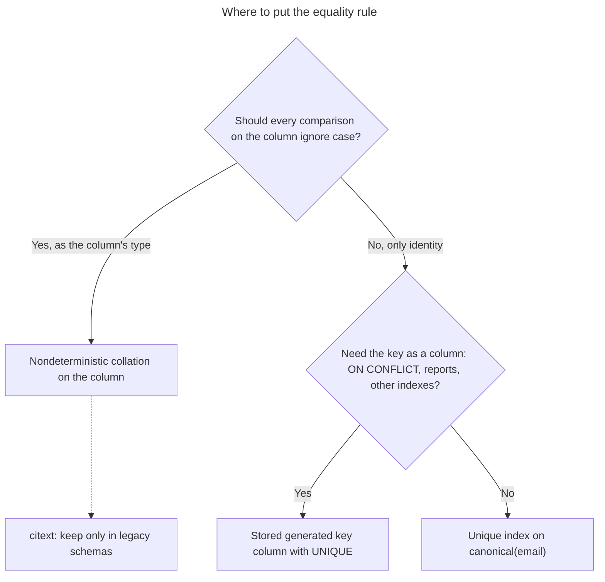
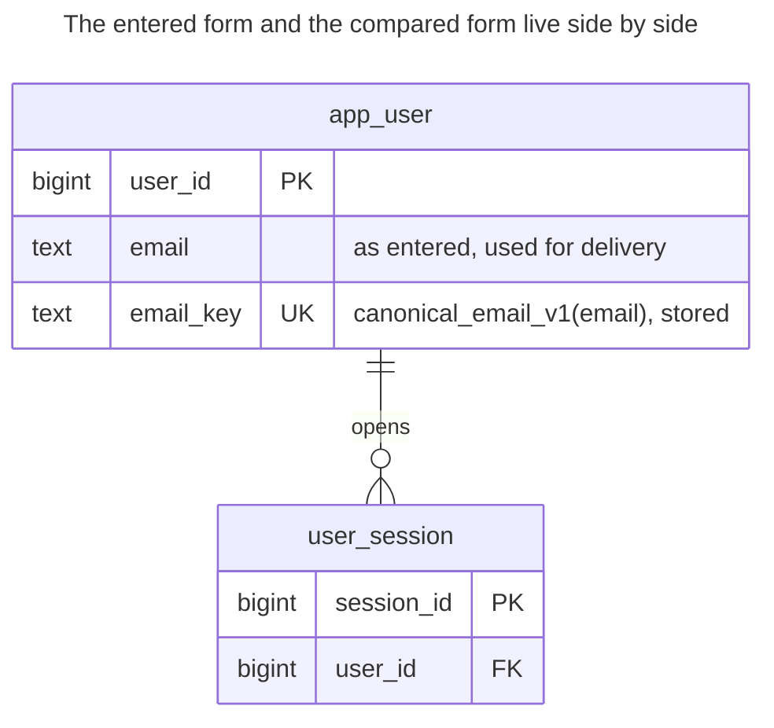
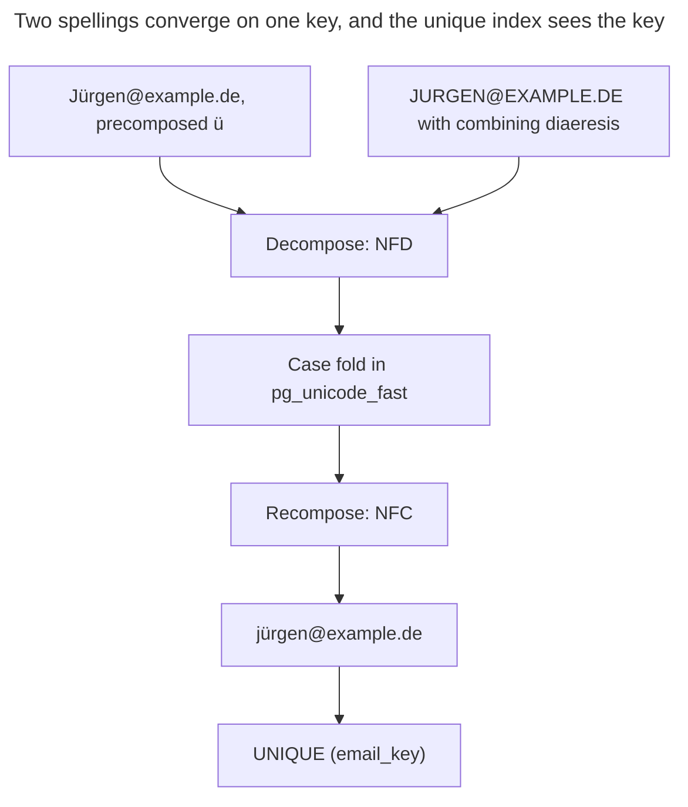
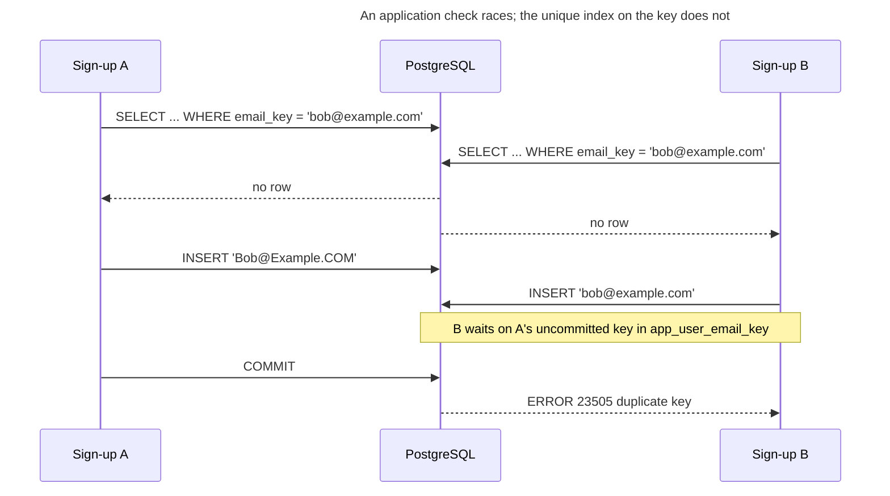
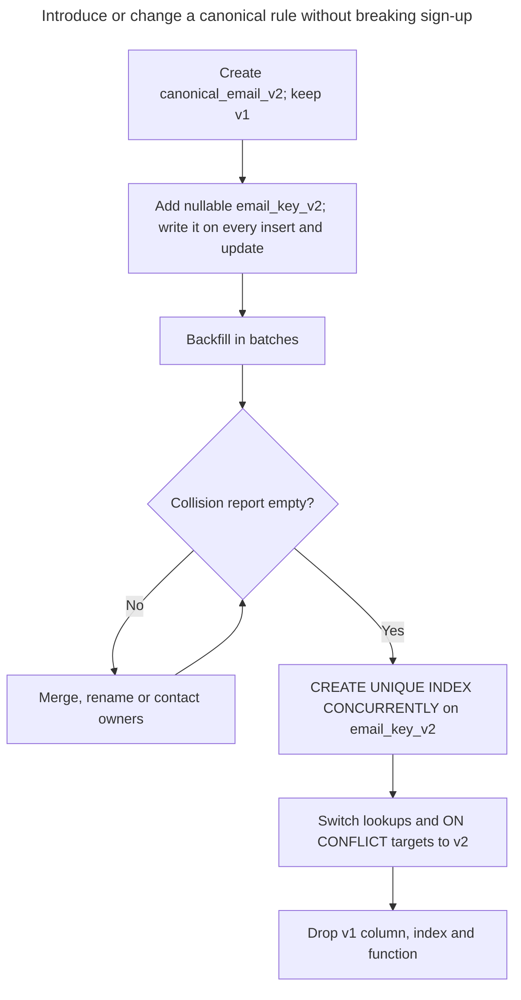

# Canonical Value

## Intent

A canonical value is the single normalized form that the database compares when people type the same identifier in different ways. An e-mail address, a username or a slug arrives as `Bob@Example.COM` today and `bob@example.com` tomorrow; the application means the same account, while a plain unique constraint sees two different strings. Write the equivalence rule down once as an immutable function, store or index its result next to the value as entered, and put the unique constraint on that result. The database then rejects the second spelling under any concurrency, lookups use the same rule, and the display form stays exactly what the user typed.

## Also known as

Normalized key; case-insensitive unique key; functional unique constraint ([Django](https://docs.djangoproject.com/en/6.1/ref/models/constraints/#django.db.models.UniqueConstraint.expressions)). The Unicode Standard calls the comparison [canonical caseless matching](https://www.unicode.org/versions/Unicode18.0.0/core-spec/chapter-3/#G53523). PostgreSQL offers the comparison side as [nondeterministic collations](https://www.postgresql.org/docs/18/collation.html#COLLATION-NONDETERMINISTIC) and the older [`citext`](https://www.postgresql.org/docs/18/citext.html) type.

## Problem

Your sign-up form stores `email text UNIQUE`. One person registers as `Bob@Example.COM`, later forgets and registers again as `bob@example.com`; both inserts succeed, password reset now finds two accounts, and the login query `WHERE email = $1` finds neither when the user types a third spelling. The same happens with Unicode: `Jürgen` can arrive with a precomposed `ü` from one keyboard and as `u` plus a combining diaeresis from another. The strings look identical and compare unequal.

The usual repairs leave the gap open. Lowercasing in application code before the insert works until one code path, an import script or an admin console forgets to do it. A uniqueness check in the application (`SELECT ... WHERE lower(email) = lower($1)`, then `INSERT`) races: two concurrent requests both see no row and both insert. Lowercasing the stored value destroys the form the user chose, which you may need for display or for delivery.

## Solution

Separate the two roles the column played. Keep `email` as entered, and derive `email_key` from it with one named, immutable canonicalization function: Unicode normalization followed by case folding in a pinned collation. Make `email_key` the unique key. Every lookup canonicalizes its input with the same function and compares keys; every write gets the key from the database, not from the caller.

Unicode describes the same arrangement for search: the original string is usually [stored along with a case-folded version](https://www.unicode.org/versions/Unicode18.0.0/core-spec/chapter-5/#G21790) for fast comparisons, because replacing it would erase information.

The canonical form is a business rule, not a technical fact. [RFC 5321](https://www.rfc-editor.org/rfc/rfc5321.html#section-2.4) says that mail software must treat the local part as case-sensitive, because for some hosts `smith` and `Smith` are different users, while it discourages relying on that; domains are case-insensitive. Folding the whole address is therefore a decision about your users, not a reading of the standard, and you record it in the function's name and comment. Provider-specific rules, such as ignoring dots in some mail services, change which people count as the same customer and belong in that decision too, not in ad-hoc query code.

## Alternatives and selection

| Sibling | Relationship | Deciding requirement |
| --- | --- | --- |
| Expression unique index on `canonical(email)` | Implementation option without a stored column | You want no extra column and accept that every query must repeat the exact expression to use the index |
| Stored generated column (this chapter) | Implementation option | The key should be visible, usable as an `ON CONFLICT` target and indexable like any column |
| Nondeterministic collation on the column | Replacement for the derived key | Equality, uniqueness and ordering should all ignore case by the column's type, and you accept a performance penalty and limited pattern matching |
| `citext` | Legacy replacement | Existing schemas only; PostgreSQL recommends nondeterministic collations instead, and `citext` folds by the database's `LC_CTYPE` |
| [Natural Key](natural-key.md) | Complement | The canonical value is the business identifier, but references should still use a stable key |

See the [Decision Atlas](decision-atlas.md) for identifiers. A canonical value is usually an alternate key: the table keeps a [Surrogate Key](surrogate-key.md) for references, so a person who changes their address does not rewrite foreign keys.



The derived key keeps ordinary equality on the entered text and adds one identity rule beside it. A nondeterministic collation changes what `=` means for the column everywhere, which is broader and has its own restrictions.

## Structure



`app_user` holds both forms. Other tables reference `user_id`, never the e-mail key, so changing an address is one row update.



The pipeline follows Unicode's canonical caseless matching, `NFD(toCasefold(NFD(X)))`, and then recomposes so that the stored key is in the usual NFC form. The second normalization is needed because, as the PostgreSQL documentation warns, `casefold()` does not always preserve the normalized form of its input. Both inputs end in the same key, so the second insert hits the constraint.

## Tables and invariants

- **`canonical_email_v1(text)`** is `IMMUTABLE` and pins the collation `pg_unicode_fast` inside its body, so its result does not depend on the database's default locale. The version suffix is deliberate: a different rule is a different function, never a silent `CREATE OR REPLACE`.
- **`app_user.email`** keeps the address exactly as entered. `app_user_email_shape` rejects surrounding or embedded whitespace instead of trimming it silently.
- **`app_user.email_key`** is a stored generated column. `app_user_email_key` makes it unique, so no two users share a canonical address regardless of which code path inserted them.
- **References** go to `user_id`. The canonical key identifies the person at the boundary; it is not a foreign-key target.

## When to use

- People type the identifier: e-mail addresses, usernames, organization slugs, coupon codes, license plates.
- The business says that some spellings are the same thing, and you can state the rule precisely.
- Several code paths, imports or services write the table, so application-side normalization cannot be guaranteed.
- You must keep the form as entered for display, delivery or audit.

## Consequences and trade-offs

- ➕ Uniqueness under the business rule is enforced by the database, including under concurrent inserts.
- ➕ Lookups, upserts and duplicate reports use one named rule.
- ➕ The value as entered survives for display and delivery.
- ➖ Each row stores the identifier twice, and each insert maintains a unique index on the derived form.
- ➖ The function is a contract: changing it means a migration with collision handling, not an edit.
- ➖ Full Unicode folding makes decisions you must accept: `STRAßE` and `strasse` collide.
- ➖ Queries that compare `email` directly bypass the rule; review lookups for the key.

## Implementation

The [complete script](../assets/canonical-value/canonical-value.sql) checks every statement below, including the error states. Define the rule once:

```sql
CREATE FUNCTION canonical_email_v1(raw text) RETURNS text
LANGUAGE sql IMMUTABLE PARALLEL SAFE STRICT
RETURN normalize(casefold(normalize(raw, NFD) COLLATE pg_unicode_fast), NFC);

CREATE TABLE app_user (
    user_id bigint GENERATED ALWAYS AS IDENTITY PRIMARY KEY,
    email text NOT NULL,
    email_key text GENERATED ALWAYS AS (canonical_email_v1(email)) STORED,
    CONSTRAINT app_user_email_key UNIQUE (email_key),
    CONSTRAINT app_user_email_shape CHECK (email ~ '^[^@[:space:]]+@[^@[:space:]]+$')
);
```

PostgreSQL 18's [`casefold()`](https://www.postgresql.org/docs/18/functions-string.html#FUNCTIONS-STRING-OTHER) performs case folding according to the collation. Its documentation distinguishes the two operations: case folding exists for case-insensitive matching, case conversion such as `lower()` for producing a particular cased form. Under the predefined `pg_unicode_fast` collation, `ß` folds to `ss`; under a libc collation `casefold()` is identical to `lower()`, which is why the function pins its collation. `STORED` is required: [generated columns are virtual by default](https://www.postgresql.org/docs/18/ddl-generated-columns.html) in PostgreSQL 18, a virtual column must not call user-defined functions, and PostgreSQL 18.7 also rejects a unique constraint on a virtual generated column with `unique constraints on virtual generated columns are not supported`.

```sql
INSERT INTO app_user (email) VALUES ('Bob@Example.COM')
RETURNING user_id, email, email_key;
```

The row keeps `Bob@Example.COM` and gets the key `bob@example.com`. A second spelling is rejected by the database itself:

```sql
INSERT INTO app_user (email) VALUES ('bob@example.com');
```

PostgreSQL 18.7 raises SQLSTATE `23505`: `ERROR: duplicate key value violates unique constraint "app_user_email_key"` with `DETAIL: Key (email_key)=(bob@example.com) already exists.` The decomposed, upper-case `JU\0308RGEN@EXAMPLE.DE` collides with the stored `Jürgen@example.de` the same way, with `Key (email_key)=(jürgen@example.de)`.

Use the key as the conflict target when sign-up must be idempotent, and canonicalize lookup input with the same function so the unique index serves the query:

```sql
INSERT INTO app_user (email) VALUES ('BOB@example.com')
ON CONFLICT (email_key) DO NOTHING
RETURNING user_id;

SELECT user_id, email FROM app_user
WHERE email_key = canonical_email_v1('bob@EXAMPLE.com');
```

The insert returns no row, and the lookup returns user `1` with the entered form `Bob@Example.COM`. The script also confirms that the lookup plan uses `app_user_email_key`.

If case should be ignored by every comparison on the column, not only by its identity, put the rule into a [nondeterministic collation](https://www.postgresql.org/docs/18/collation.html#COLLATION-NONDETERMINISTIC) instead:

```sql
CREATE COLLATION case_insensitive (
    provider = icu, locale = 'und-u-ks-level2', deterministic = false
);
CREATE TABLE ci_user (
    user_id bigint GENERATED ALWAYS AS IDENTITY PRIMARY KEY,
    email text COLLATE case_insensitive NOT NULL,
    CONSTRAINT ci_user_email_key UNIQUE (email)
);
```

Here a plain `UNIQUE (email)` rejects `bob@example.com` after `Bob@Example.COM` with the same SQLSTATE `23505`. The collation needs an ICU-enabled build, and its rule is ICU's comparison strength rather than a function you can read. PostgreSQL documents the costs: a performance penalty, no B-tree deduplication, and limited pattern matching — `LIKE` works with nondeterministic collations since 18, while `ILIKE` and regular expressions do not. ICU [results may depend on the library version](https://www.postgresql.org/docs/18/locale.html#LOCALE-PROVIDERS).

## Engine support

- **PostgreSQL 18:** the stored generated key, the expression index and nondeterministic ICU collations all work as shown. [`casefold()`](https://www.postgresql.org/docs/18/release-18.html#RELEASE-18-FUNCTIONS) and the `pg_unicode_fast` collation are new in 18; on earlier versions use `lower()` and accept simple case mapping. Keep [`citext`](https://www.postgresql.org/docs/18/citext.html) only where it already exists.
- **MySQL 8.4:** the default `utf8mb4_0900_ai_ci` collation is [accent- and case-insensitive](https://dev.mysql.com/doc/refman/8.4/en/charset-unicode-sets.html), and [string columns compare by their collation](https://dev.mysql.com/doc/refman/8.4/en/char.html), so a plain `UNIQUE` already treats `Bob` and `bob` — and `resume` and `résumé` — as duplicates. Check the column collation before porting the derived key; the risk there is the opposite one, an unintended collision.
- **SQL Server 2025 (17.x):** [collations determine how data is compared](https://learn.microsoft.com/en-us/sql/relational-databases/collations/collation-and-unicode-support?view=sql-server-ver17), a column without an explicit collation takes the database default, and the [default for US English installations](https://learn.microsoft.com/en-us/sql/relational-databases/collations/set-or-change-the-server-collation?view=sql-server-ver17) is the case-insensitive `SQL_Latin1_General_CP1_CI_AS`. State the collation on the column, or index a computed column when the rule goes beyond case; [indexes on computed columns](https://learn.microsoft.com/en-us/sql/relational-databases/indexes/indexes-on-computed-columns?view=sql-server-ver17) require a deterministic expression.
- **Oracle AI Database 26ai:** a [data-bound collation](https://docs.oracle.com/en/database/oracle/oracle-database/26/nlspg/linguistic-sorting-and-matching.html#GUID-7E70C5D5-82E1-4BA6-8DF8-01E365B202C2) such as `BINARY_CI` on the column makes comparisons case-insensitive and also orders the keys of unique-constraint indexes. It requires `MAX_STRING_SIZE = EXTENDED`.
- **SQLite 3:** [`COLLATE NOCASE`](https://www.sqlite.org/datatype3.html#collation) folds only ASCII letters. Its built-in `lower()` also [works for ASCII only](https://www.sqlite.org/lang_corefunc.html), and the core library has no Unicode normalization function, so store an application-computed key column with a unique index.

## Failure and concurrency

The unique index is what closes the race; checking first in the application does not. PostgreSQL makes the second inserter of a conflicting key [wait for the first transaction and then recheck](https://www.postgresql.org/docs/18/index-unique-checks.html), so exactly one of two concurrent sign-ups wins at any isolation level.



Both preliminary checks pass, and only the constraint stops the second account. Treat `23505` on `app_user_email_key` as "address already registered" in the application, or use `ON CONFLICT (email_key)` to make the outcome explicit.

The function must really be immutable. The built-in provider uses PostgreSQL's own operations, and the documentation promises that `pg_unicode_fast` is [stable within a major version](https://www.postgresql.org/docs/18/collation.html#COLLATION-MANAGING-STANDARD). ICU results may depend on the ICU library version, and libc locales may behave differently across platforms. If the rule's results change, an index built on the old results holds keys that the new function no longer produces. Pinning `pg_unicode_fast` removes the dependency on operating-system libraries, but not on PostgreSQL's Unicode tables: after a major upgrade, rerun the collision report.

## Migration

The usual starting point is `email text UNIQUE` with variants already inside. Report the collisions first, because the new rule turns existing rows into duplicates:

```sql
SELECT canonical_email_v1(email) AS email_key,
       array_agg(user_id ORDER BY user_id) AS user_ids
FROM legacy_user
GROUP BY 1
HAVING count(*) > 1;
```

Building the index before resolving them fails with SQLSTATE `23505`: `ERROR: could not create unique index "legacy_user_email_key_idx"` and `DETAIL: Key (public.canonical_email_v1(email))=(ann@example.com) is duplicated.` Resolving a collision is a business operation: merge the accounts, contact the owners, or rename one of them. Do it before enforcement, not by deleting rows in a migration script.



On a busy table, build the unique index on the `email_key_v2` column [`CONCURRENTLY`](https://www.postgresql.org/docs/18/sql-createindex.html#SQL-CREATEINDEX-CONCURRENTLY), then attach it as a constraint with `ALTER TABLE ... ADD CONSTRAINT ... UNIQUE USING INDEX`; an index on an expression cannot back a constraint, so this step needs the column. Adding a stored generated column rewrites the table, so on a large table use an ordinary column filled by a trigger during the transition. New sign-ups can still collide between the report and the index; repeat the report right before building it. The full sequence is [Expand and Contract](expand-contract.md). To back out, drop the new index and column; the entered values were never changed.

## Anti-patterns and common mistakes

- Lowercasing the stored value and losing the form the user entered.
- Normalizing only in application code, so an import or an admin tool writes a second spelling.
- Checking for a duplicate with `SELECT` and relying on it without a unique constraint.
- Editing the canonical function in place with `CREATE OR REPLACE`: stored keys and index entries keep the old results.
- Building the rule on a libc or ICU collation without planning for library upgrades that change its results.
- Querying `WHERE lower(email) = lower($1)` while the index is on a different expression, so the lookup scans the table.
- Encoding provider-specific address tricks into the key without a business decision about who counts as the same customer.

## Known uses

- Django's [constraints reference](https://docs.djangoproject.com/en/6.1/ref/models/constraints/#django.db.models.UniqueConstraint.expressions) supports functional unique constraints and shows `UniqueConstraint(Lower("name").desc(), "category", ...)`, a case-insensitive name unique within a category.
- PostgreSQL's [expression index documentation](https://www.postgresql.org/docs/18/indexes-expressional.html) notes that declaring its `lower(col1)` index `UNIQUE` would prevent rows whose values differ only in case.
- The Rails [uniqueness validation](https://api.rubyonrails.org/classes/ActiveRecord/Validations/ClassMethods.html#method-i-validates_uniqueness_of-label-Concurrency+and+integrity) documents that application-level uniqueness checks are inherently prone to race conditions and recommends a unique index; its `case_sensitive` option changes only the check, not the guarantee.

## Related patterns

- [Natural Key](natural-key.md) discusses business identifiers; a canonical value is how such an identifier stays unique when people type it.
- [Surrogate Key](surrogate-key.md) carries references so that the canonical value can change.
- [Public Identifier](public-identifier.md) is the opposite case: a machine-generated handle that must be compared exactly.
- [Expand and Contract](expand-contract.md) is the migration frame for changing the rule.
