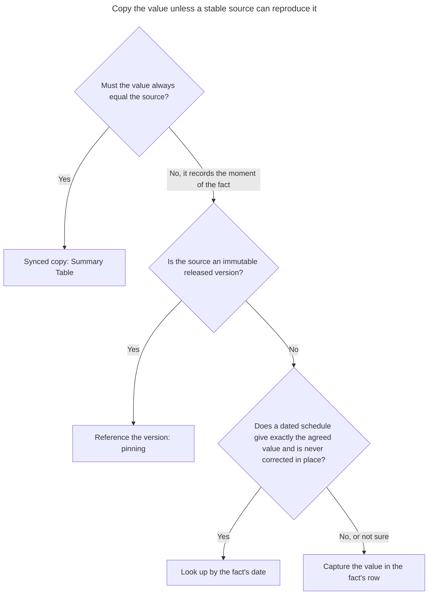
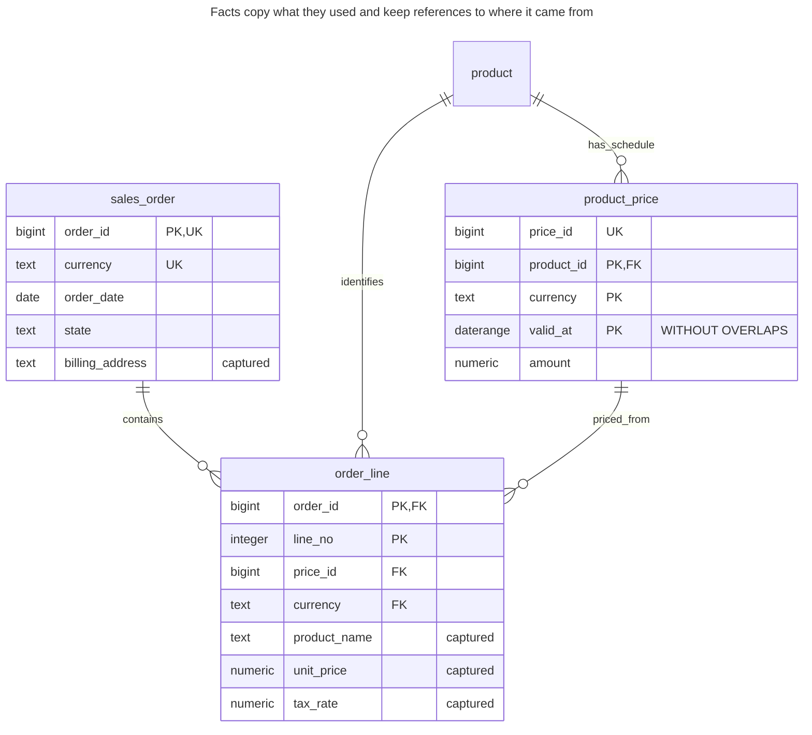
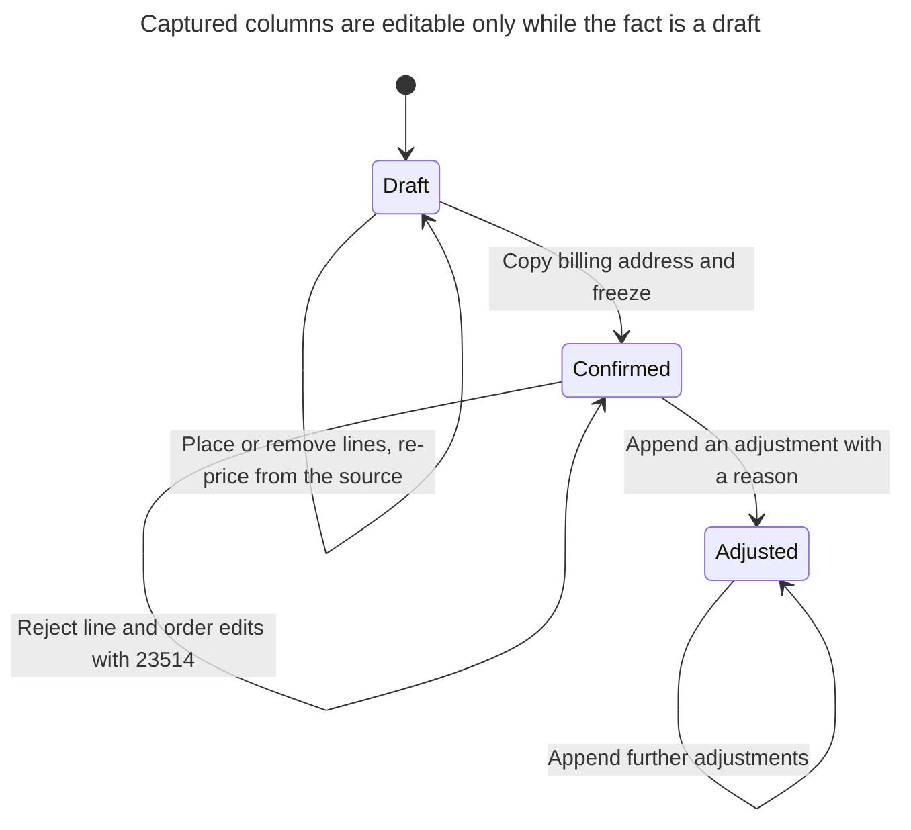
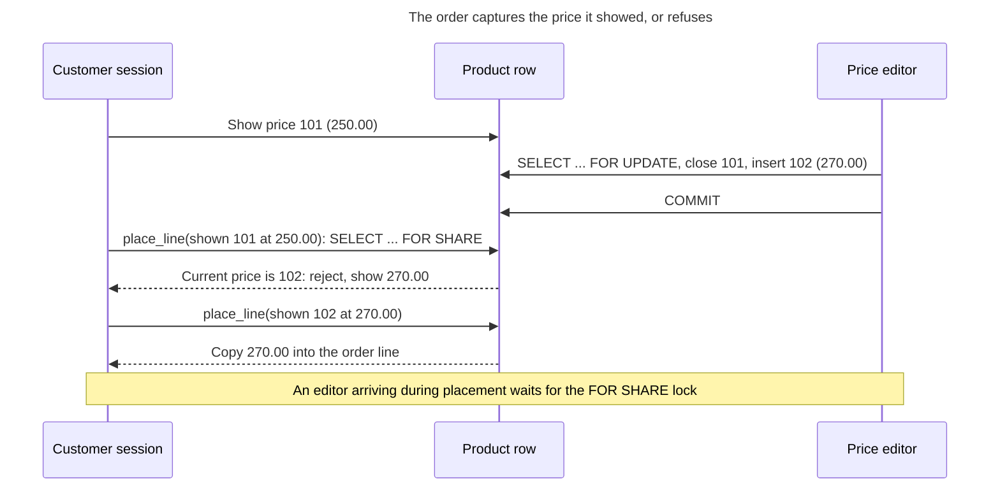
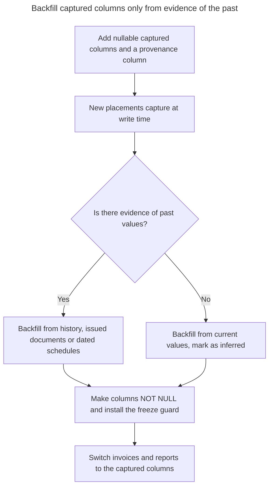

# Captured Value

## Intent

A captured value is a copy of what was true when a business fact happened — an order line's unit price, product name and tax rate, an invoice's billing address — stored in the fact's row and never re-synced with its source. It is part of the fact, not a cache: once the order is confirmed, the copy is the record of what the customer agreed to, and changing it is a correction with its own row, not an edit. The chapter separates this legitimate half of “denormalization” from synced copies, compares it with referencing an immutable version and with looking up a dated value, freezes the captured columns with a trigger or with privileges, and works through currency conversion, where the applied exchange rate is the captured value.

## Also known as

Snapshot column; frozen copy; historical copy. Often filed under denormalization, which hides the difference this chapter depends on: a denormalized copy must agree with its source, and a captured value need not. Stripe's API documents this behavior for an invoice's customer fields: [`customer_address`](https://docs.stripe.com/api/invoices/object) equals the customer's address until the invoice is finalized and “will no longer be updated” after that.

## Problem

A customer orders a grinder for 250.00 EUR at 19 % tax, to be billed to an address in Berlin. The order line stores `product_id` and `quantity`; the invoice joins to `product` and `customer` to print the rest. Next week the product is renamed, its tax category changes to 7 %, the price rises to 270.00 and the customer moves to Hamburg. Reprinting the invoice now shows a product name the customer never saw, a total the customer never agreed to and an address the goods were never billed to. Nothing was lost by accident: the schema never recorded those facts.

A dated price table looks like a fix: find the price valid on the order date. It answers correctly only while three things hold. The order date must select exactly the price that was shown. The price schedule must never be corrected in place. Every attribute you print must have its own dated table, while names, addresses and tax categories rarely do. A negotiated discount, a promotion or a quote outside the list breaks the first condition immediately.

The opposite reflex is just as harmful. A team that has been told “copies are denormalization” adds a trigger that refreshes `order_line.product_name` whenever the product changes. That turns a recorded fact into a cache of the current catalog.

## Solution

Decide for every value the fact depends on whether it belongs to the fact or to the source:

- **Captured**: the value was agreed, shown, charged or reported at the time of the fact. Copy it into the fact's row when the fact is created, from the row you locked or verified, and never update it from the source again.
- **Referenced**: the value describes the source's identity or current state, for example the product's stock level or the customer's current e-mail address. Keep a foreign key and join.

Keep the reference to the source next to the copy. The `product_id` answers “which product”, the copied name answers “what we called it then”. A reference to the dated row the value came from (`price_id`, `quote_id`) adds provenance: it shows which rule produced the copy, and it finds every fact a later correction of the source would have changed.

Freeze captured columns once the fact is confirmed. A draft order may still be re-priced; a confirmed one may not. When a captured value turns out to be wrong, record an explicit adjustment (a credit line, a reversal, a revised document) and keep the original row intact.

## Alternatives and selection

| Choice | Relationship | Deciding requirement |
| --- | --- | --- |
| Captured value | Default for facts | The fact must reproduce what was agreed or shown, whatever happens to the source later |
| Synced copy (cache), see [Summary Table](summary-table.md) | Different contract, not a replacement | The copy must always equal the source; it exists for read speed, and a mismatch is a bug |
| Reference an immutable version, as [Bill of Materials](bill-of-materials.md) pins released revisions | Replacement | The source is already versioned and its released versions can never change; several facts share large versioned content |
| Look up a dated value by the fact's date, see [Effective Dating](effective-dating.md) | Replacement for list prices only; complement for selection | The value is exactly the schedule's value on that date, and the schedule is never corrected in place |
| [History Table](history-table.md) on the source | Complement | You need to know what the source said at an instant, not what a particular fact used |

See the [Decision Atlas](decision-atlas.md) for the full comparison of time-related contracts.



Pinning and capturing reach the same guarantee by different routes. A pinned reference is cheap when the versioned source already exists and is guaranteed immutable; Stripe, for example, does not let you [change a price's amount](https://docs.stripe.com/products-prices/manage-prices) and asks you to create a new price instead. Capturing is the only route when the source is ordinary mutable data, such as a customer's address.

## Structure



The highlighted tables are facts; the muted ones are sources that keep changing. The exchange-rate tables, `fx_quote` and `order_conversion`, are shown with the currency variant below. Every arrow from a source to a fact is a reference used for identity and provenance, never for reading the values the fact printed.

## Tables and invariants

- **`product`** and **`customer`** hold current descriptive values. Nothing in a fact depends on their staying the same.
- **`product_price`** is an effective-dated schedule with a temporal key, as in [Effective Dating](effective-dating.md). Its surrogate `price_id` is unique, so an order line can cite the exact row it was priced from.
- **`sales_order`** captures `billing_address` at confirmation. A check requires the address and confirmation time once the state is `confirmed`; the trigger `sales_order_frozen` rejects every update and delete of a confirmed order, including a move back to draft. `UNIQUE (order_id, currency)` is the target for currency-matching references.
- **`order_line`** copies the product name, unit price and tax rate and keeps `product_id` and `price_id`. The composite reference `(order_id, currency)` makes every line use its order's currency. The trigger `order_line_frozen` locks the parent order with `FOR SHARE` and rejects inserts, updates and deletes of lines on a confirmed order. `FOR KEY SHARE` would not conflict with the confirming update and would let a line slip into an order that is being confirmed.
- **`order_adjustment`** records corrections as new signed amounts with a reason, in the order's currency.
- **`fx_quote`** stores dated rates per source and currency pair: one unit of `base_currency` equals `rate` units of `quote_currency`. The temporal key rejects two quotes from one source for the same pair and day.
- **`order_conversion`** copies `applied_rate` and the source amount, derives the converted amount as a stored generated column, and references the quote through `(quote_id, from_currency, to_currency)`. A quote for another currency pair cannot be cited.

## When to use

- Orders, invoices, receipts, contracts, payslips and shipping labels: any document a counterparty received or relied on.
- Values that were shown to a person before they committed, such as a price, a fee, a delivery promise or terms and conditions.
- Values derived from sources that change for reasons unrelated to the fact: catalog edits, address moves, tax-category changes, rate corrections.
- Reports that must reproduce the same figures after the sources change, such as a monthly revenue in a reporting currency.

## Consequences and trade-offs

- ➕ A fact reproduces itself without the source's history: reprinting an invoice needs only the invoice's rows.
- ➕ Sources can be edited, renamed and corrected freely; no edit silently rewrites a past document.
- ➕ The kept reference turns a source correction into a query: which facts used the corrected row, and by how much do they differ.
- ➖ Storage grows with every captured column on every fact row. Capture what the fact used, not the whole source row.
- ➖ Captured values that were wrong stay wrong until someone records an adjustment. The schema enforces the procedure, not the outcome.
- ➖ Developers trained to remove duplication will try to “fix” the copy. The column names and comments must say that the copy is intentional.

## Implementation

The [complete PostgreSQL 18.7 script](../assets/captured-value/captured-value.sql) verifies capture at placement and confirmation, a dated lookup that drifts after an in-place correction, the frozen order and lines, an adjustment, stale-price rejection, currency-matching references, a currency conversion that survives a quote correction, per-currency totals and a privilege-only guard. The line table:

```sql
CREATE TABLE order_line (
    order_id bigint NOT NULL,
    line_no integer NOT NULL,
    product_id bigint NOT NULL REFERENCES product (product_id),
    price_id bigint NOT NULL REFERENCES product_price (price_id),
    currency text NOT NULL,
    quantity integer NOT NULL CHECK (quantity > 0),
    product_name text NOT NULL,
    unit_price numeric(12,2) NOT NULL CHECK (unit_price >= 0),
    tax_rate numeric(5,4) NOT NULL CHECK (tax_rate >= 0 AND tax_rate < 1),
    PRIMARY KEY (order_id, line_no),
    FOREIGN KEY (order_id, currency) REFERENCES sales_order (order_id, currency)
);
```

The line guard runs before every insert, update and delete of a line:

```sql
SELECT state INTO v_state FROM sales_order WHERE order_id = v_order_id FOR SHARE;
IF v_state = 'confirmed' OR (TG_OP = 'UPDATE' AND NEW.order_id <> OLD.order_id) THEN
    RAISE EXCEPTION 'lines of confirmed order % are immutable', v_order_id
        USING ERRCODE = '23514';
END IF;
```

The function `place_line(order, line, product, quantity, shown_price_id, shown_amount)` takes the price row and the amount the customer was shown and copies only from rows it has locked or verified. The amount matters because a schedule row can be corrected in place under the same `price_id`:

```sql
SELECT * INTO STRICT v_product FROM product WHERE product_id = p_product_id FOR SHARE;
SELECT * INTO v_price FROM product_price
WHERE product_id = p_product_id
  AND currency = v_order.currency
  AND valid_at @> v_order.order_date;
IF NOT FOUND OR v_price.price_id <> p_shown_price_id
   OR v_price.amount <> p_shown_amount THEN
    RAISE EXCEPTION 'shown price % (%) is not current for product % on %',
        p_shown_price_id, p_shown_amount, p_product_id, v_order.order_date
        USING ERRCODE = 'P0001', HINT = 'Show the customer the current price.';
END IF;
INSERT INTO order_line (order_id, line_no, product_id, price_id, currency, quantity,
                        product_name, unit_price, tax_rate)
VALUES (p_order_id, p_line_no, p_product_id, v_price.price_id, v_price.currency,
        p_quantity, v_product.name, v_price.amount, v_product.tax_rate);
```

Confirmation is a procedure that copies the customer's current billing address and sets the state in one `UPDATE ... FROM customer`. After order 1 is placed at 250.00 EUR and confirmed, the script renames the product, changes its tax rate to 7 %, moves the customer to Hamburg and splits the price schedule so that 270.00 applies from February 27. Order 1 still reads `Espresso grinder`, `250.00`, `0.1900` and the Berlin address, while a join to the sources shows today's values.

Then someone corrects the old schedule row in place to 240.00. A dated lookup for the order date now returns `240.00`, and the order still says `250.00`. The kept reference finds what the correction affected:

```sql
SELECT l.order_id, l.line_no, l.unit_price, pp.amount
FROM order_line l JOIN product_price pp USING (price_id)
WHERE l.unit_price <> pp.amount;
```

It returns order 1. The fix is not an edit. Changing the captured price raises SQLSTATE `23514`: `ERROR: lines of confirmed order 1 are immutable`; deleting the line or adding a new one raises the same error, and changing the order's address, moving it back to draft or deleting it raises `ERROR: confirmed order 1 is immutable`. A draft dated February 20 is still editable: placing price 101 at the old `250.00` is now rejected, placing it at `240.00` succeeds, and the script then updates and deletes that draft line and the draft order. The script records the business decision as a row instead:

```sql
INSERT INTO order_adjustment VALUES
    (1, 1, 'EUR', -10.00, 'Price list error corrected on 2026-03-02');
```

The order's net amount becomes `240.00`, and the line still shows the `250.00` the customer saw.

A customer who saw price 101 at 250.00 and places order 3 dated February 27 is rejected with SQLSTATE `P0001`: `ERROR: shown price 101 (250.00) is not current for product 1 on 2026-02-27`, with `HINT: Show the customer the current price.` Passing price 102 at 270.00 succeeds and captures `270.00`. A line whose currency differs from its order's raises `23503`: `ERROR: insert or update on table "order_line" violates foreign key constraint "order_line_order_id_currency_fkey"`.



The only arrow out of `Confirmed` adds rows. A move back to draft would reopen the captured columns, so the order trigger rejects it like any other edit.

**Worked variant: currency conversion.** A shop that reports in EUR also sells in USD. The rate used for an order is a captured value, and the quotes it comes from are an effective-dated source with a named provider. [Quantity](quantity.md) keeps each currency a separate dimension, and [Double-Entry Ledger](double-entry-ledger.md) balances each currency separately; this section adds the dated quote and the applied rate those chapters leave out. `fx_quote` has the same shape as the price schedule, with the temporal key `(source, base_currency, quote_currency, valid_at WITHOUT OVERLAPS)`, a unique `quote_id` and `UNIQUE (quote_id, base_currency, quote_currency)` as the target for the conversion's reference:

```sql
CREATE TABLE order_conversion (
    order_id bigint PRIMARY KEY,
    from_currency text NOT NULL,
    to_currency text NOT NULL,
    quote_id bigint NOT NULL,
    applied_rate numeric(18,8) NOT NULL CHECK (applied_rate > 0),
    source_amount numeric(12,2) NOT NULL,
    converted_amount numeric(12,2) GENERATED ALWAYS AS
        (round(source_amount * applied_rate, 2)) STORED,
    FOREIGN KEY (order_id, from_currency) REFERENCES sales_order (order_id, currency),
    FOREIGN KEY (quote_id, from_currency, to_currency)
        REFERENCES fx_quote (quote_id, base_currency, quote_currency)
);
```

The conversion selects the quote valid on the order date, then copies its rate. Order 2 is 60.00 USD; at quote 301 (`0.86`) it is reported as `51.60` EUR. A quote's direction is part of its meaning: the inverse of a USD→EUR rate is a new number with its own rounding, so store the pair you applied. Citing a USD→EUR quote for a EUR order raises `23503` on `order_conversion_quote_id_from_currency_to_currency_fkey` with `DETAIL: Key (quote_id, from_currency, to_currency)=(301, EUR, USD) is not present in table "fx_quote".`

The applied rate is stored even though the quote is referenced, for two reasons. The rate you apply can legitimately differ from the quote, for example by a contracted spread; store that spread in its own column if you use one. And the provider can correct a published quote. The script changes quote 301 to `0.87`; the conversion keeps `0.86` and `51.60`, and `applied_rate <> rate` lists it for review. Rounding and the scale of intermediate results follow [Inexact Arithmetic](inexact-arithmetic.md).

Amounts in different currencies are never summed. Totals are grouped by currency, and a total in the reporting currency adds only amounts that are already in it. The script's `order_total` view adds lines and adjustments per order and always returns the order's currency with the amount:

```sql
SELECT sum(eur) FROM (
    SELECT net_amount AS eur FROM order_total WHERE currency = 'EUR'
    UNION ALL
    SELECT converted_amount FROM order_conversion WHERE to_currency = 'EUR'
) s;
```

It returns `561.60`: orders 1 and 3 in EUR plus the captured conversion of order 2. The grouped totals are `510.00` EUR and `60.00` USD. A quote also has a contract: the European Central Bank publishes its [euro reference rates](https://www.ecb.europa.eu/stats/policy_and_exchange_rates/euro_reference_exchange_rates/html/index.en.html) around 16:00 CET on working days “for information purposes only” and discourages their use for transactions, so the `source` column says which provider's terms a rate carries.

Conversions and adjustments are never updated after insertion, so privileges alone can guard them, without a state-dependent trigger. The script creates `captured_value_app` with `SELECT, INSERT` on both tables; its update raises SQLSTATE `42501`: `ERROR: permission denied for table order_conversion`. PostgreSQL's [`GRANT`](https://www.postgresql.org/docs/18/sql-grant.html) also accepts column lists, so a role can update a status column without being able to touch the captured ones. A table whose captured columns are editable in a draft state needs the trigger, because privileges do not depend on row values.

## Engine support

- **PostgreSQL 18:** [row triggers](https://www.postgresql.org/docs/18/plpgsql-trigger.html) implement state-dependent freezing, and [column-level privileges](https://www.postgresql.org/docs/18/sql-grant.html) guard insert-only facts. Temporal keys for the dated sources need `btree_gist` for scalar columns, as in [Effective Dating](effective-dating.md).
- **MySQL 8.4:** [`GRANT`](https://dev.mysql.com/doc/refman/8.4/en/grant.html) supports column privileges for `INSERT`, `REFERENCES`, `SELECT` and `UPDATE`, and triggers can reject an edit with [`SIGNAL`](https://dev.mysql.com/doc/refman/8.4/en/signal.html). There is no temporal key for the quote schedule; follow the effective-dating port.
- **SQL Server 2025 (17.x):** [`GRANT` on object permissions](https://learn.microsoft.com/en-us/sql/t-sql/statements/grant-object-permissions-transact-sql?view=sql-server-ver17) accepts a column list for `SELECT`, `REFERENCES`, `UPDATE` and `UNMASK`. [DML triggers operate on sets](https://learn.microsoft.com/en-us/sql/relational-databases/triggers/create-dml-triggers-to-handle-multiple-rows-of-data?view=sql-server-ver17), so a freeze check must join `inserted` and `deleted` to the parent orders rather than assume one row.
- **Oracle AI Database 26ai:** [`GRANT`](https://docs.oracle.com/en/database/oracle/oracle-database/26/sqlrf/GRANT.html) allows column-level `INSERT`, `UPDATE` and `REFERENCES` privileges; state-dependent freezing still needs a trigger.
- **SQLite 3:** there are no privileges. A [trigger](https://www.sqlite.org/lang_createtrigger.html) with `RAISE(ABORT, ...)` can reject updates of confirmed rows; everything else is the application's discipline.

## Failure and concurrency

A price change racing an order placement is decided by what the order copies. Re-reading “the current price” at placement charges whatever price committed last, which may not be the price the customer agreed to. Passing the shown price row and amount and verifying them under a lock charges exactly what was shown, or fails:



The protocol assumes Read Committed, like the effective-dating writers. The lock target is the product row, not the price row. A price change inserts a new dated row, and a lock on the old price row would not stop that insert; the effective-dating protocol has every schedule editor lock the product first, so `FOR SHARE` in placement makes the editor wait until the placing transaction commits. Within one placement, the product name, the tax rate and the price then come from one consistent state. A stale price is a business conflict, not a transient error: do not retry it automatically, show the new price and ask again. [Version Column](version-column.md) treats a stale token the same way.

The line trigger locks the parent order with `FOR SHARE`, which conflicts with the confirming `UPDATE`. A line inserted concurrently with confirmation either commits before the order is confirmed or sees the confirmed state and fails; it cannot appear afterwards in a frozen order.

Retries must not capture twice. If a placement or conversion response is lost, find the existing line or conversion by its key before trying again; a retry under a new key could capture a different price or rate. [Idempotency Record](idempotency-record.md) covers the general case.

## Migration

The usual starting point is an order line that stores only `product_id` and `quantity`, with invoices reading names and prices from the catalog. Captured columns must be filled with what was true then, and the current catalog is not evidence of that.



Start capturing for new orders before backfilling, so the set of rows to repair stops growing. For old orders, prefer the sources that saw the past: a [History Table](history-table.md) on the catalog, an [Audit Log](audit-log.md), the PDF or e-mail that was sent, a payment amount. Where none exists, copy the current value but record that it was inferred, so nobody mistakes it for evidence. Installing a `NOT NULL` constraint and the trigger takes locks; follow [Expand and Contract](expand-contract.md). To back out, point readers back at the join but keep capturing: values not captured in the meantime cannot be recovered later.

## Anti-patterns and common mistakes

- Re-synchronizing captured columns from the source with a trigger or a nightly job, which turns the fact into a cache.
- Removing the copy as “redundant” during a normalization review.
- Printing a past document by joining to the current catalog, customer or tax table.
- Reconstructing a price by date when the agreed price could differ from the list price.
- Capturing from a value the client sent without verifying it against the source under a lock; the client can send any number.
- Editing a confirmed captured value to fix a mistake instead of recording an adjustment.
- Storing an applied rate without the quote it came from, or the quote without the applied rate.
- Summing order totals across currencies, or converting with a rate that was not captured with the conversion.

## Known uses

- Stripe's [Invoice object](https://docs.stripe.com/api/invoices/object) copies the customer's name, e-mail, address, shipping details and tax IDs into the invoice; each field follows the customer until finalization and is no longer updated after it.
- Stripe does not let you edit a finalized invoice's monetary amounts or customer information through the Update endpoint. A [revision](https://docs.stripe.com/invoicing/invoice-edits) is a new draft linked by `from_invoice`; finalizing it voids the original.
- Stripe [prices](https://docs.stripe.com/products-prices/manage-prices) are the immutable-version alternative: a price's amount cannot be changed through the API, and Stripe recommends creating a new price, switching to its ID and deactivating the old one.

## Related patterns

- [Effective Dating](effective-dating.md) provides the dated price and quote schedules that capture selects from.
- [Bill of Materials](bill-of-materials.md) pins immutable released versions instead of copying them.
- [Summary Table](summary-table.md) covers copies that must stay in sync with their source.
- [History Table](history-table.md) records what a source said over time, which a backfill can use.
- [Quantity](quantity.md) and [Double-Entry Ledger](double-entry-ledger.md) keep currencies apart in arithmetic and postings.
- [Inexact Arithmetic](inexact-arithmetic.md) explains exact amounts and rounding of converted values.
- [Version Column](version-column.md) rejects a command based on a stale view, the general form of the shown-price check.
