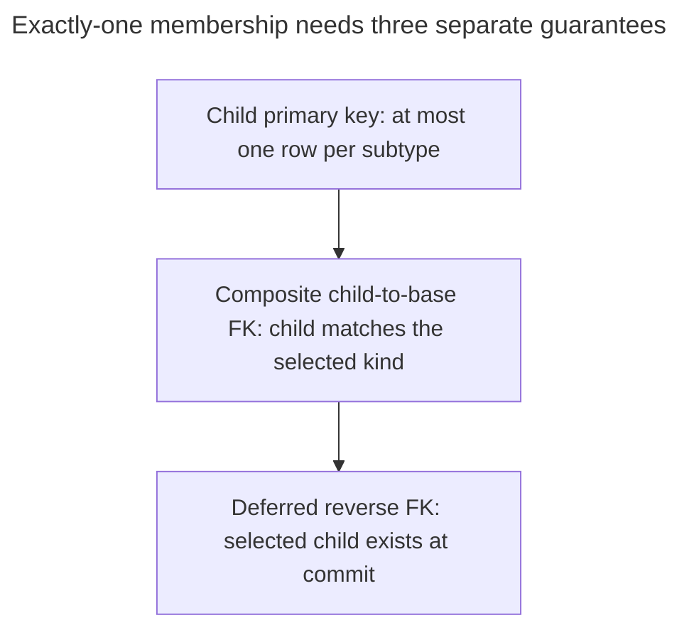
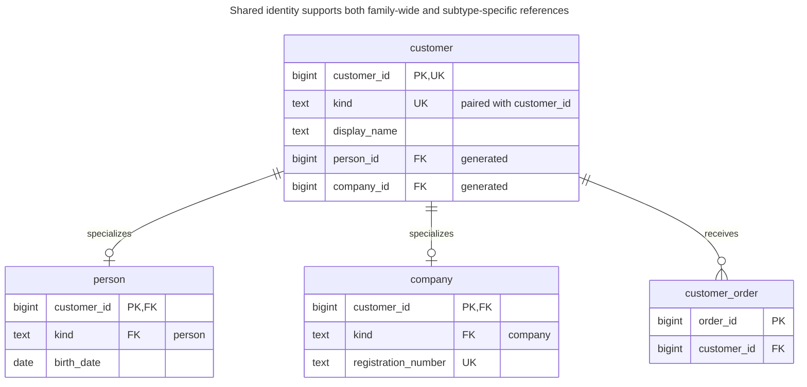
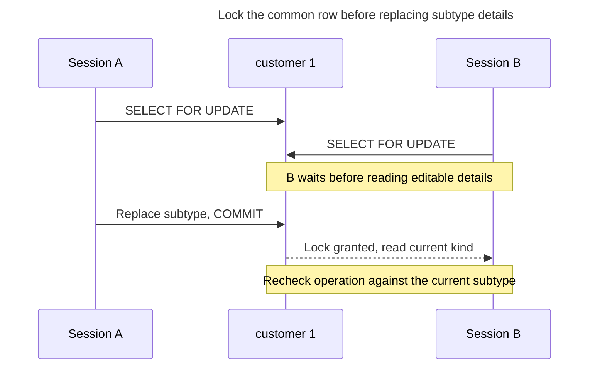
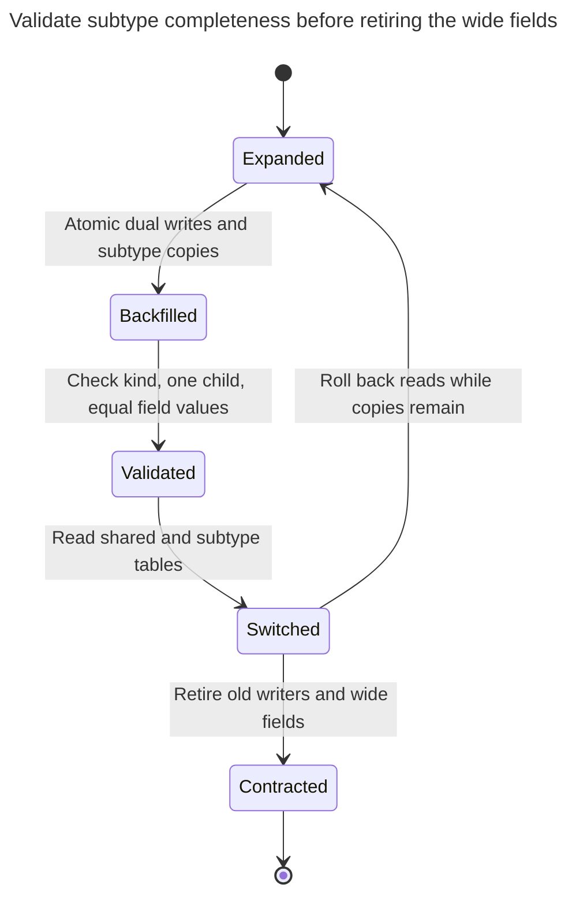

# Class Table Inheritance

## Intent

Class table inheritance gives the shared attributes of a family of types one supertype table and each subtype its own table, whose primary key is also a foreign key to the supertype. Every column lives in exactly one place, can be NOT NULL where the subtype demands it, and other tables can reference either the supertype or one specific subtype. The chapter covers guaranteeing that each supertype row has exactly one matching subtype row, the cost of joins when reading a whole object, and how the same structure works as a shared supertype for references that may point to several kinds of entity.

## Also known as

Joined inheritance; table per subclass. Fowler names [Class Table Inheritance](https://martinfowler.com/eaaCatalog/classTableInheritance.html); Hibernate calls the mapping [`JOINED`](https://docs.hibernate.org/orm/6.6/userguide/html_single/Hibernate_User_Guide.html#entity-inheritance-joined-table).

## Problem

People and companies share customer identity and a display name but have substantial, different details. Orders need to reference either kind of customer, while a corporate-only operation needs a reference specifically to a company. One wide row puts every subtype's fields in the same shape rule; independent complete tables leave no single customer table for orders.

Creating a supertype and two shared-key extensions solves identity and field placement, but not completeness. A foreign key from `person` to `customer` cannot require every customer to have a person or company row. Nor does it prevent the same customer ID from appearing in both extensions.

## Solution

Store shared fields once in `customer`, and required subtype fields in `person` and `company`. For this example, membership is total and disjoint: every customer has exactly one of those subtypes. Other domains permit an abstract base row or overlapping subtypes; those require different invariants.

Enforce disjointness with a mandatory discriminator, a fixed subtype tag in each child, and a composite foreign key matching `(customer_id, kind)`. Enforce completeness with generated references from the base row to its selected child, checked at transaction end. This is the chapter's worked PostgreSQL design using [generated columns](https://www.postgresql.org/docs/18/ddl-generated-columns.html) and [deferred foreign keys](https://www.postgresql.org/docs/18/sql-createtable.html), not a claim that an ORM installs these additional constraints.



Each step closes a different gap. If the base may exist without details, omit the completeness requirement deliberately; if subtypes overlap, replace the exclusive discriminator rather than weakening its checks accidentally.

## Alternatives and selection

| Sibling | Relationship | Deciding requirement |
| --- | --- | --- |
| [Single Table Inheritance](single-table-inheritance.md) | Replacement | Small subtype differences and frequent complete-object reads make one row simpler |
| [Concrete Table Inheritance](concrete-table-inheritance.md) | Replacement | You do not need a common identity or common foreign-key target |
| [Exclusive Arc](exclusive-arc.md) | Replacement for a reference to unrelated existing tables; implementation option for reverse completeness references | A short list of targets needs no common entity lifecycle |
| [Table Split](table-split.md) | Replacement for attribute placement without subtyping | The extension represents an optional field group, not membership in a type |
| [Party](party.md) / [Role Object](role-object.md) | Complements | People and organizations share identity, while business roles can overlap |

See the [Decision Atlas](decision-atlas.md) for the full table. A shared supertype can also replace [Polymorphic Associations](polymorphic-associations.md): dependent tables reference the real common key instead of a table name and an unchecked number.

## Structure



The individual subtype edges each allow zero or one child. Together, the discriminator and reverse references require exactly one selected child at commit. `UK` on the base ID and kind denotes the composite unique pair, not uniqueness of `kind` by itself. A company-only dependent can reference `company.customer_id` directly.

## Tables and invariants

- **`customer`** owns the shared key and display name. Its discriminator chooses one generated reverse reference; the other is null.
- **`person` and `company`** share the base key as their primary key. Their fixed type tags and composite foreign keys prevent attaching the wrong subtype to a base row.
- **Completeness** comes from `customer_requires_person` and `customer_requires_company`, both deferred. Ordinary child-to-base foreign keys alone provide no such guarantee.
- **`customer_order`** references the supertype. Subtype conversion keeps its reference unchanged; deleting a customer with orders is rejected. Deleting an unreferenced base customer cascades to its subtype.

## When to use

- Shared identity and shared references matter, but subtype fields deserve separate mandatory columns.
- Some relationships should accept all customers and others only a particular subtype.
- You can create, convert and delete the complete object inside one transaction.

## Consequences and trade-offs

- ➕ Each subtype can declare its own required fields and unique business attributes directly.
- ➕ Shared fields and family-wide references have one owner.
- ➖ Reading a complete person requires a join; listing complete heterogeneous objects involves joining the relevant subtype tables.
- ➖ Exactly-one membership adds constraints and a multi-statement write protocol. The reverse-reference implementation also adds a generated column and foreign key for each subtype.
- ➖ A common base is a domain commitment. Do not create one solely to hide unrelated tables behind an identical integer field.

## Implementation

The [complete script](../assets/class-table-inheritance/class-table-inheritance.sql) includes both missing-child and wrong-child failures, conversion and deletion. The essential schema is:

```sql
CREATE TABLE customer (
    customer_id bigint PRIMARY KEY,
    kind text NOT NULL CHECK (kind IN ('person', 'company')),
    display_name text NOT NULL,
    person_id bigint GENERATED ALWAYS AS
        (CASE WHEN kind = 'person' THEN customer_id END) STORED,
    company_id bigint GENERATED ALWAYS AS
        (CASE WHEN kind = 'company' THEN customer_id END) STORED,
    UNIQUE (customer_id, kind)
);
CREATE TABLE person (
    customer_id bigint PRIMARY KEY,
    kind text NOT NULL DEFAULT 'person' CHECK (kind = 'person'),
    birth_date date NOT NULL,
    FOREIGN KEY (customer_id, kind) REFERENCES customer (customer_id, kind)
        ON DELETE CASCADE
);
CREATE TABLE company (
    customer_id bigint PRIMARY KEY,
    kind text NOT NULL DEFAULT 'company' CHECK (kind = 'company'),
    registration_number text NOT NULL UNIQUE,
    FOREIGN KEY (customer_id, kind) REFERENCES customer (customer_id, kind)
        ON DELETE CASCADE
);
ALTER TABLE customer ADD CONSTRAINT customer_requires_person
    FOREIGN KEY (person_id) REFERENCES person (customer_id)
    DEFERRABLE INITIALLY DEFERRED;
ALTER TABLE customer ADD CONSTRAINT customer_requires_company
    FOREIGN KEY (company_id) REFERENCES company (customer_id)
    DEFERRABLE INITIALLY DEFERRED;
CREATE TABLE customer_order (
    order_id bigint PRIMARY KEY,
    customer_id bigint NOT NULL REFERENCES customer (customer_id)
);
CREATE INDEX customer_order_customer_idx ON customer_order (customer_id);
```

The extra type tag in each child is deliberate: the composite reference proves that its parent has that type. The reverse references are stored generated columns so writers cannot choose a different child's ID. Insert the base before its subtype, and commit the pair together:

```sql
BEGIN;
INSERT INTO customer (customer_id, kind, display_name) VALUES (1, 'person', 'Ada');
INSERT INTO person (customer_id, birth_date) VALUES (1, DATE '1990-01-01');
INSERT INTO customer_order VALUES (10, 1);
COMMIT;
SELECT c.customer_id, c.display_name, p.birth_date
FROM customer AS c JOIN person AS p USING (customer_id);
```

The query returns `(1, Ada, 1990-01-01)`. Inserting a company base without its details is invalid at commit:

```sql
BEGIN;
INSERT INTO customer (customer_id, kind, display_name)
VALUES (2, 'company', 'Incomplete');
COMMIT;
```

PostgreSQL 18.6 raises SQLSTATE `23503`: `ERROR: insert or update on table "customer" violates foreign key constraint "customer_requires_company"`. Customer `2` is rolled back. Trying to insert company details for customer `1`, whose kind is still `person`, instead fails the immediate `company_customer_id_kind_fkey` reference with SQLSTATE `23503`.

Convert a permitted customer by replacing its subtype inside one transaction:

```sql
BEGIN;
DELETE FROM person WHERE customer_id = 1;
UPDATE customer SET kind = 'company' WHERE customer_id = 1;
INSERT INTO company (customer_id, registration_number) VALUES (1, 'REG-1');
COMMIT;
SELECT o.order_id, c.kind, d.registration_number
FROM customer_order AS o JOIN customer AS c USING (customer_id)
JOIN company AS d USING (customer_id);
```

The result is `(10, company, REG-1)`. Deleting only the selected company row fails at commit; deleting the base after removing its orders cascades to that company row. Deferred checks permit an incomplete intermediate state within the transaction, not in committed data. PostgreSQL documents this distinction in [`SET CONSTRAINTS`](https://www.postgresql.org/docs/18/sql-set-constraints.html).

## Engine support

- **PostgreSQL 18:** the example uses ordinary tables, not [`INHERITS`](https://www.postgresql.org/docs/18/ddl-inherit.html#DDL-INHERIT-CAVEATS). Native inheritance does not extend primary-key uniqueness or foreign keys across all child tables and is not a substitute for the shared-key relationships here.
- **MySQL 8.4 / InnoDB:** [foreign-key checks are immediate](https://dev.mysql.com/doc/refman/8.4/en/create-table-foreign-keys.html). The deferred circular creation protocol cannot be copied unchanged; keep one row or explicitly accept a procedure-enforced completeness boundary.
- **SQL Server 2025 (17.x):** the documented [`CREATE TABLE` syntax](https://learn.microsoft.com/en-us/sql/t-sql/statements/create-table-transact-sql?view=sql-server-ver17) has no deferred constraint option. Child-to-base keys port conceptually, but the exactly-one guarantee needs a different implementation.
- **Oracle AI Database 26ai:** supports [deferrable constraints](https://docs.oracle.com/en/database/oracle/oracle-database/26/sqlrf/constraint.html); adapt generated-column syntax and types and verify the complete circular lifecycle on Oracle before using it.
- **SQLite 3:** supports [deferred foreign keys](https://www.sqlite.org/foreignkeys.html#fk_deferred) and [generated columns with foreign keys](https://www.sqlite.org/gencol.html). Enable enforcement per connection and declare the whole schema with SQLite's DDL rather than copying the later PostgreSQL `ADD CONSTRAINT` steps.

## Failure and concurrency

The declared constraints protect exactly-one membership at read committed isolation. A second session cannot commit another type for the same base key: the child primary keys and discriminator references remain authoritative. For a multi-statement edit, lock the base row before touching subtype rows and use the same order in every writer. PostgreSQL's [row-lock rules](https://www.postgresql.org/docs/18/explicit-locking.html#LOCKING-ROWS) make that base row a practical serialization point.



Keep the lock until commit, including the deferred checks. If a request loses its response, reload the customer and its current subtype before retrying a conversion. A successful base insert is not yet a successful customer creation; commit can still reject missing details.

## Migration

From a wide customer table, keep the existing IDs. Create subtype tables, deploy atomic dual writes and backfill selected details while locking the source customer. Classify invalid wide rows before adding checks. Install child type references, then generated reverse references and completeness constraints after every selected child exists; PostgreSQL's [`NOT VALID` / `VALIDATE CONSTRAINT` stages](https://www.postgresql.org/docs/18/sql-altertable.html) separate installation from checking old rows.



The rollback edge is available only while both representations remain synchronized. Plan DDL lock windows and defer dropping old columns until the [Expand and Contract](expand-contract.md) overlap has ended. When starting from independent subtype tables instead, resolve duplicate IDs and business keys before building the common base.

## Anti-patterns and common mistakes

- Claiming exactly-one membership from child foreign keys alone: a base can otherwise have zero or multiple children.
- Matching only the ID while leaving the child's type tag unchecked.
- Mapping overlapping customer roles into an exclusive discriminator; see [Role Object](role-object.md).
- Acknowledging creation before the deferred constraints have passed at commit.
- Assuming an ORM mapping includes the reverse completeness constraints shown here.

## Known uses

- Hibernate's [`JOINED` mapping](https://docs.hibernate.org/orm/6.6/userguide/html_single/Hibernate_User_Guide.html#entity-inheritance-joined-table) retrieves inherited state by joining subclass and superclass tables.
- Django's [multi-table inheritance](https://docs.djangoproject.com/en/5.2/topics/db/models/#multi-table-inheritance) creates an automatic one-to-one parent link. This demonstrates shared-key mapping, not the stronger total-disjoint completeness rule implemented here.

## Related patterns

- [Single Table Inheritance](single-table-inheritance.md) keeps the same exclusive family in one row.
- [Concrete Table Inheritance](concrete-table-inheritance.md) removes the common base table.
- [Exclusive Arc](exclusive-arc.md) provides checked references to a short list of existing targets.
- [Table Split](table-split.md) separates attribute groups without introducing types.
- [Party](party.md) applies shared identity to people and organizations.
- [Polymorphic Associations](polymorphic-associations.md) explains the unchecked reference a shared supertype can replace.
