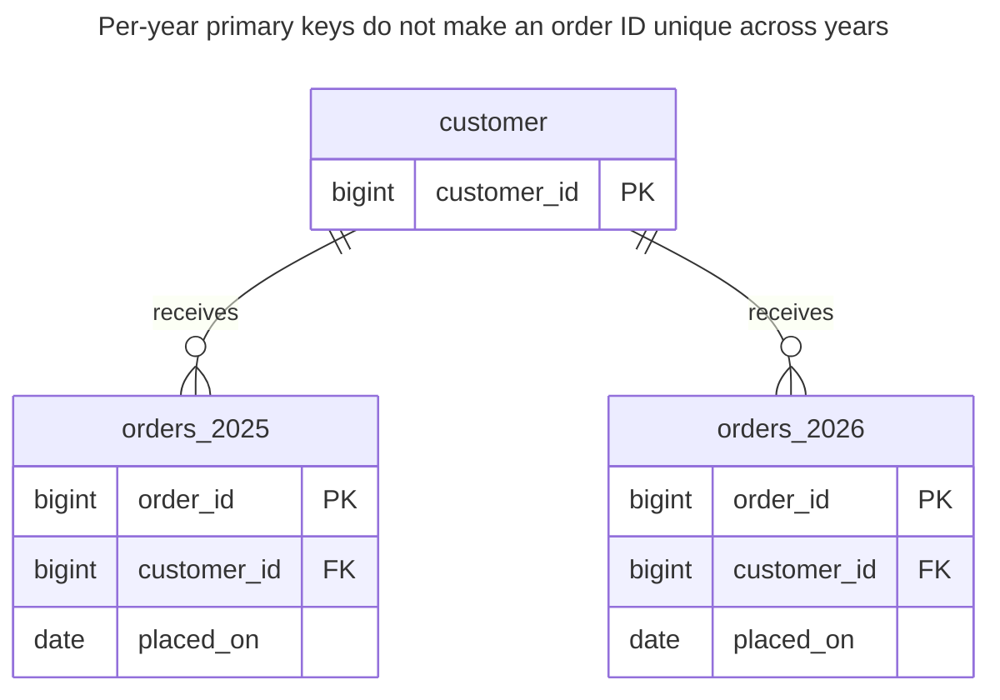
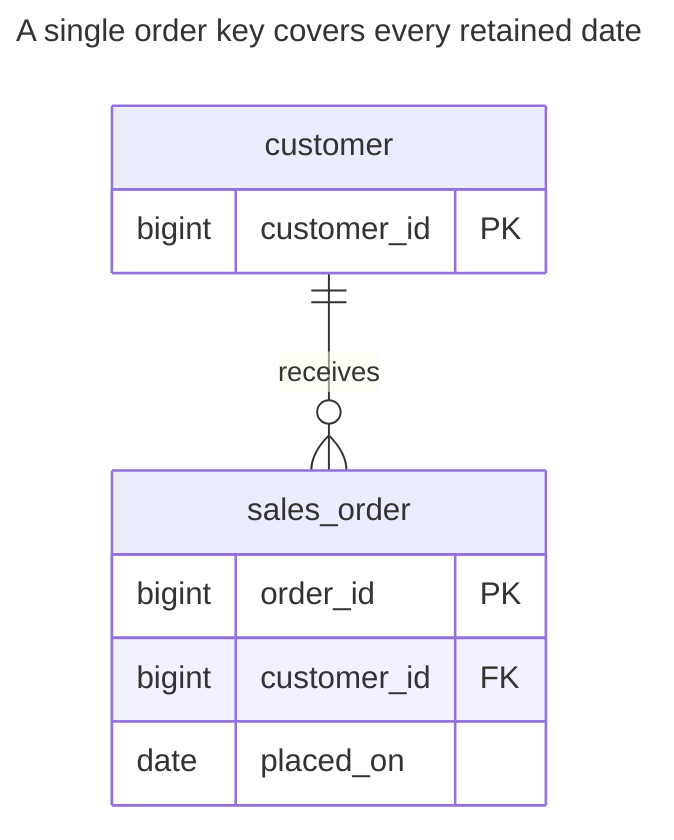
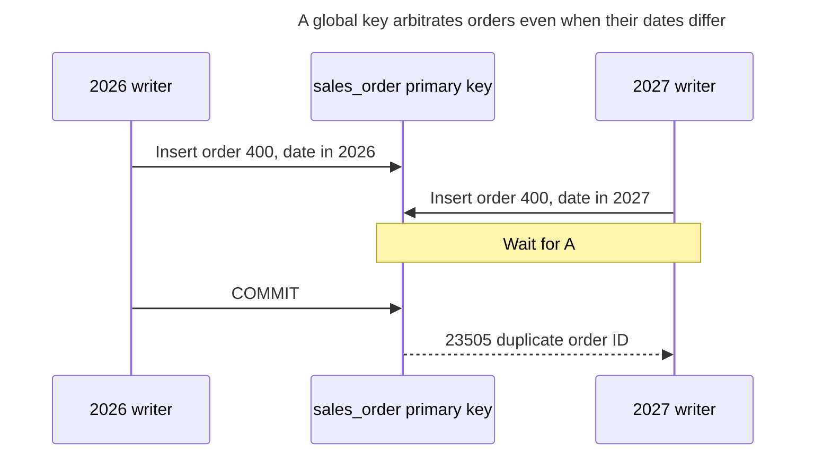
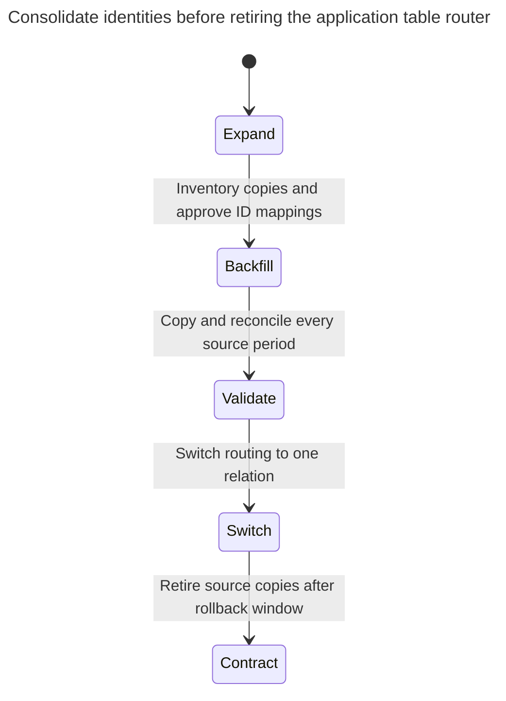

# Cloned Tables

Cloned tables split one kind of data across many identical tables — `orders_2024`, `orders_2025`, or one table per customer — to keep each of them small. Queries across them need a maintained UNION or dynamic SQL, a local unique key cannot enforce uniqueness across the copies, and every schema change has to be repeated in all of them. The chapter shows how table partitioning, or an ordinary column with an index, solves the same problem. Bill Karwin calls this Metadata Tribbles.

## Also known as

Metadata Tribbles, in Bill Karwin's [SQL Antipatterns contents](https://pragprog.com/titles/bksap1/sql-antipatterns-volume-1/). Here the proliferating metadata is one table definition per period or customer for a single logical relation.

## Context

Orders accumulate, and you want recent reads to be fast and old data easy to archive. You create one order table per year. Alternatively, onboarding a customer creates another table with the same shape. Application SQL chooses the name from the date or customer and combines tables for broader reports.

## Problem

You expose a storage slice as a separate application relation while still expecting one logical order model. Every new slice changes the set of objects that readers, migrations, grants and repair tools must cover. A local primary key can admit the same order ID in another copy. Adding an FK to one copy does not make a union of all copies a globally unique reference target.

This does not mean that every constraint across separately named tables is impossible. Each copy can have its own FKs and checks, and you can build a separate identity registry. The harmful condition is expecting local constraints and an expanding list of table names to act like a single consistently managed relation.

## Why people do it

A period-sized table looks easy to drop, and a customer's rows look easy to find when the customer's name is in the object name. Those can be useful operational boundaries. The mistake is adopting them without deciding how the logical query contract, key space and lifecycle remain coherent.

Separate archival snapshots are defensible when they are intentionally independent datasets. Deliberate tenant schemas or databases are also different designs: they need routing, grants, provisioning, migrations and recovery policies. Merely suffixing a shared table with a tenant number does not define that complete boundary.

## Consequences

- ➖ A report can return a plausible partial result when its table list becomes stale.
- ➖ Every schema change must reach every independently managed copy.
- ➖ An ID can identify different rows in different copies.
- ➖ Reference and permission policies can drift between slices.
- ➖ Moving a row across periods becomes a cross-table operation visible to application code.

## Signs

- January provisioning changes SQL text in annual reports.
- Migration code loops over discovered tables matching a prefix.
- You cannot identify an order from its ID without also knowing its table name.
- One copy has a different constraint or column default from the others.

## A better way

Start with one ordinary table and an explicit discriminator such as `placed_on` or `tenant_id`, plus indexes matching real queries. Choose [Table Partitioning](table-partitioning.md) when partition-level retention or pruning is justified. Native partitions keep one parent relation for application queries, while retaining engine-specific constraints and maintenance work.

### Alternatives and selection

| Sibling | Relationship | Deciding requirement |
| --- | --- | --- |
| Ordinary indexed table | Replacement | Global identity and ordinary predicates meet the workload and retention budget |
| [Table Partitioning](table-partitioning.md) | Replacement for physical slicing | Complete periods need maintenance together and queries constrain a partition key |
| [Shared Schema](shared-schema.md) | Replacement for customer-named table copies | Tenants share a schema with explicit scoped keys and access rules |
| [Schema per Tenant](schema-per-tenant.md) / [Database per Tenant](database-per-tenant.md) | Replacement for a deliberate isolation boundary | Independent tenant administration justifies operating separate namespaces or databases |

Use the [Decision Atlas](decision-atlas.md). Partitioning and tenant isolation solve different requirements; one can complement the other. Native partitions do not make every possible global key available.

## Example

### Structure

**Before:** two annual relations each own an independent order key.



Both copies have a valid customer relationship. Their separate keys do not arbitrate one shared order identity.

```sql
CREATE TABLE customer (customer_id bigint PRIMARY KEY);
CREATE TABLE orders_2025 (
    order_id bigint PRIMARY KEY,
    customer_id bigint NOT NULL REFERENCES customer (customer_id),
    placed_on date NOT NULL
);
CREATE TABLE orders_2026 (LIKE orders_2025 INCLUDING ALL);
ALTER TABLE orders_2026 ADD FOREIGN KEY (customer_id) REFERENCES customer (customer_id);
INSERT INTO customer VALUES (1);
INSERT INTO orders_2025 VALUES (100, 1, DATE '2025-12-31');
INSERT INTO orders_2026 VALUES (200, 1, DATE '2026-01-01');
SELECT count(*) FROM orders_2025;
SELECT count(*) FROM (
    SELECT order_id FROM orders_2025
    UNION ALL SELECT order_id FROM orders_2026
) AS all_orders;
INSERT INTO orders_2026 VALUES (100, 1, DATE '2026-02-01');
SELECT order_id, count(*) FROM (
    SELECT order_id FROM orders_2025
    UNION ALL SELECT order_id FROM orders_2026
) AS all_orders GROUP BY order_id HAVING count(*) > 1;
```

The old-table count is `1`, while the union initially counts `2`. After the second `100` insert, the duplicate query returns `(100, 2)`. PostgreSQL's [`LIKE ... INCLUDING ALL`](https://www.postgresql.org/docs/18/sql-createtable.html) copies selected table properties, but does not copy foreign keys; the lab installs the second FK explicitly. Even copying every local invariant would not add cross-copy uniqueness.

**After:** choose one global key and keep the period as data.



The customer/day index supports the shown predicate. The primary key's uniqueness is independent of the date.

```sql
CREATE TABLE sales_order (
    order_id bigint PRIMARY KEY,
    customer_id bigint NOT NULL REFERENCES customer (customer_id),
    placed_on date NOT NULL
);
CREATE INDEX sales_order_customer_day_idx ON sales_order (customer_id, placed_on);
CREATE TABLE order_id_review (
    source_table text NOT NULL,
    old_order_id bigint NOT NULL,
    new_order_id bigint NOT NULL UNIQUE,
    PRIMARY KEY (source_table, old_order_id)
);
-- Reviewed mapping: the two old order 100 rows are distinct orders in this lab.
INSERT INTO order_id_review VALUES
    ('orders_2025', 100, 100), ('orders_2026', 200, 200), ('orders_2026', 100, 300);
BEGIN;
LOCK TABLE orders_2025, orders_2026 IN SHARE ROW EXCLUSIVE MODE;
INSERT INTO sales_order
SELECT m.new_order_id, o.customer_id, o.placed_on FROM orders_2025 AS o
JOIN order_id_review AS m ON m.source_table = 'orders_2025' AND m.old_order_id = o.order_id
UNION ALL
SELECT m.new_order_id, o.customer_id, o.placed_on FROM orders_2026 AS o
JOIN order_id_review AS m ON m.source_table = 'orders_2026' AND m.old_order_id = o.order_id;
COMMIT;
SELECT count(*) FROM sales_order;
SELECT order_id FROM sales_order
WHERE customer_id = 1 AND placed_on >= DATE '2026-01-01' ORDER BY order_id;
```

There are `3` orders, with 2026 IDs `200, 300`. The retained mapping distinguishes source-table identity from the new global identity. This lab treats the two old `100` rows as different orders; if evidence instead says they are duplicate copies, merge their dependents deliberately. Never resolve a collision by blindly changing one number.

```sql
INSERT INTO sales_order VALUES (100, 1, DATE '2027-01-01');
```

PostgreSQL 18.6 raises SQLSTATE `23505`: `ERROR: duplicate key value violates unique constraint "sales_order_pkey"`. A different year no longer makes the duplicate valid. The [complete script](../assets/cloned-tables/cloned-tables.sql) preserves all source rows and checks the mapping and final counts.

### Engine support

- **PostgreSQL 18:** [declarative partitioning](https://www.postgresql.org/docs/18/ddl-partitioning.html#DDL-PARTITIONING-DECLARATIVE-LIMITATIONS) requires a parent primary/unique key to include every partition-key column. Range partitioning this table by date would change its available key contract; do not silently substitute `(placed_on, order_id)` for ID-only uniqueness.
- **MySQL 8.4 / InnoDB:** [partitioned tables cannot participate in foreign keys](https://dev.mysql.com/doc/refman/8.4/en/partitioning-limitations-storage-engines.html). An ordinary table may be the better repair when these relationships are required.
- **SQL Server:** [partition functions and schemes](https://learn.microsoft.com/en-us/sql/relational-databases/partitions/partitioned-tables-and-indexes?view=sql-server-ver17) organize native partitions. Unique aligned and nonaligned indexes have different requirements, so review identity and maintenance together.
- **Oracle:** [interval partitioning](https://docs.oracle.com/en/database/oracle/oracle-database/19/vldbg/partition-concepts.html) can create additional interval partitions automatically. That is a native lifecycle option, not permission to omit operating the retention policy.
- **SQLite:** its [`CREATE TABLE` grammar](https://www.sqlite.org/lang_createtable.html) has no declarative `PARTITION BY`. Use an ordinary indexed table when a single constrained relation is required.

### Failure and concurrency

Two annual tables can independently accept the same ID because they have separate unique indexes. The ordinary replacement has one arbiter. PostgreSQL's [unique-index conflict checking](https://www.postgresql.org/docs/18/index-unique-checks.html) waits for the competing insert before rejecting a duplicate.



Partitioned alternatives require the complete selected key in the same reasoning. A date-and-ID primary key arbitrates duplicate pairs, not ID-only duplicates on different dates. Keep retry identity and foreign-key shape consistent with that choice.

### Migration

Inventory all copies and compare columns, constraints, grants and identity collisions. Build an explicit `(source_table, old_id)` mapping, then migrate every incoming reference through it. The source table is essential when two copies issued the same number. Reconcile row counts and contents by period, not just in total.



The lab pauses writes during its copy. A live consolidation must capture inserts, corrections and deletes from every copy until final reconciliation. For compatible period-sized tables, PostgreSQL can [attach them as partitions](https://www.postgresql.org/docs/18/sql-altertable.html#SQL-ALTERTABLE-ATTACH-PARTITION), subject to matching shape and bounds; that avoids treating a union as permanent application routing. It does not remove unique-key limitations. Keep source copies synchronized through rollback, then archive or drop them only after all consumers have moved. See [Expand and Contract](expand-contract.md).

## Related patterns and anti-patterns

- [Table Partitioning](table-partitioning.md) keeps physical slices behind a single relation contract.
- [Shared Schema](shared-schema.md) makes tenant scope explicit in rows and references.
- [Schema per Tenant](schema-per-tenant.md) defines a deliberate namespace boundary.
- [Database per Tenant](database-per-tenant.md) defines a separate database lifecycle.
- [Repeated Columns](repeated-columns.md) puts data-driven proliferation into fields instead of tables.
