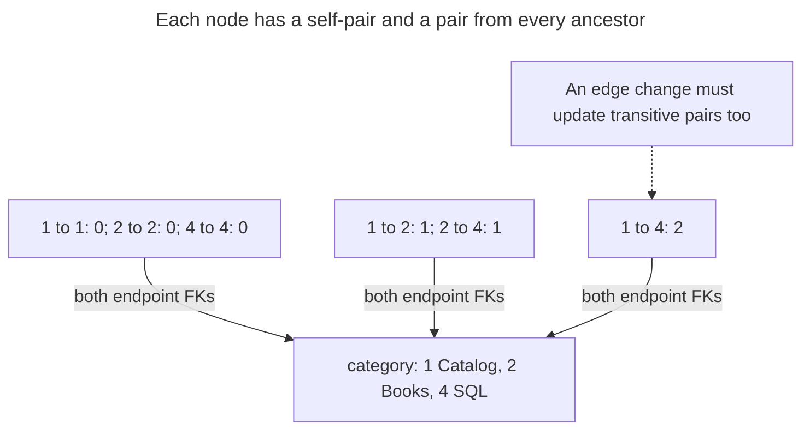

# Closure Table

## Intent

A closure table stores every ancestor–descendant pair of a tree in a separate table, usually with the distance between them. Descendant, ancestor and depth-limited queries become plain joins on an indexed table without recursion, and foreign keys guarantee that every pair refers to real nodes. The chapter shows how inserts, deletes and subtree moves update the pairs, how much space the table takes as trees grow deep, and how the structure extends to graphs where a node has several parents. [Karwin's hierarchy slides](https://www.slideshare.net/billkarwin/models-for-hierarchical-data) demonstrate the ancestor–descendant representation and optional path length.

## Also known as

Transitive closure table. [Bill Karwin's hierarchy slides](https://www.slideshare.net/billkarwin/models-for-hierarchical-data) use “Closure Table”. Kimball's [hierarchy bridge](https://www.kimballgroup.com/data-warehouse-business-intelligence-resources/kimball-techniques/dimensional-modeling-techniques/ragged-variable-depth-hierarchy/) is a related warehouse representation of complete hierarchy paths; its treatment of shared ownership is broader than this chapter's one-parent example.

## Problem

You need both directions of a catalog hierarchy: all categories under Books, and all ancestors of SQL. You also ask for direct children or descendants no more than two edges away. Repeated traversal makes those reads depend on the parent chain each time. A string path moves that work to writes but still encodes ancestry inside one value.

You want each reachable relationship to be a row you can index and join. That gives the database real foreign-key targets for both endpoints, but introduces another consistency question: which rows must exist after an insert, move or delete? Foreign keys can reject an invented node; they cannot discover a missing ancestor pair.

## Solution

Separate nodes from reachability. Store `category` once per node and `category_path(ancestor_id, descendant_id, depth)` once per reachable ordered pair. Include `(node, node, 0)` for every node. For a tree, each reachable pair has one distance, so its two IDs form the primary key. Karwin's [closure-table examples](https://www.slideshare.net/billkarwin/models-for-hierarchical-data) include reflexive pairs and add path length for immediate-child queries.

Insert a child by copying its parent's ancestor rows, adding one to each distance, and adding the child's self-pair. Move a branch by retaining its internal pairs, removing links from its old external ancestors and adding links from the new parent's ancestors. Delete a whole branch by identifying its descendants before removing nodes and their incident pairs. Perform each change atomically under the same structural lock.

## Alternatives and selection

| Sibling | Relationship | Deciding requirement |
| --- | --- | --- |
| [Adjacency List](adjacency-list.md) | Replacement; complement as the authoritative edge representation | Writes dominate and recursive reads are sufficient, or you want an independent source for rebuilding closure |
| [Materialized Path](materialized-path.md) | Replacement | A one-parent tree needs compact path-based traversal rather than individually stored pairs |
| [Nested Sets](nested-sets.md) | Replacement | A mostly static publication favors range scans and dense-number counts over pair storage |
| [Bill of Materials](bill-of-materials.md) | Complement: domain model | Edges carry quantities and components have multiple parents; reachability alone cannot calculate quantities |

See the [Decision Atlas](decision-atlas.md) for the full comparison. A closure table can replace parent links, as in this example, or serve as a maintained read index beside them. These choices determine what data you can trust when rebuilding after an error.

## Structure



Many pairs reference the same category in each endpoint role. The two IDs identify reachability; `depth` counts edges, not nodes. A self-pair has distance zero and lets insert and move queries handle selected roots without a special ancestor case.

## Tables and invariants

- **`category`** stores stable node identities and names. This version derives immediate parenthood from pairs of depth one rather than retaining a separate parent column.
- **`category_path`** has a composite primary key and two foreign keys to real categories. `category_path_depth` requires self-pairs to have depth zero and other pairs to have positive depth.
- **`category_one_parent`** is a partial unique index on descendants at depth one. It forbids two direct parents but does not prove acyclicity or completeness.
- **Complete closure** requires every self-pair, every reachable ancestor pair and the correct distance, with no extra pairs. Neither foreign keys nor the depth check establish that global invariant; the write protocol maintains it and the script audits it against depth-one edges.
- **Reverse lookup** uses an index beginning with `descendant_id`; the primary key already begins with `ancestor_id`. This supports both traversal directions without requiring recursion on reads.

## When to use

- Both ancestor and descendant queries occur frequently, including distance filters.
- You accept extra stored rows and transactional maintenance to simplify those reads.
- You can keep all structural writers on one protocol and audit redundant reachability.

## Consequences and trade-offs

- ➕ Ancestors, descendants and direct children use the same join with different endpoint or depth predicates.
- ➕ Foreign keys enforce that each stored endpoint exists, and pair uniqueness prevents duplicate reachability rows.
- ➖ Storage depends on depth. For a tree with `n` nodes, the row count is `sum(depth_from_root + 1)`: a star needs `2n - 1` pairs, while a chain needs `n(n + 1) / 2`. These counts follow directly from storing one row per ancestor including self.
- ➖ A move updates relationships to every node in the branch. Its cost depends on branch size and the old/new ancestor counts, not just the moved node.
- ➖ Deleting an edge in a multiple-parent graph is substantially different from moving a tree branch: another route can preserve reachability.

## Implementation

The [complete PostgreSQL 18.6 script](../assets/closure-table/closure-table.sql) builds Catalog, Books, Tools and SQL; verifies closure after a move; and deletes a branch. It checks the expected invalid-depth error without accepting unexpected errors. Define nodes and pairs:

```sql
CREATE TABLE category (
    category_id bigint PRIMARY KEY,
    name text NOT NULL
);
CREATE TABLE category_path (
    ancestor_id bigint REFERENCES category (category_id) ON DELETE CASCADE,
    descendant_id bigint REFERENCES category (category_id) ON DELETE CASCADE,
    depth integer NOT NULL,
    PRIMARY KEY (ancestor_id, descendant_id),
    CONSTRAINT category_path_depth CHECK (
        (ancestor_id = descendant_id AND depth = 0)
        OR (ancestor_id <> descendant_id AND depth > 0)
    )
);
CREATE INDEX category_path_descendant_idx
    ON category_path (descendant_id, ancestor_id) INCLUDE (depth);
CREATE UNIQUE INDEX category_one_parent
    ON category_path (descendant_id) WHERE depth = 1;
```

PostgreSQL's [partial indexes](https://www.postgresql.org/docs/18/indexes-partial.html) can enforce uniqueness for just the depth-one rows. The other depth rows can share the same descendant. Start a root and add Books, Tools and SQL by copying each parent's ancestors:

```sql
BEGIN;
LOCK TABLE category, category_path IN SHARE ROW EXCLUSIVE MODE;
INSERT INTO category VALUES (1, 'Catalog');
INSERT INTO category_path VALUES (1, 1, 0);
INSERT INTO category VALUES (2, 'Books');
INSERT INTO category_path
SELECT ancestor_id, 2, depth + 1 FROM category_path WHERE descendant_id = 1
UNION ALL SELECT 2, 2, 0;
INSERT INTO category VALUES (3, 'Tools');
INSERT INTO category_path
SELECT ancestor_id, 3, depth + 1 FROM category_path WHERE descendant_id = 1
UNION ALL SELECT 3, 3, 0;
INSERT INTO category VALUES (4, 'SQL');
INSERT INTO category_path
SELECT ancestor_id, 4, depth + 1 FROM category_path WHERE descendant_id = 2
UNION ALL SELECT 4, 4, 0;
COMMIT;
```

Read Books' subtree and SQL's breadcrumbs:

```sql
SELECT c.category_id, c.name, p.depth
FROM category_path AS p JOIN category AS c ON c.category_id = p.descendant_id
WHERE p.ancestor_id = 2 ORDER BY p.depth, c.category_id;
SELECT c.category_id, c.name, p.depth
FROM category_path AS p JOIN category AS c ON c.category_id = p.ancestor_id
WHERE p.descendant_id = 4 ORDER BY p.depth DESC;
```

The subtree contains `(2, Books, 0)` and `(4, SQL, 1)`; the ancestors are Catalog, Books, SQL in that order. Add a depth predicate for a bounded read, or require depth one for immediate children. The self-pair means depth zero includes the selected node.

Move Books (`2`) under Tools (`3`). Validate the destination before deleting any old links, then replace only the external ancestry:

```sql
BEGIN;
LOCK TABLE category, category_path IN SHARE ROW EXCLUSIVE MODE;
-- Check before deleting any evidence of the old ancestry.
DO $$
BEGIN
    IF EXISTS (SELECT 1 FROM category_path
               WHERE ancestor_id = 2 AND descendant_id = 3) THEN
        RAISE EXCEPTION 'category cycle' USING ERRCODE = '23514';
    END IF;
    ASSERT EXISTS (SELECT 1 FROM category WHERE category_id = 2);
    ASSERT EXISTS (SELECT 1 FROM category WHERE category_id = 3);
END;
$$;
DELETE FROM category_path AS p
USING category_path AS old_ancestor, category_path AS subtree
WHERE old_ancestor.descendant_id = 2 AND old_ancestor.ancestor_id <> 2
  AND subtree.ancestor_id = 2
  AND p.ancestor_id = old_ancestor.ancestor_id
  AND p.descendant_id = subtree.descendant_id;
INSERT INTO category_path
SELECT a.ancestor_id, s.descendant_id, a.depth + 1 + s.depth
FROM category_path AS a CROSS JOIN category_path AS s
WHERE a.descendant_id = 3 AND s.ancestor_id = 2;
COMMIT;
```

The operation deletes two old pairs and inserts four new ones. SQL's stored ancestors afterward are `(1,3)`, `(3,2)`, `(2,1)`, `(4,0)`, shown as `(ancestor_id, depth)`. Books-to-SQL and both self-pairs remain in place. `category_one_parent` now records Tools as Books' sole direct parent. In application code, replace the demonstration assertions with explicit missing-node errors and return the affected branch identity to the caller.

This attempt gives a self-pair an impossible distance:

```sql
INSERT INTO category_path VALUES (4, 4, 1);
```

PostgreSQL 18.6 raises SQLSTATE `23514`: `ERROR: new row for relation "category_path" violates check constraint "category_path_depth"`, with `DETAIL: Failing row contains (4, 4, 1).` The check runs before the existing self-pair's duplicate-key rejection. This proves the local depth rule; the script also independently compares the full closure with a recursive reconstruction from depth-one edges.

For subtree deletion, capture the descendant IDs in the same transaction and delete those nodes. The script's single node-delete statement does this; the foreign keys cascade deletion to their incident pairs. Deleting one category while keeping and reattaching its children is a different operation: reparent them and rebuild affected pairs before removing the node.

Delete the moved Books subtree in one transaction:

```sql
BEGIN;
LOCK TABLE category, category_path IN SHARE ROW EXCLUSIVE MODE;
DELETE FROM category WHERE category_id IN (
    SELECT descendant_id FROM category_path WHERE ancestor_id = 2
);
COMMIT;
```

## Engine support

- **PostgreSQL 18:** composite keys, foreign keys, a [partial unique index](https://www.postgresql.org/docs/18/indexes-partial.html) and an ordinary reverse index implement this tree model. No hierarchy extension is required.
- **SQL Server 2025 (17.x):** a [unique filtered index](https://learn.microsoft.com/en-us/sql/relational-databases/indexes/create-filtered-indexes?view=sql-server-ver17) can enforce the depth-one rule. SQL Server rejects [multiple cascade paths](https://learn.microsoft.com/en-us/sql/relational-databases/errors-events/mssqlserver-1785-database-engine-error?view=sql-server-ver17), so replace this example's two cascading endpoint foreign keys with noncascading references and explicitly delete incident pairs before nodes in the same transaction. [`hierarchyid`](https://learn.microsoft.com/en-us/sql/relational-databases/hierarchical-data-sql-server?view=sql-server-ver17) is an alternative path representation, not a requirement for a closure table.
- **MySQL 8.4:** its [`CREATE INDEX` grammar](https://dev.mysql.com/doc/refman/8.4/en/create-index.html) does not offer this filtered `WHERE` clause. One port is to retain `parent_id` on nodes for the one-parent rule and maintain the closure alongside it; validate their agreement.
- **Oracle AI Database 26ai:** its [`CREATE INDEX` documentation](https://docs.oracle.com/en/database/oracle/oracle-database/26/sqlrf/CREATE-INDEX.html) demonstrates conditional uniqueness with a function-based unique index. That is an implementation option for the depth-one invariant; the pair tables remain the same design.
- **SQLite 3:** [unique partial indexes](https://www.sqlite.org/partialindex.html) support this rule. Enable [foreign keys per connection](https://www.sqlite.org/foreignkeys.html), and adapt the write protocol to SQLite's [single-writer transactions](https://www.sqlite.org/lang_transaction.html).

## Failure and concurrency

An insert reads its parent's ancestors. A move changes those ancestors. If the operations run concurrently without coordination, the new child can inherit stale or incomplete ancestry even though every stored foreign key is valid. The example takes [`SHARE ROW EXCLUSIVE` locks](https://www.postgresql.org/docs/18/explicit-locking.html#LOCKING-TABLES) on `category` and then `category_path`, before reads, at [Read Committed](https://www.postgresql.org/docs/18/transaction-iso.html#XACT-READ-COMMITTED). Every structural writer uses the same order. Keep old-pair deletion, new-pair insertion and validation in one transaction.

On error, roll back and recompute both ancestor and descendant sets before retrying. After an uncertain commit, first inspect whether the requested parent is already installed. Do not add `ON CONFLICT DO NOTHING` to the maintenance insert: an unexpected existing pair may mean the stored closure is inconsistent, and silently ignoring it can preserve a wrong distance.

To extend the model to a directed acyclic graph, remove the one-parent restriction only after defining what `depth` means. A diamond can give the same ordered pair several routes, sometimes of different lengths. Choose reachability-only pairs, minimum distance, or separately identified paths according to your queries; this tree script's single distance and deletion algorithm are not a graph implementation. Before deleting an edge, determine which pairs remain reachable through another route. [Bill of Materials](bill-of-materials.md) also needs edge quantities and path-sensitive aggregation, which these pairs alone cannot supply.

## Migration

Starting from parent links, validate cycles and missing parents first. Build the closure in a new table from self-pairs and a recursive expansion of the authoritative edges. Compare both directions, including depth, rather than checking only the row count. The script's `EXCEPT` audit shows that comparison for the depth-one source used here.

Keep the old parent representation authoritative while you capture edits and refresh the new table. Reconcile the final edit batch under a short structural-write pause, enable the new write protocol and switch readers after the pair sets agree. Preserve the original edges through the rollback window; they provide an independent rebuild source. If closure is your only representation, export depth-one pairs and roots before retiring it, and verify that rebuilding from them yields exactly the stored closure.

## Anti-patterns and common mistakes

- Omitting self-pairs, so root insertion and ancestor-copy operations silently miss relationships.
- Assuming endpoint foreign keys prove that every transitive pair exists.
- Storing a surrogate pair ID without retaining uniqueness of `(ancestor_id, descendant_id)`.
- Deleting all pairs through a removed edge in a graph that may have another route.
- Summing facts over overlapping ancestor selections without deciding whether a descendant should contribute once or once per selected branch.

## Known uses

- [Karwin's hierarchy slides](https://www.slideshare.net/billkarwin/models-for-hierarchical-data) demonstrate `TreePaths` with ancestor and descendant columns, reflexive rows and optional path length.
- Kimball's [ragged hierarchy technique](https://www.kimballgroup.com/data-warehouse-business-intelligence-resources/kimball-techniques/dimensional-modeling-techniques/ragged-variable-depth-hierarchy/) uses a bridge containing all hierarchy paths to support traversal with ordinary SQL. Treat its richer shared-ownership model as a separate design requirement rather than assuming this tree script implements it.

## Related patterns

- [Adjacency List](adjacency-list.md) provides a compact authoritative edge model for rebuilding reachability.
- [Materialized Path](materialized-path.md) encodes ancestry within each node instead of separate pairs.
- [Nested Sets](nested-sets.md) encodes a static tree with traversal intervals.
- [Bill of Materials](bill-of-materials.md) adds multiple-parent component edges and quantities.
