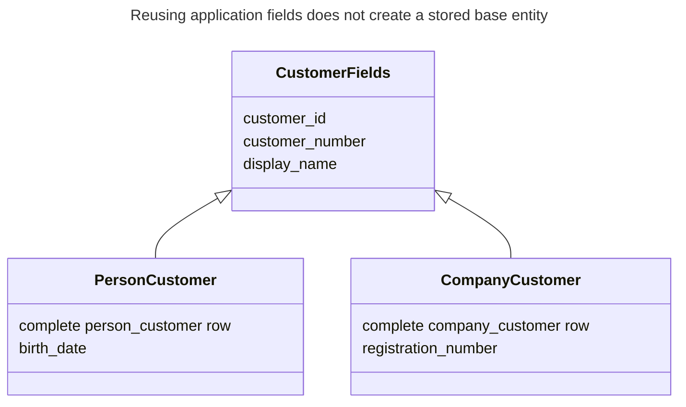
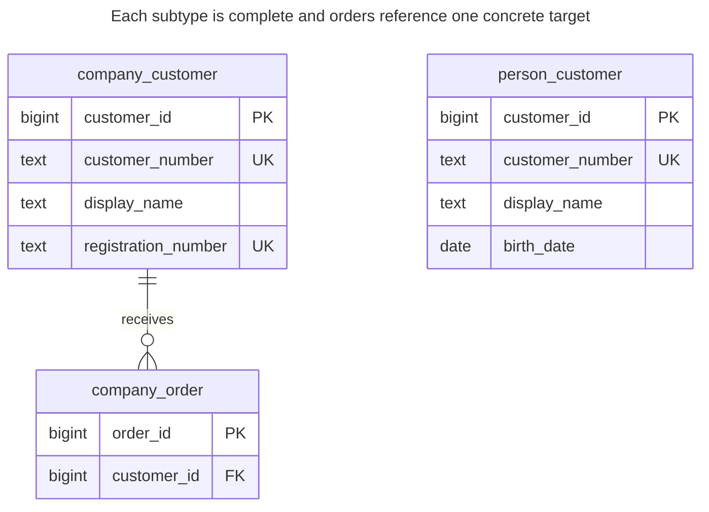
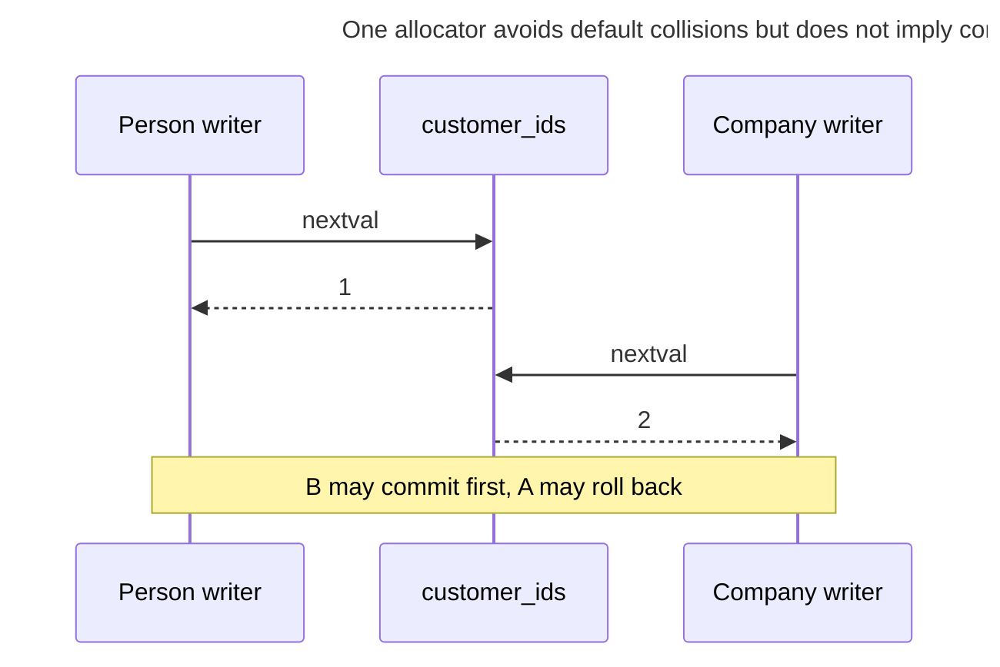
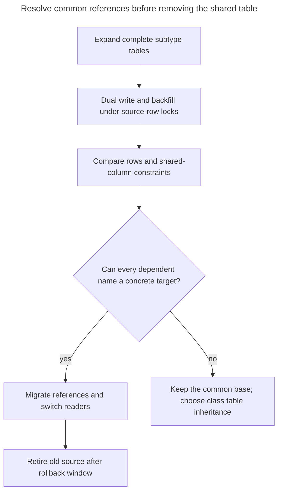

# Concrete Table Inheritance

## Intent

Concrete table inheritance gives each concrete subtype its own complete table that repeats the shared columns, with no table for the supertype. Each table is simple and fast to read on its own, and every column can carry the constraints its subtype needs. The chapter shows what this costs: queries across subtypes need UNION, IDs must stay unique across tables if a bare ID refers to "any subtype", and a change to a shared column must be repeated in every table.

## Also known as

Table per concrete class. Fowler's [Concrete Table Inheritance](https://martinfowler.com/eaaCatalog/concreteTableInheritance.html) names the mapping; Hibernate calls it [`TABLE_PER_CLASS`](https://docs.hibernate.org/orm/6.6/userguide/html_single/Hibernate_User_Guide.html#entity-inheritance-table-per-class).

## Problem

You sell to people and companies, but their workflows are separate. Most screens load one known customer type, and a company-only order should never reference a person. You want a complete row for each type without joining a shared base on every read.

The temptation is to stop there and treat `customer_id` as globally meaningful. Two independent identity columns can both generate `1`; two unique constraints on `customer_number` can each accept `C-1`. A union view unifies reading, but it does not turn those separate constraints into family-wide uniqueness or give you a real common foreign-key target.

## Solution

Give each concrete type a complete table containing its shared and subtype-specific fields. Write directly to the selected table. Provide a union view for the shared projection, and always include the type when an identifier's uniqueness is only local to its table.



The base describes shared application fields; it has no table. Each stored row contains those fields again. That repetition is the chosen mapping, rather than an accidental copy of a shared entity.

For this lab, one sequence supplies both tables' default IDs. PostgreSQL's [`nextval`](https://www.postgresql.org/docs/18/functions-sequence.html) allocates distinct values across concurrent calls, but an explicit import can bypass the default. This is an allocation policy, not a cross-table unique constraint. If you need an enforced global key with a common reference target, choose a shared supertype instead.

## Alternatives and selection

| Sibling | Relationship | Deciding requirement |
| --- | --- | --- |
| [Single Table Inheritance](single-table-inheritance.md) | Replacement | Family-wide uniqueness and common references matter more than separate complete row shapes |
| [Class Table Inheritance](class-table-inheritance.md) | Replacement | You need shared identity and fields without repeating their storage |
| [Exclusive Arc](exclusive-arc.md) | Complement | A small number of complete subtype tables must be targets of one dependent table |
| [Surrogate Key](surrogate-key.md) | Implementation option for allocation | Pick a generator, but still decide whether identity includes the table's type |

See the [Decision Atlas](decision-atlas.md) for the full table. A shared sequence does not repair [Polymorphic Associations](polymorphic-associations.md): a `(type, id)` pair still needs actual target-specific references or a shared base.

## Structure



There is deliberately no edge between the two customer tables. Each owns its rows and its unique customer numbers. The order's foreign key accepts companies only, even when a person has the same numeric ID.

## Tables and invariants

- **`person_customer`** holds a complete person customer, including a mandatory birth date and a locally unique customer number.
- **`company_customer`** holds a complete company customer, including a mandatory, locally unique registration number.
- **`company_order`** must reference an existing company. Its foreign key cannot accidentally resolve a person with the same ID.
- **`all_customers`** exposes a shared projection plus `kind`. PostgreSQL [`UNION ALL`](https://www.postgresql.org/docs/18/queries-union.html) preserves all result rows; ordinary `UNION` removes duplicates and is not an identity check.
- **Family-wide uniqueness** is absent. The script demonstrates that explicit IDs and business numbers can collide across tables while all declared constraints remain satisfied.

## When to use

- Concrete types are normally queried and referenced separately.
- Shared columns have stable meanings and the team can keep their definitions aligned.
- You accept type-qualified identity or have a disciplined shared allocation policy.
- There is no mandatory abstract entity that must exist independently of a concrete row.

## Consequences and trade-offs

- ➕ A known concrete object is loaded and changed in one table.
- ➕ All of a type's required columns can be declared `NOT NULL` without conditional subtype checks.
- ➖ A shared-field change must be deployed to every concrete table and the union projection.
- ➖ A whole-family search must cover each table; adding a subtype means updating that search.
- ➖ Family-wide uniqueness and common references are no longer local table constraints.
- ➖ Changing subtype is a move between tables, not a discriminator update; inbound references may prevent it or require migration.

## Implementation

The [complete script](../assets/concrete-table-inheritance/concrete-table-inheritance.sql) demonstrates shared allocation, a union query, a subtype-specific foreign key and a permitted cross-table collision:

```sql
CREATE SEQUENCE customer_ids AS bigint;
CREATE TABLE person_customer (
    customer_id bigint PRIMARY KEY DEFAULT nextval('customer_ids'),
    customer_number text NOT NULL UNIQUE,
    display_name text NOT NULL,
    birth_date date NOT NULL
);
CREATE TABLE company_customer (
    customer_id bigint PRIMARY KEY DEFAULT nextval('customer_ids'),
    customer_number text NOT NULL UNIQUE,
    display_name text NOT NULL,
    registration_number text NOT NULL UNIQUE
);
CREATE TABLE company_order (
    order_id bigint PRIMARY KEY,
    customer_id bigint NOT NULL REFERENCES company_customer (customer_id)
);
CREATE INDEX company_order_customer_idx ON company_order (customer_id);
CREATE VIEW all_customers AS
SELECT customer_id, 'person'::text AS kind, customer_number, display_name
FROM person_customer
UNION ALL
SELECT customer_id, 'company'::text AS kind, customer_number, display_name
FROM company_customer;
```

The union view is a read interface. PostgreSQL does [not automatically make a view containing a top-level union updatable](https://www.postgresql.org/docs/18/sql-createview.html#SQL-CREATEVIEW-UPDATABLE-VIEWS); route writes to the concrete table explicitly.

```sql
INSERT INTO person_customer (customer_number, display_name, birth_date)
VALUES ('P-1', 'Ada', DATE '1990-01-01');
INSERT INTO company_customer (customer_number, display_name, registration_number)
VALUES ('C-1', 'Northwind', 'REG-2');
INSERT INTO company_order VALUES (10, 2);
SELECT customer_id, kind, display_name FROM all_customers ORDER BY customer_id;
UPDATE company_customer SET display_name = 'Northwind Ltd' WHERE customer_id = 2;
```

In the empty lab the query returns `(1, person, Ada)` and `(2, company, Northwind)`. The order cannot refer to the person ID:

```sql
INSERT INTO company_order VALUES (11, 1);
```

PostgreSQL 18.6 raises SQLSTATE `23503`: `ERROR: insert or update on table "company_order" violates foreign key constraint "company_order_customer_id_fkey"`. The detail identifies `(customer_id)=(1)` as absent from `company_customer`.

By contrast, this explicit import is accepted, demonstrating a missing family-wide invariant:

```sql
INSERT INTO company_customer (customer_id, customer_number, display_name, registration_number)
VALUES (1, 'P-1', 'Collision demonstration', 'REG-X');
SELECT customer_id, count(*) FROM all_customers GROUP BY customer_id HAVING count(*) > 1;
```

The result is `(1, 2)`. The person and company both have ID `1` and number `P-1`. Keep the type in exported identities when such duplicates are valid. When they are invalid, use a common key registry with enforced references or replace this mapping with class table inheritance; do not claim that the default sequence alone enforces the rule.

## Engine support

- **PostgreSQL 18:** use ordinary tables and the shared sequence. Native [`INHERITS`](https://www.postgresql.org/docs/18/ddl-inherit.html) is a different storage/query feature and does not supply hierarchy-wide uniqueness.
- **MySQL 8.4 / InnoDB:** [`AUTO_INCREMENT` counters belong to tables](https://dev.mysql.com/doc/refman/8.4/en/innodb-auto-increment-handling.html). Two auto-increment columns are not this shared sequence; allocate in the application or retain type-qualified identity.
- **SQL Server 2025 (17.x):** a [sequence object can supply values across tables](https://learn.microsoft.com/en-us/sql/relational-databases/sequence-numbers/sequence-numbers?view=sql-server-ver17). This provides an allocation option with the same distinction between a generator and an enforced common entity key.
- **Oracle AI Database 26ai:** a [`SEQUENCE`](https://docs.oracle.com/en/database/oracle/oracle-database/26/sqlrf/CREATE-SEQUENCE.html) can likewise serve multiple tables. Translate defaults and data types rather than adding independent identities accidentally.
- **SQLite 3:** [`INTEGER PRIMARY KEY` allocation is per table](https://www.sqlite.org/lang_createtable.html#rowid). Use type-qualified identifiers or a deliberate application allocator, and enable [foreign keys](https://www.sqlite.org/foreignkeys.html#fk_enable).

## Failure and concurrency

Let the sequence allocate defaults instead of reading a maximum from the union. PostgreSQL documents that [sequence values are not reclaimed on rollback](https://www.postgresql.org/docs/18/functions-sequence.html); gaps do not imply missing customers. A concurrent allocator can receive its ID before another transaction commits.



Neither table can check a business-key duplicate being inserted into the other. An application query of both tables before inserting is race-prone. If global business uniqueness is required, prefer a common constrained table. For subtype moves, lock the source before copying shared fields, migrate dependent references in the same transaction, and define how a retry recognizes an already completed move. This mapping does not make moves free.

## Migration

From a wide table, create one complete destination per concrete type, preserve old IDs, and retain the old source while dual writers populate the chosen destination. Verify that each source row appears once and only once across the destinations. Synchronize backfill with live writers using the source-row lock; a stale copy must not resurrect deleted or reclassified data.



A generic customer foreign key is the decisive migration obstacle, not a minor query rewrite. Retain a shared base if those references must stay generic. While both representations remain synchronized, roll reads back through the retained source; after adding new concrete types or type-specific fields, first ensure that the old representation can still express them. See [Expand and Contract](expand-contract.md).

## Anti-patterns and common mistakes

- Repeating a common field's name while silently changing its type or meaning in one subtype.
- Assuming separate primary keys enforce uniqueness of the bare ID across tables.
- Treating a union view as a common reference target with its own primary key.
- Using ordinary `UNION` to hide duplicate projections rather than defining identity.
- Calling every cloned table concrete inheritance: [Cloned Tables](cloned-tables.md) covers repeated copies for tenants or periods, which have a different reason to exist.

## Known uses

- Hibernate's [`TABLE_PER_CLASS` mapping](https://docs.hibernate.org/orm/6.6/userguide/html_single/Hibernate_User_Guide.html#entity-inheritance-table-per-class) stores inherited fields in each concrete table and uses union queries for polymorphic reads.
- Django's [abstract base classes](https://docs.djangoproject.com/en/5.2/topics/db/models/#abstract-base-classes) copy their fields into child models without creating a base table. This shares application declarations, not stored base rows.

## Related patterns

- [Single Table Inheritance](single-table-inheritance.md) restores one table for family-wide checks and references.
- [Class Table Inheritance](class-table-inheritance.md) keeps a common identity without repeating shared storage.
- [Exclusive Arc](exclusive-arc.md) can reference a bounded set of concrete tables safely.
- [Polymorphic Associations](polymorphic-associations.md) explains the cost of an unchecked generic reference.
- [Cloned Tables](cloned-tables.md) distinguishes duplication by tenant or period from real concrete types.
