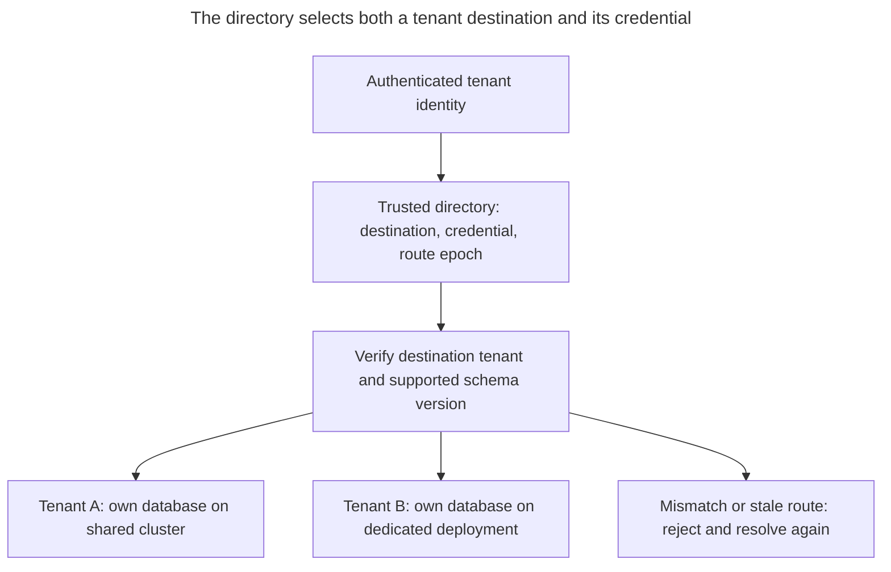
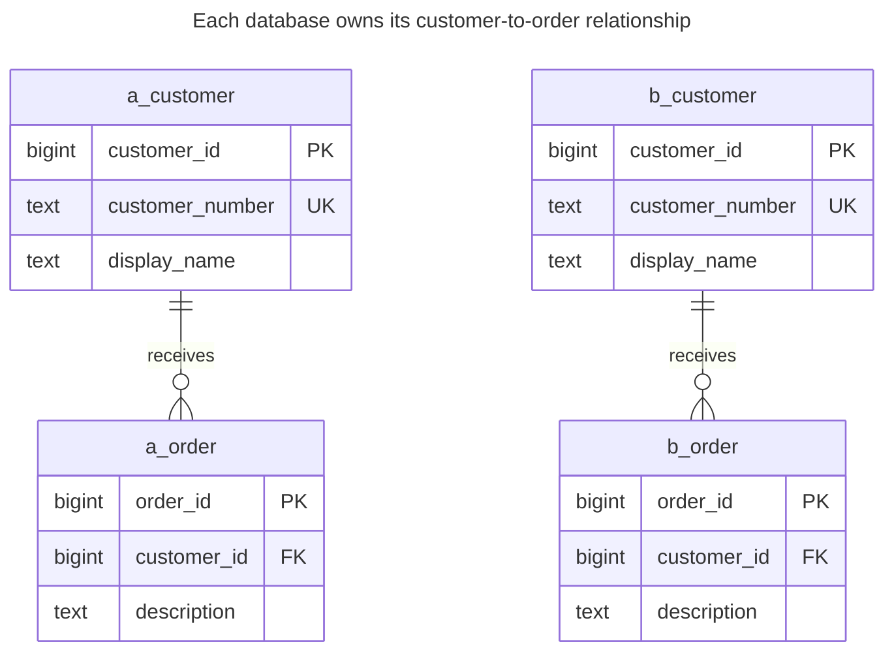
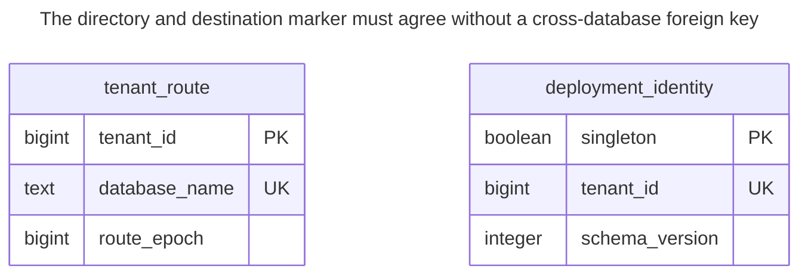
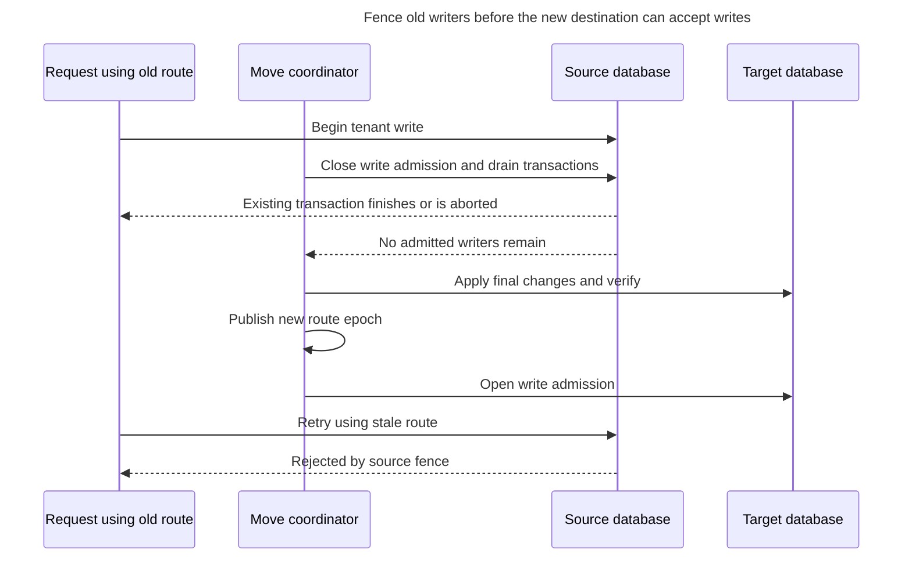
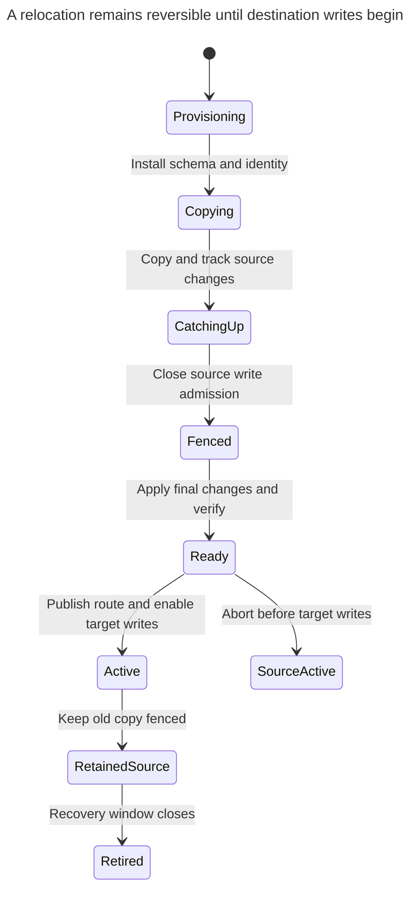

# Database per Tenant

## Intent

Database per tenant gives each tenant a separate database, sometimes on a separate server. With a separate server or managed deployment, it can offer the strongest isolation — separate resources, backups, encryption keys, versions, even placement in a required region — which may be a compliance or contract requirement. The chapter covers the operational cost of provisioning, migrating and monitoring many databases, connection routing, reporting across tenants, and mixed models in which large tenants get their own database while small ones share. PostgreSQL distinguishes [database boundaries](https://www.postgresql.org/docs/18/manage-ag-overview.html) from [server-wide resources](https://www.postgresql.org/docs/18/runtime-config-resource.html).

## Also known as

Single-tenant database; dedicated tenant database. Microsoft's [database-per-tenant model](https://learn.microsoft.com/en-us/azure/azure-sql/database/saas-tenancy-app-design-patterns) keeps the application tier multitenant while each database serves one tenant. AWS's historical [silo vocabulary](https://docs.aws.amazon.com/pdfs/whitepapers/latest/multi-tenant-saas-storage-strategies/multi-tenant-saas-storage-strategies.pdf) includes a separate RDS instance per tenant; that deployment boundary is stronger than two PostgreSQL databases on one instance.

## Problem

A customer wants its data exported, restored, relocated or upgraded without treating every other customer's rows as part of the same operation. Another tenant needs enough capacity that placing it beside small tenants makes their service objectives difficult to meet. You want to keep the same local customer-and-order schema while changing where each tenant lives.

A separate schema gives you a namespace, but it leaves connection routing and database-level operations shared. A separate database gives you another boundary to manage. It also introduces a new application responsibility: before executing any business SQL, you must connect to the correct database using the correct credential. An ordinary local query cannot discover that the router selected the wrong tenant's otherwise identical tables.

## Solution

Provision one database with a complete tenant-owned schema per tenant. Keep the database owner and migration authority separate from runtime credentials. Store a trusted directory mapping tenant identity to connection destination, credential reference and routing generation. Authenticate the request first, resolve its tenant through that directory, then check out a connection for that destination and credential.

In PostgreSQL, a client [specifies a database at connection establishment](https://www.postgresql.org/docs/18/manage-ag-overview.html), and one ordinary connection accesses one database. Give each runtime role access to its own database and revoke public connection access on tenant databases. A tenant-local deployment identity lets the application check that the destination matches the directory before running business operations.

Choose the physical boundary independently. Two databases in one cluster still use the server's [shared resources](https://www.postgresql.org/docs/18/runtime-config-resource.html); they do not automatically receive dedicated compute or independent engine versions. If your tenant contract requires a separate region, server lifecycle or encryption-key boundary, select and verify a deployment that supplies it. A database name alone proves none of those properties.

## Alternatives and selection

| Sibling or mechanism | Relationship | Deciding requirement |
| --- | --- | --- |
| [Shared Schema](shared-schema.md) | Replacement; complement in a hybrid fleet | Small tenants can share a release and operational pool, while selected tenants get dedicated destinations |
| [Schema per Tenant](schema-per-tenant.md) | Replacement | Object-level separation inside one database is sufficient and cross-schema work remains useful |
| Several tenant databases on one cluster | Implementation option | Separate logical datasets and credentials suffice; shared server resources and recovery are acceptable |
| Separate cluster or managed deployment per tenant | Implementation option | The required boundary includes server resources, placement or engine lifecycle |
| [Expand and Contract](expand-contract.md) | Complement | One application release must work against several database schema versions during rollout |

See the [Decision Atlas](decision-atlas.md) for the full table. Evaluate the actual backup and resource unit of your deployment; do not infer it from the word “database.”



The same routing contract serves shared infrastructure and dedicated deployments. Validate the selected destination, because a correct SQL statement run against the wrong tenant database is still wrong.

## Structure



The `a_` and `b_` labels denote tables in databases `dt_a` and `dt_b`, each under schema `app`; `order` abbreviates `customer_order`. Each database contains the full relationship, so customer `10` in B cannot satisfy an order's reference in A.



The directory lives in the control database; each tenant database has its own `app.deployment_identity`. There is deliberately no foreign-key line between them. Provisioning and connection checks must verify that the directory's selected destination contains the expected tenant marker.

## Tables and invariants

- **`dt_control.tenant_route`** lives in the control database. Its primary key gives one current destination per tenant; `database_name` is unique within this lab's single cluster. A real fleet needs the full destination, including server or service identity, and a separate credential reference rather than a password stored here.
- **`app.deployment_identity`** has at most one row because its boolean primary key must be true. Its `tenant_id` and `schema_version` are mandatory. Provisioning inserts the row; runtime has read access only. The constraints do not guarantee that the row exists or matches an external directory.
- **`app.customer` and `app.customer_order`** use ordinary local keys. The order foreign key requires a customer in the same database. Equal customer and order IDs across databases are intentional.
- **Connection privileges** restrict each runtime role to its assigned tenant database. Owner roles and administrators remain trusted; PostgreSQL [roles are cluster-wide objects](https://www.postgresql.org/docs/18/manage-ag-overview.html), not independent identities recreated under each database name.
- **Single writable placement** is an orchestration invariant. `route_epoch` is bookkeeping for a routing protocol, not a database-enforced fence on an already connected writer.

## When to use

- A tenant needs a separately handled logical export, relocation or schema rollout.
- You can automate provisioning, credential management, migration status, monitoring and restoration across every database you create.
- Large tenants need deployment options that differ from the small-tenant pool.
- Most transactions stay within one tenant; cross-tenant reports can use a deliberate collection or reporting process.

## Consequences and trade-offs

- ➕ Business tables retain local constraints without carrying tenant columns through every relationship.
- ➕ You can export one database's complete local object graph and choose where to restore it.
- ➕ Tenant-specific migration scheduling need not change the other databases immediately.
- ➖ Each active destination and credential needs connection capacity. Budget total open connections across application processes, retire idle pools, and bound concurrent provisioning and migration work.
- ➖ Reports and global operations must visit multiple databases or use a consolidated read model. A global customer number requires an explicit registry if it must be unique across the fleet.
- ➖ A successful application release does not prove every database migrated. Store observed version, last attempt and outcome per destination, and distinguish an unreachable tenant from a completed upgrade.

## Implementation

The [complete PostgreSQL 18.6 script](../assets/database-per-tenant/database-per-tenant.sql) runs through `psql` against `postgres` in a fresh throwaway cluster. It creates two tenant databases and reconnects as their runtime roles. The lab uses local trust authentication and passwordless roles; configure production authentication separately. Provision as an administrator:

```sql
CREATE ROLE dt_owner NOLOGIN;
CREATE ROLE dt_app_a LOGIN NOSUPERUSER NOBYPASSRLS;
CREATE ROLE dt_app_b LOGIN NOSUPERUSER NOBYPASSRLS;
CREATE DATABASE dt_a OWNER dt_owner;
CREATE DATABASE dt_b OWNER dt_owner;
REVOKE ALL ON DATABASE dt_a, dt_b FROM PUBLIC;
GRANT CONNECT ON DATABASE dt_a TO dt_app_a;
GRANT CONNECT ON DATABASE dt_b TO dt_app_b;
CREATE SCHEMA dt_control;
CREATE TABLE dt_control.tenant_route (
    tenant_id bigint PRIMARY KEY,
    database_name text NOT NULL UNIQUE,
    route_epoch bigint NOT NULL CHECK (route_epoch > 0)
);
INSERT INTO dt_control.tenant_route VALUES (1, 'dt_a', 1), (2, 'dt_b', 1);
```

PostgreSQL [`CREATE DATABASE`](https://www.postgresql.org/docs/18/sql-createdatabase.html) cannot run inside a transaction block. Treat provisioning as a resumable workflow: create the database, install its schema and grants, verify it, then publish the route. The script is a demonstration of the components, not a production provisioner; its administrator-owned control table is not granted to tenant roles.

Connect to `dt_a` as the administrator, revoke public-schema creation and install the tenant objects under the owner role:

```sql
REVOKE CREATE ON SCHEMA public FROM PUBLIC;
SET ROLE dt_owner;
CREATE SCHEMA app AUTHORIZATION dt_owner;
CREATE TABLE app.deployment_identity (
    singleton boolean PRIMARY KEY CHECK (singleton),
    tenant_id bigint NOT NULL UNIQUE,
    schema_version integer NOT NULL CHECK (schema_version > 0)
);
INSERT INTO app.deployment_identity VALUES (true, 1, 1);
CREATE TABLE app.customer (
    customer_id bigint PRIMARY KEY,
    customer_number text NOT NULL UNIQUE,
    display_name text NOT NULL
);
CREATE TABLE app.customer_order (
    order_id bigint PRIMARY KEY,
    customer_id bigint NOT NULL,
    description text NOT NULL,
    CONSTRAINT order_customer_fk FOREIGN KEY (customer_id)
        REFERENCES app.customer (customer_id)
);
CREATE INDEX order_customer_idx ON app.customer_order (customer_id);
GRANT USAGE ON SCHEMA app TO dt_app_a;
GRANT SELECT ON app.deployment_identity TO dt_app_a;
GRANT SELECT, INSERT, UPDATE, DELETE ON app.customer, app.customer_order TO dt_app_a;
RESET ROLE;
```

Provision the same shape in `dt_b` with tenant identity `2` and grants to `dt_app_b`. Keep the owner separate from runtime: PostgreSQL's [ownership rights](https://www.postgresql.org/docs/18/ddl-priv.html) include altering or destroying owned objects. The shared lab owner is a trusted fleet operator, not a tenant identity.

After connecting to `dt_a` as `dt_app_a`, verify the destination and perform local work:

```sql
SELECT current_database(), tenant_id, schema_version FROM app.deployment_identity;
INSERT INTO app.customer VALUES (10, 'C-10', 'Acme customer');
INSERT INTO app.customer_order VALUES (100, 10, 'First order');
UPDATE app.customer SET display_name = 'Acme renamed' WHERE customer_id = 10;
SELECT o.order_id, c.display_name
FROM app.customer_order AS o JOIN app.customer AS c USING (customer_id);
```

The identity query returns `(dt_a, 1, 1)` and the join returns `(100, Acme renamed)`. Require exactly one identity row, the expected tenant, and a supported schema version; reject mismatches before business work. Key the pool by destination and credential, and invalidate obsolete pools when the route changes. PostgreSQL's [connection parameters](https://www.postgresql.org/docs/18/libpq-connect.html#LIBPQ-PARAMKEYWORDS) distinguish host, database and user; changing `search_path` cannot switch databases.

An order referring to a nonexistent local customer is rejected:

```sql
INSERT INTO app.customer_order VALUES (101, 20, 'Missing customer');
```

PostgreSQL 18.6 raises SQLSTATE `23503`: `ERROR: insert or update on table "customer_order" violates foreign key constraint "order_customer_fk"`. Local integrity still matters even though tenants have separate databases. An ordinary three-part attempt to reach another tenant also fails:

```sql
SELECT * FROM dt_b.app.customer;
```

From `dt_a`, this raises SQLSTATE `0A000`: `ERROR: cross-database references are not implemented: "dt_b.app.customer"`. This query error is separate from connection authorization. The script also verifies that `dt_app_a` has no `CONNECT` privilege on `dt_b`; a new connection using that role is rejected with `FATAL: permission denied for database "dt_b"`. PostgreSQL's [`CONNECT` privilege](https://www.postgresql.org/docs/18/sql-grant.html) is checked at connection startup in addition to host-based authentication.

## Engine support

- **PostgreSQL 18:** [`pg_dump`](https://www.postgresql.org/docs/18/app-pgdump.html) exports a single database, but roles and other global objects need separate handling. Physical [continuous-archiving recovery](https://www.postgresql.org/docs/18/continuous-archiving.html) restores the whole cluster, not one tenant database. Recover to another cluster and extract the tenant if the production cluster contains other tenants.
- **MySQL 8.4:** [database and schema are synonyms](https://dev.mysql.com/doc/refman/8.4/en/create-database.html). MySQL [qualified table references](https://dev.mysql.com/doc/refman/8.4/en/identifier-qualifiers.html) can name a database on the same server, so separate databases do not represent the same connection boundary as PostgreSQL databases; choose credentials and deployment boundaries according to the engine rather than translating container names literally.
- **SQL Server 2025 (17.x):** native [backups operate at database, file or filegroup level](https://learn.microsoft.com/en-us/sql/relational-databases/backup-restore/backup-overview-sql-server?view=sql-server-ver17). Azure SQL Database's [database-per-tenant guidance](https://learn.microsoft.com/en-us/azure/azure-sql/database/saas-tenancy-app-design-patterns) also describes elastic pools and individual-tenant recovery; those managed-service capabilities are not promises about PostgreSQL databases.
- **Oracle AI Database 26ai:** the [multitenant architecture](https://docs.oracle.com/en/database/oracle/oracle-database/26/cncpt/introduction-to-oracle-database.html) distinguishes a container database from pluggable databases. Decide whether a tenant receives a schema, a PDB or a separate deployment before comparing lifecycle and isolation guarantees.
- **SQLite 3:** one tenant per file is an implementation option. [`ATTACH`](https://www.sqlite.org/lang_attach.html) permits multiple files in one connection, but WAL mode does not guarantee atomic commit across all attached files. [Foreign keys cannot cross schema boundaries](https://www.sqlite.org/foreignkeys.html#fk_unsupported), so keep each tenant's constrained graph in its own file.

## Failure and concurrency

A stale directory entry is dangerous during relocation even if every local foreign key is correct. Two writable copies can each accept valid local writes and then disagree. Incrementing a directory epoch alone cannot stop an old connection that already knows its database address.



The fence is part of your deployment protocol, not an effect of the route table. Stop admissions, drain pools and workers, and ensure stale credentials or old service paths cannot resume source writes. Revoking `CONNECT` alone affects new connections; it does not terminate existing sessions, as the [privilege definition](https://www.postgresql.org/docs/18/ddl-priv.html) makes clear by checking it at startup. The lab does not implement a distributed write fence.

Within a tenant database, local unique keys and foreign keys retain their normal concurrency behavior. Across databases, do not assume a single local transaction covers a fleet operation. Break a fleet migration into independently recorded tenant transactions and retry the failed destinations. Use a migration lock inside each destination and reread its version after taking that lock; PostgreSQL's [advisory locks](https://www.postgresql.org/docs/18/explicit-locking.html#ADVISORY-LOCKS) coordinate cooperating runners, not an external fleet automatically.

Do not acknowledge a customer write because the control directory changed successfully. The business commit occurs in the selected tenant database. If its response is lost, resolve the operation there using the same tenant and retry identity before deciding to repeat it elsewhere.

## Migration

Introduce trusted routing while all tenants still use their existing placement. Separate logical tenant identity from database name in APIs, jobs, logs and external references. Existing [Public Identifiers](public-identifier.md) should continue to resolve under the authenticated tenant after a move; database-local integer IDs need not become globally unique.

Provision a destination with the expected schema version and identity. Copy a consistent tenant dataset, including children and the reference data needed to interpret it. Arrange change capture or a bounded write pause before copying begins, so no interval of source changes goes missing. During final cutover, fence source writes, drain in-flight transactions, apply remaining changes, verify the destination, publish the new route, and open destination writes.



Once target writes begin, reversing the route without copying them back loses accepted work. Keep the old destination fenced and retained through a recovery window; plan reverse synchronization or another paused copy if rollback becomes necessary. Do not advertise automatic, uninterrupted migration merely because the source and target have identical schemas.

For routine schema upgrades, apply [Expand and Contract](expand-contract.md) to each tenant database, record actual completion, and keep the application compatible with the versions still deployed. For restoration, first restore into an isolated destination, verify identity and version, then use the same routing-and-fencing procedure. PostgreSQL logical exports and physical recovery have different units; rehearse the actual recovery path you promise.

## Anti-patterns and common mistakes

- Promising dedicated resources, independent engine versions or tenant-specific encryption keys merely because each tenant has a different database name.
- Keeping public `CONNECT` access on tenant databases or granting runtime the owner role.
- Reusing a connection selected for another tenant because its schema happens to look identical.
- Making the directory row point to a half-provisioned database, or reporting a fleet migration successful when only reachable tenants completed it.
- Treating route-cache invalidation as a write fence while existing sessions continue to write.
- Assuming a cluster backup can rewind one PostgreSQL database in place without affecting its neighbors.
- Replacing local foreign keys with application checks because the tenant already has its own database; see [Missing Foreign Keys](missing-foreign-keys.md).

## Known uses

- Microsoft's [multitenant application with database-per-tenant](https://learn.microsoft.com/en-us/azure/azure-sql/database/saas-tenancy-app-design-patterns) provisions a database for each tenant, supports per-tenant schema customization, and describes a hybrid model. Its tenant catalog maps identity to database location.
- AWS's historical [RDS silo model](https://docs.aws.amazon.com/pdfs/whitepapers/latest/multi-tenant-saas-storage-strategies/multi-tenant-saas-storage-strategies.pdf) provisions separate tenant instances. It is an example of combining the logical tenant boundary with a separate deployment, rather than evidence that every same-instance database is a silo.

## Related patterns

- [Shared Schema](shared-schema.md) provides the small-tenant pool in a hybrid fleet.
- [Schema per Tenant](schema-per-tenant.md) supplies namespace separation within one database.
- [Expand and Contract](expand-contract.md) stages version changes across the database fleet.
- [Public Identifier](public-identifier.md) keeps external identity separate from placement and local keys.
- [Missing Foreign Keys](missing-foreign-keys.md) explains the integrity checks each local schema still needs.
