# Decision Atlas

The Decision Atlas gathers in one place the comparison tables for every family of alternatives in the book: keys, tree structures, inheritance mappings, ways to store variable attributes, history models and tenant isolation. Each table lists the requirements that decide the choice and points to the chapters. Use it when you know the problem but not yet the pattern.

Read each family as a set of requirements, not a ranking. Replacements answer the same question; complements add another guarantee; implementation options change how you provide it. The linked chapters define the invariants, concurrency protocols and engine-specific qualifications behind each row. Run their examples through [SQL Lab](sql-lab.md).

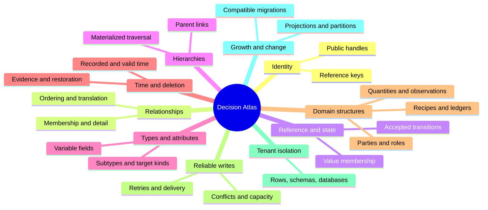

The map separates the book's families by the question they answer. A single design can need several branches: a tenant-scoped reservation can also need request deduplication and an outbox.

## Identifiers

What identifies the row to its dependents, and what may clients see? Choose the reference key first, its generator second, and the external contract separately.

| Choice | Requirement deciding the choice | Reference and uniqueness contract | Generation or disclosure cost |
| --- | --- | --- | --- |
| [Surrogate Key](surrogate-key.md) | Business values change, arrive late or are too wide for references | Stable generated PK; retain business uniqueness separately | Integer allocation is central; a UUID is another implementation |
| [Natural Key](natural-key.md) | A short, mandatory business tuple has settled scope and manageable corrections | Every dependent carries the complete tuple | Corrections or scope expansion affect references; Oracle has no `ON UPDATE CASCADE` |
| [Time-Ordered Identifier](time-ordered-identifier.md) | Generate before insertion or across writers, with useful measured index locality | A surrogate implementation; PK still rejects collisions | Reveals generation time; ordering is not commit order; PostgreSQL 18 supplies `uuidv7()` |
| [Public Identifier](public-identifier.md) | Published references need a distinct stability or disclosure contract | Complement to either internal key; separate unique handle | Maintain resolution and any rotation/alias policy; random handles do not replace authorization |

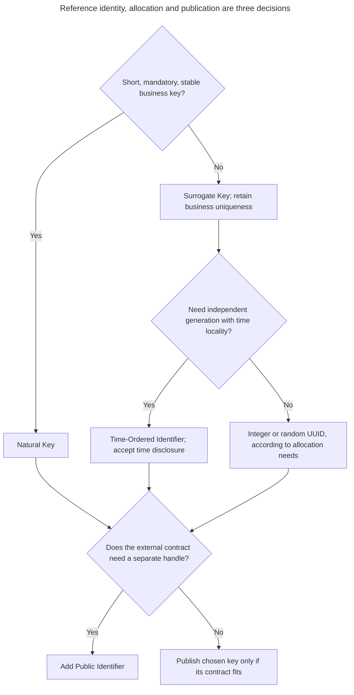

A public handle can accompany a natural or surrogate key. Choosing UUIDv7 does not decide whether a surrogate is needed, and its locality is a workload question rather than a throughput guarantee.

## Relationships

Does another row represent membership, part of one entity, a user-controlled occurrence or a translation? Cardinality and edit boundaries decide the structure; several of these patterns can apply together.

| Choice | Cardinality and ownership | Read or edit requirement | Integrity and maintenance cost |
| --- | --- | --- | --- |
| [Ordinary dependent FK](association-table.md) | Each child has one parent | No independent many-to-many link is needed | FK enforces parent existence; index navigation as needed |
| [Association Table](association-table.md) | Many-to-many membership with link attributes | Query and edit individual links | Endpoint FKs and pair uniqueness; an extra ID does not replace the pair rule |
| [Table Split](table-split.md) | At most one detail row per core row | Optional group, separate permissions or measured benefit from separate rows | Shared PK/FK; full reads join; mandatory circular variant needs deferred checks |
| [Ordered Collection](ordered-collection.md) | Occurrences within one owner | Users insert or move items independently of creation time | Serialize collection edits; stable item identity differs from mutable position |
| [Localized Values](localized-values.md) | One entity has multiple locale rows | Edit, search and validate translations independently | Unique entity/locale pair; required default needs a lifecycle protocol |
| [Columns or a JSON locale map](localized-values.md) | Fixed language columns, or one aggregate map | Fixed small language set, or whole-map reads | Columns grow through DDL; JSON needs explicit key, type and default validation |

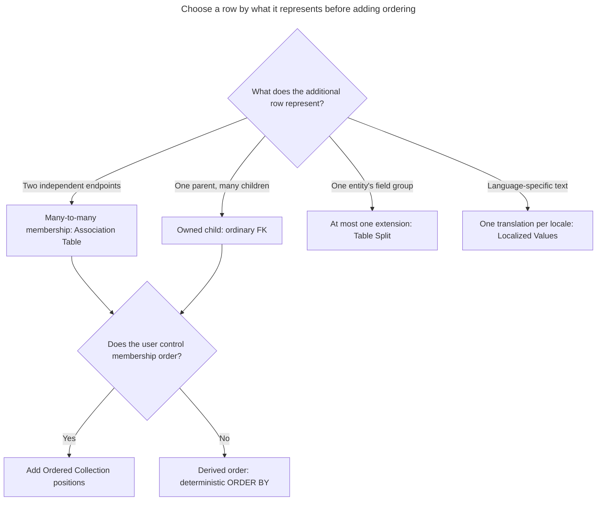

An ordered association is still an association. A translation is many rows per entity, so an at-most-one detail table cannot supply its cardinality.

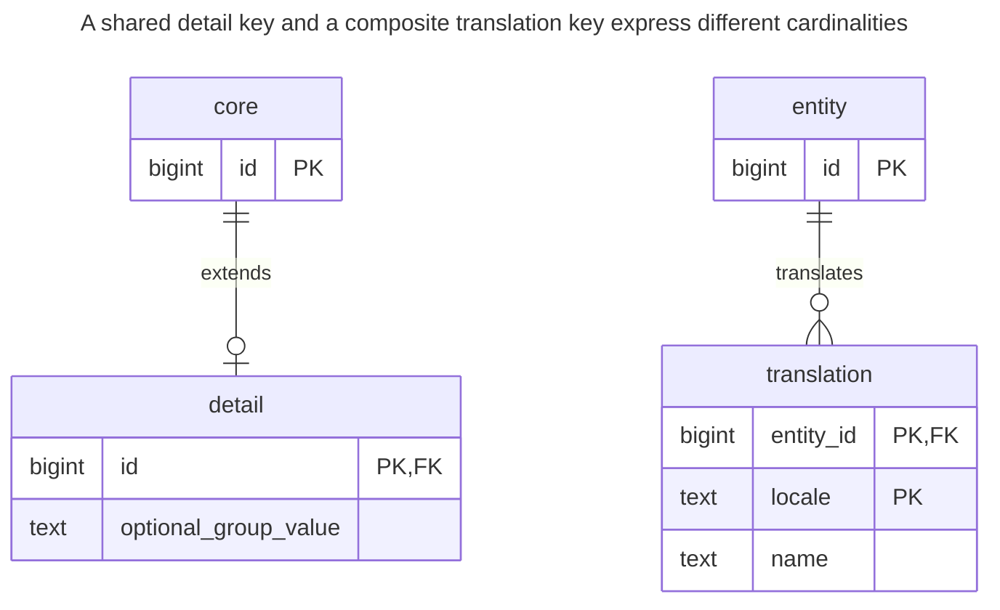

The detail's key permits one extension; the translation's composite key permits one row per locale. This comparison omits the required-default variant, whose reverse reference is explained in Localized Values.

For ordering, [Ordered Collection](ordered-collection.md) compares dense integers (suffix shifts), gapped integers (occasional renumbering), exact numeric midpoints (finite scale), lexicographic ranks (generator and collation contract) and neighbor pointers (connectivity and cycle maintenance). PostgreSQL and Oracle support the deferred uniqueness used for swaps; MySQL, SQL Server and SQLite need collision-free temporary positions for that implementation. The mandatory detail and default-translation examples also need redesign on engines without deferred FKs.

## Constrained values and statuses

Who maintains the vocabulary, and do you need only valid membership or also legal transitions? A value list and a transition history enforce different rules.

| Choice | Vocabulary ownership and change | Metadata or reuse requirement | Transition and engine boundary |
| --- | --- | --- | --- |
| [Lookup Table](lookup-table.md) | Business maintainers add or retire values through data writes | Labels, display order, availability and translations belong on rows | FK enforces membership; guarded assignment handles retirement |
| [Native enum](lookup-table.md) | Small stable developer-owned list changes with releases | Type identity and declaration order are useful; no editable metadata row | PostgreSQL cannot remove/reorder members without recreating the type; MySQL has different invalid-value semantics |
| [Column `CHECK`](lookup-table.md) | Small release-controlled list local to one column | No per-value metadata needed | Local membership predicate; does not encode previous-to-next state |
| [Domain with `CHECK`](lookup-table.md) | Stable reusable value rule | Several columns share validation, without labels per value | PostgreSQL domain syntax is not SQL Server alias-type syntax |
| [Status History](status-history.md) | Accepted lifecycle moves require controlled writes | Retain source, destination, revision and attribution | Current row plus history commit together; lock or conditional version update rejects competing stale commands |
| [Milestone columns](status-history.md) | Fixed single-pass process | Reporting needs known timestamps only | Loses repeated visits and arbitrary moves; no automatic workflow enforcement |

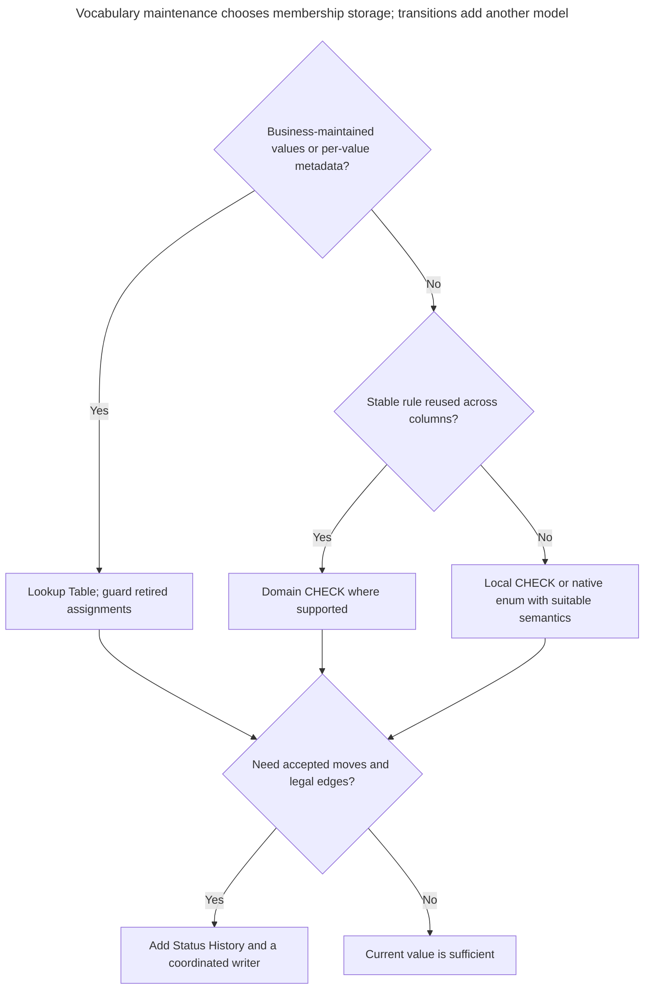

Two valid status names can still form an illegal transition. Moving the vocabulary to rows does not teach an older application what a new state means.

## Trees

Which traversals justify redundant storage, and how often do branches move? These comparisons concern the chapters' one-parent trees; multiple-parent quantity graphs need the separate [component model](#component-graphs).

| Pattern | Subtree and ancestor reads | Move write cost | Stored integrity and space | Implementation boundary |
| --- | --- | --- | --- | --- |
| [Adjacency List](adjacency-list.md) | Recursive traversal; direct children use parent index | Change one parent after cycle validation | One parent reference per node; FK proves existence, not acyclicity | Recursive query dialects and limits differ |
| [Materialized Path](materialized-path.md) | Indexed containment/prefix for descendants; path supplies ancestry | Rewrite moved branch's descendant paths | One path per node; maintain agreement with retained parent | PostgreSQL `ltree` or SQL Server `hierarchyid`; text encoding is another implementation |
| [Nested Sets](nested-sets.md) | Range reads and preorder; dense bounds allow arithmetic descendant counts | Renumber affected bounds, potentially outside moved branch | Two bounds per node; uniqueness alone does not prove noncrossing dense intervals | Mostly static publication; deferred-unique permutation needs redesign on some engines |
| [Closure Table](closure-table.md) | Indexed joins in both directions, including distance | Replace external ancestor/descendant pairs | One row per reachable pair including self; depth drives space; FKs do not prove completeness | Partial/filtered uniqueness or a retained parent enforces one direct parent |

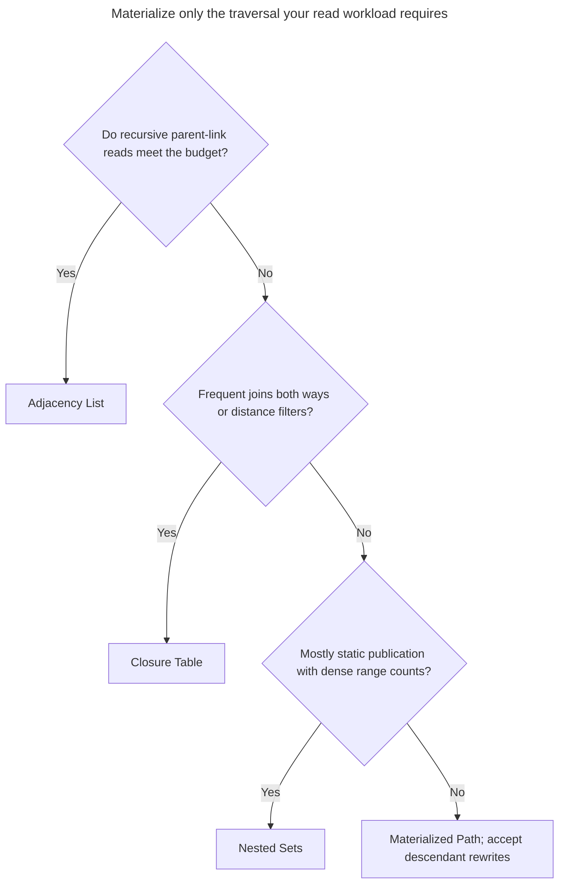

There is no universal depth threshold. Parent links can remain the authoritative source while paths, intervals or closure serve as maintained read representations; all structural writers must follow the chosen coordination protocol.

## Subtypes and references to several kinds

Do the target kinds share a real identity, or does one dependent merely choose among unrelated owners? Then decide whether complete reads favor one row, shared-key details or separate concrete tables.

| Choice | Common identity and references | Read shape | Write and evolution cost |
| --- | --- | --- | --- |
| [Single Table Inheritance](single-table-inheritance.md) | One family PK and family-wide uniqueness | One row; conditional subtype fields | Row checks enforce exclusive shape; new types change shared DDL |
| [Class Table Inheritance](class-table-inheritance.md) | Base is the common FK target; subtype tables are specific targets | Join base and required detail | Exactly-one completeness needs extra constraints and atomic lifecycle; deferred circular example does not port unchanged to MySQL/SQL Server |
| [Concrete Table Inheritance](concrete-table-inheritance.md) | Separate keys; shared allocator is not a common constrained entity | One table per known type; family reads use a union | Repeat shared definitions; family uniqueness and subtype changes need explicit design |
| [Exclusive Arc](exclusive-arc.md) | One FK per target kind; no artificial common entity | One dependent row with nullable target columns | Exactly-one row check; add a column/FK per kind; review engine cascade restrictions |
| [Per-target association tables](polymorphic-associations.md) | Real FK for each relationship | Separate relationship reads | Local endpoint integrity; cross-table exactly-one ownership needs another protocol |
| [Polymorphic Associations](polymorphic-associations.md) | Unchecked `(type, id)` cannot be one ordinary FK | Resolve target using discriminator | Weaker external-handle contract is defensible only when missing/remote targets are explicitly allowed |

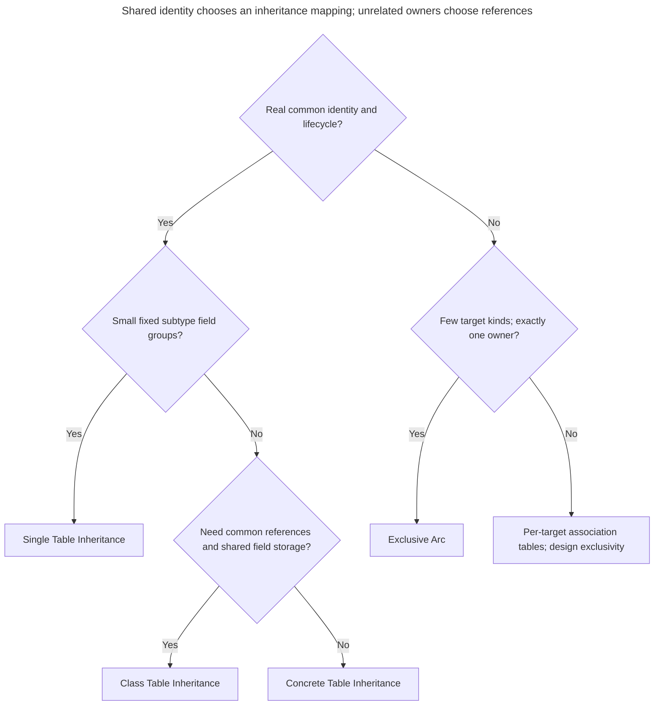

A shared sequence cannot repair an unchecked reference. Overlapping business capacities lead instead to [Party and roles](#party-and-roles), not an exclusive subtype discriminator.

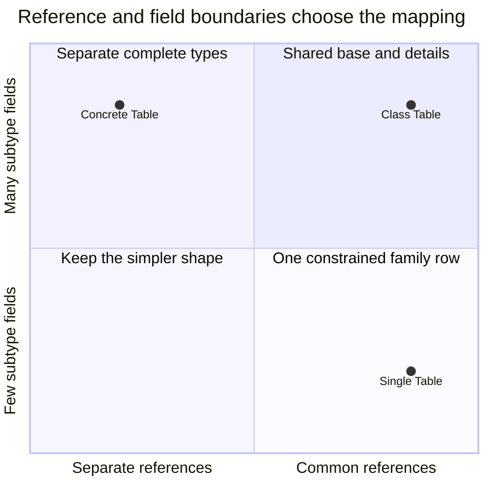

Positions are qualitative reminders of the selection requirements, not measured scores. Separate concrete tables give up the local common-reference and family-uniqueness guarantees of the shared mappings.

## Variable attributes

Are fields stable developer-owned schema, one bounded document or managed definitions created at runtime? Distinguish current attributes from independently observed facts.

| Choice | Definition and validation requirement | Read and index requirement | Edit or migration cost |
| --- | --- | --- | --- |
| [Ordinary typed columns](typed-properties.md) | Stable known fields with direct constraints and FKs | Direct predicates and ordinary indexes | New fields use schema migrations |
| [JSON Column](json-column.md) | Variable aggregate shape; explicitly validate important paths | Whole-document reads; targeted extraction/indexes for selected paths | One row is the edit boundary; add a version token for stale whole-document saves; indexing differs by engine |
| [Typed Properties](typed-properties.md) | Administrators publish field types, ranges, requiredness and versioned profiles | Reconstruct value rows; multi-property search adds predicates/joins | Definition publication and completeness require coordinated validation; new primitive shapes still need design |
| [Known subtype mappings](single-table-inheritance.md) | Variation follows fixed classes with required groups | Choose single/shared-key subtype storage by read needs | DDL describes the finite family; not a runtime field-definition system |
| [Untyped Properties](untyped-properties.md) | String names and values have no definition contract | Casts and reconstructed predicates hide typing failures | Repair through conversion audit and constrained destinations; moving strings to JSON preserves the problem |
| [Observation](observation.md) | Each reading has its own time, method and provenance | Query retained facts under an explicit selection policy | Preserve corrections and rejections rather than overwrite one current property |

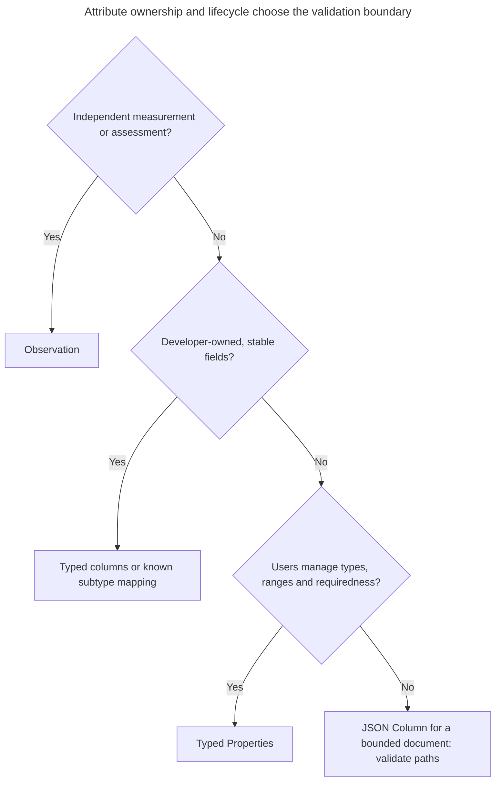

Runtime-defined fields earn the metadata lifecycle of Typed Properties. A JSON syntax check alone cannot supply that lifecycle, entity references or business requiredness.

## Time and deletion

Which past question must you answer: recorded values, business validity, an earlier belief, an action or restoration? These contracts can coexist on selected facts.

| Pattern or option | Question it answers | Write and query requirement | Retention or engine boundary |
| --- | --- | --- | --- |
| [History Table](history-table.md) | What row values were recorded at an instant? | Capture old values and query current plus closed versions | Define capture clock and retention; SQL Server native periods use transaction-begin time, unlike the chapter's processing clock |
| [Effective Dating](effective-dating.md) | What applies on a business date, including future dates? | Explicit periods; prevent ambiguous overlapping schedules | PostgreSQL 18 temporal keys or exclusion; other implementations need coordinated overlap checks |
| [Bitemporal Table](bitemporal-table.md) | What did we know at one date about another business date? | Preserve business and recorded periods through atomic corrections | More complex rectangle rule; one business-period overlap key alone rejects valid archived beliefs |
| [Audit Log](audit-log.md) | Who performed an accepted action, why and under which request? | Atomic attributed evidence; trusted context and restricted bypass writes | Not automatically a state-at-time model or tamper evidence; failed attempts need a separate logging path |
| [Soft Delete](soft-delete.md) | Can removal be reversed in place with the same identity? | Apply live visibility everywhere; define live uniqueness and restore conflicts | Retains data and FK targets; ordinary FK does not require a target to be live |
| [Status History](status-history.md) | Which legal lifecycle moves were accepted? | Guard transitions and commit history with current state | Does not version every attribute or capture rejected commands |
| [Physical delete or deleted-record archive](soft-delete.md) | Can removal be immediate, or can restoration be an explicit import? | Follow reference/retention rules; archive outside live tables if recovery copy is needed | Avoid live-row filtering when in-place restore is unnecessary |

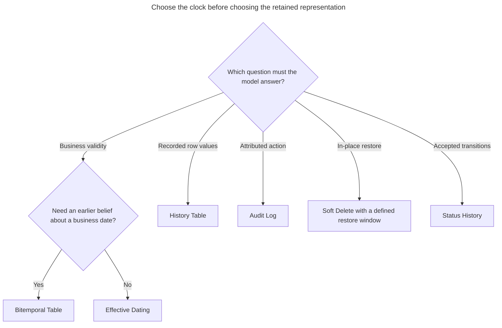

The branches are requirements you may combine. An audit payload is not automatically a convenient temporal query model, and retaining a final row version does not implement restoration.

## Party and roles

Do workflows refer to the same enduring counterparty, and can its capacities overlap or recur? Shared identity and participation episodes are separate decisions.

| Choice | Identity requirement | Classification or participation | Lifecycle cost |
| --- | --- | --- | --- |
| [Party](party.md) | People and organizations share real counterparty references | Person/organization details belong to that identity | Identity resolution and merges affect every reference; sample does not require subtype details at commit |
| [Role Object](role-object.md) | Retain the party across changing capacities | Roles overlap or recur with episode-specific attributes and references | Business-date queries and coordinated conflict-period maintenance |
| [Class Table Inheritance](class-table-inheritance.md) | Shared base with specific subtype targets | Intrinsic exclusive classification | Stronger exactly-one completeness adds an atomic creation/conversion protocol |
| [Separate entities or fixed capacity columns](role-object.md) | Independent lifecycles, or one simple capacity | No shared-counterparty requirement, or no role attributes/history | Avoid episode machinery when its contract is unnecessary |

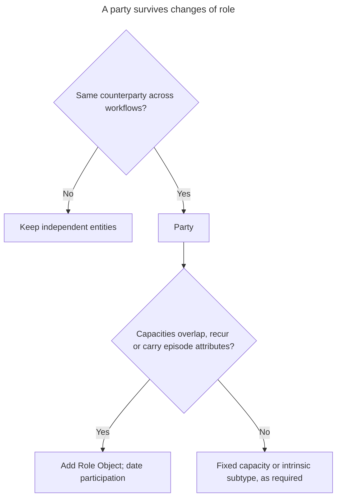

A customer becoming a supplier need not acquire a second party identity. Party's simpler shared-key example and Class Table Inheritance's complete subtype protocol intentionally provide different guarantees.

## Quantities and observations

Does the value need explicit units, repeated evidence or just one current scalar? Meaning, numeric representation and measurement provenance are independent requirements.

| Choice | Meaning and provenance requirement | Read or arithmetic requirement | Storage and change cost |
| --- | --- | --- | --- |
| [Quantity](quantity.md) | Amount carries compatible unit and dimension | Normalize compatible units before arithmetic; chapter handles multiplicative factors only | Guard unit definitions; currencies need an explicit contextual conversion model |
| [Observation](observation.md) | Repeated facts carry method, observer and two timestamps | Select active evidence under a defined policy; numeric phenomena use configured units | Retain immutable facts, replacements and rejections |
| [Fixed unit column](quantity.md) | One developer-controlled unit is sufficient | Normalize inputs at the boundary | Simple schema; no general unit catalog needed |
| [Current typed property](typed-properties.md) | One editable configurable value | Search current attributes rather than separate readings | Publish definition contracts; does not supply scientific provenance |
| [Exact decimal or scaled integer](inexact-arithmetic.md) | Exact amounts have a resolution and rounding contract | Review intermediate precision, range and overflow | PostgreSQL `numeric` is not SQLite NUMERIC affinity; fixed integer resolution is another option |
| [Floating point](inexact-arithmetic.md) | Approximation has accepted error bounds | Suitable numerical/measurement arithmetic under that contract | Cannot satisfy an exact decimal contract merely by balancing totals |

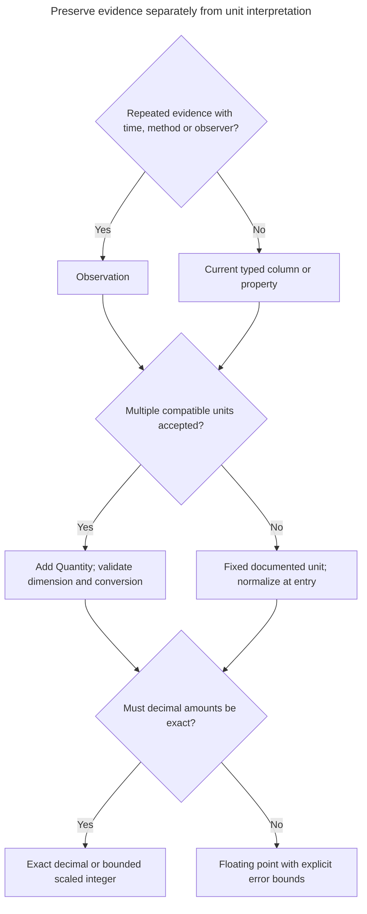

An observation can arrive late or contradict another without changing the subject's identity. Exact decimal storage still needs deliberate rounding when a conversion yields a repeating fraction.

## Component graphs

Are links one-parent navigation, shared recipe requirements or merely reachability? Quantity-bearing paths and reproducible version selection distinguish a recipe from a tree index.

| Pattern | Parent and edge requirement | Read requirement | Change and reproducibility cost |
| --- | --- | --- | --- |
| [Bill of Materials](bill-of-materials.md) | Reused components; quantity per parent/child version edge | Multiply along every route and sum leaf requirements | Validate acyclicity; immutable releases; pin selected version on orders |
| [Adjacency List](adjacency-list.md) | At most one parent; no shared recipe requirement | Traverse the hierarchy | Simple parent changes with coordinated cycle checks |
| [Closure Table](closure-table.md) | Precomputed ancestry supplements component edges | Frequent where-used/reachability joins | Tree algorithm needs redesign for multiple paths; pairs alone cannot calculate demand |
| [Effective Dating](effective-dating.md) | Business dates choose released versions | Resolve the schedule for new work | Complement to pinning; a later schedule change must not rewrite old orders |

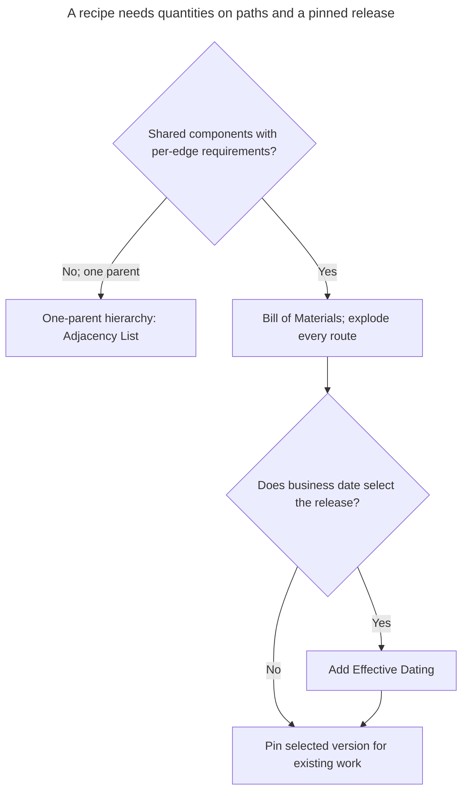

Deduplicating a component before summing its paths loses legitimate demand. A closure index can accelerate reachability without replacing the quantity-bearing source edges.

## Conserved movements

Must each movement retain its counterpart and explanation, or is only a current counter required? Choose posting integrity separately from the balance read strategy.

| Choice | Movement requirement | Enforcement and write boundary | Balance read requirement |
| --- | --- | --- | --- |
| [Double-Entry Ledger](double-entry-ledger.md) | Multiple legs, exact amounts, immutable explanation and reversals | Post balanced same-currency entries atomically; deferred aggregate trigger in PostgreSQL example | Derive balances from authoritative entries |
| [Two-account transfer row](double-entry-ledger.md) | Every movement is exactly one equal debit/credit pair | Equality can be structural | Simpler posting shape when every accepted movement fits |
| [Balance-only account](double-entry-ledger.md) | Current counter suffices; movement explanation can be lost | Atomic update with any required capacity coordination | Direct current read, weaker retained contract |
| [Summary Table](summary-table.md) | Faster balances over a long entry history | Maintain/reconcile projection against entries | Complement; cannot replace posting conservation |

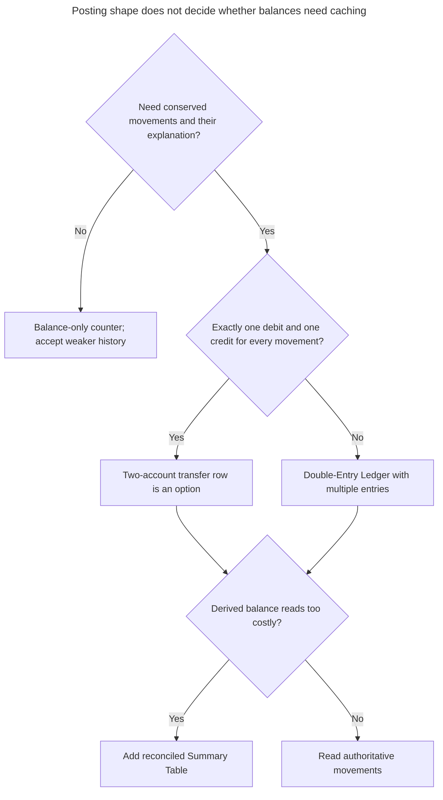

Zero sum proves conservation within the modeled posting, not sufficient funds or agreement with the external world. Add [Idempotency Record](idempotency-record.md) for retries and [Quantity](quantity.md) for explicit asset interpretation when those requirements apply.

## Concurrency and reliable writes

What can go wrong between reading, committing, receiving a response and completing external work? These patterns protect different boundaries and commonly compose.

| Choice | Requirement it protects | Concurrency or crash behavior | Boundary and operating cost |
| --- | --- | --- | --- |
| [Version Column](version-column.md) | Command depends on a displayed snapshot | Conditional update rejects stale token; losing writer must reconcile | Every relevant aggregate mutation advances token; engine tokens have different semantics |
| [Short row-lock transaction](version-column.md) | Read/decide/write can finish without user/network waits | Serialize a short calculation; simple atomic increments may suffice | Do not hold locks across a human decision |
| [Reservation](reservation.md) | Scarce capacity must remain held during a decision | Coordinated capacity rule plus persisted expiry/confirmation policy | Slots use overlap rules; pooled stock uses coordinated quantities; cleanup is part of lifecycle |
| [Idempotency Record](idempotency-record.md) | Retry after uncertain response must recover the same result | Scoped unique key arbitrates; reject changed payload under same key | Save effect and result atomically; retention defines retry window |
| [Transactional Outbox](transactional-outbox.md) | Local commit must eventually cause remote delivery | Durable staging survives crash; relay and consumers handle duplicates | Polling or log tailing; explicit ordering, acknowledgements and retention |
| [Queue Table](queue-table.md) | Enqueue local background execution with business data | Short claim; leases for work outside transaction; stale generation cannot finish replacement | Recovery and bounded retries; `SKIP LOCKED` is not strict FIFO or freedom from all waits |
| [Dedicated broker](queue-table.md) | Fan-out, transport or workload isolation justifies another service | Separate delivery protocol; duplicates still need handling | Same-transaction local enqueue needs an outbox bridge |

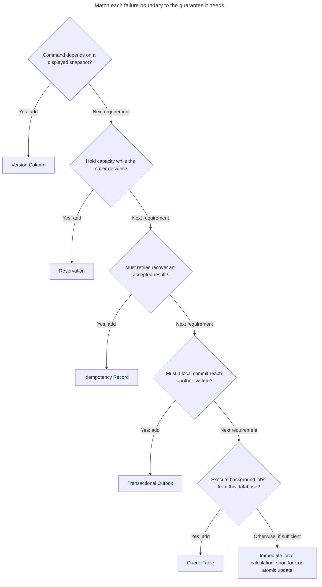

Read this as a checklist of independent requirements. A version does not reserve capacity, a correlation ID does not deduplicate a command, and an idempotency record does not deliver an event.

The PostgreSQL queue/outbox examples use `SKIP LOCKED`; SQL Server ports need an isolation-aware `READPAST`/update-lock protocol. SQLite's single writer changes the claim strategy and makes a write transaction held across broker I/O especially restrictive. A reservation check must never treat a skipped locked claim as free capacity.

## Tenant isolation

Which operation needs a tenant boundary: access to rows, privileges on objects, database lifecycle or dedicated placement? Choose the boundary along with its migration and recovery fleet.

| Pattern | Access and relationship boundary | Migration and query cost | Lifecycle and engine qualification |
| --- | --- | --- | --- |
| [Shared Schema](shared-schema.md) | Scoped composite keys plus trusted tenant context; RLS is an implementation option | One release and object set; all tenant paths carry scope | Tenant recovery selects a row graph; no resource isolation; PostgreSQL superusers/`BYPASSRLS` bypass policies |
| [Schema per Tenant](schema-per-tenant.md) | Separate namespace/object grants within a database | Repeated objects and migrations; qualified names or trusted transaction-local routing | Controlled staged versions; not dedicated resources; MySQL schema/database are synonyms |
| [Database per Tenant](database-per-tenant.md) | Directory selects destination and credential; validate tenant identity/version | Provisioning, pools, migrations and cross-tenant reporting become fleet work | PostgreSQL logical dump is database-sized, physical recovery is cluster-sized; dedicated resources need deployment separation |

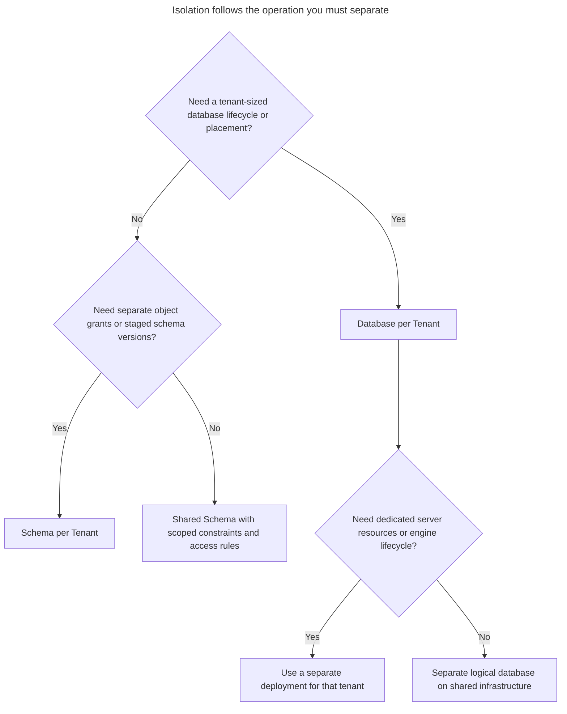

Hybrid routing can keep small tenants in shared tables and move selected tenants to separate databases. Container names do not establish equal guarantees across engines: Oracle schemas/PDBs and SQLite files have their own access and recovery boundaries.

## Growth and change

Is the measured cost repeated aggregation, physical retention/range access or incompatible client versions during rollout? These mechanisms address different costs and can be combined.

| Choice | Deciding workload requirement | Write or migration cost | Integrity and engine boundary |
| --- | --- | --- | --- |
| [Ordinary indexed table and on-demand aggregate](summary-table.md) | Existing queries and retention meet their budget | Simplest baseline; pay for aggregation on reads | Retains ordinary global key choices |
| [Summary Table](summary-table.md) | Repeated grouping is expensive and freshness is defined | Synchronous maintenance adds write contention; delayed refresh accepts lag; retain rebuild/reconciliation | Projection does not replace ledger integrity; materialized/indexed-view refresh contracts differ by engine |
| [Table Partitioning](table-partitioning.md) | Whole periods leave together or important predicates constrain a partition key | Operate creation, detach, restore and late arrivals; moving an existing table needs rollout work | PostgreSQL unique keys include partition key; MySQL partitioned InnoDB tables cannot participate in FKs; SQLite has no native equivalent |
| [Table Split](table-split.md) | Cold or separately protected columns cause the problem | Full reads join; measure benefit against projected unsplit reads | Vertical attribute boundary rather than period slicing |
| [Expand and Contract](expand-contract.md) | Old and new clients overlap through a breaking change | Add compatible shape, bridge writes, backfill/reconcile, switch, retire old contract | Still needs DDL locks and resource budget; MySQL DDL implicit commits change transaction boundaries |
| [Coordinated maintenance deployment](expand-contract.md) | All clients can stop for the measured conversion window | One coordinated stop can be simpler | No requirement for a prolonged compatibility bridge |
| [Sharding](table-partitioning.md) | One database cannot carry the workload | Separate routing and integrity design | Native partitions alone do not add servers |

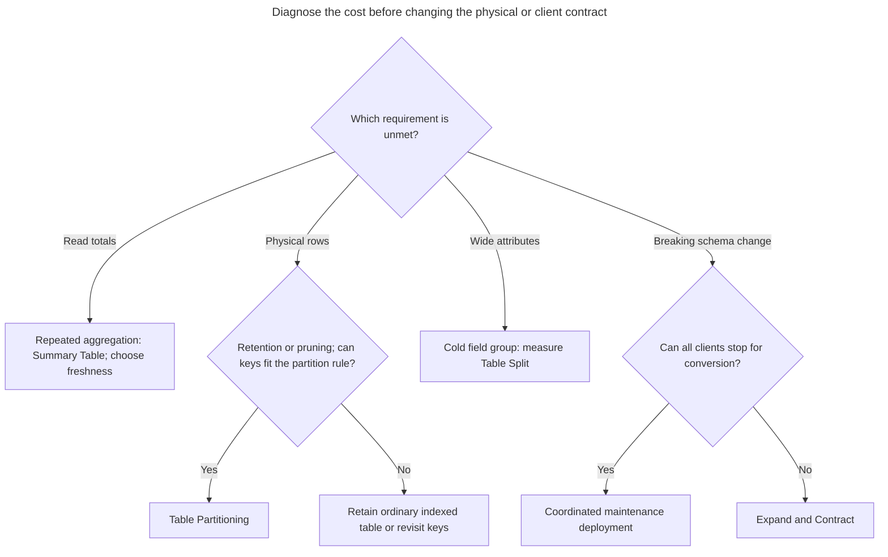

Partitioning does not precompute totals, and a summary does not manage source retention. Expand and Contract supplies a rollout protocol for either destination; contraction waits until old consumers have actually retired.

## Anti-pattern repair map

Start from the missing invariant, then use the corresponding family above. The anti-pattern chapters also describe defensible exceptions; the repair is not an instruction to replace every superficially similar structure.

| Anti-pattern | Repair and deciding condition |
| --- | --- |
| [Delimited Lists](delimited-lists.md) | [Association Table](association-table.md) for independently referenced members; an owned child table for owned facts. Typed arrays fit one aggregate without per-element FKs; keep opaque import text separately when required. |
| [Mandatory Surrogates](mandatory-surrogates.md) | [Natural Key](natural-key.md) or endpoint-pair identity in [Association Table](association-table.md); retain [Surrogate Key](surrogate-key.md) plus business uniqueness when independent references justify it. |
| [Missing Foreign Keys](missing-foreign-keys.md) | Ordinary/deferred FKs within one integrity boundary; validated staging for imports; [Exclusive Arc](exclusive-arc.md) for several target kinds; scoped composite keys from [Shared Schema](shared-schema.md) for tenants. |
| [Repeated Columns](repeated-columns.md) | [Association Table](association-table.md) for reusable members; owned child rows for independently managed values; [Localized Values](localized-values.md) for an evolving language set. Keep distinct permanent role columns when the tuple really is fixed. |
| [Polymorphic Associations](polymorphic-associations.md) | [Exclusive Arc](exclusive-arc.md) for few exactly-one targets, per-target [Association Tables](association-table.md) for separate relationships, or [Class Table Inheritance](class-table-inheritance.md) for real shared identity. |
| [Untyped Properties](untyped-properties.md) | Ordinary typed columns for stable fields; [Typed Properties](typed-properties.md) for managed runtime definitions; [JSON Column](json-column.md) for a validated aggregate; subtype tables for known field groups. |
| [Volatile Enums](volatile-enums.md) | [Lookup Table](lookup-table.md) for maintained labels/retirement; preserve guarded assignment. A stable developer-owned enum or local CHECK remains an option. |
| [Fixed-Depth Queries](fixed-depth-queries.md) | Recursive reads over [Adjacency List](adjacency-list.md), or measured read representations: [Materialized Path](materialized-path.md), [Nested Sets](nested-sets.md), [Closure Table](closure-table.md). An explicitly bounded request may stay bounded. |
| [Cloned Tables](cloned-tables.md) | One indexed relation, [Table Partitioning](table-partitioning.md) for physical slicing, or deliberate [Shared Schema](shared-schema.md), [Schema per Tenant](schema-per-tenant.md) or [Database per Tenant](database-per-tenant.md) isolation. Review global-key requirements before partitioning. |
| [Inexact Arithmetic](inexact-arithmetic.md) | Exact decimals or bounded integer minor units with rounding rules; [Quantity](quantity.md) for unit meaning and [Double-Entry Ledger](double-entry-ledger.md) for conservation. Approximate calculations may retain floating point with accepted error bounds. |
