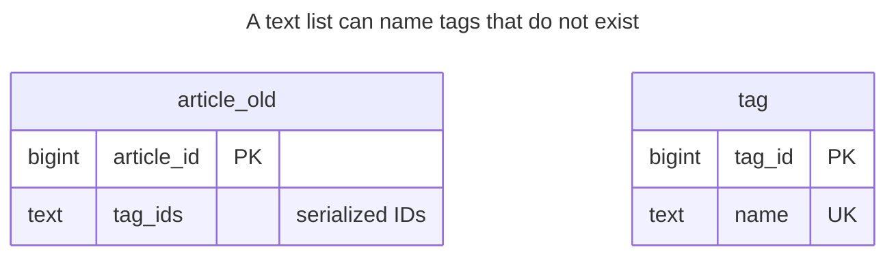
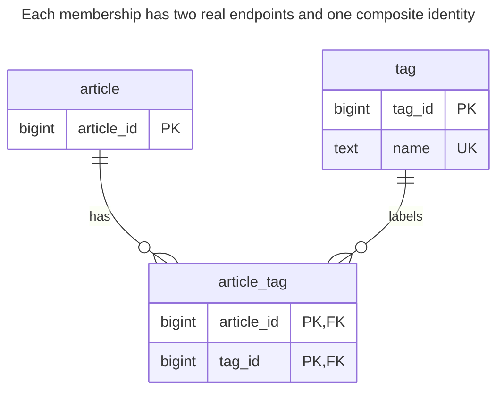
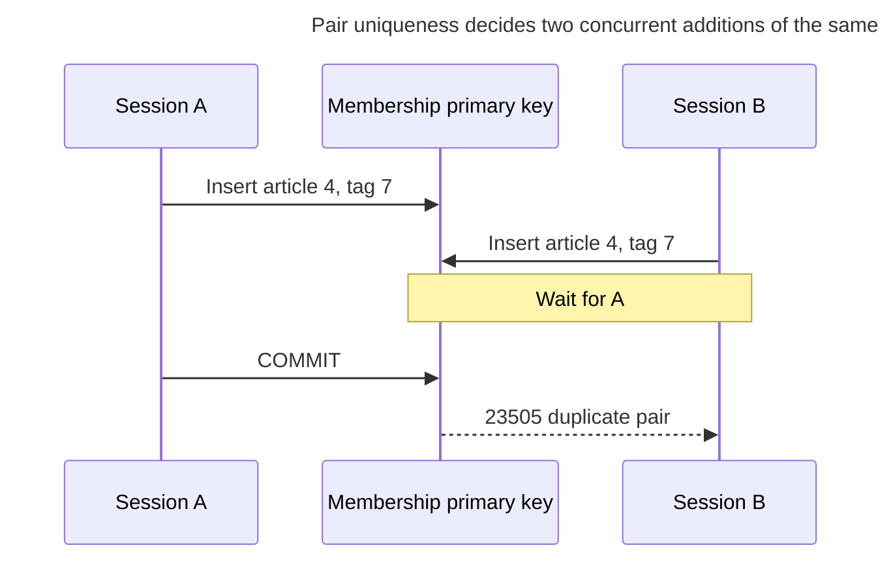
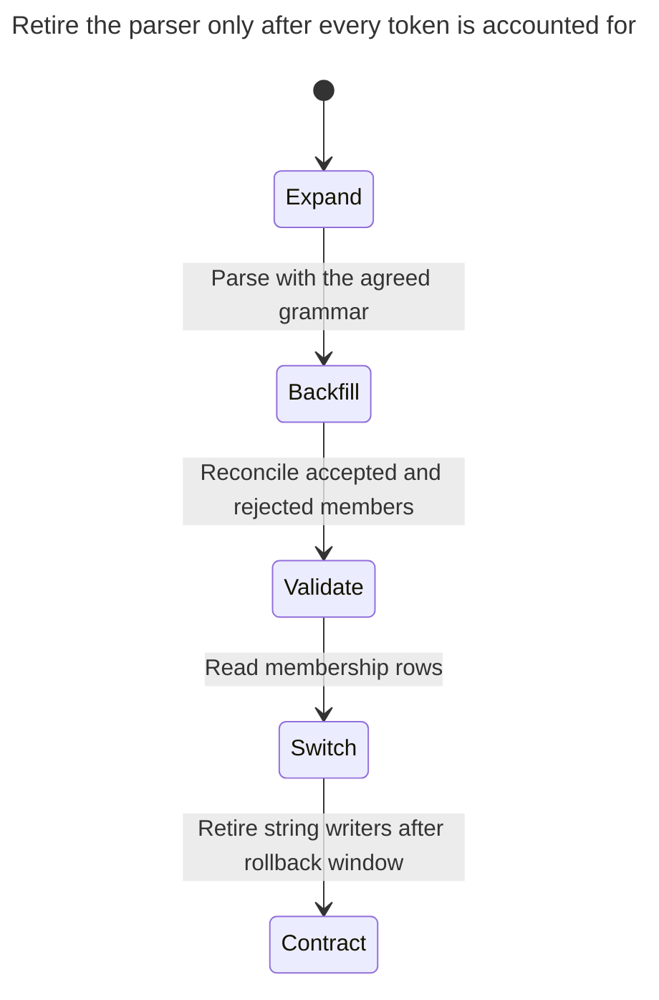

# Delimited Lists

Delimited lists store several values in one string column — tag IDs as `'3,7,12'` or e-mail addresses separated by semicolons — to avoid creating another table. Every query then has to parse the string: searching for one value needs parsing or delimiter-aware matching, an ordinary B-tree cannot serve arbitrary substring membership, joins need parsed elements, foreign keys cannot check individual IDs, and a declared column length caps how many fit. The chapter shows how the list breaks, when an array type is an acceptable middle ground, and how to migrate to an association table. Bill Karwin calls this Jaywalking.

## Also known as

Jaywalking, in Bill Karwin's [SQL Antipatterns contents](https://pragprog.com/titles/bksap1/sql-antipatterns-volume-1/). The name identifies the catalog entry; the lab below demonstrates the failure independently.

## Context

You add tags to articles. An article can have many tags, tags are shared, and each tag already has an ID. A form submits a list, so storing that list as one string looks like a direct translation of the request. The important question is whether you will treat the list as opaque text or treat each member as a relationship.

## Problem

You store the serialized list as the authoritative relationship. The column's type describes text, while readers depend on a grammar for separators, spaces, empty members and IDs. A substring predicate confuses `2` with `12`; adding separators to the predicate fixes that one ambiguity without proving that tag `12` exists. PostgreSQL's [B-tree pattern rules](https://www.postgresql.org/docs/18/indexes-types.html) support appropriate anchored patterns, not arbitrary leading-wildcard membership searches.

Parsing makes joins possible. It also makes every writer and query responsible for the same encoding. A specialized [expression index](https://www.postgresql.org/docs/18/indexes-expressional.html) can improve a particular parsed predicate; it does not provide a foreign key for each token. PostgreSQL [foreign keys](https://www.postgresql.org/docs/18/ddl-constraints.html#DDL-CONSTRAINTS-FK) reference column values against a declared key, rather than iterating a string's elements.

## Why people do it

You avoid a second table, can save the request with one assignment, and can display it without aggregation. Those are reasonable advantages for an imported source field that you retain verbatim. They become a poor bargain when the same field controls tag existence, tag-based searches or independent membership edits.

## Consequences

- ➖ A misspelled or deleted tag ID remains ordinary valid text in this schema.
- ➖ A full-list save can erase a member added since the user opened the form.
- ➖ Relationship attributes such as who applied a tag require another embedded encoding.
- ➖ Deduplication and ordering become grammar decisions. Sorting a string is not a substitute for defining whether the relationship is a set or a sequence.

## Signs

- You surround both the column and search value with separators before every match.
- You split a column into rows before joining to its supposed parent table.
- A repair job removes unknown IDs from strings.
- Two writers disagree about whether `3,7` and `7,3,3` are the same value.

## A better way

Store one row per membership in an [Association Table](association-table.md). Give the pair a key and give each endpoint a real reference. Decide explicitly whether duplicates are invalid and whether order matters. The example is a set; keep the source string and rejected tokens until you have reconciled every member.

### Alternatives and selection

| Choice | Relationship | Choose it when |
| --- | --- | --- |
| [Association Table](association-table.md) | Replacement | Members identify independent entities and need joins, constraints or individual edits |
| PostgreSQL array | Implementation option for a single aggregate value | Elements are typed scalar data owned and replaced together, without individual foreign-key relationships |
| Opaque source text | Complement | You retain the exact imported representation alongside validated relationships |
| [Repeated Columns](repeated-columns.md) | Another failure mode | Numbered slots merely move the membership grammar into column names |

PostgreSQL [arrays](https://www.postgresql.org/docs/18/arrays.html#ARRAYS-SEARCHING) provide typed elements and membership operators; their documentation recommends a separate table when searching elements indicates a set. Array containment can use [GIN](https://www.postgresql.org/docs/18/indexes-types.html#INDEXES-TYPES-GIN), but an integer array still does not declare an FK for every member. Use the [Decision Atlas](decision-atlas.md) for the full table.

## Example

### Structure

**Before:** the tag IDs in the string have no declared relationship to `tag`.



The absence of an ER edge is intentional. Similar-looking numbers in the string are not constrained references.

```sql
CREATE TABLE tag (tag_id bigint PRIMARY KEY, name text NOT NULL UNIQUE);
CREATE TABLE article_old (article_id bigint PRIMARY KEY, tag_ids text NOT NULL);
INSERT INTO tag VALUES (3, 'sql'), (7, 'schema'), (12, 'keys');
INSERT INTO article_old VALUES (1, '3,7,12'), (2, '12'), (3, '7,999');
SELECT article_id FROM article_old WHERE tag_ids LIKE '%3%' ORDER BY article_id;
SELECT article_id FROM article_old WHERE tag_ids LIKE '%2%' ORDER BY article_id;
```

The first query returns article `1`. Searching for nonexistent tag `2` returns articles `1, 2` because both strings contain `12`. The `999` on article `3` is accepted even though it is absent from `tag`.

**After:** keep a unique pair for every accepted relationship.



An article can have no tags, and a tag can be unused. A membership always has both endpoints. The reverse index serves tag-first reads.

```sql
CREATE TABLE article (article_id bigint PRIMARY KEY);
CREATE TABLE article_tag (
    article_id bigint NOT NULL REFERENCES article (article_id),
    tag_id bigint NOT NULL REFERENCES tag (tag_id),
    CONSTRAINT article_tag_pkey PRIMARY KEY (article_id, tag_id)
);
CREATE INDEX article_tag_reverse_idx ON article_tag (tag_id, article_id);
CREATE TABLE tag_reject (
    article_id bigint NOT NULL,
    token text NOT NULL,
    reason text NOT NULL
);
BEGIN;
LOCK TABLE article_old IN SHARE ROW EXCLUSIVE MODE;
INSERT INTO article SELECT article_id FROM article_old;
CREATE TEMP TABLE tag_token ON COMMIT DROP AS
SELECT a.article_id, btrim(t.token) AS token
FROM article_old AS a
CROSS JOIN LATERAL unnest(string_to_array(a.tag_ids, ',')) AS t(token);
INSERT INTO tag_reject
SELECT t.article_id, t.token, 'unknown or noncanonical tag ID'
FROM tag_token AS t LEFT JOIN tag AS g ON g.tag_id::text = t.token
WHERE g.tag_id IS NULL;
INSERT INTO article_tag
SELECT DISTINCT t.article_id, g.tag_id
FROM tag_token AS t JOIN tag AS g ON g.tag_id::text = t.token;
COMMIT;
SELECT article_id FROM article_tag WHERE tag_id = 12 ORDER BY article_id;
SELECT * FROM tag_reject ORDER BY article_id, token;
```

The corrected lookup returns articles `1, 2` for tag `12`. The reject table contains `(3, 999, unknown or noncanonical tag ID)`. The import matches canonical text to existing IDs, so malformed numeric text never reaches a cast. It deliberately sends `003` for review rather than deciding that it means `3`. The script's split assumes the documented simple comma grammar; quoted CSV or addresses containing separators require the source format's parser.

```sql
INSERT INTO article_tag VALUES (1, 999);
```

PostgreSQL 18.6 raises SQLSTATE `23503`: `ERROR: insert or update on table "article_tag" violates foreign key constraint "article_tag_tag_id_fkey"`. Its detail identifies `(tag_id)=(999)` as missing from `tag`. Run the [complete script](../assets/delimited-lists/delimited-lists.sql) for the migration and asserted rejection.

### Engine support

- **PostgreSQL 18:** [`string_to_array`](https://www.postgresql.org/docs/18/functions-string.html) and [`unnest`](https://www.postgresql.org/docs/18/functions-array.html) are import operations here. They disappear from ordinary membership reads.
- **MySQL 8.4 / InnoDB:** [foreign keys require indexed reference columns](https://dev.mysql.com/doc/refman/8.4/en/create-table-foreign-keys.html); translate the import parser while retaining the two endpoint constraints.
- **SQLite:** [enable foreign keys on each connection](https://www.sqlite.org/foreignkeys.html#fk_enable). Otherwise the corrected declarations alone do not supply the demonstrated rejection.

### Failure and concurrency

With a list, two clients can read `3`, independently add `7` and `12`, then overwrite one another with full-string saves. Relationship-row inserts avoid that full-value overwrite. Two requests adding the same pair still compete; PostgreSQL's [unique-index checking](https://www.postgresql.org/docs/18/index-unique-checks.html) waits for the conflicting transaction before deciding the duplicate.



If adding an existing tag is intentionally idempotent, handle that specific duplicate as the desired state. Do not treat every database error as success. Replacing the entire tag set is a separate operation: serialize on the article before comparing and replacing memberships.

### Migration

The lab pauses writes to the source during its small copy. For a live conversion, first define the source grammar, audit malformed and unknown tokens, and preserve the original text. Install writers that update both forms in one transaction under an article-row lock, then backfill under that same lock. This avoids replaying an old string over a newer membership set.



Compare sets per article, including the rejected members, before switching reads. `DISTINCT` is correct only because this example defines set membership; preserve duplicate counts separately if they might have meaning. Keep the string maintained during rollback, and remove it only after all writers and exports use the new contract. See [Expand and Contract](expand-contract.md).

## Related patterns and anti-patterns

- [Association Table](association-table.md) gives each relationship its own constrained row.
- [Repeated Columns](repeated-columns.md) creates a different arbitrary representation limit for the same collection.
- [Missing Foreign Keys](missing-foreign-keys.md) explains the integrity gap that remains after parsing without references.
