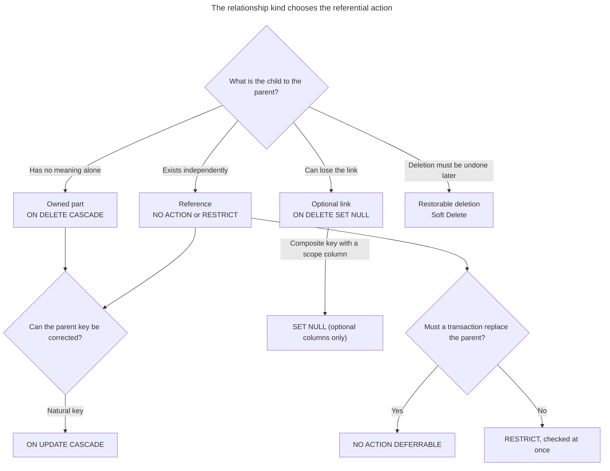
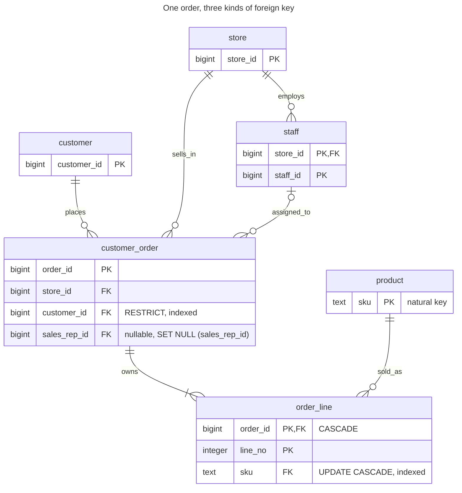
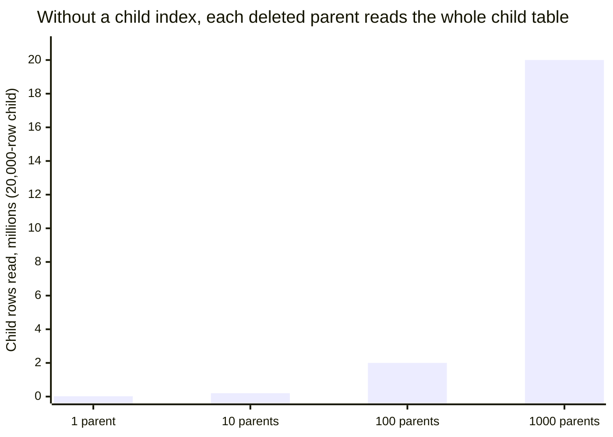
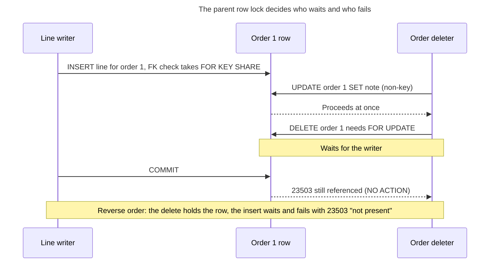
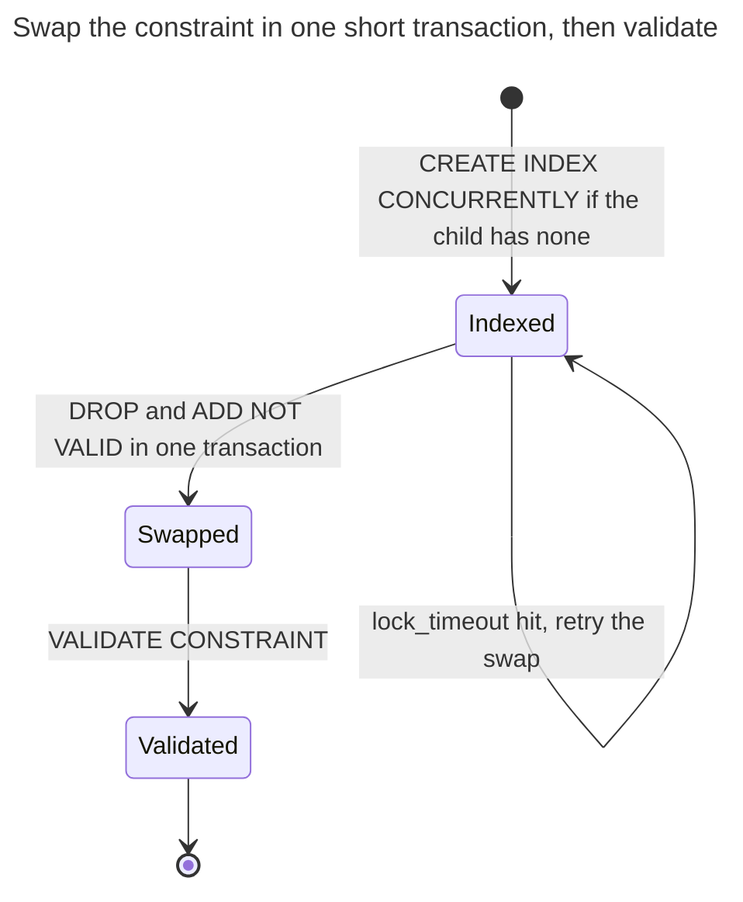

# Dependent Table

## Intent

A dependent table holds rows that belong to a parent row through a foreign key: order lines to an order, an order to the customer who placed it, an order to the sales rep assigned to it. The key alone says only that the parent exists. The chapter is about the other half of the declaration: what deleting or re-keying the parent does to its children. Choose the action per relationship kind: owned parts cascade, references to independent things restrict, optional links are set to null, and corrected natural keys cascade on update. The chapter also covers the index PostgreSQL does not create for you, large cascades, triggers and ORM-side cascades, and the lock that lets a child insert and a parent delete meet safely. See PostgreSQL's [foreign keys](https://www.postgresql.org/docs/18/ddl-constraints.html#DDL-CONSTRAINTS-FK).

## Also known as

[Dependent Mapping](https://martinfowler.com/eaaCatalog/dependentMapping.html) and [Foreign Key Mapping](https://martinfowler.com/eaaCatalog/foreignKeyMapping.html) in Fowler's Patterns of Enterprise Application Architecture: the first has one class perform the database mapping for a child class, the second maps an association between objects to a foreign key reference. Referential actions, `ON DELETE` and `ON UPDATE` rules, cascading delete.

## Problem

An online shop stores orders, their lines, customers, products and staff. A support agent deletes a test customer, and the application removes the customer row; their orders stay, pointing at nothing, or, with a carelessly copied `ON DELETE CASCADE`, vanish with the customer together with the revenue they record. A product manager deletes a discontinued product and either breaks old invoices or gets an error nobody planned for. A sales rep leaves, and every order they handled must lose the assignment but keep its store.

Each of these is one foreign key, and each needs a different answer. The default, `NO ACTION`, rejects the delete, which is right for the customer and wrong for the order lines, whose owner is being deleted on purpose. Copying one action to every key in the schema treats a line, which has no meaning without its order, the same way as a customer, who exists without any order.

Deletes also cost more than they look. PostgreSQL checks the children of every deleted parent row, and without an index on the referencing columns each check reads the whole child table. A cascade over a large tree runs inside one statement and one transaction, locking every row it removes.

## Solution

Classify each foreign key by what the child is to the parent, then declare the action that follows from it:

- **Owned part** — a line of an order, a detail row of a [Table Split](table-split.md), a membership of an [Association Table](association-table.md) to the side that owns it: `ON DELETE CASCADE`. The child has no meaning without the parent and no other owner.
- **Reference to an independent thing** — an order's customer, a line's product: `NO ACTION` (the default) or `RESTRICT`. Deleting the parent is a business decision that must first deal with the children. `NO ACTION` can be deferred to the end of the transaction; `RESTRICT` is checked at once and never deferred.
- **Optional link** — an assigned sales rep, a "last edited by": a nullable column with `ON DELETE SET NULL`. In a composite key that carries a tenant or store, list only the optional column: `ON DELETE SET NULL (sales_rep_id)`, available since [PostgreSQL 15](https://www.postgresql.org/docs/release/15.0/).
- **Fallback value** — rarely, `ON DELETE SET DEFAULT`, where the default must itself be an existing parent row.
- **Corrected natural key** — `ON UPDATE CASCADE`, when the parent key is a business value that can be corrected; see [Natural Key](natural-key.md). Surrogate keys never change, so their `ON UPDATE` action does not matter.

Then index the referencing columns of every key whose parent you delete or re-key, and decide how big a tree a single delete may remove.

## Alternatives and selection

| Choice | Relationship | Deciding requirement |
| --- | --- | --- |
| `ON DELETE CASCADE` | Action for owned parts | The child has no meaning and no owner without the parent |
| `NO ACTION` / `RESTRICT` | Action for references | The parent exists independently; its removal must be decided, not implied |
| `ON DELETE SET NULL (cols)` | Action for optional links | The child stays valid without the link; other key columns stay set |
| Application or ORM cascade | Replacement, usually worse | Each child needs per-row domain logic that a trigger cannot express |
| [Soft Delete](soft-delete.md) | Complement | Deleted parents must stay restorable; its cascades are a different design |
| [Association Table](association-table.md) | Complement | The child links two independent things; each side gets its own action |
| [Exclusive Arc](exclusive-arc.md) | Complement | The child has exactly one owner among several tables, each with a cascading key |
| [Missing Foreign Keys](missing-foreign-keys.md) | Anti-pattern this replaces | References exist but are not declared, so no action is possible |

See the [Decision Atlas](decision-atlas.md) for the full comparison.



The delete action and the update action are separate decisions on the same key. A line cascades from its order on delete, and its product reference restricts on delete but cascades on update.

## Structure



`order_line` is the dependent table here: its key starts with its owner's key, and nothing but its order refers to it. `customer_order` owns its lines but is owned by nothing: its keys point at a customer, a store and a staff member, all of which outlive it.

## Tables and invariants

- **`customer`**, **`product`**, **`store`** exist independently. They are parents only; nothing they reference is deleted with them.
- **`staff`** is keyed by `(store_id, staff_id)`, so a sales rep can be referenced only together with their store.
- **`customer_order`** must have a customer (`NOT NULL`, `ON DELETE RESTRICT`) and a store. Its sales rep is optional: under the default `MATCH SIMPLE`, a null `sales_rep_id` disables the composite check, and deleting the rep sets only `sales_rep_id` to null.
- **`order_line`** cannot outlive its order (`ON DELETE CASCADE`), and its primary key `(order_id, line_no)` already serves as the index that finds an order's lines. Its product reference is `NO ACTION` on delete, `ON UPDATE CASCADE` for a corrected SKU, and `DEFERRABLE` so that a transaction can replace a product row.
- **Every referencing column has an index** whose leading columns match the key: `customer_order (customer_id)`, `customer_order (store_id, sales_rep_id)`, `order_line (sku)`. The primary key of `order_line` covers `order_id`.

## When to use

- For every foreign key you declare: the action is part of the declaration whether you write it or not.
- When a parent is deleted by users or by retention jobs, so the children's fate must be decided once instead of in every code path.
- When a natural key can be corrected and its references must follow.

## Consequences and trade-offs

- ➕ The relationship kind is visible in the schema; every writer, including ad hoc SQL, gets the same deletion rule.
- ➕ Cascades remove an owned tree in one statement without orphan-cleanup jobs.
- ➕ `RESTRICT` and `NO ACTION` turn an accidental delete of a referenced row into an error instead of lost data.
- ➖ A cascade is silent: one `DELETE` of a parent can remove thousands of rows, and a chain of cascades can reach tables the author of the statement never thought about.
- ➖ Each referencing column needs an index for deletes to stay cheap; the index costs space and write time.
- ➖ Database actions bypass application code: no domain events, no ORM callbacks, no in-memory state updated.

## Implementation

The [complete PostgreSQL 18.7 script](../assets/dependent-table/dependent-table.sql) checks every action, error and count below, and runs the races through two extra connections:

```sql
CREATE TABLE customer_order (
    order_id bigint PRIMARY KEY,
    store_id bigint NOT NULL REFERENCES store (store_id),
    customer_id bigint NOT NULL
        REFERENCES customer (customer_id) ON DELETE RESTRICT,
    sales_rep_id bigint,
    FOREIGN KEY (store_id, sales_rep_id)
        REFERENCES staff (store_id, staff_id)
        ON DELETE SET NULL (sales_rep_id)
);
CREATE INDEX customer_order_customer_idx ON customer_order (customer_id);
CREATE INDEX customer_order_sales_rep_idx ON customer_order (store_id, sales_rep_id);

CREATE TABLE order_line (
    order_id bigint NOT NULL
        REFERENCES customer_order (order_id) ON DELETE CASCADE,
    line_no integer NOT NULL,
    sku text NOT NULL
        REFERENCES product (sku) ON UPDATE CASCADE DEFERRABLE INITIALLY IMMEDIATE,
    quantity integer NOT NULL CHECK (quantity > 0),
    PRIMARY KEY (order_id, line_no)
);
CREATE INDEX order_line_sku_idx ON order_line (sku);
```

Deleting order `1` removes its three lines. A row-level `AFTER DELETE` trigger on `order_line` records three rows: cascades are ordinary deletes on the child, so its row triggers fire for each cascaded row. Deleting a customer who still has orders is refused at once:

```sql
DELETE FROM customer WHERE customer_id = 100;
```

PostgreSQL 18.7 raises SQLSTATE `23001`: `ERROR: update or delete on table "customer" violates RESTRICT setting of foreign key constraint "customer_order_customer_id_fkey" on table "customer_order"`, with `DETAIL: Key (customer_id)=(100) is referenced from table "customer_order".` The product reference uses `NO ACTION`, so deleting a sold product raises `23503` instead: `ERROR: update or delete on table "product" violates foreign key constraint "order_line_sku_fkey" on table "order_line"`. The difference shows up in a transaction that replaces a parent row. After `SET CONSTRAINTS ALL DEFERRED`, deleting product `CUP-01` and inserting it again passes the deferred check. A `RESTRICT` key declared `DEFERRABLE INITIALLY DEFERRED` still fails with `23001` on the `DELETE` itself; the [documentation](https://www.postgresql.org/docs/18/ddl-constraints.html#DDL-CONSTRAINTS-FK) states that `RESTRICT` does not allow the check to be deferred.

A corrected SKU follows into the lines:

```sql
UPDATE product SET sku = 'CUP-001' WHERE sku = 'CUP-01';
```

Order `2`'s line now reads `CUP-001`. Deleting sales rep `(1, 8)` leaves order `2` with `store_id = 1` and `sales_rep_id` null. The column list matters: a `delivery` table with the same composite key and plain `ON DELETE SET NULL` tries to clear both columns, and the delete fails with `23502`: `ERROR: null value in column "store_id" of relation "delivery" violates not-null constraint`. Column lists are allowed for `ON DELETE` only, not for `ON UPDATE`.

`SET DEFAULT` rewrites children to the column default, which is checked like any other value. Deleting channel `phone` moves its leads to `web`. Deleting `web` itself fails with `23503`, because the leads cannot fall back to a row that is being removed. Moving children to a catch-all parent also rewrites what they recorded, which is why the action is rare.

### The index PostgreSQL does not create

The parent side of every key has a unique index; the child side has none unless you create it. Each deleted or re-keyed parent row runs one lookup on the child. The script deletes two unsold products while `order_line` (about 20,000 rows) has no index on `sku`: `pg_stat_xact_user_tables` shows exactly two more sequential scans of `order_line`. After `CREATE INDEX order_line_sku_idx`, deleting a third product adds one index scan and no sequential scan.



The bars multiply the measured one scan per deleted parent by the 20,000 rows of the script's child table; with the index, each check reads only the matching entries. The parent rows deleted so far stay locked while the scans run, and child inserts for those parents wait. A retention job that deletes a thousand parents multiplies the full read of the child table by a thousand.

### Large cascades

`DELETE FROM customer_order WHERE order_id = 500` with 20,000 lines is one statement: it deletes and locks every line in one transaction and fires the child's row trigger once per line before it returns. For a big tree, delete the children in bounded batches first, each batch in its own transaction, then delete the owner:

```sql
DELETE FROM order_line
WHERE (order_id, line_no) IN (
    SELECT order_id, line_no FROM order_line
    WHERE order_id = 500
    LIMIT 5000);
-- repeat until it deletes 0 rows, then:
DELETE FROM customer_order WHERE order_id = 500;
```

The script runs the batch four times, inserts one more line, then deletes the order: the cascade removes the late line, and the trigger has recorded all 20,001. Keep `ON DELETE CASCADE` on the key while you batch, so lines inserted between batches are removed by the final delete instead of blocking it.

### ORM-side cascades

ORMs offer their own cascades that run in the application. Rails' [`has_many ... dependent: :destroy`](https://api.rubyonrails.org/classes/ActiveRecord/Associations/ClassMethods.html#method-i-has_many) destroys each associated object with its callbacks; [`destroy_all`](https://api.rubyonrails.org/classes/ActiveRecord/Relation.html#method-i-destroy_all) documents the cost as "at least one SQL `DELETE` query per record". Jakarta Persistence [`CascadeType.REMOVE`](https://jakarta.ee/specifications/persistence/3.2/jakarta-persistence-spec-3.2#a1946) cascades the remove operation to every referenced entity, and `orphanRemoval` removes an entity taken out of its owner's collection; both are applied at flush or commit. Such cascades run only when the parent is deleted through the ORM: a `DELETE` from SQL, another service or a migration skips them. They work entity by entity, and a child inserted after the collection was loaded either makes the final parent delete fail on the key or, without a key, survives as an orphan. Next to a database action they duplicate it or contradict it. Use them only for children whose deletion needs per-row domain logic, and keep a database action as the rule for everyone else. Rails' [`add_foreign_key`](https://api.rubyonrails.org/classes/ActiveRecord/ConnectionAdapters/SchemaStatements.html#method-i-add_foreign_key) takes `on_delete: :cascade`, Hibernate's [`@OnDelete`](https://docs.hibernate.org/orm/7.0/javadocs/org/hibernate/annotations/OnDelete.html) generates `on delete cascade` in the DDL, and Django 6.1 adds [`DB_CASCADE` and `DB_SET_NULL`](https://docs.djangoproject.com/en/6.1/ref/models/fields/#django.db.models.ForeignKey.on_delete).

## Engine support

- **PostgreSQL 18:** all five actions, column lists for `ON DELETE SET NULL` and `SET DEFAULT` (since 15), deferrable `NO ACTION`, and [no automatic index on referencing columns](https://www.postgresql.org/docs/18/ddl-constraints.html#DDL-CONSTRAINTS-FK). Cascades run as ordinary deletes and updates on the child, so its row triggers fire.
- **MySQL 8.4 / InnoDB:** supports `CASCADE`, `SET NULL`, `RESTRICT` and `NO ACTION`, where `NO ACTION` is checked [immediately, like `RESTRICT`](https://dev.mysql.com/doc/refman/8.4/en/create-table-foreign-keys.html); InnoDB rejects `SET DEFAULT`. It creates the index on the referencing columns if none exists. "Cascaded foreign key actions do not activate triggers": an audit trigger on the child misses every cascaded delete.
- **SQL Server 2025 (17.x):** [`ON DELETE` and `ON UPDATE`](https://learn.microsoft.com/en-us/sql/t-sql/statements/create-table-transact-sql?view=sql-server-ver17) take `NO ACTION`, `CASCADE`, `SET NULL` and `SET DEFAULT`; there is no `RESTRICT` keyword and no deferrable option. It rejects multiple cascade paths to one table, as [Exclusive Arc](exclusive-arc.md) and [Closure Table](closure-table.md) show.
- **Oracle AI Database 26ai:** the [`ON DELETE` clause](https://docs.oracle.com/en/database/oracle/oracle-database/26/sqlrf/constraint.html) offers `CASCADE` and `SET NULL`; omitting it forbids deleting referenced keys. There is no `ON UPDATE CASCADE`, so natural keys need a correction procedure.
- **SQLite 3:** supports all five [actions](https://www.sqlite.org/foreignkeys.html#fk_actions); `RESTRICT` fails immediately even on a deferred key. Foreign keys work only after `PRAGMA foreign_keys = ON` per connection, and without an [index on the child key](https://www.sqlite.org/foreignkeys.html#fk_indexes) every parent delete scans the child table.

## Failure and concurrency

The foreign key check on a child insert locks the parent row `FOR KEY SHARE`; the script reads that mode with `pgrowlocks`. The lock conflicts with `DELETE` and with updates of key columns, which take `FOR UPDATE`, and not with other updates, which take `FOR NO KEY UPDATE` ([row-level locks](https://www.postgresql.org/docs/18/explicit-locking.html#LOCKING-ROWS)). Whoever touches the parent row first makes the other wait:



With `NO ACTION`, the delete waits for the inserting transaction and then fails with `23503`: `update or delete on table "customer_order" violates foreign key constraint "order_line_order_id_fkey"`. If the delete comes first, the insert waits for it and fails after it commits, also with `23503`: `Key (order_id)=(2) is not present in table "customer_order".` With `ON DELETE CASCADE`, the waiting delete succeeds and removes the line the writer has just committed. Either way no orphan appears, but one side gets an error or loses work; treat it as a business conflict, not as a retryable glitch.

A cascade also holds row locks on every child it deleted until commit: while another session's cascade over order `4` is open, `SELECT ... FOR UPDATE NOWAIT` on one of its lines fails with `55P03`. An application that locks a parent with `SELECT ... FOR UPDATE` to edit non-key columns blocks every child insert for that parent; use `FOR NO KEY UPDATE` instead.

## Migration

PostgreSQL cannot change an action in place: `ALTER CONSTRAINT ... ON DELETE CASCADE` is a syntax error (`42601`), since `ALTER CONSTRAINT` changes attributes such as deferrability, not the action. Replace the constraint instead, in one transaction, and validate later:

```sql
BEGIN;
SET LOCAL lock_timeout = '2s';
ALTER TABLE order_line DROP CONSTRAINT order_line_order_id_fkey;
ALTER TABLE order_line ADD CONSTRAINT order_line_order_id_fkey
    FOREIGN KEY (order_id) REFERENCES customer_order (order_id)
    ON DELETE CASCADE NOT VALID;
COMMIT;
ALTER TABLE order_line VALIDATE CONSTRAINT order_line_order_id_fkey;
```



The swap holds `ACCESS EXCLUSIVE` on both tables until commit, which the script reads from `pg_locks`; the bounded `lock_timeout` keeps it from queuing behind long transactions. `NOT VALID` postpones only the scan of existing rows: the script deletes an order right after the swap commits, and its line is cascaded before validation runs. Validation then scans the child under a weaker lock, as [Missing Foreign Keys](missing-foreign-keys.md) describes. Before switching an ORM cascade to a database one, remove the ORM option in the same release, or both will try to delete the same rows.

## Anti-patterns and common mistakes

- `ON DELETE CASCADE` on a reference to an independent thing: deleting a customer erases their orders, deleting a product erases sales history.
- The same action on every key, copied from a template or an ORM default.
- No index on referencing columns, discovered when a retention job takes hours.
- Plain `SET NULL` on a composite key that includes a tenant or store column.
- Deleting a parent with millions of descendants in one statement during peak traffic.
- An audit trigger on the child that is expected to see cascaded deletes on MySQL.
- ORM cascades and database cascades on the same relationship, each assuming it is the only one.
- Cascading a soft delete through `ON DELETE CASCADE`; a soft delete is an `UPDATE` and triggers no referential action. See [Soft Delete](soft-delete.md).

## Known uses

- PostgreSQL's own [documentation example](https://www.postgresql.org/docs/18/ddl-constraints.html#DDL-CONSTRAINTS-FK) uses `ON DELETE SET NULL (author_id)` for posts whose author is deleted in a multi-tenant schema.
- Rails association options (`dependent: :destroy`, `:delete_all`, `:nullify`, `:restrict_with_exception`) and Django's `on_delete` name the same kinds of relationship as this chapter's actions.
- Hibernate's `@OnDelete` and Django 6.1's `DB_CASCADE` move the cascade from the ORM into the database; Django's documentation notes that the database variants avoid fetching related objects.

## Related patterns

- [Association Table](association-table.md) applies these actions to both endpoints of a link.
- [Table Split](table-split.md) is a one-to-one dependent table whose detail row cascades from the core.
- [Natural Key](natural-key.md) shows `ON UPDATE CASCADE` through several levels.
- [Exclusive Arc](exclusive-arc.md) cascades from whichever of several owners a row has.
- [Closure Table](closure-table.md) cascades node deletion into its path pairs.
- [Missing Foreign Keys](missing-foreign-keys.md) is the anti-pattern where no action can be declared.
- [Soft Delete](soft-delete.md) covers restorable deletion and its cascades.
