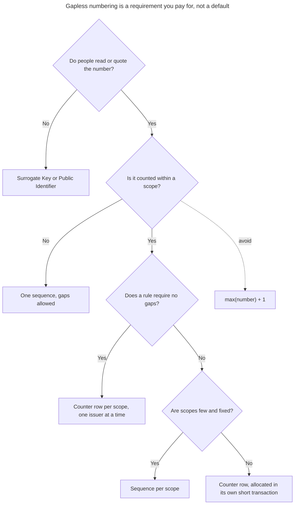
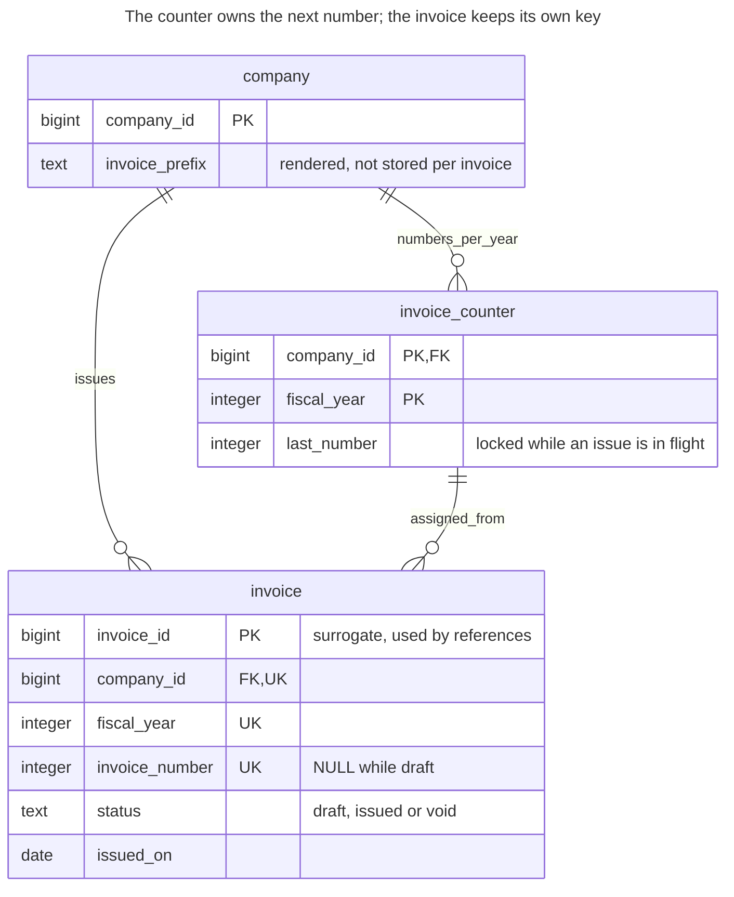
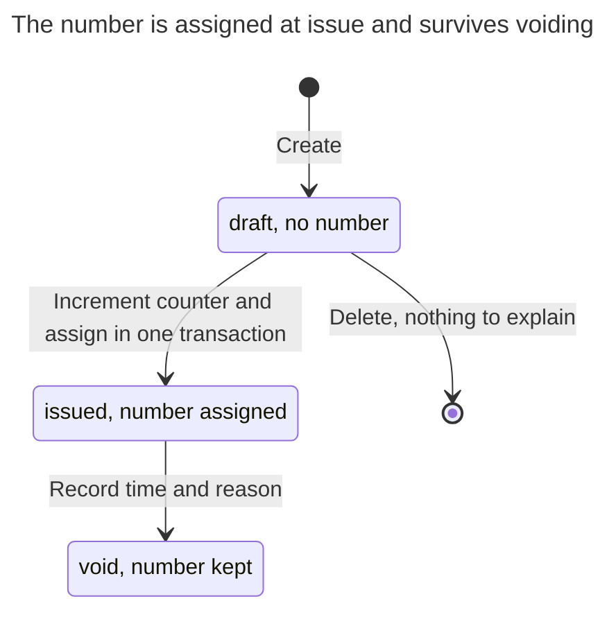
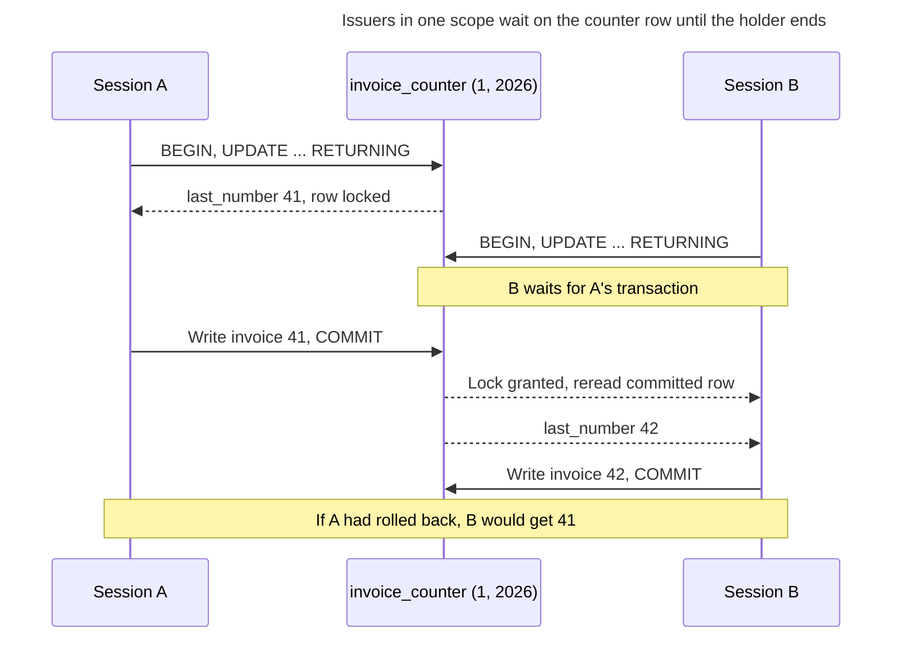

# Document Number

## Intent

A document number is a human-facing sequential number assigned within a scope: invoice `INV-2026-000123` is the 123rd invoice of one company in 2026, and issue `#42` is the 42nd issue of one project. Keep one counter row per scope, increment it with `UPDATE ... RETURNING` in the same transaction that issues the document, and enforce `UNIQUE (scope, number)` on the document table. The document keeps its own surrogate key; the number is a unique attribute that people quote. The chapter shows why a PostgreSQL sequence cannot provide such numbers without gaps, what gapless numbering costs in concurrency, and why a voided document keeps its number. See the [CREATE SEQUENCE notes](https://www.postgresql.org/docs/18/sql-createsequence.html) on gapless assignment.

## Also known as

Invoice number; sequential document number; per-scope counter. GitLab calls the per-project issue number an internal ID (`iid`) and allocates it from an [`internal_ids` counter table](https://gitlab.com/gitlab-org/gitlab/-/blob/master/app/models/internal_id.rb). Article 226(2) of the EU VAT Directive 2006/112/EC requires an invoice to carry “a sequential number, based on one or more series, which uniquely identifies the invoice” ([text of Article 226](https://www.legislation.gov.uk/eudr/2006/112/article/226)).

## Problem

An accountant expects invoice numbers to run 1, 2, 3 within each company and year and asks about every hole. The developer reuses the table's identity column, which is already sequential. Then a payment check fails after the number was drawn, the transaction rolls back, and the register jumps from 41 to 43. The identity is also shared by all companies, so company B's first invoice of the year is number 5,318.

The next attempt computes `max(invoice_number) + 1` for the company and year. Two clerks issue invoices at the same moment, both read 41, and both write 42: either two documents share a number, or the second one fails if a unique key exists. When someone deletes the newest invoice, the same expression hands its number to the next document, and two different papers carry the same printed number.

## Solution

Separate the row's identity from the number people read. The invoice has a surrogate `invoice_id` for foreign keys and joins, and a scoped number `(company_id, fiscal_year, invoice_number)` with a unique constraint. A counter table holds one row per scope with the last number issued.

Issuing a document increments the counter row and writes the number in one transaction. `UPDATE ... RETURNING` takes a row lock on the counter, so every other issue in that scope waits until the transaction commits or rolls back. A rollback also undoes the increment, so a failed issue leaves no hole. This is the price of gapless numbering: in each scope, issues run one at a time.

Pay that price only where a rule requires gapless numbers. Issue numbers per project, order numbers and ticket numbers usually need only uniqueness within the scope and a rough order; a per-scope sequence or a counter that may skip numbers is enough there. The EU VAT Directive itself asks for a sequential number in one or more series that uniquely identifies the invoice, and the [Commission's explanatory notes](https://taxation-customs.ec.europa.eu/system/files/2016-09/explanatory_notes_en.pdf) leave the choice of series (per branch, per type of supply) to the business. Whether a gap must be explained is set by national rules and auditors; check them before you pay for strict density.

Assign the number at issue, not when a draft is created, so abandoned drafts consume nothing. Once issued, a document is voided, never deleted, and keeps its number. Store the integer and its scope; render the prefix, year and padding at display time.

## Alternatives and selection

| Choice | Relationship | Deciding requirement |
| --- | --- | --- |
| Counter row per scope | The pattern | Numbers must be dense within the scope, or the scope count is unbounded (one per project or customer) |
| Sequence per scope | Implementation option | Gaps are acceptable and scopes are few and fixed; inserts never wait for each other |
| One global sequence or identity | Replacement | Only uniqueness matters; the number is an internal or reference ID, not a per-scope count |
| `max(number) + 1` | Avoid | None; it races under concurrency and reissues deleted numbers |
| [Surrogate Key](surrogate-key.md) | Complement | Foreign keys and joins need an identity that never changes |
| [Public Identifier](public-identifier.md) | Complement | Clients need a handle that does not reveal how many documents a company issues |

See the [Decision Atlas](decision-atlas.md) for the identifier family.



The only branch that serializes issuers is the gapless one. When gaps are acceptable, a counter row committed separately from the document releases its lock at once; the number survives even if the document is later abandoned, which leaves a gap but no wait.

## Structure



The scope is the counter's primary key, and the same three columns form the invoice's unique key. The relationship between counter and invoice is logical, not a foreign key: the constraint that matters is that no two invoices share a number in a scope. Other tables reference `invoice_id`, so correcting a customer or voiding the invoice never touches them.

## Tables and invariants

- **`invoice_counter`** holds one row per company and fiscal year with the last number issued. The primary key on the scope makes the row the single point that issuers lock. `last_number >= 0` and the absence of any other writer keep it equal to the highest number issued.
- **`invoice`** has a surrogate `invoice_id`. `invoice_number_key UNIQUE (company_id, fiscal_year, invoice_number)` rejects a second document with the same number, whichever code path produced it. `invoice_numbered_when_issued` requires drafts to have no number and issued or voided invoices to have a number, an issue date and a year, so none of them escapes the unique key through a `NULL`. Here `fiscal_year` is the calendar year of `issued_on`; if your fiscal year starts on another date, derive it from a calendar table instead. `invoice_void_explained` requires a time and reason for every void.
- **`invoice_keep_issued`** is a trigger that rejects deleting an issued or voided invoice, returning it to draft, reissuing a voided one, or changing its number or scope. Grant the application role no `DELETE` on the table as well; the trigger also covers roles that do hold the privilege.
- **`invoice_register`** is a view that renders `INV-2026-000123` from the company's prefix, the year and the integer. The prefix lives once on `company`, not in each row.

## When to use

- Invoices, credit notes, receipts and other documents where a tax or audit rule asks for sequential numbers per series.
- Per-project or per-account numbers that users type, such as issue `#42` or order `1043`, where numbering per scope matters more than global uniqueness.
- Any number printed on paper or sent outside, which must therefore never be reissued.

## Consequences and trade-offs

- ➕ Numbers are dense per scope; a failed or rolled-back issue leaves no hole.
- ➕ The unique key catches a duplicate from any source: a bug, a manual insert, an import.
- ➕ The surrogate key keeps references stable while the number stays a business attribute.
- ➖ All issues in one scope are serialized on the counter row for the length of each issuing transaction.
- ➖ The counter row is updated on every issue and collects dead row versions that vacuum must remove.
- ➖ A scope that was never opened, or a wrong year, fails the issue; the application must open scopes or create them on first use.

## Implementation

The [complete PostgreSQL 18.7 script](../assets/document-number/document-number.sql) checks issue numbering per scope, rendering, rollback without gaps, sequence gaps, year rollover, voiding and the rejections below. The essential tables:

```sql
CREATE TABLE doc_example.invoice_counter (
    company_id bigint NOT NULL REFERENCES doc_example.company (company_id),
    fiscal_year integer NOT NULL CHECK (fiscal_year BETWEEN 2000 AND 9999),
    last_number integer NOT NULL CHECK (last_number >= 0),
    PRIMARY KEY (company_id, fiscal_year)
);
CREATE TABLE doc_example.invoice (
    invoice_id bigint GENERATED ALWAYS AS IDENTITY PRIMARY KEY,
    company_id bigint NOT NULL REFERENCES doc_example.company (company_id),
    status text NOT NULL DEFAULT 'draft' CHECK (status IN ('draft', 'issued', 'void')),
    customer_name text NOT NULL,
    total numeric(12, 2) NOT NULL,
    issued_on date,
    fiscal_year integer,
    invoice_number integer CHECK (invoice_number > 0),
    voided_at timestamptz,
    void_reason text,
    CONSTRAINT invoice_number_key UNIQUE (company_id, fiscal_year, invoice_number),
    CONSTRAINT invoice_numbered_when_issued CHECK (
        (status = 'draft' AND issued_on IS NULL AND fiscal_year IS NULL
            AND invoice_number IS NULL)
        OR (status <> 'draft' AND issued_on IS NOT NULL AND fiscal_year IS NOT NULL
            AND invoice_number IS NOT NULL
            AND fiscal_year = extract(year FROM issued_on))
    ),
    CONSTRAINT invoice_void_explained CHECK (
        (status = 'void') = (voided_at IS NOT NULL AND void_reason IS NOT NULL)
    )
);
```

Opening the year is one insert, `INSERT INTO doc_example.invoice_counter VALUES (1, 2026, 0)`. Issuing a draft increments the counter and assigns the number in one statement; a [data-modifying `WITH`](https://www.postgresql.org/docs/18/queries-with.html#QUERIES-WITH-MODIFYING) passes the returned value to the outer update:

```sql
WITH allocated AS (
    UPDATE doc_example.invoice_counter
    SET last_number = last_number + 1
    WHERE company_id = 1 AND fiscal_year = 2026
    RETURNING last_number
)
UPDATE doc_example.invoice
SET status = 'issued', issued_on = DATE '2026-03-02', fiscal_year = 2026,
    invoice_number = (SELECT last_number FROM allocated)
WHERE invoice_id = 1 AND status = 'draft'
RETURNING invoice_number;
```

The first issue returns `1`; the next one in that scope returns `2`, while company 2 starts its own series at `1`. If the statement returns no row because the invoice was not a draft, roll back: the counter was incremented anyway, as the script checks. A savepoint that increments the counter and rolls back leaves `last_number` unchanged, so the next issue reuses the number. The script checks that each scope's count of issued invoices, its maximum number and its counter agree. Run the same query as an audit:

```sql
SELECT c.company_id, c.fiscal_year, c.last_number, n.issued, n.top
FROM doc_example.invoice_counter AS c
JOIN (SELECT company_id, fiscal_year, count(*) AS issued, max(invoice_number) AS top
      FROM doc_example.invoice WHERE status <> 'draft'
      GROUP BY company_id, fiscal_year) AS n USING (company_id, fiscal_year)
WHERE n.issued <> c.last_number OR n.top <> c.last_number;
```

The register renders the number. `lpad` alone truncates long values (`lpad('1234567', 6, '0')` is `123456`), so the view pads to a minimum width:

```sql
SELECT format('%s-%s-%s', c.invoice_prefix, i.fiscal_year,
              lpad(i.invoice_number::text, greatest(6, length(i.invoice_number::text)), '0'))
FROM doc_example.invoice AS i JOIN doc_example.company AS c USING (company_id);
```

A sequence leaves holes by design. The script draws `nextval` inside a savepoint and rolls it back, and the next call returns `2`, not `1`. An `INSERT ... ON CONFLICT DO NOTHING` that hits a conflict consumes an identity value without any abort, so the next row gets `3`. A sequence created with `CACHE 20` returns `21` after `DISCARD SEQUENCES` throws away the session's unused cached values, as a session end does. The [sequence functions](https://www.postgresql.org/docs/18/functions-sequence.html) page states that `nextval` is never rolled back and that aborts and crashes can leave gaps.

For year rollover, either open next year's counters before January 1 or create the row on first use. An upsert gives the first 2027 invoice number `1`, and a concurrent first issue waits and then receives `2`:

```sql
INSERT INTO doc_example.invoice_counter AS c (company_id, fiscal_year, last_number)
VALUES (1, 2027, 1)
ON CONFLICT (company_id, fiscal_year)
DO UPDATE SET last_number = c.last_number + 1
RETURNING last_number;
```

With the explicit opening, an issue into a scope that was never opened gets no row from the `UPDATE`, so the number is `NULL`. PostgreSQL 18.7 rejects it with SQLSTATE `23514`: `ERROR: new row for relation "invoice" violates check constraint "invoice_numbered_when_issued"`. Without that check, the statement would issue an invoice without a number.

Voiding changes the status and keeps the number:

```sql
UPDATE doc_example.invoice
SET status = 'void', voided_at = now(), void_reason = 'Wrong customer'
WHERE invoice_id = 2;
```

The register still lists `INV-2026-000002 void`. Issuing number 2 again raises SQLSTATE `23505`: `ERROR: duplicate key value violates unique constraint "invoice_number_key"`, with `DETAIL: Key (company_id, fiscal_year, invoice_number)=(1, 2026, 2) already exists.` Deleting the voided invoice, or setting it back to `issued`, raises `P0001` from the trigger: `ERROR: invoice 2 is void and keeps its number`. Renumbering an issued invoice or returning it to draft fails the same way. An issued row without `issued_on` and `fiscal_year` fails `invoice_numbered_when_issued` with `23514`. Deleting a draft succeeds.



There is no arrow out of `void` and no arrow from `issued` back to `draft` or out of the diagram. A correction is a new document, such as a credit note with its own number, that refers to the voided one.

## Engine support

- **PostgreSQL 18:** the counter row and `UPDATE ... RETURNING` as shown. [`CREATE SEQUENCE`](https://www.postgresql.org/docs/18/sql-createsequence.html) states that sequences cannot be used for gapless assignment and suggests exclusive locking of a counter table as the more expensive alternative.
- **MySQL 8.4:** there are no sequence objects, and InnoDB `AUTO_INCREMENT` values are [lost when a transaction rolls back](https://dev.mysql.com/doc/refman/8.4/en/innodb-auto-increment-handling.html). Lacking `RETURNING`, read the incremented counter with `UPDATE invoice_counter SET last_number = LAST_INSERT_ID(last_number + 1) WHERE ...` followed by `SELECT LAST_INSERT_ID()`, the sequence emulation shown in the [information functions](https://dev.mysql.com/doc/refman/8.4/en/information-functions.html#function_last-insert-id) reference.
- **SQL Server 2025 (17.x):** [sequence numbers](https://learn.microsoft.com/en-us/sql/t-sql/statements/create-sequence-transact-sql?view=sql-server-ver17) are generated outside the current transaction and are consumed whether it commits or rolls back. Use a counter table and read the value with `UPDATE ... OUTPUT inserted.last_number`.
- **Oracle AI Database 26ai:** a sequence is [incremented independently of the transaction committing or rolling back](https://docs.oracle.com/en/database/oracle/oracle-database/26/sqlrf/CREATE-SEQUENCE.html), and cached values are lost on a system failure. Use a counter table with `UPDATE ... RETURNING last_number INTO`.
- **SQLite 3:** no sequences; [`UPDATE ... RETURNING`](https://www.sqlite.org/lang_returning.html) works since 3.35.0. A database has one writer at a time, so start the issuing transaction with [`BEGIN IMMEDIATE`](https://www.sqlite.org/lang_transaction.html) to take the write lock before reading.

## Failure and concurrency

The counter row is the scope's lock. A second issuer's `UPDATE` waits on the first transaction, and under the default `READ COMMITTED` level it rereads the committed row and gets the next number. Under `REPEATABLE READ` or `SERIALIZABLE` the waiter fails instead with SQLSTATE `40001`, `could not serialize access due to concurrent update`, and must retry the whole transaction. PostgreSQL's [row-level locks](https://www.postgresql.org/docs/18/explicit-locking.html#LOCKING-ROWS) and [isolation rules](https://www.postgresql.org/docs/18/transaction-iso.html) define this behavior.



Checked by hand with two `psql` sessions on PostgreSQL 18.7: B shows `wait_event_type = Lock` with A in `pg_blocking_pids` until A commits, then returns the next number. Throughput per scope is therefore bounded by the length of the issuing transaction, not by the counter update itself.

Keep that transaction short. Validate the draft, compute totals and call payment or tax services before you take a number, then increment, write the invoice and commit. Render the PDF and send email after commit, from an [outbox](transactional-outbox.md) if they must not be lost. When one transaction issues documents in several scopes, lock the counters in a fixed order, for example by `(company_id, fiscal_year)`, so two such transactions cannot deadlock.

A client that retries after a lost commit acknowledgment must not issue a second invoice. Tie the issue to an [Idempotency Record](idempotency-record.md) or to the draft's `invoice_id`: the `WHERE status = 'draft'` condition makes a repeated issue update no row, and the caller rolls back its counter increment.

`max(number) + 1` has no row to lock. Two sessions read the same maximum; with the unique key the second insert waits for the first, then fails with `23505`. The script replays this order of events and shows a retry that recomputes the maximum succeeds. Without the unique key, both commit with the same number. A `SELECT ... FOR UPDATE` on the parent project or company serializes this approach as well, but it still reissues the number of a deleted newest row, which the script also demonstrates.

When gaps are acceptable and the scope is busy, allocate from the counter in its own short transaction, or use one sequence per scope. Issuers then never wait for each other's documents, and a failed issue leaves a gap that you record rather than prevent.

## Migration

From an identity used as the invoice number: add `fiscal_year` and `invoice_number` as nullable columns, backfill them per scope with `row_number() OVER (PARTITION BY company_id, fiscal_year ORDER BY issued_on, invoice_id)` only if the old numbers were never sent out. If they were, keep the printed numbers as they are in a `legacy_number` column and start the scoped series with the next fiscal year. Build the unique index concurrently, create one counter row per scope with `last_number = max(invoice_number)`, switch the writer to the counter, then add `invoice_numbered_when_issued` as `NOT VALID` and validate it, as in [Expand and Contract](expand-contract.md).

From `max(number) + 1`: create counter rows from the current maxima in the same transaction that switches the writers, or lock the scopes while you do it, otherwise an issue in between hands out a number the counter will hand out again. The unique key will catch that collision, but only as a failed issue.

## Anti-patterns and common mistakes

- Renumbering rows to close gaps after deletes or rollbacks. Karwin's [SQL Antipatterns](https://pragprog.com/titles/bksap1/sql-antipatterns-volume-1/) lists this as Pseudokey Neat-Freak; for a document number it also changes printed papers.
- Using the primary key or a single global sequence as the invoice number, then explaining every gap.
- Allocating the number when the draft is created, so abandoned drafts leave holes.
- Deleting an issued document instead of voiding it, which lets `max + 1` or a manual insert reissue its number.
- Storing the formatted string `INV-2026-000123` as the only value: changing the prefix or padding becomes a data migration, and sorting by number sorts text.
- Calling external services while holding the counter lock, which stalls every issuer in the scope.
- A lazily created scope with a plain `UPDATE` that affects no row, so the document is written without a number; enforce the number with a `CHECK` or `NOT NULL`.

## Known uses

- GitLab allocates per-project issue and merge request numbers from an [`internal_ids` table](https://gitlab.com/gitlab-org/gitlab/-/blob/master/app/models/internal_id.rb): it updates `last_value + 1` and returns it, creates the row on first use and retries if a concurrent creator wins. The source comment describes the generated sequence as gapless.
- The EU VAT Directive's [Article 226(2)](https://www.legislation.gov.uk/eudr/2006/112/article/226) requires sequential invoice numbers in one or more series, and the [Commission's explanatory notes](https://taxation-customs.ec.europa.eu/system/files/2016-09/explanatory_notes_en.pdf) allow a series per branch or type of supply, which are scopes in this chapter's sense.
- PostgreSQL's [`CREATE SEQUENCE`](https://www.postgresql.org/docs/18/sql-createsequence.html) documentation names the locked counter table as the way to build gapless assignment.

## Related patterns

- [Surrogate Key](surrogate-key.md) gives the document a stable identity that references use; the number stays a unique attribute.
- [Natural Key](natural-key.md) discusses scoped business keys such as an order number with a line number.
- [Public Identifier](public-identifier.md) hides allocation volume when a sequential number must not leave the company.
- [Time-Ordered Identifier](time-ordered-identifier.md) generates unique IDs without a central counter when density does not matter.
- [Soft Delete](soft-delete.md) hides rows from live use; voiding is different, because a voided invoice stays in the register.
- [Status History](status-history.md) records who voided a document, when and why.
