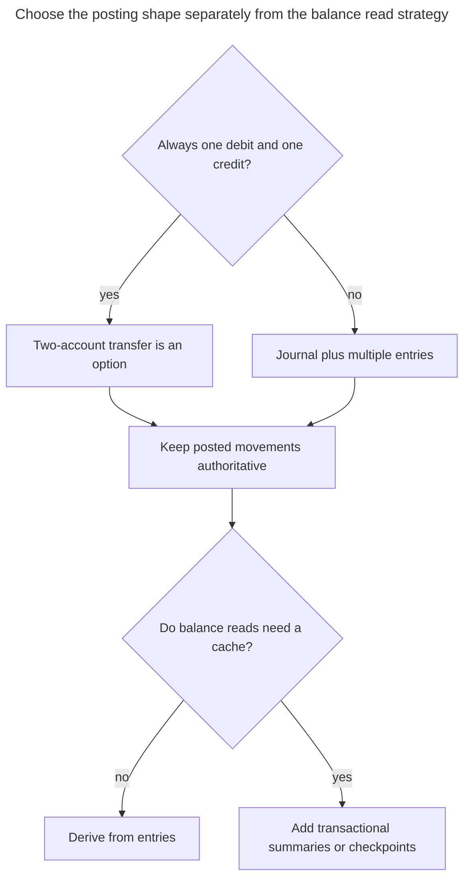
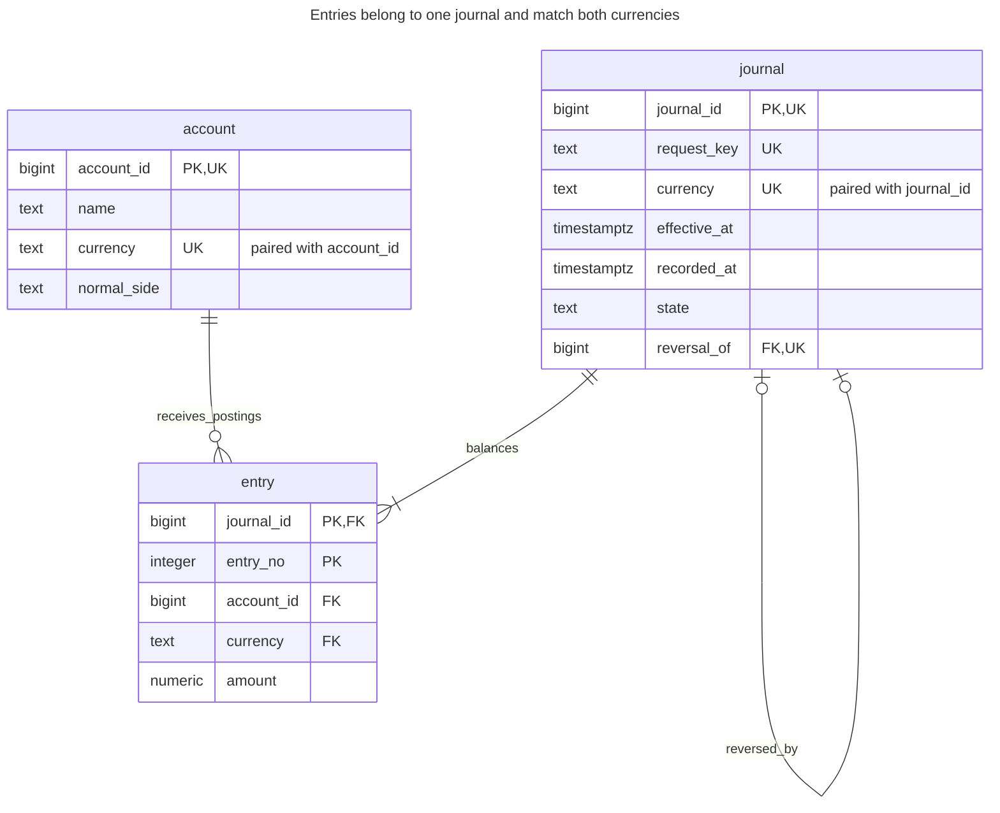
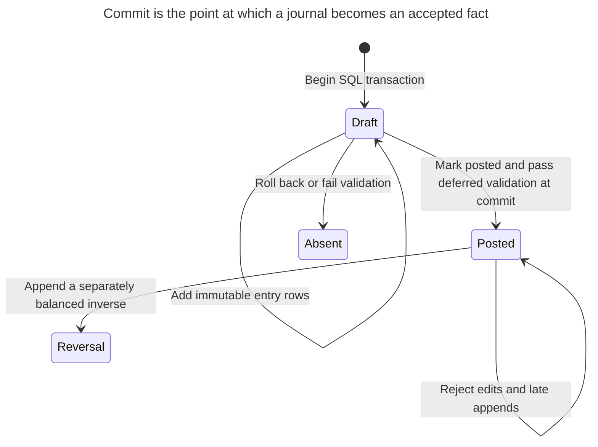
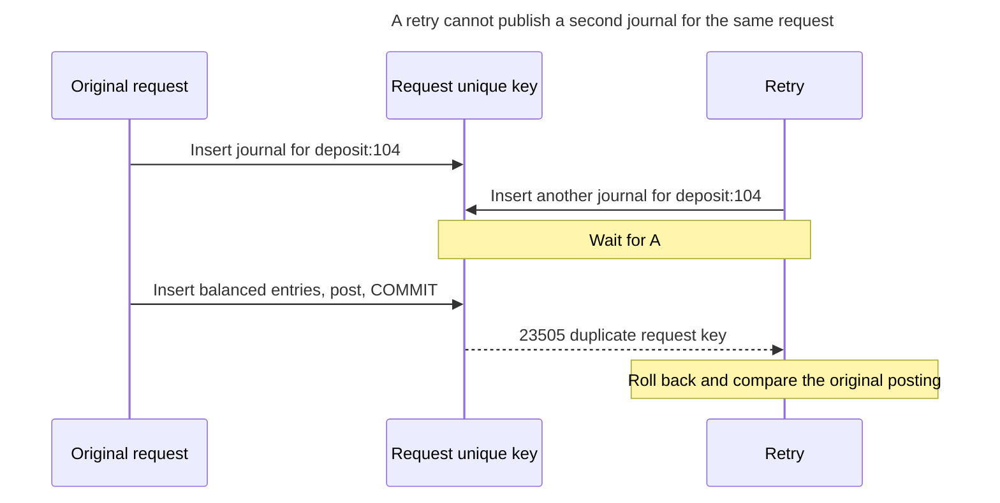
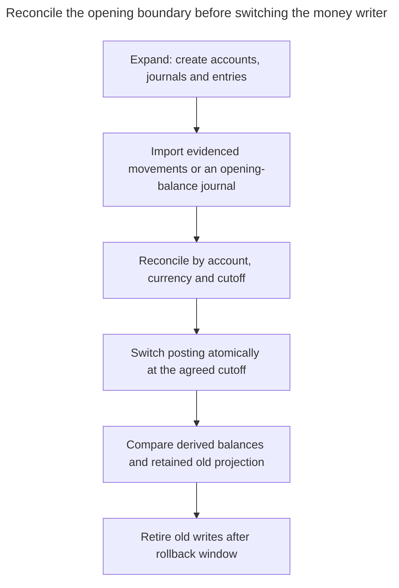

# Double-Entry Ledger

## Intent

A double-entry ledger records every movement of money as a transaction of entries between accounts, in which debits and credits sum to zero. The schema guarantees that money is never created or lost, only moved, and that every balance can be derived from the entries. The chapter shows accounts, transactions and entries, how to enforce the balancing rule, immutable entries corrected by reversals instead of updates, and when to store running balances for speed. The same structure tracks stock moving between warehouses.

## Also known as

Double-entry bookkeeping; accounting transaction with accounting entries. Fowler's [Accounting Transaction](https://martinfowler.com/eaaDev/AccountingTransaction.html) links two or more entries whose signed amounts total zero. Here a `journal` is that domain transaction; the SQL transaction is the atomic database operation that creates it.

## Problem

You subtract 100 from one account and add 100 to another. If the writes commit separately, a failure between them leaves an unexplained difference. Even inside one SQL transaction, a mistyped second amount of 90 commits unless something checks the relationship. Atomicity preserves your commands together; it does not establish that the commands balance.

A balance-only table also cannot explain where money came from, what a correction undid or whether a timed-out request already ran. You need an authoritative movement history, a balancing boundary and a retry identity. A useful balance is then a projection of that history, not an independently editable fact.

## Solution

Store immutable accounts with a currency and normal balance side, journals with request identity and effective time, and entries linking journals to accounts. Use positive amounts for debits and negative amounts for credits. Every journal contains at least two entries, in one currency, with a signed sum of zero. This sign convention does not make every debit an increase: the example's credit-normal liability balance is the negation of its signed entry sum.

Build a journal as draft inside one SQL transaction, insert all entries, then mark it posted. Deferred validation rejects any commit that leaves a draft, fewer than two entries or a nonzero total. No draft journal is persistently visible after commit in this example. Posted facts cannot be edited; an exact reversal creates another journal with the opposite per-account totals.

For stock movements, use the same conservation boundary with a stock item and unit in place of currency, and accounts representing locations or external source/sink positions. Never balance unlike items together. Production, consumption and stock corrections need explicit counterpart accounts; balancing rows does not establish that a warehouse count is physically correct.

## Alternatives and selection

| Sibling | Relationship | Deciding requirement |
| --- | --- | --- |
| Balance-only account row | Replacement with a weaker contract | Only a current counter is required and you accept losing movement-level explanation |
| Two-account transfer row | Implementation option | Every movement has exactly one debit and one credit of equal magnitude; equality can be structural rather than a sum over arbitrary entries |
| [Summary Table](summary-table.md) | Complement | Long histories need cached balances or periodic checkpoints, reconciled against entries |
| [Idempotency Record](idempotency-record.md) | Complement | Retries must return the original result and reject a changed payload under the same key |
| [Quantity](quantity.md) | Complement | Currency, asset scale and exact arithmetic must remain explicit |

See the [Decision Atlas](decision-atlas.md) for the full table. A separate audit trail cannot replace conservation at the posting boundary. Fowler also [distinguishes two-legged from multi-legged transactions](https://martinfowler.com/eaaDev/AccountingTransaction.html); use the simpler representation when it fits every movement you accept.



A stored balance is a read and coordination choice. It does not remove the need to validate every movement and retain its explanation.

## Structure



The journal-to-entry edge describes committed postings; drafts temporarily have fewer entries. The deferred rule strengthens its minimum to two. Both currency references are composite keys. A journal may have one exact reversal; a reversal can itself be reversed by another journal under this example's policy.

## Tables and invariants

- **`account`** owns a stable currency and normal side. Its definition guard rejects updates and deletes; descriptive account maintenance would need a separate permitted operation.
- **`journal`** has a unique request key, effective time and recording time. Its only update is draft-to-posted with identity and content metadata unchanged.
- **`entry`** requires a matching account and journal currency, a nonzero amount, fewer than 12 integer digits in magnitude and at most two decimal places. These are the example's limits, not universal currency rules.
- **Immutability** rejects entry updates/deletes and insertion into posted journals. A before-insert guard locks the journal row, serializing appends with posting.
- **Balance validation** is deferred on journal creation/posting and entry insertion. A row-local `CHECK` cannot enforce an aggregate over other rows; PostgreSQL [documents that limitation](https://www.postgresql.org/docs/18/ddl-constraints.html#DDL-CONSTRAINTS-CHECK-CONSTRAINTS).
- **Reversals** use the original currency and must negate its totals for every account. `UNIQUE (reversal_of)` limits exact reversal to one direct successor.

## When to use

- Every accepted movement needs an explicit counterpart and durable explanation.
- Corrections must preserve posted history.
- You need derived balances, reconciliation and retries tied to one accepted posting.

## Consequences and trade-offs

- ➕ A missing or mistyped leg prevents the entire posting from committing.
- ➕ Balances and reversals can be explained from retained entries.
- ➖ Zero sum proves conservation inside the modeled journal, not a valid business purpose, sufficient funds or agreement with an external bank.
- ➖ Posting creates several rows and commit can still fail after all inserts succeed.
- ➖ An overdraft rule needs coordination across journals touching the same account. Journal balance checks alone do not enforce it.
- ➖ A single-currency journal cannot directly express an exchange by adding unlike currencies. Use balanced postings per currency with explicit clearing accounts and a retained quote or rate policy.

## Implementation

The [complete PostgreSQL 18.6 script](../assets/double-entry-ledger/double-entry-ledger.sql) verifies balance, immutability, duplicate-request rejection, account-currency mismatch and reversal. These tables keep the essential identities and amount checks inline:

```sql
CREATE SCHEMA ledger_example;
SET search_path = ledger_example, public;

CREATE TABLE account (
    account_id bigint PRIMARY KEY,
    name text NOT NULL,
    currency text NOT NULL,
    normal_side text NOT NULL CHECK (normal_side IN ('debit', 'credit')),
    UNIQUE (account_id, currency)
);
CREATE TABLE journal (
    journal_id bigint PRIMARY KEY,
    request_key text NOT NULL UNIQUE,
    currency text NOT NULL,
    effective_at timestamptz NOT NULL,
    recorded_at timestamptz NOT NULL DEFAULT clock_timestamp(),
    state text NOT NULL DEFAULT 'draft' CHECK (state IN ('draft', 'posted')),
    reversal_of bigint UNIQUE,
    UNIQUE (journal_id, currency),
    FOREIGN KEY (reversal_of, currency) REFERENCES journal (journal_id, currency),
    CHECK (reversal_of <> journal_id)
);
CREATE TABLE entry (
    journal_id bigint,
    entry_no integer CHECK (entry_no > 0),
    account_id bigint NOT NULL,
    currency text NOT NULL,
    amount numeric NOT NULL,
    PRIMARY KEY (journal_id, entry_no),
    FOREIGN KEY (journal_id, currency) REFERENCES journal (journal_id, currency),
    FOREIGN KEY (account_id, currency) REFERENCES account (account_id, currency),
    CONSTRAINT entry_amount CHECK (amount <> 0 AND amount > -1000000000000
        AND amount < 1000000000000 AND scale(amount) <= 2)
);
CREATE INDEX entry_account_idx ON entry (account_id, journal_id);
```

Unconstrained PostgreSQL [`numeric`](https://www.postgresql.org/docs/18/datatype-numeric.html) plus `scale(amount) <= 2` rejects excess fractional precision instead of rounding it during a fixed-scale cast. Choose and apply your rounding rule before posting. Increase or change the scale policy deliberately when modeling other assets.

The following guards prevent later mutation and make the posting boundary explicit. Keep their database owner separate from the application and withhold `TRUNCATE`, trigger changes and schema creation; PostgreSQL's [privilege model](https://www.postgresql.org/docs/18/sql-grant.html) makes those separate capabilities. The lab itself runs as owner.

```sql
CREATE FUNCTION guard_entry() RETURNS trigger LANGUAGE plpgsql SET search_path = ledger_example, pg_temp AS $$
DECLARE
    journal_state text;
BEGIN
    IF TG_OP <> 'INSERT' THEN
        RAISE EXCEPTION 'ledger entries are immutable' USING ERRCODE = '23514';
    END IF;
    SELECT state INTO journal_state FROM journal
    WHERE journal_id = NEW.journal_id FOR UPDATE;
    IF journal_state IS DISTINCT FROM 'draft' THEN
        RAISE EXCEPTION 'entries require a draft journal' USING ERRCODE = '23514';
    END IF;
    RETURN NEW;
END $$;
CREATE TRIGGER entry_guard BEFORE INSERT OR UPDATE OR DELETE ON entry
    FOR EACH ROW EXECUTE FUNCTION guard_entry();
CREATE FUNCTION guard_journal() RETURNS trigger LANGUAGE plpgsql SET search_path = ledger_example, pg_temp AS $$
BEGIN
    IF TG_OP = 'INSERT' THEN
        IF NEW.state <> 'draft' THEN
            RAISE EXCEPTION 'create journals in draft' USING ERRCODE = '23514';
        END IF;
        IF NEW.reversal_of IS NOT NULL AND NOT EXISTS (
            SELECT FROM journal WHERE journal_id = NEW.reversal_of AND state = 'posted'
        ) THEN
            RAISE EXCEPTION 'reversal requires a posted original' USING ERRCODE = '23514';
        END IF;
        RETURN NEW;
    END IF;
    IF TG_OP = 'DELETE' OR OLD.state = 'posted' THEN
        RAISE EXCEPTION 'posted journal is immutable' USING ERRCODE = '23514';
    END IF;
    IF NEW.state <> 'posted' OR
        (NEW.journal_id, NEW.request_key, NEW.currency, NEW.effective_at, NEW.recorded_at, NEW.reversal_of)
        IS DISTINCT FROM
        (OLD.journal_id, OLD.request_key, OLD.currency, OLD.effective_at, OLD.recorded_at, OLD.reversal_of) THEN
        RAISE EXCEPTION 'only posting may change a draft journal' USING ERRCODE = '23514';
    END IF;
    RETURN NEW;
END $$;
CREATE TRIGGER journal_guard BEFORE INSERT OR UPDATE OR DELETE ON journal
    FOR EACH ROW EXECUTE FUNCTION guard_journal();
CREATE FUNCTION guard_account() RETURNS trigger LANGUAGE plpgsql SET search_path = ledger_example, pg_temp AS $$
BEGIN
    RAISE EXCEPTION 'ledger account definition is immutable' USING ERRCODE = '23514';
END $$;
CREATE TRIGGER account_guard BEFORE UPDATE OR DELETE ON account
    FOR EACH ROW EXECUTE FUNCTION guard_account();
```

Install deferred aggregate validation. PostgreSQL [constraint triggers](https://www.postgresql.org/docs/18/sql-createtrigger.html) can run at transaction end, allowing the temporary imbalance while entries are being assembled:

```sql
CREATE FUNCTION check_journal() RETURNS trigger LANGUAGE plpgsql SET search_path = ledger_example, pg_temp AS $$
DECLARE
    target_id bigint;
    original_id bigint;
BEGIN
    target_id := NEW.journal_id;
    SELECT reversal_of INTO original_id FROM journal WHERE journal_id = target_id;
    IF NOT EXISTS (SELECT FROM journal WHERE journal_id = target_id AND state = 'posted')
       OR (SELECT count(*) FROM entry WHERE journal_id = target_id) < 2
       OR (SELECT coalesce(sum(amount), 0) FROM entry WHERE journal_id = target_id) <> 0 THEN
        RAISE EXCEPTION 'journal must be posted with at least two balanced entries'
            USING ERRCODE = '23514';
    END IF;
    IF original_id IS NOT NULL AND EXISTS (
        SELECT FROM
            (SELECT account_id, sum(amount) AS total FROM entry
             WHERE journal_id = target_id GROUP BY account_id) AS n
        FULL JOIN
            (SELECT account_id, sum(amount) AS total FROM entry
             WHERE journal_id = original_id GROUP BY account_id) AS o USING (account_id)
        WHERE coalesce(n.total, 0) <> -coalesce(o.total, 0)
    ) THEN
        RAISE EXCEPTION 'reversal must negate original account totals' USING ERRCODE = '23514';
    END IF;
    RETURN NULL;
END $$;
CREATE CONSTRAINT TRIGGER journal_balanced AFTER INSERT OR UPDATE ON journal
    DEFERRABLE INITIALLY DEFERRED FOR EACH ROW EXECUTE FUNCTION check_journal();
CREATE CONSTRAINT TRIGGER entry_balanced AFTER INSERT ON entry
    DEFERRABLE INITIALLY DEFERRED FOR EACH ROW EXECUTE FUNCTION check_journal();
```

Repeated deferred events validate the final journal state. This simple implementation may rescan a journal several times; keep posting sizes bounded and measure before optimizing the validation schedule.

Post a 100 EUR deposit, then derive normal-side balances:

```sql
INSERT INTO account VALUES
    (1, 'Cash', 'EUR', 'debit'), (2, 'Customer liability', 'EUR', 'credit'),
    (3, 'Dollar cash', 'USD', 'debit');
BEGIN;
INSERT INTO journal (journal_id, request_key, currency, effective_at)
VALUES (100, 'deposit:104', 'EUR', '2026-11-01 10:00Z');
INSERT INTO entry VALUES (100, 1, 1, 'EUR', 100), (100, 2, 2, 'EUR', -100);
UPDATE journal SET state = 'posted' WHERE journal_id = 100;
COMMIT;
SELECT a.account_id, a.normal_side,
       CASE WHEN a.normal_side = 'debit' THEN coalesce(sum(e.amount), 0)
            ELSE -coalesce(sum(e.amount), 0) END AS normal_balance
FROM account AS a LEFT JOIN entry AS e USING (account_id)
GROUP BY a.account_id ORDER BY a.account_id;
```

Cash account `1` and customer-liability account `2` each show normal balance `100`; account `3` shows zero. Their signed sums are opposite. Because no draft can commit, readers do not need to exclude a persistently stored draft population.

This complete attempted posting is invalid:

```sql
BEGIN;
INSERT INTO journal (journal_id, request_key, currency, effective_at)
VALUES (101, 'bad:101', 'EUR', '2026-11-01 10:00Z');
INSERT INTO entry VALUES (101, 1, 1, 'EUR', 100), (101, 2, 2, 'EUR', -90);
UPDATE journal SET state = 'posted' WHERE journal_id = 101;
COMMIT;
```

PostgreSQL 18.6 raises SQLSTATE `23514` at commit: `ERROR: journal must be posted with at least two balanced entries`. Journal `101` and its entries roll back together. The script forces the same deferred check inside an exception block so it can assert the rejection and continue. An attempted in-place entry update raises `23514`: `ERROR: ledger entries are immutable`.

Correct an accepted posting by appending its exact inverse:

```sql
BEGIN;
INSERT INTO journal (journal_id, request_key, currency, effective_at, reversal_of)
VALUES (104, 'reverse:104', 'EUR', '2026-11-02 10:00Z', 100);
INSERT INTO entry
SELECT 104, entry_no, account_id, currency, -amount FROM entry WHERE journal_id = 100;
UPDATE journal SET state = 'posted' WHERE journal_id = 104;
COMMIT;
SELECT account_id, sum(amount) AS signed_balance FROM entry GROUP BY account_id ORDER BY account_id;
```

Both signed account balances now equal zero, while journals `100` and `104` remain. If the intended corrected amount was 90, post a separate new balanced 90 EUR journal under a new request key after reversal. The reversal link records why the inverse exists; it is not a command to delete the original.



Draft is an internal construction state, not an accepted pending payment. A reservation or pending-transfer lifecycle needs a separate design and cannot be inferred from these rows.

## Engine support

- **PostgreSQL 18:** deferred constraint triggers implement the aggregate commit rule. Checks and foreign keys handle local amount and currency invariants.
- **MySQL 8.4 / InnoDB:** [checks cannot contain subqueries](https://dev.mysql.com/doc/refman/8.4/en/create-table-check-constraints.html), and [foreign keys are immediate](https://dev.mysql.com/doc/refman/8.4/en/create-table-foreign-keys.html). Port through a controlled posting routine that validates and publishes atomically; do not translate the aggregate into a row check.
- **SQL Server 2025 (17.x):** [DML triggers operate on sets](https://learn.microsoft.com/en-us/sql/relational-databases/triggers/create-dml-triggers-to-handle-multiple-rows-of-data?view=sql-server-ver17). A port needs a set-aware posting boundary rather than per-row deferred PL/pgSQL validation.
- **Oracle AI Database 26ai:** [deferrable constraints](https://docs.oracle.com/en/database/oracle/oracle-database/26/sqlrf/constraint.html) do not turn an arbitrary aggregate into a check constraint; checks exclude subqueries. Design and verify the posting routine and access grants separately.
- **SQLite 3:** [row triggers](https://www.sqlite.org/lang_createtrigger.html) do not provide PostgreSQL's deferred custom constraint-trigger mechanism. A controlled transaction can assemble and validate a posting; use scaled integers or its [decimal extension](https://www.sqlite.org/floatingpoint.html#decext) for exact amounts rather than assuming `numeric` ports unchanged.

## Failure and concurrency

Every entry insert locks its journal with [`FOR UPDATE`](https://www.postgresql.org/docs/18/explicit-locking.html#LOCKING-ROWS) before testing draft state. A draft belongs to its constructing SQL transaction; another session cannot use an uncommitted draft, and no draft can commit. Later inserts against a committed journal see posted state and fail. Keep the complete posting in one transaction at Read Committed.

Two retries can nevertheless construct separate candidate journals for the same request. The unique request key decides which one can commit, using PostgreSQL's [unique-index conflict checking](https://www.postgresql.org/docs/18/index-unique-checks.html):



The loser must discard its candidate journal and all proposed entries. A duplicate key identifies an existing result; it does not prove the retried payload is equal.

`request_key` makes two accepted journals for one request impossible, but does not compare payloads. After an uncertain commit, find the original journal by that key and compare its currency, effective time and complete entries. A reused key with different content is an error. A fuller [Idempotency Record](idempotency-record.md) can retain a normalized request hash and response. Never retry under a fresh key merely because the previous response was lost.

For a stored balance, update the affected account summaries in the same SQL transaction as entries, acquiring account locks in ascending ID order. Use an atomic guarded update or a check after obtaining those locks for funds limits. A derived sum can also support a funds rule if all relevant writers serialize on the account before reading it; a cache is not mathematically required. Ordinary unlocked sums can race. Reconcile caches with authoritative entries and use complete-transaction retries after deadlocks or serialization failures, following PostgreSQL's [transaction guidance](https://www.postgresql.org/docs/18/transaction-iso.html).

## Migration

Define accounts, currency and sign conventions before importing history. Preserve stable source request IDs and reconcile source movements into balanced journals. Put unresolved differences in an explicitly identified reconciliation process; do not manufacture a counterpart solely to make an import pass while claiming the source was correct.



If only current balances survive, a dated opening-balance journal against a disclosed opening-equity or migration-clearing account establishes a baseline, not recovered transaction history. Mark that boundary in reports. Capture or pause writes during final reconciliation so movements are neither missed nor imported twice. Retain old readers and synchronized balance projections through the rollback window; after new postings exist, keep them authoritative even if the old interface temporarily returns.

## Anti-patterns and common mistakes

- Balancing across currencies or stock items as though their numerals were interchangeable.
- Updating a posted amount to fix a mistake and losing the correction trail.
- Returning success before commit has passed deferred validation.
- Storing a balance cache without atomic maintenance and reconciliation.
- Treating zero sum as proof of solvency, authorization or economic correctness.

## Known uses

- Square's [Books engineering article](https://developer.squareup.com/blog/books-an-immutable-double-entry-accounting-database-service/) describes balanced journal entries, immutable book entries and maintained book balances. It is a vendor account of that service, not a performance claim about this PostgreSQL implementation.
- [TigerBeetle's data-modeling guide](https://docs.tigerbeetle.com/coding/data-modeling/) uses immutable accounts and transfers with ledger separation for assets. It demonstrates a specialized implementation rather than the arbitrary-entry relational journal shown here.
- Fowler's [accounting narrative](https://martinfowler.com/eaaDev/AccountingNarrative.html) connects accounts, entries, balances and transactions; the deferred enforcement and retry policy here are this chapter's design.

## Related patterns

- [Quantity](quantity.md) defines amount interpretation and rounding policy.
- [Summary Table](summary-table.md) supplies balance projections that must reconcile with entries.
- [Idempotency Record](idempotency-record.md) makes uncertain-response retries explicit.
- [Inexact Arithmetic](inexact-arithmetic.md) describes approximate-number failures for exact amounts.
