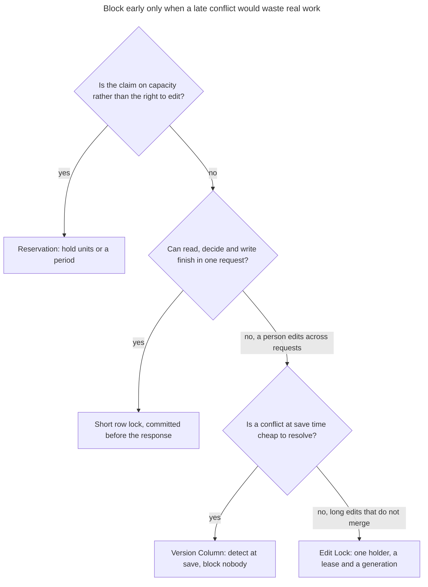
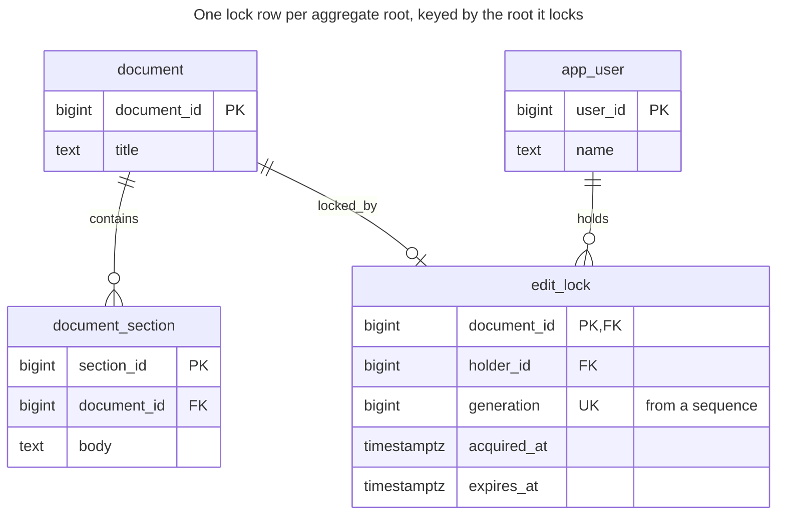
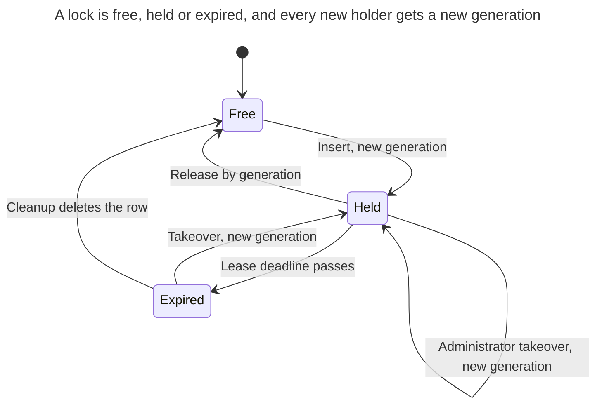
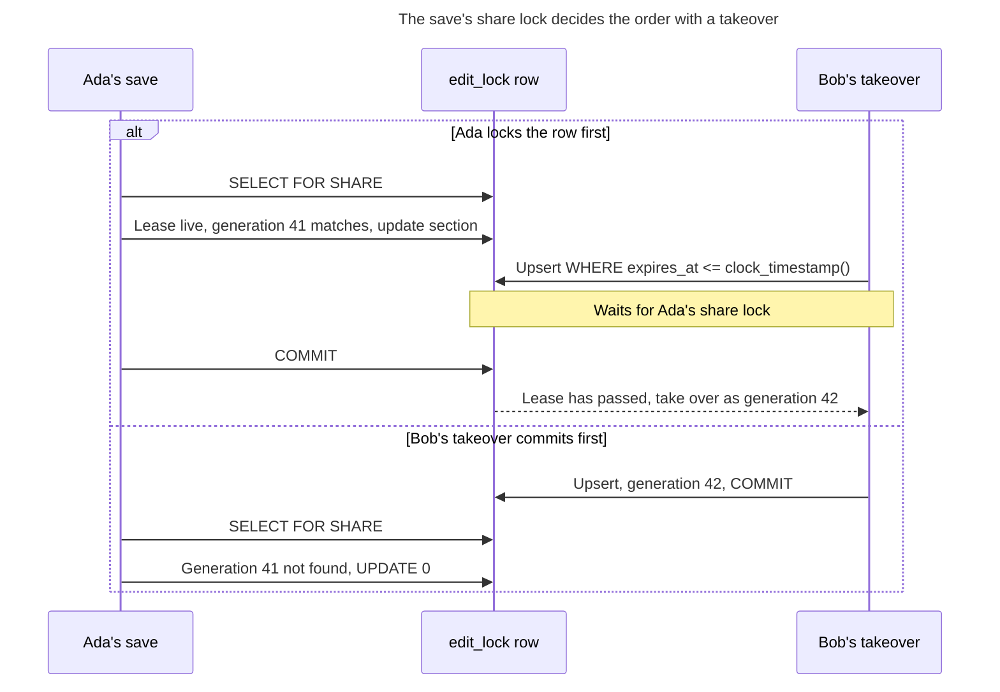

# Edit Lock

## Intent

An edit lock gives one user the exclusive right to edit a resource for a limited time across many HTTP requests, so other users see “locked by Ada until 14:30” before they start, instead of losing their work to a conflict at save time. The lock is an ordinary row: one per resource or per aggregate root, with a holder, a lease deadline and a generation token. Acquiring is an insert against a unique key, or a takeover of an expired row in the same statement. A heartbeat renews the lease, release deletes the row, and an administrator can take the lock over. Every save checks, in the same transaction as the write, that the caller still holds the lock with the same generation, so a holder whose lease expired and was taken over cannot write.

## Also known as

[Pessimistic Offline Lock](https://martinfowler.com/eaaCatalog/pessimisticOfflineLock.html), by David Rice in Fowler's *Patterns of Enterprise Application Architecture*, which “prevents conflicts between concurrent business transactions by allowing only one business transaction at a time to access data.” One lock for a whole group of rows is the same book's [Coarse-Grained Lock](https://martinfowler.com/eaaCatalog/coarseGrainedLock.html). Also called check-out, document lock or write lock; WebDAV calls it an exclusive write lock.

## Problem

Ada opens a supply contract at 14:00 and spends twenty minutes rewriting its payment terms. Bob opens the same contract at 14:05 and rewrites the delivery section. With a [Version Column](version-column.md), whoever saves second gets a conflict and either merges by hand or redoes the work. That is a fair price when conflicts are rare and edits are short. It is a poor one for long edits of legal text, layouts or configuration that cannot be merged mechanically: the victim learns about the conflict only after doing the work.

The obvious fixes fail. A `locked_by` column on the document without a deadline stays set forever when Ada closes her browser, and someone has to clear it by hand. Reading `locked_by IS NULL` and then setting it in a second statement lets two users both see the document as free. Holding `SELECT ... FOR UPDATE` open while Ada edits is impossible in a stateless web application: the transaction would have to live on one pooled connection between requests, and every other writer would queue behind a person's coffee break. Checking the lock when the edit page opens but saving unconditionally lets a user whose lock was taken over overwrite the new holder's work.

## Solution

Store the lock as a row whose primary key is the locked resource. Acquire by inserting it; the primary key admits one row, so one of two racing users wins. In the same statement, `ON CONFLICT ... DO UPDATE ... WHERE expires_at <= clock_timestamp()` takes over a lock whose lease has run out. A refused acquire returns zero rows, and the screen reads the current row to say who holds the lock and until when.

The lease and the generation are the mechanism [Queue Table](queue-table.md) uses for a worker's claim, applied to a person: the editor's page sends heartbeats that extend `expires_at` while the user is active, every acquisition or takeover issues a new generation, and every renewal, save and release names the generation it holds. One difference matters. A queue job row survives its attempts, so a per-row counter can serve as the generation. Release here deletes the lock row, so a per-row counter would restart at 1 and an old token could match again. Draw generations from a sequence instead; RFC 4918 asks the same of WebDAV lock tokens, which must be [“unique across all resources for all time”](https://www.rfc-editor.org/rfc/rfc4918.html#section-6.5).

A save first locks the lock row with `FOR SHARE`, then writes only if that row still has the caller's holder and generation and a live lease. The shared row lock makes a concurrent takeover wait until the save commits. Lock the aggregate root, not every child row: one lock on the document covers its sections, which is Coarse-Grained Lock. All deadlines use the database's clock; clients never send `expires_at`.

## Alternatives and selection

| Sibling or mechanism | Relationship | Deciding requirement |
| --- | --- | --- |
| [Version Column](version-column.md) | Replacement; also a complement | Conflicts are rare or cheap to merge: detect them at save time and never block anyone. Keep a version even with edit locks for writers that do not take the lock and for a holder who re-acquires after a lapse |
| Short row lock, `SELECT ... FOR UPDATE` | Implementation option inside each save, never a replacement | Read, decide and write finish within one request. It must not span user think time |
| [Reservation](reservation.md) | Different purpose | The claim is on capacity — a period of a room or units of stock — and ends in confirmation or expiry. An edit lock claims the right to change a resource and ends in release; nothing is confirmed |
| [Queue Table](queue-table.md) | Same lease-and-generation mechanism | The holder is a worker executing a job, not a person editing |
| Session advisory lock | Rejected implementation | PostgreSQL holds a session-level [advisory lock](https://www.postgresql.org/docs/18/explicit-locking.html#ADVISORY-LOCKS) “until explicitly released or the session ends”; a pooled HTTP request does not keep its session |
| [Audit Log](audit-log.md) | Complement | Administrator takeovers and broken locks must be attributable |

See the [Decision Atlas](decision-atlas.md) for the full comparison.



An edit lock trades availability for certainty: while Ada holds the contract, nobody else can change it even if they would have touched a different section. Choose it for the long, unmergeable edits where that is the point.

## Structure



The lock's primary key is the document's key, so a document has at most one lock row. Sections have no lock of their own: a section save checks the lock of its document. The generation is unique across all lock rows, past and present.

## Tables and invariants

- **`document`** is the aggregate root and the unit of locking. Deleting it cascades to its lock.
- **`document_section`** belongs to one document. Its writes are guarded by the document's lock, not by a per-section lock.
- **`edit_lock`** holds at most one row per document, enforced by the primary key. `generation` is unique and drawn from a sequence, so a released and re-acquired lock never repeats an old token. `edit_lock_lease` requires `expires_at > acquired_at`.
- **A live lock** is a row whose `expires_at` is later than the database's current time. An expired row is not deleted by time passing; it only becomes eligible for takeover. A cleanup job may delete expired rows, but correctness does not depend on it.
- **Write authority** belongs to the save protocol. A `CHECK` constraint cannot look at another table, so the database does not stop a writer that skips the lock. Route section writes through one application boundary or a function that performs the check, and restrict direct table privileges as [Audit Log](audit-log.md) does for its controlled operation.

## When to use

- Users edit a resource for minutes or hours across many requests, and a conflict found at save time would throw away real work.
- Edits cannot be merged mechanically: legal text, layouts, pricing tables, configuration.
- Others benefit from seeing who is editing and until when before they start.
- You can define a lease length, a heartbeat, and who may take over a lock.

## Consequences and trade-offs

- ➕ Conflicts are prevented up front; a user who holds the lock can finish without being bounced at save time.
- ➕ The current holder and deadline are queryable, so the interface can say who is editing.
- ➕ A crashed or abandoned editor blocks others only until the lease expires, without manual cleanup.
- ➕ The generation fences stale holders exactly, because the token check and the write happen in the same database transaction.
- ➖ Availability drops: while a lock is held, nobody else can edit the resource, even an unrelated part of it. A coarse lock blocks more than a fine one.
- ➖ Lease length is a trade: a short lease frees abandoned documents quickly but takes the lock away from a user whose heartbeat stopped during a laptop sleep or a network drop.
- ➖ Every write path must check the lock. One importer or admin tool that writes directly bypasses the whole protocol.
- ➖ An expired holder who re-acquires cannot tell from the lock alone whether someone else edited in between; a version column or a reload is needed.

## Implementation

The [complete PostgreSQL 18.7 script](../assets/edit-lock/edit-lock.sql) checks acquisition, a refused second acquire, both rejected writes, renewal, a section save, expiry and takeover, the rejected late save and release, administrator takeover and the stale heartbeat it causes, fresh generations after release, cleanup, and a guarded save with no lock at all. One session plays every user in turn and simulates expiry by moving a lease into the past; the waits between concurrent sessions described under Failure and concurrency are not part of the script:

```sql
CREATE TABLE app_user (user_id bigint PRIMARY KEY, name text NOT NULL);
CREATE TABLE document (document_id bigint PRIMARY KEY, title text NOT NULL);
CREATE TABLE document_section (
    section_id bigint PRIMARY KEY,
    document_id bigint NOT NULL REFERENCES document (document_id),
    body text NOT NULL
);
CREATE SEQUENCE lock_generation;
CREATE TABLE edit_lock (
    document_id bigint PRIMARY KEY REFERENCES document (document_id) ON DELETE CASCADE,
    holder_id bigint NOT NULL REFERENCES app_user (user_id),
    generation bigint NOT NULL UNIQUE DEFAULT nextval('lock_generation'),
    acquired_at timestamptz NOT NULL,
    expires_at timestamptz NOT NULL,
    CONSTRAINT edit_lock_lease CHECK (expires_at > acquired_at)
);
CREATE INDEX edit_lock_expiry_idx ON edit_lock (expires_at);
```

Acquire, or take over an expired lock, in one statement:

```sql
INSERT INTO edit_lock (document_id, holder_id, acquired_at, expires_at)
VALUES (1, 1, clock_timestamp(), clock_timestamp() + interval '15 minutes')
ON CONFLICT (document_id) DO UPDATE
SET holder_id = EXCLUDED.holder_id, generation = EXCLUDED.generation,
    acquired_at = EXCLUDED.acquired_at, expires_at = EXCLUDED.expires_at
WHERE edit_lock.expires_at <= clock_timestamp()
RETURNING generation;
```

Ada gets one row with her generation, and the page keeps it with the edit session. Bob's identical statement while her lease is live returns zero rows and no error, and so does Ada's own second browser tab: the holder alone does not identify a lock, the generation does. The `EXCLUDED` row already carries a fresh `nextval`, so a takeover gets a new token. Refused attempts consume sequence values too; gaps are harmless, because only uniqueness matters. Bob's screen then reads:

```sql
SELECT u.name, l.expires_at
FROM edit_lock AS l JOIN app_user AS u ON u.user_id = l.holder_id
WHERE l.document_id = 1 AND l.expires_at > clock_timestamp();
```

A plain insert without the takeover clause shows what the primary key guarantees. PostgreSQL 18.7 raises SQLSTATE `23505`: `ERROR: duplicate key value violates unique constraint "edit_lock_pkey"`, with `DETAIL: Key (document_id)=(1) already exists.` A lease that ends when it starts raises `23514`: `ERROR: new row for relation "edit_lock" violates check constraint "edit_lock_lease"`.

The statements below use 41 as Ada's generation and 42 as Bob's; the script binds whatever values the sequence returned. The heartbeat extends only a live lease with the caller's generation, and release deletes only the caller's generation. Zero rows from either means the lock is gone:

```sql
UPDATE edit_lock SET expires_at = clock_timestamp() + interval '20 minutes'
WHERE document_id = 1 AND holder_id = 1 AND generation = 41
  AND expires_at > clock_timestamp()
RETURNING expires_at;

DELETE FROM edit_lock WHERE document_id = 1 AND generation = 41;
```

A save locks the lock row first, then writes only while the lock is still the caller's, as Queue Table does when a worker acknowledges a job:

```sql
BEGIN;
SELECT document_id FROM edit_lock WHERE document_id = 1 FOR SHARE;
UPDATE document_section SET body = 'Payment terms: 45 days'
WHERE document_id = 1 AND section_id = 10
  AND EXISTS (
      SELECT FROM edit_lock
      WHERE document_id = 1 AND holder_id = 1 AND generation = 41
        AND expires_at > clock_timestamp())
RETURNING section_id;
COMMIT;
```

One returned row means the save is accepted. Zero rows means Ada no longer holds the lock: roll back and tell her who does. After the script moves Ada's lease into the past and Bob takes it over, the same save with generation 41 changes nothing and the section keeps its text; Ada's late release deletes nothing and Bob's lock survives.

An administrator takeover is the acquire statement without the expiry condition. It also works when no lock row exists:

```sql
INSERT INTO edit_lock (document_id, holder_id, acquired_at, expires_at)
VALUES (1, 3, clock_timestamp(), clock_timestamp() + interval '15 minutes')
ON CONFLICT (document_id) DO UPDATE
SET holder_id = EXCLUDED.holder_id, generation = EXCLUDED.generation,
    acquired_at = EXCLUDED.acquired_at, expires_at = EXCLUDED.expires_at
RETURNING generation;
```

Bob's generation stops matching at once, and his next heartbeat or save gets zero rows. Record the takeover, its reason and the displaced holder in an [Audit Log](audit-log.md) in the same transaction. To break a lock without taking it, delete the row unconditionally under the same audit rule.



Notice that “Expired” is not a stored state: it is a held row whose deadline has passed, and nothing happens to it until someone takes it over or cleanup deletes it. Each arrow into Held that is not a heartbeat issues a new generation and invalidates every token issued before it.

## Engine support

- **PostgreSQL 18:** [`INSERT ... ON CONFLICT DO UPDATE`](https://www.postgresql.org/docs/18/sql-insert.html) “guarantees an atomic `INSERT` or `UPDATE` outcome” under concurrency, and its `WHERE` condition makes the update conditional; the conflicting row is locked even when the condition is false. [`FOR SHARE`](https://www.postgresql.org/docs/18/sql-select.html#SQL-FOR-UPDATE-SHARE) blocks `UPDATE` and `DELETE` of the row by other transactions, so a takeover or a foreign release waits for the save to commit. [`clock_timestamp()`](https://www.postgresql.org/docs/18/functions-datetime.html#FUNCTIONS-DATETIME-CURRENT) reads the server clock at the moment of the call.
- **MySQL 8.4:** [`INSERT ... ON DUPLICATE KEY UPDATE`](https://dev.mysql.com/doc/refman/8.4/en/insert-on-duplicate.html) takes a list of column assignments. Acquire with a plain `INSERT`; on a duplicate-key error, take over with `UPDATE ... WHERE document_id = ? AND expires_at <= CURRENT_TIMESTAMP(6)` and check the affected-row count. Draw generations from a generator that never repeats, such as a counter row updated in the same transaction. Lock the row in the save with [`FOR SHARE`](https://dev.mysql.com/doc/refman/8.4/en/innodb-locking-reads.html). [`GET_LOCK()`](https://dev.mysql.com/doc/refman/8.4/en/locking-functions.html) is not a substitute: it is released when the session ends and is not released at commit.
- **SQL Server 2025 (17.x):** use a conditional `UPDATE` for takeover and an `INSERT` for acquisition, or [`MERGE`](https://learn.microsoft.com/en-us/sql/t-sql/statements/merge-transact-sql?view=sql-server-ver17), whose documentation recommends `HOLDLOCK` to prevent unique key violations when the same keys are inserted and updated concurrently. Read the lock row with the [`UPDLOCK`](https://learn.microsoft.com/en-us/sql/t-sql/queries/hints-transact-sql-table?view=sql-server-ver17) hint in the save transaction, and use [`CREATE SEQUENCE`](https://learn.microsoft.com/en-us/sql/t-sql/statements/create-sequence-transact-sql?view=sql-server-ver17) for generations and [`SYSDATETIMEOFFSET()`](https://learn.microsoft.com/en-us/sql/t-sql/functions/sysdatetimeoffset-transact-sql?view=sql-server-ver17) for the clock. [`sp_getapplock`](https://learn.microsoft.com/en-us/sql/relational-databases/system-stored-procedures/sp-getapplock-transact-sql?view=sql-server-ver17) locks belong to a transaction or a session and do not outlive either.
- **Oracle AI Database 26ai:** [`MERGE`](https://docs.oracle.com/en/database/oracle/oracle-database/26/sqlrf/MERGE.html) accepts a `WHERE` clause on its update, which expresses “take over only if expired”. Lock the row with [`FOR UPDATE`](https://docs.oracle.com/en/database/oracle/oracle-database/26/sqlrf/SELECT.html) in the save transaction, and compare with [`SYSTIMESTAMP`](https://docs.oracle.com/en/database/oracle/oracle-database/26/sqlrf/SYSTIMESTAMP.html), which reads the clock of the system on which the database resides.
- **SQLite 3:** [upsert](https://www.sqlite.org/lang_upsert.html) supports `ON CONFLICT DO UPDATE ... WHERE`, so the acquire statement ports; draw generations from a counter row rather than a sequence. Writers are serialized, so begin the save with [`BEGIN IMMEDIATE`](https://www.sqlite.org/lang_transaction.html) and check the lock inside it. The “database clock” is the clock of the host running the library.

## Failure and concurrency

Two users who press “Edit” at once both execute the acquire statement. The primary key admits one row; PostgreSQL resolves the conflict atomically, and the second statement sees the first user's live lock and returns zero rows. Nobody needs a lock on a separate “document free” flag, and nobody sees an error. A user who finds the document locked can retry after the displayed deadline.

The dangerous race is a takeover against a late save from the old holder. Ada's lease ends at 14:30 while her laptop sleeps; Bob takes over at 14:32; at 14:40 Ada's laptop wakes and sends the save it had queued.

```mermaid
---
title: The lease bounds the old holder, and the generation rejects its late save
config:
  gantt:
    useWidth: 900
---
gantt
    dateFormat HH:mm
    axisFormat %H:%M
    todayMarker off
    section Ada, generation 41
    Lease, extended by heartbeats :active, a1, 14:00, 14:30
    Laptop asleep :crit, a2, 14:12, 14:40
    Late save rejected :milestone, crit, a3, 14:40, 0m
    section Bob, generation 42
    Waits, the screen shows Ada's lock :b1, 14:05, 14:32
    Lease after takeover :active, b2, 14:32, 14:47
```



Ada's heartbeats stop at 14:12, but her lease still runs until 14:30, so Bob waits. After the takeover, Ada's save names generation 41 and matches nothing. Without the generation check, her save would overwrite Bob's work.

The interleaving inside the database is decided by the row lock on `edit_lock`:



In both branches the write and the takeover are ordered: Ada's save commits while she holds a live lease, or it fails. Without `FOR SHARE`, Ada's existence check and Bob's takeover could commit in either order around her write, and a save checked against generation 41 could land after generation 42 exists. A save that locks the row at 14:29:59 legitimately commits after the deadline; the deadline is checked right after the row is locked.

Compare deadlines with the database clock. The application servers that issue heartbeats and the users' browsers have their own clocks, possibly minutes apart; if a client sent `expires_at`, a fast clock could keep a lock forever. Compute every deadline as `clock_timestamp() + interval` in the statement. `now()` is fixed at transaction start, so after a lock wait it is earlier than the moment of the decision; see [Time Point](time-point.md) for which clock each function reads. Format `expires_at` in the viewer's time zone only for display.

The generation fences writes to this database exactly, because the check and the write commit together. It does not stop a stale holder from sending email or calling another service; give such effects their own idempotency, as Queue Table explains for workers. A database row lock taken by a save lasts milliseconds; the edit lock lasts minutes. Keep the two apart: never hold `SELECT ... FOR UPDATE` from the moment the user opens the form. PostgreSQL can end such sessions with [`idle_in_transaction_session_timeout`](https://www.postgresql.org/docs/18/runtime-config-client.html#GUC-IDLE-IN-TRANSACTION-SESSION-TIMEOUT), but the design should not need it.

## Migration

Start from optimistic or no conflict control. Create `edit_lock` and the generation sequence; nothing reads them yet. Deploy the editor so that it acquires on “Edit”, sends heartbeats and releases on “Done”, while saves still use the old path. Then switch saves to the guarded form for clients that hold a lock. Find every other writer — imports, admin tools, background jobs — and either make it acquire the lock or document that it bypasses it and keeps a [Version Column](version-column.md) check. Reject unguarded section writes only after the old editor is gone, through [Expand and Contract](expand-contract.md).

To back out, switch saves back to the version-checked path first, because a guarded save fails when no lock row exists; then stop acquiring, let existing leases expire and drop the table. Keep the version column throughout: it protects the transition, and later it tells an expired holder who re-acquires whether the document changed while she was away.

## Anti-patterns and common mistakes

- Holding a database transaction or `SELECT ... FOR UPDATE` across user think time.
- A `locked_by` flag with no deadline, cleared only by hand.
- Check-then-set acquisition in two statements, without the unique key deciding.
- Checking the lock when the form opens but saving unconditionally, or checking it in a separate transaction from the write.
- Checking the holder but not the generation, so a second tab or a re-acquired lock lets stale saves through.
- A per-row generation counter on a row that release deletes, so tokens repeat.
- Taking the deadline from the client or from `now()` after a wait instead of `clock_timestamp()`.
- No row lock on `edit_lock` in the save, so a takeover can commit between the check and the write.
- Locking every child row separately instead of the aggregate root, so every writer has to find and lock the whole group itself.
- Session-level advisory locks or `GET_LOCK()` held across pooled HTTP requests.
- Silent administrator takeovers with no record of who displaced whom.

## Known uses

- WebDAV ([RFC 4918](https://www.rfc-editor.org/rfc/rfc4918.html)) defines the protocol form of this pattern. `LOCK` creates a lock with a server-chosen [timeout](https://www.rfc-editor.org/rfc/rfc4918.html#section-6.6) and returns a lock token that must be unique for all time; a [refresh](https://www.rfc-editor.org/rfc/rfc4918.html#section-9.10.2) restarts the timeout; `UNLOCK` releases it; a write to a locked resource must submit the token in an `If` header or fail, typically with [`423 Locked`](https://www.rfc-editor.org/rfc/rfc4918.html#section-11.3). The RFC also tells clients to assume a lock can disappear at any time, for example when “a sufficiently privileged user” removes it.
- Rails [Solid Queue](https://github.com/rails/solid_queue) keeps concurrency limits in a [`solid_queue_semaphores`](https://raw.githubusercontent.com/rails/solid_queue/main/lib/generators/solid_queue/install/templates/db/queue_schema.rb) table with a unique `key`, a `value` and an `expires_at`. It is a counting semaphore for jobs rather than a single-holder edit lock: a job claims a slot by inserting the key or decrementing `value`, and the README describes the expiry as a failsafe for a job that never releases its slot. It shows the same core idea — a unique key per locked thing plus a database deadline — without an owner or generation.

## Related patterns

- [Version Column](version-column.md) detects conflicts at save time instead of preventing them, and complements an edit lock for writers outside it.
- [Queue Table](queue-table.md) explains the lease and generation that this chapter applies to human editors.
- [Reservation](reservation.md) holds capacity until confirmation or expiry, rather than an exclusive right to edit.
- [Time Point](time-point.md) explains which clock `now()` and `clock_timestamp()` read.
- [Audit Log](audit-log.md) records administrator takeovers and broken locks.
- [Expand and Contract](expand-contract.md) stages the switch from unguarded to guarded saves.
