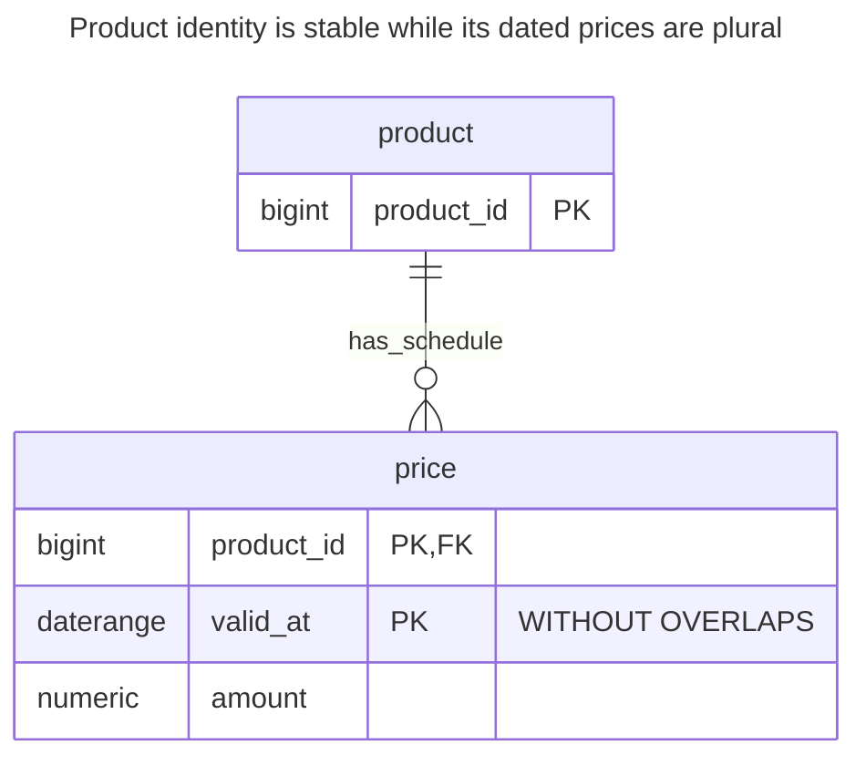
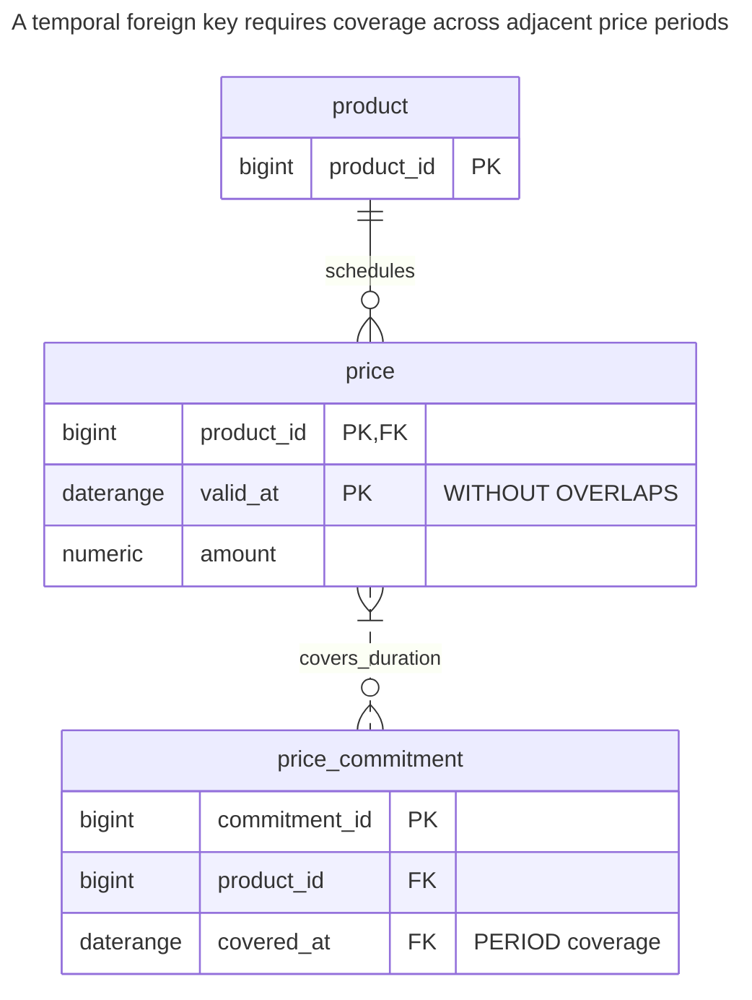
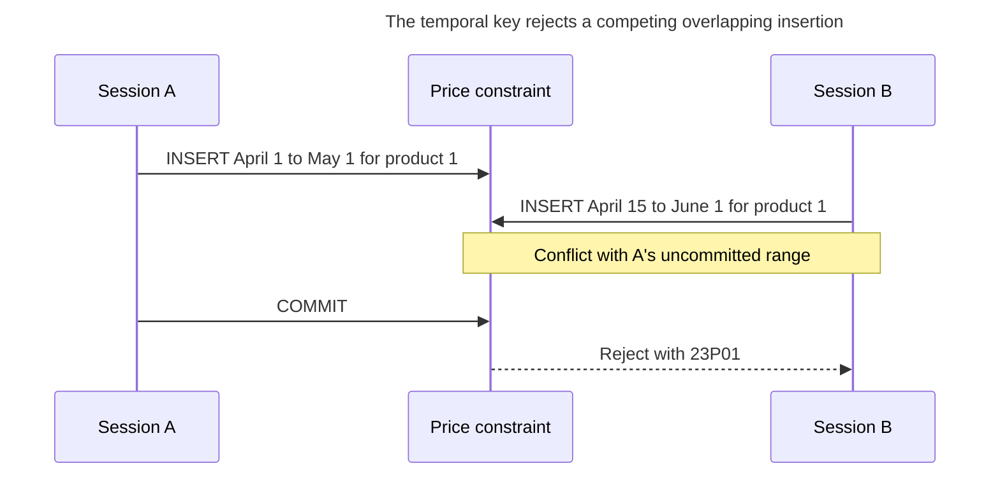
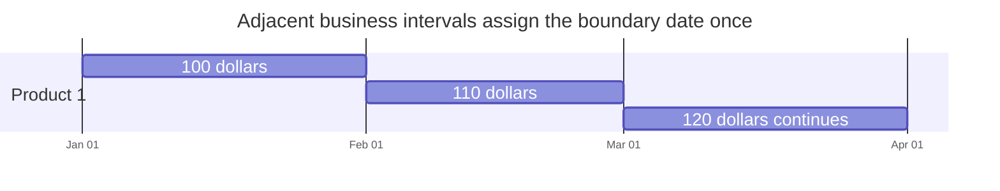
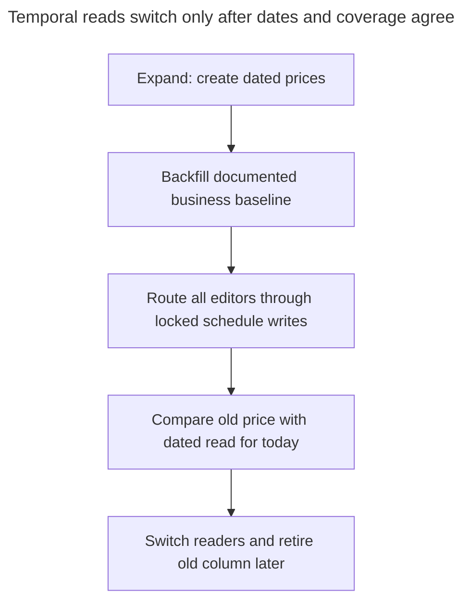

# Effective Dating

## Intent

Effective dating gives each row the business period during which it is valid: a price from the first of the month, an employee's position until a given date, a contract version for one year. The key is the entity plus its period, and the database enforces that periods of the same entity do not overlap — with an exclusion constraint on a range type, `WITHOUT OVERLAPS` in PostgreSQL 18, or SQL:2011 application-time periods in other engines. The chapter covers half-open intervals, finding the value valid at a date, and changing a period without leaving gaps. Compare [PostgreSQL 18 temporal keys](https://www.postgresql.org/docs/18/sql-createtable.html) with the [SQL:2011 period model](https://sigmodrecord.org/?download_id=3338&smd_process_download=1).

## Also known as

[Effectivity](https://martinfowler.com/eaaDev/Effectivity.html) in Fowler's catalog; application time or valid time. Kulkarni and Michels describe [SQL:2011 application-time period tables](https://sigmodrecord.org/?download_id=3338&smd_process_download=1), where a named period is metadata over start and end columns. PostgreSQL's range-valued temporal keys implement a different SQL surface.

## Problem

You must publish March's price in February without changing what customers pay today. A single `price` column cannot hold both answers, and adding `next_price` only postpones the problem until you schedule another change. Previous prices also matter when you price an order for an earlier service date.

The ambiguity is per product and business date: two overlapping prices cannot both be authoritative. Missing prices are a separate question. A product may intentionally have no price before launch or between sale seasons. Decide the required coverage instead of assuming that rejecting overlaps also fills gaps.

## Solution

Store one row per product and effective period. Use `[start, end)` throughout: February's row ends exactly where March's starts, and March 1 belongs only to the March row. The [PostgreSQL range documentation](https://www.postgresql.org/docs/18/rangetypes.html) defines these bounds, containment and overlap; `daterange` canonicalizes to the half-open representation.

Use a PostgreSQL 18 temporal primary key on `(product_id, valid_at WITHOUT OVERLAPS)` to reject intersecting periods for one product. Lock the stable product row before changing a schedule, shorten the old interval and insert its replacement in one transaction. The constraint protects uniqueness at each date; the write protocol preserves the particular coverage that the operation promises.

## Alternatives and selection

| Sibling | Relationship | Deciding requirement |
| --- | --- | --- |
| [History Table](history-table.md) | Replacement for the clock; complement for recording edits | You ask when the database recorded a value, not when it applies |
| [Bitemporal Table](bitemporal-table.md) | Replacement that includes effective dating | A correction must preserve both the old belief and the corrected business schedule |
| [Reservation](reservation.md) | Complement using the same overlap mechanism | The periods represent claims that expire or become confirmed |
| [Status History](status-history.md) | Replacement for transition questions | You need the accepted lifecycle sequence rather than values scheduled over intervals |
| Exclusion constraint | Implementation option | You need a conditional overlap rule or more than one range dimension |

See the [Decision Atlas](decision-atlas.md) for the full comparison. An as-of business query alone does not require recording every edit to the schedule.

## Structure



One product has many dated prices, but at most one matches a given date. References to the product need only its ordinary ID; references that require coverage over a duration need more.

## Tables and invariants

- **`product`** supplies stable identity and a lock target even when no price exists yet.
- **`price`** requires a nonempty period through the temporal primary key, a bounded lower end through its check, and a nonnegative amount. The key enforces no overlap per product. PostgreSQL documents that [`WITHOUT OVERLAPS` uses GiST exclusion semantics](https://www.postgresql.org/docs/18/sql-createtable.html).
- **Coverage** is not a table-wide invariant in this schema. The demonstrated split preserves the original interval's coverage; a direct delete could create a gap.
- **Date granularity** is a domain choice: this example prices whole business dates. Use a timezone policy and timestamp ranges for intraday changes rather than silently casting timestamps to dates.

## When to use

- You schedule multiple future prices, assignments, terms or permissions.
- Callers have a meaningful business date to supply when selecting a value.
- At most one value may apply per entity at a date, and missing coverage has an explicit meaning.

## Consequences and trade-offs

- ➕ Future changes can coexist with today's value and earlier values.
- ➕ The overlap constraint rejects an ambiguous schedule even when application checks race.
- ➖ Every lookup needs a business date; selecting the row with the greatest start can select a future value or cross a gap.
- ➖ Corrections involve interval arithmetic, especially when they touch several scheduled rows.
- ➖ Updating an old amount destroys the previous belief about that date. Add recorded time when that belief must remain queryable.

## Implementation

The [complete PostgreSQL 18.6 script](../assets/effective-dating/effective-dating.sql) exercises adjacent intervals, a coverage-preserving split, overlap rejection and temporal referential coverage. [`btree_gist`](https://www.postgresql.org/docs/18/btree-gist.html) supplies the equality operator class for the bigint product ID:

```sql
CREATE EXTENSION IF NOT EXISTS btree_gist;
CREATE SCHEMA effective_example;
CREATE TABLE effective_example.product (
    product_id bigint PRIMARY KEY
);
CREATE TABLE effective_example.price (
    product_id bigint REFERENCES effective_example.product (product_id),
    valid_at daterange NOT NULL CHECK (NOT lower_inf(valid_at)),
    amount numeric(12,2) NOT NULL CHECK (amount >= 0),
    CONSTRAINT price_no_overlap PRIMARY KEY (product_id, valid_at WITHOUT OVERLAPS)
);
```

At creation, store a January price and a February price with no upper bound. Then split the latter at March 1. Run the operation at Read Committed, require the expected update count of one in your application, and roll back if the old interval no longer matches:

```sql
INSERT INTO effective_example.product VALUES (1);
INSERT INTO effective_example.price VALUES
    (1, daterange('2026-01-01', '2026-02-01', '[)'), 100),
    (1, daterange('2026-02-01', NULL, '[)'), 110);
BEGIN;
SELECT product_id FROM effective_example.product WHERE product_id = 1 FOR UPDATE;
UPDATE effective_example.price
SET valid_at = daterange('2026-02-01', '2026-03-01', '[)')
WHERE product_id = 1 AND valid_at = daterange('2026-02-01', NULL, '[)');
INSERT INTO effective_example.price VALUES
    (1, daterange('2026-03-01', NULL, '[)'), 120);
COMMIT;
SELECT amount FROM effective_example.price
WHERE product_id = 1 AND valid_at @> DATE '2026-03-01';
```

The query returns `120.00`. The rows cover January at `100.00`, February at `110.00`, and March onward at `120.00`. The lock is for schedule editing; the database rejects this overlap even for a writer that omits the lock:

```sql
INSERT INTO effective_example.price VALUES
    (1, daterange('2026-02-15', '2026-03-15', '[)'), 99);
```

PostgreSQL 18.6 raises SQLSTATE `23P01`: `ERROR: conflicting key value violates exclusion constraint "price_no_overlap"`. The detail identifies `[2026-02-15,2026-03-15)` conflicting with `[2026-02-01,2026-03-01)`. Identical start dates are not the only possible collision, so uniqueness on `(product_id, lower(valid_at))` would be insufficient.

A dependent duration can require coverage by the union of parent periods through a PostgreSQL 18 [`PERIOD` foreign key](https://www.postgresql.org/docs/18/sql-createtable.html). It does not mean “one identical range exists,” nor does it freeze an agreed price amount:

```sql
CREATE TABLE effective_example.price_commitment (
    commitment_id bigint PRIMARY KEY,
    product_id bigint NOT NULL,
    covered_at daterange NOT NULL,
    CONSTRAINT commitment_coverage FOREIGN KEY (product_id, PERIOD covered_at)
        REFERENCES effective_example.price (product_id, PERIOD valid_at)
);
INSERT INTO effective_example.price_commitment VALUES
    (1, 1, daterange('2026-01-15', '2026-03-15', '[)'));
```

This insert succeeds across three adjacent price rows. The script then verifies that deleting February's price is rejected with SQLSTATE `23503` by `commitment_coverage`. Snapshot the contracted amount elsewhere if a commitment must retain it after a price correction.



The dashed relationship is coverage, not a conventional one-parent-row FK: several matching price rows may jointly cover one commitment. Conversely, a date gap makes the reference invalid.

## Engine support

- **PostgreSQL 18:** use the shown temporal key or an [exclusion constraint](https://www.postgresql.org/docs/18/rangetypes.html#RANGETYPES-CONSTRAINT) over entity equality and range overlap. The latter also supports conditional variants; temporal foreign keys require a referenced `WITHOUT OVERLAPS` key.
- **MySQL 8.4 / InnoDB:** the [`CREATE TABLE` grammar](https://dev.mysql.com/doc/refman/8.4/en/create-table.html) has no equivalent temporal key. A port can store start/end columns, lock the parent with [`FOR UPDATE` inside an explicit transaction](https://dev.mysql.com/doc/refman/8.4/en/innodb-locking-reads.html), check overlaps and write. Restrict all writers to that protocol; a plain pre-check is insufficient.
- **SQL Server 2025 (17.x):** [native temporal tables](https://learn.microsoft.com/en-us/sql/relational-databases/tables/temporal/overview?view=sql-server-ver17) track system history. Their generated system period is not a business-validity schedule; retain explicit business bounds and a coordinated no-overlap writer when porting this design.
- **Oracle Database 21c:** [Temporal Validity](https://docs.oracle.com/en/database/oracle/oracle-database/21/adfns/design_basics.html) supplies valid-time visibility and queries. That feature alone is not evidence of the per-product exclusion rule used here; preserve a separate enforcement design.
- **SQLite 3:** implement start/end comparison with [triggers](https://www.sqlite.org/lang_createtrigger.html) or a controlled writer under [`BEGIN IMMEDIATE`](https://www.sqlite.org/lang_transaction.html), handling `SQLITE_BUSY`. Its single-writer model changes coordination; it does not make an unguarded read-then-write sequence safe.

## Failure and concurrency



The constraint arbitrates ambiguity even if both callers initially see an empty April schedule. Do not convert the rejection into an unqualified overwrite. Reload the affected schedule and ask the application to resolve the competing change.

For a multi-statement split, take the [parent row lock](https://www.postgresql.org/docs/18/explicit-locking.html#LOCKING-ROWS) before reading the intervals, and make every schedule editor use it. A lock on existing price rows alone cannot serialize two writers when no price row exists. The split's update and insert must commit together; an insertion failure must restore the old open-ended interval. With immediate constraints, shorten first, then insert. A bulk rewrite that temporarily overlaps needs a deliberately deferred constraint design, not removal of enforcement.



March 1 belongs to the last interval. The picture stops at April 1 for display; the example's March range has no upper bound. Adjacency is intentional coverage, not a consequence of the no-overlap key.

## Migration

Start from a single current price by choosing a trustworthy effective baseline. If earlier validity is unknown, say so rather than inferring it from insertion timestamps. Build the dated table beside the old columns, copy a consistent baseline and route every price change through the new writer during the overlap. If a previous schema already has periods, resolve overlaps and decide which gaps are intentional before installing the key.



Use [Expand and Contract](expand-contract.md) to keep old readers available, but do not keep two independent price authorities. Account for the [DDL locks](https://www.postgresql.org/docs/18/sql-altertable.html) needed to install constraints; this is not a promise of lock-free migration. For rollback, derive the old current column from the dated schedule and retain future rows. Dropping the dated table would discard already accepted future changes.

## Anti-patterns and common mistakes

- Testing a date with `BETWEEN` over inclusive endpoints and assigning a boundary to two rows. Use the range containment predicate consistently.
- Assuming the temporal key prevents gaps or that a product FK proves dated coverage.
- Updating an earlier price in place while claiming to reproduce the previous report's knowledge.
- Locking only the row being split while allowing other writers to change the same product's schedule through another path.
- Using a date interval for an intraday domain without defining the business timezone and cutoff.

## Known uses

- Fowler's [Effectivity](https://martinfowler.com/eaaDev/Effectivity.html) models employment over effective periods and shows that overlap can be legitimate in some domains. The no-overlap rule here is specifically for a single authoritative product price, not a universal rule for dated facts.
- MariaDB's [application-time periods](https://mariadb.com/docs/server/reference/sql-structure/temporal-tables/application-time-periods) support business periods and `FOR PORTION OF` operations; these are native interval-editing options rather than PostgreSQL syntax.

## Related patterns

- [History Table](history-table.md) retains recorded values before schedule edits.
- [Bitemporal Table](bitemporal-table.md) keeps business validity and recorded knowledge independently.
- [Reservation](reservation.md) adds expiry and confirmation to interval claims.
- [Status History](status-history.md) records lifecycle edges rather than dated values.
- [Expand and Contract](expand-contract.md) stages the change in read and write contracts.
