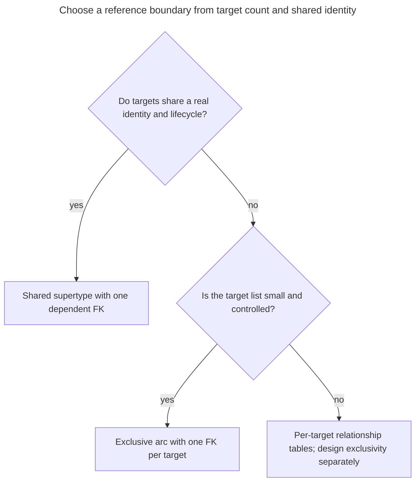
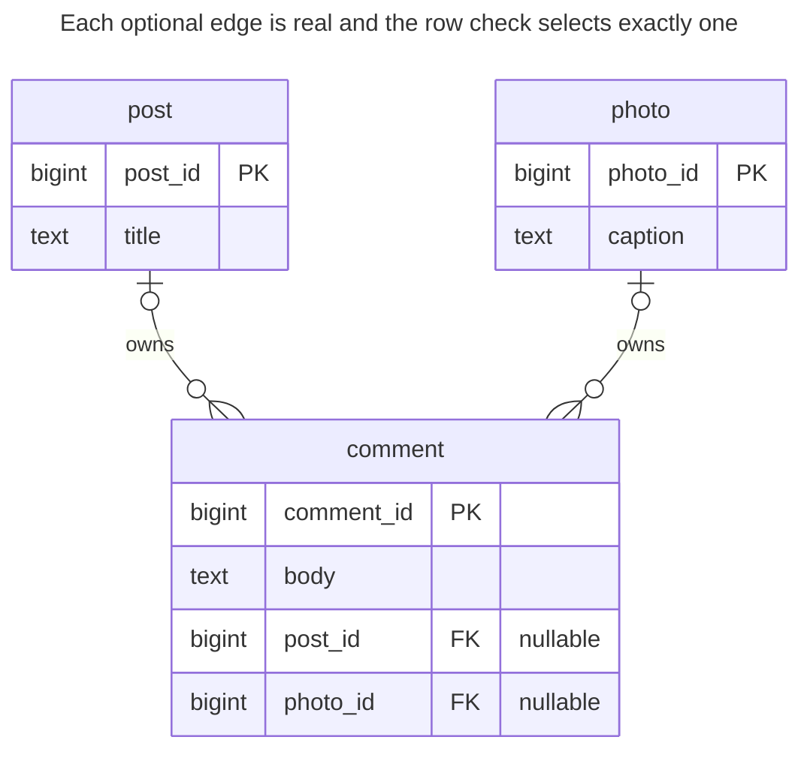
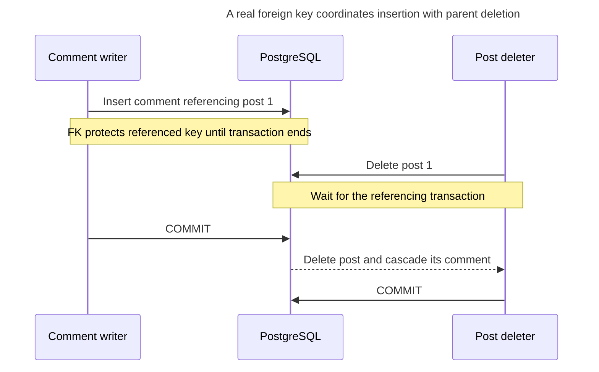
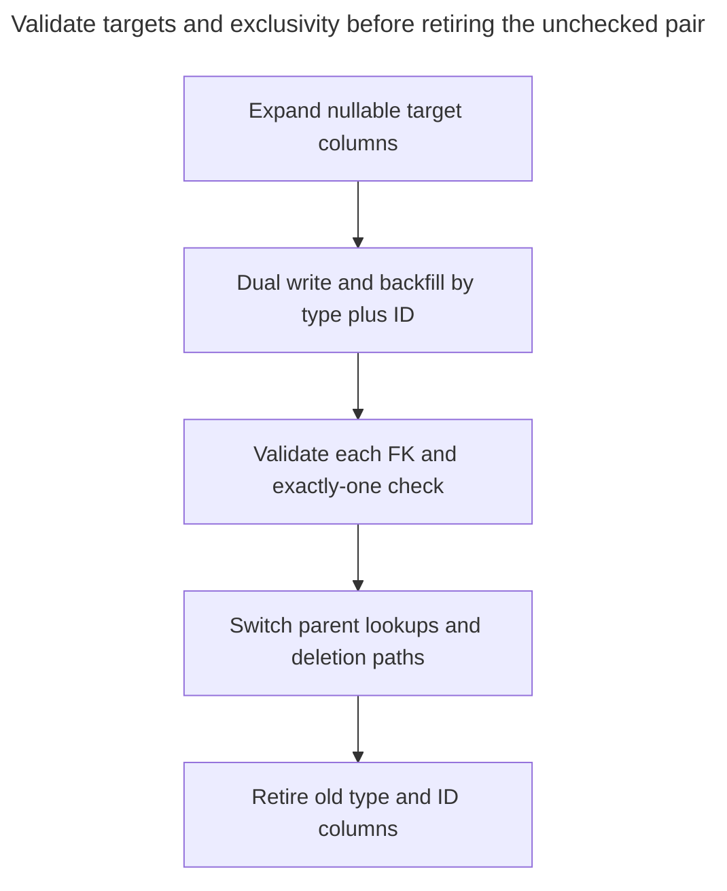

# Exclusive Arc

## Intent

An exclusive arc lets a row refer to exactly one of several possible parent tables — a comment on either a post or a photo — by giving it one nullable foreign key per target and a CHECK constraint that exactly one of them is set. Every reference is a real foreign key, so the database guarantees the target exists and cascades work as usual. The chapter shows the constraint and the index each key needs, and when the number of possible targets makes a shared supertype or per-target association tables the better choice.

## Also known as

Exclusive relationships; exclusive arcs in Bill Karwin's [Practical Object-Oriented Models in SQL](https://www.slideshare.net/slideshow/practical-object-oriented-models-in-sql/1762095). The name describes mutual exclusion between relationships, not a special SQL constraint type.

## Problem

Your comments belong to posts or photos. Storing `(parent_type, parent_id)` saves a column but gives an ordinary foreign key no fixed referenced table. A misspelled type or a deleted target can leave a reference the database cannot resolve.

Adding two real foreign keys solves target existence, but leaves two invalid combinations: a comment can point to both targets or to neither. Two independent foreign keys do not express “exactly one.” You also need to choose what happens when the selected parent is deleted.

## Solution

Add one nullable foreign key per permitted target. Add a row check that accepts exactly one populated reference. Choose a delete policy for each target; in this example comments are owned by their parent, so deleting that parent removes its comments with `ON DELETE CASCADE`. This relies on PostgreSQL's ordinary [foreign-key actions](https://www.postgresql.org/docs/18/ddl-constraints.html#DDL-CONSTRAINTS-FK), not a custom orphan-cleanup job.

Use the arc for a short, explicit list of parent kinds. If new kinds arrive frequently, the growing set of columns, checks and joins can make a common supertype a better boundary. Mutual exclusion is useful only if a comment really has one owner; a comment linked to many targets needs a relationship model instead.

## Alternatives and selection

| Sibling | Relationship | Deciding requirement |
| --- | --- | --- |
| [Class Table Inheritance](class-table-inheritance.md) with a shared supertype | Replacement | Many kinds have a meaningful common identity that dependents can reference |
| One [Association Table](association-table.md) per target kind | Replacement for reference placement | Keep each relationship separate; account explicitly for cross-table exclusivity if one owner is still required |
| [Single Table Inheritance](single-table-inheritance.md) | Replacement for the parent storage | Parent kinds form one compact entity family and can share one constrained table |
| [Concrete Table Inheritance](concrete-table-inheritance.md) | Complement | The parent kinds stay separate while dependents retain real target-specific references |

See the [Decision Atlas](decision-atlas.md) for the full table. The arc is a repair for [Polymorphic Associations](polymorphic-associations.md), not an alternate spelling of an unchecked `(type, id)` pair.



Separate relationship tables enforce endpoint existence locally. They do not automatically prevent the same comment from appearing once in each table; the arc's row check is valuable precisely because all competing choices are on one row.

## Structure



A comment has zero or one post and zero or one photo on each individual edge. `comment_one_parent` constrains those edges together to exactly one. The two target tables may use overlapping numeric IDs without ambiguity.

## Tables and invariants

- **`post` and `photo`** own their independent keys and content. No global parent-ID allocation is needed.
- **`comment`** has one row per comment and a mandatory body. Each non-null target column must identify a real target.
- **`comment_one_parent`** rejects both populated and both null. It uses null predicates, so every combination yields true or false rather than unknown.
- **Deletion** cascades from the selected target only. `SET NULL` would violate this exactly-one check when it removed the last reference.
- **Indexes** cover each non-null parent reference for parent-specific reads. PostgreSQL does [not create referencing-side indexes automatically](https://www.postgresql.org/docs/18/ddl-constraints.html#DDL-CONSTRAINTS-FK).

## When to use

- A dependent has exactly one owner from a small, stable set of tables.
- You want the database to reject missing targets and enforce deletion behavior.
- The target kinds should remain separate entities rather than sharing an artificial base.

## Consequences and trade-offs

- ➕ Existence and ownership choice are checked on every ordinary write.
- ➕ A post's comments are a direct indexed lookup without a type discriminator in the predicate.
- ➖ Every new target kind needs a column, foreign key, index and revised check.
- ➖ A heterogeneous parent display needs joins or separate target-specific queries.
- ➖ Arc checks describe one row. They do not enforce wider rules such as “every post has at least one comment.”

## Implementation

The [complete script](../assets/exclusive-arc/exclusive-arc.sql) verifies both invalid shapes, a missing target, reassignment and cascades:

```sql
CREATE TABLE post (post_id bigint PRIMARY KEY, title text NOT NULL);
CREATE TABLE photo (photo_id bigint PRIMARY KEY, caption text NOT NULL);
CREATE TABLE comment (
    comment_id bigint PRIMARY KEY,
    body text NOT NULL,
    post_id bigint REFERENCES post (post_id) ON DELETE CASCADE,
    photo_id bigint REFERENCES photo (photo_id) ON DELETE CASCADE,
    CONSTRAINT comment_one_parent CHECK (
        (post_id IS NOT NULL AND photo_id IS NULL)
        OR (post_id IS NULL AND photo_id IS NOT NULL)
    )
);
CREATE INDEX comment_post_idx ON comment (post_id) WHERE post_id IS NOT NULL;
CREATE INDEX comment_photo_idx ON comment (photo_id) WHERE photo_id IS NOT NULL;
```

The two-column Boolean expression is intentionally explicit. For a longer arc, PostgreSQL's [`num_nonnulls`](https://www.postgresql.org/docs/18/functions-comparison.html) is an implementation option for counting populated targets, but review the number of targets before shortening a design that is becoming difficult to evolve.

```sql
INSERT INTO post VALUES (1, 'Schema notes');
INSERT INTO photo VALUES (2, 'Whiteboard');
INSERT INTO comment VALUES (10, 'Useful', 1, NULL);
SELECT comment_id, body FROM comment WHERE post_id = 1;
```

The query returns `(10, Useful)`. Giving a comment two parents is invalid:

```sql
INSERT INTO comment VALUES (11, 'Ambiguous', 1, 2);
```

PostgreSQL 18.6 raises SQLSTATE `23514`: `ERROR: new row for relation "comment" violates check constraint "comment_one_parent"`. Both-null input fails the same check; a sole `post_id` of `999` instead fails `comment_post_id_fkey` with SQLSTATE `23503`.

Change both columns in one statement when moving a comment:

```sql
UPDATE comment SET post_id = NULL, photo_id = 2 WHERE comment_id = 10;
DELETE FROM post WHERE post_id = 1;
SELECT comment_id, photo_id FROM comment;
DELETE FROM photo WHERE photo_id = 2;
SELECT count(*) AS remaining_comments FROM comment;
```

After deleting the old post, the reassigned comment is still `(10, 2)`. Deleting its current photo leaves `0` comments. Separate updates that first clear the old target would fail the immediate row check.

## Engine support

- **PostgreSQL 18:** the nullable foreign keys, row check and [partial indexes](https://www.postgresql.org/docs/18/indexes-partial.html) implement the example directly.
- **MySQL 8.4 / InnoDB:** the [check-constraint restrictions](https://dev.mysql.com/doc/refman/8.4/en/create-table-check-constraints.html) prohibit foreign-key referential actions on columns used in checks. Do not copy this check-plus-cascade definition unchanged; use restrictive references and explicitly delete comments before parents in a transaction, or choose a shared supertype.
- **SQL Server 2025 (17.x):** supports [nullable foreign keys and checks](https://learn.microsoft.com/en-us/sql/t-sql/statements/create-table-transact-sql?view=sql-server-ver17), but [multiple cascade paths are rejected](https://learn.microsoft.com/en-us/sql/relational-databases/errors-events/mssqlserver-1785-database-engine-error?view=sql-server-ver17). Review the entire parent dependency graph, not only these three tables.
- **Oracle AI Database 26ai:** ordinary [foreign keys with `ON DELETE CASCADE`](https://docs.oracle.com/en/database/oracle/oracle-database/26/sqlrf/constraint.html) and the explicit null-predicate check express the arc. PostgreSQL's counting function is not required.
- **SQLite 3:** enable [foreign-key enforcement per connection](https://www.sqlite.org/foreignkeys.html#fk_enable). Keep the explicit two-column check when translating the DDL.

## Failure and concurrency

Two sessions cannot evade the row check by populating different columns independently: every resulting comment row must satisfy the check. At PostgreSQL's [read committed isolation](https://www.postgresql.org/docs/18/transaction-iso.html#XACT-READ-COMMITTED), concurrent updates to the same row wait and recheck their conditions. Use a predicate naming the previously selected parent, or a [Version Column](version-column.md), when a reassignment should fail if another writer already moved the comment.

Target deletion races are handled by the actual foreign keys. PostgreSQL uses [key-share row locks](https://www.postgresql.org/docs/18/explicit-locking.html#LOCKING-ROWS) to protect referenced keys against deletion during the referencing transaction.



The comment can be inserted successfully and then removed by a later valid parent deletion. If deletion commits first, a later referencing insert fails instead. Both outcomes preserve referential integrity; neither guarantees that a newly created comment lives forever.

## Migration

From a `(parent_type, parent_id)` pair, inventory all stored type names and resolve missing parents before copying references. Add nullable target columns, deploy writers that fill both representations atomically, and backfill using the type plus ID. Never match by ID alone: post `1` and photo `1` can be different parents.



In PostgreSQL, add the new checks and foreign keys [`NOT VALID`, then validate](https://www.postgresql.org/docs/18/sql-altertable.html) after backfill. Arrange a lock window for installation, and synchronize backfill with the same comment-row locking used by live writers. Retain the old pair for rollback until every writer and deletion path uses the arc; adding a new target kind requires keeping that pair capable of representing it. See [Expand and Contract](expand-contract.md).

## Anti-patterns and common mistakes

- Two foreign keys without the exactly-one check: both targets and no target remain possible.
- Checking only “at least one,” which accepts ambiguous ownership.
- Clearing the current parent in one statement and assigning the next in another.
- Choosing `SET NULL` while still requiring exactly one target.
- Moving references to per-target link tables and assuming exclusivity survived automatically.

## Known uses

- Karwin's [author-uploaded slides](https://www.slideshare.net/slideshow/practical-object-oriented-models-in-sql/1762095) show exclusive arcs for comments referencing bugs or features and contrast them with separate relationship tables and a base parent table. This chapter adds an explicit check for the exactly-one rule.

## Related patterns

- [Class Table Inheritance](class-table-inheritance.md) offers a shared target when the family deserves common identity.
- [Polymorphic Associations](polymorphic-associations.md) describes the unchecked pair the arc replaces.
- [Association Table](association-table.md) explains relationship rows when a dependent may link to several targets.
- [Concrete Table Inheritance](concrete-table-inheritance.md) keeps parent storage separate while the arc checks dependent references.
