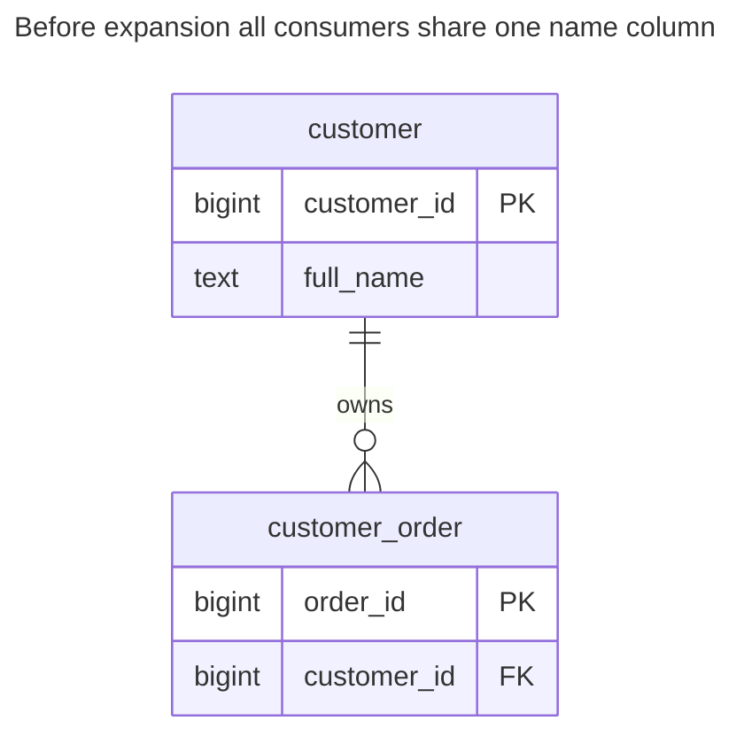
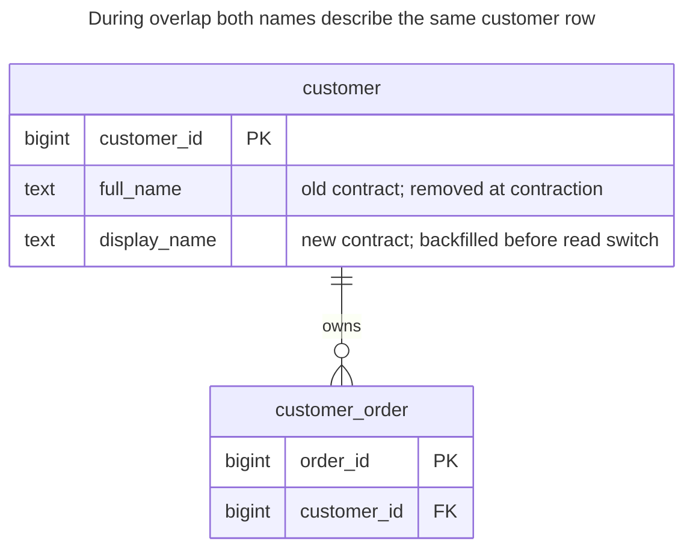
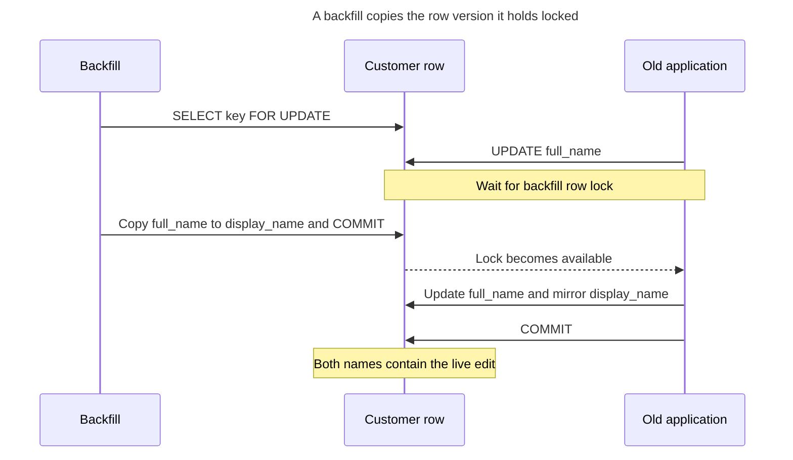
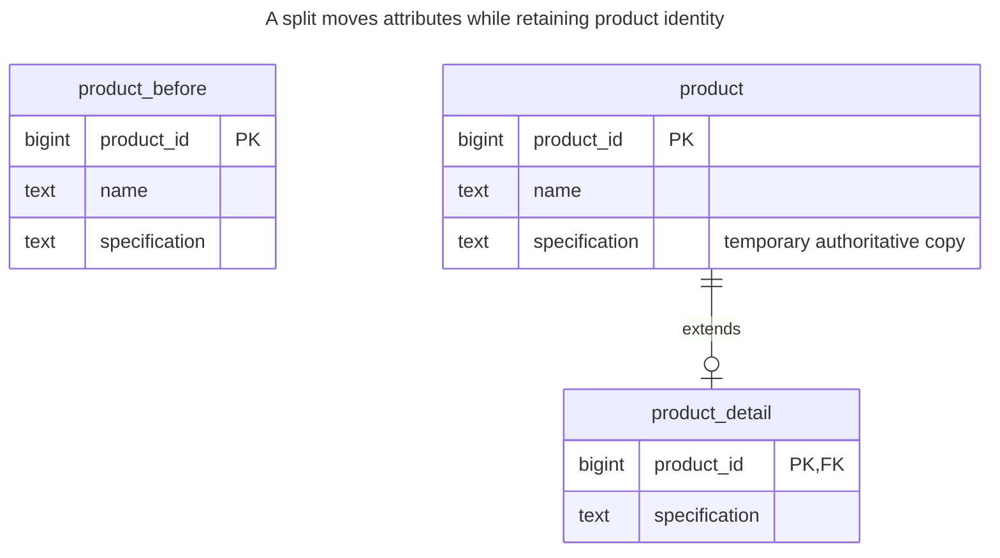
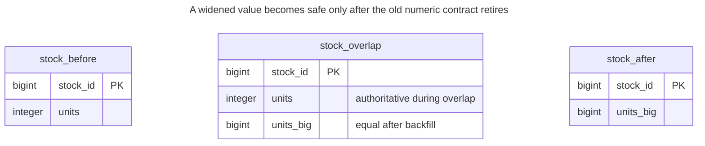

# Expand and Contract

## Intent

Expand and contract changes a schema in a series of backward-compatible steps, so old and new versions of the application work at the same time and no deploy needs downtime. You first expand — add the new column or table — then write to both and backfill, switch reads, and only then contract by removing the old structure. The chapter walks through renaming a column, splitting a table and changing a type this way, and shows how locks taken by DDL statements can still stop production when a step is done carelessly. PostgreSQL [documents DDL lock requirements](https://www.postgresql.org/docs/18/sql-altertable.html), so this compatibility sequence does not itself guarantee uninterrupted availability.

## Also known as

Parallel Change in [Danilo Sato's description](https://martinfowler.com/bliki/ParallelChange.html): expand the interface, migrate its consumers, then contract it. Ambler's [database-refactoring process](https://agiledata.org/essays/databaseRefactoring.html) describes a transition period with temporary synchronization scaffolding. The pattern concerns compatibility across versions, not a particular migration framework.

## Problem

You want to rename `customer.full_name` to `display_name`. A direct rename can be quick to execute, yet an old process still selects `full_name` while a new process selects `display_name`. A rolling deployment, queued job or rollback can therefore fail even when the DDL itself succeeds.

Adding a second column only postpones the failure. If new code writes one column while old code writes the other, the database has two competing names. A background copy can also read an old value and overwrite a newer edit. You need an explicit authority and synchronization rule during overlap, plus evidence that old readers and writers have retired before removal.

## Solution

Treat schema state and application capability as separate deployment steps. Expand with additive storage and synchronization while preserving the old contract. Migrate existing rows in bounded, restartable batches, verify equivalence and move readers. Contract only after every reader and writer can tolerate removal and your rollback window has ended.

For a lossless rename, synchronize either column into the other in a before-row trigger. Reject a command that changes both to different values. Install the column and trigger together so no committed interval exposes the new shape without its maintenance. PostgreSQL [before-row triggers can modify `NEW`](https://www.postgresql.org/docs/18/plpgsql-trigger.html), letting the old mandatory column remain valid for new-only inserts.

Do not apply bidirectional copying to an arbitrary transformation. A split or widened type may need one authoritative old representation throughout the overlap, with new readers but old-compatible writers. Define when the new model becomes authoritative and whether each new value can still be expressed in the old model.

## Alternatives and selection

| Sibling or mechanism | Relationship | Deciding requirement |
| --- | --- | --- |
| Coordinated maintenance deployment | Replacement | You can stop all clients and accept the measured DDL/data-conversion window |
| Compatibility view or trigger | Implementation option | The database can translate the old contract while clients migrate |
| [Table Split](table-split.md) | Complement | The destination is a shared-key detail table; this chapter supplies the rollout protocol |
| [Table Partitioning](table-partitioning.md) | Complement | The destination changes physical routing and may change the reference key |
| [Summary Table](summary-table.md) | Complement | Readers switch to a new projection after its baseline and live maintenance agree |
| Oracle edition-based redefinition | Implementation option | Your Oracle deployment can use editioning views and crossedition synchronization |

See the [Decision Atlas](decision-atlas.md) for the full comparison. Additive migration still needs DDL locks and a resource budget; the pattern avoids requiring simultaneous client replacement, not every possible pause.

## Structure

The starting schema has one name and an order referencing the customer's stable identity:



The rename concerns the descriptive field. Orders need no new key or backfill because their customer reference does not change.



The new column is temporarily nullable for unvisited rows. Once validation finishes, both columns are mandatory and equal. Contraction removes `full_name` and its bridge; it does not rename `display_name` again, which would introduce another client break.

## Tables and invariants

- **`customer`** retains the same primary key in every phase. During expansion, old rows may lack `display_name`; every inserted or updated row passes the bridge.
- **`bridge_customer_name`** copies a change to either name into the other. It rejects contradictory dual writes with SQLSTATE `23514`. It does not choose which of two independent user edits should win.
- **Completeness** is a migration gate: backfill all rows, validate the not-null check and compare the values before switching reads.
- **`customer_order`** keeps its foreign key throughout. A migration is incomplete if an unlisted consumer still depends on a removed column, even when all modeled table constraints pass.
- **Rollback compatibility** depends on representability. A renamed string remains representable; a newly accepted number outside the old integer range does not.

## When to use

- Application versions, workers or integrations overlap during deployment.
- A breaking rename, split or conversion cannot be installed as one coordinated stop.
- You can inventory consumers, operate temporary synchronization and measure completion before removal.

## Consequences and trade-offs

- ➕ Each application version can move independently while the bridge preserves the agreed contract.
- ➕ You can switch readers back before contraction without discarding later edits.
- ➖ Duplicate storage, extra writes and migration code remain until you explicitly remove them.
- ➖ A logically additive step can still wait for a lock or scan a large table.
- ➖ Rollback becomes a data-conversion problem once new writes exceed the old model's capabilities.
- ➖ Keeping the overlap forever leaves two contracts and ongoing ambiguity. Assign an owner and a removal gate for the bridge.

## Implementation

The [complete PostgreSQL 18.6 script](../assets/expand-contract/expand-contract.sql) runs the rename through contraction and includes table-split and integer-widening variants. The lab begins with the old schema and two existing customers:

```sql
CREATE TABLE customer (
    customer_id bigint PRIMARY KEY,
    full_name text NOT NULL
);
CREATE TABLE customer_order (
    order_id bigint PRIMARY KEY,
    customer_id bigint NOT NULL REFERENCES customer (customer_id)
);
INSERT INTO customer VALUES (1, 'Harbor'), (2, 'Meadow');
INSERT INTO customer_order VALUES (10, 1);
```

Expand in a short transaction. The [`lock_timeout`](https://www.postgresql.org/docs/18/runtime-config-client.html#GUC-LOCK-TIMEOUT) bounds each lock-acquisition wait; it does not limit the duration of a successful table scan or the whole migration:

```sql
BEGIN;
SET LOCAL lock_timeout = '1s';
ALTER TABLE customer ADD COLUMN display_name text;
CREATE FUNCTION bridge_customer_name() RETURNS trigger LANGUAGE plpgsql AS $$
BEGIN
    IF TG_OP = 'INSERT' THEN
        NEW.full_name := coalesce(NEW.full_name, NEW.display_name);
        NEW.display_name := coalesce(NEW.display_name, NEW.full_name);
    ELSE
        IF NEW.full_name IS DISTINCT FROM OLD.full_name
           AND NEW.display_name IS NOT DISTINCT FROM OLD.display_name THEN
            NEW.display_name := NEW.full_name;
        ELSIF NEW.display_name IS DISTINCT FROM OLD.display_name
           AND NEW.full_name IS NOT DISTINCT FROM OLD.full_name THEN
            NEW.full_name := NEW.display_name;
        ELSIF NEW.display_name IS NULL
           AND NEW.full_name IS NOT DISTINCT FROM OLD.full_name
           AND NEW.display_name IS NOT DISTINCT FROM OLD.display_name THEN
            NEW.display_name := NEW.full_name;
        END IF;
    END IF;
    IF NEW.full_name IS DISTINCT FROM NEW.display_name THEN
        RAISE EXCEPTION 'customer names must agree' USING ERRCODE = '23514';
    END IF;
    RETURN NEW;
END $$;
CREATE TRIGGER customer_name_bridge
BEFORE INSERT OR UPDATE ON customer
FOR EACH ROW EXECUTE FUNCTION bridge_customer_name();
COMMIT;
```

Old clients may keep writing `full_name`; new clients may write `display_name`. Inserts with either name fill the other. Updates to unrelated columns on an unvisited row also initialize its new name. Explicit nulling is not a supported rename operation: the existing mandatory old column still rejects a null name.

Backfill rows while locking the source version you actually copy. PostgreSQL's [`FOR UPDATE SKIP LOCKED`](https://www.postgresql.org/docs/18/sql-select.html#SQL-FOR-UPDATE-SHARE) lets workers skip currently locked rows; skipped rows remain unfinished work:

```sql
WITH batch AS (
    SELECT customer_id FROM customer
    WHERE display_name IS NULL
    ORDER BY customer_id LIMIT 100
    FOR UPDATE SKIP LOCKED
)
UPDATE customer AS c SET display_name = c.full_name
FROM batch AS b WHERE c.customer_id = b.customer_id;
UPDATE customer SET full_name = 'Harbor Shop' WHERE customer_id = 1;
INSERT INTO customer (customer_id, display_name) VALUES (3, 'Brook');
SELECT customer_id, full_name, display_name FROM customer ORDER BY customer_id;
```

The three rows have matching names: `Harbor Shop`, `Meadow` and `Brook`. Repeat the batch in separate committed transactions until verification shows no null or unequal names. A batch updating zero rows can mean all remaining rows were locked, so it is not completion evidence by itself.

A contradictory dual write is invalid:

```sql
UPDATE customer SET full_name = 'Old choice', display_name = 'New choice'
WHERE customer_id = 1;
```

PostgreSQL 18.6 raises SQLSTATE `23514`: `ERROR: customer names must agree`. The row remains `Harbor Shop` in both columns. This is a bridge consistency check, not optimistic concurrency protection against a later independent edit.

Establish completeness with separate constraint installation and validation, then make the new column mandatory:

```sql
ALTER TABLE customer ADD CONSTRAINT customer_display_ready
    CHECK (display_name IS NOT NULL) NOT VALID;
ALTER TABLE customer VALIDATE CONSTRAINT customer_display_ready;
ALTER TABLE customer ALTER COLUMN display_name SET NOT NULL;
ALTER TABLE customer DROP CONSTRAINT customer_display_ready;
SELECT count(*) AS mismatches FROM customer
WHERE full_name IS DISTINCT FROM display_name;
```

The mismatch count is `0`. [`NOT VALID` and validation](https://www.postgresql.org/docs/18/sql-altertable.html) separate installation from scanning existing rows. A valid check proving non-nullness lets `SET NOT NULL` skip its usual scan. Commit these as separate migration steps in production so a stronger installation lock is not held through validation. Switch new readers only after these gates pass; retain synchronization while any old writer remains.

After old consumers and rollback binaries retire, contract in a short lock window:

```sql
BEGIN;
SET LOCAL lock_timeout = '1s';
DROP TRIGGER customer_name_bridge ON customer;
ALTER TABLE customer DROP COLUMN full_name;
DROP FUNCTION bridge_customer_name();
COMMIT;
UPDATE customer SET display_name = 'Harbor Market' WHERE customer_id = 1;
SELECT o.order_id, c.display_name
FROM customer_order AS o JOIN customer AS c USING (customer_id);
```

The order still resolves as `(10, Harbor Market)`. An old client now fails because its column is gone; old-client absence is therefore a prerequisite, not something the DDL can establish for you.

## Engine support

- **PostgreSQL 18:** [`ALTER TABLE`](https://www.postgresql.org/docs/18/sql-altertable.html) takes `ACCESS EXCLUSIVE` unless its form documents a weaker lock. A nullable column without a default does not require a table rewrite; validation and type changes have their own scan/rewrite rules. Split the migration into measured steps.
- **MySQL 8.4:** [`ALTER TABLE` causes implicit commits](https://dev.mysql.com/doc/refman/8.4/en/implicit-commit.html). Do not copy the PostgreSQL “column plus bridge in one transaction” guarantee; arrange a compatible writer deployment around separately committed DDL.
- **SQL Server 2025 (17.x):** Microsoft [warns that changing a populated column's type can lose data and break dependent code](https://learn.microsoft.com/en-us/sql/relational-databases/tables/modify-columns-database-engine?view=sql-server-ver17). Preserve both representations through the compatibility period and use a set-aware bridge: SQL Server's [DML triggers handle multiple rows](https://learn.microsoft.com/en-us/sql/relational-databases/triggers/create-dml-triggers-to-handle-multiple-rows-of-data?view=sql-server-ver17), unlike this row-trigger body.
- **Oracle Database 19c:** [edition-based redefinition](https://docs.oracle.com/en/database/oracle/oracle-database/19/adfns/editions.html) provides editioning views and crossedition triggers; tables themselves are noneditioned. It is a native implementation option for version coexistence, with its own deployment protocol.
- **SQLite 3:** [`ALTER TABLE`](https://www.sqlite.org/lang_altertable.html) has a limited set of direct operations and documents a generalized table-rebuild procedure for other changes. Its [one-writer model](https://www.sqlite.org/lang_transaction.html) means copying a large table in a write transaction needs a planned write window.

## Failure and concurrency

The bridge keeps the names equal at Read Committed, but two valid edits still need an application conflict policy. A background worker that reads values into client memory, commits, and later writes them back can overwrite an intervening change. Keep selection, locking and copying inside the same batch transaction:



PostgreSQL's [row-lock rules](https://www.postgresql.org/docs/18/explicit-locking.html#LOCKING-ROWS) make the live edit wait. If the application holds the lock first, the batch skips the row and must revisit it. Keep transactions small and use a consistent row order; retry whole batches after deadlocks or serialization failures.

DDL can queue behind an old transaction even when the metadata change itself is small. Because [`ACCESS EXCLUSIVE` conflicts with readers too](https://www.postgresql.org/docs/18/explicit-locking.html#LOCKING-TABLES), a waiting migration can disrupt traffic. Inspect blockers, apply bounded acquisition waits and retry deliberately; do not leave a migration waiting indefinitely. A failure during a PostgreSQL transaction above rolls back that step, while previously committed phases remain installed.

Track the operational gates explicitly: remaining unfilled rows, mismatches, constraint-validation status, errors by client version and evidence of old SQL usage across jobs, exports and integrations. “The web deployment finished” does not prove every database consumer moved.

## Migration

The rename is the complete walkthrough above. Keep these phase gates independent of how many application releases they require:

```mermaid
---
title: Contraction waits for data validation and retirement of old consumers
---
stateDiagram-v2
    [*] --> OldOnly
    OldOnly --> Expanded: Install storage and bridge
    Expanded --> Backfilling: Compatible writers available
    Backfilling --> Verified: No gaps or mismatches; constraints valid
    Verified --> NewReads: Switch readers
    NewReads --> Verified: Roll readers back while bridge remains
    NewReads --> ContractReady: Old consumers and rollback window retired
    ContractReady --> NewOnly: Remove old storage and bridge
    class OldOnly muted
    class Expanded,Backfilling,Verified,NewReads accent
    class ContractReady,NewOnly warn
```



Before contraction, rollback means switching readers and application versions while leaving the bridge installed. After contraction, reinstalling an old binary requires a new expansion and reconstruction of its contract. A reverse migration is safe only if every value written since the switch remains representable.

For a **table split**, start with `product(product_id, name, specification)` and move the specification into a shared-key extension. Keep the old column authoritative during overlap; an after-write trigger mirrors it into `product_detail`, so old writers remain compatible. New readers join the detail only after backfill. This is the optional-extension mechanism explained in [Table Split](table-split.md), with completeness additionally required at this migration's read-switch gate.



`product_before` depicts the starting schema, not an extra live table. During overlap the extension still permits missing rows at the constraint level; verification must prove coverage. Contraction removes the temporary specification from `product` and retires its mirror.

The essential expansion and backfill are:

```sql
CREATE TABLE product_detail (
    product_id bigint PRIMARY KEY REFERENCES product (product_id) ON DELETE CASCADE,
    specification text NOT NULL
);
CREATE FUNCTION mirror_product_detail() RETURNS trigger LANGUAGE plpgsql AS $$
BEGIN
    INSERT INTO product_detail VALUES (NEW.product_id, NEW.specification)
    ON CONFLICT (product_id) DO UPDATE SET specification = EXCLUDED.specification;
    RETURN NULL;
END $$;
CREATE TRIGGER product_detail_bridge AFTER INSERT OR UPDATE ON product
FOR EACH ROW EXECUTE FUNCTION mirror_product_detail();
WITH batch AS (
    SELECT product_id, specification FROM product
    WHERE NOT EXISTS (
        SELECT FROM product_detail AS d WHERE d.product_id = product.product_id
    )
    ORDER BY product_id LIMIT 100 FOR UPDATE OF product SKIP LOCKED
)
INSERT INTO product_detail SELECT * FROM batch
ON CONFLICT (product_id) DO UPDATE SET specification = EXCLUDED.specification;
```

Install the expansion in one transaction in the lab. The source-row lock is shared with live updates, preventing a stale backfill from replacing a newer mirrored specification. Deletion uses the FK cascade. Keep new writers using the old authoritative column until the switch protocol retires old writers; writing the detail independently during this phase violates the bridge's authority rule. The script checks coverage and values, drops the bridge and old column, then demonstrates a new detail-only edit.

For a **type change**, the script widens `stock.units` from `integer` to a new `bigint` column, `units_big`. During overlap a one-way trigger copies old writes, and a row check requires equality after backfill:



These are three versions of one table. The larger column does not permit larger business values while old clients still depend on the smaller representation.

```sql
ALTER TABLE stock ADD COLUMN units_big bigint;
CREATE FUNCTION mirror_stock_units() RETURNS trigger LANGUAGE plpgsql AS $$
BEGIN
    NEW.units_big := NEW.units;
    RETURN NEW;
END $$;
CREATE TRIGGER stock_units_bridge BEFORE INSERT OR UPDATE ON stock
FOR EACH ROW EXECUTE FUNCTION mirror_stock_units();
UPDATE stock SET units_big = units;
ALTER TABLE stock ADD CONSTRAINT stock_units_agree
    CHECK (units_big IS NOT NULL AND units_big = units) NOT VALID;
ALTER TABLE stock VALIDATE CONSTRAINT stock_units_agree;
ALTER TABLE stock ALTER COLUMN units_big SET NOT NULL;
```

The lab backfills two rows in one statement; use locked bounded batches for a large table. New readers may use `units_big`, but all overlap writers still supply `units`. After retiring those writers, remove the equality check, bridge and old column together. Only then accept `2147483648` in `units_big`. PostgreSQL's [`integer` range ends at `2147483647`](https://www.postgresql.org/docs/18/datatype-numeric.html); accepting the larger value ends lossless rollback to that old type. Conversions with changed units, precision or meaning need a specified mapping and rejection policy before this sequence is usable.

## Anti-patterns and common mistakes

- Renaming or dropping a column during a rolling deploy because the DDL executes quickly in development.
- Calling two independently committed writes “dual write”; a failure can leave only one representation changed.
- Letting both representations be independently authoritative without a conflict rule.
- Backfilling from unlocked client-side snapshots or interpreting a skipped batch as completion.
- Enabling new-only values while promising rollback to a model that cannot represent them.
- Contracting before scheduled jobs, analytics, integrations and rollback versions have moved.
- Leaving temporary triggers and columns indefinitely because no removal owner was assigned.

## Known uses

- Sato's [Parallel Change](https://martinfowler.com/bliki/ParallelChange.html) separates expanding an interface, migrating clients and removing the old interface. Its example is an application API; the schema walkthrough here applies the same sequence.
- Ambler's [database-refactoring account](https://agiledata.org/essays/databaseRefactoring.html) discusses complex deployments with a transition period and the need to remove scaffolding after dependent systems change.
- Oracle's [edition-based redefinition guide](https://docs.oracle.com/en/database/oracle/oracle-database/19/adfns/editions.html) documents forward and reverse crossedition triggers for online application upgrades. The guide supplies the mechanism; the schema examples here use ordinary PostgreSQL tables and triggers.

## Related patterns

- [Table Split](table-split.md) defines the shared-key destination and its optionality rules.
- [Table Partitioning](table-partitioning.md) changes storage routing and retention, sometimes requiring a new key contract.
- [Summary Table](summary-table.md) requires a consistent baseline before reader cutover.
