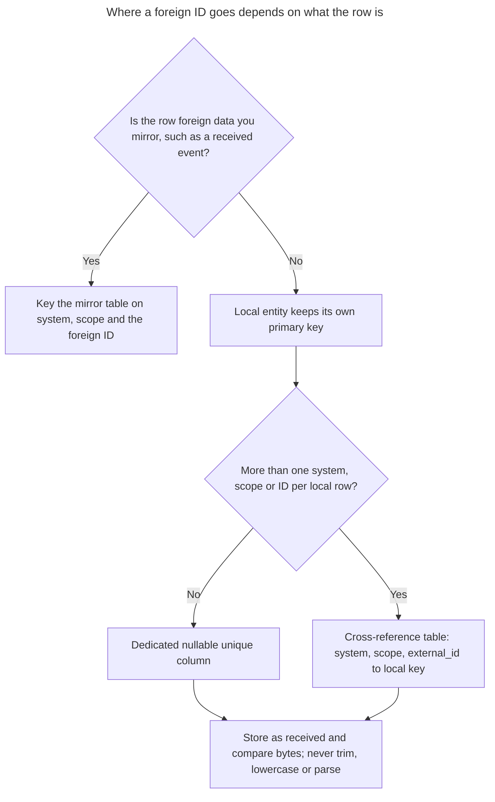
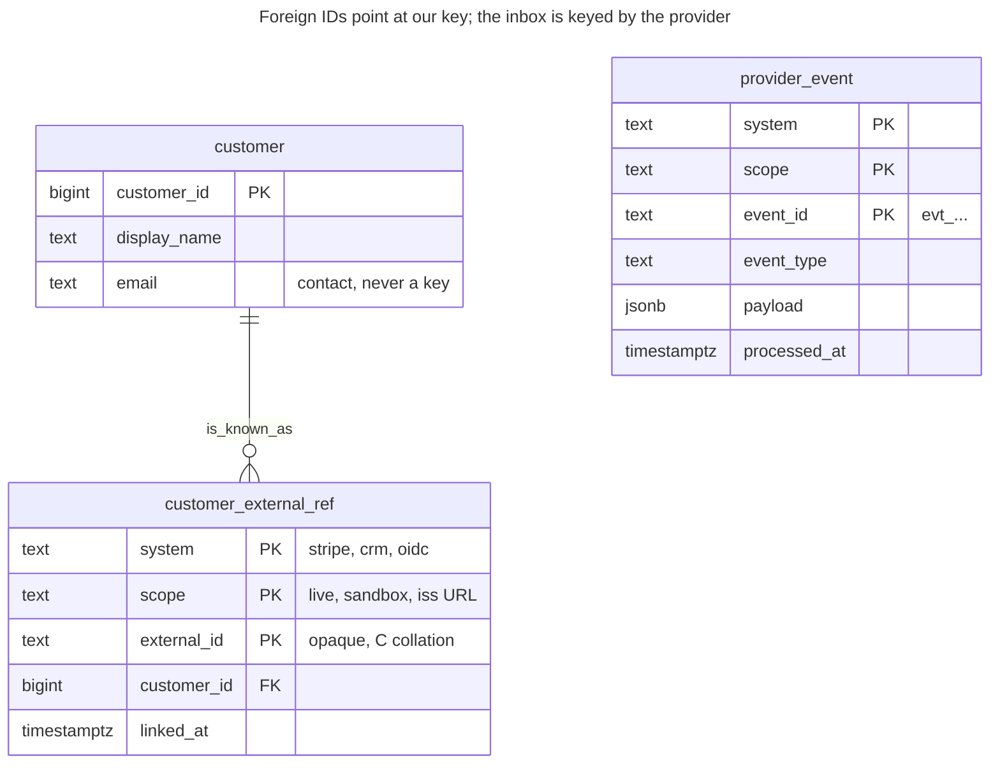
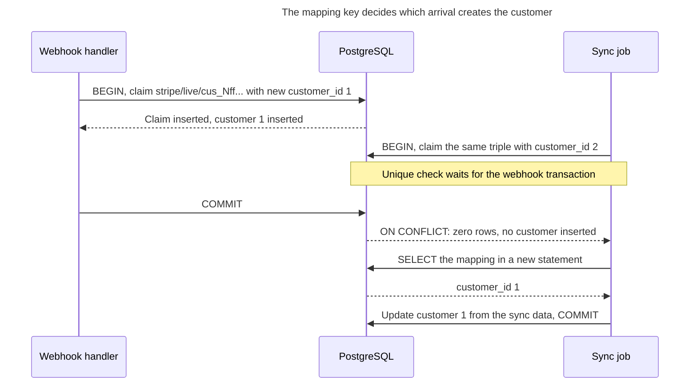
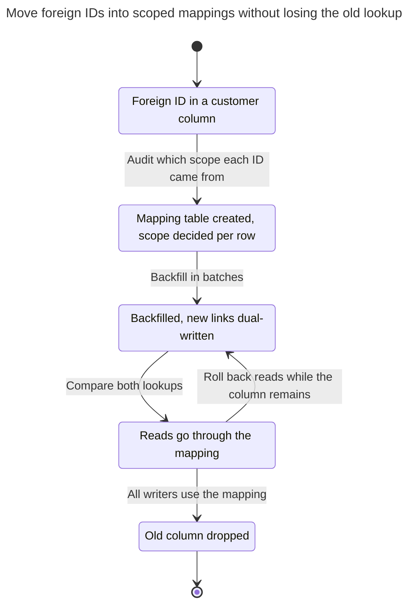

# External Reference

## Intent

An external reference stores an identifier that another system issued: a payment provider's customer ID such as Stripe's `cus_...`, a CRM record number, or the subject of an OpenID Connect login. Keep it next to your own key as a unique attribute, never as your primary key. Qualify it by the system and the namespace inside that system that make it unique, compare it byte for byte, and let a unique constraint decide which of two concurrent arrivals creates the local row. The chapter shows when one column is enough, when you need a cross-reference table, how OIDC identity reduces to the pair `(iss, sub)`, and why a webhook inbox may key on the provider's event ID.

## Also known as

Foreign ID; external ID mapping; cross-reference (xref) table. Fowler's Analysis Patterns has a pattern named Identification Scheme. The direction matters: [Public Identifier](public-identifier.md) also lists "External ID" as an alias, but for the opposite flow, the handle *we* issue to clients. An external reference is inbound: someone else issued it, and we only store it.

## Problem

A customer pays through Stripe Checkout. Stripe sends a `customer.created` webhook, and at the same moment your nightly sync job pages through Stripe's customer list. Both see `cus_NffrFeUfNV2Hib`, both look it up locally, find nothing, and each inserts a customer. You now have two local customers for one Stripe customer. Invoices go to one and support notes to the other. Stripe [does not guarantee event order](https://docs.stripe.com/webhooks#event-ordering) either, so a `customer.updated` can be the first message you see about a customer.

Other mistakes come from assumptions about the string. A staging database copied into production brings sandbox IDs that the live API key cannot resolve: Stripe keeps [separate keys for sandboxes and live mode, and objects in one mode aren't accessible to the other](https://docs.stripe.com/keys#test-live-modes). A `varchar(18)` column sized to today's IDs, or a regex on the `cus_` prefix, breaks on a change that Stripe [calls backward-compatible](https://docs.stripe.com/api-versions): it may change the length or format of object IDs, add or remove prefixes, and asks integrations to accept up to 255 characters. A case-insensitive collation merges two IDs that differ only in case. And logging users in by the e-mail an identity provider returns lets a recycled address open someone else's account.

[Surrogate Key](surrogate-key.md), in its section on customer IDs from two systems, already explains why the foreign ID must not be your customer's primary key and why an ID needs the issuing system next to it. This chapter builds on that: the namespace inside a system, the choice between a column and a table, the first-arrival race and the comparison rules.

## Solution

Give the local entity your own key, then store each foreign ID as a fact about that entity: *system S, in scope C, calls this customer X*. The triple `(system, scope, external_id)` is unique and maps to exactly one local key.

- **System** names the issuer family: `stripe`, `crm`, `oidc`.
- **Scope** names the namespace in which the issuer promises uniqueness. For Stripe it is the account and the mode or sandbox the credential belongs to; in the examples it is shortened to `live` and `sandbox`. For OIDC it is the issuer URL `iss`. Take it from the credential or endpoint that authenticated the data, not from the shape of the ID.
- **External ID** is an opaque string: `text`, compared in the `C` collation, stored exactly as received. Do not trim, fold case, strip leading zeros, or derive anything from a prefix.

OpenID Connect states the identity rule outright. `sub` is ["a locally unique and never reassigned identifier within the Issuer"](https://openid.net/specs/openid-connect-core-1_0.html#IDToken), a case-sensitive string of at most 255 ASCII characters, and the [only guaranteed unique identifier for an end user is the combination of `iss` and `sub`](https://openid.net/specs/openid-connect-core-1_0.html#ClaimStability). The same section says an issuer may reuse an e-mail address for different users over time, and that `email`, `phone_number`, `preferred_username` and `name` must not be used as unique identifiers. Keep the e-mail as a contact attribute of the customer and key the login on `(iss, sub)`.

When exactly one system in one fixed scope issues at most one ID per row, a dedicated nullable unique column is enough: `stripe_customer_id text COLLATE "C" UNIQUE`. The production database talks only to live mode, so the scope is a deployment fact. Move to the cross-reference table as soon as one database can hold IDs from two scopes, a second system appears, or a lookup must say which issuer it trusts.

Writing your own key into the provider's object (Stripe customers carry key-value [`metadata`](https://docs.stripe.com/api/customers/object)) gives a reverse lookup for reconciliation. It does not replace the local unique key: your database cannot enforce uniqueness over values stored in another system.

## Alternatives and selection

| Choice or sibling | Relationship | Deciding requirement |
| --- | --- | --- |
| Dedicated column | Implementation option | One system, one fixed scope, at most one foreign ID per local row |
| Cross-reference table (this chapter) | Implementation option | Several systems or scopes, logins from several issuers, or lookups that must name the issuer |
| Mirror table keyed on the foreign ID | Exception | The row *is* foreign data, such as a received webhook event, not an entity the rest of the schema references |
| [Surrogate Key](surrogate-key.md) | Complement | Supplies the local key every foreign ID maps to |
| [Public Identifier](public-identifier.md) | Opposite direction | You issue the ID and promise its stability to others |
| [Natural Key](natural-key.md) | Different question | The value comes from a public standard and identifies the thing itself, not a record in one vendor's system |
| [Canonical Value](canonical-value.md) | Contrast | People type the value and spellings must collapse; machine-issued IDs must not be folded |
| [Idempotency Record](idempotency-record.md) | Complement | Processing each delivery once, separately from resolving whom it concerns |

See the [Decision Atlas](decision-atlas.md) for the identifier family.



The first branch is the exception: an inbox row has no identity of its own apart from the provider's event ID. Every entity your schema references takes the other branch and keeps its own key.

## Structure



One customer can be known as many foreign IDs: a live Stripe customer, a CRM record and two logins from different issuers. Each foreign ID names exactly one customer. `provider_event` has no foreign key to `customer`: it stores what the provider sent, before the handler decides whom it concerns.

## Tables and invariants

- **`customer`** owns `customer_id`, a `GENERATED ALWAYS` identity. A direct insert of a foreign number into it fails with SQLSTATE `428C9`, so an import cannot quietly reuse a CRM ID as the local key.
- **`customer_external_ref`** has the primary key `(system, scope, external_id)`: one foreign ID in one scope maps to one customer. The same string under another scope is a separate row, so a sandbox link never answers a live lookup. All three columns use the `C` collation; `customer_external_ref_id_present` rejects an empty ID. The index on `customer_id` serves the outbound lookup, "which Stripe customer do I charge?".
- **`provider_event`** is a mirror: its primary key is the provider's scoped event ID, which is exactly the deduplication key a redelivery repeats.
- **Link stability** is a write policy: once written, a row is not repointed by ordinary code. Moving a foreign ID to another customer and merging duplicate customers are a separate topic with their own protocol, see [Record Merge](record-merge.md).

## When to use

- You receive webhooks, sync jobs or logins that name your records by someone else's IDs.
- You call an external API and must know which foreign object stands for your customer.
- Several environments, accounts or tenants of one provider can reach the same database.
- You accept sign-in from one or more OIDC issuers.

## Consequences and trade-offs

- ➕ Changing providers, adding a second CRM or a second login method adds rows, not columns or key changes.
- ➕ The unique key decides first arrival under any concurrency, without locks in application code.
- ➕ Byte comparison keeps every distinction the issuer makes, including case and leading zeros.
- ➖ Every inbound message pays a lookup through the cross-reference table before it reaches your key.
- ➖ The scope must be captured correctly at write time. A wrong scope cannot be detected from the ID alone.
- ➖ The schema does not stop the provider from holding two objects for one of your customers. It keeps them as two rows pointing to one or two customers; deciding that they are duplicates is a business decision.

## Implementation

The [complete PostgreSQL 18.7 script](../assets/external-reference/external-reference.sql) verifies first arrival without an orphan customer, scope separation, the OIDC pair, rejection of duplicates and empty IDs, case-sensitive and zero-preserving comparison, inbox deduplication, the single-column variant and the identity guard:

```sql
CREATE TABLE customer (
    customer_id bigint GENERATED ALWAYS AS IDENTITY PRIMARY KEY,
    display_name text NOT NULL,
    email text
);
CREATE TABLE customer_external_ref (
    system text COLLATE "C" NOT NULL,
    scope text COLLATE "C" NOT NULL,
    external_id text COLLATE "C" NOT NULL,
    customer_id bigint NOT NULL REFERENCES customer (customer_id),
    linked_at timestamptz NOT NULL DEFAULT now(),
    CONSTRAINT customer_external_ref_pkey PRIMARY KEY (system, scope, external_id),
    CONSTRAINT customer_external_ref_id_present CHECK (external_id <> '')
);
CREATE INDEX customer_external_ref_customer_idx ON customer_external_ref (customer_id);
```

The webhook handler and the sync job both run the same statement. It claims the mapping first and creates the customer only if the claim inserted a row:

```sql
WITH claimed AS (
    INSERT INTO customer_external_ref (system, scope, external_id, customer_id)
    VALUES ('stripe', 'live', 'cus_NffrFeUfNV2Hib',
            nextval(pg_get_serial_sequence('customer', 'customer_id')))
    ON CONFLICT (system, scope, external_id) DO NOTHING
    RETURNING customer_id
)
INSERT INTO customer (customer_id, display_name)
OVERRIDING SYSTEM VALUE
SELECT customer_id, 'Jenny Rosen' FROM claimed
RETURNING customer_id;
```

The first run returns customer `1`. The second inserts nothing into either table, and the caller resolves the winner in a separate statement:

```sql
SELECT customer_id FROM customer_external_ref
WHERE system = 'stripe' AND scope = 'live' AND external_id = 'cus_NffrFeUfNV2Hib';
```

Three details carry the design. The conflict target names the key, so a violation of any other constraint still raises instead of being taken for "someone else won". The customer ID is drawn from the identity's own sequence and inserted with [`OVERRIDING SYSTEM VALUE`](https://www.postgresql.org/docs/18/sql-insert.html), so the column stays `GENERATED ALWAYS` for every other writer. A non-deferrable foreign key is checked [immediately after every command](https://www.postgresql.org/docs/18/sql-createtable.html#SQL-CREATETABLE-PARMS-DEFERRABLE), that is, after the whole statement, so the mapping may name a customer that the same statement inserts. A losing claim consumes a sequence value; the gap is harmless, as in [Surrogate Key](surrogate-key.md).

The same string in another scope is a separate mapping. A customer created through the sandbox receives ID `3`, because the losing claim consumed `2`:

```sql
INSERT INTO customer (display_name) VALUES ('Sandbox tester');
INSERT INTO customer_external_ref (system, scope, external_id, customer_id)
VALUES ('stripe', 'sandbox', 'cus_NffrFeUfNV2Hib', 3);
```

The live lookup still returns customer `1` and the sandbox lookup returns `3`. The key does not depend on whether a provider ever repeats an ID across modes; it simply never lets one scope answer for another. An OIDC login uses the same table with the issuer as scope:

```sql
INSERT INTO customer_external_ref (system, scope, external_id, customer_id)
VALUES ('oidc', 'https://server.example.com', '248289761001', 1),
       ('oidc', 'https://login.example.org', '248289761001', 3);
```

The two rows have the same `sub` and belong to different people, because the issuers differ. Changing customer `1`'s e-mail later leaves its login intact. A second mapping for a scoped ID that is already linked is rejected:

```sql
INSERT INTO customer_external_ref (system, scope, external_id, customer_id)
VALUES ('stripe', 'live', 'cus_NffrFeUfNV2Hib', 3);
```

PostgreSQL 18.7 raises SQLSTATE `23505`: `ERROR: duplicate key value violates unique constraint "customer_external_ref_pkey"`, with `DETAIL: Key (system, scope, external_id)=(stripe, live, cus_NffrFeUfNV2Hib) already exists.` An empty ID fails `customer_external_ref_id_present` with `23514`.

Under the `C` collation, `cus_Q8sZA` and `cus_Q8sZa` link to two different customers, and CRM ID `007` does not match `7`. The script also builds the same key over a case-insensitive [nondeterministic collation](https://www.postgresql.org/docs/18/collation.html#COLLATION-NONDETERMINISTIC); there the second ID fails with `23505` as a duplicate of the first. Do not size the column to the IDs you see today: Stripe's 255-character ceiling and the 255-character limit on `sub` are bounds to accommodate with `text`, not `CHECK`s to enforce.

The webhook inbox deduplicates by the provider's event ID. Stripe tells you to [log the event IDs you have processed](https://docs.stripe.com/webhooks#handle-duplicate-events) because an endpoint may receive the same event more than once:

```sql
INSERT INTO provider_event (system, scope, event_id, event_type, payload)
VALUES ('stripe', 'live', 'evt_1NG8Du2eZvKYlo2CUI79vXWy', 'customer.created',
        '{"object": {"id": "cus_NffrFeUfNV2Hib"}}')
ON CONFLICT (system, scope, event_id) DO NOTHING
RETURNING event_id;
```

A redelivery returns no row. This is the one place where a foreign ID is a primary key: the row has no meaning beyond "the provider sent event X", and nothing else in the schema references it. The same page warns that Stripe sometimes generates two separate Event objects for one change, which a key on the event ID cannot catch; deduplicating the *effect* belongs to the handler and to the [Idempotency Record](idempotency-record.md) processed-message pattern.

For the single-column variant, `billing_profile.stripe_customer_id text COLLATE "C" UNIQUE` accepts any number of unlinked rows (`NULL`) and rejects a second row with the same ID with `23505` on `billing_profile_stripe_customer_id_key`.

## Engine support

- **PostgreSQL 18:** `COLLATE "C"` compares bytes. The single-statement claim relies on a data-modifying `WITH`, `ON CONFLICT` with an explicit target and `OVERRIDING SYSTEM VALUE`. Nondeterministic collations exist and fold case if you choose one; do not use them for foreign IDs.
- **MySQL 8.4:** the server's default collation is [`utf8mb4_0900_ai_ci`](https://dev.mysql.com/doc/refman/8.4/en/charset-server.html), which is [accent- and case-insensitive](https://dev.mysql.com/doc/refman/8.4/en/charset-unicode-sets.html). A unique key on a foreign ID in that collation merges IDs that differ in case; declare a binary collation such as `utf8mb4_bin` on the column, as Stripe's [own example](https://docs.stripe.com/api-versions) does with `VARCHAR(255) COLLATE utf8_bin`. Without the single-statement claim, insert the customer first and the mapping second in one transaction; on a duplicate-key error, roll back and read the winning mapping.
- **SQL Server 2025 (17.x):** the default collation [comes from the operating system locale at setup](https://learn.microsoft.com/en-us/sql/relational-databases/collations/collation-and-unicode-support?view=sql-server-ver17), for example `SQL_Latin1_General_CP1_CI_AS` for English (United States), which is case-insensitive. Give the column a `_BIN2` collation with `COLLATE`.
- **Oracle AI Database 26ai:** the database [currently treats a zero-length character value as null](https://docs.oracle.com/en/database/oracle/oracle-database/26/sqlrf/Nulls.html), so `NOT NULL` already rejects an empty ID; keep the check explicit anyway, since Oracle warns this may change.
- **SQLite 3:** strings compare with the [`BINARY` collating function](https://www.sqlite.org/datatype3.html#collating_sequences) unless you declare another. [UPSERT](https://www.sqlite.org/lang_upsert.html), added in 3.24.0, supports `ON CONFLICT ... DO NOTHING` and applies only to uniqueness constraints.

## Failure and concurrency

The race from the Problem section resolves on the primary key of `customer_external_ref`:



The loser never creates a customer, so nothing is orphaned and nothing needs cleanup. If the webhook transaction rolls back instead, the sync job's claim proceeds and it creates the customer. [Unique-index arbitration](https://www.postgresql.org/docs/18/index-unique-checks.html) gives this result at the default Read Committed level, with no explicit lock.

Two details are easy to get wrong. The lookup must be a separate statement: at Read Committed, [`ON CONFLICT DO NOTHING` can skip an insert because of a row that the statement's own snapshot does not see](https://www.postgresql.org/docs/18/transaction-iso.html#XACT-READ-COMMITTED), so a union in the same statement may return nothing. At Repeatable Read or Serializable the waiting session does not get zero rows. In manual two-session runs on PostgreSQL 18.7 at both levels it failed with SQLSTATE `40001`, `ERROR: could not serialize access due to concurrent update`; retry the whole transaction, and the retry finds the mapping. When the first session rolled back instead, the waiting session's claim succeeded at every level and it created the only customer.

The application check-then-insert version (`SELECT` the mapping, then `INSERT` a customer and a mapping) is the bug this protocol replaces. Both sessions pass the check and both insert a customer. The second session's mapping insert then fails with `23505`, so it must roll back and retry; if the two inserts were not in one transaction, its customer stays behind as an orphan. Without a unique key on the triple, both mappings succeed and the duplicate is permanent.

Deliveries can also arrive before their subject exists. If `invoice.paid` names a customer you have not linked yet, run the same claim with the data you have, or park the event in the inbox and process it after the customer arrives; the inbox's own key keeps redeliveries out either way.

## Migration

Two starting points are common: a foreign ID stored as a plain column, and a foreign ID used as the primary key. For the second, first introduce a local key as described in [Surrogate Key](surrogate-key.md) and repoint children to it; the foreign column then becomes the plain-column case.



Decide each row's scope before backfilling it. If production only ever used live keys, every existing ID is `live`. If a database ever received data from a sandbox, resolve each ID with each environment's credential; an ID that only one environment can retrieve belongs to that scope. Backfill in bounded batches with `INSERT ... ON CONFLICT DO NOTHING`, then compare the old column with the mapping and investigate every disagreement before switching reads. Keep writing both until all writers have moved, and drop the column through [Expand and Contract](expand-contract.md). If you are changing the column's collation along the way, check for IDs that collided under the old case-insensitive rule: they are already merged, and the provider's records are the only evidence for splitting them.

## Anti-patterns and common mistakes

- Using the provider's ID as the primary key of your own entity; see [Surrogate Key](surrogate-key.md).
- Matching a login to an account by e-mail. OIDC forbids it; key on `(iss, sub)`.
- A unique constraint on `external_id` alone, without system and scope. Two CRMs, or a sandbox and live mode, then collide or, worse, resolve to each other's customers.
- Sizing the column to current IDs, validating a prefix, or parsing the ID for meaning. Providers may change all of that compatibly.
- A case-insensitive collation, `lower()` on lookup, or `citext`. These are right for [Canonical Value](canonical-value.md) and wrong for machine-issued IDs.
- Storing a numeric-looking ID in an integer column, which strips leading zeros and breaks when the issuer adds a letter.
- Taking the scope from an unauthenticated part of the request instead of the credential or the verified webhook endpoint.
- Creating the customer first and the mapping second outside one transaction, which leaves orphan customers behind each lost race.
- Keeping foreign IDs only inside a JSON metadata column, where nothing enforces their uniqueness.

## Known uses

- [OpenID Connect Core 1.0, section 5.7](https://openid.net/specs/openid-connect-core-1_0.html#ClaimStability) makes `(iss, sub)` the only stable user identifier and forbids using `email` as one.
- [django-allauth](https://github.com/pennersr/django-allauth/blob/main/allauth/socialaccount/models.py) stores social logins in `SocialAccount` with `unique_together = ("provider", "uid")`, a cross-reference table keyed by issuer and foreign ID next to the local user.
- Stripe's [webhook guide](https://docs.stripe.com/webhooks#handle-duplicate-events) recommends logging processed event IDs, which is the mirror-table exception in this chapter.

## Related patterns

- [Surrogate Key](surrogate-key.md) supplies the local key and already rules out foreign IDs as primary keys.
- [Public Identifier](public-identifier.md) is the outbound counterpart: the ID you issue to others.
- [Natural Key](natural-key.md) covers identifiers that come from a public standard rather than from one vendor.
- [Canonical Value](canonical-value.md) normalizes typed identifiers; external references must not be normalized.
- [Idempotency Record](idempotency-record.md) deduplicates the processing of deliveries that carry external references.
- [Party](party.md) is a common local entity for customers and suppliers to which foreign IDs attach.
