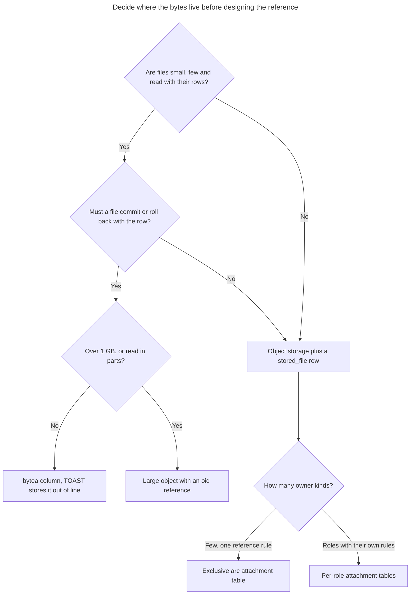
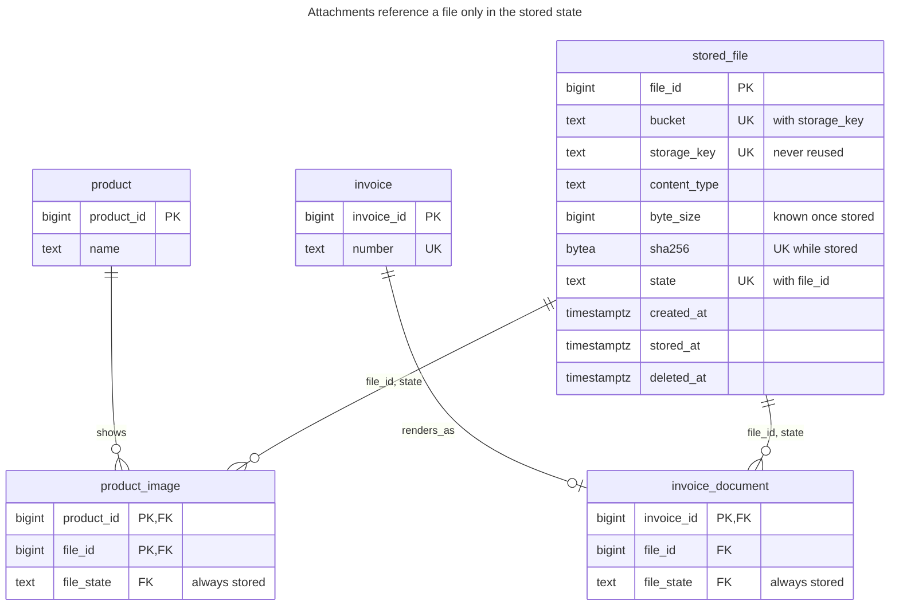
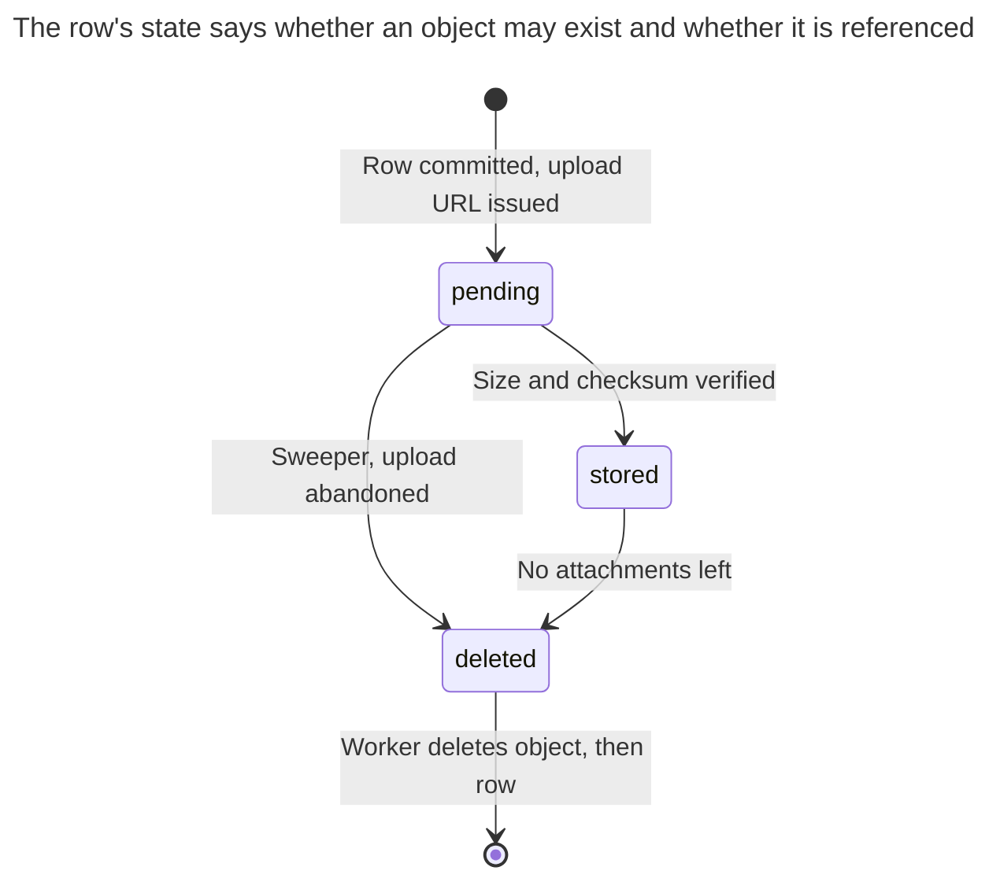
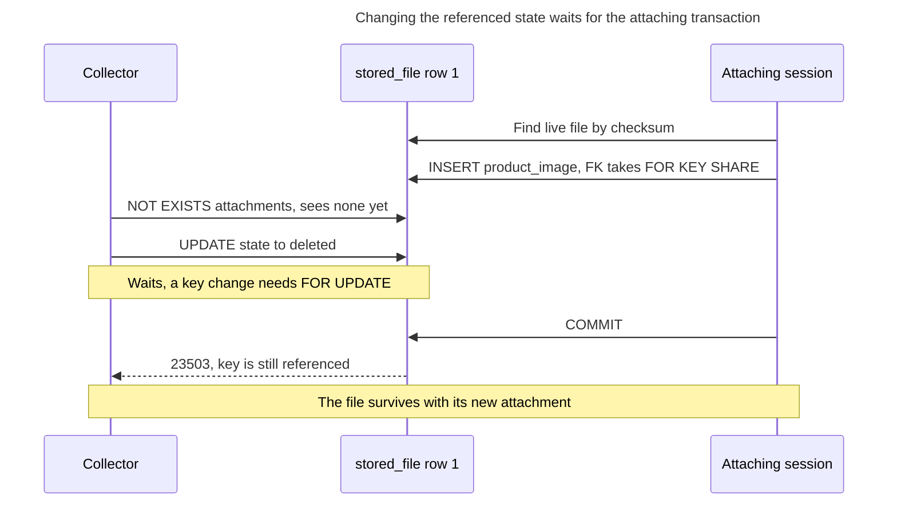
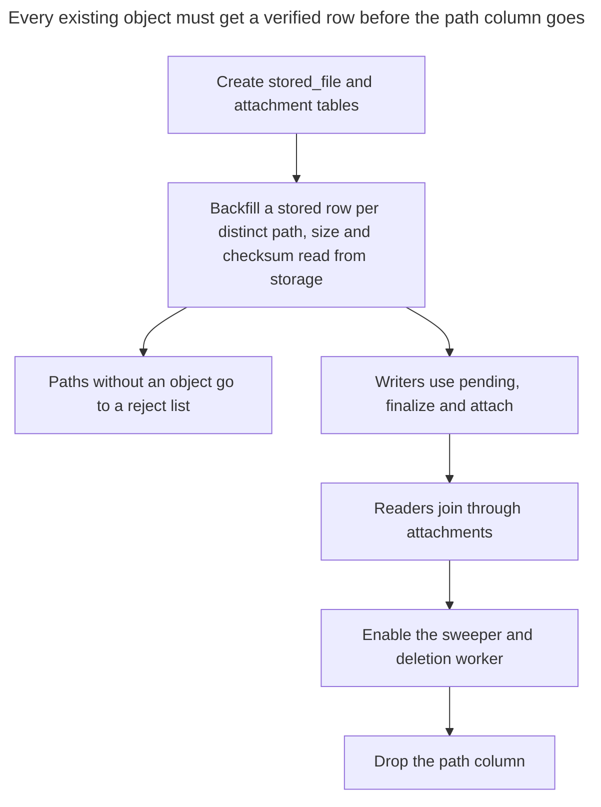

# File Reference

## Intent

A file reference keeps the bytes of an image or PDF in object storage or a filesystem and keeps a metadata row about them in the database: bucket and storage key, content type, byte size, a SHA-256 checksum, the original filename and an upload state that moves from pending to stored to deleted. Business rows attach files through typed association tables with real foreign keys, and the database row, not the bucket listing, decides whether a file is still referenced. The chapter shows how to avoid orphans in both directions, how to deduplicate by checksum without deleting a file another row has just attached, and when `bytea` or large objects inside PostgreSQL are the simpler choice. See PostgreSQL's [TOAST storage](https://www.postgresql.org/docs/18/storage-toast.html) and [large objects](https://www.postgresql.org/docs/18/largeobjects.html).

## Also known as

Blob and attachment in Rails [Active Storage](https://guides.rubyonrails.org/active_storage_overview.html#setup), whose `active_storage_blobs` table holds the metadata and `active_storage_attachments` links records to blobs. Bill Karwin's [SQL Antipatterns contents](https://pragprog.com/titles/bksap1/sql-antipatterns-volume-1/) has a related entry named Phantom Files.

## Problem

A product page shows a photo. The first schema stores `photo_path text` on `product`, and the upload handler writes the file to a bucket, then inserts the product. If the insert fails or its transaction rolls back, the object stays in the bucket and nothing points to it. Nobody knows it exists until the storage bill grows. Reversing the order does not help: the row commits, the upload fails, and the page now links to a file that was never written.

Deletion has the same two sides. Deleting the object first and then the row loses the object when the row's transaction rolls back. Deleting the row first and the object afterwards leaves the object behind when the process crashes between the two steps. A bucket and a database have no shared commit, so every order of operations leaves a window, and the schema must say which side is the authority and how the other side is repaired.

The path column causes more trouble. It carries no size, type or checksum, so the application cannot verify what it serves, detect a truncated upload or find duplicates. Reusing the same file for a second product copies the path, and deleting one product then raises the question of whether the other still needs the object. A generic attachment table keyed by `(record_type, record_id)`, as in Active Storage, answers "which files does this record have" but cannot prove that the record exists; [Polymorphic Associations](polymorphic-associations.md) explains why no foreign key can check it.

## Solution

Make the database row the authority on whether a file exists and is referenced, and let storage follow it:

- **One metadata row per stored object.** `stored_file` holds the bucket and a storage key that is generated once and never reused, the declared content type and original filename, and, once the upload is verified, the byte size and SHA-256. A `state` column moves from `pending` to `stored` to `deleted`, with a timestamp for each step.
- **Pending before upload.** Commit a `pending` row before the client receives an upload URL. If anything fails afterwards, the row records that an object may exist. A sweeper marks stale pending rows deleted, which collects uploads whose business transaction never happened.
- **Finalize conditionally.** After the upload, the server checks the object's size and checksum and runs `UPDATE ... WHERE state = 'pending'`. Zero affected rows means the sweeper won, and the client must start over.
- **Typed attachments.** Each role of a file gets its own association table, such as `product_image` or `invoice_document`, with a foreign key to the business row and a foreign key to the file. The file reference is the pair `(file_id, file_state)`, where `file_state` is always `stored`, so the database refuses to attach a pending or deleted file and refuses to mark an attached file deleted.
- **Delete through a tombstone.** Removing a file is a database change first: the attachment goes, and the file row becomes `deleted` in a transaction. A worker deletes the object after commit and then the row. Treat "object already missing" as success, so every step can be repeated.

## Alternatives and selection

| Choice | Relationship | Deciding requirement |
| --- | --- | --- |
| `bytea` column, possibly in a [Table Split](table-split.md) | Replacement | Files are small and few, you want them in the same transaction and backup as the rows, and size limits are acceptable |
| Large objects (`oid` reference) | Replacement inside PostgreSQL | Values exceed 1 GB or need partial reads and writes, and you accept managing their deletion |
| Path column on the business row | Simplification | Exactly one file per row, no deduplication, and a failed or abandoned upload costs nothing |
| One polymorphic attachment table | Replacement for the typed tables | You accept an unchecked record reference; see [Polymorphic Associations](polymorphic-associations.md) |
| [Exclusive Arc](exclusive-arc.md) attachment table | Implementation option for attachments | Few owner kinds, and one table should answer "is this file referenced" |
| Per-role [Association Tables](association-table.md) | Implementation option for attachments (shown here) | Roles carry their own rules, keys and cardinalities |
| [Queue Table](queue-table.md) or [Transactional Outbox](transactional-outbox.md) | Complement | Object deletion and other storage calls happen after commit |

See the [Decision Atlas](decision-atlas.md) for the full comparison.



The database is a fine home for bytes when the files are part of the transactional record. Object storage wins once files are large, numerous, served directly to browsers or shared with other systems, and then the attachment design is the next decision.

## Structure



A product can show many images, and one deduplicated file can appear on many products. An invoice has at most one rendered PDF, so its key is the invoice. Both attachment tables reference `stored_file` through `(file_id, state)`, backed by the unique constraint on that pair; that composite reference is what ties attachment to the file's lifecycle.

## Tables and invariants

- **`stored_file`** has a surrogate key and a unique `(bucket, storage_key)`, so two rows never claim one object. The `stored_file_content_known` check requires size, checksum and `stored_at` in the `stored` state, and `stored_file_deleted_at` ties `deleted_at` to the `deleted` state. The partial unique index `stored_file_sha256_live` allows one stored row per content hash, which is the deduplication option.
- **`product_image`** and **`invoice_document`** cascade from their business rows: deleting a product deletes its attachments, not its files. Each declares `file_state text CHECK (file_state = 'stored')` and a foreign key `(file_id, file_state)` to `stored_file (file_id, state)`. A pending or deleted file has no matching key, and an attached file cannot leave the `stored` state while the reference exists.
- **Indexes** on `file_id` in each attachment table serve the foreign-key check that runs when a file's state changes, and the sweeper's `NOT EXISTS` probes.
- **Transitions** are enforced by the writes, not by a constraint: finalize updates only `pending` rows, and nothing turns a `deleted` row back into `stored`. Add a trigger if other writers might.



`pending` means "an object may exist under this key". `deleted` means "an object may still exist and must go". Only `stored` rows can be attached, and only unattached ones can leave that state.

## When to use

- Files are larger than a few hundred kilobytes, numerous, or served directly from storage or a CDN.
- Several business rows use the same file, or you want to deduplicate identical uploads.
- Uploads go directly from the client to storage, so the database transaction cannot contain the upload.
- You must answer "which files are referenced", "how much storage does this tenant use" or "is this download intact" from the database.

## Consequences and trade-offs

- ➕ Orphans in either direction become rows in a known state, found with an indexed query instead of a bucket scan.
- ➕ Checksums and sizes let you verify uploads, detect corruption and deduplicate.
- ➕ Typed attachments keep real foreign keys at both ends, so a business row and its files are deleted and joined like any other data.
- ➖ Storage changes trail database changes. A deleted file stays in the bucket until the worker runs, and backups of the database and the bucket are taken at different moments.
- ➖ Uploads need a protocol of two requests plus a sweeper and a deletion worker, all of which must be monitored.
- ➖ Each new attachment role is a table, and "is this file referenced" must consult every one of them. An exclusive arc keeps that in one table at the cost of a column per owner kind.

## Implementation

The [complete PostgreSQL 18.7 script](../assets/file-reference/file-reference.sql) checks the pending row, the rejected attachments, finalize and deduplication, the guarded deletion, the sweeper, the deletion worker, TOAST storage of a `bytea` value and the lifecycle of large objects:

```sql
CREATE TABLE file_example.stored_file (
    file_id bigint GENERATED ALWAYS AS IDENTITY PRIMARY KEY,
    bucket text NOT NULL,
    storage_key text NOT NULL,
    original_filename text NOT NULL,
    content_type text NOT NULL,
    byte_size bigint CHECK (byte_size >= 0),
    sha256 bytea CHECK (octet_length(sha256) = 32),
    state text NOT NULL DEFAULT 'pending'
        CHECK (state IN ('pending', 'stored', 'deleted')),
    created_at timestamptz NOT NULL DEFAULT now(),
    stored_at timestamptz,
    deleted_at timestamptz,
    CONSTRAINT stored_file_location_key UNIQUE (bucket, storage_key),
    CONSTRAINT stored_file_state_key UNIQUE (file_id, state),
    CONSTRAINT stored_file_content_known CHECK (
        state <> 'stored'
        OR (byte_size IS NOT NULL AND sha256 IS NOT NULL AND stored_at IS NOT NULL)),
    CONSTRAINT stored_file_deleted_at CHECK ((state = 'deleted') = (deleted_at IS NOT NULL))
);
CREATE UNIQUE INDEX stored_file_sha256_live ON file_example.stored_file (sha256)
WHERE state = 'stored';
CREATE TABLE file_example.product_image (
    product_id bigint NOT NULL
        REFERENCES file_example.product (product_id) ON DELETE CASCADE,
    file_id bigint NOT NULL,
    file_state text NOT NULL DEFAULT 'stored' CHECK (file_state = 'stored'),
    PRIMARY KEY (product_id, file_id),
    CONSTRAINT product_image_file_fkey FOREIGN KEY (file_id, file_state)
        REFERENCES file_example.stored_file (file_id, state)
);
CREATE INDEX product_image_file_idx ON file_example.product_image (file_id);
```

Commit the pending row first; the generated key is what the client uploads to:

```sql
INSERT INTO file_example.stored_file
    (bucket, storage_key, original_filename, content_type)
VALUES ('media', 'uploads/0b8f2c1e-lamp', 'lamp.jpg', 'image/jpeg');
INSERT INTO file_example.product_image (product_id, file_id) VALUES (1, 1);
```

The attachment fails while the file is pending. PostgreSQL 18.7 raises SQLSTATE `23503`: `ERROR: insert or update on table "product_image" violates foreign key constraint "product_image_file_fkey"`, with `DETAIL: Key (file_id, file_state)=(1, stored) is not present in table "stored_file".` Marking the row stored without size and checksum fails `stored_file_content_known` with `23514`.

After the upload, the server reads the object's size and checksum from storage, not from the client, and finalizes only a row that is still pending:

```sql
UPDATE file_example.stored_file
SET state = 'stored', byte_size = 18, stored_at = now(),
    sha256 = sha256('lamp photo content'::bytea)
WHERE file_id = 1 AND state = 'pending'
RETURNING file_id;
INSERT INTO file_example.product_image (product_id, file_id) VALUES (1, 1);
```

A second upload of the same bytes cannot become a second live row: finalizing it raises `23505`, `ERROR: duplicate key value violates unique constraint "stored_file_sha256_live"`. The application marks its own pending row deleted and attaches the existing file to product 2 instead. Deduplicate only on a checksum the server computed. A client that can declare a hash could otherwise claim a file it has never seen, and in a shared bucket, scope the unique index by tenant so one tenant's upload does not reveal another's.

Now the file has two attachments. Removing the one on product 1 leaves product 2's, and the guard refuses to mark the file deleted:

```sql
DELETE FROM file_example.product_image WHERE product_id = 1 AND file_id = 1;
UPDATE file_example.stored_file SET state = 'deleted', deleted_at = now()
WHERE file_id = 1;
```

PostgreSQL 18.7 raises SQLSTATE `23503`: `ERROR: update or delete on table "stored_file" violates foreign key constraint "product_image_file_fkey" on table "product_image"`, with `DETAIL: Key (file_id, state)=(1, stored) is still referenced from table "product_image".` Deleting product 2 cascades to its attachment and leaves the file unattached.

The sweeper collects both kinds of orphans after a grace period:

```sql
UPDATE file_example.stored_file AS f
SET state = 'deleted', deleted_at = now()
WHERE (f.state = 'pending' AND f.created_at < now() - interval '1 day')
   OR (f.state = 'stored' AND f.stored_at < now() - interval '1 day'
       AND NOT EXISTS (SELECT 1 FROM file_example.product_image AS i
                       WHERE i.file_id = f.file_id)
       AND NOT EXISTS (SELECT 1 FROM file_example.invoice_document AS d
                       WHERE d.file_id = f.file_id))
RETURNING f.file_id;
```

In the lab it returns the unattached lamp photo and a two-day-old pending upload, and leaves the attached invoice PDF and a fresh pending upload alone. A late finalize of the swept upload updates zero rows. The grace period must exceed the lifetime of the upload URL you hand out; otherwise a slow client can finish its upload after the worker deleted the object, and the new object has no row. The lab's sweep is one set-based statement, so a `23503` from a file that a concurrent session just attached aborts all of it; a production sweeper selects candidates first and marks each in its own transaction or savepoint.

The alternative to a sweep is reference counting: an `attachment_count` on `stored_file`, changed in the same transaction as each attach and detach. It identifies an unreferenced file at once, but every attach writes the shared file row, which serializes attachments of popular content, and a counter that drifts from the attachment rows can be repaired only by the scan the sweep would have done.

The deletion worker claims tombstones the way a [Queue Table](queue-table.md) claims jobs, deletes each object, and then deletes the row:

```sql
SELECT file_id, bucket, storage_key FROM file_example.stored_file
WHERE state = 'deleted'
ORDER BY deleted_at, file_id
LIMIT 10
FOR UPDATE SKIP LOCKED;
-- delete each object in storage, then:
DELETE FROM file_example.stored_file WHERE file_id = ANY ($1) AND state = 'deleted';
```

Here the row locks are held across short storage calls that are safe to repeat. If the storage calls can be slow, commit the claim with a lease, as [Queue Table](queue-table.md) describes.

A crash between the storage call and the row delete repeats the storage call on the next run, so the worker must treat "not found" as done. A delete queued for a tombstone must never remove an object that a later upload wrote under the same key. With a fresh key per row, as here, that cannot happen: generate keys from a UUID or the never-reused identity value, never from the filename.

Content-addressed storage goes one step further and uses the hash as the key, so identical bytes become one object, and the key is reused by design. The pending-row protocol makes that safe. A new upload needs its row before it writes, and `UNIQUE (bucket, storage_key)` rejects that row while the tombstone of the same content still exists, as the lab shows for a tombstone's key. The worker deletes the object before the tombstone row, so by the time a new row can exist, the old delete has finished. The cost is that a re-upload of recently deleted content must wait for the purge or retry.

The same script stores a 1 MiB incompressible `bytea` value: the table's heap stays one 8 kB page and the value lands in its TOAST table. It also creates a large object inside a savepoint and rolls back, after which the object does not exist, and deletes a row holding a large object's `oid`, after which the object still exists until `lo_unlink`.

## Engine support

- **PostgreSQL 18:** a [`bytea`](https://www.postgresql.org/docs/18/datatype-binary.html) value is stored out of line by [TOAST](https://www.postgresql.org/docs/18/storage-toast.html) once a row exceeds about 2 kB, is limited to 1 GB, and most operations read or write it as a whole; updates that do not touch it do not copy it. [Large objects](https://www.postgresql.org/docs/18/lo-intro.html) live in `pg_largeobject`, reach 4 TB and support reading and writing parts. Creating a large object rolls back with the transaction, but deleting or updating the row that holds its `oid` does not delete it: the [`lo` module's `lo_manage` trigger](https://www.postgresql.org/docs/18/lo.html) unlinks on update and delete, assuming one reference per object, and [`vacuumlo`](https://www.postgresql.org/docs/18/vacuumlo.html) removes large objects no `oid` or `lo` column mentions. [`pg_dump`](https://www.postgresql.org/docs/18/app-pgdump.html) includes large objects by default but not when you dump selected schemas or tables. Both options put every byte into WAL, replicas and backups, which is the point when files must be restored with the rows and the cost when they are large.
- **MySQL 8.4:** the four [`BLOB` types](https://dev.mysql.com/doc/refman/8.4/en/blob.html) differ only in maximum length, and the largest value a client can send is bounded by `max_allowed_packet` on both client and server. The metadata table here applies unchanged.
- **SQL Server 2025 (17.x):** [`varbinary(max)`](https://learn.microsoft.com/en-us/sql/t-sql/data-types/binary-and-varbinary-transact-sql?view=sql-server-ver17) holds up to 2^31-1 bytes. On Windows, [FILESTREAM](https://learn.microsoft.com/en-us/sql/relational-databases/blob/filestream-sql-server?view=sql-server-ver17) stores a `varbinary(max)` column as files on NTFS or ReFS, keeps them transactionally consistent with the row, deletes them with it and includes them in backups. Microsoft suggests considering it when objects average more than 1 MB.
- **Oracle AI Database 26ai:** [`BLOB`](https://docs.oracle.com/en/database/oracle/oracle-database/26/sqlrf/Data-Types.html) stores binary data in the database. `BFILE` stores a locator to a read-only file on the server's filesystem; such files do not participate in transactions, so a `BFILE` is a file reference without the lifecycle this chapter adds.
- **SQLite 3:** files go into `BLOB` columns. The project's [measurements](https://www.sqlite.org/intern-v-extern-blob.html) found reads faster from the database for BLOBs under about 100 KB and faster from separate files above that.

## Failure and concurrency

Deduplication creates the hard race: one file, two owners, and one owner's deletion collecting the file while another session attaches it. The collector checks that no attachment exists and marks the file deleted. If its `NOT EXISTS` runs before the other session's attachment commits, it sees nothing, and with an ordinary `file_id` foreign key the update goes through. The new attachment then points at a file the worker is about to delete. A two-session run on PostgreSQL 18.7, outside the single-session lab, reproduced exactly that outcome with the plain reference.

The composite reference closes the window. `state` belongs to the unique constraint `(file_id, state)` that a foreign key uses, so changing it takes the `FOR UPDATE` row lock, which [conflicts with the `FOR KEY SHARE` lock](https://www.postgresql.org/docs/18/explicit-locking.html#LOCKING-ROWS) that the attaching session's foreign-key check holds until it ends.



In the opposite order, the collector's uncommitted update blocks the attaching session's foreign-key check. When the collector commits, the key `(1, stored)` no longer exists, and the insert fails with `23503`; the attaching session looks up the checksum again, finds no live file and uploads a new copy. The two-session run confirmed both orders; the lab asserts their committed equivalents, attaching a deleted file and deleting an attached one. A `NOT EXISTS` that forgets one attachment table also fails safe: the foreign key from that table still raises `23503` instead of letting the file go.

Run collection in its own transaction, one file at a time or with a savepoint per file, not inside the user's request. A detach that also tried to mark a shared file deleted would roll back the user's change whenever the race fired. Without deduplication, where every file has one owner, marking the file deleted in the same transaction as the detach is safe and avoids the grace period.

Two rules cover the storage side. Never delete an object before the transaction that marks it deleted commits: the deletion is work that the commit creates, so carry it in a [Queue Table](queue-table.md) or, when another service owns the storage, a [Transactional Outbox](transactional-outbox.md). Never let the worker's retry hit a different object: keys are unique and never reused, and the worker deletes by the key its tombstone carries. A periodic reconciliation that compares a storage listing with the table finds what both protocols missed, such as objects written by hand.

## Migration

From a `photo_path` column, create `stored_file` and the attachment table next to it. Backfill one `stored` row per distinct path, with the size and checksum read from storage, and one attachment per product. Paths that point at missing objects go to a reject list rather than becoming `stored` rows. Switch writers to the upload protocol, then readers to the attachment join, and drop the column after a compatibility window, as in [Expand and Contract](expand-contract.md).



Enable the sweeper last: until every writer creates attachments, it would collect files that the old code still references by path. From a `bytea` column, copy each value to storage under a fresh key, insert its `stored` row with the checksum computed in the database, attach it, and clear the column in batches. From a polymorphic attachment table, split rows by type into typed tables using type and ID together, as [Polymorphic Associations](polymorphic-associations.md) describes.

## Anti-patterns and common mistakes

- Uploading before any row exists, which leaves no trace of an upload whose transaction rolled back.
- Deleting the object inside or before the database transaction that removes its reference.
- Using the original filename as the storage key, or the content hash without a row that claims the key before the upload, so a queued delete can remove a later upload of the same content.
- Trusting the client's declared size, type or checksum instead of verifying the stored object.
- Attaching through a `(record_type, record_id)` pair and relying on application callbacks to clean up.
- Collecting deduplicated files with a plain `file_id` reference and a `NOT EXISTS` check, which loses the race described above.
- Storing large objects in PostgreSQL without `lo_manage` or `vacuumlo`, which accumulates unreferenced large objects as silently as a bucket accumulates orphan files.
- Setting a sweeper grace period shorter than the upload URL lifetime.

## Known uses

- Rails Active Storage keeps blob metadata (`key`, `filename`, `content_type`, `byte_size`, `checksum`, `service_name`) in `active_storage_blobs`, per its [table migration](https://github.com/rails/rails/blob/8-0-stable/activestorage/db/migrate/20170806125915_create_active_storage_tables.rb). Its `active_storage_attachments` is, in the guide's words, ["a polymorphic join table"](https://guides.rubyonrails.org/active_storage_overview.html#setup): the `blob_id` has a foreign key, and `record_type` and `record_id` have none. The guide asks you to migrate `record_type` when a model class is renamed, notes that direct uploads can leave a file that "never attaches to a record", and gives a task that [purges unattached blobs](https://guides.rubyonrails.org/active_storage_overview.html#purging-unattached-uploads) older than two days.
- Django's [`FileField`](https://docs.djangoproject.com/en/5.2/ref/models/fields/#filefield-and-fieldfile) documentation states that related files are not deleted when a model is deleted and leaves orphan cleanup to the application.
- PostgreSQL ships the `lo` module and `vacuumlo` for the same orphan problem inside the database, with large objects in place of bucket objects.

## Related patterns

- [Polymorphic Associations](polymorphic-associations.md) explains why a generic attachment table cannot check its records.
- [Exclusive Arc](exclusive-arc.md) puts all owner kinds of an attachment into one checked table.
- [Association Table](association-table.md) describes the link rows that attachments are.
- [Queue Table](queue-table.md) claims tombstones for object deletion.
- [Transactional Outbox](transactional-outbox.md) delivers storage commands when another service owns the bucket.
- [Soft Delete](soft-delete.md) discusses keeping a deleted row visible, which the `deleted` state does only until the object is gone.
- [Table Split](table-split.md) moves a `bytea` column out of a hot table when files stay in the database.
