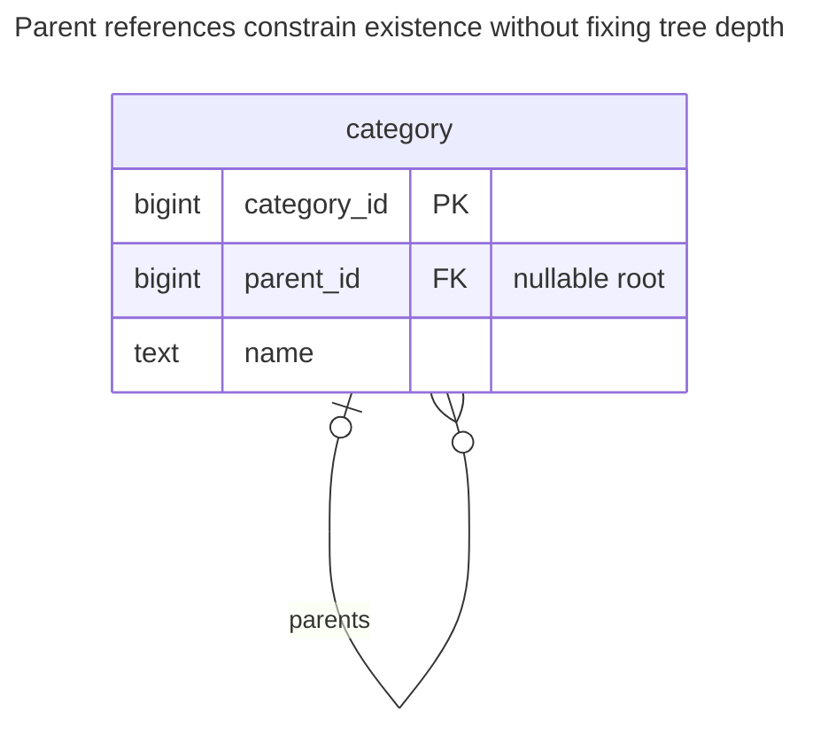
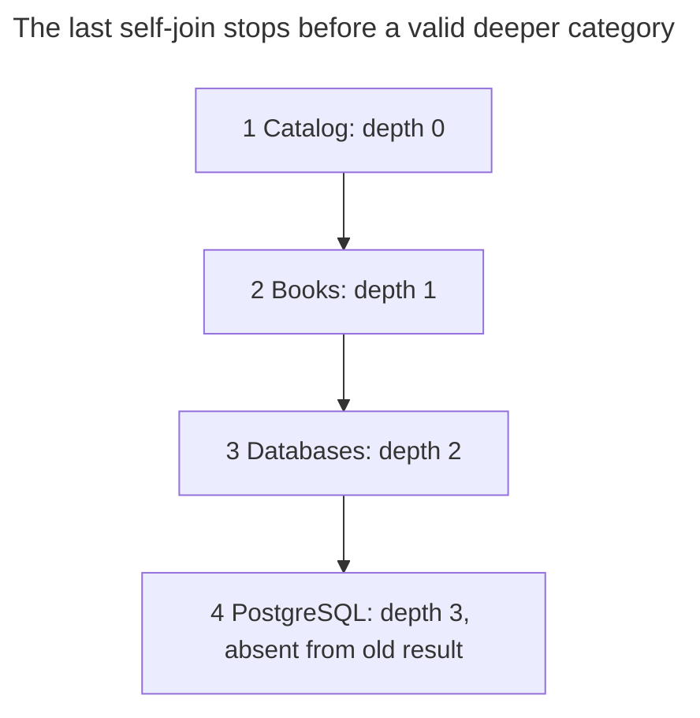
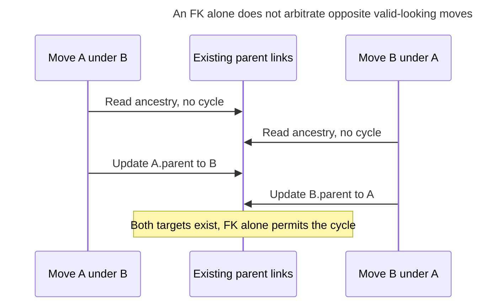
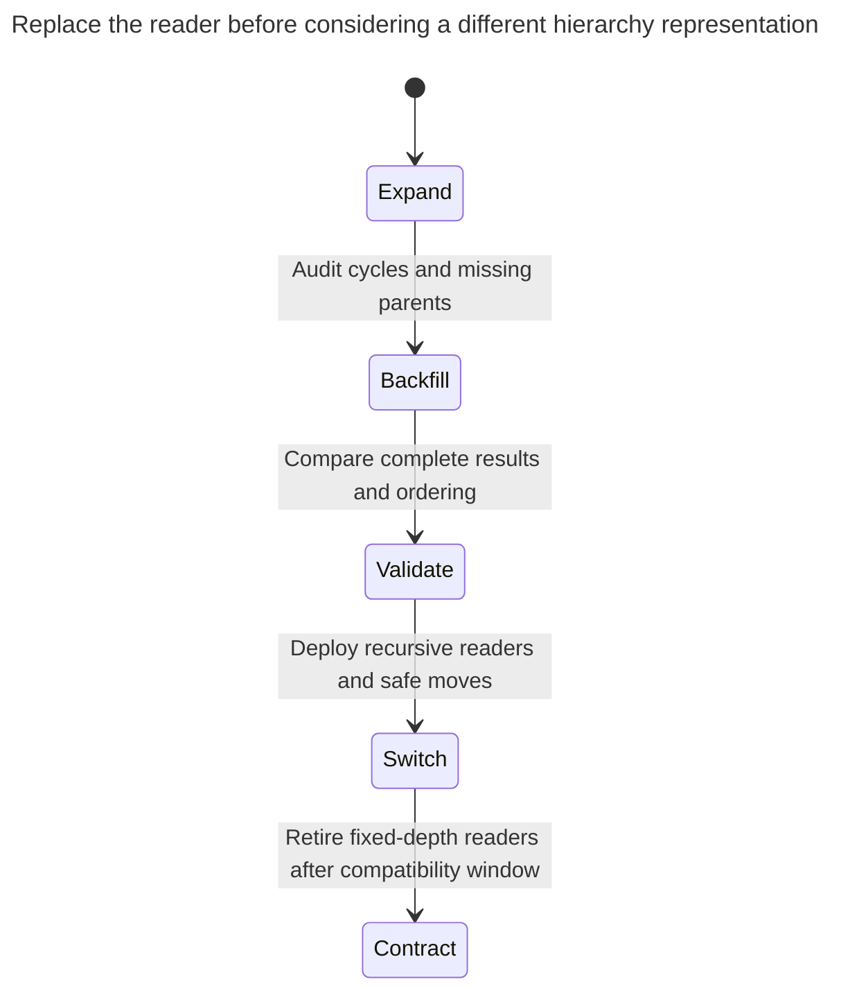

# Fixed-Depth Queries

Fixed-depth queries read a tree stored as an adjacency list with a fixed number of self-joins, one per level, on the assumption that the hierarchy will never go deeper than three or four levels. The query silently drops nodes below the last join, and every new level means rewriting it. The chapter shows how recursive CTEs remove the limit and when another tree structure fits better; the adjacency list itself is not the problem. Bill Karwin calls this Naive Trees.

## Also known as

Naive Trees, in Bill Karwin's [SQL Antipatterns contents](https://pragprog.com/titles/bksap1/sql-antipatterns-volume-1/). This chapter isolates the fixed-depth traversal mistake. The [Adjacency List](adjacency-list.md) remains a useful schema when you read it with appropriate traversal.

## Context

You store a category's parent ID in the category table. A report initially shows root, child and grandchild, so you join the table to itself twice. Editors later create a deeper branch, while the report's purpose remains “all descendants.”

## Problem

You encode today's maximum observed depth in the query without declaring that bound as a requirement. A row beyond the last join is valid data but absent from the result. Adding another join postpones the same failure. The harm is silent incompleteness, especially when the missing rows contribute to authorization, totals or deletion decisions.

A query for exactly two levels is legitimate. If your API deliberately returns children and grandchildren, a bounded self-join or explicit depth filter states the request correctly. The anti-pattern is presenting that bound as a complete traversal when the domain allows greater depth.

## Why people do it

Self-joins are familiar and make a small sample easy to inspect. A fixed-depth result also maps neatly to a screen with one column per level. Those are good reasons to return a bounded projection, but not to impose an undeclared maximum on the underlying hierarchy.

You may also confuse parent existence with tree validity. An FK checks the parent row; it does not prevent a longer cycle. Recursive traversal must handle that separate risk rather than replacing silent truncation with a nonterminating query.

## Consequences

- ➖ Deeper valid nodes disappear from supposedly complete results.
- ➖ Each new level changes query text and often the output shape.
- ➖ Subtree deletion based on a truncated result can fail or leave work incomplete.
- ➖ A fixed-depth sample conceals cycles beyond its visible horizon.
- ➖ Switching to unguarded recursion can expose malformed legacy links that the old query never followed fully.

## Signs

- The query has aliases named `parent`, `grandparent` and `great_grandparent` while claiming to return a whole tree.
- A hierarchy-depth increase requires a report release.
- Tests use only trees as shallow as the SQL text.
- Deletion or permission propagation loops over a fixed number of levels.

## A better way

Keep the parent reference and replace the traversal with a recursive CTE. PostgreSQL's [recursive query documentation](https://www.postgresql.org/docs/18/queries-with.html#QUERIES-WITH-RECURSIVE) defines an anchor plus repeated expansion; its [CYCLE clause](https://www.postgresql.org/docs/18/queries-with.html#QUERIES-WITH-CYCLE) provides a read-time cycle guard. It does not validate writes or choose a display order automatically.

### Alternatives and selection

| Sibling | Relationship | Deciding requirement |
| --- | --- | --- |
| [Adjacency List](adjacency-list.md) with recursion | Implementation option for the existing schema | Parent changes are common and traversal meets the read budget |
| [Closure Table](closure-table.md) | Replacement or maintained complement | Frequent reachability joins justify storing ancestor/descendant pairs |
| [Materialized Path](materialized-path.md) | Replacement or maintained complement | Prefix-based subtree reads justify rewriting descendant paths on moves |
| [Nested Sets](nested-sets.md) | Replacement or published read complement | Mostly static hierarchies favor interval reads over frequent renumbering |

Use the [Decision Atlas](decision-atlas.md). There is no universal depth threshold for switching storage; measure your branch sizes and read/write mix. A bounded query remains an implementation option when the bound is the actual request.

## Example

### Structure

**Before:** the schema permits more depth than the report reads.



Each category has at most one parent and can have many children. This is a forest-shaped intention; acyclicity still needs a write policy.

```sql
CREATE TABLE category (
    category_id bigint PRIMARY KEY,
    parent_id bigint,
    name text NOT NULL,
    CONSTRAINT category_parent_fk FOREIGN KEY (parent_id) REFERENCES category (category_id),
    CONSTRAINT category_not_self CHECK (parent_id <> category_id)
);
CREATE INDEX category_parent_idx ON category (parent_id);
INSERT INTO category VALUES
    (1, NULL, 'Catalog'), (2, 1, 'Books'), (3, 2, 'Databases'), (4, 3, 'PostgreSQL');
SELECT c.category_id FROM category AS c
LEFT JOIN category AS p ON p.category_id = c.parent_id
LEFT JOIN category AS gp ON gp.category_id = p.parent_id
WHERE c.category_id = 1 OR p.category_id = 1 OR gp.category_id = 1
ORDER BY c.category_id;
```

The query returns `1, 2, 3`, excluding PostgreSQL at depth `3`. All four rows are valid under the declared constraints.



The old query ends at Databases. The missing node is not an orphan; its parent exists and is already in the result.

**After:** keep the same table and make traversal data-driven.

```sql
WITH RECURSIVE subtree AS (
    SELECT category_id, parent_id, name, 0 AS depth FROM category WHERE category_id = 1
    UNION ALL
    SELECT c.category_id, c.parent_id, c.name, s.depth + 1
    FROM category AS c JOIN subtree AS s ON c.parent_id = s.category_id
) CYCLE category_id SET is_cycle USING path
SELECT category_id, name, depth FROM subtree WHERE NOT is_cycle ORDER BY path;
```

The result is `(1, Catalog, 0)`, `(2, Books, 1)`, `(3, Databases, 2)`, `(4, PostgreSQL, 3)`. `ORDER BY path` makes the presentation order explicit. No DDL or new schema is needed for this repair. `CYCLE` marks the closing repeated node and stops expanding that path; the filter excludes the marked row from normal output.

```sql
INSERT INTO category VALUES (5, 999, 'Missing parent');
```

PostgreSQL 18.6 raises SQLSTATE `23503`: `ERROR: insert or update on table "category" violates foreign key constraint "category_parent_fk"`. That checks existence, not acyclicity. The following temporary cycle is accepted by the same schema and then rolled back:

```sql
BEGIN;
LOCK TABLE category IN SHARE ROW EXCLUSIVE MODE;
UPDATE category SET parent_id = 4 WHERE category_id = 1;
WITH RECURSIVE walk AS (
    SELECT category_id, parent_id, 0 AS depth FROM category WHERE category_id = 1
    UNION ALL
    SELECT c.category_id, c.parent_id, w.depth + 1
    FROM category AS c JOIN walk AS w ON c.parent_id = w.category_id
) CYCLE category_id SET is_cycle USING path
SELECT category_id, depth, is_cycle FROM walk WHERE is_cycle;
ROLLBACK;
```

The diagnostic returns `(1, 4, true)`. Treat a detected cycle as invalid input to a tree operation, not as a successful complete result with one row hidden. The [complete script](../assets/fixed-depth-queries/fixed-depth-queries.sql) verifies both traversals, the FK error and the rolled-back cycle.

### Engine support

- **PostgreSQL 18:** [`SEARCH` and `CYCLE`](https://www.postgresql.org/docs/18/queries-with.html) can compute order keys and detect repeated nodes. A final `ORDER BY` still controls presentation.
- **MySQL 8.4:** [recursive CTEs default to a recursion-depth limit of 1000](https://dev.mysql.com/doc/refman/8.4/en/with.html). Configure an intentional bound and port the cycle guard; PostgreSQL's clause is not interchangeable syntax.
- **SQL Server:** [recursive CTEs use `WITH` without `RECURSIVE`, with `MAXRECURSION` to control the limit](https://learn.microsoft.com/en-us/sql/t-sql/queries/recursive-common-table-expression-transact-sql?view=sql-server-ver17). A safety limit that raises an error is different from silently omitting deeper nodes.
- **Oracle:** [`START WITH ... CONNECT BY` and `NOCYCLE`](https://docs.oracle.com/en/database/oracle/oracle-database/26/sqlrf/Hierarchical-Queries.html) support hierarchical traversal and cycle-aware reads. Retain a separate write-validity policy.
- **SQLite:** [recursive CTEs](https://www.sqlite.org/lang_with.html) can traverse parent links; translate the path guard and remember to [enable FKs](https://www.sqlite.org/foreignkeys.html#fk_enable).

### Failure and concurrency

A read-time guard cannot stop two structural writers from creating a cycle. If A and B are separate roots, one writer can move A below B while another moves B below A. Both can pass an unlocked ancestor pre-check against the old tree. [Adjacency List](adjacency-list.md) supplies a serialized move protocol.



This diagram shows the missing coordination, not the lab's write contract. Serialize structural writes before checking ancestry. PostgreSQL documents [self-conflicting table lock modes](https://www.postgresql.org/docs/18/explicit-locking.html#LOCKING-TABLES) that can supply a simple global boundary; a more granular protocol must cover inserts, moves and deletes consistently.

### Migration

Start with a read-only audit of missing parents and cycles. Compare old and recursive results at shallow roots, deep chains and branching trees, checking both completeness and presentation order. A query-only replacement has no row backfill; its migration is the reader contract and the structural write policy.



If deeper nodes were previously hidden from permissions or exports, resolve their intended behavior before exposing them. Keep a rollback path to the prior application version, but do not mistake its incomplete result for a valid reconciliation baseline. If recursion fails the measured budget, build and verify a sibling representation from the validated parent links before switching storage.

## Related patterns and anti-patterns

- [Adjacency List](adjacency-list.md) defines parent references and cycle-safe structural writes.
- [Closure Table](closure-table.md) stores reachability as constrained endpoint pairs.
- [Materialized Path](materialized-path.md) moves ancestry work into stored paths.
- [Nested Sets](nested-sets.md) publishes interval-based subtree reads.
