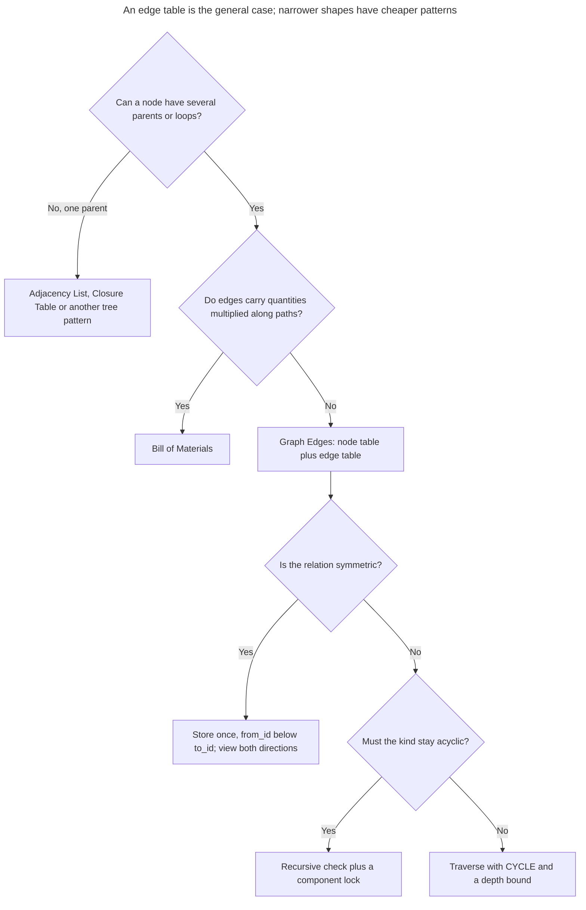
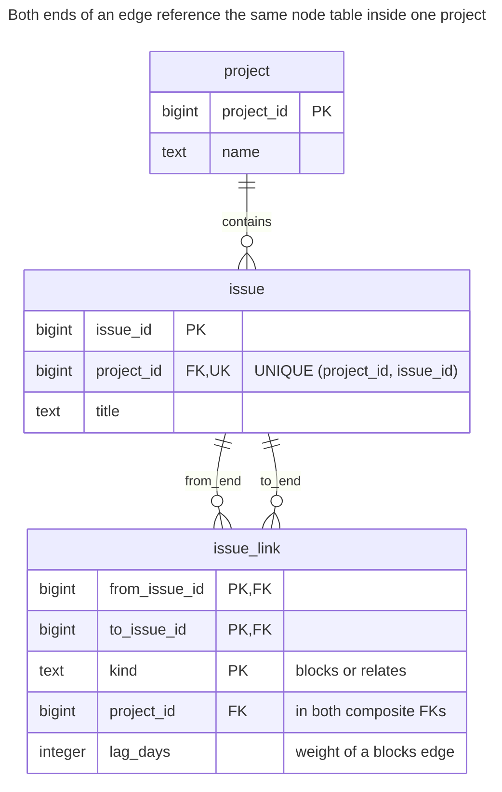
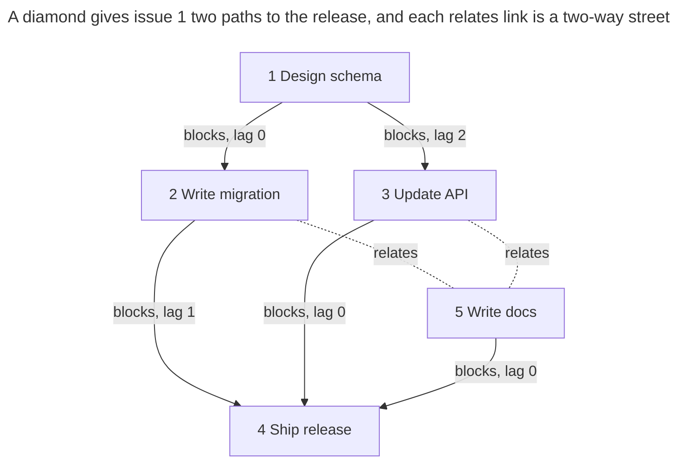
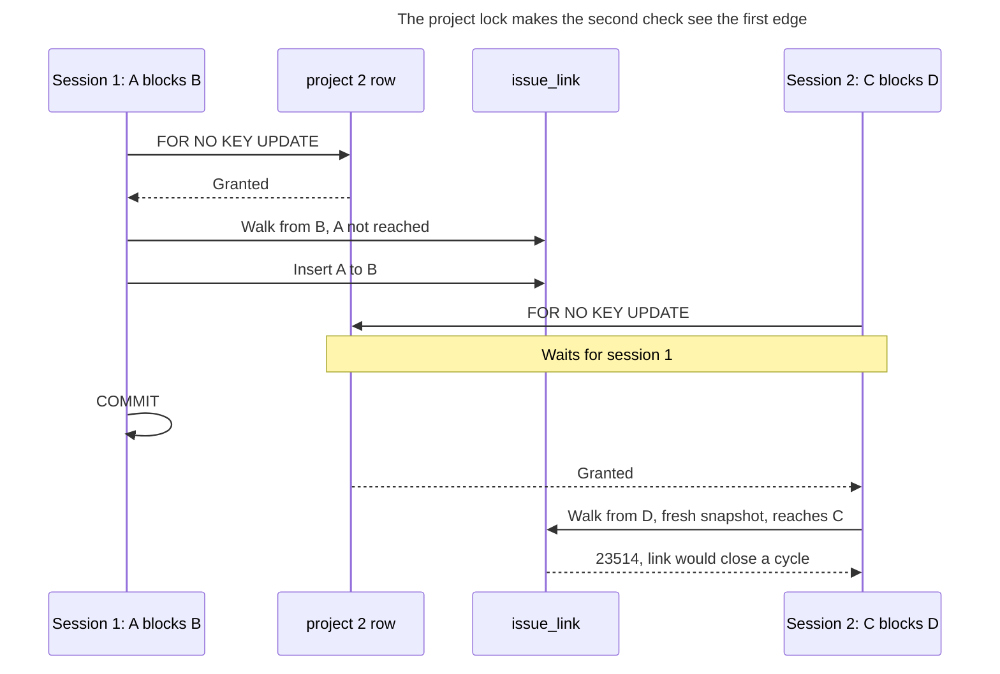
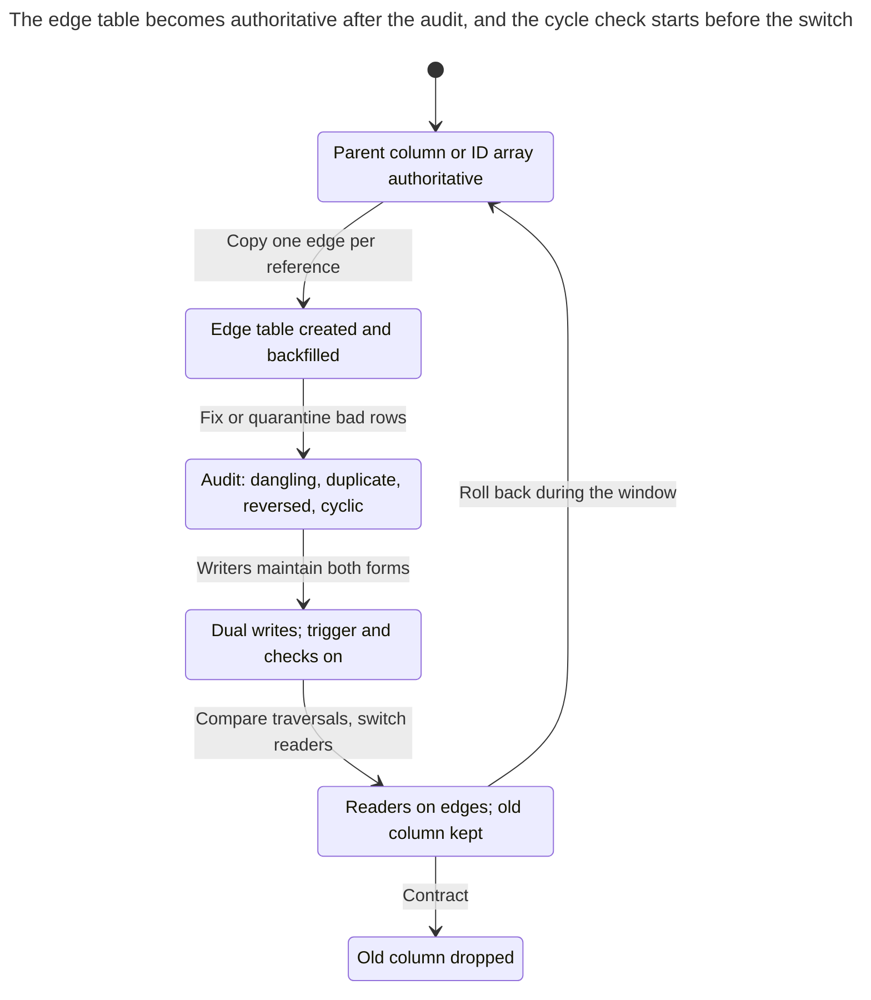

# Graph Edges

## Intent

Graph edges store a many-to-many relationship between rows of the same table as a separate edge table, one row per connection, when the connections do not form a tree. The edge table has a foreign key to the node table at each end, a composite key over the pair and its kind, and columns for the edge's own facts such as a weight. The chapter shows how row checks forbid self-loops, how a symmetric relation is stored once and read in both directions, how [`WITH RECURSIVE` with `SEARCH` and `CYCLE`](https://www.postgresql.org/docs/18/queries-with.html) traverses a graph that may loop, and how to keep a dependency graph acyclic when two sessions add edges at once.

## Also known as

Edge list; node and edge tables; self-referencing many-to-many. SQL Server's [graph tables](https://learn.microsoft.com/en-us/sql/relational-databases/graphs/sql-graph-overview?view=sql-server-ver17) call the two tables a node table and an edge table, and Oracle's [property graphs](https://docs.oracle.com/en/database/oracle/oracle-database/26/sqlrf/create-property-graph.html) call them vertex and edge tables. See also Joe Celko's *Trees and Hierarchies in SQL for Smarties*.

## Problem

Four relationships look alike in an ER sketch and differ in what they allow. Task dependencies are directed and must never loop: if A waits for B and B waits for A, neither can start. Friendship is symmetric: Ada befriending Bob is the same fact as Bob befriending Ada. Following is directed, and loops are normal: two people can follow each other. Road segments are directed (one-way streets exist) and carry a length that a route sums.

None of them fits a parent column. An issue can be blocked by several issues and block several others, so `blocked_by_id` keeps only one. An array or a comma-separated list of IDs has no foreign keys and no place for the edge's own attributes; see [Delimited Lists](delimited-lists.md). A tree representation assumes one parent per node and rejects the shape outright.

A plain link table has its own traps when both ends point to the same table. Nothing stops `(2, 5)` and `(5, 2)` from both being stored for one symmetric fact, a node linking to itself, or a dependency loop closing through three other issues. A recursive query over such data can run until it exhausts its limits, and two sessions that each validate a new edge against the old graph can together create the loop that neither saw.

## Solution

Keep nodes and edges in separate tables. The edge table has:

- **Two foreign keys to the node table**, `from_id` and `to_id`. When the graph lives inside a scope such as a project, make each foreign key composite with the scope column, so both ends provably belong to the same scope.
- **A `kind` column** when one table holds several relationships, and a composite primary key `(from_id, to_id, kind)`. Each fact is stored once.
- **Edge attributes** such as a weight, a lag or a creation time, which describe the connection rather than either node.
- **Row checks** for the shape of each kind: `from_id <> to_id` where self-loops mean nothing, and `from_id < to_id` for a symmetric kind, so each unordered pair has exactly one spelling. A view unions both directions for readers.
- **An acyclicity check** for kinds that must form a directed acyclic graph (DAG): before inserting `A → B`, walk forward from `B` and reject the edge if the walk reaches `A`. Serialize these checks by locking the graph or the component the edge belongs to, because the check reads rows the new edge does not touch.

Traverse with a recursive CTE. Put a depth bound in the recursive term, use `CYCLE` wherever the graph can loop, and decide whether the query wants every path or every reachable node.

## Alternatives and selection

| Choice | Relationship | Deciding requirement |
| --- | --- | --- |
| [Adjacency List](adjacency-list.md) | Replacement for one-parent data | Every node has at most one parent; one column replaces the edge table |
| [Closure Table](closure-table.md) | Complement: a reachability index over the edges | Reachability reads dominate and justify storing every reachable pair; DAG deletions need path-aware maintenance |
| [Bill of Materials](bill-of-materials.md) | Specialization for quantities | Each edge carries a quantity that multiplies along paths, and released structures are versioned |
| [Association Table](association-table.md) | General case across two tables | The two ends are different entities; no traversal, symmetry or cycle rule applies |
| Native graph tables or a graph database | Implementation option | Pattern queries over many hops dominate and the engine supports them; see Engine support |

See the [Decision Atlas](decision-atlas.md) for the hierarchy comparisons.



The questions are asked per kind of edge, not per table: one edge table below holds a symmetric kind and an acyclic kind side by side, each with its own checks.

## Structure



An issue tracker keeps two kinds of link between issues. `blocks` is directed and must stay acyclic; its `lag_days` is the edge's weight, the minimum wait after the blocker is done. `relates` is symmetric and may form any cycle. `project_id` appears in both composite foreign keys, so an edge cannot join issues of different projects, and the project is the component the acyclicity check locks.

## Tables and invariants

- **`issue`** is the node table. `UNIQUE (project_id, issue_id)` exists only as the target of the edges' composite foreign keys.
- **`issue_link`** holds one row per directed pair and kind. The primary key rejects a repeated edge; `issue_link_from_fk` and `issue_link_to_fk` require both ends to exist in the edge's project, and `ON DELETE CASCADE` removes the edges of a deleted issue.
- **`issue_link_no_self_loop`** rejects an issue linked to itself. Drop it for a kind where a self-loop means something, such as a state transition that stays in place.
- **`issue_link_relates_canonical`** requires `from_issue_id < to_issue_id` for `relates`, so a pair has one spelling and the primary key catches the duplicate. The `related_issue` view returns each such row in both directions.
- **`issue_link_acyclic`** is a trigger on `blocks` edges. It locks the project row and rejects an insert or update that would close a cycle. Nothing else in the schema can express this rule: it depends on rows other than the one being written.

## When to use

- A node can have several predecessors and several successors: dependencies, prerequisites, citations, follows, transport networks.
- The connection has facts of its own, such as a weight, a type or a creation time.
- You need some traversal in SQL (reachability, paths, neighborhoods a few hops deep) but the graph is an OLTP side structure, not the main workload.

## Consequences and trade-offs

- ➕ Any number of connections per node, each with its own key, foreign keys and attributes.
- ➕ Constraints express the shape of each kind: no self-loops, one spelling per symmetric pair, both ends in one scope.
- ➕ Removing an edge is a single-row delete that can never create a cycle, so it needs no graph-wide check.
- ➖ Traversal is recursive and enumerates paths, not nodes. In a DAG with many diamonds the number of paths grows exponentially with depth even when the number of nodes is small.
- ➖ Acyclicity is enforced by a trigger and a lock, not by a declarative constraint. Every writer must go through the trigger, and blocking edits in one component queue behind each other.
- ➖ Symmetric kinds put normalization on the writer: `least` and `greatest` before insert, and a union view for every reader.

## Implementation

The [complete PostgreSQL 18.7 script](../assets/graph-edges/graph-edges.sql) verifies traversal order and duplicates, reachability, the weighted chain, cycle marking, every rejected write below and an emulation of the race. The tables:

```sql
CREATE TABLE issue (
    issue_id bigint PRIMARY KEY,
    project_id bigint NOT NULL REFERENCES project (project_id),
    title text NOT NULL,
    UNIQUE (project_id, issue_id)
);
CREATE TABLE issue_link (
    project_id bigint NOT NULL,
    from_issue_id bigint NOT NULL,
    to_issue_id bigint NOT NULL,
    kind text NOT NULL CHECK (kind IN ('blocks', 'relates')),
    lag_days integer NOT NULL DEFAULT 0 CHECK (lag_days >= 0),
    PRIMARY KEY (from_issue_id, to_issue_id, kind),
    CONSTRAINT issue_link_from_fk FOREIGN KEY (project_id, from_issue_id)
        REFERENCES issue (project_id, issue_id) ON DELETE CASCADE,
    CONSTRAINT issue_link_to_fk FOREIGN KEY (project_id, to_issue_id)
        REFERENCES issue (project_id, issue_id) ON DELETE CASCADE,
    CONSTRAINT issue_link_no_self_loop CHECK (from_issue_id <> to_issue_id),
    CONSTRAINT issue_link_relates_canonical
        CHECK (kind <> 'relates' OR from_issue_id < to_issue_id),
    CONSTRAINT issue_link_lag_only_on_blocks CHECK (kind = 'blocks' OR lag_days = 0)
);
CREATE INDEX issue_link_to_idx ON issue_link (to_issue_id, kind);

CREATE VIEW related_issue AS
SELECT from_issue_id AS issue_id, to_issue_id AS related_issue_id
FROM issue_link WHERE kind = 'relates'
UNION ALL
SELECT to_issue_id, from_issue_id FROM issue_link WHERE kind = 'relates';
```

The primary key serves outgoing walks; `issue_link_to_idx` serves incoming ones. The acyclicity trigger locks the project row, then walks forward from the new edge's target:

```sql
CREATE FUNCTION reject_blocking_cycle() RETURNS trigger
LANGUAGE plpgsql SET search_path = graph_example, pg_temp AS $$
BEGIN
    IF NEW.kind <> 'blocks' OR NEW.from_issue_id = NEW.to_issue_id THEN
        RETURN NEW;
    END IF;
    PERFORM FROM project WHERE project_id = NEW.project_id FOR NO KEY UPDATE;
    IF EXISTS (
        WITH RECURSIVE downstream(issue_id) AS (
            VALUES (NEW.to_issue_id)
            UNION
            SELECT l.to_issue_id
            FROM issue_link AS l JOIN downstream AS d ON l.from_issue_id = d.issue_id
            WHERE l.kind = 'blocks'
        )
        SELECT FROM downstream WHERE issue_id = NEW.from_issue_id
    ) THEN
        RAISE EXCEPTION 'blocking link % -> % would close a cycle',
            NEW.from_issue_id, NEW.to_issue_id USING ERRCODE = '23514';
    END IF;
    RETURN NEW;
END;
$$;
CREATE TRIGGER issue_link_acyclic
BEFORE INSERT OR UPDATE OF from_issue_id, to_issue_id, kind ON issue_link
FOR EACH ROW EXECUTE FUNCTION reject_blocking_cycle();
```

`UNION` in the walk discards revisited nodes, so the check terminates and stays linear in the edges it reads. Self-loops are left to the row check, which reports them by name. [`FOR NO KEY UPDATE`](https://www.postgresql.org/docs/18/explicit-locking.html#LOCKING-ROWS) conflicts with itself but not with the `FOR KEY SHARE` lock that foreign-key checks take, so creating issues in the project is not blocked. Load a diamond and two symmetric links:

```sql
INSERT INTO issue_link (project_id, from_issue_id, to_issue_id, kind, lag_days) VALUES
    (1, 1, 2, 'blocks', 0), (1, 1, 3, 'blocks', 2),
    (1, 2, 4, 'blocks', 1), (1, 3, 4, 'blocks', 0), (1, 5, 4, 'blocks', 0);
INSERT INTO issue_link (project_id, from_issue_id, to_issue_id, kind) VALUES
    (1, 2, 5, 'relates'), (1, 3, 5, 'relates');
```



Walking upstream from issue 4 meets issue 1 once through issue 2 and once through issue 3. Walking the dotted links through the symmetric view can step from 2 to 5 and straight back to 2.

List everything that blocks the release, breadth first, with the accumulated lag:

```sql
WITH RECURSIVE upstream(issue_id, depth, lag_total) AS (
    SELECT from_issue_id, 1, lag_days
    FROM issue_link WHERE to_issue_id = 4 AND kind = 'blocks'
    UNION ALL
    SELECT l.from_issue_id, u.depth + 1, u.lag_total + l.lag_days
    FROM issue_link AS l JOIN upstream AS u ON l.to_issue_id = u.issue_id
    WHERE l.kind = 'blocks' AND u.depth < 10
) SEARCH BREADTH FIRST BY issue_id SET ord
SELECT issue_id, depth, lag_total FROM upstream ORDER BY ord;
```

The query returns five rows for four issues, in the order `2, 3, 5, 1, 1`: issue 1 appears once per path. That is what a weighted question needs: the longest lag chain in front of the release is `max(lag_total) = 2`, through issue 3. For plain reachability, group the rows: `min(depth)` per issue gives `1:2, 2:1, 3:1, 5:1`. [`SEARCH BREADTH FIRST`](https://www.postgresql.org/docs/18/queries-with.html#QUERIES-WITH-SEARCH) only computes the `ord` column; the final `ORDER BY` produces the order. `u.depth < 10` in the recursive term bounds the walk even if a cycle slipped in; an outer `LIMIT` would not, once the result is sorted or joined.

Through the symmetric view, every link is a cycle of length two. A depth limit alone lets the walk from issue 2 come back to issue 2. [`CYCLE`](https://www.postgresql.org/docs/18/queries-with.html#QUERIES-WITH-CYCLE) marks such rows and stops extending them:

```sql
WITH RECURSIVE walk(issue_id, depth) AS (
    SELECT 2::bigint, 0
    UNION ALL
    SELECT r.related_issue_id, w.depth + 1
    FROM related_issue AS r JOIN walk AS w ON r.issue_id = w.issue_id
    WHERE w.depth < 3
) CYCLE issue_id SET is_cycle USING path
SELECT issue_id, depth, path FROM walk WHERE NOT is_cycle ORDER BY path;
```

It returns issues `2, 5, 3` with paths `{(2)}`, `{(2),(5)}`, `{(2),(5),(3)}`, and marks two rows as cycles. `CYCLE` stops loops per path, not repeats across paths: in a graph with diamonds a node still appears once per simple path, so the depth bound stays.

The schema rejects the malformed edges. A self-loop:

```sql
INSERT INTO issue_link (project_id, from_issue_id, to_issue_id, kind) VALUES (1, 3, 3, 'blocks');
```

PostgreSQL 18.7 raises SQLSTATE `23514`: `ERROR: new row for relation "issue_link" violates check constraint "issue_link_no_self_loop"`, with `DETAIL: Failing row contains (1, 3, 3, blocks, 0).` The reverse spelling `(5, 2, 'relates')` of an existing symmetric link fails `issue_link_relates_canonical` with the same SQLSTATE. A writer that normalizes with `least(5, 2), greatest(5, 2)` reaches the key instead: `23505`, `ERROR: duplicate key value violates unique constraint "issue_link_pkey"`, `DETAIL: Key (from_issue_id, to_issue_id, kind)=(2, 5, relates) already exists.` An edge into another project fails `issue_link_to_fk` with `23503` and `DETAIL: Key (project_id, to_issue_id)=(1, 6) is not present in table "issue".`

Closing a loop through the diamond:

```sql
INSERT INTO issue_link (project_id, from_issue_id, to_issue_id, kind) VALUES (1, 4, 1, 'blocks');
```

The trigger raises `23514`: `ERROR: blocking link 4 -> 1 would close a cycle`. Retargeting the `5 → 4` edge to `4 → 2` with `UPDATE` fails the same way, and one `INSERT` that carries both `3 → 5` and `5 → 3` fails on its second row, because a row-level `BEFORE` trigger [sees the rows its statement processed earlier](https://www.postgresql.org/docs/18/trigger-datachanges.html). A `relates` link from 1 to 4 is accepted: the walk follows only `blocks` edges.

## Engine support

- **PostgreSQL 18:** the [`SEARCH` and `CYCLE` clauses](https://www.postgresql.org/docs/18/queries-with.html) arrived in [PostgreSQL 14](https://www.postgresql.org/docs/release/14.0/). There are no graph tables; the edge table, checks and trigger above are the whole mechanism. For shortest routes over road networks, the pgRouting extension provides [`pgr_dijkstra`](https://docs.pgrouting.org/latest/en/pgr_dijkstra.html) instead of enumerating paths with recursion.
- **MySQL 8.4:** [recursive CTEs](https://dev.mysql.com/doc/refman/8.4/en/with.html) are documented without a `SEARCH` or `CYCLE` clause; the manual suggests `UNION DISTINCT` against loops in transitive closures and bounds recursion with `cte_max_recursion_depth`, 1000 by default. When you need depth or paths, carry a path string and test membership yourself. [Check constraints](https://dev.mysql.com/doc/refman/8.4/en/create-table-check-constraints.html) cannot share columns with a foreign key's `ON DELETE` or `ON UPDATE` action, so the self-loop and canonical-order checks rule out `ON DELETE CASCADE` on these endpoints. Delete edges before their node.
- **SQL Server 2025 (17.x):** [`CREATE TABLE ... AS NODE` and `AS EDGE`](https://learn.microsoft.com/en-us/sql/relational-databases/graphs/sql-graph-overview?view=sql-server-ver17) give native node and edge tables with `$from_id` and `$to_id` columns, queried with [`MATCH`](https://learn.microsoft.com/en-us/sql/t-sql/queries/match-sql-graph?view=sql-server-ver17). By default an edge may connect any node to any node; [edge constraints](https://learn.microsoft.com/en-us/sql/relational-databases/tables/graph-edge-constraints?view=sql-server-ver17) (SQL Server 2019 and later) restrict which node tables an edge may connect and, unless declared `ON DELETE CASCADE`, block deleting a connected node, but create no index on `$from_id` and `$to_id`. [`SHORTEST_PATH`](https://learn.microsoft.com/en-us/sql/relational-databases/graphs/sql-graph-shortest-path?view=sql-server-ver17) finds an unweighted shortest path, so a road length still needs a recursive CTE or application code.
- **Oracle AI Database 26ai:** [`CREATE PROPERTY GRAPH`](https://docs.oracle.com/en/database/oracle/oracle-database/26/sqlrf/create-property-graph.html) defines a graph over existing tables, with `SOURCE KEY ... REFERENCES` and `DESTINATION KEY ... REFERENCES` naming the edge table's endpoint columns, and [`GRAPH_TABLE`](https://docs.oracle.com/en/database/oracle/oracle-database/26/sqlrf/graph_table-operator.html) queries it with `MATCH` patterns. Because `issue_link` has two foreign keys to `issue`, the mapping must name both endpoint keys explicitly. In the default `TRUSTED` mode the graph does not require the keys to be enforced constraints, so keep the foreign keys and checks on the tables.
- **SQLite 3:** [recursive CTEs](https://www.sqlite.org/lang_with.html#queries_against_a_graph) traverse an edge table; the documentation's graph example uses `UNION` to stop at revisited nodes, and the same page recommends a `LIMIT` as a safety bound. Check constraints work; enable [foreign keys](https://www.sqlite.org/foreignkeys.html) on each connection. SQLite allows one writer at a time: run the cycle check and the insert in one transaction started with [`BEGIN IMMEDIATE`](https://www.sqlite.org/lang_transaction.html), so no other writer changes the graph in between.

## Failure and concurrency

The cycle check reads edges that the new edge does not touch, so two sessions can each pass it against the same old graph. Take project 2 with `B → C` and `D → A`. Session 1 adds `A → B`, session 2 adds `C → D`. Neither sees the other's uncommitted edge, both checks pass, both commit, and the graph holds `A → B → C → D → A`. The new edges share no endpoint, so locking the rows of the issues involved would not order the two sessions. The lock has to cover the whole component: here the project row, since composite foreign keys keep every blocking edge inside one project.



Without the lock line in the trigger, both sessions commit. The lab script reproduces the outcome in one session: each edge passes the check on its own, and with the trigger disabled both are stored, accepted by every key, foreign key and check, until a `CYCLE` walk from A finds `{(6),(7),(8),(9),(6)}`. With the trigger on, the second edge is rejected.

The two-session run against PostgreSQL 18.7 shows the isolation dependency. At Read Committed, session 2 waits and then fails with `ERROR: blocking link 8 -> 9 would close a cycle`: a [volatile function takes a fresh snapshot](https://www.postgresql.org/docs/18/xfunc-volatility.html) for each query, so the walk after the wait sees session 1's commit. At Repeatable Read, session 2 waits for the same lock and then checks its transaction snapshot, which predates session 1's commit; both edges commit and the cycle is stored. At Serializable, with or without the lock, one session fails with SQLSTATE `40001`, `could not serialize access due to read/write dependencies among transactions`, and must be retried. Serializable protects only against other Serializable transactions: with session 1 at Serializable and session 2 at Read Committed the lock still serializes them, but with session 1 at Read Committed and session 2 at Serializable both edges commit. Pick one regime for every writer of blocking edges, either Read Committed with the lock or Serializable with a retry loop, and never Repeatable Read.

A component lock serializes blocking edits within one project and leaves other projects alone. If the graph has no natural scope, lock the whole edge table in `SHARE ROW EXCLUSIVE` mode in a separate statement before the insert, as [Adjacency List](adjacency-list.md) does; taking that lock inside the trigger would upgrade a lock the insert already holds and invites deadlocks. Deletes never need the lock. An uncertain commit is resolved by reading the edge by its key before retrying: the primary key makes a repeated insert fail rather than duplicate.

## Migration

The usual start is a single parent column that has to admit a second parent, or an array of predecessor IDs. Audit before enforcing: find dangling references, duplicates, reverse spellings of symmetric pairs and existing cycles. The trigger only checks new edges, so a cycle already in the data survives it. Find them with a `CYCLE` walk from every node, filtered on `is_cycle`.



Backfill symmetric pairs with `least` and `greatest`, and decide whether a reference that existed in only one direction meant a one-sided fact you are about to make mutual. Compare recursive results over the old and new forms for representative nodes before switching readers. The old column can return as long as writers keep it maintained; drop it with [Expand and Contract](expand-contract.md) once no reader uses it.

## Anti-patterns and common mistakes

- Storing a symmetric relation in both directions without a rule that keeps the two rows in step; one side gets deleted and the friendship becomes one-sided.
- A unique index on `(least(a, b), greatest(a, b))` without a canonical-order check: duplicates are rejected, but each row keeps whatever direction the writer chose, and readers still need the union view.
- Recursing with `UNION ALL` and no depth bound or `CYCLE` over a graph that can loop.
- Deduplicating paths with `UNION` or `DISTINCT` when the query sums weights along each path, or summing weights when it only needs reachability.
- Trusting the acyclicity trigger without a lock, running it at Repeatable Read, or letting writers mix isolation levels.
- Putting nodes of different types behind one `(type, id)` pair in the edge table; see [Polymorphic Associations](polymorphic-associations.md). Use one edge table per pair of node tables, or a supertype node table.

## Known uses

- Microsoft's [SQL Graph overview](https://learn.microsoft.com/en-us/sql/relational-databases/graphs/sql-graph-overview?view=sql-server-ver17) models `Person` nodes connected by a `friends` edge table with its own `StartDate`, the same node and edge split as this chapter.
- SQLite's [graph query example](https://www.sqlite.org/lang_with.html#queries_against_a_graph) stores an undirected graph as an `edge(aa, bb)` table with an index on each column and walks it in both directions.
- PostgreSQL's [cycle detection example](https://www.postgresql.org/docs/18/queries-with.html#QUERIES-WITH-CYCLE) walks a `graph` table with a `link` column and shows the hand-written path array that `CYCLE` replaces.

## Related patterns

- [Adjacency List](adjacency-list.md) is the one-parent special case and its table-lock protocol.
- [Closure Table](closure-table.md) materializes reachability; for a DAG it needs a decision about what distance means when there are several routes.
- [Bill of Materials](bill-of-materials.md) adds quantities that multiply along every path and versioned structures.
- [Association Table](association-table.md) covers link identity and attributes when the two ends are different tables.
- [Fixed-Depth Queries](fixed-depth-queries.md) explains why a fixed number of self-joins is not a traversal.
