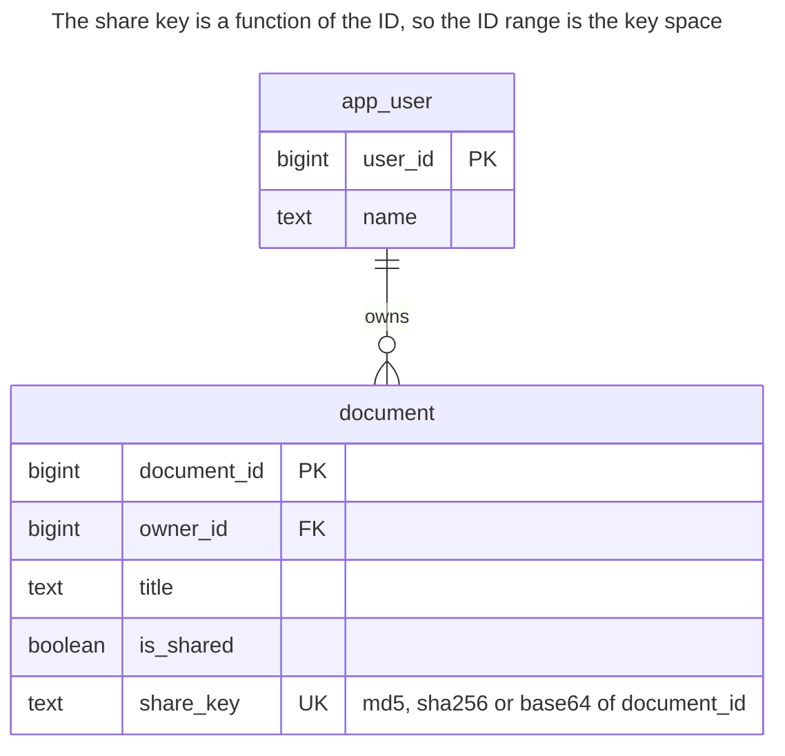
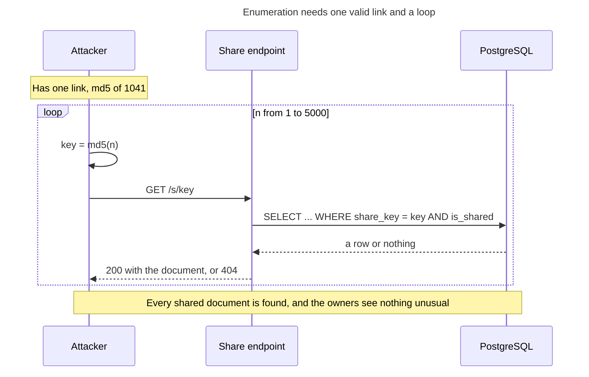
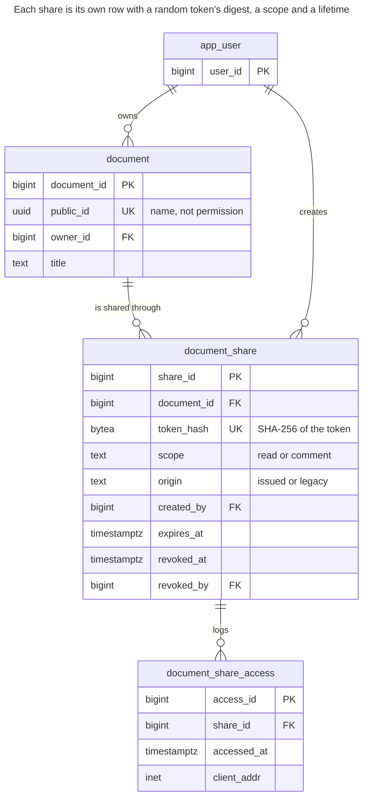
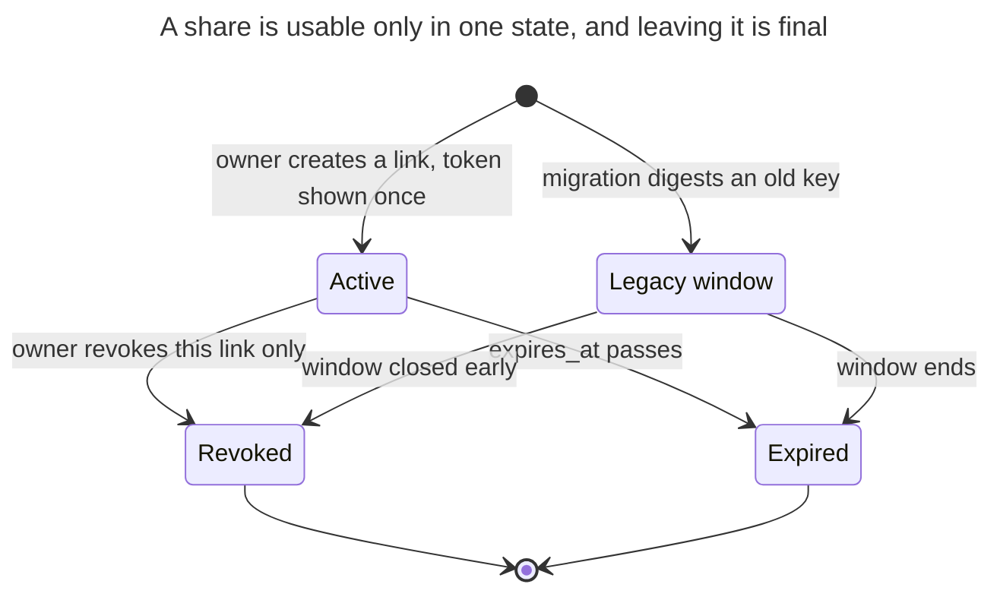
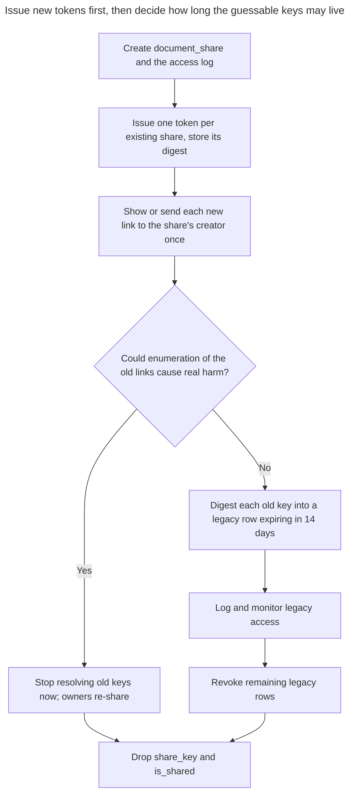

# Guessable Links

A guessable link is a public or share-by-link URL whose only secret is the object's sequential ID, or a deterministic encoding of it: `md5(id)`, `sha256(id)`, Hashids or Sqids, base64. Whoever holds one link can compute the next one, and a script can walk the whole ID range in minutes. The chapter shows why hashing or encoding an ID protects nothing, replaces the key with a random capability token per share — stored as a digest, scoped, expiring and revocable — and migrates existing links without leaving the old ones open indefinitely.

## Also known as

Insecure Direct Object Reference (IDOR) in the [OWASP cheat sheet](https://cheatsheetseries.owasp.org/cheatsheets/Insecure_Direct_Object_Reference_Prevention_Cheat_Sheet.html), and [API1:2023 Broken Object Level Authorization](https://owasp.org/API-Security/editions/2023/en/0xa1-broken-object-level-authorization/) in the OWASP API Security Top 10; both name the general failure of serving an object to whoever supplies its reference. The correct design is called a capability URL in the W3C TAG's [Good Practices for Capability URLs](https://www.w3.org/TR/capability-urls/), a 2014 First Public Working Draft that the TAG itself asks to cite only as work in progress.

## Context

Users want to send a document, an invoice or a report to someone who has no account: a client, an accountant, a colleague in another company. The product adds a "Share" button that turns the object's page into a link anyone can open, such as `/invoices/123/share` or `/docs/1042?public=1`. The link must work without a login, survive being pasted into chat and e-mail, and be fast to resolve.

## Problem

The link carries nothing the server did not already publish. In `/docs/1042?public=1` the only check is a flag on the document, and `1042` is the [surrogate key](surrogate-key.md): `1041` and `1043` are the neighbours, and some of them are shared too. Replacing the number with a function of it changes how the URL looks, not what an attacker has to do. The attacker does not need to reverse the function; it is enough to compute it forward for `1`, `2`, `3` and so on and to request each result.

- **A hash of the ID** — `md5(id)`, `sha256(id)`, with or without a fixed prefix — maps a small, ordered input space to the same number of outputs. Five thousand documents need five thousand hash computations, which take milliseconds. A secret key mixed in, properly as an HMAC, makes the function unguessable while the key stays secret, but there is still exactly one link per object, forever. You cannot expire one recipient's link or revoke it without rotating the key for every link, and a leaked key opens every object at once.
- **Base64 or hex of the ID** is an encoding; `MTA0Mw==` decodes to `1043`.
- **Hashids and Sqids** are reversible obfuscation by design. The [Sqids FAQ](https://sqids.org/faq#not-recommended) lists what it is not good for: "Any data that's sensitive. Generated IDs are not hashes and could be decoded back into numbers." A shuffled alphabet does not change that: "given enough effort, somebody could reverse-engineer your shuffled alphabet, so this is by no means a technique to hide sensitive data" ([FAQ](https://sqids.org/faq#unique)). Sqids dropped the Hashids salt parameter because it "was never meant to be associated with security or safety"; "There is no encryption of any kind" ([FAQ](https://sqids.org/faq#salt)).

## Why people do it

The object already has an ID, the route already loads it, and a flag column is one migration. Hashing feels like it adds a secret; Sqids produce short, friendly strings that look random. Nobody notices for a long time, because a legitimate recipient opening a guessed link and an attacker opening it look the same in the logs. The W3C draft makes the same point: "there is nothing to distinguish legitimate access from illegitimate access" ([§4.2](https://www.w3.org/TR/capability-urls/#detecting-compromises)).

## Consequences

- ➖ Every shared object of every user can be enumerated by anyone who sees a single link, as the lab's three encodings show.
- ➖ The link has no lifetime: a link sent to a contractor two years ago still opens today's version of the document.
- ➖ One link per object means revocation is all or nothing: to cut off one recipient, the owner unshares the object for everyone.
- ➖ There is no record of which link was used, so an incident cannot be scoped.
- ➖ Sequential or decodable keys also disclose volume: Sqids' own FAQ warns that decoded user IDs "could reveal your app's user count".

## Signs

- A share endpoint looks the object up by its primary key, or by a column computed from it.
- A column such as `share_key` has a default like `md5(id::text)`, or the application calls a Sqids/Hashids encoder to build share URLs.
- Sharing is a boolean on the object (`is_public`, `is_shared`) rather than a row per link.
- Share links have no expiry, and the only way to revoke one is to unshare the object.
- A UUID column, often UUIDv7 or a database GUID function, is presented as "unguessable" and used as the only check.

## A better way

Issue a capability token per share. The token is a separate secret, unrelated to the object's identity, and each row that stores it says what it grants and until when:

- **Random:** at least 128 bits from a cryptographically secure generator, for example 32 bytes encoded as base64url with a recognizable prefix such as `shr_`. Not a UUID: [RFC 9562 §8](https://www.rfc-editor.org/rfc/rfc9562.html#section-8) says UUIDs "MUST NOT be used as security capabilities (identifiers whose mere possession grants access)". The W3C draft still names "a UUID" as a good unguessable identifier ([§5.2](https://www.w3.org/TR/capability-urls/#capability-url-design)); the RFC, published ten years later, rules that out. A UUIDv4 carries 122 random bits. A UUIDv7 is worse: its first 48 bits are the Unix millisecond of creation (see [Time-Ordered Identifier](time-ordered-identifier.md)), at most 74 bits remain, and a generator may spend some of them on counters — the RFC calls an increment of 1 "easily guessable" ([§6.2](https://www.rfc-editor.org/rfc/rfc9562.html#section-6.2)) — or on sub-millisecond time, as PostgreSQL's [`uuidv7()`](https://www.postgresql.org/docs/18/functions-uuid.html) documents.
- **Stored as a digest:** a SHA-256 digest under a unique constraint, never the token itself — exactly the token mechanism of [Hashed Secret](hashed-secret.md), including where the hashing happens and why a fast digest suffices.
- **Scoped and bounded:** the row names the target, the scope (`read` or `comment`, never more than the share page implements), the creator, `expires_at` and `revoked_at`. The W3C draft recommends that capability URLs expire and that a user can create several per resource "so that they can revoke access through a compromised capability URL without affecting access from other capability URLs" ([§5.1](https://www.w3.org/TR/capability-urls/#application-design)).
- **Separate from the public identifier:** a [Public Identifier](public-identifier.md) is a name. It appears in logs, support tickets and authenticated URLs, it is hard to withdraw, and it grants nothing. A share token is a permission: it is shown once, can be revoked alone, and expires.

An unguessable ID is not access control. Ordinary authenticated URLs such as `/documents/{public_id}` still need an object-level authorization check on every request, whether the identifier is an integer or a random UUID; OWASP's IDOR sheet treats complex identifiers only "as a defense-in-depth measure" ([Mitigation](https://cheatsheetseries.owasp.org/cheatsheets/Insecure_Direct_Object_Reference_Prevention_Cheat_Sheet.html#mitigation)). The capability token is the authorization for the one anonymous route that accepts it, and that route serves nothing else.

### Alternatives and selection

| Choice | Relationship | Choose it when |
| --- | --- | --- |
| Exposed ID behind object-level authorization | Defensible original choice | Every viewer is logged in; the ID is a name and the check decides access |
| Capability token per share | Replacement for the guessable link | People without accounts must open the object, and owners need expiry and per-link revocation |
| Account-based grant row in an [Association Table](association-table.md) | Replacement | Recipients can sign in; the W3C draft asks first: "Could access be restricted using an account-based mechanism instead?" |
| Signed URL: HMAC over target and expiry | Implementation option | Links are short-lived, such as a download in an e-mail, and need no revocation before expiry; rotating the key revokes all of them |
| [Public Identifier](public-identifier.md) | Complement | The object needs a stable, non-sequential name in authenticated URLs; it never replaces the token |

The defensible case is real: `/invoices/123` is fine when the route requires a session and checks that the invoice belongs to the caller's account. The integer then only discloses volume and order; choose a [Public Identifier](public-identifier.md) if that matters. See the [Decision Atlas](decision-atlas.md) for the identifier family.

## Example

### Structure

**Before:**



The unique constraint on `share_key` makes each key resolve to one document, which is exactly what an enumerator wants. There is one key per document and nowhere to record an expiry, a scope or a revocation.

```sql
CREATE TABLE document (
    document_id bigint PRIMARY KEY,
    owner_id bigint NOT NULL REFERENCES app_user (user_id),
    title text NOT NULL,
    is_shared boolean NOT NULL DEFAULT false,
    share_key text UNIQUE
);
UPDATE document SET share_key = md5(document_id::text);

SELECT title FROM document WHERE share_key = $key AND is_shared;
```

An attacker effectively runs this query, one HTTP request per row of `generate_series`:

```sql
SELECT d.document_id, d.owner_id, d.title
FROM generate_series(1, 5000) AS guess(n)
JOIN document AS d ON d.share_key = md5(guess.n::text)
WHERE d.is_shared;
```

In the [lab](../assets/guessable-links/guessable-links.sql), three shared documents of two different owners use `md5`, `sha256` in hex and base64 of the ID respectively; one join over the three candidate encodings finds all three.



Each request is a valid request that the server answers as designed. Rate limiting slows the loop down, but the key space is still only as large as the ID range.

**After:**



A document can have any number of shares, each revocable on its own. `public_id` names the document in authenticated URLs and appears in no share lookup. `origin` exists only for the migration below.

```sql
CREATE TABLE document_share (
    share_id bigint GENERATED ALWAYS AS IDENTITY PRIMARY KEY,
    document_id bigint NOT NULL REFERENCES document (document_id) ON DELETE CASCADE,
    token_hash bytea NOT NULL,
    scope text NOT NULL DEFAULT 'read',
    origin text NOT NULL DEFAULT 'issued',
    created_by bigint NOT NULL REFERENCES app_user (user_id),
    created_at timestamptz NOT NULL DEFAULT now(),
    expires_at timestamptz NOT NULL,
    revoked_at timestamptz,
    revoked_by bigint REFERENCES app_user (user_id),
    CONSTRAINT document_share_token_hash_key UNIQUE (token_hash),
    CONSTRAINT document_share_token_hash_length CHECK (octet_length(token_hash) = 32),
    CONSTRAINT document_share_scope CHECK (scope IN ('read', 'comment')),
    CONSTRAINT document_share_origin CHECK (origin IN ('issued', 'legacy')),
    CONSTRAINT document_share_lifetime CHECK (
        expires_at > created_at AND expires_at <= created_at + interval '2160 hours'),
    CONSTRAINT document_share_revocation CHECK ((revoked_at IS NULL) = (revoked_by IS NULL))
);
CREATE INDEX document_share_document_idx ON document_share (document_id);
```

`expires_at` is mandatory and capped at 90 days, so "never expires" is not an option a code path can choose by omission. The cap is written as 2160 hours because adding `'90 days'` to a `timestamptz` follows the session time zone across daylight-saving transitions, and a constraint must not depend on it; see [Time Point](time-point.md). The share endpoint resolves the token, checks expiry and revocation, and logs the access in one statement. The application computes the digest; the lab calls `sha256()` only to be self-contained:

```sql
WITH hit AS (
    SELECT s.share_id, s.document_id, s.scope
    FROM document_share AS s
    WHERE s.token_hash = $token_digest
      AND s.revoked_at IS NULL
      AND s.expires_at > now()
), logged AS (
    INSERT INTO document_share_access (share_id, client_addr)
    SELECT share_id, $client_addr FROM hit
)
SELECT d.title, hit.scope FROM hit JOIN document AS d USING (document_id);
```

The lab gives document `1041` two links, one `read` link for a colleague and one `comment` link for a client. Revoking the colleague's link with `UPDATE document_share SET revoked_at = now(), revoked_by = 1 WHERE token_hash = $digest AND revoked_at IS NULL` leaves the client's link working. An expired link returns no row. Running the enumeration again — `md5`, `sha256`, base64 and the bare number for every ID up to 5000 — finds nothing.

Storing the token's own bytes instead of its digest fails with SQLSTATE `23514`: `ERROR: new row for relation "document_share" violates check constraint "document_share_token_hash_length"`. Issuing the same token twice fails with SQLSTATE `23505`: `ERROR: duplicate key value violates unique constraint "document_share_token_hash_key"`. A `write` scope or a one-year lifetime fail `document_share_scope` and `document_share_lifetime` with `23514`, and a revocation without `revoked_by` fails `document_share_revocation`. All messages are from PostgreSQL 18.7.



Nothing moves a share back to `Active`: a recipient who needs access again gets a new link with a new token. `Legacy` behaves like `Active` in the lookup, which is why it must be short.

### Engine support

Generate and hash the token in the application, for the reasons given in [Hashed Secret](hashed-secret.md), which also lists each engine's type for a 32-byte digest. If a database must generate the random bytes, use its cryptographic generator, never its UUID function:

- **PostgreSQL 18:** the core [`uuidv4()` and `uuidv7()`](https://www.postgresql.org/docs/18/functions-uuid.html) return UUIDs, which RFC 9562 rules out as capabilities. The [`pgcrypto`](https://www.postgresql.org/docs/18/pgcrypto.html#PGCRYPTO-RANDOM-DATA-FUNCS) extension's `gen_random_bytes(count)` returns "cryptographically strong random bytes", at most 1024 per call. PostgreSQL 18.7's `encode()` rejects `base64url` as an unrecognized encoding, so URL-safe encoding stays in the application anyway.
- **MySQL 8.4:** [`RANDOM_BYTES(len)`](https://dev.mysql.com/doc/refman/8.4/en/encryption-functions.html#function_random-bytes) returns bytes from "the random number generator of the SSL library", 1 to 1024 per call.
- **SQL Server 2025 (17.x):** [`CRYPT_GEN_RANDOM(length)`](https://learn.microsoft.com/en-us/sql/t-sql/functions/crypt-gen-random-transact-sql?view=sql-server-ver17) returns "a cryptographic, randomly-generated number, generated by the Crypto API". `NEWSEQUENTIALID()` is the opposite of what a token needs; see [Public Identifier](public-identifier.md).
- **Oracle AI Database 26ai:** [`DBMS_CRYPTO.RANDOMBYTES`](https://docs.oracle.com/en/database/oracle/oracle-database/26/arpls/DBMS_CRYPTO.html) returns "a cryptographically secure pseudo-random sequence of bytes".
- **SQLite 3:** [`randomblob(N)`](https://www.sqlite.org/lang_corefunc.html) is documented only as returning "pseudo-random bytes", with no cryptographic claim; generate tokens in the application.

### Failure and concurrency

Revocation is one `UPDATE`, and every lookup tests `revoked_at`, so it takes effect for every statement that starts after the revoking transaction commits. At read committed, a lookup already running keeps its snapshot and may serve one last response; a download that streams for minutes keeps streaming. If you cache successful lookups, the cache lifetime is the revocation delay. Revoking twice is harmless because the `UPDATE` requires `revoked_at IS NULL` and, as the lab checks, updates zero rows the second time.

Two links created at once cannot collide in practice with 256 random bits, and the unique digest turns the impossible case into SQLSTATE `23505` rather than one token opening two documents. A token is presented in the URL, so it lands in browser history, proxy logs and `Referer` headers; the W3C draft calls this risk "very high" ([§4.1](https://www.w3.org/TR/capability-urls/#risk-of-exposure)) and recommends HTTPS, no third-party links or scripts on the page, and `rel="noreferrer"` on any that remain. Expiry and per-link revocation are what limit the damage when, not if, a link leaks. An access row per request is a write per request; aggregate it, as [Hashed Secret](hashed-secret.md) suggests for `last_used_at`, if share traffic is heavy.

### Migration

Old links are guessable for as long as they work, so the migration is a decision about exposure, not only about compatibility.



The legacy rows reuse the same table and the same lookup, so the window closes by expiry with no code change. The lab proves the cost of the window: while the legacy rows are live, the enumeration that submits `md5(n)` as a token still finds the document whose old key was an MD5.

1. Create `document_share` and `document_share_access` next to the old columns.
2. For each document with `is_shared`, the application generates a token, inserts its digest with the owner as `created_by`, and delivers the new link to the owner once — in the share dialog or by e-mail. If your product must show a share link again later, the cheap answer is a new link per request, since links are many per object; storing tokens reversibly is the alternative [Hashed Secret](hashed-secret.md) describes for secrets you must present again.
3. Kill the old keys, or insert `sha256(old_key)` as `origin = 'legacy'` rows with a short `expires_at`. Have the share route accept both URL shapes and resolve both through the digest lookup.
4. Watch `document_share_access` for legacy rows: a burst of distinct legacy shares from one `client_addr` is enumeration in progress, and a revoke of all legacy rows is one `UPDATE`.
5. After the window, revoke what remains, drop `share_key` and `is_shared`, and remove the old route, so that old URLs answer 404 or 410 as the W3C draft recommends for expired capability URLs.

## Related patterns and anti-patterns

- [Hashed Secret](hashed-secret.md) stores the token as a digest and supplies its lifecycle columns.
- [Public Identifier](public-identifier.md) names an object without granting access; it is the defensible thing to put in authenticated URLs.
- [Surrogate Key](surrogate-key.md) is the internal identity whose sequence the guessable link exposes.
- [Time-Ordered Identifier](time-ordered-identifier.md) explains why a UUIDv7 discloses its creation time and is no token.
- [Association Table](association-table.md) models account-based grants when recipients can sign in.
