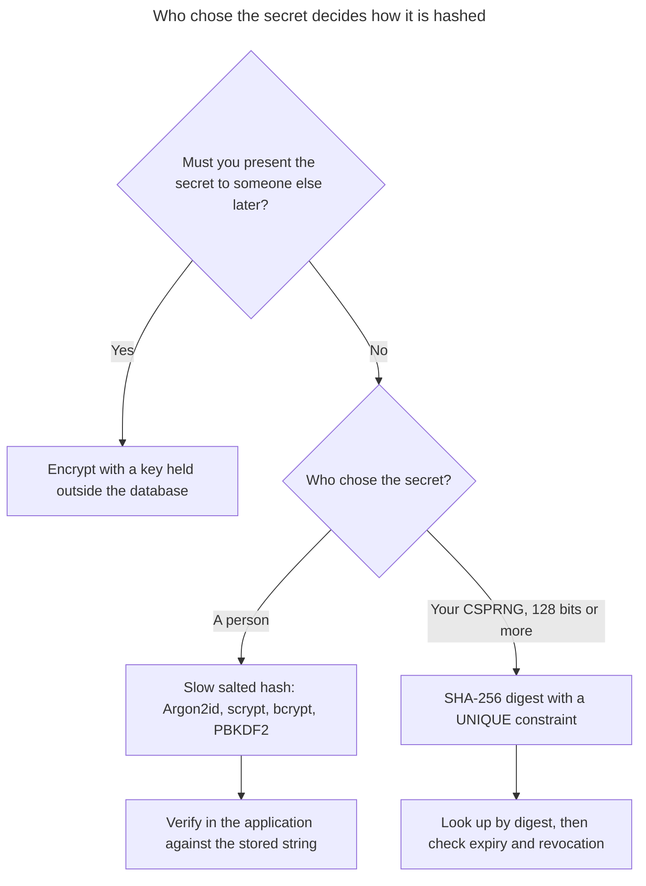
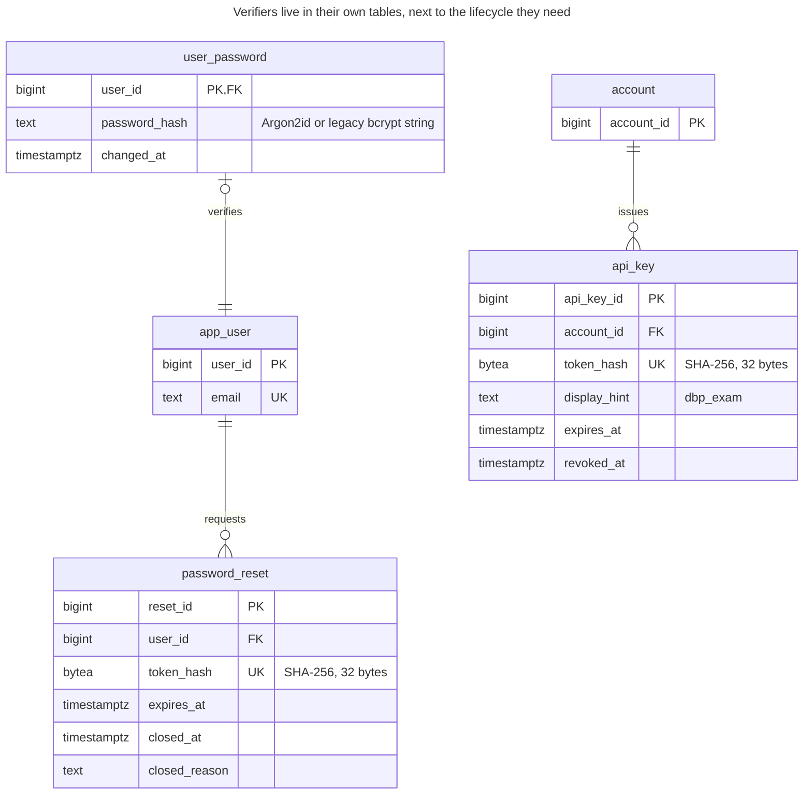
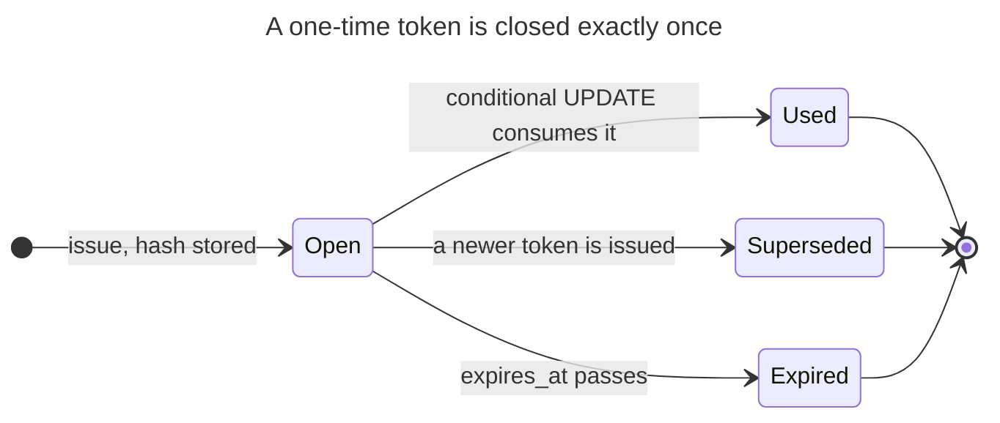
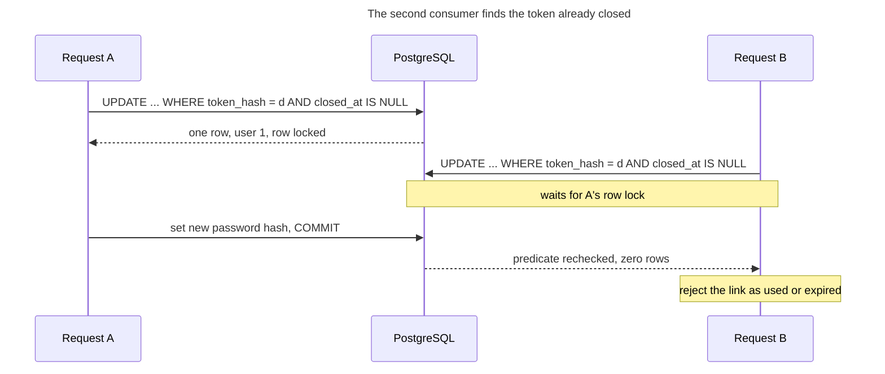

# Hashed Secret

## Intent

A hashed secret stores a verifier instead of the secret itself: whoever reads the table — a backup, a replica, a leaked dump, a support query — cannot use what they find to log in or call the API. Passwords get a slow, salted hash in a self-describing format so that the work factor can grow; random tokens such as API keys and reset links get a fast digest that doubles as an indexed lookup key. Lifecycle columns — expiry, revocation, single use — and constraints that reject anything shaped like plaintext complete the pattern.

## Also known as

Password hash; token digest; credential verifier. Bill Karwin's [*SQL Antipatterns*](https://pragprog.com/titles/bksap1/sql-antipatterns-volume-1/) calls the failure it prevents Readable Passwords, with the solution "Store a Salted Hash of the Password". [NIST SP 800-63B](https://pages.nist.gov/800-63-4/sp800-63b.html#passwordver) speaks of verifiers that store passwords "salted and hashed using a suitable password hashing scheme"; the [OWASP Password Storage Cheat Sheet](https://cheatsheetseries.owasp.org/cheatsheets/Password_Storage_Cheat_Sheet.html) gives current algorithms and parameters.

## Problem

Your users table has a `password` column, and a later feature adds `api_token` and `reset_token` next to it. Anyone who can read the table now holds working credentials: an analyst with read access, a misconfigured backup bucket, a log of slow queries that captured the `UPDATE`. Because people reuse passwords, a leak also opens their accounts elsewhere. Encryption with a key the application holds does not change this much: the application must be able to decrypt, so whoever obtains the key with the data obtains every secret.

The secrets also differ. A password is chosen by a person, is short and guessable, and must resist offline guessing after a leak. An API key or a reset token is generated by you with enough randomness that guessing is hopeless, but it is presented on every request and has to be found quickly. One hashing rule for both is either too slow for tokens or too weak for passwords.

## Solution

Never store the secret; store what is needed to check it.

- **Passwords:** the application computes a slow, salted, memory-hard hash and stores the encoded result. OWASP's minimum for Argon2id is 19 MiB of memory, two iterations and one degree of parallelism; scrypt, bcrypt with a work factor of at least 10, or PBKDF2-HMAC-SHA-256 with at least 600,000 iterations are the [fallbacks](https://cheatsheetseries.owasp.org/cheatsheets/Password_Storage_Cheat_Sheet.html). The encoding — usually the [PHC string format](https://c2sp.org/phc-strings) — names the algorithm, its parameters and the salt, so verification needs nothing else and old hashes can be recognized and upgraded at the next login. NIST likewise asks verifiers to store a reference to the hashing scheme and its cost factor with each password.
- **Random tokens:** the application generates at least 128 bits from a cryptographically secure generator, shows the token to the user once, and stores its SHA-256 digest under a unique constraint. OWASP's [Forgot Password Cheat Sheet](https://cheatsheetseries.owasp.org/cheatsheets/Forgot_Password_Cheat_Sheet.html#general-security-practices) asks for reset tokens that come from such a generator, are single-use, expire and are stored securely. A fast digest is enough because the input cannot be guessed, and an equality lookup on the digest finds the row in one index probe.
- **Lifecycle:** each token row carries `expires_at` and `revoked_at`; one-time tokens are closed by the same conditional `UPDATE` that consumes them.

Hashing happens in the application. If the database computes the hash, the plaintext travels to the server and can end up in statement logs, `pg_stat_activity` and error messages.

## Alternatives and selection

| Sibling | Relationship | Deciding requirement |
| --- | --- | --- |
| Reversible encryption of the secret | Replacement for a different requirement | You must use the secret itself later: an outgoing integration's credentials, or a webhook signing key needed to compute the HMAC; then store it encrypted under a key held outside the database |
| Slow password hash | Implementation option within this pattern | The secret is chosen by a person |
| Fast digest as lookup key | Implementation option within this pattern | The secret is random and high-entropy and must be looked up on every request |
| [Public Identifier](public-identifier.md) | Complement | A non-secret handle names the key in a UI, logs and support tickets |
| [Table Split](table-split.md) | Complement | Keep verifiers out of the wide, frequently read user row and grant access to them separately |

See the [Decision Atlas](decision-atlas.md) for identifiers. Outgoing credentials that your system must replay are not hashed secrets; that is a secrets-management problem, not a schema pattern.



The split follows the attacker's cost: guessing a person's password is cheap unless every guess is expensive, while guessing a 128-bit random token is infeasible even when each guess is fast.

## Structure



`user_password` is a one-to-one split of the user, so listing users never reads hashes. `api_key` and `password_reset` find their row by digest; the hint is a non-secret prefix that lets a person recognize a key in a list. The lab script keeps `account_id` as a plain column without an `account` table.



Every closed state is terminal, and the partial unique index `password_reset_one_open` allows only one open token per user. `Expired` is reached by time; a cleanup job may record it in `closed_reason`, but the consuming query also checks `expires_at` itself.

## Tables and invariants

- **`user_password`** holds one hash per user. `user_password_hash_format` accepts an Argon2id string in [PHC format](https://c2sp.org/phc-strings) or a legacy bcrypt string and rejects anything else, so a code path that forgot to hash fails loudly.
- **`api_key.token_hash`** is unique and exactly 32 bytes (`api_key_token_hash_length`), the length of a SHA-256 digest; storing the token's own bytes fails the check.
- **`api_key`** is usable only while `revoked_at IS NULL` and `expires_at` is absent or in the future; every lookup states both conditions.
- **`password_reset`** has a unique digest, a closing pair that is either both set or both empty, and at most one open row per user through `password_reset_one_open`.

## When to use

- You verify a secret that a person or client presents: passwords, PINs, API keys, personal access tokens, e-mail confirmation and password-reset links.
- Read access to the database is wider than the set of people who should be able to authenticate as your users.
- You want to rotate the hashing work factor without forcing everyone to reset their password.

## Consequences and trade-offs

- ➕ A leaked table yields no usable credentials for random tokens and expensive, per-user guessing for passwords.
- ➕ The stored hash string carries its own parameters, so stronger settings apply gradually at each login.
- ➕ Token lookup is one unique-index probe on a fixed-width digest.
- ➖ A lost token cannot be shown again; the user must create a new one.
- ➖ Password verification costs time and memory by design. NIST requires verifiers to [rate-limit failed attempts](https://pages.nist.gov/800-63-4/sp800-63b.html#throttle), which also keeps the cost from becoming a denial-of-service lever.
- ➖ Hashing in the application means every writer must use the same library and parameters; the format constraint catches only the crudest mistakes.
- ➖ The CHECK constraint is a last line of defense: when it rejects a row, PostgreSQL echoes the failing row, plaintext included, in the error's `DETAIL` and possibly the server log.

## Implementation

The [complete script](../assets/hashed-secret/hashed-secret.sql) checks every statement below. It calls `sha256()` in SQL only to stay self-contained; in an application, compute the digest before the query.

```sql
CREATE TABLE user_password (
    user_id bigint PRIMARY KEY REFERENCES app_user (user_id) ON DELETE CASCADE,
    password_hash text NOT NULL,
    changed_at timestamptz NOT NULL DEFAULT now(),
    CONSTRAINT user_password_hash_format CHECK (
        password_hash ~ '^\$argon2id\$v=19\$m=[0-9]+,t=[0-9]+,p=[0-9]+\$[A-Za-z0-9+/]{11,}\$[A-Za-z0-9+/]{16,}$'
        OR password_hash ~ '^\$2[aby]\$[0-9]{2}\$[./A-Za-z0-9]{53}$'
    )
);
```

The lab inserts a real Argon2id string produced by the Argon2 reference command-line tool with `m=19456,t=2,p=1` — 19 MiB of memory, two passes, one lane — and a legacy bcrypt string. A code path that writes the password itself is rejected:

```sql
UPDATE user_password SET password_hash = 'correct horse battery staple'
WHERE user_id = 1;
```

PostgreSQL 18.7 raises SQLSTATE `23514`: `ERROR: new row for relation "user_password" violates check constraint "user_password_hash_format"`. Its `DETAIL` line shows the failing row, including the plaintext, which is why this constraint is a safety net and not the place where hashing is enforced.

Find hashes that should be upgraded, and upgrade one at a successful login only if it is still the hash you verified:

```sql
SELECT user_id FROM user_password
WHERE password_hash NOT LIKE '$argon2id$v=19$m=19456,t=2,p=1$%';

UPDATE user_password
SET password_hash = $new_hash, changed_at = now()
WHERE user_id = $user_id AND password_hash = $verified_hash;
```

The first query returns user `2`, the bcrypt user. The `UPDATE` is shown with application parameters; the script uses literals. Requiring the verified hash in the predicate keeps a concurrent password change from being overwritten by the upgrade.

API keys use the digest as the key:

```sql
CREATE TABLE api_key (
    api_key_id bigint GENERATED ALWAYS AS IDENTITY PRIMARY KEY,
    account_id bigint NOT NULL,
    token_hash bytea NOT NULL,
    display_hint text NOT NULL,
    created_at timestamptz NOT NULL DEFAULT now(),
    expires_at timestamptz,
    revoked_at timestamptz,
    CONSTRAINT api_key_token_hash_key UNIQUE (token_hash),
    CONSTRAINT api_key_token_hash_length CHECK (octet_length(token_hash) = 32),
    CONSTRAINT api_key_display_hint_shape CHECK (display_hint ~ '^dbp_[a-z0-9_]{4}$')
);

SELECT account_id FROM api_key
WHERE token_hash = sha256(convert_to('dbp_example_not_a_real_key_000001', 'UTF8'))
  AND revoked_at IS NULL
  AND (expires_at IS NULL OR expires_at > now());
```

The lookup returns account `42` until the key is revoked, and nothing afterwards. Inserting `convert_to(token, 'UTF8')` instead of its digest fails `api_key_token_hash_length` with SQLSTATE `23514`. The literal is a deliberately non-random lab value; a real key is at least 128 random bits after its prefix. Give your tokens a distinctive prefix, such as `dbp_` here, so that secret scanners can recognize a leaked one. Record `last_used_at` sparingly, for example once per hour per key, so authentication does not turn every request into a write.

## Engine support

- **PostgreSQL 18:** `bytea` with [`sha256()`](https://www.postgresql.org/docs/18/functions-binarystring.html#FUNCTIONS-BINARYSTRING-OTHER) serves the lab. The [`pgcrypto`](https://www.postgresql.org/docs/18/pgcrypto.html#PGCRYPTO-CRYPT-ALGORITHMS) extension offers `crypt()` with bcrypt and SHA-crypt schemes but no Argon2id or scrypt, and its [security notes](https://www.postgresql.org/docs/18/pgcrypto.html#PGCRYPTO-NOTES-SEC-LIMITS) warn that data and passwords move between client and server in clear text; prefer application-side hashing.
- **MySQL 8.4:** store digests in [`BINARY(32)`](https://dev.mysql.com/doc/refman/8.4/en/binary-varbinary.html), where all bytes are significant in comparisons. Give password-hash strings a binary collation if you compare them, as the conditional upgrade does: [nonbinary string comparisons are case-insensitive by default](https://dev.mysql.com/doc/refman/8.4/en/case-sensitivity.html), so base64 strings that differ only in case would compare equal.
- **SQL Server 2025 (17.x):** `varbinary(32)` for digests. [`HASHBYTES`](https://learn.microsoft.com/en-us/sql/t-sql/functions/hashbytes-transact-sql?view=sql-server-ver17) supports `SHA2_256` but, like any in-database hash, brings the plaintext into the server.
- **Oracle AI Database 26ai:** `RAW(32)` for digests. [`STANDARD_HASH`](https://docs.oracle.com/en/database/oracle/oracle-database/26/sqlrf/STANDARD_HASH.html) has the same plaintext caveat, and its default algorithm is SHA-1, so name `SHA256` explicitly if you use it in a lab.
- **SQLite 3:** `BLOB` with a `CHECK (length(token_hash) = 32)`. The [core functions](https://www.sqlite.org/lang_corefunc.html) include no hash function, so the application computes the digest anyway.

## Failure and concurrency

Two clicks on the same reset link, or an attacker racing the owner, must not both succeed. Consuming the token is therefore one conditional statement, not a read followed by a write:

```sql
UPDATE password_reset
SET closed_at = now(), closed_reason = 'used'
WHERE token_hash = $digest
  AND closed_at IS NULL
  AND expires_at > now()
RETURNING user_id;
```



At read committed, the waiting `UPDATE` re-evaluates `closed_at IS NULL` on the committed row and skips it. Change the password in the same transaction that consumes the token, so a failure between the two cannot leave a consumed token and an old password, or a new password and a reusable token. Issuing a new reset closes the previous open token in the same transaction; `password_reset_one_open` turns a forgotten close into SQLSTATE `23505` rather than two live links.

Revoking an API key is a single `UPDATE`, and every lookup tests `revoked_at`, so revocation takes effect at the next request with no cache to invalidate. If you cache successful lookups, the cache lifetime becomes the revocation delay.

## Migration

From a plaintext or reversibly encrypted password column, add `user_password` and copy each password's hash in application code, in batches, then drop the old column and purge it from backups on their normal rotation. If the old values are themselves weak hashes, such as unsalted MD5, you cannot recover the passwords; wrap them instead — store `argon2id(md5_value)` marked as wrapped — and replace the wrapper with a plain Argon2id hash at each user's next login. OWASP [describes this layering](https://cheatsheetseries.owasp.org/cheatsheets/Password_Storage_Cheat_Sheet.html#upgrading-legacy-hashes) and warns that layered hashes can be easier to crack, so they are a transition, not a destination; its alternative is to expire long-inactive users' hashes and require a reset.

For tokens stored in clear, hash the existing values in place into a new `token_hash` column, switch lookups to the digest, then drop the clear column. Tokens remain valid for their owners because the digest of the same string is the same.

## Anti-patterns and common mistakes

- Storing passwords encrypted "so support can tell users their password".
- Using a fast hash such as SHA-256 or MD5, salted or not, for passwords.
- Using a slow password hash for API keys, which makes every request expensive and gains nothing against a 128-bit secret.
- Hashing in SQL with `crypt()` or `sha256()` in production, so the plaintext appears in statement logs and error messages.
- Checking a reset token with `SELECT` and closing it with a separate `UPDATE`, which lets two requests use it.
- Copying credential tables into an [Audit Log](audit-log.md) or [History Table](history-table.md) with full row images, which multiplies the places hashes live.
- Tokens without expiry and without a revocation column.

## Known uses

- GitHub's [token format announcement](https://github.blog/engineering/platform-security/behind-githubs-new-authentication-token-formats/) adds identifiable prefixes such as `ghp_` and a checksum so that leaked tokens can be detected by secret scanning with few false positives.
- Django's [password management](https://docs.djangoproject.com/en/6.1/topics/auth/passwords/#how-django-stores-passwords) stores `<algorithm>$<iterations>$<salt>$<hash>` strings and [upgrades a user's hash](https://docs.djangoproject.com/en/6.1/topics/auth/passwords/#password-upgrading) when they log in with anything other than the preferred algorithm.
- Stripe [displays a live secret key you create only once](https://docs.stripe.com/keys#reveal-an-api-key) and cannot reveal it later; its keys carry prefixes such as `sk_live_` and `rk_live_`.

## Related patterns

- [Public Identifier](public-identifier.md) names an object without granting access; a hashed secret grants access without being stored.
- [Table Split](table-split.md) keeps verifiers apart from the frequently read user row.
- [Canonical Value](canonical-value.md) normalizes the login name that the password is checked against.
- [Audit Log](audit-log.md) records who changed a credential, not the credential.
- [Guessable Links](guessable-links.md) applies the token digest to share-by-link URLs, one revocable row per link.
