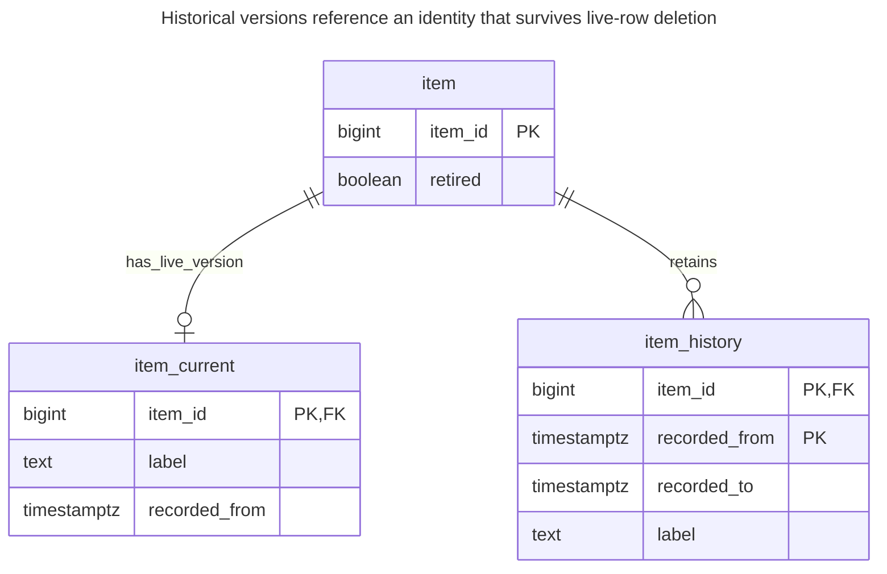
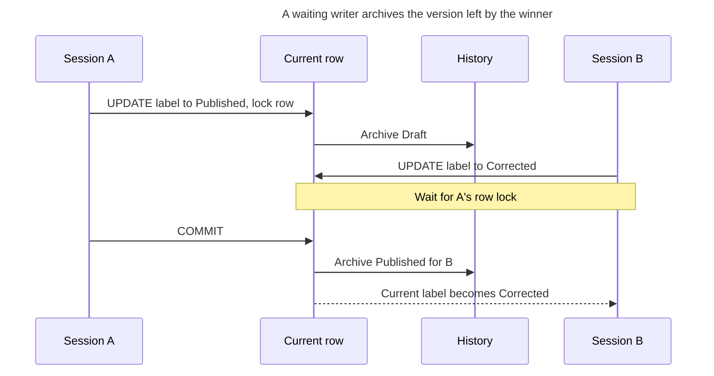
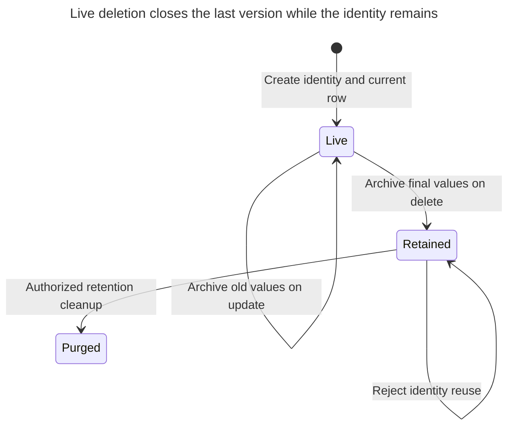
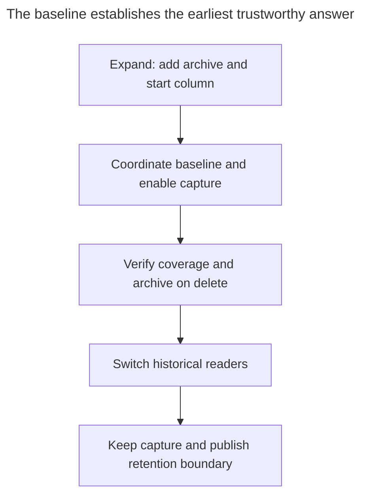

# History Table

## Intent

A history table keeps every previous version of a row together with the period during which it was current, so you can ask what a record looked like at any past moment. The chapter shows both ways to maintain it: by hand, with triggers that copy the old row on every update and delete, and with native SQL:2011 system versioning in SQL Server, MariaDB and Db2, where the database maintains the period columns and answers `FOR SYSTEM_TIME AS OF` queries. It covers what history does not record, such as who made the change, and how to keep it from growing without bound. The standard model is described by [Kulkarni and Michels](https://sigmodrecord.org/?download_id=3338&smd_process_download=1), with native implementations documented by [Microsoft](https://learn.microsoft.com/en-us/sql/relational-databases/tables/temporal/overview?view=sql-server-ver17), [MariaDB](https://mariadb.com/docs/server/reference/sql-structure/temporal-tables/system-versioned-tables) and [IBM](https://www.ibm.com/docs/en/db2-for-zos/13.0.0?topic=tables-creating-bitemporal).

## Also known as

System-versioned table when the engine maintains the versions. Fowler's [Temporal Object](https://martinfowler.com/eaaDev/TemporalObject.html) describes the related distinction between an enduring identity and its changing versions; it is an object model rather than this particular trigger implementation.

## Problem

You overwrite an item's label when an editor publishes it. A week later, support asks which label a customer saw before publication. The current row cannot answer, and a list of “item updated” actions cannot answer unless it also retained the values you need. Keeping a dated copy before each change makes this a state query instead of a reconstruction exercise.

Decide what the date means. An editor can enter a correction today for a mistake made last month. This chapter retains when you recorded each value. It does not make the correction true in the business last month, and it does not establish the exact time a transaction became visible to another session. Those are different contracts.

## Solution

Keep live values in `item_current` and closed versions in `item_history`. On each update, copy the old values with their original start and a new end, then give the current row that same boundary as its new start. On deletion, archive the last version and remove the live row. A union view presents both populations using half-open intervals: start inclusive, end exclusive. PostgreSQL's [trigger variables](https://www.postgresql.org/docs/18/plpgsql-trigger.html) provide `OLD` and `NEW` for this implementation.

Retain a small `item` identity row after deletion, so historic versions have a stable FK target. Mark that identity retired and reject reuse of a deleted ID even after history expires. This avoids confusing a newly created item with an earlier item's history. The example records every update, including a no-op, and deliberately records intermediate writes within one transaction; choose whether those processing versions are useful before adopting that policy.

## Alternatives and selection

| Sibling | Relationship | Deciding requirement |
| --- | --- | --- |
| [Effective Dating](effective-dating.md) | Replacement for the single clock | You ask when a value applies in the business, including future schedules |
| [Bitemporal Table](bitemporal-table.md) | Replacement that incorporates both models | You must reproduce what you knew at one date about another date |
| [Audit Log](audit-log.md) | Complement; replacement for occasional action investigation | You need actor, reason and request context rather than repeated state-at-time queries |
| [Status History](status-history.md) | Replacement for lifecycle-only history | You need accepted transitions and their guards, not every column version |
| [Soft Delete](soft-delete.md) | Complement | You need reversible removal; a retained final version alone does not implement restore |
| Native system versioning | Implementation option | The engine's time semantics and schema restrictions fit your contract |

See the [Decision Atlas](decision-atlas.md) for the full family comparison. Adding actor fields to versions can be useful, but it does not capture actions that leave the row unchanged or attempts that fail.

## Structure



One identity has zero or one current row and any number of closed versions. There is deliberately no FK from history to the current row: deleting the live version must preserve the archive.

## Tables and invariants

- **`item`** identifies the enduring object and retains its retirement marker independently of archived values. Keep its ID unchanged and do not delete it while retained versions refer to it.
- **`item_current`** holds the live label. Its primary key permits one live version; the trigger owns `recorded_from` and rejects identity changes.
- **`item_history`** holds closed versions, keyed by identity and start. Its check requires a positive duration. It does not independently enforce adjacency or prevent overlaps with the current table; the trigger and restricted write paths maintain that cross-table invariant.
- **`item_versions`** gives current rows a null end meaning “still current.” The as-of predicate must test both boundaries; the greatest start alone would return a deleted item after deletion.

## When to use

- Support or reports repeatedly need complete previous values for selected entities.
- Your main access path should continue reading a small current table.
- You can define which changes are captured, when recording starts and how long history remains available.

## Consequences and trade-offs

- ➕ A past-state query reads stored values rather than replaying field changes.
- ➕ Deleting a live row preserves its last recorded state.
- ➖ Every archived update writes another row and maintains its indexes. Wide frequently changed values make this expensive; measure your workload rather than assuming a fixed multiplier.
- ➖ Schema changes must preserve the meaning of both old and new versions. A newly added column does not reveal its value before you began recording it.
- ➖ Retention bounds the questions you can answer. Purging versions must also move the documented earliest supported date.

## Implementation

The [complete PostgreSQL 18.6 script](../assets/history-table/history-table.sql) checks update capture, deletion, adjacency and ID-reuse rejection. The essential schema and trigger are:

```sql
CREATE SCHEMA history_example;
CREATE TABLE history_example.item (
    item_id bigint PRIMARY KEY,
    retired boolean NOT NULL DEFAULT false
);
CREATE TABLE history_example.item_current (
    item_id bigint PRIMARY KEY REFERENCES history_example.item (item_id),
    label text NOT NULL,
    recorded_from timestamptz NOT NULL
);
CREATE TABLE history_example.item_history (
    item_id bigint REFERENCES history_example.item (item_id),
    recorded_from timestamptz NOT NULL,
    recorded_to timestamptz NOT NULL,
    label text NOT NULL,
    PRIMARY KEY (item_id, recorded_from),
    CHECK (recorded_from < recorded_to)
);
CREATE FUNCTION history_example.keep_version()
RETURNS trigger LANGUAGE plpgsql SECURITY DEFINER
SET search_path = pg_catalog, pg_temp AS $$
DECLARE
    boundary timestamptz;
BEGIN
    -- Serialize creation/reuse checks with archival of this identity.
    PERFORM 1 FROM history_example.item
    WHERE item_id = CASE WHEN TG_OP = 'INSERT' THEN NEW.item_id ELSE OLD.item_id END
    FOR UPDATE;
    IF TG_OP = 'INSERT' THEN
        IF (SELECT retired FROM history_example.item WHERE item_id = NEW.item_id) THEN
            RAISE EXCEPTION 'item identity cannot be reused'
                USING ERRCODE = '23514';
        END IF;
        NEW.recorded_from := clock_timestamp();
        RETURN NEW;
    END IF;
    IF TG_OP = 'UPDATE' AND NEW.item_id IS DISTINCT FROM OLD.item_id THEN
        RAISE EXCEPTION 'item identity is immutable' USING ERRCODE = '23514';
    END IF;
    boundary := greatest(clock_timestamp(),
                         OLD.recorded_from + interval '1 microsecond');
    INSERT INTO history_example.item_history
        (item_id, recorded_from, recorded_to, label)
    VALUES (OLD.item_id, OLD.recorded_from, boundary, OLD.label);
    IF TG_OP = 'DELETE' THEN
        UPDATE history_example.item SET retired = true WHERE item_id = OLD.item_id;
        RETURN OLD;
    END IF;
    NEW.recorded_from := boundary;
    RETURN NEW;
END;
$$;
REVOKE ALL ON FUNCTION history_example.keep_version() FROM PUBLIC;
CREATE TRIGGER keep_version BEFORE INSERT OR UPDATE OR DELETE
ON history_example.item_current
FOR EACH ROW EXECUTE FUNCTION history_example.keep_version();
CREATE VIEW history_example.item_versions AS
SELECT item_id, label, recorded_from, recorded_to
FROM history_example.item_history
UNION ALL
SELECT item_id, label, recorded_from, NULL::timestamptz
FROM history_example.item_current;
```

The security-definer function uses qualified table names and a restricted search path following PostgreSQL's [safe function guidance](https://www.postgresql.org/docs/18/sql-createfunction.html#SQL-CREATEFUNCTION-SECURITY). Deploy under a trusted owner; grant the application reads, insertion of `item_id` and `label`, updates of `label`, and deletion of current rows, plus a controlled identity-creation path. Grant no history writes, identity updates, schema creation or `TRUNCATE`. The lab runs as owner to exercise the mechanics; its revocation from `PUBLIC` is not a complete application-role deployment.

The boundary uses [`clock_timestamp()`](https://www.postgresql.org/docs/18/functions-datetime.html#FUNCTIONS-DATETIME-CURRENT), with a one-microsecond minimum advance from the previous start. This is a per-item processing clock that avoids empty intervals and backward boundaries. It is not a commit clock or a globally consistent database snapshot. A long transaction can commit later than its recorded boundary, and clock adjustment can move the synthetic boundary ahead of wall time. If you need reproducible multi-entity reports, retain an explicit report snapshot or choose a stronger recording contract.

```sql
INSERT INTO history_example.item VALUES (1);
INSERT INTO history_example.item_current (item_id, label)
VALUES (1, 'Draft');
UPDATE history_example.item_current SET label = 'Published' WHERE item_id = 1;
SELECT label FROM history_example.item_versions
WHERE item_id = 1
  AND recorded_from <= (SELECT min(recorded_from)
                       FROM history_example.item_history WHERE item_id = 1)
  AND (recorded_to IS NULL OR recorded_to >
       (SELECT min(recorded_from) FROM history_example.item_history WHERE item_id = 1));
```

The query returns `Draft`, using the first archived start as a reproducible past instant. A real request supplies its as-of instant as a bound parameter. Changing the enduring identity is invalid:

```sql
UPDATE history_example.item_current SET item_id = 2 WHERE item_id = 1;
```

PostgreSQL 18.6 raises SQLSTATE `23514`: `ERROR: item identity is immutable`. Deleting the current row afterwards leaves two archive rows, `Draft` and `Published`, and no live row. Attempting to reinsert current ID `1` then raises `23514`: `ERROR: item identity cannot be reused`.

## Engine support

- **PostgreSQL 18:** this implementation uses triggers; its [`CREATE TABLE` temporal-key syntax](https://www.postgresql.org/docs/18/sql-createtable.html) covers overlap constraints, not a declaration of automatic system versioning. Do not substitute a range key for the capture trigger.
- **MySQL 8.4 / InnoDB:** port capture through [`BEFORE`/`AFTER` row triggers with `OLD` and `NEW`](https://dev.mysql.com/doc/refman/8.4/en/create-trigger.html). MariaDB's [`WITH SYSTEM VERSIONING`](https://mariadb.com/docs/server/reference/sql-structure/temporal-tables/system-versioned-tables) is a separate engine feature, not portable MySQL syntax.
- **SQL Server 2025 (17.x):** [native temporal tables](https://learn.microsoft.com/en-us/sql/relational-databases/tables/temporal/overview?view=sql-server-ver17) maintain current and history tables and support `FOR SYSTEM_TIME AS OF`. Periods use transaction-begin time in UTC, unlike this processing-clock trigger. Its [history table cannot have a primary key](https://learn.microsoft.com/en-us/sql/relational-databases/tables/temporal/considerations-limitations?view=sql-server-ver17); do not copy the manual history DDL unchanged.
- **Oracle Database 21c:** [Flashback Time Travel](https://docs.oracle.com/en/database/oracle/oracle-database/21/adfns/flashback.html) archives changes with configured retention. Ordinary undo-backed flashback queries have a different retention dependency; choose the archive facility when designing retained application history.
- **SQLite 3:** use [row triggers](https://www.sqlite.org/lang_createtrigger.html), but coordinate writes with its [single-writer transaction model](https://www.sqlite.org/lang_transaction.html). Port timestamp representation explicitly; the PostgreSQL trigger function is not executable SQLite syntax.

## Failure and concurrency

The trigger and originating write share a transaction; [a trigger error rolls back the statement's effects](https://www.postgresql.org/docs/18/trigger-definition.html). If archiving fails, the label must not change. Do not catch that failure and retry just the current-table write through a bypass path.



At Read Committed the waiting update proceeds against the updated row under PostgreSQL's [row-lock rules](https://www.postgresql.org/docs/18/explicit-locking.html#LOCKING-ROWS). History capture preserves both writes; it does not reject a stale editor's command. Add a [Version Column](version-column.md) if that second command should fail instead of overwriting.

The trigger also locks the enduring identity, so a concurrent insert cannot pass its reuse check while deletion is archiving that identity. For compound operations, acquire identity locks before current-row writes in a consistent ID order. A direct insert contending with deletion can otherwise acquire locks in the opposite order; PostgreSQL [detects deadlocks and aborts a participant](https://www.postgresql.org/docs/18/explicit-locking.html#LOCKING-DEADLOCKS), whose whole transaction must be retried.



Deletion ends the final recorded interval. Retention cleanup is a separate maintenance capability; the example intentionally supplies no automatic purge or resurrection operation.

## Migration

Establish the recording boundary before promising historical answers. Create history storage, add a start column to live rows, and install capture together with a consistent baseline under a planned write-lock window. For a large table, stage the schema first and coordinate batched baselines with the same row locks as writers; track which rows are baselined so a late backfill cannot overwrite a newer start. A current snapshot is evidence only from its baseline time. Do not invent older periods.



The critical handoff is between baseline and capture, where an unrecorded write would create a permanent gap. Use [Expand and Contract](expand-contract.md) to retain old reads during rollout. Rolling readers back is easy; turning capture off creates a gap that must be recorded explicitly.

For growth, index the actual as-of predicates and define deletion batches or an archive policy. [Table Partitioning](table-partitioning.md) is a complement, but PostgreSQL's [partitioned uniqueness restrictions](https://www.postgresql.org/docs/18/sql-createtable.html) mean partitioning by end time would require revisiting this history primary key. Do not present partitioning as a transparent change to these invariants.

For a bounded purge, select complete expired versions and delete them in the same statement using a [data-modifying query](https://www.postgresql.org/docs/18/queries-with.html). This lab derives its cutoff from the first closed version to demonstrate deleting `Draft` while retaining `Published`; a service supplies its configured retention cutoff instead:

```sql
WITH cutoff AS (
    SELECT min(recorded_to) AS retain_from FROM history_example.item_history
), expired AS (
    SELECT item_id, recorded_from FROM history_example.item_history, cutoff
    WHERE recorded_to <= retain_from ORDER BY recorded_to LIMIT 1000
)
DELETE FROM history_example.item_history AS h USING expired AS e
WHERE h.item_id = e.item_id AND h.recorded_from = e.recorded_from;
```

Expire by end time: a version that began before the cutoff may still be the answer at the cutoff. Publish the earliest supported as-of time alongside this maintenance policy. Keep the retired identity marker even if all its value versions eventually expire.

## Anti-patterns and common mistakes

- Giving history a foreign key to the live row, then cascading away the evidence on deletion.
- Recording versions in a separate application transaction or allowing a bulk loader to bypass capture.
- Calling the processing timestamp the transaction's commit time, or treating histories of unrelated rows as one consistent past snapshot.
- Granting `TRUNCATE` while relying on a row-level delete trigger. PostgreSQL distinguishes [statement-level truncation triggers from row events](https://www.postgresql.org/docs/18/trigger-definition.html).
- Retaining everything indefinitely without specifying which old answers may expire or which sensitive values must be removed.

## Known uses

- Microsoft's [system-versioned temporal table example](https://learn.microsoft.com/en-us/sql/relational-databases/tables/temporal/overview?view=sql-server-ver17) retains old employee rows automatically; it implements the native capture option.
- MariaDB's [system-versioned tables](https://mariadb.com/docs/server/reference/sql-structure/temporal-tables/system-versioned-tables) expose historical querying through `FOR SYSTEM_TIME`.
- IBM's [Db2 13 for z/OS bitemporal example](https://www.ibm.com/docs/en/db2-for-zos/13.0.0?topic=tables-creating-bitemporal) links a current table to history through `ADD VERSIONING USE HISTORY TABLE`; its system-time component is the history-table mechanism.

## Related patterns

- [Effective Dating](effective-dating.md) gives periods business meaning.
- [Bitemporal Table](bitemporal-table.md) preserves earlier beliefs about business periods.
- [Audit Log](audit-log.md) adds attributable actions and request context.
- [Status History](status-history.md) records accepted lifecycle transitions.
- [Soft Delete](soft-delete.md) keeps a deleted object in the live schema for restoration.
- [Version Column](version-column.md) detects stale writes rather than merely remembering them.
- [Table Partitioning](table-partitioning.md) helps manage retained history after revisiting key scope.
