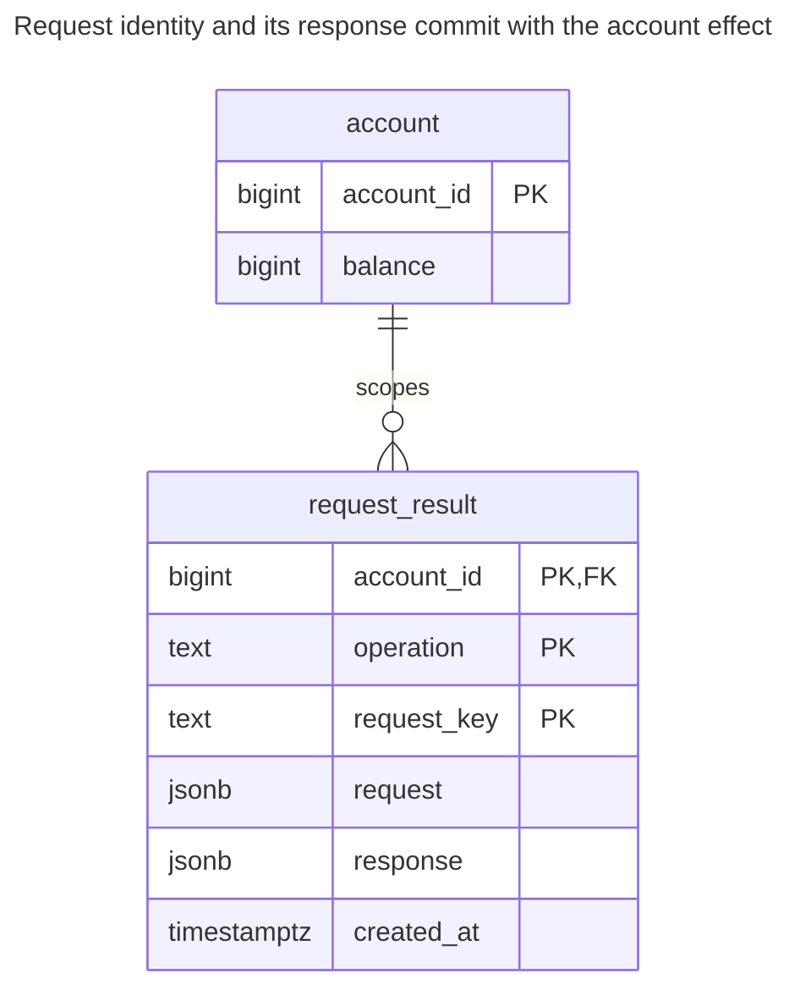
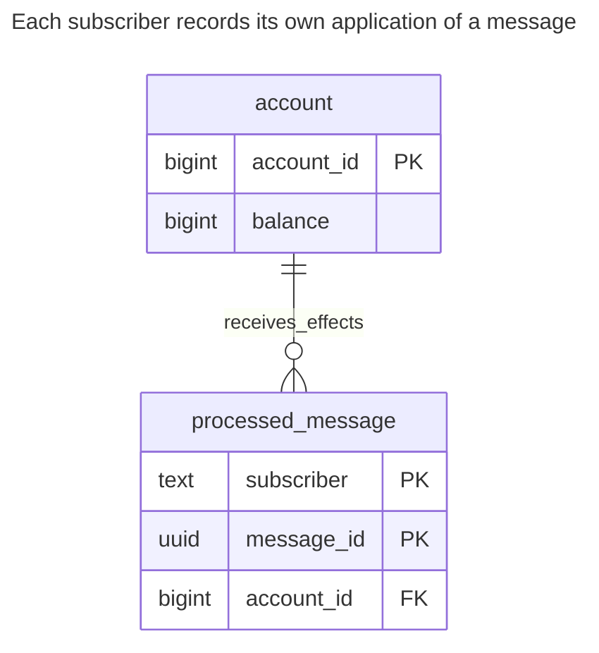
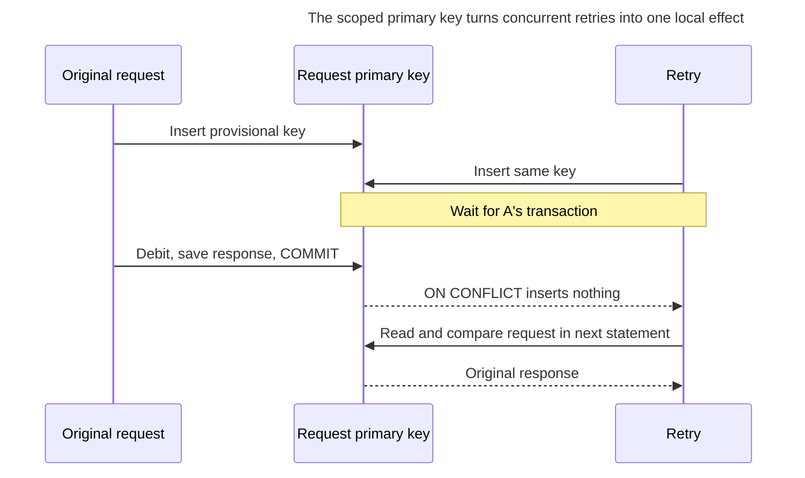
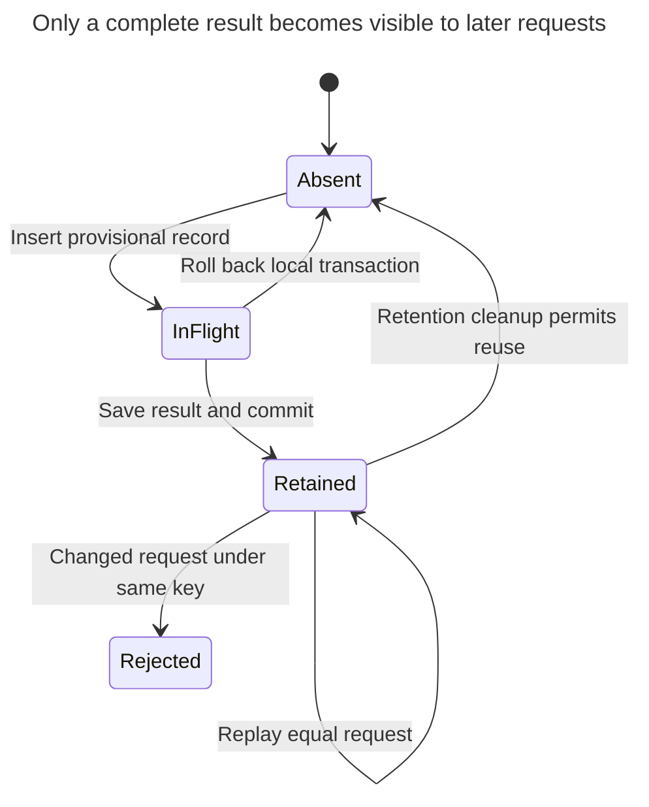

# Idempotency Record

## Intent

An idempotency record makes a retried operation safe: the client sends a unique key with the request, and the server stores the key and the result in the same transaction as the effect. A repeated request with the same key returns the stored result instead of charging the card twice. The chapter shows the table, the unique constraint that settles races between concurrent retries, how long to keep keys, how to detect a key reused for a different request, and the consumer-side variant that records processed message IDs.

## Also known as

Idempotency-key table; request-result record. The consumer-side form is Richardson's [Idempotent Consumer](https://microservices.io/patterns/communication-style/idempotent-consumer.html), which records processed message identities rather than client response bodies.

## Problem

You commit a debit and lose the connection before the client receives the response. The client cannot tell whether nothing happened or the debit succeeded. Repeating the debit blindly can subtract twice; refusing all retries leaves the caller unable to recover a definite result.

A key stored after committing the debit leaves the same crash gap. A key stored before it in a separate transaction can suppress a debit that never happened. A unique key alone also cannot tell whether the caller accidentally reused it for a different amount.

## Solution

Scope the key by authenticated account and operation contract. Store the normalized request and final response with that key, committing them in the same transaction as the local business effect. Let a primary key arbitrate concurrent attempts. The winner performs the effect and saves the result; the loser compares requests and returns the original saved result or rejects the mismatch.

The example debits a local balance in integer units; it does not call a card processor. The opening's card-charge goal needs additional cooperation when the effect is outside your database: send a stable provider idempotency key, retain recovery state, or stage a command in a [Transactional Outbox](transactional-outbox.md). A local record cannot roll back an external charge. [Brandur Leach's implementation](https://brandur.org/idempotency-keys) separates local atomic phases from foreign mutations for precisely that boundary.

## Alternatives and selection

| Sibling or mechanism | Relationship | Deciding requirement |
| --- | --- | --- |
| Unique business reference on the effect row | Replacement for a smaller contract | Finding the existing effect suffices; you can validate its original parameters without storing a complete response |
| [Version Column](version-column.md) | Complement | Reject commands based on obsolete state; a changed version alone cannot identify which request changed it |
| [Transactional Outbox](transactional-outbox.md) | Complement | A committed local command must eventually reach another system |
| [Queue Table](queue-table.md) | Complement | Execution is asynchronous and may recur after lease expiry |
| [Double-Entry Ledger](double-entry-ledger.md) | Complement | A financial effect needs balancing and an immutable explanation independently of retry identity |
| Processed-message table | Implementation option | The caller is a message consumer; retain `(subscriber, message_id)` with its local effect |

See the [Decision Atlas](decision-atlas.md) for the full comparison. Deduplicating by amount and account would collapse two legitimate equal payments. The client must distinguish a retry from a new intention by retaining or changing the request key.

## Structure



Each account has many request results. The composite primary key gives one result per account, operation and key; equal keys in different scopes are independent. Use trusted authentication context for account scope rather than trusting an arbitrary account ID in the request body.

## Tables and invariants

- **`account`** stores a nonnegative balance in integer units. This is a retry demonstration, not a replacement for a ledger.
- **`request_result`** stores the exact normalized business parameters used by the example, their saved response and creation time. The composite primary key enforces scoped uniqueness; its text components use bytewise equality through PostgreSQL's [`C` collation](https://www.postgresql.org/docs/18/collation.html).
- **The write routine** creates a provisional result and finishes it before returning, in one atomic call. The constraints alone do not prevent a privileged writer from inserting an unfinished response or editing a saved request; restrict production write paths accordingly.
- **Retention** defines how long a retry remains the same operation. Once a record is removed, this schema can accept the key again. Keep an independent permanent business reference if duplicates must be rejected forever.

## When to use

- Clients retry mutating requests after uncertain responses.
- The effect can commit atomically with a saved result, or the external provider supplies a separate recoverable protocol.
- The same key must be rejected if reused with different business parameters.

## Consequences and trade-offs

- ➕ A lost response can be recovered without repeating the local effect.
- ➕ The original response is returned even if later operations have changed the account again.
- ➖ You store one indexed record per accepted request within the retention window, potentially including sensitive response data.
- ➖ Concurrent retries wait on the winning request; a slow transaction makes retries slow too.
- ➖ Canonicalization becomes part of the API contract. Decide which defaults, operation version and units belong to request identity before computing a fingerprint.

## Implementation

The [complete PostgreSQL 18.6 script](../assets/idempotency-record/idempotency-record.sql) verifies replay, mismatched reuse, rollback on insufficient funds and consumer deduplication. The function stores normalized JSON directly so the example needs no hash algorithm or undocumented canonical byte format:

```sql
CREATE TABLE account (
    account_id bigint PRIMARY KEY,
    balance bigint NOT NULL CHECK (balance >= 0)
);
CREATE TABLE request_result (
    account_id bigint NOT NULL REFERENCES account (account_id),
    operation text COLLATE "C" NOT NULL,
    request_key text COLLATE "C" NOT NULL,
    request jsonb NOT NULL,
    response jsonb NOT NULL,
    created_at timestamptz NOT NULL DEFAULT clock_timestamp(),
    CONSTRAINT request_result_pkey PRIMARY KEY (account_id, operation, request_key)
);
CREATE FUNCTION debit_once(p_account bigint, p_key text, p_amount bigint)
RETURNS jsonb LANGUAGE plpgsql AS $$
DECLARE
    supplied jsonb := jsonb_build_object('amount', p_amount);
    saved_request jsonb;
    reply jsonb;
    remaining bigint;
BEGIN
    IF p_key IS NULL OR p_key = '' OR p_amount IS NULL OR p_amount <= 0 THEN
        RAISE EXCEPTION 'key and positive amount required' USING ERRCODE = '22023';
    END IF;
    INSERT INTO request_result (account_id, operation, request_key, request, response)
    VALUES (p_account, 'debit:v1', p_key, supplied, '{}'::jsonb)
    ON CONFLICT (account_id, operation, request_key) DO NOTHING;
    IF NOT FOUND THEN
        SELECT request, response INTO STRICT saved_request, reply
        FROM request_result
        WHERE account_id = p_account AND operation = 'debit:v1' AND request_key = p_key;
        IF saved_request IS DISTINCT FROM supplied THEN
            RAISE EXCEPTION 'idempotency key reused with different request'
                USING ERRCODE = '22023';
        END IF;
        RETURN reply;
    END IF;
    UPDATE account SET balance = balance - p_amount
    WHERE account_id = p_account AND balance >= p_amount
    RETURNING balance INTO remaining;
    IF NOT FOUND THEN
        RAISE EXCEPTION 'insufficient balance' USING ERRCODE = 'P0001';
    END IF;
    reply := jsonb_build_object('balance', remaining);
    UPDATE request_result SET response = reply
    WHERE account_id = p_account AND operation = 'debit:v1' AND request_key = p_key;
    RETURN reply;
END;
$$;
INSERT INTO account VALUES (1, 1000);
SELECT debit_once(1, 'checkout-42', 100);
SELECT debit_once(1, 'checkout-42', 100);
SELECT balance FROM account WHERE account_id = 1;
```

Both calls return `{"balance": 900}` and the balance is `900`. This routine uses invoker privileges for the lab. For production, deploy a controlled writer with qualified object names and carefully scoped grants; PostgreSQL's [function security guidance](https://www.postgresql.org/docs/18/sql-createfunction.html#SQL-CREATEFUNCTION-SECURITY) explains the additional requirements if you choose a security-definer boundary. Do not grant callers an alternative path that edits saved requests or commits the provisional `{}` response.

At Read Committed, PostgreSQL's [`ON CONFLICT DO NOTHING`](https://www.postgresql.org/docs/18/transaction-iso.html#XACT-READ-COMMITTED) can decline insertion because of a conflicting row absent from the statement snapshot. The routine therefore performs a **separate** subsequent `SELECT`, rather than trying to return the winner through a same-statement union. Do not delete retained keys concurrently with active retries; the lookup assumes the winning record remains available. The mismatch is rejected before a second debit:

```sql
-- Expected SQLSTATE 22023.
SELECT debit_once(1, 'checkout-42', 101);
```

The routine raises SQLSTATE `22023`: `ERROR: idempotency key reused with different request`. A direct attempt to duplicate the stored identity is rejected by the schema too:

```sql
-- Expected SQLSTATE 23505.
INSERT INTO request_result (account_id, operation, request_key, request, response)
VALUES (1, 'debit:v1', 'checkout-42', '{"amount":100}', '{"balance":900}');
```

PostgreSQL 18.6 raises `ERROR: duplicate key value violates unique constraint "request_result_pkey"` (SQLSTATE `23505`). A failed local debit rolls back its provisional key with its effect. This example saves successful results only; saving a terminal business refusal as a response instead is another explicit API policy.

For consumers, the subscriber name is part of identity because independent projections each need to apply the message:



The message ID identifies an external event, so it has no foreign key to a local broker table. The account reference identifies the local object affected by this subscriber.

```sql
CREATE TABLE processed_message (
    subscriber text NOT NULL,
    message_id uuid NOT NULL,
    account_id bigint NOT NULL REFERENCES account (account_id),
    PRIMARY KEY (subscriber, message_id)
);
WITH accepted AS (
    INSERT INTO processed_message VALUES
        ('balance-projection', '00000000-0000-4000-8000-000000000001', 1)
    ON CONFLICT DO NOTHING
    RETURNING account_id
)
UPDATE account SET balance = balance + 50
WHERE account_id IN (SELECT account_id FROM accepted)
RETURNING balance;
```

The first execution returns `950`; repeating the statement updates zero rows. Acknowledge the broker message only after commit. Richardson's [Idempotent Consumer](https://microservices.io/patterns/communication-style/idempotent-consumer.html) describes this same processed-ID/local-effect transaction boundary. Treat the event payload as immutable under its message ID; if the transport permits changed content, retain and compare that content too.

## Engine support

- **PostgreSQL 18:** use the composite key and transaction shown. [Unique-index arbitration](https://www.postgresql.org/docs/18/index-unique-checks.html) waits for the conflicting transaction and rechecks its outcome.
- **MySQL 8.4 / InnoDB:** choose a [case-sensitive or binary key collation](https://dev.mysql.com/doc/refman/8.4/en/case-sensitivity.html) explicitly. A key generator that treats case as significant must not have its identities collapsed by case-insensitive comparison.
- **SQL Server 2025 (17.x):** a [`UNIQUE` or primary-key constraint](https://learn.microsoft.com/en-us/sql/relational-databases/tables/unique-constraints-and-check-constraints?view=sql-server-ver17) supplies arbitration. Handle duplicate insertion with a dialect-specific transaction path; the PL/pgSQL routine and `ON CONFLICT` syntax are not portable SQL.
- **Oracle AI Database 26ai:** keep the idempotency key [nonempty](https://docs.oracle.com/en/database/oracle/oracle-database/26/sqlrf/Nulls.html): Oracle currently treats zero-length character strings as null. Validate before insertion and preserve mandatory scoped-key columns.
- **SQLite 3:** local effect and result can share its [write transaction](https://www.sqlite.org/lang_transaction.html). One active writer limits parallel requests even for unrelated keys; include busy handling in the retry protocol.

## Failure and concurrency



If A rolls back, B can acquire the key and execute instead. If A commits but its response is lost, the saved response survives. The whole effect/result transaction must finish before returning success. At stronger isolation levels, restart a failed transaction with the same request key, not a newly generated one.



`InFlight` exists inside the constructing transaction, not as a committed lease in this implementation. Long-running remote workflows need a different persistent recovery lifecycle, such as the atomic phases in [Leach's design](https://brandur.org/idempotency-keys).

Choose retention from the maximum retry, redelivery and recovery windows you promise, including delayed clients. Stripe's [API v1 policy](https://docs.stripe.com/api/idempotent_requests) permits pruning keys after at least 24 hours, compares parameters, and returns saved status/body including `500` results once execution began. That is a vendor contract, not a universal TTL, and differs from this lab's rollback-on-error behavior. API v2 has different retry semantics on the same documentation page; do not generalize the v1 rule to it.

## Migration

Create the result table and introduce client keys before enforcing them. Route accepted keyed operations through one transactional writer. Keep a bounded compatibility period for clients without keys and disclose that those calls retain weaker retry behavior. You cannot reconstruct a missing original response reliably from today's balance.

Switch retries to the saved-result path and reject missing keys for the operations covered by the contract. Retain records through rollback: an older endpoint that ignores keys must not process clients already entitled to replay. Stage this through [Expand and Contract](expand-contract.md), and keep a rollback-compatible deduplicating writer until all promised windows close. Consumer migration similarly requires a defined starting offset or baseline, not invented processed IDs for unknown history.

## Anti-patterns and common mistakes

- Allocating a fresh key for each retry, or deduplicating by request parameters instead of request intention.
- Returning the account's current balance instead of the saved response; later operations can have changed it.
- Committing the key separately from the effect, or catching an error and committing an unfinished record.
- Deleting records while delayed retries still qualify for the advertised guarantee.
- Assuming this table makes an arbitrary remote charge atomic with your database.

## Known uses

- Stripe's [idempotent-request API](https://docs.stripe.com/api/idempotent_requests) exposes client-supplied keys and documents version-specific replay and retention semantics; it does not publish the private table layout used internally.
- [Leach's PostgreSQL implementation](https://brandur.org/idempotency-keys) stores request bookkeeping, recovery points and results while separating foreign calls into atomic phases.
- Richardson's [Idempotent Consumer](https://microservices.io/patterns/communication-style/idempotent-consumer.html) places processed message IDs and local updates in one transaction.

## Related patterns

- [Transactional Outbox](transactional-outbox.md) durably stages remote work.
- [Queue Table](queue-table.md) retries asynchronous execution, which still needs idempotent effects.
- [Version Column](version-column.md) protects the source snapshot independently of retry identity.
- [Double-Entry Ledger](double-entry-ledger.md) validates the financial posting that a key deduplicates.
- [Expand and Contract](expand-contract.md) stages mandatory request keys without discarding retained results.
