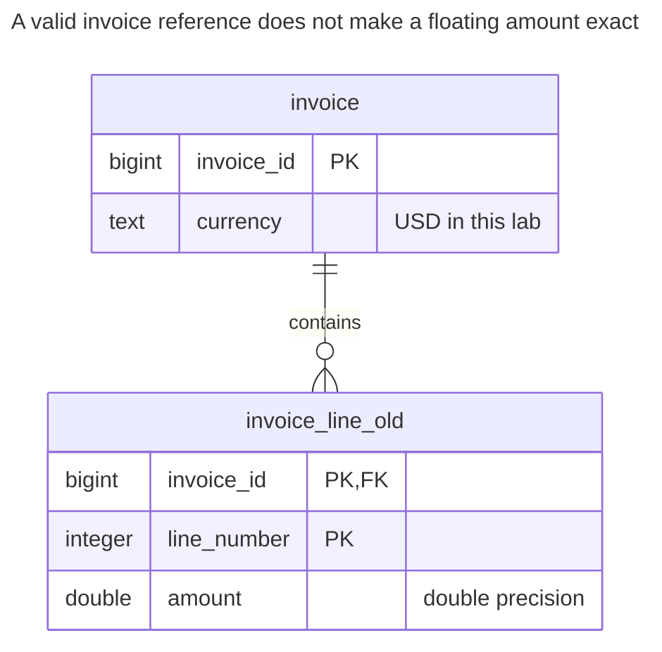
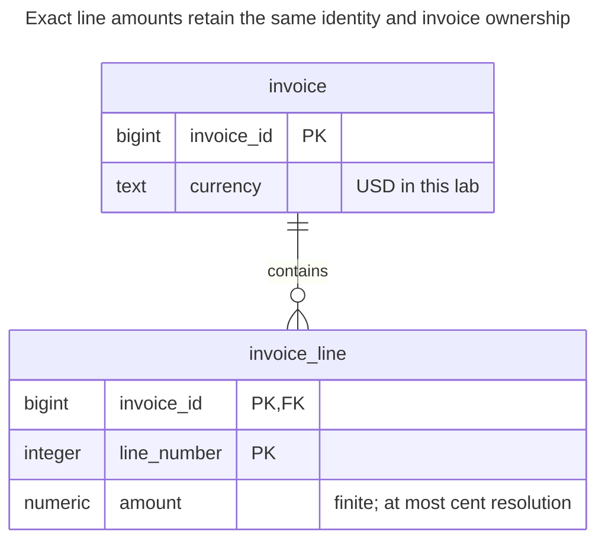
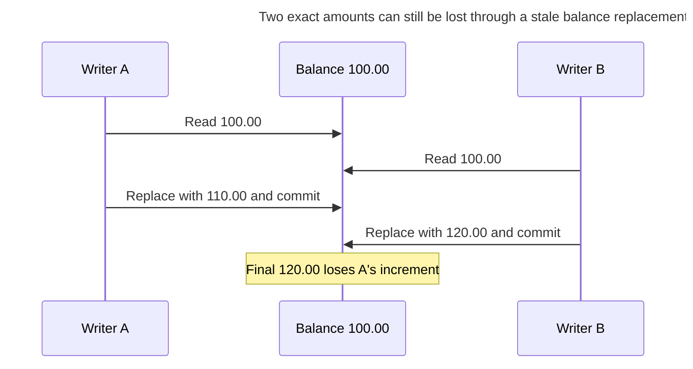
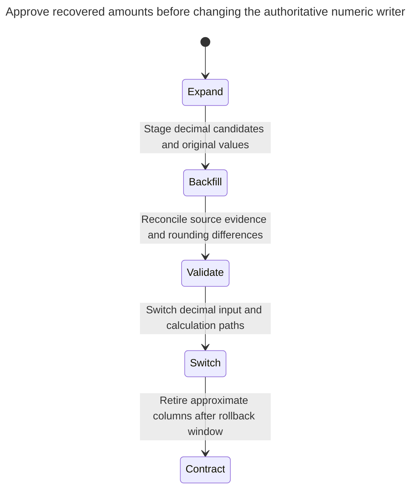

# Inexact Arithmetic

Inexact arithmetic stores money and other exact quantities in floating-point columns, whose binary representation cannot hold most decimal fractions exactly. Sums drift by fractions of a cent, equality comparisons fail, and reports disagree with the bank. The chapter shows the errors, the `numeric`/`decimal` types and integer minor units as the fix, and where rounding rules have to be explicit. Bill Karwin calls this Rounding Errors.

## Also known as

Rounding Errors, in Bill Karwin's [SQL Antipatterns contents](https://pragprog.com/titles/bksap1/sql-antipatterns-volume-1/). Exact storage and rounding policy are distinct decisions; fixing the type alone does not decide when you round or who receives a residual cent.

## Context

You store invoice line amounts, sum them, compare the result with the amount due and reconcile it with an external statement. Your contract is exact in an agreed decimal unit. You select a floating-point type because it accepts fractional input and ordinary examples print familiar decimal values.

## Problem

You use an approximate representation where the application requires exact decimal equality. PostgreSQL documents [`real` and `double precision` as inexact types](https://www.postgresql.org/docs/18/datatype-numeric.html#DATATYPE-FLOAT). A short printed representation can look correct while arithmetic exposes an approximation. The lab makes that failure visible with two positive amounts and one sum.

Floating point remains defensible for measured values and numerical models whose error budget explicitly permits approximation. It is a poor default for a contractual number of cents. Conversely, exact decimals do not make every division terminate or choose a correct accounting policy: one cent divided among three recipients still needs a residual allocation rule.

## Why people do it

The type is familiar across languages, arithmetic is convenient, and the UI rounds everything to two places. Rounding the display can hide a discrepancy without changing the stored value used by equality checks. “Use a tolerance” can fit measured data, but a tolerance must not silently waive a monetary reconciliation rule.

## Consequences

- ➖ Equal-looking displayed amounts can fail exact comparisons.
- ➖ Aggregation and repeated conversions can expose representation differences at a reconciliation boundary.
- ➖ Casting approximate historical values cannot recover decimal intent that was never retained.
- ➖ Rounding each line and rounding the final sum can produce different valid-looking totals.
- ➖ Storing integer minor units without the unit and resolution makes the number ambiguous.

## Signs

- A money report relies on float equality after formatting to two decimals.
- A reconciliation job treats every small discrepancy as noise without a business rule.
- The application parses exact input through a binary float before saving it as `numeric`.
- A type migration promises to recover the original amounts by casting existing floats.

## A better way

Use `numeric`/`decimal` for exact decimal amounts, or integer minor units for a fixed resolution and sufficient integer range. Keep the currency or unit with the amount. Fowler's [Money](https://martinfowler.com/eaaCatalog/money.html) discusses currency differences and rounding; [Quantity](quantity.md) supplies the broader amount-and-unit model.

The example deliberately supports only USD amounts at a two-decimal storage boundary. That is its local contract, not a claim that all currencies or all intermediate calculations use two decimals. Rates and intermediate allocations may need greater precision before explicit final rounding.

### Alternatives and selection

| Choice | Relationship | Choose it when |
| --- | --- | --- |
| Exact decimal column | Replacement | Decimal input and calculations must retain agreed precision with explicit rounding |
| Integer minor units | Implementation option | Resolution is fixed, units are explicit and range/overflow limits are acceptable |
| [Quantity](quantity.md) | Complement | Amount interpretation and unit compatibility must travel with the value |
| [Double-Entry Ledger](double-entry-ledger.md) | Complement | Transfers must conserve exact amounts across entries |
| Floating point | Implementation option for approximate quantities | Measurement or numerical error bounds are part of the contract |

Use the [Decision Atlas](decision-atlas.md). A ledger can balance approximate representations yet still disagree with the intended decimal amounts; conservation and representation solve different problems.

## Example

### Structure

**Before:** line amounts are approximate although their currency contract is exact.



The identity and reference constraints are sound. Only the amount representation is changing.

```sql
CREATE TABLE invoice (
    invoice_id bigint PRIMARY KEY,
    currency text NOT NULL CHECK (currency = 'USD')
);
CREATE TABLE invoice_line_old (
    invoice_id bigint NOT NULL REFERENCES invoice (invoice_id),
    line_number integer NOT NULL,
    amount double precision NOT NULL,
    PRIMARY KEY (invoice_id, line_number)
);
INSERT INTO invoice VALUES (1, 'USD');
INSERT INTO invoice_line_old VALUES (1, 1, 0.1), (1, 2, 0.2);
SELECT sum(amount) AS total, sum(amount) = 0.3::double precision AS equals_expected
FROM invoice_line_old WHERE invoice_id = 1;
```

On PostgreSQL 18.6 the sum is `0.30000000000000004`, and the comparison is `false`. This observed output demonstrates the issue without assuming that every floating sum drifts or that every discrepancy reaches a whole cent.

**After:** validate the agreed resolution without silently rounding input.



The unconstrained-scale numeric column lets the check see the original decimal fraction. The finite check also excludes special values.

```sql
CREATE TABLE invoice_line (
    invoice_id bigint NOT NULL REFERENCES invoice (invoice_id),
    line_number integer NOT NULL,
    amount numeric NOT NULL,
    PRIMARY KEY (invoice_id, line_number),
    CONSTRAINT invoice_line_finite CHECK (
        amount > '-Infinity'::numeric AND amount < 'Infinity'::numeric
    ),
    CONSTRAINT invoice_line_scale CHECK (amount = round(amount, 2))
);
CREATE TABLE line_conversion (
    invoice_id bigint NOT NULL,
    line_number integer NOT NULL,
    old_amount double precision NOT NULL,
    proposed_amount numeric NOT NULL,
    approved boolean NOT NULL DEFAULT false,
    PRIMARY KEY (invoice_id, line_number)
);
BEGIN;
LOCK TABLE invoice_line_old IN SHARE ROW EXCLUSIVE MODE;
INSERT INTO line_conversion (invoice_id, line_number, old_amount, proposed_amount)
SELECT invoice_id, line_number, amount, round(amount::numeric, 2) FROM invoice_line_old;
-- These two approvals stand for a review against the original decimal amounts in this lab.
UPDATE line_conversion SET approved = true
WHERE invoice_id = 1 AND ((line_number = 1 AND proposed_amount = 0.10)
    OR (line_number = 2 AND proposed_amount = 0.20));
INSERT INTO invoice_line
SELECT invoice_id, line_number, proposed_amount FROM line_conversion WHERE approved;
COMMIT;
SELECT sum(amount) AS total, sum(amount) = 0.30 AS equals_expected
FROM invoice_line WHERE invoice_id = 1;
```

The sum is `0.30`, and equality is `true`. The conversion table preserves old approximations and proposed decimals; only reviewed rows are published. A production review must use retained source amounts, statements or another authoritative record. The suggested rounded cast is a candidate interpretation, not recovered evidence.

```sql
INSERT INTO invoice_line VALUES (1, 3, 1.005);
```

PostgreSQL 18.6 raises SQLSTATE `23514`: `ERROR: new row for relation "invoice_line" violates check constraint "invoice_line_scale"`. The example rejects excess precision instead of silently rounding it.

```sql
INSERT INTO invoice_line VALUES (1, 3, 'NaN');
```

That raises SQLSTATE `23514`: `ERROR: new row for relation "invoice_line" violates check constraint "invoice_line_finite"`. The [complete script](../assets/inexact-arithmetic/inexact-arithmetic.sql) asserts both errors and the following rounding results.

```sql
SELECT 1.005::numeric(10, 2) AS amount;
SELECT round(0.005::numeric, 2) + round(0.005::numeric, 2) AS round_each,
       round(0.005::numeric + 0.005::numeric, 2) AS round_total;
SELECT 10 / 3 AS whole_cents, 10 % 3 AS remaining_cents;
```

The fixed-scale conversion yields `1.01`. `round_each` is `0.02`, while `round_total` is `0.01`. PostgreSQL's [numeric scale and rounding rules](https://www.postgresql.org/docs/18/datatype-numeric.html#DATATYPE-NUMERIC-DECIMAL) round input to a declared scale before storage and round numeric ties away from zero. Choose a different explicit calculation when your contract requires a different tie rule. A check on `numeric(10,2)` cannot reject the input fraction after that coercion has already removed it.

The integer calculation produces `3` whole cents and `1` remaining cent. Define a deterministic recipient for that remainder, retain the chosen allocation and verify that all parts sum to the original `10`. Exact storage does not decide that policy.

### Engine support

- **PostgreSQL 18:** `decimal` and `numeric` are [equivalent](https://www.postgresql.org/docs/18/datatype-numeric.html). An unconstrained numeric plus a scale check serves input rejection; a declared scale serves automatic coercion.
- **MySQL 8.4:** [precision math](https://dev.mysql.com/doc/refman/8.4/en/precision-math.html) distinguishes exact-value decimal calculations from approximate floating calculations. Port expression types as well as destination columns.
- **SQL Server:** [`decimal`/`numeric` have maximum precision 38](https://learn.microsoft.com/en-us/sql/t-sql/data-types/decimal-and-numeric-transact-sql?view=sql-server-ver17). Specify supported precision and scale, then review intermediate expression rounding and overflow.
- **Oracle:** [`NUMBER` and `BINARY_FLOAT`/`BINARY_DOUBLE`](https://docs.oracle.com/en/database/oracle/oracle-database/26/sqlrf/Data-Types.html) have different decimal and binary representations. Do not assume a similarly named floating type is the PostgreSQL type's exact counterpart.
- **SQLite:** [floating values are approximate](https://www.sqlite.org/floatingpoint.html), and [NUMERIC affinity](https://www.sqlite.org/datatype3.html#type_affinity) does not supply PostgreSQL exact decimal storage. Use integer minor units or a deliberately integrated decimal implementation.

### Failure and concurrency

Exact arithmetic does not prevent lost updates. Replacing a stored balance with a client-computed number can overwrite another edit even when every operand is exact. Use atomic updates for simple counters, or an explicit posting and locking protocol for transfers; see [Double-Entry Ledger](double-entry-ledger.md).



The diagram illustrates an unconditional replacement policy, not the line-storage script. PostgreSQL [serializes updates to a row](https://www.postgresql.org/docs/18/explicit-locking.html#LOCKING-ROWS), but a stale constant remains stale after waiting. Protect the business operation and its retry identity as well as its numeric type.

### Migration

Define units, accepted precision, rounding stage and tie policy first. Audit nonfinite values and out-of-range amounts before conversion. Preserve source representations, proposed replacements and approval decisions. Reconcile totals by invoice and currency, including differences; matching one grand total can hide offsetting mistakes.



The lab uses a short source write pause. For live backfill, synchronize old and new writes under the same owner lock until the authority switch; see [Expand and Contract](expand-contract.md). Keep decimal input out of binary-float intermediates in clients and drivers, binding an exact decimal representation instead. Do not silently keep float as the authoritative source after switching the column: that would reintroduce approximation at the write boundary.

## Related patterns and anti-patterns

- [Quantity](quantity.md) makes unit compatibility explicit.
- [Double-Entry Ledger](double-entry-ledger.md) conserves amounts through atomic balanced postings.
- [Untyped Properties](untyped-properties.md) loses another part of the numeric contract by storing amounts as unconstrained text.
- [Expand and Contract](expand-contract.md) stages the representation and client change.
