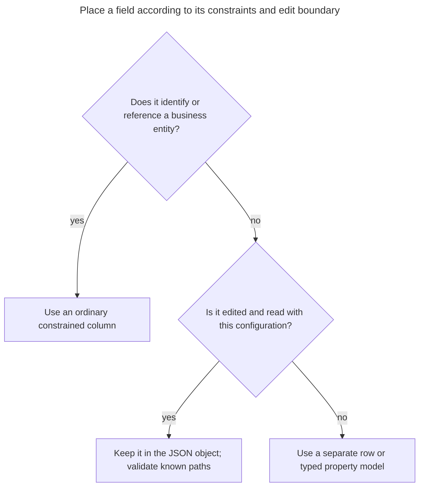
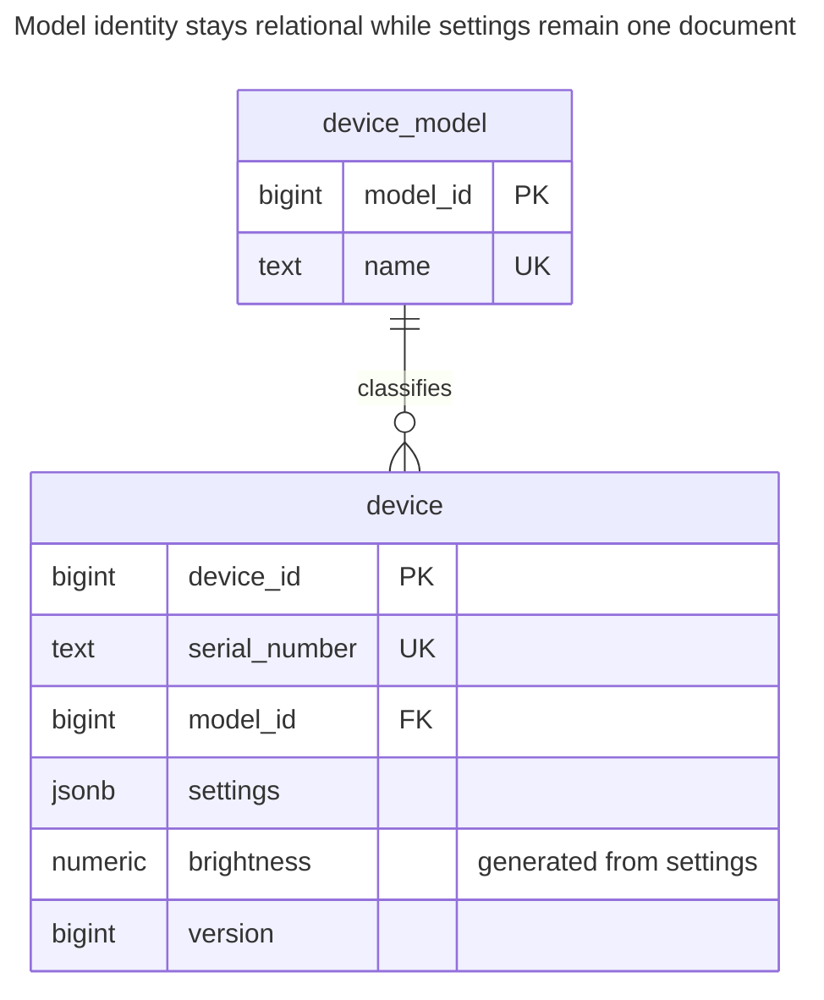
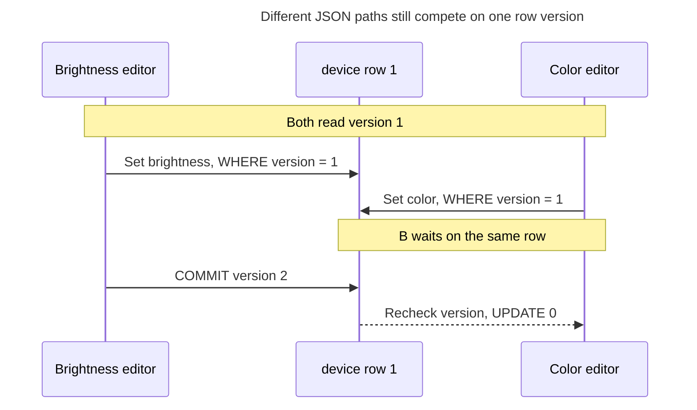
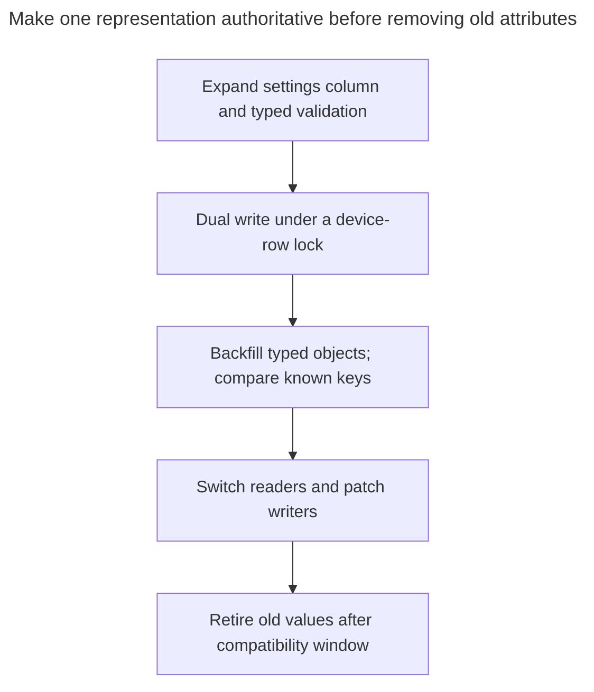

# JSON Column

## Intent

A JSON column stores semi-structured attributes — device settings, product specifications that differ by category, payloads from external systems — in a single JSONB value next to the regular columns. You get a flexible shape without migrations and can still query it with operators, GIN indexes, and generated columns that pull frequently used fields into ordinary typed columns. The chapter shows where to draw the line between JSON and columns, how CHECK constraints and schema validation win back some guarantees, and what you lose in foreign keys, statistics and type safety.

## Also known as

Document column; hybrid relational/document model. Fowler's [Serialized LOB](https://martinfowler.com/eaaCatalog/serializedLOB.html) is the broader mapping of an object graph into one column; a queryable JSON column is one implementation choice, not the whole meaning of that pattern.

## Problem

You manage devices with fixed serial numbers and models but different settings. A lamp has brightness and color; another model has a different collection of settings. You usually retrieve settings as one configuration, and adding an optional key should not require a column in every device row.

A text blob cannot offer the same structured queries and validation as a JSON type. At the other extreme, a generic string-valued property table makes a simple configuration read a reconstruction problem. You want the settings to remain one document without moving device identity and model relationships out of ordinary columns.

## Solution

Keep identity, model references and stable business keys relational. Store the variable configuration as a `jsonb` object. Validate the paths on which your application depends, extract an important scalar into a generated typed column, and choose indexes for the operators you actually use. PostgreSQL's [JSON documentation](https://www.postgresql.org/docs/18/datatype-json.html) distinguishes `jsonb`, which supports indexing, from `json`, which preserves the input text.

Treat adding an unknown optional key differently from changing the meaning or type of a known key. The latter is still a data-contract migration. This example permits extra keys but requires `brightness`, when present, to be a JSON number between 0 and 100. Missing brightness is allowed; an explicit JSON null is rejected. This is a narrow schema rule, not validation of every possible setting.

## Alternatives and selection

| Sibling | Relationship | Deciding requirement |
| --- | --- | --- |
| Ordinary typed columns | Replacement for stable attributes; complement for the relational core | You repeatedly filter, join or constrain the same scalar fields |
| [Single Table Inheritance](single-table-inheritance.md) | Replacement | A small known family has fixed subtype shapes that should be expressed in DDL |
| [Class Table Inheritance](class-table-inheritance.md) | Replacement for subtype storage | Subtypes need separately referenced rows with mandatory fields |
| [Typed Properties](typed-properties.md) | Replacement | Administrators define searchable attributes, requiredness and ranges as managed metadata |
| [Table Split](table-split.md) | Complement | Settings form an independently edited group that should use a separate row and lock |
| [Version Column](version-column.md) | Complement | Whole-document editing must detect stale saves |

See the [Decision Atlas](decision-atlas.md) for the full table. JSON numbers and explicit validation are a better fit than [Untyped Properties](untyped-properties.md) for a document, but JSON syntax alone does not supply your business schema.



A generated scalar is an implementation option when one document path becomes important to filtering. If many paths need independent references or write lifecycles, reconsider the document boundary rather than adding extraction logic indefinitely.

## Structure



Every device has one real model reference. `brightness` is a projection of the document, not a second editable source. The diagram contains one settings column regardless of the number of optional keys.

## Tables and invariants

- **`device_model`** owns the model key and a unique name. `device.model_id` is a mandatory foreign key.
- **`device`** has a unique serial number, a non-null settings document and a version used for conditional saves.
- **`device_settings_object`** rejects scalar and array documents. JSON syntax validity alone would not require an object.
- **`device_brightness`** accepts absence, rejects JSON null and strings, and bounds numeric values. The generated expression uses a type guard before casting.
- **Projection and indexes** give two access paths: containment over `settings` and numeric range comparison over `brightness`. PostgreSQL's [`jsonb_path_ops`](https://www.postgresql.org/docs/18/datatype-json.html#JSON-INDEXING) supports containment but not the key-existence `?` operator; choose default `jsonb_ops` if that operator needs index support.

## When to use

- Attributes vary by instance and are usually consumed as a bounded document.
- The relational core is stable and you can name the few paths that need database validation.
- A new optional attribute should not require DDL, while changing an established field can still follow a versioned contract.

## Consequences and trade-offs

- ➕ A configuration can acquire new optional keys without creating property-definition and value rows.
- ➕ You can combine a document read with ordinary keys, joins and constrained scalar projections.
- ➖ Every business guarantee on a path needs explicit validation; a misspelled unknown key is permitted by this example.
- ➖ One large document is a shared update boundary. PostgreSQL [locks the whole row when a JSON document is updated](https://www.postgresql.org/docs/18/datatype-json.html#JSON-DOC-DESIGN), even when writers edit different paths.
- ➖ The [planner statistics](https://www.postgresql.org/docs/18/planner-stats.html) gathered by `ANALYZE` describe columns and explicitly selected statistics objects. Use the generated `brightness` column for a scalar distribution you can inspect; do not assume the document column supplies a separate histogram for every path.
- ➖ The example's foreign keys constrain ordinary columns, not arbitrary IDs buried in settings. Keep reference-bearing fields in the relational core.
- ➖ `jsonb` [does not preserve whitespace, object key order or duplicate keys](https://www.postgresql.org/docs/18/datatype-json.html). Preserve original payload text separately if exact replay or signature verification requires those bytes.

## Implementation

The [complete script](../assets/json-column/json-column.sql) checks queries, conditional editing, wrong types, explicit null and out-of-range input:

```sql
CREATE TABLE device_model (model_id bigint PRIMARY KEY, name text NOT NULL UNIQUE);
CREATE TABLE device (
    device_id bigint PRIMARY KEY,
    serial_number text NOT NULL UNIQUE,
    model_id bigint NOT NULL REFERENCES device_model (model_id),
    settings jsonb NOT NULL DEFAULT '{}',
    version bigint NOT NULL DEFAULT 1,
    brightness numeric GENERATED ALWAYS AS (
        CASE WHEN jsonb_typeof(settings -> 'brightness') = 'number'
            THEN (settings ->> 'brightness')::numeric END
    ) STORED,
    CONSTRAINT device_settings_object CHECK (jsonb_typeof(settings) = 'object'),
    CONSTRAINT device_brightness CHECK (
        CASE WHEN settings ? 'brightness' THEN
            jsonb_typeof(settings -> 'brightness') = 'number'
            AND brightness BETWEEN 0 AND 100
        ELSE true END
    )
);
CREATE INDEX device_model_idx ON device (model_id);
CREATE INDEX device_settings_idx ON device USING gin (settings jsonb_path_ops);
CREATE INDEX device_brightness_idx ON device (brightness);
```

PostgreSQL 18 supports stored and virtual [generated columns](https://www.postgresql.org/docs/18/ddl-generated-columns.html); this example explicitly chooses `STORED`. A generated scalar is useful for an ordinary typed range index. It does not validate unrelated JSON paths or prevent extra keys.

```sql
INSERT INTO device_model VALUES (10, 'Lamp');
INSERT INTO device (device_id, serial_number, model_id, settings)
VALUES (1, 'D-1', 10, '{"brightness":40,"color":"warm"}'), (2, 'D-2', 10, '{}');
SELECT device_id FROM device WHERE settings @> '{"color":"warm"}';
SELECT device_id, brightness FROM device WHERE brightness BETWEEN 30 AND 50;
```

The queries return `1` and `(1, 40)`. These are index-compatible predicates, not a promise that the planner will use an index for a two-row lab. A JSON string in the numeric path is invalid:

```sql
INSERT INTO device (device_id, serial_number, model_id, settings)
VALUES (3, 'D-3', 10, '{"brightness":"60"}');
```

PostgreSQL 18.6 raises SQLSTATE `23514`: `ERROR: new row for relation "device" violates check constraint "device_brightness"`. `{"brightness":null}` and `{"brightness":101}` fail the same constraint; `{}` is valid. The guarded generated expression returns null for a non-number, while the check rejects that present invalid value.

For a configuration edit, compute a path change from the stored document and check the version that the client read. PostgreSQL documents the path operation as [`jsonb_set`](https://www.postgresql.org/docs/18/functions-json.html):

```sql
UPDATE device
SET settings = jsonb_set(settings, '{brightness}', '60'::jsonb), version = version + 1
WHERE device_id = 1 AND version = 1;
SELECT brightness, version FROM device WHERE device_id = 1;
UPDATE device SET settings = '{"color":"cool"}', version = version + 1
WHERE device_id = 1 AND version = 1;
```

The first update returns `(60, 2)` from the following select. The stale replacement affects `0` rows. Report a conflict and reload rather than accepting that save. PostgreSQL's [extraction operators return SQL null for missing paths](https://www.postgresql.org/docs/18/functions-json.html); distinguish that from explicit JSON null when designing your own required-path rules.

## Engine support

- **PostgreSQL 18:** choose `jsonb` for these indexed queries. Neither the column type nor the GIN index asserts a complete application schema; the shown checks enforce only the named rules.
- **MySQL 8.4:** native [`JSON` columns are not indexed directly](https://dev.mysql.com/doc/refman/8.4/en/json.html). Indexed generated columns provide scalar access; PostgreSQL's GIN definition is not portable. Validate JSON types before scalar coercion when preserving this number-versus-string rule.
- **SQL Server 2025 (17.x):** Microsoft documents the native [`json` type and JSON indexes as generally available](https://learn.microsoft.com/en-us/sql/t-sql/data-types/json-data-type?view=sql-server-ver17). Older text-column examples are not the only implementation; use the target release's syntax and index capabilities.
- **Oracle AI Database 26ai:** native [`JSON`](https://docs.oracle.com/en/database/oracle/oracle-database/26/adjsn/json-data-type.html) uses Oracle's binary JSON representation. Translate extraction, validation and indexing; PostgreSQL operator classes are engine-specific.
- **SQLite 3:** supports [JSON functions and its own JSONB representation](https://www.sqlite.org/json1.html). That binary format is not compatible with PostgreSQL's JSONB. [Generated columns](https://www.sqlite.org/gencol.html) can be indexed, but this GIN index needs a different query/index design.

## Failure and concurrency

A path update still contends on the device row. At PostgreSQL's [read committed isolation](https://www.postgresql.org/docs/18/transaction-iso.html#XACT-READ-COMMITTED), a waiting update rechecks its condition against the updated row. The version predicate therefore makes a second save report a conflict even if the two users edited different paths.



If independent path changes are intentionally mergeable, a server-side patch computed from the current row can use a different conflict policy. Do not read an old document in the client and overwrite the whole value unconditionally: it can erase another writer's keys. Split settings into separately locked rows when they truly have independent ownership or update rates.

## Migration

From string-valued attributes, first classify each key's intended type and how to represent absence. Converting every stored value to a JSON string merely moves the old typing problem. Keep fixed keys and references in columns, build documents only for the chosen settings, and resolve duplicate attribute names before constructing an object.



Keep both forms in the same transaction during backfill and preserve the old form for rollback. If a frequently queried path later becomes a real column, choose either a generated projection or a staged authority transfer; two independently writable copies can drift. Use PostgreSQL's [staged check validation](https://www.postgresql.org/docs/18/sql-altertable.html) and plan DDL lock windows. See [Expand and Contract](expand-contract.md).

## Anti-patterns and common mistakes

- Calling the design schema-free when readers depend on exact path names and types.
- Assuming valid JSON implies an object or that every known field has the right type.
- Treating a missing key, JSON null and SQL null as interchangeable.
- Adding one giant document to avoid modeling independently edited entities.
- Expecting a containment GIN index to serve every numeric range, ordering and key-existence predicate.
- Keeping both a hand-written scalar column and the JSON path editable without an authority rule.

## Known uses

- PostgreSQL's [JSON indexing examples](https://www.postgresql.org/docs/18/datatype-json.html#JSON-INDEXING) store API documents with searchable attributes and demonstrate both whole-document GIN and targeted expression indexes.
- Fowler's [Serialized LOB](https://martinfowler.com/eaaCatalog/serializedLOB.html) supplies the broader object-to-one-column mapping. This chapter's queryable, checked JSON is a narrower design choice.

## Related patterns

- [Typed Properties](typed-properties.md) makes user-defined fields and their rules explicit metadata.
- [Single Table Inheritance](single-table-inheritance.md) gives known subtype fields a fixed shape.
- [Table Split](table-split.md) moves an independently edited group to its own row.
- [Version Column](version-column.md) protects a client save from stale document replacement.
- [Untyped Properties](untyped-properties.md) explains the typing failures a JSON document does not automatically cure.
