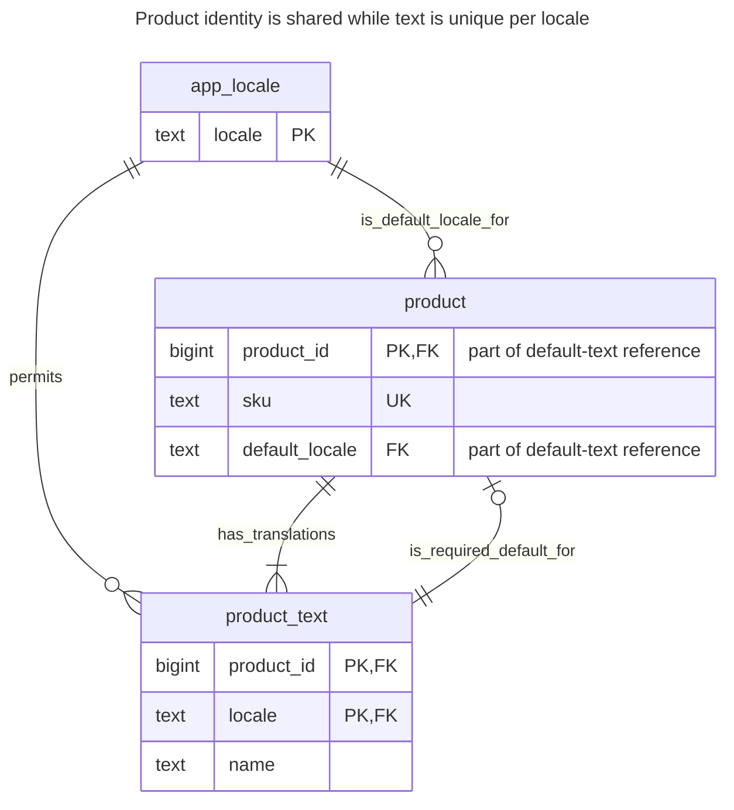
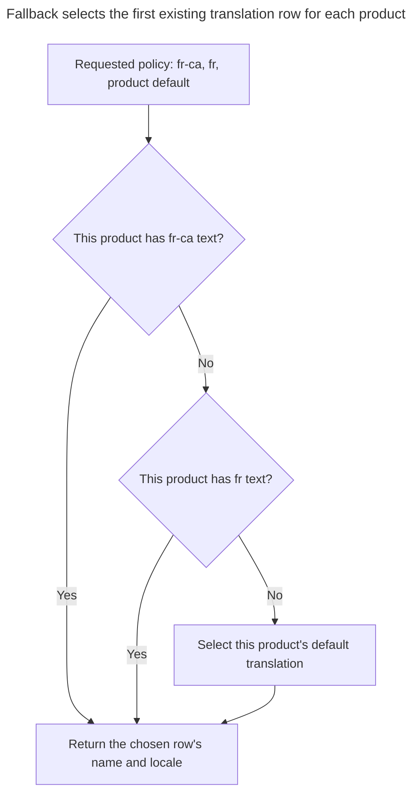
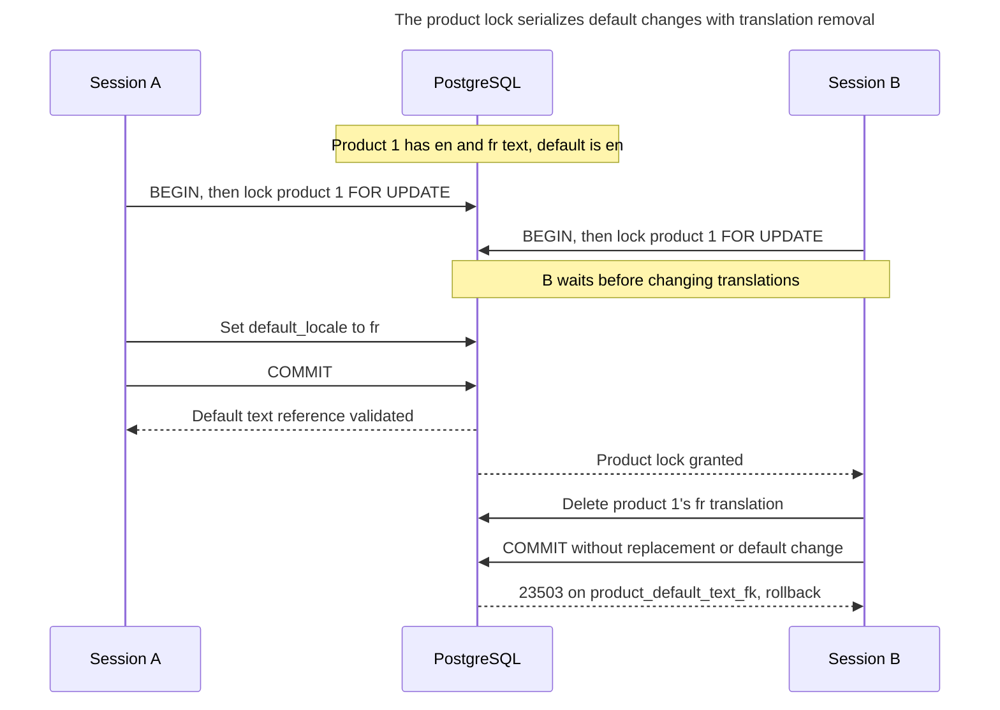

# Localized Values

## Intent

Localized values are attributes that need a separate value per language, such as a product name or a category description. The chapter compares a translation table keyed by entity and locale, per-language columns, and a JSON map of translations, and shows how to guarantee one value per locale, require the default language, and read with a fallback chain when a translation is missing. It also covers sorting and searching translated text, where collation and full-text configuration depend on the language.

## Also known as

Translation table; localized attribute table. This chapter treats stored entity attributes, rather than application interface messages or formatting dates and numbers.

## Problem

Your catalog has a product identity and SKU that do not change with the display language. Its name does: English readers see “Chair,” French readers see “Chaise.” Copying the whole product per language would give stock and orders several apparent identities for the same product. Adding `name_en`, `name_fr` and another column for each new language ties language rollout to schema changes.

Missing text raises a separate decision. Should a Canadian French request receive French, English or no result? Does an empty string count as missing? Can the name fall back independently of the description? Decide those rules before writing a query; a table key cannot choose them for you.

## Solution

Store common attributes in `product` and translated attributes in `product_text`, keyed by `(product_id, locale)`. Use an `app_locale` lookup table to admit only the languages your application supports. Normalize accepted language tags to one stored spelling before writing them: [RFC 5646](https://www.rfc-editor.org/rfc/rfc5646.html#section-2.1.1) makes tag comparisons case-insensitive. This example uses lowercase ASCII tags and bytewise equality, so alternate spellings cannot become separate translation rows.

Give each product a mandatory `default_locale` and a deferred composite foreign key to its own default translation. You may insert the product before its text in one transaction, but cannot commit without that text. The translation's reverse foreign key ensures that all text belongs to an existing product. The default language is a per-product choice here, not necessarily English.

Resolve a prepared fallback list in priority order and return the chosen locale with the text. The example list is `fr-ca`, `fr`, then the product default. It is an application policy, not an implementation of every language-negotiation rule. [RFC 4647 lookup](https://www.rfc-editor.org/rfc/rfc4647.html#section-3.4) defines progressive matching and requires explicit default behavior; implement that algorithm separately if your protocol promises it.

## Alternatives and selection

| Sibling or representation | Relationship | Deciding requirement |
| --- | --- | --- |
| Per-language columns | Replacement | The language set is fixed and small, and per-language column constraints justify changing the schema when it grows |
| [JSON Column](json-column.md) containing a locale-to-text map | Replacement | You usually retrieve the whole map and accept a document validation policy instead of ordinary translation-row references |
| [Table Split](table-split.md) | Complement | Nontranslated optional details have a separate lifecycle; translations still need multiple rows per product |
| [Lookup Table](lookup-table.md) | Complement | Supported locales need controlled membership and application metadata |
| A required default name on `product`, with only overrides in `product_text` | Implementation option | You want a simple non-null default without a circular foreign key, and accept two storage paths for the same attribute |

See the [Decision Atlas](decision-atlas.md) for the full comparison. Per-language columns are defensible for a fixed contract; [Repeated Columns](repeated-columns.md) becomes the relevant warning when the set is open-ended. For a JSON map, PostgreSQL's [`->>` operator](https://www.postgresql.org/docs/18/functions-json.html) can extract one locale's text, but you must separately define accepted keys, required defaults and value types.

## Structure



One product can have many translations. The composite default reference includes `product_id`, so it cannot be satisfied by another product's English row. The locale lookup admits a language but does not require every product to have that translation.

## Tables and invariants

- **`app_locale`** contains normalized supported tags. Its lowercase check is a local storage rule, not a complete BCP 47 validator; provision vetted tags rather than accepting arbitrary user input into this table.
- **`product`** holds one unique SKU, one identity and a mandatory supported default locale. Its deferred foreign key requires its own default text.
- **`product_text`** permits one nonempty name per product and locale. Missing translation means no row; an empty or space-only name is rejected by the example check. Other whitespace normalization remains an input policy.
- **Fallback** chooses a whole translation row. If you add descriptions and permit null descriptions, decide whether to fall back the row or each field. Field-level fallback can intentionally mix languages; this example does not do that.

## When to use

- Entities have one shared identity and an evolving set of translated attributes.
- You edit, validate, search or publish translations independently by language.
- Default-language completeness must be a database guarantee rather than a read-time assumption.

## Consequences and trade-offs

- ➕ Adding a supported language adds lookup and translation rows rather than columns.
- ➕ Translation uniqueness and default completeness have explicit constraints.
- ➖ Display reads need language selection and joins.
- ➖ One index or search configuration cannot be assumed to provide every language's desired ordering and stemming.
- ➖ Correctly keyed text can still be an obsolete or inaccurate translation. Add review or source-version metadata if publication depends on freshness.

## Implementation

The [complete script](../assets/localized-values/localized-values.sql) exercises fallback, translation edits, uniqueness rejection, default completeness and English full-text search:

```sql
CREATE TABLE app_locale (
    locale text COLLATE "C" PRIMARY KEY,
    CHECK (locale = lower(locale))
);
CREATE TABLE product (
    product_id bigint PRIMARY KEY,
    sku text NOT NULL UNIQUE,
    default_locale text COLLATE "C" NOT NULL REFERENCES app_locale (locale)
);
CREATE TABLE product_text (
    product_id bigint NOT NULL REFERENCES product (product_id)
        ON DELETE CASCADE,
    locale text COLLATE "C" NOT NULL REFERENCES app_locale (locale),
    name text NOT NULL CHECK (btrim(name) <> ''),
    CONSTRAINT product_text_pkey PRIMARY KEY (product_id, locale)
);
ALTER TABLE product ADD CONSTRAINT product_default_text_fk
    FOREIGN KEY (product_id, default_locale)
    REFERENCES product_text (product_id, locale)
    DEFERRABLE INITIALLY DEFERRED;
INSERT INTO app_locale VALUES ('en'), ('fr'), ('fr-ca');
BEGIN;
INSERT INTO product VALUES (1, 'CHAIR', 'en'), (2, 'DESK', 'en');
INSERT INTO product_text VALUES
    (1, 'en', 'Chair'), (1, 'fr', 'Chaise'), (2, 'en', 'Desk');
COMMIT;
```

The product-to-default cycle relies on PostgreSQL's [deferred foreign keys](https://www.postgresql.org/docs/18/sql-createtable.html). The primary key begins with the product for individual lookups. Consider an additional locale-leading index when translation queues or locale-wide reads justify it.

```sql
SELECT p.sku, chosen.locale, chosen.name
FROM product AS p
CROSS JOIN LATERAL (
    SELECT t.locale, t.name
    FROM (VALUES ('fr-ca', 1), ('fr', 2), (p.default_locale, 3))
        AS preference(locale, priority)
    JOIN product_text AS t
      ON t.product_id = p.product_id AND t.locale = preference.locale
    ORDER BY preference.priority
    LIMIT 1
) AS chosen
ORDER BY p.product_id;
UPDATE product_text SET name = 'Chaise en bois'
WHERE product_id = 1 AND locale = 'fr';
```

The first result is `(CHAIR, fr, Chaise)` and `(DESK, en, Desk)`. The [lateral subquery](https://www.postgresql.org/docs/18/queries-table-expressions.html#QUERIES-LATERAL) selects text for each product; the default reference guarantees a candidate for committed products. Return `chosen.locale` so a caller can label or index the actual language. Do not cache the result solely by product ID when requests can have different fallback lists.



With the seeded rows, CHAIR takes the French branch and DESK reaches its English default. The deferred reference guarantees the default candidate for committed products, while the query supplies the preference order.

```sql
INSERT INTO product_text VALUES (1, 'fr', 'Autre chaise');
```

PostgreSQL 18.6 raises SQLSTATE `23505`: `ERROR: duplicate key value violates unique constraint "product_text_pkey"`, with `DETAIL: Key (product_id, locale)=(1, fr) already exists.` Default completeness is a separate rejection: inserting product `(3, 'LAMP', 'en')` without its translation fails at commit with SQLSTATE `23503`, constraint `product_default_text_fk`, and `DETAIL: Key (product_id, default_locale)=(3, en) is not present in table "product_text".` The script runs that failure too.

For a simple English search path, keep the language filter and explicit configuration in both index and query:

```sql
CREATE INDEX product_text_en_search_idx ON product_text
    USING gin (to_tsvector('english'::regconfig, name)) WHERE locale = 'en';
SELECT product_id FROM product_text
WHERE locale = 'en'
  AND to_tsvector('english'::regconfig, name)
      @@ plainto_tsquery('english'::regconfig, 'chairs')
ORDER BY product_id;
SELECT product_id, name FROM product_text
WHERE locale = 'en' ORDER BY name COLLATE "C", product_id;
```

Search returns product `1`; sorting returns Chair before Desk. PostgreSQL documents [configuration-specific full-text indexes](https://www.postgresql.org/docs/18/textsearch-tables.html), including configurations selected by a row column for multilingual indexes. Use a vetted locale-to-configuration mapping; a language tag is not itself a search-configuration name. Search the resolved fallback text if search results must match what the reader sees; searching every translation can match words the displayed row does not contain.

The sample's [`C` collation](https://www.postgresql.org/docs/18/collation.html) sorts by bytes, making the lab independent of installed linguistic collations. For reader-facing ordering, select a supported language-appropriate collation in the query and design the matching index for that expression. A `locale` value in a row does not automatically change the column's collation. Decide whether a fallback French or English name is sorted according to the requested language or its actual language before building a multilingual listing.

## Engine support

- **PostgreSQL 18:** deferred references enforce the required default. Collation and full-text configuration are explicit choices, independent of the translation key.
- **MySQL 8.4 / InnoDB:** [immediate foreign-key checks](https://dev.mysql.com/doc/refman/8.4/en/ansi-diff-foreign-keys.html) prevent the shown circular creation sequence. Keeping the mandatory default on the core row is a simpler portable option. Choose [column character sets and collations](https://dev.mysql.com/doc/refman/8.4/en/charset-column.html) deliberately for locale equality and text comparison.
- **SQL Server 2025 (17.x):** its [`CREATE TABLE` syntax](https://learn.microsoft.com/en-us/sql/t-sql/statements/create-table-transact-sql?view=sql-server-ver17) has no deferred-constraint clause; use a different default-storage design. [Column collation](https://learn.microsoft.com/en-us/sql/relational-databases/collations/set-or-change-the-column-collation?view=sql-server-ver17) is configurable rather than inferred from a row's locale.
- **Oracle AI Database 26ai:** supports [deferred constraints](https://docs.oracle.com/en/database/oracle/oracle-database/26/sqlrf/constraint.html). Its [linguistic comparison rules](https://docs.oracle.com/en/database/oracle/oracle-database/26/nlspg/linguistic-sorting-and-matching.html) require Oracle-specific collation choices; PostgreSQL search configurations are not portable SQL.
- **SQLite 3:** enable [foreign-key enforcement](https://www.sqlite.org/foreignkeys.html) and declare the circular deferred relationship in the table definitions. Built-in [`NOCASE` folds ASCII letters only](https://www.sqlite.org/datatype3.html#collation), so it is not a general multilingual sorting solution. Use a suitable custom collation when needed.

## Failure and concurrency

Write the product and default text in one transaction and treat commit as the success boundary. To change the default, create the new translation and update `default_locale` atomically; the deferred reference checks the final pair. Deleting the current default alone fails unless the same transaction replaces it or changes the default. Deleting the product cascades to its translations.

Competing inserts for one product and locale meet the primary-key constraint. Competing edits to an existing translation need a [Version Column](version-column.md) if silent overwrites are unacceptable. For a workflow that changes the default and removes translations together, take a [product row lock](https://www.postgresql.org/docs/18/explicit-locking.html#LOCKING-ROWS) first in every participating writer. Invalidate fallback caches when either translations or the default changes, since adding a more preferred translation changes the selected result even though the old text remains.



B must re-evaluate the current default after taking the lock. The deferred constraint rejects removing that default without a replacement, even if the delete itself succeeded.

```mermaid
---
title: A default-language change becomes valid only with matching text
---
stateDiagram-v2
  direction TB
  state "Committed product with default text" as Valid
  state "Transaction holds product lock" as Locked
  state "New default translation exists" as Text
  state "Default points to new translation" as Pointed
  state "Commit rejected; old state restored" as Failed
  [*] --> Valid
  Valid --> Locked: BEGIN; lock product
  Locked --> Text: Create or retain target translation
  Text --> Pointed: Update default_locale
  Pointed --> Valid: COMMIT validates the product/locale pair
  Locked --> Failed: Remove default alone; COMMIT
  Failed --> Valid: Rollback
  class Valid,Text,Pointed accent
  class Locked muted
  class Failed warn
```



The required pair includes the product ID, so another product's translation cannot satisfy the change. A failed commit restores the previous default and its text atomically.

## Migration

From a single name column, choose its real language before labeling it. Create the locale and translation tables, then deploy writers that maintain both representations atomically. Backfill under a product lock shared with live writers so stale copies cannot overwrite newer translations. From language columns or JSON, normalize tags and resolve collisions before inserting; distinguish absent values, nulls and empty strings according to the new policy.

Populate the required default for every product before adding and [validating its foreign key](https://www.postgresql.org/docs/18/sql-altertable.html). Switch readers to an explicit fallback policy, compare results and retain old storage during the [Expand and Contract](expand-contract.md) overlap. Reverting to a single-language column cannot represent newly added translations; preserve them in the translation table even if readers switch back. Schedule DDL lock windows rather than assuming constraint installation is lock-free.

## Anti-patterns and common mistakes

- Treating `fr` and `FR` as different languages because a bytewise key allows both; normalize at the boundary and restrict supported tags.
- Copying SKU, stock and identity into each language row.
- Storing empty text as “missing” while fallback only tests whether a row exists.
- Calling an ad hoc fallback list complete BCP 47 negotiation.
- Assuming the database selects collation or stemming automatically from `locale`.
- Building one generic `(entity_type, entity_id, locale, value)` translation bucket and losing ordinary entity foreign keys; prefer a translation table for each entity shape.

## Known uses

- [django-parler's background documentation](https://django-parler.readthedocs.io/en/stable/background.html) describes a shared model proxying attributes to a translated model, which can be created manually or through `TranslatedFields`. It illustrates the shared/translated separation, not this chapter's required-default constraint.
- PostgreSQL's [full-text indexing documentation](https://www.postgresql.org/docs/18/textsearch-tables.html) explicitly describes a configuration-name column for collections containing documents in different languages. That is a search implementation option for translation rows, rather than a fallback policy.

## Related patterns

- [Lookup Table](lookup-table.md) controls supported locale membership.
- [JSON Column](json-column.md) is an alternative storage shape for translation maps.
- [Table Split](table-split.md) separates nontranslated optional attributes.
- [Version Column](version-column.md) protects competing translation edits.
- [Repeated Columns](repeated-columns.md) explains the cost of encoding an expanding language set as columns.
- [Expand and Contract](expand-contract.md) stages the storage and read-path migration.
