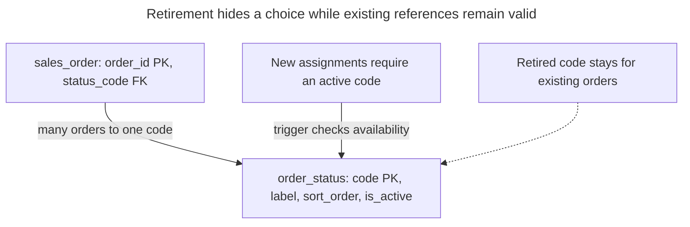

# Lookup Table

## Intent

A lookup table restricts a column to a fixed vocabulary — order statuses, countries, payment methods — by keeping the allowed values in their own table and referencing them with a foreign key. It competes with a native enum type, a CHECK constraint and a domain, and the chapter treats the choice as one decision: how often the list changes, whether values carry their own attributes such as labels or sort order, and what a change costs as a migration. It also shows the failure mode of folding every vocabulary into one generic table, known as One True Lookup Table.

## Also known as

Code table; reference-data table. Joe Celko's [Look-up Tables in SQL](https://www.red-gate.com/simple-talk/databases/sql-server/t-sql-programming-sql-server/look-up-tables-in-sql/) discusses translating stored codes into descriptions and the problems of combining unrelated vocabularies.

## Problem

You store an order status as text. One writer sends `paid`, another sends `Paid`, and a third invents `awaiting_payment`. Your reporting query must decide whether those are three states or two spelling errors. An application dropdown helps one writer, but imports and administrative SQL still need the same membership rule.

The vocabulary also has a lifecycle. You may change a display label, add manual review, reorder choices or stop offering a code while retaining old orders. Putting every spelling in application code makes the database depend on every writer being upgraded together. Putting a list in the schema is reasonable when its changes belong to releases; it is awkward when maintaining the list is an ordinary business operation.

## Solution

Create one table for each vocabulary and reference its key from the consuming column. Store a stable code separately from its label, display order and availability. In the example, `order_status.code` is the reference target, while `sales_order.status_code` is mandatory. PostgreSQL's [foreign-key rules](https://www.postgresql.org/docs/18/ddl-constraints.html#DDL-CONSTRAINTS-FK) supply membership enforcement; the example's trigger separately checks whether a value is available for a new assignment.

Retire a code by clearing `is_active`, preserving the row for existing references. Do not reuse a retired code for a different meaning. Changing a label changes what every joined order displays; if you must reproduce the wording on a historical document, preserve that wording with the document or version it separately. The lookup is a current vocabulary, not a record of earlier labels.

Choose a short natural code when you can keep its meaning and spelling stable. If external codes are routinely replaced, use a [Surrogate Key](surrogate-key.md) and retain a unique code attribute. Either choice still needs a distinct row per allowed concept; the key generator does not decide vocabulary policy.

## Alternatives and selection

| Representation or sibling | Relationship | Choose it when |
| --- | --- | --- |
| Lookup table with an FK | Implementation option for constrained values | Values need labels, retirement, translations or maintenance through ordinary data writes |
| Native enum | Replacement | Developers own a small, stable, ordered vocabulary and accept type migrations |
| Column `CHECK` | Replacement | A short list is local to one column and changes with releases |
| Domain with a `CHECK` | Replacement | Several columns must share the same stable value rule, without per-value metadata |
| [Status History](status-history.md) | Complement | You need allowed moves and the sequence of changes, beyond membership in the state list |
| [Localized Values](localized-values.md) | Complement | Each vocabulary entry needs labels in several languages |

PostgreSQL [enums](https://www.postgresql.org/docs/18/datatype-enum.html) have declaration order and separate type identity; values can be added or renamed, but existing members cannot be removed or reordered without recreating the type. An [`ALTER TYPE ... ADD VALUE`](https://www.postgresql.org/docs/18/sql-altertype.html) performed inside a transaction makes the new member usable only after commit. A lookup insert can instead introduce an entry and assign it in the same transaction. Neither representation makes an old application understand a new business state.

A PostgreSQL [domain](https://www.postgresql.org/docs/18/sql-createdomain.html) centralizes constraints over a base type; it does not provide a row to hold each value's label. Put mandatory-value rules on the consuming columns. See the [Decision Atlas](decision-atlas.md) for the full comparison and [Volatile Enums](volatile-enums.md) for the failure mode of treating business-maintained data as a fixed schema list.

## Structure



An order has one status; a status can serve many orders or none. Reading existing orders joins all referenced codes, including retired ones. Only the choices query filters by availability. Display position is an attribute, so changing it does not change references.

## Tables and invariants

- **`order_status`** has one row per code. Its primary key prevents duplicate codes; mandatory attributes and a nonempty-label check keep the example usable for display. Display positions may tie; `code` breaks ties in the query.
- **`sales_order`** requires an existing code through `sales_order_status_fk`. `ON DELETE RESTRICT` prevents deleting a referenced code. The explicit child index supports status-based order queries; PostgreSQL [does not automatically index the referencing columns](https://www.postgresql.org/docs/18/ddl-constraints.html#DDL-CONSTRAINTS-FK).
- **Availability** is checked on insertion and actual status changes. The trigger rejects a retired target but permits saving an unchanged retired status. An active flag alone supplies no such guarantee.
- **Meaning and code stability** remain maintenance rules. Restrict dictionary changes to trusted maintainers; the schema cannot decide whether an operator has silently redefined a code.

## When to use

- Adding a value is part of operating the application, rather than deploying a new database type.
- Codes need labels, sort order, availability or other domain-specific attributes.
- Several writers must share one enforced vocabulary, and existing records must keep retired references.

## Consequences and trade-offs

- ➕ You can add entries and edit presentation attributes through data operations.
- ➕ The foreign key protects imports and direct writes as well as application forms.
- ➕ Retiring an entry preserves the meaning of existing references.
- ➖ Display reads need a join or a maintained cache; filtering by a known code does not.
- ➖ Every code addition still needs compatibility planning if application logic branches on that code.
- ➖ Strict retirement needs an additional write check and coordination with reference-data updates.

## Implementation

The [complete PostgreSQL 18.6 script](../assets/lookup-table/lookup-table.sql) includes membership, retirement and deletion failures plus isolated enum, CHECK and domain alternatives. Its dedicated schema keeps the lab objects together:

```sql
CREATE SCHEMA lookup_example;
REVOKE ALL ON SCHEMA lookup_example FROM PUBLIC;

CREATE TABLE lookup_example.order_status (
    code text PRIMARY KEY,
    label text NOT NULL CHECK (btrim(label) <> ''),
    sort_order integer NOT NULL,
    is_active boolean NOT NULL DEFAULT true
);
CREATE TABLE lookup_example.sales_order (
    order_id bigint PRIMARY KEY,
    status_code text NOT NULL,
    CONSTRAINT sales_order_status_fk FOREIGN KEY (status_code)
        REFERENCES lookup_example.order_status (code) ON DELETE RESTRICT
);
CREATE INDEX sales_order_status_idx
    ON lookup_example.sales_order (status_code);
```

Membership and retirement answer different questions. The following [row trigger](https://www.postgresql.org/docs/18/sql-createtrigger.html) checks availability and takes a shared lock on the code until transaction end. A missing code is left for the FK to reject:

```sql
CREATE FUNCTION lookup_example.require_active_status()
RETURNS trigger LANGUAGE plpgsql SECURITY DEFINER
SET search_path = pg_catalog, pg_temp AS $$
DECLARE
    active boolean;
BEGIN
    IF TG_OP = 'UPDATE' THEN
        IF NEW.status_code IS NOT DISTINCT FROM OLD.status_code THEN
            RETURN NEW;
        END IF;
    END IF;
    SELECT s.is_active INTO active
    FROM lookup_example.order_status AS s
    WHERE s.code = NEW.status_code FOR SHARE;
    IF FOUND AND NOT active THEN
        RAISE EXCEPTION 'order status is retired: %', NEW.status_code
            USING ERRCODE = '23514',
                  CONSTRAINT = 'sales_order_status_active';
    END IF;
    RETURN NEW;
END;
$$;
REVOKE ALL ON FUNCTION lookup_example.require_active_status() FROM PUBLIC;
CREATE TRIGGER sales_order_active_status
BEFORE INSERT OR UPDATE OF status_code ON lookup_example.sales_order
FOR EACH ROW EXECUTE FUNCTION lookup_example.require_active_status();
```

The trigger uses a [`SECURITY DEFINER` function with a fixed search path](https://www.postgresql.org/docs/18/sql-createfunction.html#SQL-CREATEFUNCTION-SECURITY), so order writers need not receive permission to lock or edit the dictionary directly. Keep the schema and function owned by a trusted maintenance role, and grant application roles only the schema access and order operations they need. The shared lock is deliberate: PostgreSQL's [`FOR KEY SHARE` allows non-key updates](https://www.postgresql.org/docs/18/explicit-locking.html#LOCKING-ROWS), which would include retirement; `FOR SHARE` blocks them.

```sql
INSERT INTO lookup_example.order_status (code, label, sort_order)
VALUES ('draft', 'Draft', 10), ('paid', 'Paid', 20);
INSERT INTO lookup_example.sales_order VALUES (1001, 'draft'), (1002, 'draft');
UPDATE lookup_example.order_status SET label = 'Awaiting payment'
WHERE code = 'draft';
INSERT INTO lookup_example.order_status (code, label, sort_order)
VALUES ('review', 'Manual review', 15);
UPDATE lookup_example.sales_order SET status_code = 'review' WHERE order_id = 1001;
UPDATE lookup_example.order_status SET is_active = false WHERE code = 'draft';

SELECT code, label FROM lookup_example.order_status
WHERE is_active ORDER BY sort_order, code;
SELECT o.order_id, o.status_code, s.label, s.is_active
FROM lookup_example.sales_order AS o
JOIN lookup_example.order_status AS s ON s.code = o.status_code
ORDER BY o.order_id;
```

The choices query returns `(review, Manual review)` and `(paid, Paid)`. The order query returns `(1001, review, Manual review, true)` and `(1002, draft, Awaiting payment, false)`: the old assignment survives retirement and sees the edited label. A nonexistent code fails independently of the active check:

```sql
UPDATE lookup_example.sales_order SET status_code = 'unknown' WHERE order_id = 1001;
```

PostgreSQL 18.6 raises SQLSTATE `23503`: `ERROR: insert or update on table "sales_order" violates foreign key constraint "sales_order_status_fk"`, with `DETAIL: Key (status_code)=(unknown) is not present in table "order_status".` Assigning retired `draft` to a new order instead raises the trigger's SQLSTATE `23514`: `ERROR: order status is retired: draft`. The full script verifies both failures and the rejection of deleting referenced `draft`.

For comparison, these are separate implementations of the stable two-value vocabulary, not extra constraints to add to the lookup design:

```sql
CREATE TYPE lookup_example.fixed_status AS ENUM ('draft', 'paid');
CREATE TABLE lookup_example.enum_order (
    order_id bigint PRIMARY KEY,
    status lookup_example.fixed_status NOT NULL
);
CREATE TABLE lookup_example.checked_order (
    order_id bigint PRIMARY KEY,
    status text NOT NULL CHECK (status IN ('draft', 'paid'))
);
CREATE DOMAIN lookup_example.status_domain AS text
    CHECK (VALUE IN ('draft', 'paid'));
CREATE TABLE lookup_example.domain_order (
    order_id bigint PRIMARY KEY,
    status lookup_example.status_domain NOT NULL
);
```

Keep a CHECK expression local to the value being checked. PostgreSQL [does not support CHECK constraints as cross-table integrity rules](https://www.postgresql.org/docs/18/ddl-constraints.html#DDL-CONSTRAINTS-CHECK-CONSTRAINTS); hiding a dictionary query in a function does not turn it into a maintained foreign key.

## Engine support

- **PostgreSQL 18:** the script uses native enums, domains and ordinary FK tables. The trigger is specific to PostgreSQL; port its availability and locking policy as well as its syntax.
- **MySQL 8.4 / InnoDB:** [`ENUM` belongs to the column definition and sorts by member position](https://dev.mysql.com/doc/refman/8.4/en/enum.html). Invalid values are rejected in strict mode, but can become the special error member when strictness is disabled or errors are suppressed. Decide whether those semantics meet your rejection requirement before replacing the FK table.
- **SQL Server 2025 (17.x):** an [alias type created with `CREATE TYPE`](https://learn.microsoft.com/en-us/sql/t-sql/statements/create-type-transact-sql?view=sql-server-ver17) wraps a system type; it does not accept the PostgreSQL domain's inline CHECK definition. Use table CHECK constraints for fixed lists or an FK table for maintained values.
- **Oracle AI Database 26ai:** [`CREATE DOMAIN`](https://docs.oracle.com/en/database/oracle/oracle-database/26/sqlrf/create-domain.html) supports reusable value constraints, including a documented weekday-list example. Its syntax differs from the PostgreSQL `VALUE` expression shown here; a domain still does not replace a table of editable entries.
- **SQLite 3:** enable [`PRAGMA foreign_keys = ON` on every connection](https://www.sqlite.org/foreignkeys.html#fk_enable) before transactions. The presence of an FK declaration is insufficient when enforcement is disabled. Translate the trigger to SQLite's trigger language if retirement must also be enforced there.

## Failure and concurrency

The FK settles membership; the trigger and dictionary update settle retirement. Under PostgreSQL [Read Committed](https://www.postgresql.org/docs/18/transaction-iso.html#XACT-READ-COMMITTED), if an assignment locks the active code first, retirement waits until that assignment finishes. If retirement commits first, the trigger reads the retired row and rejects a new assignment. Multiple assignments can hold shared locks concurrently. Keep transactions short because a label edit also waits behind these shared locks.

If the application caches choices, invalidate that cache after dictionary changes, but keep the database check: a user can submit a form opened before retirement. Handle the rejection as a stale choice. Do not filter retired values from existing-order reads or a report can lose valid orders. A lookup table also permits `paid` to become `draft` if both are active; use [Status History](status-history.md) when legal moves matter.

## Migration

Inventory distinct stored values and resolve typos and ambiguous meanings before seeding the dictionary. Retain a mapping from each old spelling to its chosen code. From a text column, you can keep that column and add the FK as [`NOT VALID`, then validate it](https://www.postgresql.org/docs/18/sql-altertable.html) after cleanup. The constraint checks new writes while validation handles old rows. Plan short DDL lock windows.

From an enum, add a text reference column, deploy writers that maintain both forms, and backfill using the agreed mapping. Validate membership, compare reads, then switch consumers before dropping the old column. Install the active-check trigger after the retained assignments are established; do not accidentally treat historical retired assignments as new choices. Keep new-only codes inactive until old writers no longer need the enum representation. During the [Expand and Contract](expand-contract.md) overlap you can revert reads, but an old enum cannot represent a code introduced only in the new table. Delay those additions or define rollback behavior explicitly.

## Anti-patterns and common mistakes

- **One True Lookup Table:** combining every list into `(kind, code, label)` makes the consuming reference depend on both kind and code. An FK to a globally unique generic ID proves existence but not that an order received an order-status entry. A composite FK plus a fixed-kind check can preserve that distinction, at the cost of repeating the discriminator. Prefer one table per vocabulary; this is the structural problem in [Celko's OTLT discussion](https://www.red-gate.com/simple-talk/databases/sql-server/t-sql-programming-sql-server/look-up-tables-in-sql/), rather than a reason to claim that every generic table is inherently unenforceable.
- Deleting a referenced entry or cascading deletion to its orders when you only meant to hide a choice.
- Assuming the active flag participates in the foreign key, or filtering it on every historical read.
- Using the display label as the reference key, so a wording edit becomes a reference migration.
- Using a changing schema list for business-managed values; see [Volatile Enums](volatile-enums.md). Conversely, adding a lookup table for a permanently fixed two-value rule may buy no useful maintenance capability.
- Relying only on a dropdown; [Missing Foreign Keys](missing-foreign-keys.md) leaves other writers outside the membership rule.

## Known uses

- Celko's [look-up-table examples](https://www.red-gate.com/simple-talk/databases/sql-server/t-sql-programming-sql-server/look-up-tables-in-sql/) map encodings to readable descriptions and demonstrate the discriminator burden of a combined table.
- [Citus reference tables](https://docs.citusdata.com/en/stable/get_started/concepts.html#type-2-reference-tables) replicate a small table to every worker and explicitly list order statuses and product categories as examples. Replication is a distribution choice for this kind of data, not a requirement of the local pattern.

## Related patterns

- [Status History](status-history.md) adds transition rules and a record of moves to a controlled state vocabulary.
- [Localized Values](localized-values.md) stores a label per entry and locale.
- [Natural Key](natural-key.md) evaluates using the code itself as the reference target.
- [Surrogate Key](surrogate-key.md) separates identity from a changeable external code.
- [Volatile Enums](volatile-enums.md) explains when vocabulary changes should stop being DDL.
- [Expand and Contract](expand-contract.md) stages a change of vocabulary representation.
