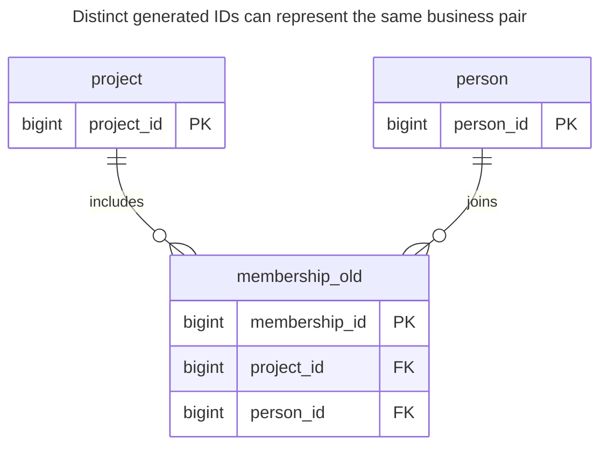
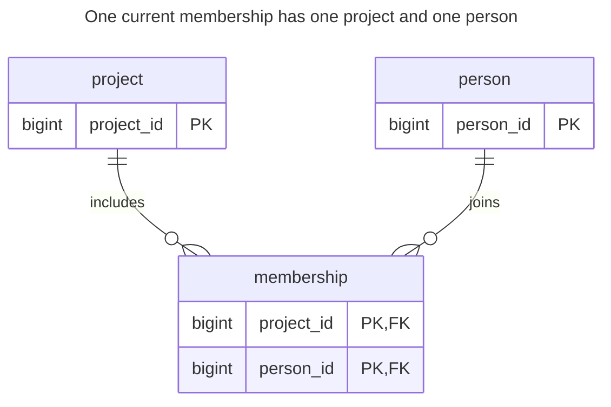
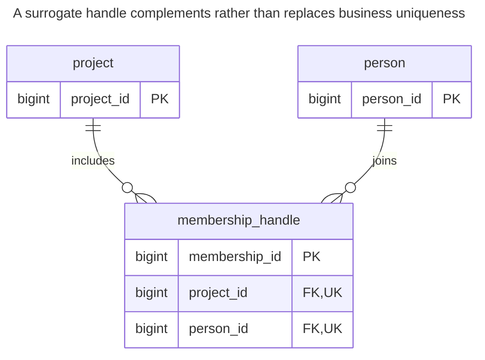
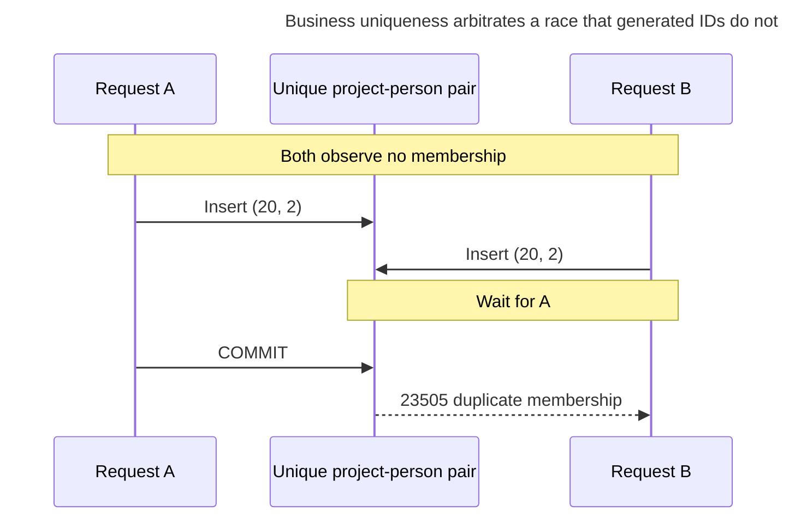
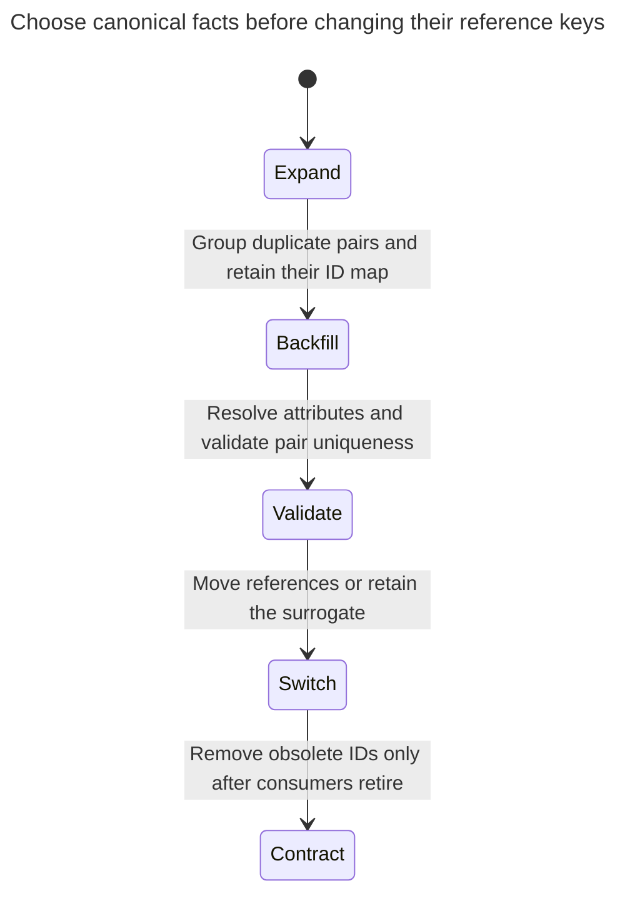

# Mandatory Surrogates

Requiring a surrogate key means adding an `id` column to every table out of habit, even where a natural or composite key is the real identity. In an association table this lets the same pair be linked twice unless a separate unique constraint is added, and elsewhere it hides the business key that should be unique. The chapter shows the duplicates this produces and when a surrogate key is nonetheless the right call. Bill Karwin calls this ID Required.

## Also known as

ID Required, in Bill Karwin's [SQL Antipatterns contents](https://pragprog.com/titles/bksap1/sql-antipatterns-volume-1/). This chapter questions compulsory surrogate identity, not deliberately chosen generated keys.

## Context

You model current membership of people in projects. The requirement says that a person is either a member of a project or is not; it does not describe multiple independent engagements. The pair already identifies the fact. A generic persistence layer or house convention nevertheless asks every table for an `id`.

## Problem

You declare only the generated key unique and let the actual business identity repeat. Each row is individually addressable, but two rows can claim the same membership. Counting rows then counts duplicate representations rather than people, and deleting by generated ID can leave a second copy behind.

The harmful condition is the missing business constraint combined with an unexplained identity policy. Keeping a surrogate and declaring the pair unique is a sound alternative. PostgreSQL's [identity documentation](https://www.postgresql.org/docs/18/ddl-identity-columns.html) distinguishes generated allocation from uniqueness; neither operation discovers which business fact should occur once.

## Why people do it

A single-column handle is easy to pass through APIs and child tables. It also keeps a reference stable when a relationship's endpoints can change. Those benefits justify a surrogate for a relationship with an independent lifecycle. They do not make two current memberships for the same pair distinct facts.

You may also expect all composite keys to be troublesome. That is a tooling requirement to evaluate, rather than a schema invariant to discard. A surrogate plus a separate unique pair can satisfy both requirements without forcing every consumer to use the pair.

## Consequences

- ➖ A row count exaggerates membership when duplicates are admitted.
- ➖ An edit by pair can affect several rows while an edit by surrogate affects only one copy.
- ➖ Removing duplicates becomes a reference migration if other rows already point to different copies.
- ➖ An unnecessary generated key adds another identity to document, index and reconcile during imports.

## Signs

- The only answer to “what does this ID identify?” is “every table has one.”
- You use `DISTINCT` on routine relationship reads to hide repeated pairs.
- You have a surrogate primary key but no declared uniqueness for the business fact.
- A retry inserts another membership because it always receives a fresh ID.

## A better way

Identify the fact first. For one current membership per project/person pair, use that pair as the primary key. If other records need an independent membership handle, keep the surrogate and declare `UNIQUE (project_id, person_id)`. If rejoining creates a distinct engagement, model its time or engagement identity and define which engagements may overlap.

### Alternatives and selection

| Sibling | Relationship | Deciding requirement |
| --- | --- | --- |
| [Natural Key](natural-key.md) | Replacement for an unnecessary surrogate | A mandatory, stable business tuple already identifies the row |
| [Surrogate Key](surrogate-key.md) | Implementation option, complemented by business uniqueness | References must survive changes to business attributes or endpoints |
| [Association Table](association-table.md) | Replacement structure for the relationship | The fact is membership of two existing endpoints |
| Surrogate plus a unique pair | Implementation option | Tooling or dependent rows benefit from one handle while the pair must still be unique |

See the [Decision Atlas](decision-atlas.md). Do not remove an ID that has become an external contract merely to make a table look cleaner; the correct repair may be adding the missing uniqueness rule.

## Example

### Structure

**Before:** the surrogate distinguishes rows without distinguishing memberships.



Both endpoint references are valid. The defect is specifically the missing uniqueness of their combination.

```sql
CREATE TABLE project (project_id bigint PRIMARY KEY);
CREATE TABLE person (person_id bigint PRIMARY KEY);
CREATE TABLE membership_old (
    membership_id bigint GENERATED ALWAYS AS IDENTITY PRIMARY KEY,
    project_id bigint NOT NULL REFERENCES project (project_id),
    person_id bigint NOT NULL REFERENCES person (person_id)
);
INSERT INTO project VALUES (10);
INSERT INTO person VALUES (1), (2);
INSERT INTO membership_old (project_id, person_id) VALUES (10, 1), (10, 1), (10, 2);
SELECT project_id, count(*) AS members FROM membership_old GROUP BY project_id;
```

The count is `(10, 3)` although only people `1` and `2` participate. All three inserts satisfy the declared surrogate and endpoint constraints.

**After:** let the pair identify membership.



Each pair can occur once. No extra number is needed for this example's reads, writes or references.

```sql
CREATE TABLE membership (
    project_id bigint NOT NULL REFERENCES project (project_id),
    person_id bigint NOT NULL REFERENCES person (person_id),
    CONSTRAINT membership_pkey PRIMARY KEY (project_id, person_id)
);
CREATE INDEX membership_person_idx ON membership (person_id, project_id);
CREATE TABLE membership_id_map (
    old_membership_id bigint PRIMARY KEY REFERENCES membership_old (membership_id),
    project_id bigint NOT NULL,
    person_id bigint NOT NULL,
    FOREIGN KEY (project_id, person_id) REFERENCES membership (project_id, person_id)
);
BEGIN;
LOCK TABLE membership_old IN SHARE ROW EXCLUSIVE MODE;
INSERT INTO membership SELECT DISTINCT project_id, person_id FROM membership_old;
INSERT INTO membership_id_map
SELECT membership_id, project_id, person_id FROM membership_old;
COMMIT;
SELECT project_id, count(*) AS members FROM membership GROUP BY project_id;
SELECT * FROM membership_id_map ORDER BY old_membership_id;
```

The corrected count is `(10, 2)`. The mapping retains old IDs `1` and `2` for the same `(10, 1)` pair and old ID `3` for `(10, 2)`. No source row is destroyed. For this pure membership, collapsing identical pairs is intentional; conflicting roles or dates require a domain decision before collapse.

```sql
INSERT INTO membership VALUES (10, 1);
```

PostgreSQL 18.6 raises SQLSTATE `23505`: `ERROR: duplicate key value violates unique constraint "membership_pkey"`, with `DETAIL: Key (project_id, person_id)=(10, 1) already exists.` The [complete script](../assets/mandatory-surrogates/mandatory-surrogates.sql) asserts that rejection and the final membership count.

If you retain the original identity instead, resolve duplicate pairs and add a unique constraint on the pair. This standalone table demonstrates the equivalent destination:



The two `UK` markers denote one composite unique pair. The surrogate supplies a separate reference handle without permitting repeated memberships.

```sql
BEGIN;
LOCK TABLE membership_old IN SHARE ROW EXCLUSIVE MODE;
-- Only this lab has no incoming references except its retained ID map.
-- Keep the old rows and demonstrate the alternative on a separate table.
CREATE TABLE membership_handle (
    membership_id bigint GENERATED ALWAYS AS IDENTITY PRIMARY KEY,
    project_id bigint NOT NULL REFERENCES project (project_id),
    person_id bigint NOT NULL REFERENCES person (person_id),
    UNIQUE (project_id, person_id)
);
INSERT INTO membership_handle (project_id, person_id)
SELECT project_id, person_id FROM membership;
COMMIT;
```

The separate table demonstrates the alternative without deleting the evidence used by the ID map. In a real in-place repair, retain one agreed old ID per pair, remap all incoming references and only then remove the duplicates.

### Engine support

- **PostgreSQL 18:** [composite primary and foreign keys](https://www.postgresql.org/docs/18/ddl-constraints.html#DDL-CONSTRAINTS-FK) support pair identity directly. A surrogate is optional.
- **MySQL 8.4 / InnoDB:** [secondary indexes contain the primary key](https://dev.mysql.com/doc/refman/8.4/en/innodb-index-types.html). Compare complete index payloads before choosing a wide business primary key or an additional surrogate.
- **SQLite:** ordinary rowid tables can [permit nulls in some primary keys](https://www.sqlite.org/lang_createtable.html#the_primary_key). The explicit `NOT NULL` declarations on both pair components matter when porting this schema.

### Failure and concurrency

Two requests can both observe no membership and then insert it. Pair uniqueness, whether primary or alternate, supplies the conflict boundary. PostgreSQL [waits for an uncommitted conflicting unique entry](https://www.postgresql.org/docs/18/index-unique-checks.html) before returning a duplicate or permitting the insert after rollback.



Treat “ensure this membership exists” differently from “create a new engagement.” After a lost response, resolve by the business identity before allocating another handle. If a duplicate carries different role data, report the conflict rather than assuming the desired result already exists.

### Migration

Find duplicate and null business keys. Inventory every reference to the generated ID, including exports and API clients. Retain a canonical-ID map before changing children; merging two memberships may require merging their dependent histories, not merely updating one FK.



The lab copies under a source write lock. A live repair can keep the surrogate permanently, build a [unique index concurrently](https://www.postgresql.org/docs/18/sql-createindex.html#SQL-CREATEINDEX-CONCURRENTLY) after cleanup and attach the constraint in a short DDL window. Prevent new duplicates during cleanup; concurrent index creation can fail if writers keep introducing them. Preserve old-ID resolution through the rollback window. See [Expand and Contract](expand-contract.md).

## Related patterns and anti-patterns

- [Natural Key](natural-key.md) evaluates the stability and scope of a business tuple.
- [Surrogate Key](surrogate-key.md) gives an independent handle a concrete purpose.
- [Association Table](association-table.md) places relationship attributes on the pair they describe.
