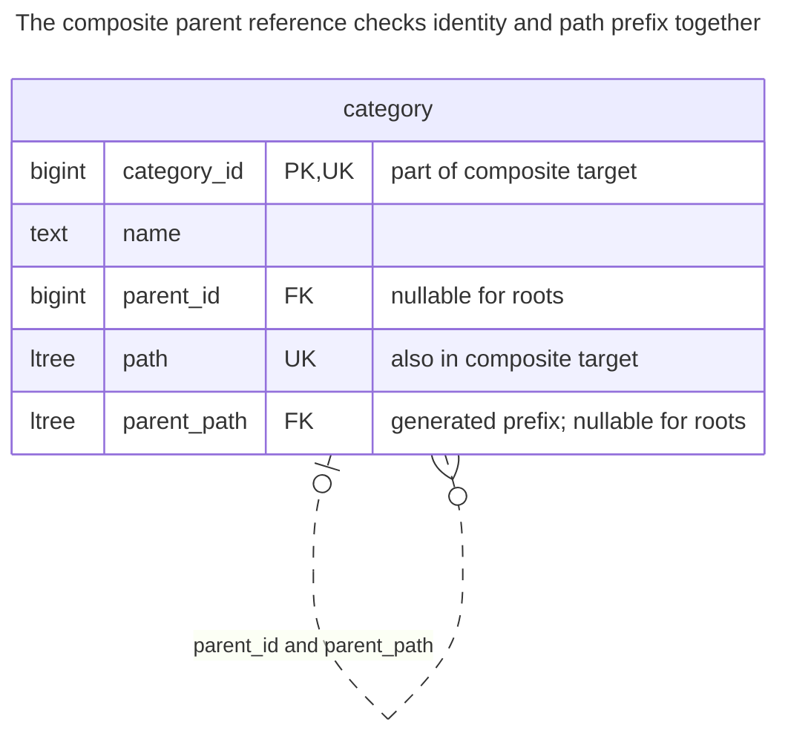
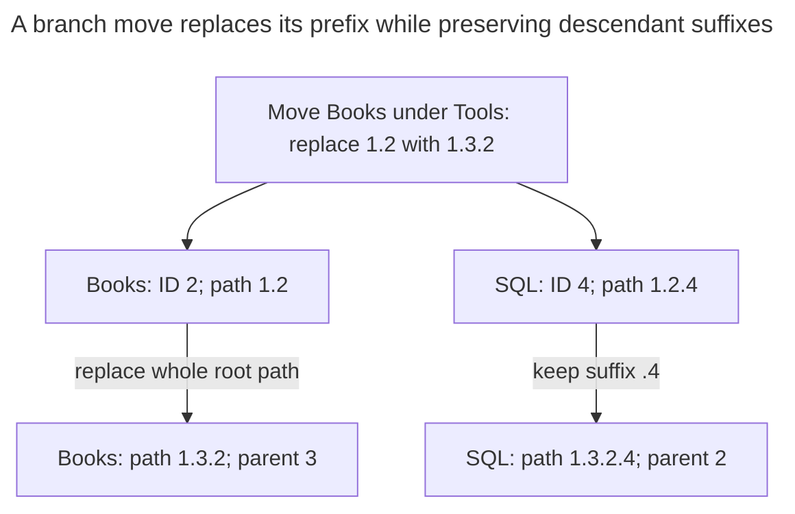
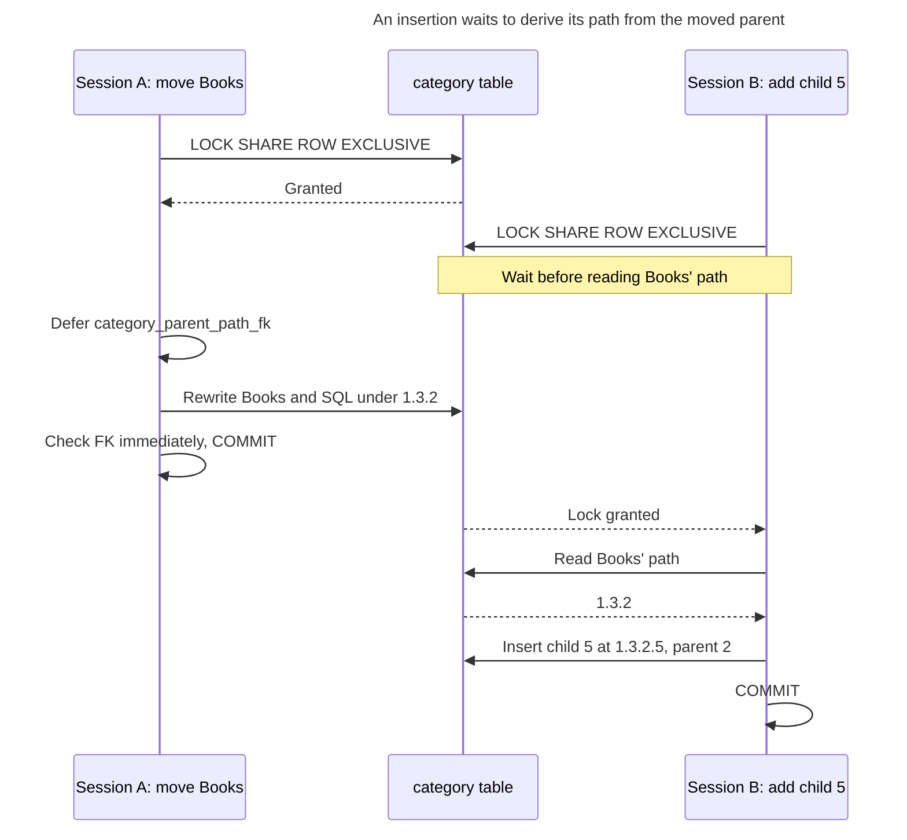
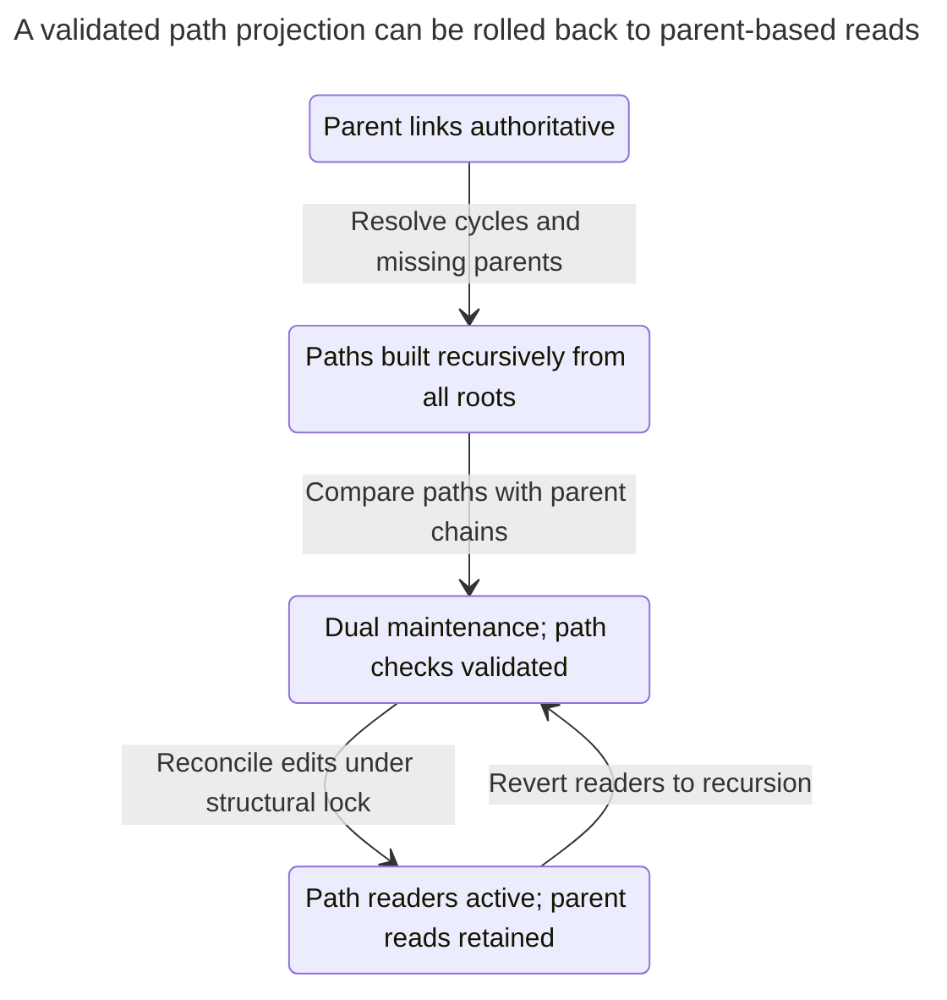

# Materialized Path

## Intent

A materialized path stores in each row the full path from the root to the node, such as `1.4.17`. Subtree and ancestor queries become path comparisons that suitable indexes can serve, and PostgreSQL's `ltree` and SQL Server's `hierarchyid` offer native types and operators for it. The chapter covers path encoding, ordering siblings, the cost of moving a subtree, which rewrites the path of every descendant, and how constraints, triggers or application code keep the path consistent with the parent reference. The [PostgreSQL `ltree` manual](https://www.postgresql.org/docs/18/ltree.html) documents the label-path operators and their supported indexes.

## Also known as

Path enumeration, the name used in [Bill Karwin's hierarchy slides](https://www.slideshare.net/billkarwin/models-for-hierarchical-data). [MongoDB](https://www.mongodb.com/docs/manual/tutorial/model-tree-structures-with-materialized-paths/) uses “Materialized Paths”; Kimball's [pathstring attribute](https://www.kimballgroup.com/data-warehouse-business-intelligence-resources/kimball-techniques/dimensional-modeling-techniques/ragged-variable-depth-hierarchy/) applies the same idea to dimension hierarchies.

## Problem

You repeatedly read a category with all its descendants or show its breadcrumbs. With only a parent reference, every read traverses the hierarchy again. You can afford more work when an editor moves a branch, but want reads to use the ancestry you have already computed.

A free-form string is a tempting shortcut. Without a label boundary, the prefix `1.2` also matches `1.20`; without a maintenance rule, the path can disagree with the parent ID. Changing a category's display name should not rewrite every descendant. The path therefore needs an unambiguous encoding, stable labels and an explicit relationship to parenthood.

## Solution

Store each node's root-to-self path using immutable numeric IDs as labels. Keep the human name separate. The implementation uses PostgreSQL's [`ltree` extension](https://www.postgresql.org/docs/18/ltree.html), with dots separating labels, `<@` for descendant-or-self and `@>` for ancestor-or-self. Use GiST for those containment operators; an ordinary B-tree over `ltree` supports comparisons and equality, not these containment searches.

Retain `parent_id` for immediate-child queries. Derive `parent_path` from the current row's path and make `(parent_id, parent_path)` reference the actual parent row's `(category_id, path)`. This declarative hybrid checks both identity and prefix. Each parent path is one label shorter, so valid references cannot form a cycle. Moving a branch changes its root's parent and rewrites every path in the branch within one transaction.

## Alternatives and selection

| Sibling | Relationship | Deciding requirement |
| --- | --- | --- |
| [Adjacency List](adjacency-list.md) | Replacement; complement through the retained parent reference | Frequent moves matter more than precomputed ancestry |
| [Nested Sets](nested-sets.md) | Replacement | You publish a mostly static tree and want interval-based aggregation |
| [Closure Table](closure-table.md) | Replacement | You need ancestor/descendant joins with explicit distance, or a separately designed multiple-parent model |
| `ltree` / SQL Server `hierarchyid` | Implementation options | Native operators and indexing justify engine-specific SQL |

See the [Decision Atlas](decision-atlas.md) for the full table. Path encoding changes storage and indexing, not the underlying one-parent requirement. Combining a parent reference with a path also gives you a source from which to rebuild that path.

## Structure



One row carries both node identity and its location. The path repeats ancestor IDs; the parent foreign key connects that encoded location to an existing row. SQL's ID remains `4` after the move even though its path changes.



Both paths change, but only Books changes parent identity. SQL's generated `parent_path` becomes `1.3.2`, matching Books' new path when the deferred FK is checked.

## Tables and invariants

- **`category`** has a stable primary key and a unique path. Positive IDs become decimal labels; `category_path_shape` requires the last label to equal the row's ID and roots to have exactly one label.
- **`parent_path`** is a stored generated column, not caller input. PostgreSQL permits [immutable, row-local generation expressions](https://www.postgresql.org/docs/18/ddl-generated-columns.html); this expression removes the final label without looking up another row.
- **`category_parent_path_fk`** uses `MATCH FULL` so the parent ID and prefix must both be null or both identify a parent. [Deferrable foreign-key checks](https://www.postgresql.org/docs/18/sql-createtable.html) allow intermediate states during a branch rewrite but require a consistent final state.
- **Ordering** by path follows label order. [`ltree` compares child labels as text](https://www.postgresql.org/docs/18/ltree.html), so label `10` precedes `2`. Numeric IDs give stable traversal order, not numeric sibling order or an editor-defined ranking.

## When to use

- Subtree reads and breadcrumbs dominate branch moves.
- Each node has at most one parent and IDs can stay unchanged when labels or names change.
- You can maintain paths transactionally and keep large rewrites out of latency-sensitive requests.

## Consequences and trade-offs

- ➕ Stored ancestry makes subtree and ancestor predicates direct path operations.
- ➕ The hybrid schema rejects a path that names the wrong parent without a custom trigger.
- ➖ A move rewrites every descendant path and its indexes; changing an ancestor's ID would do the same.
- ➖ Ancestry consumes space repeatedly, and paths grow with depth.
- ➖ Native path operators and generated-column expressions make this implementation engine-specific.

## Implementation

The [complete script](../assets/materialized-path/materialized-path.sql), checked on PostgreSQL 18.6, installs `ltree`, builds the same catalog as the other hierarchy examples and verifies the expected foreign-key error. These are the essential definitions:

```sql
CREATE EXTENSION ltree;
CREATE TABLE category (
    category_id bigint PRIMARY KEY CHECK (category_id > 0),
    name text NOT NULL,
    parent_id bigint,
    path ltree NOT NULL UNIQUE,
    parent_path ltree GENERATED ALWAYS AS (
        CASE WHEN nlevel(path) > 1
             THEN subpath(path, 0, nlevel(path) - 1) END
    ) STORED,
    UNIQUE (category_id, path),
    CONSTRAINT category_path_shape CHECK (
        nlevel(path) > 0
        AND subpath(path, -1) = text2ltree(category_id::text)
        AND ((parent_id IS NULL) = (nlevel(path) = 1))
    ),
    CONSTRAINT category_parent_path_fk FOREIGN KEY (parent_id, parent_path)
        REFERENCES category (category_id, path) MATCH FULL
        DEFERRABLE INITIALLY IMMEDIATE
);
CREATE INDEX category_path_gist ON category USING gist (path);
CREATE INDEX category_parent_idx ON category (parent_id, parent_path);
```

Insert a root, then derive a child's path from its parent's stored value. Every structural writer follows the same locking protocol:

```sql
BEGIN;
LOCK TABLE category IN SHARE ROW EXCLUSIVE MODE;
INSERT INTO category (category_id, name, parent_id, path)
VALUES (1, 'Catalog', NULL, '1');
INSERT INTO category (category_id, name, parent_id, path)
SELECT 2, 'Books', category_id, path || '2'::ltree
FROM category WHERE category_id = 1;
INSERT INTO category (category_id, name, parent_id, path)
VALUES (3, 'Tools', 1, '1.3'), (4, 'SQL', 2, '1.2.4');
COMMIT;
```

Read a subtree, including Books, and then SQL's ancestors, including itself:

```sql
SELECT category_id, path FROM category
WHERE path <@ '1.2'::ltree ORDER BY path;
SELECT category_id, name FROM category
WHERE path @> '1.2.4'::ltree ORDER BY nlevel(path);
```

The first query returns `(2, 1.2)` and `(4, 1.2.4)`; the second returns Catalog, Books, SQL. For direct children, use `parent_id`, as the script demonstrates. If you omit that column in a simpler schema, combine containment with a one-level depth difference.

Move Books under Tools by replacing the old prefix for every node in the branch:

```sql
BEGIN;
LOCK TABLE category IN SHARE ROW EXCLUSIVE MODE;
SET CONSTRAINTS category_parent_path_fk DEFERRED;
WITH moving AS (
    SELECT s.category_id, s.path AS old_path,
           d.category_id AS new_parent_id,
           d.path || text2ltree(s.category_id::text) AS new_path
    FROM category AS s CROSS JOIN category AS d
    WHERE s.category_id = 2 AND d.category_id = 3
      AND NOT d.path <@ s.path
)
UPDATE category AS c
SET path = CASE WHEN c.category_id = m.category_id THEN m.new_path
                ELSE m.new_path || subpath(c.path, nlevel(m.old_path)) END,
    parent_id = CASE WHEN c.category_id = m.category_id
                     THEN m.new_parent_id ELSE c.parent_id END
FROM moving AS m WHERE c.path <@ m.old_path;
SET CONSTRAINTS category_parent_path_fk IMMEDIATE;
COMMIT;
```

The move updates two rows. Books becomes `1.3.2`, SQL becomes `1.3.2.4`, and only Books changes `parent_id`. The destination predicate excludes the moving subtree, including its root; require the expected affected-row count so a missing destination or rejected move is not reported as success. Defer the foreign key until the rewrite finishes, then force its check before commit.

After the move, changing only SQL's parent is invalid:

```sql
UPDATE category SET parent_id = 1 WHERE category_id = 4;
```

PostgreSQL 18.6 raises SQLSTATE `23503`: `ERROR: insert or update on table "category" violates foreign key constraint "category_parent_path_fk"`, with `DETAIL: Key (parent_id, parent_path)=(1, 1.3.2) is not present in table "category".` Updating only a path can fail the same constraint. The script deletes the complete Books branch with a containment predicate; deleting an ancestor alone is rejected while children still reference it.

Delete the moved Books subtree in one transaction:

```sql
BEGIN;
LOCK TABLE category IN SHARE ROW EXCLUSIVE MODE;
DELETE FROM category WHERE path <@ '1.3.2'::ltree;
COMMIT;
```

## Engine support

- **PostgreSQL 18:** [`ltree`](https://www.postgresql.org/docs/18/ltree.html) is a supplied extension, installed with `CREATE EXTENSION`. Its GiST operator class supports containment. Use a **stored** generated column here: PostgreSQL 18's [virtual-column restrictions](https://www.postgresql.org/docs/18/ddl-generated-columns.html) exclude user-defined types and functions.
- **SQL Server 2025 (17.x):** [`hierarchyid`](https://learn.microsoft.com/en-us/sql/relational-databases/hierarchical-data-sql-server?view=sql-server-ver17) is an implementation option with depth-first comparison and `GetDescendant` for allocating positions between siblings. It does not by itself enforce path uniqueness or parent existence; Microsoft's guide also demonstrates a computed-parent foreign-key design.
- **MySQL 8.4:** a text-path implementation needs its own encoding and maintenance logic. InnoDB [does not defer foreign-key checks](https://dev.mysql.com/doc/refman/8.4/en/constraint-foreign-key.html), so the deferred composite-FK rewrite above needs a different write strategy.
- **Oracle AI Database 26ai / SQLite 3:** both document [deferred constraints in Oracle](https://docs.oracle.com/en/database/oracle/oracle-database/26/sqlrf/constraint.html) and [deferred foreign keys in SQLite](https://www.sqlite.org/foreignkeys.html). These do not supply PostgreSQL's `ltree` functions; port the path encoding and generated expression separately.

For a text implementation, include delimiters at both ends, such as `/1/2/`, and search descendants with an anchored prefix. PostgreSQL documents [`text_pattern_ops`](https://www.postgresql.org/docs/18/indexes-opclass.html) for indexed pattern matching where locale-aware ordering is unsuitable. A substring search for an ID anywhere in the path is a different query. Ancestor lookup can enumerate complete prefixes for equality searches; it is not the same as a single descendant prefix scan.

## Failure and concurrency

A concurrent insertion can derive a child's path from the old location while another transaction moves its parent. The foreign key prevents a committed mismatch in this schema, but it does not choose which editor's request should succeed. The example uses [a self-conflicting table lock](https://www.postgresql.org/docs/18/explicit-locking.html#LOCKING-TABLES) acquired before reading paths, at [Read Committed](https://www.postgresql.org/docs/18/transaction-iso.html#XACT-READ-COMMITTED), to serialize structural operations. Keep IDs immutable and include inserts and deletes in that protocol.



This insertion is a hypothetical operation after the sample move, using the same lock protocol. It reads the new prefix only after the move commits, so the child starts at the correct location.

Run the whole rewrite in one transaction. Roll back on any failure and recompute prefixes from current rows before retrying. Do not split a large subtree move into independently committed batches: children would reference a mixture of locations. If a move is too large for one transaction, publish a separately built hierarchy version and switch readers to it after validation rather than exposing a half-moved tree.

## Migration

Starting from an adjacency list, first resolve cycles and missing parents. Add a separate path projection and populate it recursively from every root using stable IDs. Keep parent links authoritative while a controlled writer updates both representations; compare each stored path with the path derived from the parent chain.

Build and validate the replacement table with its path constraints before switching reads. Reconcile concurrent edits under a short structural-write lock at cutover, and preserve IDs so references from other tables do not change. Retain parent-based reads and dual maintenance for the rollback window. You can revert reads to recursion without changing node identities; stop path writes only after no reader depends on them.



The cutover changes the read representation while stable IDs and parent links remain available. Returning readers to recursion is possible throughout the dual-maintenance rollback window.

## Anti-patterns and common mistakes

- Using names as identity labels, making a spelling correction rewrite a whole branch.
- Matching `1.2%` in a free-form string and accidentally selecting `1.20`.
- Assuming `ltree` or `hierarchyid` alone proves parent existence.
- Moving only the branch root's path, or updating `parent_id` without rebuilding descendant paths.
- Expecting text-sorted IDs to encode application-defined sibling order.

## Known uses

- PostgreSQL's [`ltree` example](https://www.postgresql.org/docs/18/ltree.html#LTREE-EXAMPLE) stores paths such as `Top.Science.Astronomy` and indexes them.
- Microsoft's [hierarchical organization examples](https://learn.microsoft.com/en-us/sql/relational-databases/hierarchical-data-sql-server?view=sql-server-ver17) use `hierarchyid` to encode tree positions.
- MongoDB's [Materialized Paths tutorial](https://www.mongodb.com/docs/manual/tutorial/model-tree-structures-with-materialized-paths/) stores ancestor IDs in a delimited string; its regex queries illustrate the importance of a rooted prefix.

## Related patterns

- [Adjacency List](adjacency-list.md) supplies the parent links you can use to rebuild paths.
- [Nested Sets](nested-sets.md) trades path encoding for interval numbering.
- [Closure Table](closure-table.md) stores ancestry as individually indexed pairs.
