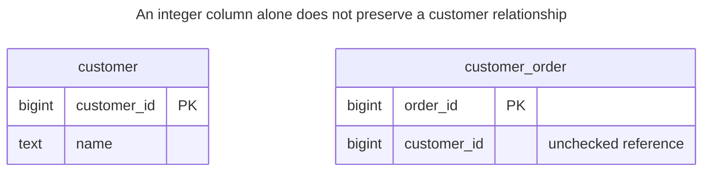
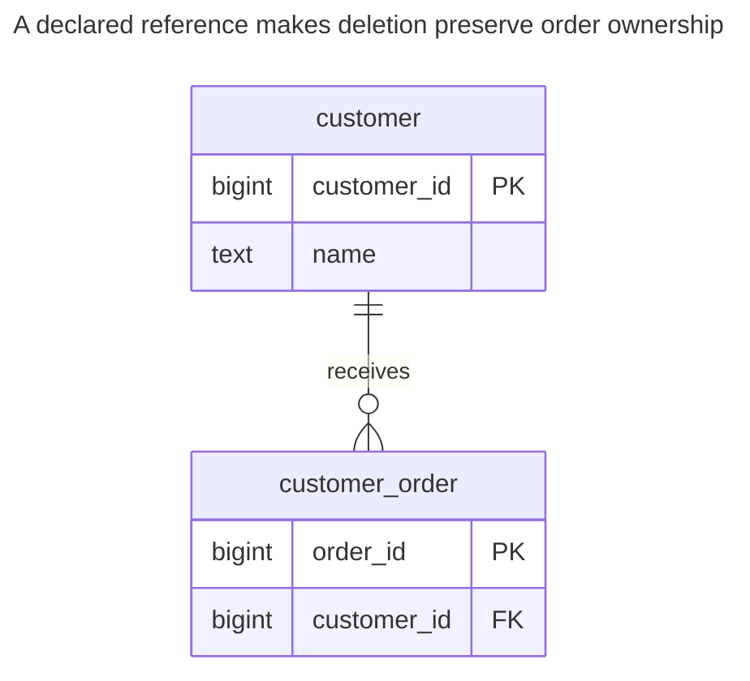
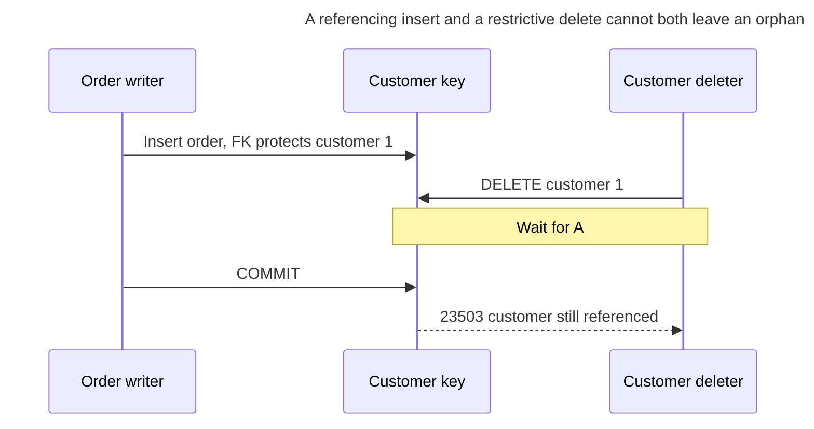
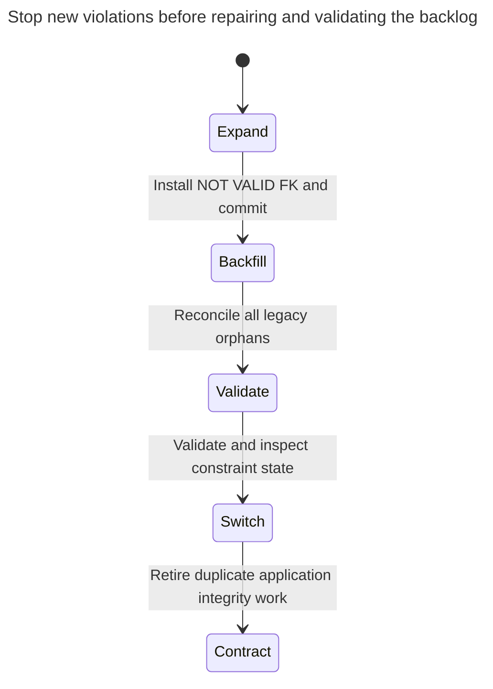

# Missing Foreign Keys

Omitting foreign keys means storing references without declaring them as foreign key constraints, usually to avoid constraint-checking overhead or to enforce referential integrity in application code. Sooner or later rows appear that point to deleted or never-existing records, and every query and report has to defend against them. The chapter shows how orphans appear, what declaring the constraint really costs, and how to clean up existing data and add constraints without long locks. Bill Karwin calls this Keyless Entry.

## Also known as

Keyless Entry, in Bill Karwin's [SQL Antipatterns contents](https://pragprog.com/titles/bksap1/sql-antipatterns-volume-1/). Here “keyless” means missing declared relationships, even when every table has a primary key.

## Context

Orders belong to customers in the same database. Your application loads a customer before creating an order, and it checks for orders before deleting a customer. That looks sufficient while one writer runs. Imports, maintenance SQL and concurrent transactions add paths that do not share that sequence of checks.

## Problem

You store `customer_id` as an ordinary required integer. The database can check that it is present, but the schema says nothing about which integers identify customers or what customer deletion must do to existing orders. An application pre-check is a statement about a past observation; it does not reserve the parent until the referencing write commits.

Do not confuse this case with a remote identifier. A local FK is appropriate when the referenced entity and its lifecycle belong to this database. A remote service ID, historical source identifier or temporarily unresolved staging record may deliberately have no local target; name that weaker contract explicitly instead of presenting it as a guaranteed local relationship.

## Why people do it

You avoid FK probes and parent-key contention, or want imports to arrive in any order. Those are real operational concerns. They need a measured workload and an ingestion design, not a permanent assumption that all writers will preserve an undeclared invariant. A staging table can accept unresolved input while the published tables remain constrained.

## Consequences

- ➖ Reports using inner joins silently omit orphan orders in this example.
- ➖ Parent deletion has no declared dependency policy; it can leave required references unresolved.
- ➖ Cleanup must infer whether an orphan is a bad reference, a lost parent or a historical record.
- ➖ Application teams must recreate the same check and synchronization protocol for every write path.
- ➖ Adding the rule later requires a data audit and a planned validation window.

## Signs

- A column named for another table's ID has no FK declaration.
- An anti-join repair job repeatedly finds new orphans.
- A bulk loader turns off constraints and assumes re-enabling them checks old rows.
- A tenant column sits beside a foreign ID, but the reference does not include tenant ownership.

## A better way

Declare the intended relationship, including its nullability and deletion action. For orders that must retain their customer, use a mandatory FK with restrictive deletion. For dependent facts owned entirely by the parent, a cascade may be appropriate. PostgreSQL documents [these reference actions](https://www.postgresql.org/docs/18/ddl-constraints.html#DDL-CONSTRAINTS-FK); pick their business meaning before their convenience.

### Alternatives and selection

| Choice | Relationship | Choose it when |
| --- | --- | --- |
| Ordinary FK | Replacement for an unchecked local reference | Parent and child share a database integrity boundary |
| Deferred FK | Implementation option | A transaction needs temporary insertion-order flexibility but must be valid at commit |
| Unconstrained staging table plus validated import | Complement | Sources arrive out of order or need quarantine before publication |
| [Exclusive Arc](exclusive-arc.md) | Replacement for a reference with several target kinds | A small target set needs real FKs plus exactly-one ownership |
| [Shared Schema](shared-schema.md) | Complement | Tenant ownership requires a scoped composite relationship, not just an existing ID |

A PostgreSQL [deferrable constraint](https://www.postgresql.org/docs/18/sql-set-constraints.html) postpones checking within one transaction, not across arbitrary committed ingestion stages. [Polymorphic Associations](polymorphic-associations.md) needs a different reference structure. See the [Decision Atlas](decision-atlas.md) for the full table.

## Example

### Structure

**Before:** orders carry customer numbers without a declared edge.



Both tables have primary keys. Neither key constrains `customer_order.customer_id` against the other table.

```sql
CREATE TABLE customer (customer_id bigint PRIMARY KEY, name text NOT NULL);
CREATE TABLE customer_order (
    order_id bigint PRIMARY KEY,
    customer_id bigint NOT NULL
);
INSERT INTO customer VALUES (1, 'Harbor'), (2, 'Meadow');
INSERT INTO customer_order VALUES (10, 1), (20, 2);
DELETE FROM customer WHERE customer_id = 2;
SELECT o.order_id, o.customer_id FROM customer_order AS o
LEFT JOIN customer AS c USING (customer_id) WHERE c.customer_id IS NULL;
```

The anti-join returns `(20, 2)`. The delete succeeded, leaving an order whose required customer is gone.

**After:** repair the existing table and validate a real reference.



An order must have one existing customer. Customers can have no orders. The default deletion policy prevents removing a customer still in use.

```sql
CREATE INDEX customer_order_customer_idx ON customer_order (customer_id);
ALTER TABLE customer_order ADD CONSTRAINT customer_order_customer_fk
    FOREIGN KEY (customer_id) REFERENCES customer (customer_id) NOT VALID;
```

PostgreSQL's [`NOT VALID` FK](https://www.postgresql.org/docs/18/sql-altertable.html) checks subsequent writes while deferring the scan of existing data. Commit installation before the later validation. The old orphan remains visible for repair; a new one is already rejected:

```sql
INSERT INTO customer_order VALUES (30, 999);
```

PostgreSQL 18.6 raises SQLSTATE `23503`: `ERROR: insert or update on table "customer_order" violates foreign key constraint "customer_order_customer_fk"`. Its detail reports missing `(customer_id)=(999)`.

```sql
CREATE TABLE order_reject (
    order_id bigint PRIMARY KEY,
    customer_id bigint NOT NULL,
    reason text NOT NULL
);
BEGIN;
LOCK TABLE customer_order, customer IN SHARE ROW EXCLUSIVE MODE;
INSERT INTO order_reject
SELECT o.order_id, o.customer_id, 'missing customer'
FROM customer_order AS o LEFT JOIN customer AS c USING (customer_id)
WHERE c.customer_id IS NULL;
DELETE FROM customer_order AS o USING order_reject AS r
WHERE o.order_id = r.order_id;
COMMIT;
ALTER TABLE customer_order VALIDATE CONSTRAINT customer_order_customer_fk;
SELECT order_id, customer_id FROM customer_order ORDER BY order_id;
SELECT * FROM order_reject ORDER BY order_id;
```

Order `10` remains `(10, 1)`; the reject table preserves `(20, 2, missing customer)`. Quarantine is this lab's chosen disposition. In production, investigate the order and restore or correct its parent when justified; do not discard commercial records simply to make validation pass. The two mutations are atomic, and the original IDs remain available for reconciliation.

```sql
DELETE FROM customer WHERE customer_id = 1;
```

PostgreSQL 18.6 raises SQLSTATE `23503`: `ERROR: update or delete on table "customer" violates foreign key constraint "customer_order_customer_fk" on table "customer_order"`. The [complete script](../assets/missing-foreign-keys/missing-foreign-keys.sql) asserts both errors and verifies that the constraint is validated.

### Engine support

- **PostgreSQL 18:** FK declaration [does not create a child index](https://www.postgresql.org/docs/18/ddl-constraints.html#DDL-CONSTRAINTS-FK). Add one when parent deletion and child lookup need it; do not claim a universal performance cost without measuring those operations.
- **MySQL 8.4 / InnoDB:** [required child indexes are created automatically if absent, and turning `foreign_key_checks` back on does not scan existing data](https://dev.mysql.com/doc/refman/8.4/en/create-table-foreign-keys.html). Re-enabling is not equivalent to PostgreSQL validation.
- **SQL Server:** [enabled and trusted are separate states](https://learn.microsoft.com/en-us/sql/relational-databases/tables/disable-foreign-key-constraints-with-insert-and-update-statements?view=sql-server-ver17). Use the documented `WITH CHECK CHECK CONSTRAINT` procedure when validating an untrusted reference.
- **Oracle:** [`ENABLE NOVALIDATE` and `ENABLE VALIDATE`](https://docs.oracle.com/en/database/oracle/oracle-database/26/sqlrf/constraint.html) distinguish new-write enforcement from validation of existing rows. Translate the rollout, not PostgreSQL's keywords.
- **SQLite:** [foreign keys must be enabled per connection before a transaction](https://www.sqlite.org/foreignkeys.html#fk_enable). A declared but disabled FK leaves the original problem intact.

### Failure and concurrency

An ordinary read of the parent does not prevent another transaction from deleting it. A declared FK coordinates with parent-key deletion; PostgreSQL's [key-share locks](https://www.postgresql.org/docs/18/explicit-locking.html#LOCKING-ROWS) block deletion while the reference transaction completes.



If deletion commits first, the later insert fails instead. Handle either outcome as a business conflict. FK integrity does not make a deleted customer available forever, and higher isolation alone does not replace a missing relationship rule.

### Migration

Inventory relationship columns and orphan counts, choose deletion policies and resolve scope errors. Install the FK as `NOT VALID` to stop new violations, then repair the backlog. PostgreSQL's [ALTER TABLE lock rules](https://www.postgresql.org/docs/18/sql-altertable.html) require `SHARE ROW EXCLUSIVE` on both tables for installation and `SHARE UPDATE EXCLUSIVE` on the child for validation. These are reduced-impact steps, not lock-free ones.



For a large child, build the supporting index [concurrently](https://www.postgresql.org/docs/18/sql-createindex.html#SQL-CREATEINDEX-CONCURRENTLY) outside a transaction block. Use bounded DDL lock waits, small repair batches and an explicit validation gate before declaring success. Keep user-facing checks for useful messages, while letting the database decide the final race. [Expand and Contract](expand-contract.md) supplies the rollout discipline.

## Related patterns and anti-patterns

- [Polymorphic Associations](polymorphic-associations.md) needs a fixed reference boundary before an FK can be added.
- [Exclusive Arc](exclusive-arc.md) supplies fixed target columns for several parent kinds.
- [Shared Schema](shared-schema.md) includes ownership scope in references.
- [Expand and Contract](expand-contract.md) separates installation, cleanup and validation.
