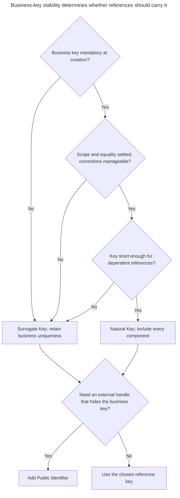
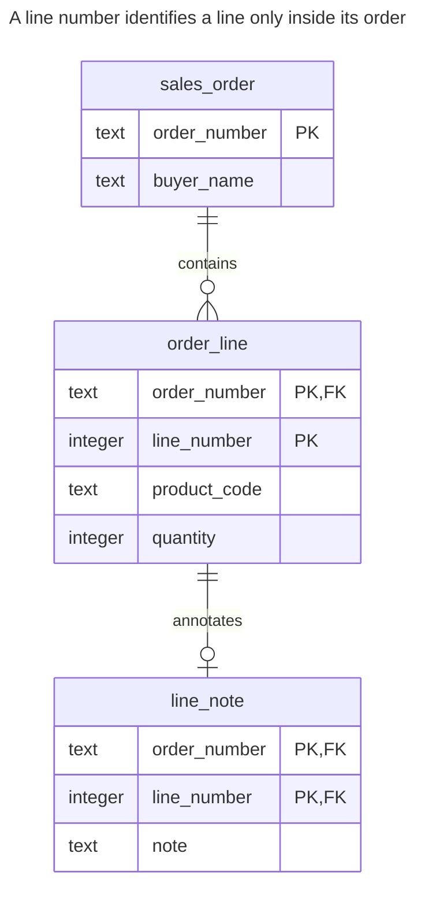
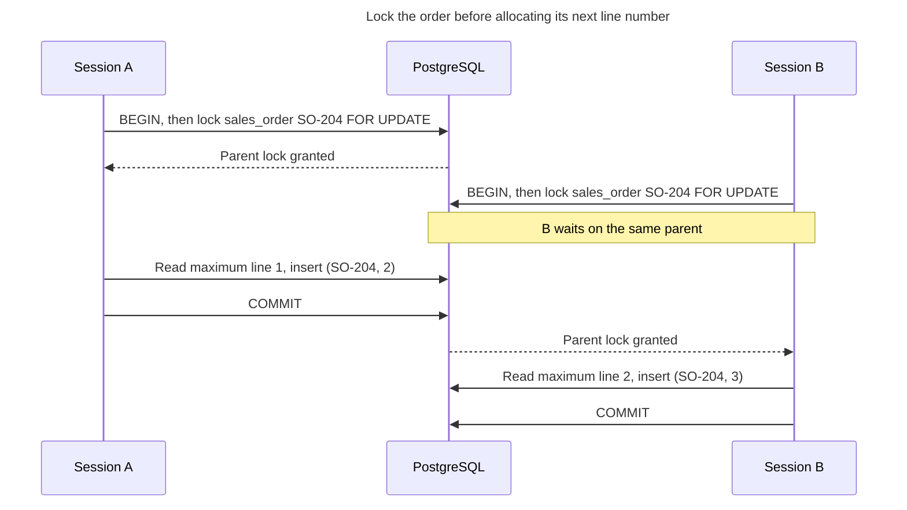

# Natural Key

## Intent

A natural key identifies a row by attributes the business already uses: a country code, an ISBN, or an order number together with a line number. Making it the primary key can remove lookup joins and rules out duplicates of that key by construction, but changing the value requires updating its references too. Judge whether the value is stable, unique and always known at insertion; use a composite key when identity spans several attributes, and retain business uniqueness even if you choose a surrogate primary key. This follows [Ambler's distinction between natural, composite and surrogate keys](https://agiledata.org/essays/keys.html).

## Also known as

Business key. A composite natural key contains several business attributes. In [Ambler's terminology](https://agiledata.org/essays/keys.html), a candidate key can identify a row; the chosen one is primary and the remaining candidates are alternate keys. Composite describes the number of columns, not whether their meaning is natural or generated.

## Problem

Your order desk already identifies a line as “line 1 of SO-104.” If you replace this with an unrelated `line_id` and omit uniqueness on the pair, two rows can both claim to be that line. You then need application code to decide which one a correction means.

The pair is useful only within its declared scope. Is the order number unique across all stores, or only within one store and year? Can operators renumber lines after submission? Can two products appear on separate lines? A product code is not a substitute for a line number when a product may occur twice. Answer these questions before choosing columns.

## Solution

Use `sales_order.order_number` as the order primary key and `(order_number, line_number)` as the line primary key. Reference a line with both values. PostgreSQL [primary keys](https://www.postgresql.org/docs/18/ddl-constraints.html#DDL-CONSTRAINTS-PRIMARY-KEYS) enforce uniqueness and non-nullness; [composite foreign keys](https://www.postgresql.org/docs/18/ddl-constraints.html#DDL-CONSTRAINTS-FK) reference the corresponding column group.

Evaluate a proposed natural key against actual write workflows. Require it at creation, document its uniqueness scope, define equality rules, and find out who can change or reuse it. Prefer another primary key if any of those answers is unsettled. You can still enforce the business value with `NOT NULL` and `UNIQUE` once it is assigned. An identifier's external standard does not by itself prove that it identifies the entity your table represents: a book edition and a physical copy need different identities.

## Alternatives and selection

| Sibling | Relationship | Deciding requirement |
| --- | --- | --- |
| [Surrogate Key](surrogate-key.md) | Replacement for the primary key; complement to a natural unique constraint | Business values change, arrive late or make every reference too wide |
| [Time-Ordered Identifier](time-ordered-identifier.md) | Implementation option for that surrogate replacement | Distributed ID generation is a separate requirement from business uniqueness |
| [Public Identifier](public-identifier.md) | Complement | You need an external handle without publishing the business key |

See the [Decision Atlas](decision-atlas.md) for the full comparison. A composite key is particularly useful for an [Association Table](association-table.md); [Mandatory Surrogates](mandatory-surrogates.md) warns against adding another ID while losing the pair invariant.



Composite identity is useful only when its whole scope is known and acceptable to every dependent. The public-handle decision remains separate from the primary-key choice.

## Structure



The line carries the order number directly, so you can find its contents without joining merely to recover that number. A note carries the complete line identity. In this example, renumbering the order cascades through both levels.

## Tables and invariants

- **`sales_order`** permits one order for each non-null order number.
- **`order_line`** permits one row per order and line number. It requires an existing order and positive line numbers and quantities; it does not require consecutive line numbers.
- **`line_note`** permits at most one note per line and cannot refer to an absent line. Both foreign-key columns are mandatory, so no partial reference is allowed.
- **Renumbering** uses `ON UPDATE CASCADE` on both foreign keys. PostgreSQL documents the action in its [foreign-key rules](https://www.postgresql.org/docs/18/ddl-constraints.html#DDL-CONSTRAINTS-FK).

## When to use

- A short business identifier exists before the row is created and its scope matches your table.
- You control corrections and reuse, and changes are rare enough to update dependent references safely.
- A dependent row or association is naturally addressed by a tuple that callers already know.

## Consequences and trade-offs

- ➕ The primary key enforces the same identity that your order desk uses.
- ➕ Queries by order and line number need no extra ID-resolution step.
- ➖ Every child must store and pass all key columns.
- ➖ Renumbering affects children; publishing the number creates obligations beyond the database too.
- ➖ A later expansion of the uniqueness scope can require changing every reference, for example from an order number to a store-and-order pair.

## Implementation

Run the [complete script](../assets/natural-key/natural-key.sql) to exercise insertion, lookup, cascaded correction and rejection:

```sql
CREATE TABLE sales_order (
    order_number text PRIMARY KEY,
    buyer_name text NOT NULL
);
CREATE TABLE order_line (
    order_number text NOT NULL REFERENCES sales_order (order_number)
        ON UPDATE CASCADE,
    line_number integer NOT NULL CHECK (line_number > 0),
    product_code text NOT NULL,
    quantity integer NOT NULL CHECK (quantity > 0),
    CONSTRAINT order_line_pkey PRIMARY KEY (order_number, line_number)
);
CREATE TABLE line_note (
    order_number text NOT NULL,
    line_number integer NOT NULL,
    note text NOT NULL,
    PRIMARY KEY (order_number, line_number),
    FOREIGN KEY (order_number, line_number)
        REFERENCES order_line (order_number, line_number) ON UPDATE CASCADE
);
```

Correct the parent key rather than issuing independent updates to children:

```sql
INSERT INTO sales_order VALUES ('SO-104', 'Northwind');
INSERT INTO order_line VALUES ('SO-104', 1, 'PEN', 2);
INSERT INTO line_note VALUES ('SO-104', 1, 'Gift wrap');
SELECT product_code, quantity FROM order_line
WHERE order_number = 'SO-104' AND line_number = 1;
UPDATE sales_order SET order_number = 'SO-204'
WHERE order_number = 'SO-104';
SELECT order_number, line_number, note FROM line_note;
```

The first query returns `(PEN, 2)`; after the update the note is `(SO-204, 1, Gift wrap)`. A duplicate line is invalid:

```sql
INSERT INTO order_line VALUES ('SO-204', 1, 'PENCIL', 1);
```

PostgreSQL 18.6 raises SQLSTATE `23505`: `ERROR: duplicate key value violates unique constraint "order_line_pkey"`, with `DETAIL: Key (order_number, line_number)=(SO-204, 1) already exists.` Adding a `line_id` would not justify removing this pair's unique constraint.

## Engine support

- **PostgreSQL 18:** the shown composite keys and update cascades implement the complete example.
- **MySQL 8.4 / InnoDB:** supports [`ON UPDATE CASCADE`](https://dev.mysql.com/doc/refman/8.4/en/create-table-foreign-keys.html). Its [secondary indexes carry the primary key](https://dev.mysql.com/doc/refman/8.4/en/innodb-index-types.html), so a wide composite business key increases their payload too.
- **SQL Server 2025 (17.x):** supports [composite primary and foreign keys and update cascades](https://learn.microsoft.com/en-us/sql/t-sql/statements/create-table-transact-sql?view=sql-server-ver17). Check the whole dependency graph before selecting cascades; SQL Server [rejects multiple cascade paths](https://learn.microsoft.com/en-us/sql/relational-databases/errors-events/mssqlserver-1785-database-engine-error?view=sql-server-ver17).
- **Oracle AI Database 26ai:** its [foreign-key syntax](https://docs.oracle.com/en/database/oracle/oracle-database/26/sqlrf/constraint.html) offers `ON DELETE` actions, not `ON UPDATE CASCADE`. Choose immutable natural keys or design an explicit correction procedure rather than porting this update unchanged.
- **SQLite 3:** ordinary tables can [allow nulls in non-integer primary keys](https://www.sqlite.org/lang_createtable.html#the_primary_key); declare `NOT NULL` explicitly or use [`WITHOUT ROWID`](https://www.sqlite.org/withoutrowid.html). Enable [foreign-key enforcement per connection](https://www.sqlite.org/foreignkeys.html#fk_enable).

## Failure and concurrency

Let the unique constraint arbitrate competing inserts rather than checking for a free pair in application code. PostgreSQL [waits for conflicting uncommitted index entries](https://www.postgresql.org/docs/18/index-unique-checks.html) before deciding whether a duplicate exists. These integrity rules need no application-wide lock or serializable isolation.

Allocating a line number is a different problem. If you calculate `MAX(line_number) + 1`, serialize that allocation for the affected order, for example by taking a [`FOR UPDATE` lock](https://www.postgresql.org/docs/18/explicit-locking.html#LOCKING-ROWS) on its parent inside the inserting transaction, with every allocator following the same protocol. Otherwise expect a conflict and retry. Keep the lock order consistent when correcting several orders. After an uncertain commit, read the original pair and compare its contents; do not automatically create another numbered line.



At read committed isolation, B reads the line numbers in a new statement after acquiring the lock. The primary key still rejects duplicate pairs from a writer that bypasses this allocation protocol.

## Migration

Start by finding nulls, duplicates and values whose equality your application interprets differently. Resolve them before making the business key authoritative. Keep the current surrogate while you build a unique index on the natural columns [concurrently](https://www.postgresql.org/docs/18/sql-createindex.html#SQL-CREATEINDEX-CONCURRENTLY). Add natural-reference columns to children, write both forms, and backfill by the old ID. Add and [validate new foreign keys](https://www.postgresql.org/docs/18/sql-altertable.html), then compare both routes before switching reads. Allow short lock windows for DDL and postpone dropping the old references.

You can retain the surrogate primary key indefinitely and expose the natural key as an alternate key. To reverse a completed logical switch while both sets of columns remain, restore the old read path and continue dual writes. If business corrections have occurred, resolve by the retained surrogate mapping rather than an obsolete number.

```mermaid
---
title: Validate natural references while the surrogate mapping still exists
---
stateDiagram-v2
  direction TB
  state "Surrogate references active" as Old
  state "Business values cleaned and uniquely indexed" as Clean
  state "Both reference forms written and backfilled" as Dual
  state "Natural foreign keys validated; routes agree" as Valid
  state "Reads resolve by natural key" as Natural
  state "Surrogate retained as mapping" as Retained
  [*] --> Old
  Old --> Clean: Resolve nulls and duplicates
  Clean --> Dual: Add child columns
  Dual --> Valid: Validate and compare
  Valid --> Natural: Switch reads
  Natural --> Retained: Keep rollback identity
  Retained --> Old: Restore old reads; keep dual writes
  class Clean,Dual,Valid,Natural accent
  class Old,Retained muted
```



The logical switch does not require dropping the surrogate primary key. Keeping its mapping lets a rollback find the same entity even after a business number changes.

## Anti-patterns and common mistakes

- Calling a value stable because it has not changed yet. Ask how mergers, corrections and identifier reuse are handled.
- Omitting part of a composite reference: line `1` alone does not identify a line.
- Treating presentation position as identity. Reordering a list should not silently rename the rows that other tables reference; see [Ordered Collection](ordered-collection.md).
- Adding a surrogate and removing natural uniqueness; see [Mandatory Surrogates](mandatory-surrogates.md).

## Known uses

- Ambler's [key essay](https://agiledata.org/essays/keys.html) uses existing real-world attributes to explain natural keys and explicitly distinguishes composite keys.
- PostgreSQL's [constraint examples](https://www.postgresql.org/docs/18/ddl-constraints.html#DDL-CONSTRAINTS-FK) use a product-and-order pair as the primary key of `order_items`: identity belongs to the relationship rather than a new generated column.

## Related patterns

- [Surrogate Key](surrogate-key.md) isolates references from mutable business identifiers.
- [Association Table](association-table.md) uses composite identity for relationships.
- [Time-Ordered Identifier](time-ordered-identifier.md) is an option when you replace the natural primary key with a generated one.
- [Public Identifier](public-identifier.md) lets you avoid publishing a sensitive business key.
- [Mandatory Surrogates](mandatory-surrogates.md) describes the cost of adding IDs without preserving business identity.
