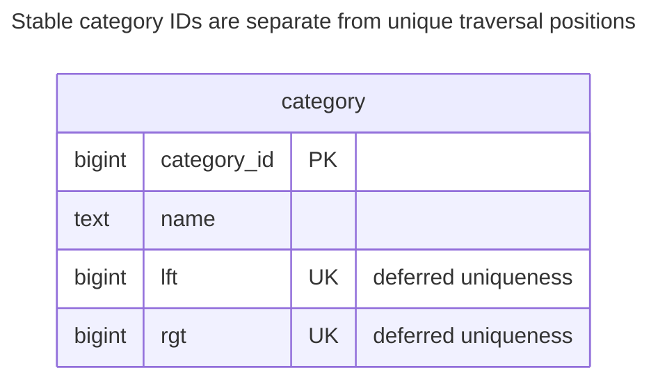
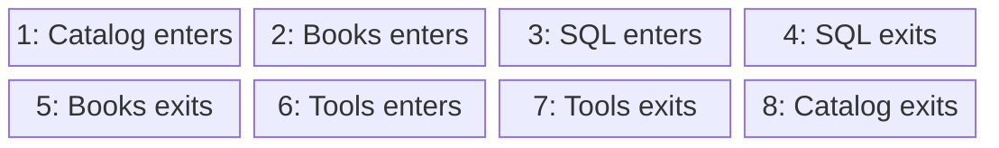
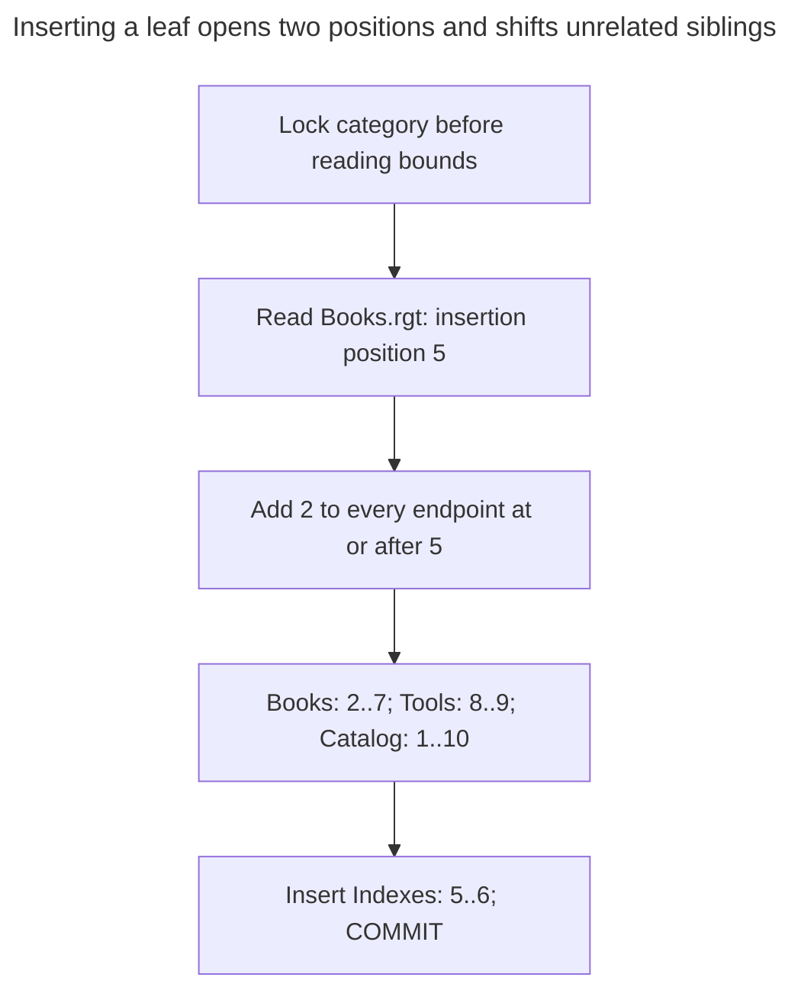
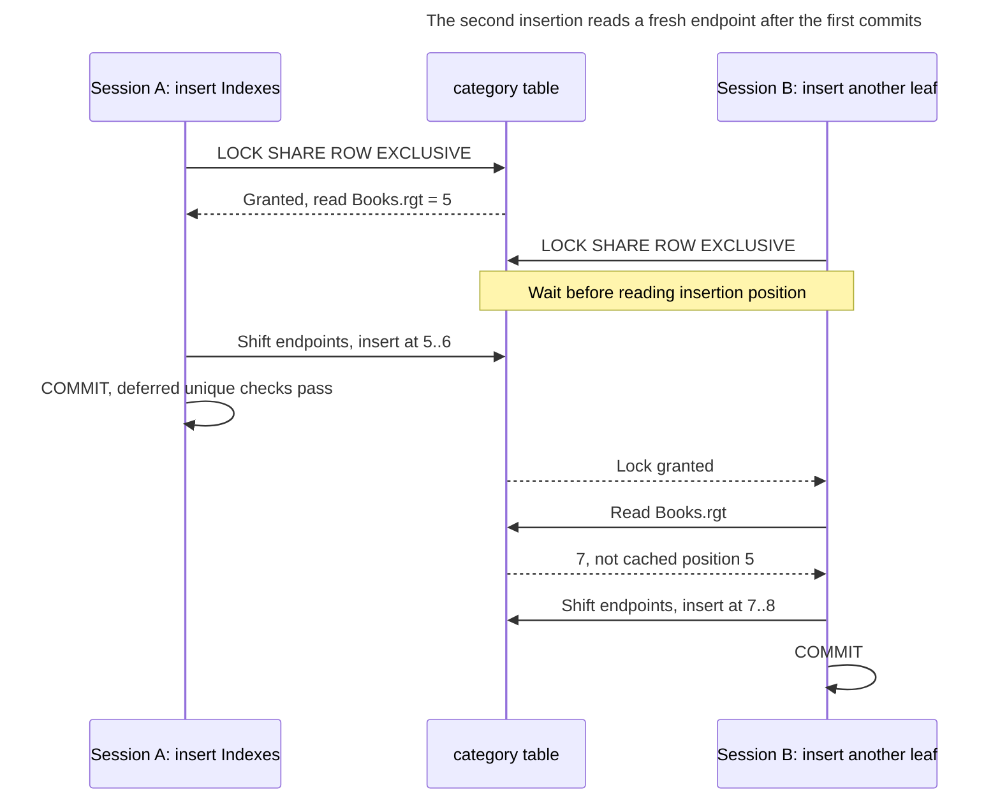

# Nested Sets

## Intent

Nested sets number the nodes of a tree with left and right bounds from a depth-first walk, so every descendant's bounds lie inside its ancestor's. Reading a whole subtree, counting descendants and ordering a tree for display become single range queries without recursion. The price is paid on writes: inserting or moving a node renumbers a large part of the table under a lock. The chapter shows when a hierarchy that is read often and changed rarely, such as a product catalog, justifies that trade. MongoDB's [nested-sets tutorial](https://www.mongodb.com/docs/manual/tutorial/model-tree-structures-with-nested-sets/) illustrates the traversal bounds and recommends the model for static trees.

## Also known as

Nested set model. [Bill Karwin's hierarchy slides](https://www.slideshare.net/billkarwin/models-for-hierarchical-data) and [MongoDB's tree tutorial](https://www.mongodb.com/docs/manual/tutorial/model-tree-structures-with-nested-sets/) both use “Nested Sets”.

## Problem

You publish a category tree that changes in editorial batches, while readers repeatedly request whole branches and counts. Recomputing reachability on each read is unnecessary if you can prepare a stable representation at publication time. You want nodes in display order and descendants selected by an interval.

The difficulty moves to maintenance. Inserting a child needs two new positions in the traversal. Moving a branch changes its position relative to other nodes, even though those other categories have not changed names or identities. This is why MongoDB's [nested-sets guidance](https://www.mongodb.com/docs/manual/tutorial/model-tree-structures-with-nested-sets/) explicitly favors static trees over mutable ones.

## Solution

During a depth-first traversal, assign a node's `lft` on entry and `rgt` on exit, using each integer from `1` through `2n` exactly once. An ancestor's interval strictly contains each descendant's interval. A subtree, including its root, is the range of left endpoints inside that root's bounds. Sorting by `lft` produces preorder.

Keep category identity separate from these positions. The implementation uses classic dense numbering, opens a two-position gap for a leaf insert and shifts an entire interval for a branch move. This is a maintained encoding: row-local checks and two unique constraints do not prove that all intervals form a tree. Restrict structural writes to the numbering protocol and audit its global invariants.

## Alternatives and selection

| Sibling | Relationship | Deciding requirement |
| --- | --- | --- |
| [Adjacency List](adjacency-list.md) | Replacement; complement as the editable source tree | Frequent edits and simple direct-child lookup matter more than precomputed range reads |
| [Materialized Path](materialized-path.md) | Replacement | Subtree reads dominate, but moves should rewrite the moved branch rather than positions elsewhere |
| [Closure Table](closure-table.md) | Replacement | Ancestor and depth-limited joins justify extra rows without global traversal numbering |

See the [Decision Atlas](decision-atlas.md) for the full family comparison. Leaving gaps between numbers is an implementation variant, but the arithmetic descendant count below then stops being valid. Do not treat a sparse numbering scheme as interchangeable with this dense one.

## Structure



Each row stores the category and its own interval; this version stores no parent column or parent foreign key. The two unique constraints keep left and right positions distinct within their respective columns, while global tree validity still needs the write protocol and audits.



Read left to right across each row: depth-first entry and exit positions encode nested intervals, placing SQL's `[3,4]` inside Books' `[2,5]`. Tools' `[6,7]` is disjoint from Books, and all eight positions are used exactly once.

## Tables and invariants

- **`category`** keeps `category_id` as its primary key and checks `0 < lft < rgt` through `category_bounds`.
- **Endpoint uniqueness** is enforced separately for left and right positions. The deferrable unique constraints allow renumbering to pass through temporary index conflicts until the transaction ends; see PostgreSQL's [constraint timing rules](https://www.postgresql.org/docs/18/sql-createtable.html).
- **Global shape** requires intervals to be disjoint or fully nested, never crossing. No left endpoint may equal any right endpoint, and dense numbering must use all positions `1..2n`. The write protocol and the script's audit check these conditions; the DDL alone does not.
- **Root policy** is separate. These rules can encode a forest; the sample has one root. Requiring exactly one root needs an additional global validation.

## When to use

- You publish a hierarchy in batches and read it many times between changes.
- Preorder subtree output and dense-number counts are central queries.
- You can serialize edits or build a new read representation away from live readers.

## Consequences and trade-offs

- ➕ A left-endpoint range selects a complete subtree without recursion.
- ➕ In this dense encoding, `(rgt - lft - 1) / 2` counts strict descendants without visiting them.
- ➖ Opening a gap can rewrite nodes outside the edited branch; the affected count depends on its position.
- ➖ Direct children require excluding intermediate ancestors, or maintaining a separate parent reference or depth representation.
- ➖ Neither endpoint uniqueness nor `lft < rgt` proves a valid tree. Corruption can make range reads silently wrong.

## Implementation

The [complete PostgreSQL 18.6 script](../assets/nested-sets/nested-sets.sql) includes insert, move, delete, a rejected interval and audits for density and crossing intervals. Keep stable IDs when renumbering:

```sql
CREATE TABLE category (
    category_id bigint PRIMARY KEY,
    name text NOT NULL,
    lft bigint NOT NULL,
    rgt bigint NOT NULL,
    CONSTRAINT category_bounds CHECK (lft > 0 AND lft < rgt),
    CONSTRAINT category_left_key UNIQUE (lft) DEFERRABLE INITIALLY DEFERRED,
    CONSTRAINT category_right_key UNIQUE (rgt) DEFERRABLE INITIALLY DEFERRED
);
INSERT INTO category VALUES
    (1, 'Catalog', 1, 8), (2, 'Books', 2, 5),
    (4, 'SQL', 3, 4), (3, 'Tools', 6, 7);
```

Read Books and SQL, count Books' one strict descendant and read SQL's ancestors:

```sql
SELECT c.category_id, c.name FROM category AS p
JOIN category AS c ON c.lft BETWEEN p.lft AND p.rgt
WHERE p.category_id = 2 ORDER BY c.lft;
SELECT (rgt - lft - 1) / 2 AS descendants
FROM category WHERE category_id = 2;
SELECT p.category_id FROM category AS c
JOIN category AS p ON p.lft < c.lft AND p.rgt > c.rgt
WHERE c.category_id = 4 ORDER BY p.lft;
```

The unique constraint on `lft` supplies a B-tree that can serve that range access; PostgreSQL documents that [unique constraints create indexes](https://www.postgresql.org/docs/18/ddl-constraints.html#DDL-CONSTRAINTS-UNIQUE-CONSTRAINTS). The count formula assumes valid **dense** numbering, not merely noncrossing intervals. For strict descendants exclude the selected node; the subtree query deliberately includes it.

Insert Indexes as Books' last child. Read the insertion position only after taking the lock, then shift both endpoints and insert into the gap:

```sql
BEGIN;
LOCK TABLE category IN SHARE ROW EXCLUSIVE MODE;
CREATE TEMP TABLE insertion ON COMMIT DROP AS
SELECT rgt AS pos FROM category WHERE category_id = 2;
UPDATE category SET
    lft = CASE WHEN lft >= i.pos THEN lft + 2 ELSE lft END,
    rgt = CASE WHEN rgt >= i.pos THEN rgt + 2 ELSE rgt END
FROM insertion AS i WHERE rgt >= i.pos;
INSERT INTO category
SELECT 5, 'Indexes', pos, pos + 1 FROM insertion;
COMMIT;
```



The gap opens at Books' old right endpoint, so Tools shifts despite being outside the edited branch. SQL's endpoints stay `[3,4]`, and the new leaf occupies the two freed positions.

Books becomes `[2,7]`; the new leaf is `[5,6]`, and Tools shifts to `[8,9]`. To move Books under Tools, use Tools' current right endpoint as the insertion target. The following update translates endpoints inside Books' interval and shifts the endpoints between the old and new locations:

```sql
BEGIN;
LOCK TABLE category IN SHARE ROW EXCLUSIVE MODE;
WITH move AS (
    SELECT s.lft AS lo, s.rgt AS hi, s.rgt - s.lft + 1 AS width,
           d.rgt AS target
    FROM category AS s CROSS JOIN category AS d
    WHERE s.category_id = 2 AND d.category_id = 3
      AND NOT d.lft BETWEEN s.lft AND s.rgt
)
UPDATE category SET
    lft = CASE
        WHEN lft BETWEEN m.lo AND m.hi THEN lft +
            CASE WHEN m.target < m.lo THEN m.target - m.lo
                 ELSE m.target - m.hi - 1 END
        WHEN m.target < m.lo AND lft >= m.target AND lft < m.lo
            THEN lft + m.width
        WHEN m.target > m.hi AND lft > m.hi AND lft < m.target
            THEN lft - m.width
        ELSE lft END,
    rgt = CASE
        WHEN rgt BETWEEN m.lo AND m.hi THEN rgt +
            CASE WHEN m.target < m.lo THEN m.target - m.lo
                 ELSE m.target - m.hi - 1 END
        WHEN m.target < m.lo AND rgt >= m.target AND rgt < m.lo
            THEN rgt + m.width
        WHEN m.target > m.hi AND rgt > m.hi AND rgt < m.target
            THEN rgt - m.width
        ELSE rgt END
FROM move AS m;
COMMIT;
```

Afterward the rows in preorder are Catalog `[1,10]`, Tools `[2,9]`, Books `[3,8]`, SQL `[4,5]`, Indexes `[6,7]`. The CTE rejects a destination inside the moved branch. Require that source and destination exist and that the update affects rows; zero updated rows is not a successful move. The script also deletes Books' entire interval and closes the resulting gap, leaving Catalog `[1,4]` and Tools `[2,3]`.

A reversed interval is invalid even outside the maintenance protocol:

```sql
INSERT INTO category VALUES (99, 'Invalid', 12, 11);
```

PostgreSQL 18.6 raises SQLSTATE `23514`: `ERROR: new row for relation "category" violates check constraint "category_bounds"`, with `DETAIL: Failing row contains (99, Invalid, 12, 11).` This proves the local bound check, not global tree validity. The script separately audits the latter before deletion.

Delete the moved Books subtree in one transaction:

```sql
BEGIN;
LOCK TABLE category IN SHARE ROW EXCLUSIVE MODE;
CREATE TEMP TABLE removal ON COMMIT DROP AS
SELECT lft AS lo, rgt AS hi, rgt - lft + 1 AS width
FROM category WHERE category_id = 2;
DELETE FROM category USING removal AS r WHERE lft BETWEEN r.lo AND r.hi;
UPDATE category SET
    lft = CASE WHEN lft > r.hi THEN lft - r.width ELSE lft END,
    rgt = CASE WHEN rgt > r.hi THEN rgt - r.width ELSE rgt END
FROM removal AS r WHERE rgt > r.hi;
COMMIT;
```

## Engine support

- **PostgreSQL 18:** [deferrable unique constraints](https://www.postgresql.org/docs/18/sql-createtable.html) support endpoint permutations within a transaction. They are part of this implementation, not an inherent property of nested sets.
- **Oracle AI Database 26ai:** [deferrable constraints](https://docs.oracle.com/en/database/oracle/oracle-database/26/sqlrf/constraint.html) also permit transaction-end checking. Translate numeric types and the update syntax; retain stable node IDs.
- **MySQL 8.4 / SQL Server 2025 (17.x):** their documented [MySQL unique-index syntax](https://dev.mysql.com/doc/refman/8.4/en/create-index.html) and [SQL Server constraint syntax](https://learn.microsoft.com/en-us/sql/t-sql/statements/alter-table-table-constraint-transact-sql?view=sql-server-ver17) do not expose PostgreSQL's deferred-unique option. Plan collision-free staging positions or publish a separately numbered version; do not copy this permutation assuming the same constraint timing.
- **SQLite 3:** [only one write transaction runs at a time](https://www.sqlite.org/lang_transaction.html). Use a write transaction before reading positions and handle busy failures. SQLite's documented [`UNIQUE` syntax](https://www.sqlite.org/lang_createtable.html) has no deferred-check option, so use collision-free staging positions or a separately numbered version when porting the update.

## Failure and concurrency

Two inserts can read the same right endpoint and both attempt to open the same gap. A concurrent move can also invalidate every saved position. The example runs at [Read Committed](https://www.postgresql.org/docs/18/transaction-iso.html#XACT-READ-COMMITTED) and acquires [`SHARE ROW EXCLUSIVE`](https://www.postgresql.org/docs/18/explicit-locking.html#LOCKING-TABLES) before reading bounds. All structural writers use it. Keep gap opening, insertion and validation in one transaction, and roll back the entire operation on failure.



The second leaf is a hypothetical concurrent insertion into Books. Its gap is chosen from the committed bounds, so it does not reuse the first insertion's saved position.

The move statement updates all sample rows, including unchanged endpoints; a production implementation can narrow the affected range after proving the same transformation. A per-node row lock is insufficient because numbering edits affect other nodes. Never commit half a renumbering or retry with positions cached before rollback. On an uncertain commit, inspect the node's current ancestry under the lock before deciding whether to repeat the operation.

## Migration

Treat nested sets as a new projection when starting from parent references. Validate the source tree, choose an explicit sibling ordering and assign entry/exit numbers in a shadow table. Check all `2n` endpoints, detect crossing intervals and compare each subtree against the source traversal before publishing the result.

For active editors, capture structural edits while building the projection and reconcile them under a brief structural-write pause. Ordinary readers can stay on the existing representation until the new version is ready. Switch reads first while retaining the source tree and rebuild path; switch writes only if maintaining nested sets directly is justified. To back out, return reads to the retained parent representation. If bounds are your only source, recover each node's parent as its closest containing interval before discarding them; reject corrupt crossings before that conversion.

```mermaid
---
title: Publish numbered intervals only after comparing them with the source tree
---
stateDiagram-v2
  state "Validated parent tree" as Source
  state "Shadow intervals numbered in sibling order" as Numbered
  state "Density, crossings and subtrees audited" as Audited
  state "Nested-set reads published; source retained" as Published
  [*] --> Source
  Source --> Numbered: Assign entry and exit positions
  Numbered --> Audited: Compare with source traversal
  Audited --> Published: Pause structural writes; reconcile edits
  Published --> Source: Return reads to retained parents
  class Source muted
  class Numbered,Audited,Published accent
```



Auditing checks the meaning of every interval as well as the `2n` endpoints. Keeping the parent tree maintained gives readers a rollback target and provides a source for rebuilding the projection.

## Anti-patterns and common mistakes

- Claiming the two unique constraints prove a tree: they do not detect cross-column endpoint reuse or crossing intervals.
- Using the dense count formula after introducing gaps or soft-deleted nodes whose positions remain occupied.
- Referencing `lft` as a node ID from other tables, so a display-order change becomes an identity change.
- Choosing nested sets for a hierarchy whose main operation is frequent drag-and-drop reparenting.
- Quoting a fixed percentage of rows rewritten per insert; the actual range depends on the insertion point and numbering policy.

## Known uses

- MongoDB's [Nested Sets tutorial](https://www.mongodb.com/docs/manual/tutorial/model-tree-structures-with-nested-sets/) demonstrates book categories with left/right traversal positions and recommends the model for static trees.
- [Karwin's hierarchy slides](https://www.slideshare.net/billkarwin/models-for-hierarchical-data) demonstrate opening a gap by shifting bounds before inserting a child. The SQL here is a separate implementation with explicit transaction and constraint timing.

## Related patterns

- [Adjacency List](adjacency-list.md) is a useful editable source for publishing nested sets.
- [Materialized Path](materialized-path.md) confines a branch move's path rewrites to its descendants.
- [Closure Table](closure-table.md) materializes reachability without traversal positions.
