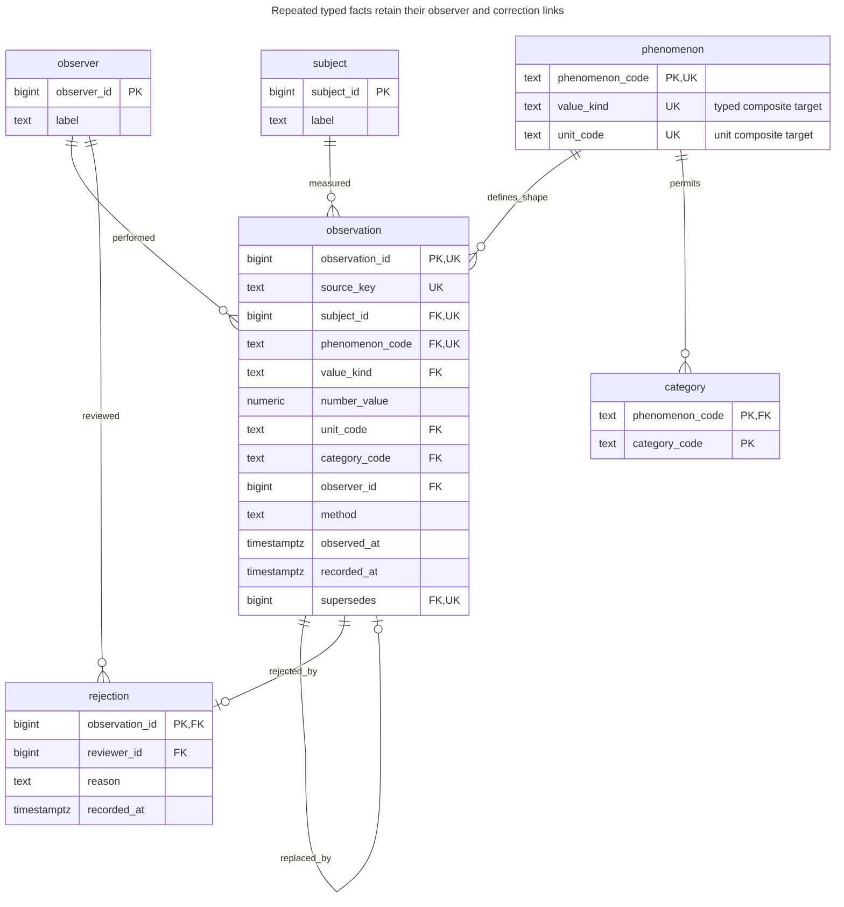
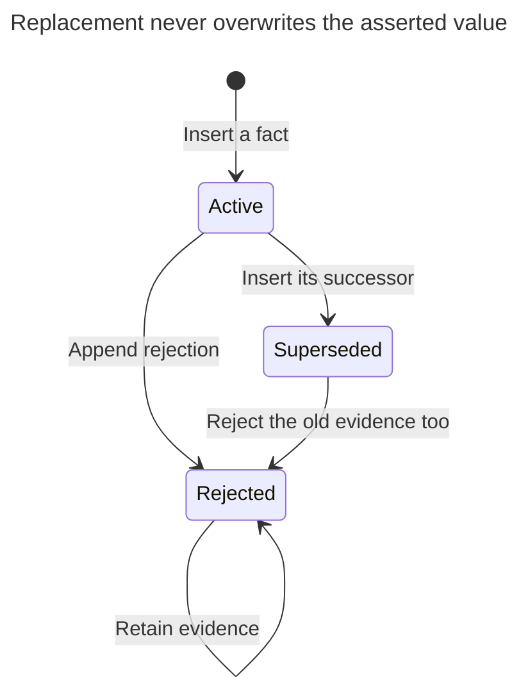
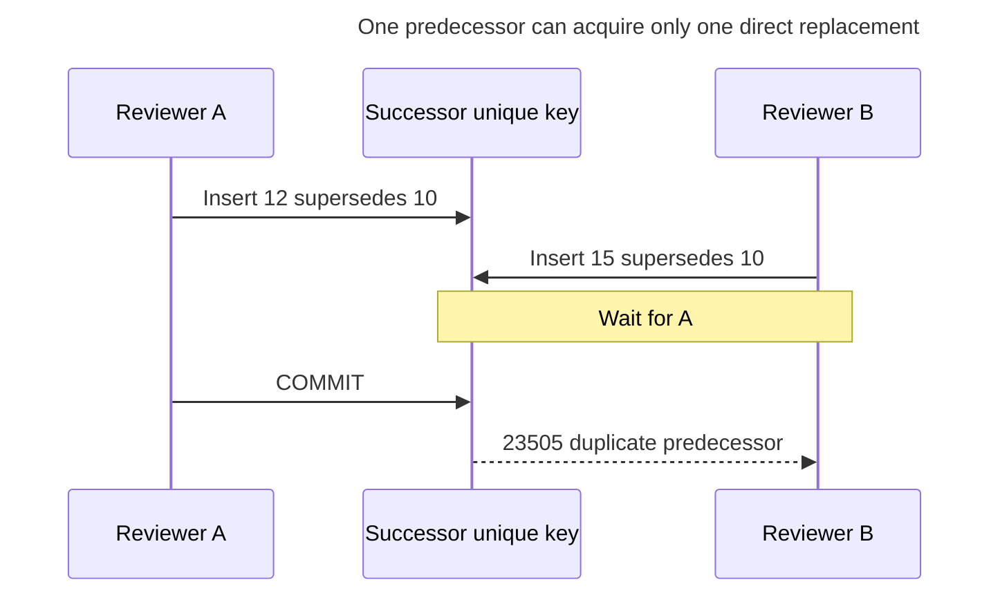
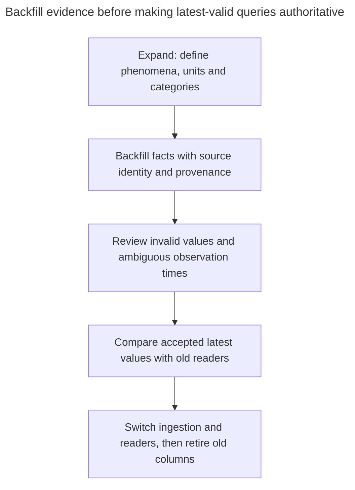

# Observation

## Intent

An observation records a measurement or assessment as a fact in its own right: which phenomenon was observed, the value or category, the method, who observed it and when. Lab results, sensor readings and quality inspections fit this shape, which keeps measurements out of fixed columns and lets new kinds of observation appear without migrations. The chapter shows the observation and phenomenon tables, numeric versus categorical values, how to mark an observation as rejected or superseded, and how to query the latest valid value.

## Also known as

Measurement record; assessment record. [HL7 FHIR R4 Observation](https://hl7.org/fhir/R4/observation.html) represents measurements and simple assertions with subject, value, method, performer and time. The schema here is a small application model, not a FHIR storage mapping or a claim of FHIR conformance.

## Problem

You store a batch's mass on `batch.mass_kg`. A second weighing overwrites the first. A recalibration then shows that the first result was wrong, while a later reading turns out to belong to a different batch. One current column cannot tell you which result was observed when, which was rejected, or which result corrected which earlier assertion.

Adding `mass_2` preserves one more result but makes repetition a schema change. A generic `(name, text_value)` row allows repetition while losing numeric type, unit rules and provenance. You need repeated facts with explicit meaning and lifecycle, rather than an unlimited bag of current attributes.

## Solution

Define each phenomenon and its value shape. Record every observation with a subject, typed value, method, observer, observation time and recording time. For numeric phenomena, this example accepts one configured unit; normalize other units through [Quantity](quantity.md) before insertion. For categorical phenomena, reference a phenomenon-specific category vocabulary.

Make observation facts immutable. A replacement is another observation pointing to its predecessor; a rejection is a separate record with reviewer and reason. Derive `active`, `superseded` and `rejected` from those facts instead of independently updating a status flag. This prevents a status flag and correction link from disagreeing. The policy deliberately keeps an earlier result superseded even if its replacement is later rejected; it does not silently restore an old result.

## Alternatives and selection

| Sibling | Relationship | Deciding requirement |
| --- | --- | --- |
| Fixed subject columns | Replacement | Only the current value matters and repeated evidence is irrelevant |
| [Typed Properties](typed-properties.md) | Replacement for current configurable attributes; complement for metadata | You need one editable property value, rather than independently observed facts |
| [Quantity](quantity.md) | Complement | Numeric results need compatible units and conversion |
| [History Table](history-table.md) | Complement; replacement for past-row questions | You need previous database row states; observation time and scientific provenance are a different contract |

See the [Decision Atlas](decision-atlas.md) for the full table. Recording an observation is not equivalent to recording an update to the subject: the observation can arrive late or disagree with another observation without changing the subject's identity.

## Structure



Many observations can describe the same subject and phenomenon. A predecessor has at most one direct replacement. Composite keys preserve the subject and phenomenon across corrections; the `UK` annotations represent several composite targets defined in the DDL, not independent uniqueness of subject or phenomenon.

## Tables and invariants

- **`phenomenon` / `category`** define numeric versus categorical shape, the configured numeric unit and allowed category codes. Treat definitions as controlled metadata: changing a unit's meaning is a new definition, not a harmless label edit.
- **`observation`** has a unique source key for import retries. Its shape check requires exactly the applicable value fields; composite foreign keys match declared kind, configured unit and category vocabulary.
- **Replacement links** stay within one subject and phenomenon. `UNIQUE (supersedes)` prevents competing direct successors; `supersedes < observation_id` makes cycles impossible in this example. Allocate a correction ID greater than its predecessor; that order is an implementation rule, not observation time.
- **`rejection`** permits one retained rejection per fact, with an identified reviewer. The example has no rejection withdrawal operation.
- **Immutability** comes from update/delete guards. Keep the application separate from the owner and withhold `TRUNCATE` and schema-changing privileges; PostgreSQL [privileges](https://www.postgresql.org/docs/18/sql-grant.html) distinguish these from row writes. The lab runs as owner to demonstrate mechanics, not a complete role deployment.

## When to use

- A subject has repeated readings or assessments with independently useful provenance.
- Results can arrive late, be rejected or be replaced without deleting evidence.
- New phenomena within the supported numeric/category vocabulary should be data changes.

## Consequences and trade-offs

- ➕ Correction preserves both the original assertion and its replacement.
- ➕ Numeric and categorical results share provenance while retaining different value rules.
- ➖ “Latest” needs a query policy: accepted status, observation time, method and a deterministic tie-breaker.
- ➖ New primitive shapes, compound results or uncertainty intervals still require design work; this is not unlimited schema-free extensibility.
- ➖ Retained evidence and indexes grow with every reading, including rejected ones.

## Implementation

The [complete PostgreSQL 18.6 script](../assets/observation/observation.sql) implements the tables, immutable facts and derived lifecycle:

```sql
CREATE SCHEMA observation_example;
SET search_path = observation_example, public;

CREATE TABLE subject (subject_id bigint PRIMARY KEY, label text NOT NULL);
CREATE TABLE observer (observer_id bigint PRIMARY KEY, label text NOT NULL);
CREATE TABLE phenomenon (
    phenomenon_code text PRIMARY KEY,
    value_kind text NOT NULL CHECK (value_kind IN ('number', 'category')),
    unit_code text,
    UNIQUE (phenomenon_code, value_kind),
    UNIQUE (phenomenon_code, unit_code),
    CHECK ((value_kind = 'number' AND unit_code IS NOT NULL)
        OR (value_kind = 'category' AND unit_code IS NULL))
);
CREATE TABLE category (
    phenomenon_code text REFERENCES phenomenon (phenomenon_code),
    category_code text,
    PRIMARY KEY (phenomenon_code, category_code)
);
CREATE TABLE observation (
    observation_id bigint PRIMARY KEY,
    source_key text NOT NULL UNIQUE,
    subject_id bigint NOT NULL REFERENCES subject (subject_id),
    phenomenon_code text NOT NULL,
    value_kind text NOT NULL,
    number_value numeric,
    unit_code text,
    category_code text,
    method text NOT NULL,
    observer_id bigint NOT NULL REFERENCES observer (observer_id),
    observed_at timestamptz NOT NULL,
    recorded_at timestamptz NOT NULL DEFAULT clock_timestamp(),
    supersedes bigint UNIQUE,
    UNIQUE (observation_id, subject_id, phenomenon_code),
    FOREIGN KEY (phenomenon_code, value_kind) REFERENCES phenomenon (phenomenon_code, value_kind),
    FOREIGN KEY (phenomenon_code, unit_code) REFERENCES phenomenon (phenomenon_code, unit_code),
    FOREIGN KEY (phenomenon_code, category_code) REFERENCES category (phenomenon_code, category_code),
    FOREIGN KEY (supersedes, subject_id, phenomenon_code)
        REFERENCES observation (observation_id, subject_id, phenomenon_code),
    CHECK (supersedes < observation_id),
    CONSTRAINT observation_value_shape CHECK (
        (value_kind = 'number' AND number_value IS NOT NULL
         AND number_value > '-Infinity'::numeric AND number_value < 'Infinity'::numeric
         AND unit_code IS NOT NULL AND category_code IS NULL)
        OR (value_kind = 'category' AND category_code IS NOT NULL
            AND number_value IS NULL AND unit_code IS NULL)
    )
);
CREATE TABLE rejection (
    observation_id bigint PRIMARY KEY REFERENCES observation (observation_id),
    reviewer_id bigint NOT NULL REFERENCES observer (observer_id),
    reason text NOT NULL,
    recorded_at timestamptz NOT NULL DEFAULT clock_timestamp()
);
CREATE INDEX observation_latest_idx
    ON observation (subject_id, phenomenon_code, observed_at DESC, observation_id DESC);
CREATE FUNCTION reject_fact_mutation() RETURNS trigger LANGUAGE plpgsql SET search_path = observation_example, pg_temp AS $$
BEGIN
    RAISE EXCEPTION 'observation facts are immutable' USING ERRCODE = '23514';
END $$;
CREATE TRIGGER observation_immutable BEFORE UPDATE OR DELETE ON observation
    FOR EACH ROW EXECUTE FUNCTION reject_fact_mutation();
CREATE TRIGGER rejection_immutable BEFORE UPDATE OR DELETE ON rejection
    FOR EACH ROW EXECUTE FUNCTION reject_fact_mutation();
CREATE VIEW observation_state AS
SELECT o.*, CASE
    WHEN EXISTS (SELECT FROM rejection AS r WHERE r.observation_id = o.observation_id) THEN 'rejected'
    WHEN EXISTS (SELECT FROM observation AS n WHERE n.supersedes = o.observation_id) THEN 'superseded'
    ELSE 'active' END AS status
FROM observation AS o;
```

`observed_at` records the asserted event time. `recorded_at` defaults to PostgreSQL's [`clock_timestamp()`](https://www.postgresql.org/docs/18/functions-datetime.html#FUNCTIONS-DATETIME-CURRENT), a wall-clock processing time, not commit time. You can ingest an old measurement today without pretending you knew it at its event time. FHIR R4 likewise distinguishes [effective time and issued time](https://hl7.org/fhir/R4/observation.html); this example's fields have their own explicitly stated semantics.

```sql
INSERT INTO subject VALUES (1, 'Batch A');
INSERT INTO observer VALUES (1, 'Scale operator'), (2, 'Quality reviewer');
INSERT INTO phenomenon VALUES ('mass', 'number', 'kg'), ('appearance', 'category', NULL);
INSERT INTO category VALUES ('appearance', 'pass'), ('appearance', 'fail');
INSERT INTO observation
    (observation_id, source_key, subject_id, phenomenon_code, value_kind,
     number_value, unit_code, method, observer_id, observed_at)
VALUES (10, 'scale:10', 1, 'mass', 'number', 20, 'kg', 'bench scale', 1, '2026-11-01 10:00Z');
INSERT INTO observation
    (observation_id, source_key, subject_id, phenomenon_code, value_kind,
     category_code, method, observer_id, observed_at)
VALUES (11, 'inspection:11', 1, 'appearance', 'category', 'pass', 'visual', 2, '2026-11-01 10:01Z');
```

The initial facts are mass `20 kg` and appearance `pass`. After recalibration, append the corrected mass using the same observed instant:

```sql
BEGIN;
SELECT subject_id FROM subject WHERE subject_id = 1 FOR UPDATE;
INSERT INTO observation
    (observation_id, source_key, subject_id, phenomenon_code, value_kind,
     number_value, unit_code, method, observer_id, observed_at, supersedes)
VALUES (12, 'scale:12', 1, 'mass', 'number', 2, 'kg', 'recalibrated scale', 1,
        '2026-11-01 10:00Z', 10);
COMMIT;
```

The result `10` now derives as `superseded`; result `12` is active. A newer mass reading `13` is rejected for belonging to the wrong batch. The following query then returns `(12, 2, kg)`, rather than the rejected 99 kg reading:

```sql
INSERT INTO observation
    (observation_id, source_key, subject_id, phenomenon_code, value_kind,
     number_value, unit_code, method, observer_id, observed_at)
VALUES (13, 'scale:13', 1, 'mass', 'number', 99, 'kg', 'bench scale', 1, '2026-11-02 10:00Z');
INSERT INTO rejection (observation_id, reviewer_id, reason) VALUES (13, 2, 'Wrong batch on scale');
SELECT observation_id, number_value, unit_code
FROM observation_state
WHERE subject_id = 1 AND phenomenon_code = 'mass' AND status = 'active'
ORDER BY observed_at DESC, observation_id DESC LIMIT 1;
```

For “latest per phenomenon,” apply the same status predicate before choosing one row per phenomenon. The ID breaks ties deterministically; it is not evidence that a reading is more trustworthy. If two methods have different authority, make that an explicit predicate or ranking policy.



These states are projections of retained rows. Rejecting a successor does not move its predecessor back to active; a new reviewed observation is needed if that is the intended correction.

Changing the accepted result in place is invalid:

```sql
UPDATE observation SET number_value = 3 WHERE observation_id = 12;
```

PostgreSQL 18.6 raises SQLSTATE `23514`: `ERROR: observation facts are immutable`. The script also checks `observation_value_shape` rejection (`23514`) and a second successor's `observation_supersedes_key` violation (`23505`). A new phenomenon needs only metadata while it fits the two supported value shapes; a new value shape requires a schema change.

## Engine support

- **PostgreSQL 18:** composite foreign keys and the row-shape check enforce interpretation; row triggers protect retained facts. Null fields intentionally omit the inapplicable category or unit reference, following [foreign-key null semantics](https://www.postgresql.org/docs/18/ddl-constraints.html#DDL-CONSTRAINTS-FK).
- **MySQL 8.4 / InnoDB:** [immediate foreign keys](https://dev.mysql.com/doc/refman/8.4/en/create-table-foreign-keys.html) suit predecessor-before-successor insertion. Preserve the numeric/category check when translating the DDL.
- **SQL Server 2025 (17.x):** implement immutability with permissions and [set-aware DML triggers](https://learn.microsoft.com/en-us/sql/relational-databases/triggers/create-dml-triggers-to-handle-multiple-rows-of-data?view=sql-server-ver17), rather than copying a per-row PL/pgSQL body.
- **Oracle AI Database 26ai:** Oracle [treats zero-length character strings as null](https://docs.oracle.com/en/database/oracle/oracle-database/26/sqlrf/Nulls.html). Define category codes and method identifiers as nonempty values when porting this metadata contract.
- **SQLite 3:** turn on [foreign keys](https://www.sqlite.org/foreignkeys.html) and choose an exact numeric representation deliberately; its [type affinity](https://www.sqlite.org/datatype3.html) is not PostgreSQL `numeric`.

## Failure and concurrency

Two reviewers can try to correct result `10`. Both can create internally valid values, but both must not become its direct successor. The unique predecessor reference rejects the loser. PostgreSQL's [unique-index conflict checks](https://www.postgresql.org/docs/18/index-unique-checks.html) wait for the first writer's outcome; after losing, reload the current chain rather than blindly correcting the new successor.



If review also checks other facts about the subject, take its row lock before reading and appending, as the correction example does. A rejection and a replacement can both exist: the view gives rejection precedence for that fact. If your domain forbids correcting rejected facts, add a coordinated guard; this schema permits it. For import retries, find the stored `source_key` and compare its payload before treating a duplicate as success.

## Migration

Define phenomenon metadata and resolve source units before importing existing value columns. Record an honest observation time only when the source contains one; otherwise use an explicitly documented baseline policy rather than inventing historical measurements. Preserve original source keys for repeatable imports.



Keep old columns synchronized with the accepted-current projection through the rollback window. If old readers cannot represent several competing observations, retain the fact tables even during a reader rollback. A current-value column cannot serve as the only backup for the accumulated evidence.

## Anti-patterns and common mistakes

- Replacing the old value and retaining only an “edited” flag.
- Sorting by recording time when the requirement is the latest event-time result.
- Selecting the newest row before filtering out rejected and superseded results.
- Using one unrestricted category vocabulary for unrelated phenomena.
- Calling this compact schema a complete clinical interchange model.

## Known uses

- [FHIR R4 Observation](https://hl7.org/fhir/R4/observation.html) includes quantity and coded value choices, method, performer, effective time and status. It is a concrete example of observation-centered modeling, with a richer contract than the two-shape schema here.

## Related patterns

- [Quantity](quantity.md) handles unit compatibility before ingestion.
- [Typed Properties](typed-properties.md) manages configurable current attributes.
- [History Table](history-table.md) retains database versions, a different question from when a measurement occurred.
