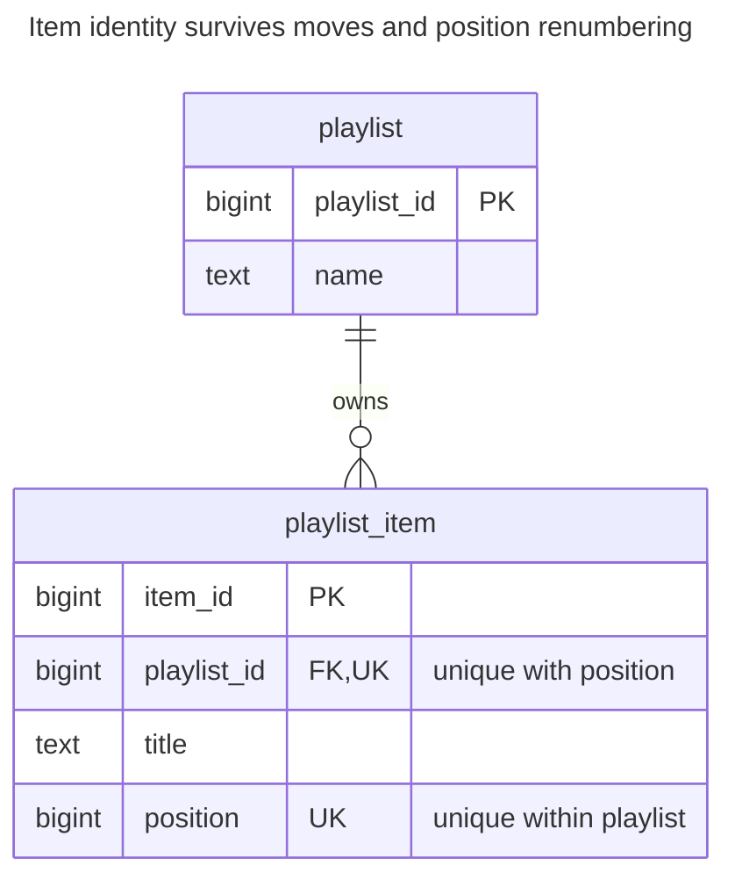
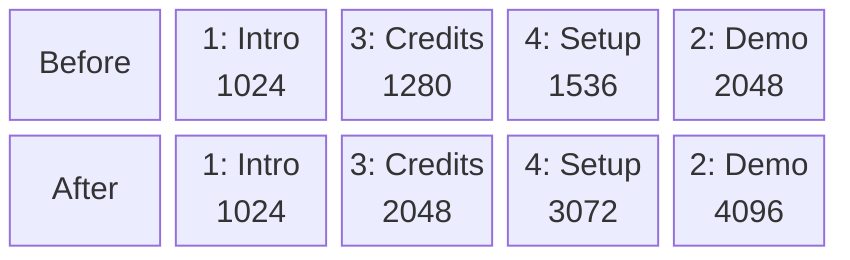
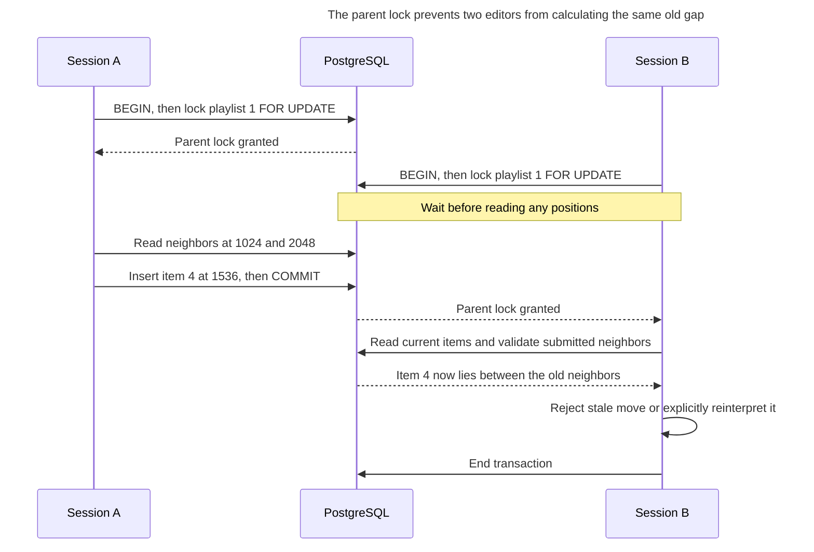
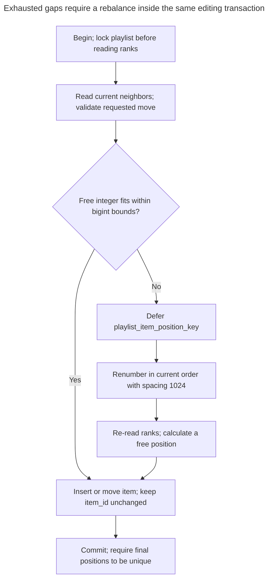

# Ordered Collection

## Intent

An ordered collection stores an order that users define themselves: tracks in a playlist, steps in a checklist, cards in a board column. The chapter compares integer positions with renumbering, gapped positions, fractional or lexicographic ranks that let you insert between two neighbours without touching the rest, and a linked list of references. It shows how to keep positions unique within a collection, how concurrent moves collide, and what to do when the gaps run out.

## Also known as

Position column; rank column. Fractional indexing names one implementation: [Rocicorp's library](https://github.com/rocicorp/fractional-indexing) generates sortable keys between neighboring keys. A position and a row's identity serve different purposes.

## Problem

A playlist is created as Intro, Demo, Credits, but its owner moves Credits before Demo. Creation time no longer describes the order. Using the primary key as position would make moving a track change the identity that notes and playback events reference.

You also need a policy for two editors dragging cards into the same gap. Unique positions can reject a collision, but cannot decide which user's intention should win. A rank scheme reduces how much you rewrite; it does not settle concurrent editing semantics.

## Solution

Keep an immutable `item_id` and a mutable position scoped to `playlist_id`. Read with `ORDER BY position`. PostgreSQL explicitly gives [no ordering guarantee without `ORDER BY`](https://www.postgresql.org/docs/18/queries-order.html), even if the current index scan happens to look correct. Require a non-null position and unique `(playlist_id, position)`.

Start with integer positions spaced by 1024. Insert or move into an available gap. When no integer fits, renumber the collection under the same parent lock that every insertion, deletion and move takes. Use a deferrable unique constraint so a multi-row renumber can pass through temporary collisions inside the transaction. This example favors a simple, serialized editing protocol over sophisticated rank generation.

## Alternatives and selection

| Sibling or representation | Relationship | Deciding requirement |
| --- | --- | --- |
| Dense integers, such as 1, 2, 3 | Implementation option | Lists are small enough that shifting a suffix on insertion is acceptable |
| Gapped integers | Implementation option used here | Most insertions should change one item; occasional renumbering is affordable |
| Fractional numeric positions | Implementation option | Taking a midpoint is convenient, and you can detect exhausted precision and rebalance |
| Lexicographic rank strings | Implementation option | You accept a rank generator, longer keys and a precise string-ordering contract |
| Previous/next references | Replacement representation | Neighbor traversal dominates; you can maintain one connected, acyclic chain |
| [Association Table](association-table.md) | Complement | Items link reusable tracks to playlists; position belongs on the occurrence or link |
| [Version Column](version-column.md) | Complement | You must reject moves based on a stale collection snapshot |

See the [Decision Atlas](decision-atlas.md) for the full comparison. If the order is derived solely from a name or timestamp, use a deterministic query order instead of maintaining another mutable attribute.

For numeric midpoints, repeatedly inserting into the same interval eventually exhausts a fixed scale; floating point also has finite precision. PostgreSQL's [numeric type rules](https://www.postgresql.org/docs/18/datatype-numeric.html) distinguish exact `numeric` from inexact floating point. Exact storage does not make a declared scale infinite. Define a rebalance threshold instead of assuming a midpoint will always be distinct.

With lexicographic ranks, use the generator's comparison rules end to end. [Rocicorp documents case-sensitive comparisons](https://github.com/rocicorp/fractional-indexing#sorting); a PostgreSQL text rank can use [`COLLATE "C"`](https://www.postgresql.org/docs/18/collation.html) for its ASCII alphabet. Two writers using the same neighbors can still choose the same key. A linked list changes the maintenance problem: a foreign key checks that a neighbor exists, not that every item is reachable once from a single head. Reconnecting several pointers atomically and detecting cycles become your responsibility.

## Structure



The relationship shows ownership, while the composite unique constraint scopes positions to one playlist. Moving or renumbering an item changes its position without changing its primary key.

## Tables and invariants

- **`playlist`** owns the collection and provides a row to lock even before the first item exists.
- **`playlist_item`** has a globally unique `item_id`, a mandatory owner and a nonnegative position. The scoped unique constraint forbids ties; it does not require contiguous positions or a first position of zero.
- **Repeated tracks** need occurrence identity. If a playlist can contain the same track twice, do not use `(playlist_id, track_id)` as its unique item key.
- **Editing protocol** requires every writer to lock the owner before reading ranks. Constraints enforce valid stored positions; application protocol preserves the intended move relative to current neighbors.

## When to use

- Users drag, insert or reorder items independently of their creation time.
- Other tables reference items whose identities must survive moves.
- You can serialize edits within one collection while allowing unrelated collections to change independently.

## Consequences and trade-offs

- ➕ A move into a free gap rewrites one item's position.
- ➕ Constraints prevent two items from occupying the same position in a collection.
- ➖ Renumbering writes the whole affected collection and holds its editing lock longer.
- ➖ A popular collection becomes a serialization point under this protocol.
- ➖ Offset-based pages can shift after moves. Clients need an explicit refresh or snapshot policy when order changes.

## Implementation

The [complete script](../assets/ordered-collection/ordered-collection.sql) demonstrates a gap insertion, a move, renumbering, a swap and collision rejection:

```sql
CREATE TABLE playlist (
    playlist_id bigint PRIMARY KEY,
    name text NOT NULL
);
CREATE TABLE playlist_item (
    item_id bigint PRIMARY KEY,
    playlist_id bigint NOT NULL REFERENCES playlist (playlist_id)
        ON DELETE CASCADE,
    title text NOT NULL,
    position bigint NOT NULL CHECK (position >= 0),
    CONSTRAINT playlist_item_position_key UNIQUE (playlist_id, position)
        DEFERRABLE INITIALLY IMMEDIATE
);
INSERT INTO playlist VALUES (1, 'Launch');
INSERT INTO playlist_item VALUES
    (1, 1, 'Intro', 1024),
    (2, 1, 'Demo', 2048),
    (3, 1, 'Credits', 3072);
```

Lock first, then read the current neighbors and calculate a free position. The fixed numbers below correspond to this seeded list. In a request, resolve the submitted neighbor IDs under the lock, verify they still belong to this playlist and are adjacent after excluding the moving item, and reject or reinterpret a stale request explicitly.

```sql
BEGIN;
SELECT playlist_id FROM playlist WHERE playlist_id = 1 FOR UPDATE;
SELECT item_id, position FROM playlist_item
WHERE playlist_id = 1 ORDER BY position;
INSERT INTO playlist_item VALUES (4, 1, 'Setup', 1536);
UPDATE playlist_item SET position = 1280
WHERE playlist_id = 1 AND item_id = 3;
COMMIT;
SELECT item_id, title, position FROM playlist_item
WHERE playlist_id = 1 ORDER BY position;
```

The order is now `1, 3, 4, 2`: Intro, Credits, Setup, Demo. For an arbitrary gap, require the upper position minus the lower position to exceed one; compute a midpoint without overflowing `bigint`. At an end, check bounds before adding or subtracting the spacing. If no value fits, rebalance and calculate again under the same lock:

```sql
BEGIN;
SELECT playlist_id FROM playlist WHERE playlist_id = 1 FOR UPDATE;
SET CONSTRAINTS playlist_item_position_key DEFERRED;
WITH ranked AS (
    SELECT item_id,
           row_number() OVER (ORDER BY position, item_id) * 1024 AS new_position
    FROM playlist_item WHERE playlist_id = 1
)
UPDATE playlist_item AS i SET position = r.new_position
FROM ranked AS r WHERE i.item_id = r.item_id;
COMMIT;
```

The positions are `1024, 2048, 3072, 4096` in the same item order. PostgreSQL supports [deferring unique checks](https://www.postgresql.org/docs/18/sql-createtable.html); the committed result must still be unique. This protects a swap or renumber from transient duplicates without accepting final ties. This deferrable constraint cannot be an `ON CONFLICT` arbiter, so do not treat rank collisions as upserts.



Rebalancing preserves the item order `1, 3, 4, 2` and restores spacing of 1024 between positions. These blocks show sorted rows before and after the SQL update, not stored neighbor pointers.

```sql
UPDATE playlist_item SET position = 1024
WHERE playlist_id = 1 AND item_id = 2;
```

Outside the deferred transaction, PostgreSQL 18.6 rejects this immediately with SQLSTATE `23505`: `ERROR: duplicate key value violates unique constraint "playlist_item_position_key"`, with `DETAIL: Key (playlist_id, "position")=(1, 1024) already exists.` The script additionally attempts a tied position at deferred-check time and verifies rejection.

## Engine support

- **PostgreSQL 18:** the deferrable unique constraint permits the shown renumbering and swaps. Keep `ORDER BY` in every ordered read.
- **MySQL 8.4 / InnoDB:** [unique constraints are checked row by row](https://dev.mysql.com/doc/refman/8.4/en/ansi-diff-foreign-keys.html). Use a reserved, disjoint range of temporary positions before assigning final ones, inside a locked transaction, with overflow checks.
- **SQL Server 2025 (17.x):** [`UNIQUE` syntax](https://learn.microsoft.com/en-us/sql/t-sql/statements/create-table-transact-sql?view=sql-server-ver17) has no PostgreSQL-style deferral. A two-phase move through unused positions avoids depending on update order.
- **Oracle AI Database 26ai:** [deferrable unique constraints](https://docs.oracle.com/en/database/oracle/oracle-database/26/sqlrf/constraint.html) support transaction-end checking; translate the key and position types.
- **SQLite 3:** its [`UNIQUE` declaration](https://www.sqlite.org/lang_createtable.html#unique_constraints) does not offer deferred uniqueness. Use disjoint temporary positions; [`BEGIN IMMEDIATE`](https://www.sqlite.org/lang_transaction.html#deferred_immediate_and_exclusive_transactions) acquires a write transaction instead of a PostgreSQL parent-row lock and can fail with `SQLITE_BUSY`.

## Failure and concurrency

At PostgreSQL read committed isolation, acquire the [parent row lock](https://www.postgresql.org/docs/18/explicit-locking.html#LOCKING-ROWS) before the statement that reads positions, and keep it until commit. Every inserting, deleting, moving and rebalancing writer must follow this protocol. Locking only existing items misses an empty collection and does not establish one common serialization point. When moving between collections, lock both parents in increasing ID order before checking either list.

Serialization prevents concurrent calculations from using the same old gap. It does not tell you whether a user saw an obsolete list. Add a collection-level [Version Column](version-column.md) and reject a stale expected version if that distinction matters. Retry failed transactions from the beginning, re-reading neighbors. After an uncertain commit, read the item's current placement or use an [Idempotency Record](idempotency-record.md); blindly repeating “move one place left” can move twice. PostgreSQL's [transaction atomicity](https://www.postgresql.org/docs/18/tutorial-transactions.html) means a failed rebalance leaves no committed half-renumbered list.



B sees A's insertion because it reads positions after acquiring the lock. Serialization provides current data, while the application must still decide how to handle the stale neighbor request.



Keep the owner lock throughout renumbering and the requested edit so another writer cannot consume the newly opened gap. Deferral permits temporary collisions, but the final committed positions must still be distinct and within bounds.

## Migration

Add nullable positions, then define the initial order explicitly, for example by creation time and item ID as a tie breaker. There is no historical insertion order to recover from an unordered table. Deploy the parent-lock protocol before backfilling; assign ranks one collection at a time under that lock and have new writers assign ranks too.

Check completeness and ties before adding mandatory and unique constraints in a planned DDL window. Switch reads to explicit ordering and keep the previous order rule available during the [Expand and Contract](expand-contract.md) period. Rolling back to a derived order discards user moves; preserve ranks if those moves must survive a later redeployment. Changing rank representation requires all writers to agree on the new comparison and rebalance rules before retiring the old column.

## Anti-patterns and common mistakes

- Making position the stable primary key, which turns every move into an identity change.
- Assuming gaps never run out, or using floating-point midpoints without collision handling.
- Deferring uniqueness but omitting serialization: a transaction-end error is not a concurrency policy.
- Treating rank strings as ordinary linguistically sorted text when their generator requires another order.
- Building a linked list with foreign keys and assuming they also prove reachability and absence of cycles.

## Known uses

- Django's [`order_with_respect_to`](https://docs.djangoproject.com/en/5.2/ref/models/options/#order-with-respect-to) adds an `_order` column for ordering objects relative to a parent. This documents a position-column use, not this chapter's uniqueness or locking protocol.
- [Rocicorp fractional-indexing](https://github.com/rocicorp/fractional-indexing) exposes `generateKeyBetween` and `generateNKeysBetween` for string ranks. It is an implementation option, not a database constraint or a solution to competing moves.

## Related patterns

- [Association Table](association-table.md) stores reusable membership independently of its ordering.
- [Natural Key](natural-key.md) explains why a line identifier should not casually become a mutable display position.
- [Version Column](version-column.md) rejects edits from an outdated collection view.
- [Idempotency Record](idempotency-record.md) distinguishes repeating a request from performing another move.
- [Expand and Contract](expand-contract.md) stages a rank-representation change.
