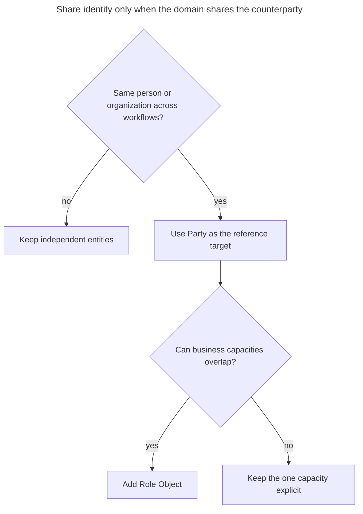
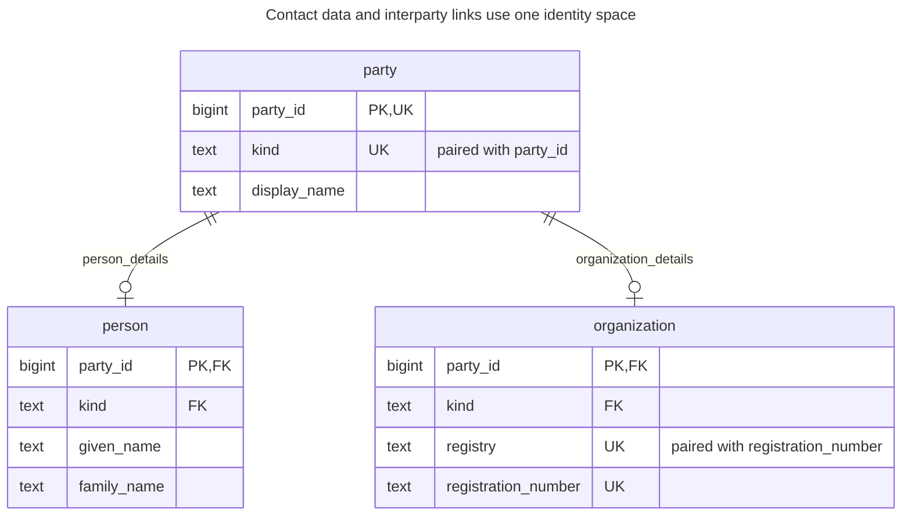
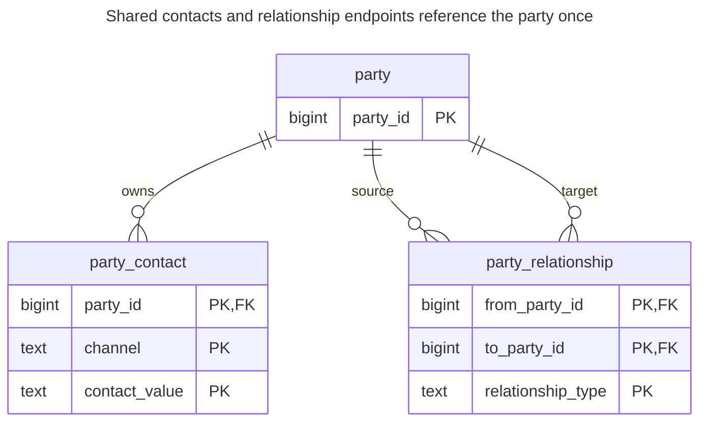
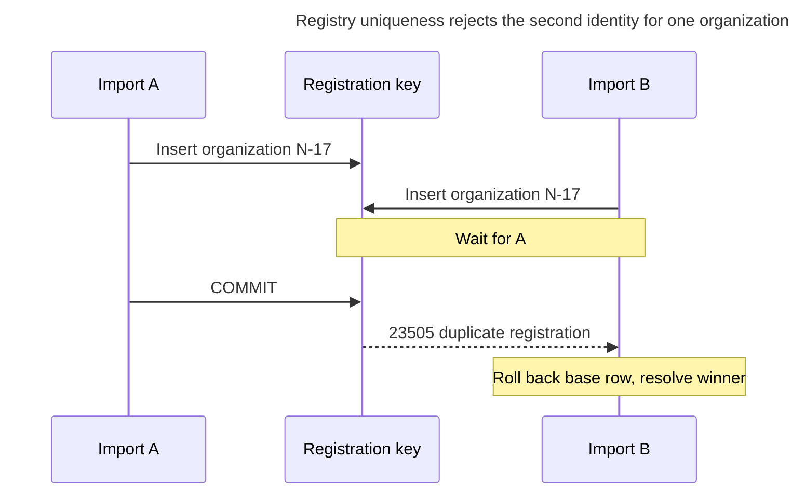
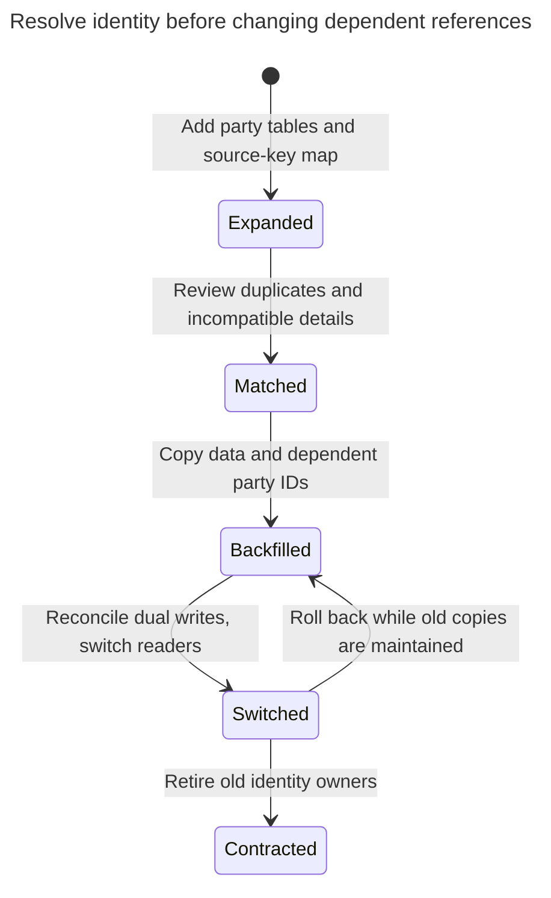

# Party

## Intent

A party is the common supertype of people and organizations, so customers, suppliers, employees and partners are all parties and the rest of the schema refers to one table. Addresses, contacts, agreements and payments then attach to a party once instead of being duplicated for every kind of counterpart, and the same company can be both a supplier and a customer without becoming two records. The chapter shows the party, person and organization tables, relationships between parties, and the point where a single party table becomes more abstraction than the domain needs.

## Also known as

Party model; person–organization supertype. Fowler's [Organization Structures](https://martinfowler.com/apsupp/accountability.pdf), pages 5–6, describes Party as the shared abstraction for people and organizational units. The relational design below is this chapter's implementation.

## Problem

Your purchasing module calls Northwind a supplier; sales calls it a customer. Each module stores its own company name, email and registration number. A correction reaches one copy and misses the other. A payment then needs two possible recipient columns, although both recipients are the same organization.

The opposite mistake is to unify everything with a name. A person, a trading company and a warehouse are not interchangeable simply because each has contact details. Decide which entities can actually sign your agreements, receive your payments or play your business roles. A delivery location can remain a location owned by a party.

## Solution

Create one `party` identity for each person or organization. Put shared display and contact data behind that key. Put person-only and organization-only attributes in shared-key extensions. Make agreements and other common relationships reference the party key; make a relationship specifically requiring an organization reference the organization extension.

Keep identity separate from participation. Northwind gains a customer role and a supplier role without gaining another party ID; [Role Object](role-object.md) owns that decision. Fowler's [roles paper](https://martinfowler.com/apsupp/roles.pdf) explicitly separates common host features from the roles an object plays. A change of role does not change a person's identity or turn a person into an organization.

## Alternatives and selection

| Sibling | Relationship | Deciding requirement |
| --- | --- | --- |
| [Class Table Inheritance](class-table-inheritance.md) | Implementation option | Shared-key subtype tables suit your required subtype fields; use its stronger completeness design if every party must have details at commit |
| [Role Object](role-object.md) | Complement | A party can be both customer and supplier, with independent participation periods |
| Separate customer and supplier entities | Replacement | They really have separate lifecycles and you have no shared-counterparty operations |

See the [Decision Atlas](decision-atlas.md) for the full table. A common key is useful when your domain has a common entity, rather than merely similar columns.



First establish shared identity; then decide whether participation needs its own rows. A role table cannot decide whether two registrations describe the same organization.

## Structure



Each extension has at most one row for a party. The composite discriminator references prevent a person extension on an organization, but deliberately allow a newly registered party to have no extension yet. The `UK` annotations denote composite keys, not unique kinds or registries individually.



A contact belongs to the identity independently of roles. Each relationship has two checked party endpoints; its type supplies the meaning, while additional business policies remain separate.

## Tables and invariants

- **`party`** owns the stable identity and a mandatory kind. A display name is a label, not a deduplication key.
- **`person` / `organization`** contain optional detail records of the selected kind. `organization_registration_key` identifies an organization within the example's registry; decide which issuing authority your real registry key denotes.
- **`party_contact`** belongs to a party once, independent of its roles. Shared household email addresses are permitted because uniqueness is per party, channel and value.
- **`party_relationship`** has checked endpoints and forbids self-links. It permits both named link kinds between either party kind; it does not enforce organization-only subsidiaries, acyclicity or business validity periods. Add those policies before treating this general association as an organization chart.

## When to use

- Several workflows refer to the same people and organizations and need shared contact changes.
- A payment, agreement or message can address either kind of counterparty.
- Your identity resolution process can distinguish shared entities from lookalike names.

## Consequences and trade-offs

- ➕ Contact corrections and common references have one owner.
- ➕ Adding a business role does not duplicate a counterparty.
- ➖ Complete subtype reads join to a detail table; cross-workflow access also needs an explicit authorization policy.
- ➖ Merging identities becomes a domain operation over every reference, not a name update.
- ➖ A universal `party` table can hide meaningful boundaries if you include locations, products or unrelated identities solely for reuse.

## Implementation

The [complete PostgreSQL 18.6 script](../assets/party/party.sql) creates contacts and a contact-person relationship, checks subtype mismatch and duplicate registration, and renames the organization. The essential schema is:

```sql
CREATE SCHEMA party_example;
SET search_path = party_example, public;

CREATE TABLE party (
    party_id bigint PRIMARY KEY,
    kind text NOT NULL CHECK (kind IN ('person', 'organization')),
    display_name text NOT NULL,
    UNIQUE (party_id, kind)
);
CREATE TABLE person (
    party_id bigint PRIMARY KEY,
    kind text NOT NULL DEFAULT 'person' CHECK (kind = 'person'),
    given_name text NOT NULL,
    family_name text NOT NULL,
    CONSTRAINT person_party_kind_fk FOREIGN KEY (party_id, kind)
        REFERENCES party (party_id, kind)
);
CREATE TABLE organization (
    party_id bigint PRIMARY KEY,
    kind text NOT NULL DEFAULT 'organization' CHECK (kind = 'organization'),
    registry text NOT NULL,
    registration_number text NOT NULL,
    CONSTRAINT organization_registration_key UNIQUE (registry, registration_number),
    FOREIGN KEY (party_id, kind) REFERENCES party (party_id, kind)
);
CREATE TABLE party_contact (
    party_id bigint REFERENCES party (party_id),
    channel text CHECK (channel IN ('email', 'phone', 'postal')),
    contact_value text NOT NULL,
    PRIMARY KEY (party_id, channel, contact_value)
);
CREATE TABLE party_relationship (
    from_party_id bigint REFERENCES party (party_id),
    to_party_id bigint REFERENCES party (party_id),
    relationship_type text CHECK (relationship_type IN ('contact_for', 'subsidiary_of')),
    PRIMARY KEY (from_party_id, to_party_id, relationship_type),
    CHECK (from_party_id <> to_party_id)
);
CREATE INDEX party_relationship_target_idx ON party_relationship (to_party_id);
```

A PostgreSQL [composite foreign key](https://www.postgresql.org/docs/18/ddl-constraints.html#DDL-CONSTRAINTS-FK) checks the ID and kind together. Unlike a child ID reference alone, it prevents the wrong extension. Create the base and known details atomically, even though incomplete parties are allowed:

```sql
BEGIN;
INSERT INTO party VALUES (1, 'organization', 'Northwind'), (2, 'person', 'Ada Lee');
INSERT INTO organization (party_id, registry, registration_number) VALUES (1, 'demo-registry', 'N-17');
INSERT INTO person (party_id, given_name, family_name) VALUES (2, 'Ada', 'Lee');
INSERT INTO party_contact VALUES (1, 'email', 'orders@example.com');
INSERT INTO party_relationship VALUES (2, 1, 'contact_for');
COMMIT;
SELECT p.display_name, c.contact_value
FROM party AS p JOIN party_contact AS c USING (party_id) WHERE p.party_id = 1;
UPDATE party SET display_name = 'Northwind Trading' WHERE party_id = 1;
SELECT p.display_name, o.registration_number
FROM party AS p JOIN organization AS o USING (party_id);
```

The first query returns `(Northwind, orders@example.com)`; after renaming, the organization query returns `(Northwind Trading, N-17)`. Neither its ID nor the contact-person reference changes. Attaching person details to the organization is invalid:

```sql
INSERT INTO person (party_id, given_name, family_name) VALUES (1, 'Wrong', 'Type');
```

PostgreSQL 18.6 raises SQLSTATE `23503`: `ERROR: insert or update on table "person" violates foreign key constraint "person_party_kind_fk"`. A second organization with the same registry and registration number instead fails `organization_registration_key` with `23505`. The script checks both diagnostics.

Do not interpret the missing extension as an unknown kind: `party.kind` is still required. If onboarding requires complete details before activation, add an explicit onboarding state and completeness guard, or adopt the total-subtype implementation in [Class Table Inheritance](class-table-inheritance.md).

## Engine support

- **PostgreSQL 18:** ordinary shared-key tables implement the model. This example needs no deferred completeness constraint.
- **MySQL 8.4 / InnoDB:** [foreign keys are checked immediately](https://dev.mysql.com/doc/refman/8.4/en/create-table-foreign-keys.html); base-before-extension insertion works, but a deferred circular completeness variant needs redesign.
- **SQL Server 2025 (17.x) / Oracle AI Database 26ai:** preserve the composite endpoint checks when translating types. If you add procedural lifecycle guards, SQL Server [DML triggers must handle sets of rows](https://learn.microsoft.com/en-us/sql/relational-databases/triggers/create-dml-triggers-to-handle-multiple-rows-of-data?view=sql-server-ver17); Oracle's [deferrable constraints](https://docs.oracle.com/en/database/oracle/oracle-database/26/sqlrf/constraint.html) offer another timing option for stronger subtype completeness.
- **SQLite 3:** enable [foreign keys on each connection](https://www.sqlite.org/foreignkeys.html). Otherwise the discriminator references do not protect subtype membership.

## Failure and concurrency

Two imports may both decide that registry `demo-registry`, number `N-17`, is new. Treat the unique constraint as the authority, then resolve the winning organization and attach the intended role in a new transaction. PostgreSQL's [unique-index checks](https://www.postgresql.org/docs/18/index-unique-checks.html) wait for conflicting uncommitted insertions before deciding the result. Do not catch the conflict and leave the losing base party orphaned; create both rows in the same transaction.



This detects only duplicates covered by the chosen registry key. Two records without comparable identifiers need an explicit matching and review process. For a merge, lock both parties in ascending ID order, reconcile conflicting details, repoint dependents and record the old-to-new mapping in one coordinated operation. Keep the old identity resolvable if external systems still use it.

## Migration

Build an explicit mapping from each old customer or supplier key to a party ID. Do not equate equal integers from different tables or merge equal display names automatically. Resolve evidence-backed matches, then backfill common contact data and subtype details. Keep role-specific fields in the originating role rather than moving them all into `party`.



Switch each dependent only after every old reference has one mapped target. During the rollback window, retain the source-key map and synchronized old representations. A party with both roles cannot be flattened back into a single exclusive customer-or-supplier flag without losing information.

## Anti-patterns and common mistakes

- Using customer and supplier as exclusive identity kinds when the same organization can be both.
- Deduplicating people by name or globally unique email without a domain rule supporting it.
- Claiming exactly-one extension from the child foreign keys; this schema intentionally allows no details.
- Treating every typed party relationship as a valid tree or legally meaningful relationship without its own rules.

## Known uses

- Fowler's [Party example](https://martinfowler.com/apsupp/accountability.pdf), page 5, unifies a telephone utility's individual and business customers. Its address-book example also motivates contacts linked to either kind.
- The same paper's Accountability section models typed links between parties. The simple relationship table here illustrates endpoint identity; it does not implement that paper's full rule model.

## Related patterns

- [Role Object](role-object.md) separates a party's changing capacities from its identity.
- [Class Table Inheritance](class-table-inheritance.md) explains subtype storage and the stronger exactly-one extension guarantee.
