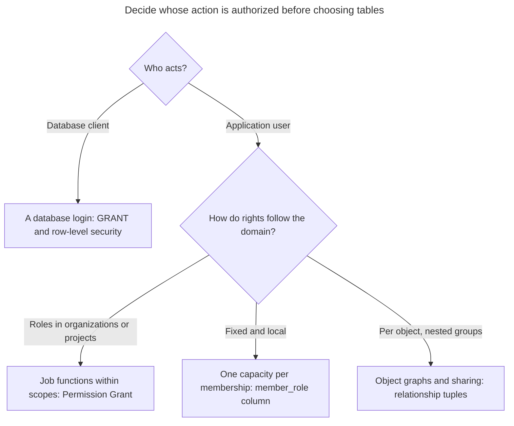
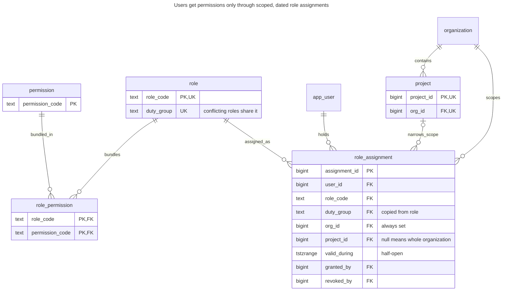
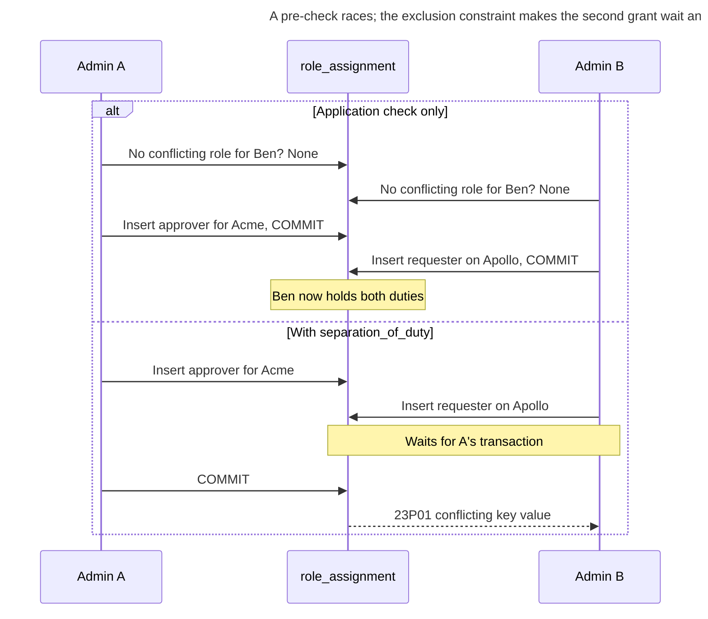
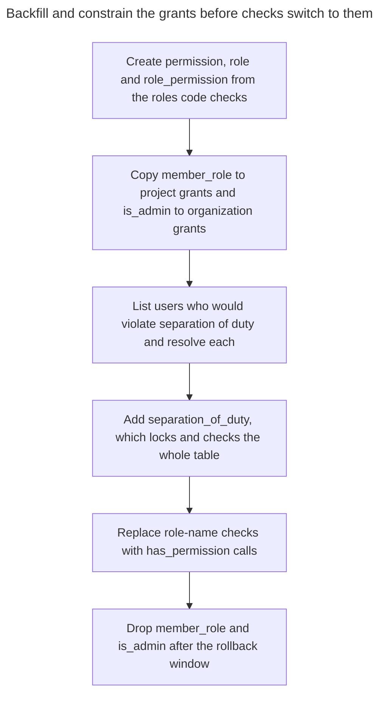

# Permission Grant

## Intent

A permission grant stores application authorization as data: a vocabulary of actions, roles that bundle them, and assignments that give a user a role within a scope — a whole organization or one project — for a stated period. One query then answers whether user U may perform action P on project X at time T, including rights inherited from the organization, and constraints on the assignment table enforce separation of duty, so nobody both submits and approves the same organization's expenses. These are rows about your application's end users. They are not PostgreSQL roles or `GRANT`, which control what a database login may do with tables. The model follows [NIST role-based access control](https://csrc.nist.gov/projects/role-based-access-control).

## Also known as

Role-based access control (RBAC); user-role and permission-role assignment, the relations the [NIST RBAC FAQ](https://csrc.nist.gov/projects/role-based-access-control/faqs) calls fundamental to Core RBAC in ANSI INCITS 359-2004. Sandhu, Ferraiolo and Kuhn's [NIST model for RBAC](https://tsapps.nist.gov/publication/get_pdf.cfm?pub_id=916402) (2000) names its levels flat, hierarchical, constrained and symmetric RBAC. Do not confuse this pattern with [Role Object](role-object.md): a role object records a business capacity a party plays, such as customer or supplier, with its own attributes, while a permission grant records which actions a user may perform in the application and where.

## Problem

Your expense application started with `app_user.is_admin` and a `member_role` column on project membership. Then Acme asked for a finance lead who can approve expenses on every Acme project but not on Globex projects, a contractor who may read one project until March, and an auditor's rule that nobody approves expenses they could have submitted. A flag cannot say where it applies, a membership role cannot cover projects that do not exist yet, and checks spread across controllers as `if role == 'admin' or role == 'editor'`.

Database privileges do not help here. The service connects through one pooled login, as [Audit Log](audit-log.md) explains, and that login must reach every tenant's rows. Creating a PostgreSQL role per end user moves business authorization into cluster-wide catalog objects that your migrations, tenant model and audit trail do not cover. The question “may Ben approve this expense?” belongs to the application's data.

## Solution

Separate four things. `permission` is the closed vocabulary of actions the code checks, such as `expense.approve`; code never checks role names. `role` names a job function, and `role_permission` bundles actions into it. `role_assignment` gives one user one role in one scope for a half-open period. Users obtain permissions only through roles, as in NIST's model: there is no user-to-permission table to bypass the review of who holds what.

Scope is a real reference, not a `(scope_type, scope_id)` pair; see [Polymorphic Associations](polymorphic-associations.md). In this example every project lies in exactly one organization, the organization is also the tenant, and an assignment always names its `org_id`. A non-null `project_id` narrows it to one project, and a composite foreign key `(org_id, project_id)` proves that the project belongs to that organization. This is not an exclusive arc: there is no exactly-one check, because containment makes the organization reference mandatory and only the narrower project reference optional. When you add a scope kind outside that tree, use an [Exclusive Arc](exclusive-arc.md), one nullable foreign key per kind with an exactly-one check, or one assignment table per scope kind; separate tables, however, put conflicting grants out of reach of a single exclusion constraint.

Separation of duty is a constraint on assignments. Each role belongs to a `duty_group`; roles in the same group conflict. The assignment row carries the group, tied to the role by a composite foreign key, and an exclusion constraint rejects two different roles of one group for the same user, organization and overlapping period. Comparing whole organizations rather than equal scopes is deliberate: an organization-wide approver inherits approval on every project, so an extra requester grant on one project is the same conflict. NIST calls a rule on assignments static separation of duty; a rule on roles activated together in a session is dynamic separation of duty and is out of scope here. Roles stay flat: inheritance runs along scopes, not from role to role. The FAQ describes the standard's components beyond Core RBAC as independent of each other, while the 2000 paper builds its constrained level on top of the hierarchical one.

## Alternatives and selection

| Mechanism | Relationship | Deciding requirement |
| --- | --- | --- |
| PostgreSQL roles, `GRANT` and [Shared Schema](shared-schema.md) row-level security | Complement | Restrict what a database login can read or write; RLS can enforce a tenant or permission predicate below the application |
| `member_role` on an [Association Table](association-table.md) | Replacement for small cases | One fixed capacity per membership, no inheritance across scopes and no conflict rules |
| Per-object access-control lists | Replacement | Each object is shared individually with users or groups, and roles add little |
| Relationship tuples | Generalization | Access follows object graphs, nested groups and sharing, as in Zanzibar |
| [Effective Dating](effective-dating.md) | Complement | Grants start and end at business times, and checks must answer for a past instant |
| [Audit Log](audit-log.md) | Complement | You must show who granted or revoked what, when and why |

See the [Decision Atlas](decision-atlas.md) for the full comparison.



The tuple branch is the general form of this chapter. [Zanzibar](https://www.usenix.org/conference/atc19/presentation/pang) (Pang et al., USENIX ATC 2019) stores access control lists as relation tuples written `object#relation@user`, for example `doc:readme#owner@10`, where the user can itself be a userset such as `group:eng#member`. The paper keys a tuple by namespace, object ID, relation and user. A document's link to its folder is itself a stored tuple, `doc:readme#parent@folder:A#...`, but the rules that turn links into access, such as “editors are viewers” or “inherit the parent folder's viewers”, live in per-namespace configuration as userset rewrite rules. A `role_assignment` row corresponds to a tuple like `project:10#requester@2`, and organization inheritance to a stored `project:10#parent@org:1#...` tuple plus a rewrite rule that follows it. A single tuple table keyed by namespace and object ID cannot have foreign keys to your scope tables. Choose it when the policy language matters more than relational guarantees.

## Structure



`permission`, `role` and `role_permission` change with releases; `role_assignment` changes daily. Note the two composite references from `role_assignment`: `(role_code, duty_group)` to `role` and `(org_id, project_id)` to `project`. Both columns of each pair are on the assignment row, so a constraint on that table can see the duty group and the organization without a join.

## Tables and invariants

- **`permission`** is the action vocabulary. The application checks these codes; adding one is a release, like adding a [Lookup Table](lookup-table.md) value.
- **`role`** names a job function and its `duty_group`. Roles with no conflicts get a group of their own. `UNIQUE (role_code, duty_group)` is the target of the assignments' composite foreign key.
- **`role_permission`** bundles actions into roles, keyed by the pair.
- **`role_assignment`** grants one role to one user in one scope. `assignment_role_fkey` makes the copied duty group match the role, and `ON UPDATE CASCADE` re-checks existing grants when a role moves to another group. `assignment_project_fkey` rejects a project from another organization; under the default `MATCH SIMPLE` it is skipped when `project_id` is null, and the separate `org_id` foreign key still rejects an unknown organization. `assignment_period_check` requires a nonempty period with a start. `separation_of_duty` rejects conflicting roles for overlapping periods.
- **Attribution:** `granted_by` and `revoked_by` say who is accountable for the current state of a grant. The reason, request ID and earlier versions of the row belong in an [Audit Log](audit-log.md) written in the same transaction.

## When to use

- Many users hold a few job functions, and administrators assign functions rather than individual actions.
- Rights apply within a tenant or a resource, and broader scopes should cover narrower ones.
- You must enforce combinations that nobody may hold, or answer who could do what at a past instant.

## Consequences and trade-offs

- ➕ The same tables answer “may U do P on X?”, “why?” and “who may do P on X?”; the NIST model's flat level already requires reviewing which roles a user holds and which users hold a role.
- ➕ A conflicting assignment is rejected by the database, whichever administrator screen or import created it.
- ➕ Time-bound grants and revocation keep their history, so a past decision can be explained from rows.
- ➖ The exclusion constraint compares whole duty groups. It cannot express an arbitrary compatibility matrix; [Role Object](role-object.md) explains the same limit of conflict groups.
- ➖ Inheritance runs only along the scope tree you encode. Role hierarchies, deny rules and attribute conditions need more tables or a policy engine.
- ➖ Every permission check is a query. Caching decisions in the application delays revocation by the cache lifetime.

## Implementation

The [complete PostgreSQL 18.7 script](../assets/permission-grant/permission-grant.sql) checks inheritance, the tenant boundary, the half-open expiry, the explanation and reverse queries, every separation-of-duty case, revocation and re-granting, and the rejections quoted below. The essential table and query are:

```sql
CREATE EXTENSION IF NOT EXISTS btree_gist;
CREATE TABLE role_assignment (
    assignment_id bigint PRIMARY KEY,
    user_id bigint NOT NULL REFERENCES app_user (user_id),
    role_code text NOT NULL,
    duty_group text NOT NULL,
    org_id bigint NOT NULL REFERENCES organization (org_id),
    project_id bigint,
    valid_during tstzrange NOT NULL,
    granted_by bigint NOT NULL REFERENCES app_user (user_id),
    revoked_by bigint REFERENCES app_user (user_id),
    CONSTRAINT assignment_role_fkey FOREIGN KEY (role_code, duty_group)
        REFERENCES role (role_code, duty_group) ON UPDATE CASCADE,
    CONSTRAINT assignment_project_fkey FOREIGN KEY (org_id, project_id)
        REFERENCES project (org_id, project_id),
    CONSTRAINT assignment_period_check
        CHECK (NOT isempty(valid_during) AND NOT lower_inf(valid_during)),
    CONSTRAINT assignment_revocation_check
        CHECK (revoked_by IS NULL OR NOT upper_inf(valid_during)),
    CONSTRAINT separation_of_duty EXCLUDE USING gist (
        org_id WITH =, user_id WITH =, duty_group WITH =,
        role_code WITH <>, valid_during WITH &&)
);

CREATE FUNCTION permission_source(p_user bigint, p_permission text, p_project bigint, p_at timestamptz)
RETURNS TABLE (assignment_id bigint, role_code text, scope text)
LANGUAGE sql STABLE
BEGIN ATOMIC
    SELECT a.assignment_id, a.role_code,
           CASE WHEN a.project_id IS NULL THEN 'organization' ELSE 'project' END
    FROM project AS p
    JOIN role_assignment AS a
      ON a.org_id = p.org_id
     AND (a.project_id IS NULL OR a.project_id = p.project_id)
    JOIN role_permission AS rp ON rp.role_code = a.role_code
    WHERE p.project_id = p_project AND a.user_id = p_user
      AND rp.permission_code = p_permission AND a.valid_during @> p_at;
END;
CREATE FUNCTION has_permission(p_user bigint, p_permission text, p_project bigint, p_at timestamptz)
RETURNS boolean LANGUAGE sql STABLE
RETURN EXISTS (SELECT FROM permission_source(p_user, p_permission, p_project, p_at));
```

The `role_code WITH <>` element is what makes the exclusion a conflict rule rather than a uniqueness rule: two rows conflict only if their roles differ. [`btree_gist`](https://www.postgresql.org/docs/18/btree-gist.html) supplies GiST support for `=` and `<>` on scalar columns. Because the operator is `<>`, Ben may be requester on Apollo and on Borealis at once.

The script grants Ada `editor` on all of Acme, Ben `requester` on Apollo and Cy `viewer` on Borealis for `[2026-01-01, 2026-03-01)`. Then `has_permission(1, 'project.edit', 11, '2026-02-01')` is true through the organization grant, and the same call for Globex's project 20 is false. `permission_source` returns `100, editor, organization` as the reason. Cy can read Borealis at `2026-02-28 23:59:59` and cannot at `2026-03-01 00:00:00`. Pass the instant explicitly: `now()` is fixed for a whole transaction, which is right for one request but wrong for a test or a report. The reverse question, “who may approve expenses on Apollo?”, is the same function applied to each user.

After Ada becomes organization `approver`, a requester grant on Apollo is rejected:

```sql
INSERT INTO role_assignment
    (assignment_id, user_id, role_code, duty_group, org_id, project_id, valid_during, granted_by)
SELECT 106, 1, role_code, duty_group, 1, 10, '[2026-02-01,)', 9
FROM role WHERE role_code = 'requester';
```

PostgreSQL 18.7 raises SQLSTATE `23P01`: `ERROR: conflicting key value violates exclusion constraint "separation_of_duty"`, with `DETAIL: Key (org_id, user_id, duty_group, role_code, valid_during)=(1, 1, expense, requester, ["2026-02-01 00:00:00+00",)) conflicts with existing key (org_id, user_id, duty_group, role_code, valid_during)=(1, 1, expense, approver, ["2026-01-01 00:00:00+00",)).` A Globex approver grant for Ben is accepted, because the organization differs. A Globex project under Acme's `org_id` raises `23503`: `ERROR: insert or update on table "role_assignment" violates foreign key constraint "assignment_project_fkey"`, `DETAIL: Key (org_id, project_id)=(1, 20) is not present in table "project".` Typing `duty_group = 'approver'` for the approver role fails the same way on `assignment_role_fkey`.

A grant moves through a small lifecycle, and only the period and the revocation columns change:

```mermaid
---
title: Expiry and revocation end the period; neither deletes an active grant
---
stateDiagram-v2
    [*] --> scheduled: Insert with a future lower bound
    scheduled --> active: Lower bound reached
    scheduled --> [*]: Withdrawn before start, row deleted
    active --> expired: Upper bound reached
    active --> revoked: Upper bound set to now, revoked_by set
    expired --> [*]
    revoked --> [*]
    class scheduled muted
    class active accent
    class revoked warn
```



Revoke by closing the period at the revocation instant, so history keeps the time the grant was in force:

```sql
UPDATE role_assignment
SET valid_during = tstzrange(lower(valid_during), '2026-06-01'), revoked_by = 9
WHERE assignment_id IN (101, 104) AND valid_during @> TIMESTAMPTZ '2026-06-01';
```

Ben can submit at `2026-05-31` and not at `2026-06-01`. An approver grant from `2026-06-01` is now accepted, but one backdated to `2026-05-01` still overlaps the closed requester period and fails with `23P01`. A grant that has not started cannot be closed at its own start: the period becomes empty and `assignment_period_check` raises `23514`, so delete it and record the withdrawal in the audit log. Setting `revoked_by` on an open-ended grant also fails `assignment_revocation_check`. Moving `editor` into the `expense` group cascades into Ada's assignments and fails `separation_of_duty`: a policy change is checked against existing grants.

## Engine support

- **PostgreSQL 18:** exclusion constraints with [range types](https://www.postgresql.org/docs/18/rangetypes.html) and `btree_gist` enforce the rule declaratively. [Roles and `GRANT`](https://www.postgresql.org/docs/18/sql-grant.html) remain the database-login layer; a [row-level security policy](https://www.postgresql.org/docs/18/ddl-rowsecurity.html) may call `has_permission` to enforce application grants below the service, with the trusted-context caveats of [Shared Schema](shared-schema.md).
- **MySQL 8.4:** there are no exclusion constraints, and a [`CHECK`](https://dev.mysql.com/doc/refman/8.4/en/create-table-check-constraints.html) cannot read other rows. Serialize grants for one user by locking the user row with [`SELECT ... FOR UPDATE`](https://dev.mysql.com/doc/refman/8.4/en/innodb-locking-reads.html), check for conflicts, then insert, in one transaction.
- **SQL Server 2025 (17.x):** a trigger must handle [multi-row inserts](https://learn.microsoft.com/en-us/sql/relational-databases/triggers/create-dml-triggers-to-handle-multiple-rows-of-data?view=sql-server-ver17), and two writers' checks must be serialized on a key such as organization and user, for example with [`sp_getapplock`](https://learn.microsoft.com/en-us/sql/relational-databases/system-stored-procedures/sp-getapplock-transact-sql?view=sql-server-ver17).
- **Oracle AI Database 26ai:** [check constraints cannot contain subqueries](https://docs.oracle.com/en/database/oracle/oracle-database/26/sqlrf/constraint.html). Lock the user row with [`SELECT ... FOR UPDATE`](https://docs.oracle.com/en/database/oracle/oracle-database/26/sqlrf/SELECT.html) in the granting procedure before checking.
- **SQLite 3:** [`BEGIN IMMEDIATE`](https://www.sqlite.org/lang_transaction.html) serializes writers, so check-then-insert is safe inside it. Enable [foreign keys](https://www.sqlite.org/foreignkeys.html) per connection for the scope and role references.

## Failure and concurrency

Two administrators grant conflicting roles to Ben at the same moment. A check in application code reads committed rows only, so under Read Committed both checks pass:



If A rolls back instead, B's insert proceeds. The lab asserts the sequential rejection; the waiting itself needs two sessions. Treat `23P01` as a business refusal to show the administrator, not as a retryable error.

Revocation races with checks too. A request that checked permission and then works for seconds can act after the revocation commits. Run the check and the action in one transaction, and if the action must not outlive the grant, lock the source rows with `SELECT ... FROM role_assignment ... FOR SHARE`: PostgreSQL documents that a [shared row lock blocks `UPDATE`](https://www.postgresql.org/docs/18/explicit-locking.html#LOCKING-ROWS), so the revoking update waits for the action. Zanzibar calls the distributed version of this the “new enemy” problem: a check that ignores the order of ACL updates, or applies an old ACL to new content. It evaluates each check at a snapshot no older than a timestamp carried in an opaque token it calls a zookie. In one PostgreSQL database at Read Committed, each statement takes a new snapshot, so the row lock, not the snapshot, orders the action before the revocation.

## Migration

From a `member_role` column on project membership and an `is_admin` flag, build the grant tables beside them and switch checks from role names to permission codes.



Start each migrated period at the migration time unless you have evidence of an earlier grant date. An exclusion constraint cannot be added `NOT VALID` and validated later; PostgreSQL 18.7 raises `0A000`: `ERROR: EXCLUDE constraints cannot be marked NOT VALID`. [`ALTER TABLE`](https://www.postgresql.org/docs/18/sql-altertable.html) builds its index and checks every row under an `ACCESS EXCLUSIVE` lock, so resolve conflicts first and add it while the table is small. Until the old columns are dropped, keep them as a projection of the grants, so rolling back the application finds current data. Follow [Expand and Contract](expand-contract.md) for the switch.

## Anti-patterns and common mistakes

- Checking role names in code, so adding a role means a release and no query can say who may perform an action.
- Granting permissions directly to users beside roles, which defeats review of who holds what.
- Storing scope as `(scope_type, scope_id)` without foreign keys, so grants survive the deletion of their project or point into another tenant.
- Enforcing separation of duty only between equal scopes, so an organization approver can request on a project and approve their own expense.
- Putting the conflict group only on `role`, where a constraint on assignments cannot see it, or letting callers type it without a foreign key.
- Deleting revoked grants, so nobody can explain a decision made while they were in force.
- Mapping each end user to a PostgreSQL role to reuse `GRANT`, which mixes business authorization with database administration.

## Known uses

- NIST's [RBAC project](https://csrc.nist.gov/projects/role-based-access-control) traces the model from Ferraiolo and Kuhn (1992) to ANSI INCITS 359-2004, revised as INCITS 359-2012. Its FAQ lists the standard's components: Core RBAC with user-role and permission-role assignment, hierarchical RBAC, static separation of duty on assignments and dynamic separation of duty on session activation.
- [Zanzibar](https://www.usenix.org/conference/atc19/presentation/pang) evaluates access control for Google services including Calendar, Cloud, Drive, Maps, Photos and YouTube. The paper reports more than two trillion ACLs stored as relation tuples in Spanner.

## Related patterns

- [Role Object](role-object.md) models business capacities of parties; its conflict groups use a similar exclusion technique.
- [Party](party.md) is a common choice for the principal when grants go to organizations as well as people.
- [Shared Schema](shared-schema.md) scopes rows by tenant and enforces access with row-level security.
- [Exclusive Arc](exclusive-arc.md) and [Polymorphic Associations](polymorphic-associations.md) explain why scope references are real foreign keys.
- [Effective Dating](effective-dating.md) explains the half-open validity periods.
- [Audit Log](audit-log.md) records who granted and revoked each assignment and why.
- [Association Table](association-table.md) is the simpler membership-with-role design this pattern replaces when scopes and conflicts appear.
