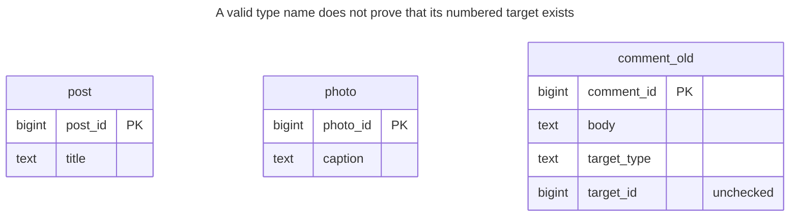
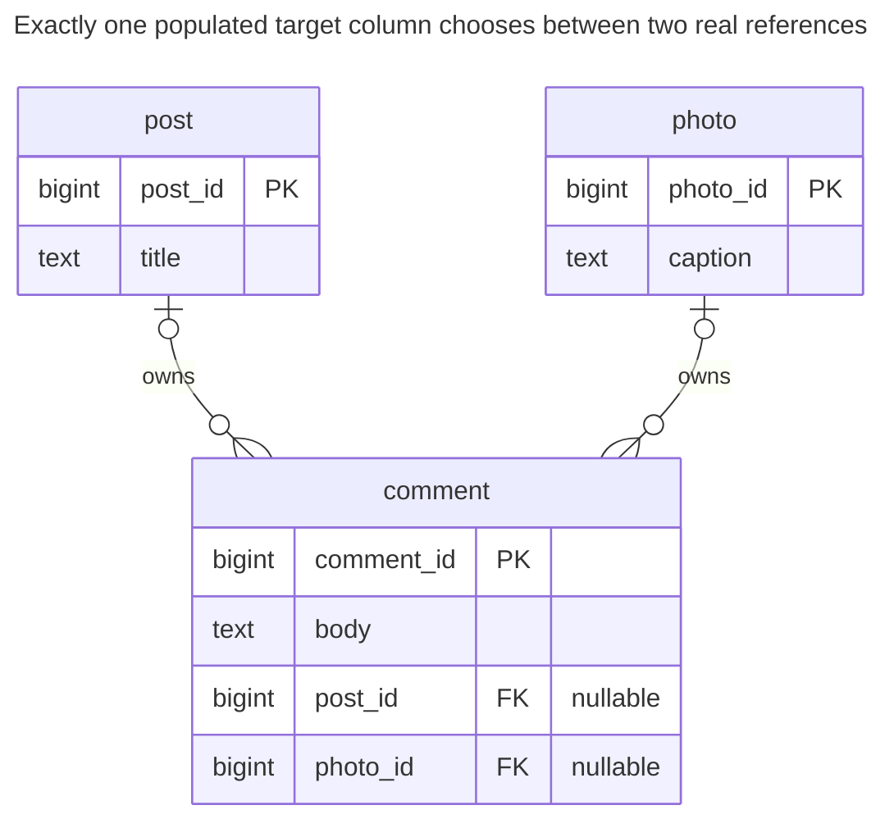
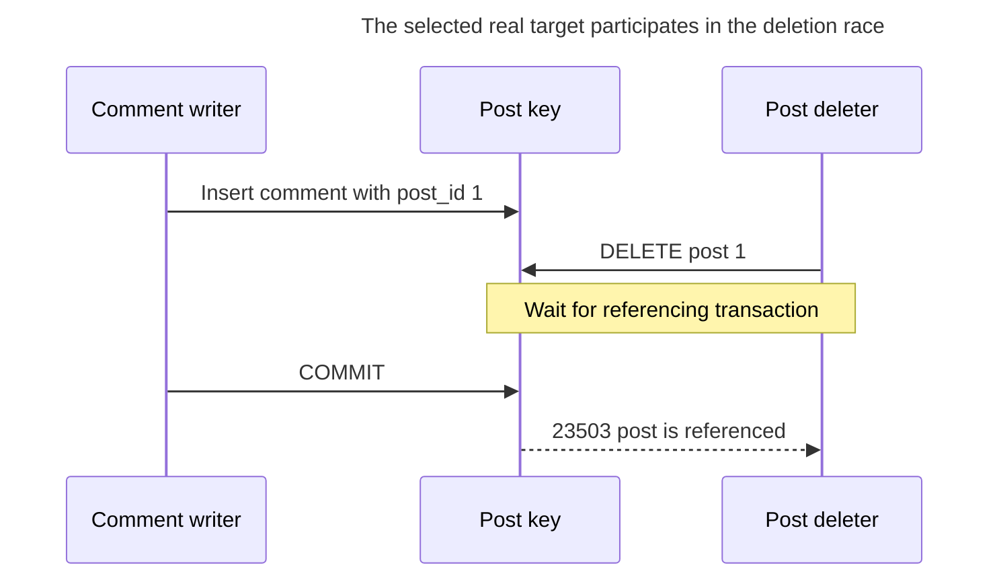
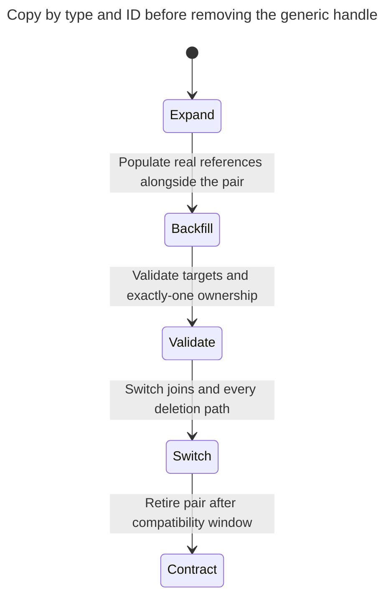

# Polymorphic Associations

Polymorphic associations reference a row in one of several tables through a pair of columns — the target type and the target ID — as Rails polymorphic associations and Django generic relations do. No foreign key can check such a reference, so the database lets a comment point to a post that never existed, and target joins must account for the type. The chapter shows the harm and three ways out: an exclusive arc, a separate association table per target, and a shared supertype. Bill Karwin's catalog uses the same name.

## Also known as

Polymorphic Associations, in Bill Karwin's [SQL Antipatterns contents](https://pragprog.com/titles/bksap1/sql-antipatterns-volume-1/). Rails uses the same term for its [type-and-ID association feature](https://guides.rubyonrails.org/association_basics.html#polymorphic-associations). The feature describes an application mapping; this chapter examines the missing database relationship guarantee.

## Context

Comments can belong to posts or photos. The two parent tables have independent keys, so post `1` and photo `1` can coexist. You want one comment API and one comment table without adding a target column whenever a new kind becomes commentable.

## Problem

You store a target type and ID but declare no reference from that ID to its actual parent. A check on the type spelling can reject `photograph`; it cannot prove that photo `999` exists. An ordinary PostgreSQL [FK names one referenced table](https://www.postgresql.org/docs/18/ddl-constraints.html#DDL-CONSTRAINTS-FK), not a table selected by another column's value.

Target-aware joins are possible, as the example shows; a `CASE` is not compulsory. The structural problem is that every query and lifecycle operation must interpret the discriminator correctly. Rails [documents class-name synchronization](https://guides.rubyonrails.org/association_basics.html#polymorphic-associations) when a stored model name changes. Django's [GenericForeignKey documentation](https://docs.djangoproject.com/en/5.2/ref/contrib/contenttypes/#generic-relations) describes a target deletion leaving stored IDs that resolve to `None`; a configured `GenericRelation` has additional deletion behavior. Do not attribute one universal deletion policy to all generic mappings.

## Why people do it

One generic feature can attach to many models with little per-target DDL. That can be defensible for a plugin registry, best-effort bookmark or remote resource handle whose target may disappear independently. It is a different contract from a comment that must always belong to one existing local owner.

## Consequences

- ➖ The sample accepts references to nonexistent targets and leaves them for query-time interpretation.
- ➖ Type renames are stored-data changes as well as application changes.
- ➖ Parent deletion requires a complete target-aware policy outside the ordinary FK graph.
- ➖ Matching by ID without its type can attach a comment to the wrong entity.
- ➖ A generic ID index accelerates a lookup without proving that its target exists.

## Signs

- A table has `target_type` and `target_id` with no fixed reference boundary.
- Deletion code enumerates all generic dependents manually.
- A model rename requires updating stored type strings.
- A repair task probes several parent tables to discover orphan children.

## A better way

For a small controlled target set, use an [Exclusive Arc](exclusive-arc.md): one nullable FK per parent plus an exactly-one check. For a meaningful common entity family, use a shared supertype. For independent relationship families, move references into target-specific link tables. Karwin's [author-uploaded slides](https://www.slideshare.net/slideshow/practical-object-oriented-models-in-sql/1762095) name these alternatives; the worked constraints here are this chapter's implementation.

### Alternatives and selection

| Sibling | Relationship | Deciding requirement |
| --- | --- | --- |
| [Exclusive Arc](exclusive-arc.md) | Replacement | Few parent kinds; exactly one owner per child |
| Per-target [Association Tables](association-table.md) | Replacement for reference placement | Relationships evolve independently or multiple targets are valid |
| [Class Table Inheritance](class-table-inheritance.md) | Replacement for target identity | Parent kinds share a real common identity and lifecycle |
| Unchecked external handle | Implementation option for a weaker contract | Missing or remote targets are explicitly allowed and handled |

Target-specific tables each enforce existence, but do not together enforce exactly one link across all tables. A shared supertype provides a real common FK target but needs its own subtype-completeness rules. These costs are part of selection; see the [Decision Atlas](decision-atlas.md).

## Example

### Structure

**Before:** the type and ID suggest two potential edges but declare neither.



No FK edge is shown because none exists. Identical numeric keys in the parent tables remain different identities.

```sql
CREATE TABLE post (post_id bigint PRIMARY KEY, title text NOT NULL);
CREATE TABLE photo (photo_id bigint PRIMARY KEY, caption text NOT NULL);
CREATE TABLE comment_old (
    comment_id bigint PRIMARY KEY,
    body text NOT NULL,
    target_type text NOT NULL CHECK (target_type IN ('post', 'photo')),
    target_id bigint NOT NULL
);
INSERT INTO post VALUES (1, 'Schema notes');
INSERT INTO photo VALUES (1, 'Whiteboard');
INSERT INTO comment_old VALUES
    (10, 'Useful', 'post', 1), (11, 'Clear', 'photo', 1), (12, 'Lost', 'post', 999);
SELECT c.comment_id FROM comment_old AS c
LEFT JOIN post AS p ON c.target_type = 'post' AND c.target_id = p.post_id
LEFT JOIN photo AS f ON c.target_type = 'photo' AND c.target_id = f.photo_id
WHERE p.post_id IS NULL AND f.photo_id IS NULL;
```

The orphan query returns comment `12`, even though `post` is an allowed type. This is not a syntax or ORM-loading error; the row satisfies every declared constraint.

**After:** preserve the two parent spaces and constrain the choice on the comment row.



Each edge is optional on its own. The row check requires exactly one of the two edges, rather than zero or two.

```sql
CREATE TABLE comment (
    comment_id bigint PRIMARY KEY,
    body text NOT NULL,
    post_id bigint REFERENCES post (post_id),
    photo_id bigint REFERENCES photo (photo_id),
    CONSTRAINT comment_one_target CHECK (
        (post_id IS NOT NULL AND photo_id IS NULL)
        OR (post_id IS NULL AND photo_id IS NOT NULL)
    )
);
CREATE INDEX comment_post_idx ON comment (post_id);
CREATE INDEX comment_photo_idx ON comment (photo_id);
CREATE TABLE comment_reject (LIKE comment_old INCLUDING ALL);
BEGIN;
LOCK TABLE comment_old, post, photo IN SHARE ROW EXCLUSIVE MODE;
INSERT INTO comment
SELECT c.comment_id, c.body,
       CASE WHEN c.target_type = 'post' THEN p.post_id END,
       CASE WHEN c.target_type = 'photo' THEN f.photo_id END
FROM comment_old AS c
LEFT JOIN post AS p ON c.target_type = 'post' AND c.target_id = p.post_id
LEFT JOIN photo AS f ON c.target_type = 'photo' AND c.target_id = f.photo_id
WHERE p.post_id IS NOT NULL OR f.photo_id IS NOT NULL;
INSERT INTO comment_reject
SELECT c.* FROM comment_old AS c
WHERE NOT EXISTS (SELECT 1 FROM comment AS n WHERE n.comment_id = c.comment_id);
COMMIT;
SELECT comment_id, body FROM comment WHERE post_id = 1;
SELECT comment_id, target_type, target_id FROM comment_reject;
```

Post `1` has `(10, Useful)`. The reject table retains comment `(12, post, 999)` for investigation. Comment `11` remains attached to photo `1`; an ID-only backfill would have confused it with the post.

```sql
INSERT INTO comment VALUES (13, 'Ambiguous', 1, 1);
```

PostgreSQL 18.6 raises SQLSTATE `23514`: `ERROR: new row for relation "comment" violates check constraint "comment_one_target"`. A sole missing target fails separately:

```sql
INSERT INTO comment VALUES (14, 'Missing', 999, NULL);
```

That raises SQLSTATE `23503`: `ERROR: insert or update on table "comment" violates foreign key constraint "comment_post_id_fkey"`. The [complete script](../assets/polymorphic-associations/polymorphic-associations.sql) asserts both checks. The lab uses restrictive deletion; choose cascades only if deleting an owner should delete its comments.

### Engine support

- **PostgreSQL 18:** the explicit null predicates are sufficient. [`num_nonnulls`](https://www.postgresql.org/docs/18/functions-comparison.html) is a shorter implementation option for a longer arc.
- **MySQL 8.4:** [CHECK constraints restrict combinations with FK referential actions](https://dev.mysql.com/doc/refman/8.4/en/create-table-check-constraints.html). Do not add cascades to this arc without checking those restrictions; the lab uses ordinary restrictive references.
- **SQL Server:** [multiple cascade paths can be rejected](https://learn.microsoft.com/en-us/sql/relational-databases/errors-events/mssqlserver-1785-database-engine-error?view=sql-server-ver17). Evaluate the complete parent graph before selecting cascading ownership.
- **Oracle:** [foreign keys support `ON DELETE` actions](https://docs.oracle.com/en/database/oracle/oracle-database/26/sqlrf/constraint.html); the explicit two-target check avoids depending on a PostgreSQL counting function.
- **SQLite:** [enable foreign keys per connection](https://www.sqlite.org/foreignkeys.html#fk_enable) so target existence is actually checked.

### Failure and concurrency

With restrictive references, a parent-key delete waits behind a referencing transaction and fails if the reference commits. PostgreSQL's [key-share lock behavior](https://www.postgresql.org/docs/18/explicit-locking.html#LOCKING-ROWS) supplies that coordination.



For reassignment, set both target columns in one statement. Clearing the old target and setting the new one in separate statements would pass through a rejected both-null row. If concurrent editors must detect reassignment conflicts, include the previously selected target in the update predicate and require one affected row.

### Migration

Inventory stored type spellings and resolve every missing target. Expand with nullable target columns, then backfill by both type and ID under the same row locks as live writers. Install and validate the per-target FKs before accepting them as authoritative. Install the exactly-one check after new writers populate the arc; a `NOT VALID` check still checks new row versions.



The lab pauses source and parent writes during its copy. At scale, use [staged constraint validation](https://www.postgresql.org/docs/18/sql-altertable.html) and coordinate parent deletes during overlap: merely dual-writing comments does not make old generic deletion code safe. Retain the pair and quarantine until rollback and reconciliation are complete; see [Expand and Contract](expand-contract.md).

## Related patterns and anti-patterns

- [Exclusive Arc](exclusive-arc.md) develops the short target-list repair.
- [Class Table Inheritance](class-table-inheritance.md) supplies a common referenceable supertype.
- [Association Table](association-table.md) separates target-specific relationships.
- [Missing Foreign Keys](missing-foreign-keys.md) explains the local integrity guarantee the generic pair omits.
