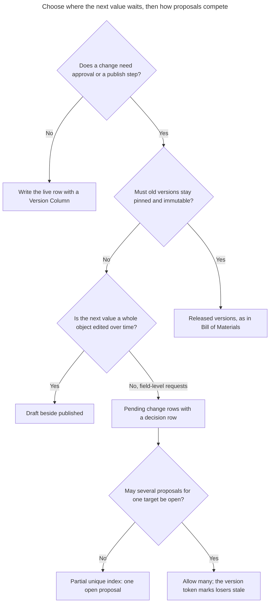
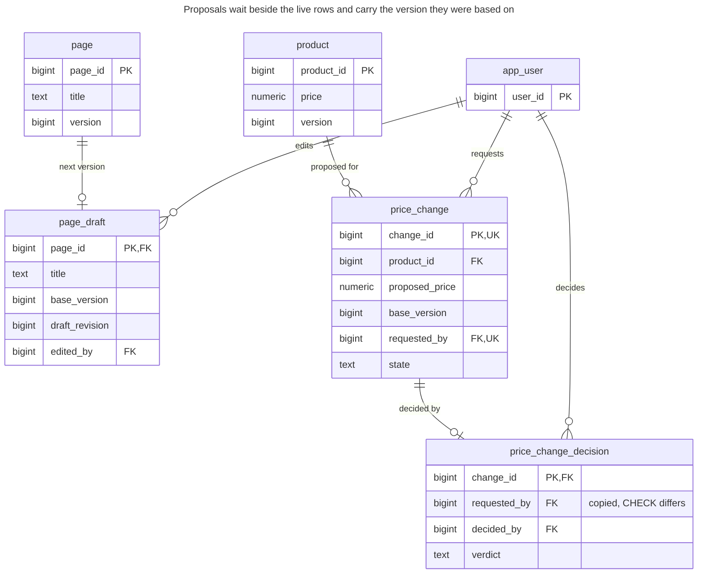
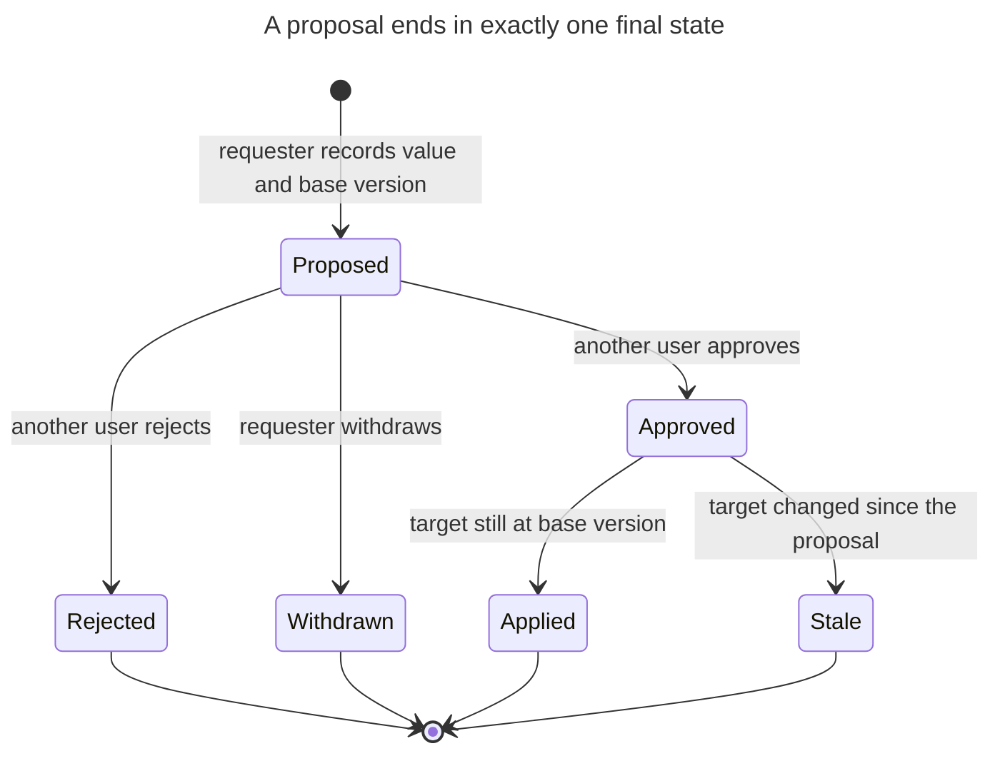
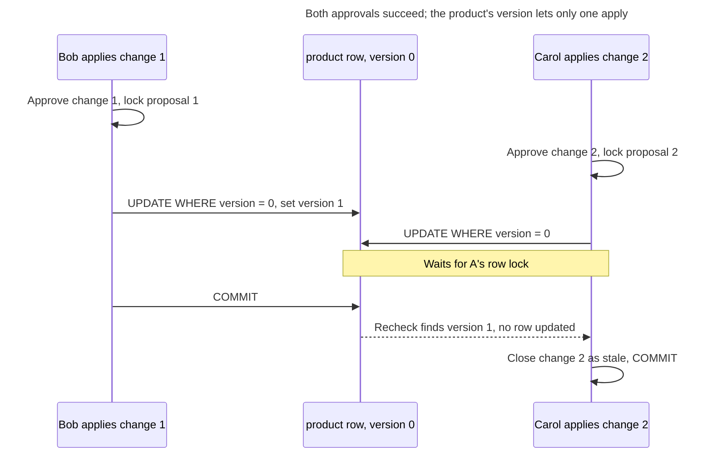

# Proposed Change

## Intent

A proposed change is recorded before it takes effect. It sits next to the live data until someone approves or publishes it, and then one guarded statement writes it into the live row. The chapter shows two shapes and when each wins. In the first, a draft copy of an object is edited beside the published one. In the second, pending change rows hold a proposed value, its requester and its state. It shows how the schema enforces that the approver is not the requester, walks the lifecycle from proposed to applied, and makes applying atomic and able to detect that the target changed after the proposal was made. It also compares two policies for several pending proposals on the same target, and shows what happens when two approvers act at the same moment.

## Also known as

Maker-checker; four-eyes principle; draft and publish in content management systems. Fowler's [*Analysis Patterns*](https://martinfowler.com/books/ap.html) names a related pattern Proposed and Implemented Action.

## Problem

A merchandiser wants to raise the price of an espresso machine from 100.00 to 120.00, and the shop's policy requires a second person to approve every price change. If the new price goes straight into `product.price` with a `needs_review` flag, customers see an unapproved price, and every reader has to remember the flag. If the proposal lives in a ticket, someone retypes it when it is approved, and nothing links the live price to the decision that allowed it.

Proposals also race. Alice proposes 120.00 and Bob proposes 110.00, both after looking at 100.00. Bob approves Alice's, Carol approves Bob's, and both get applied in turn. The second write silently replaces the first, although its approver judged a change from 100.00, not from the price that was live when it was applied. An application rule that says “you cannot approve your own request” does not help a script, an admin console or a second service that writes the decision directly.

Content has the same problem in a coarser form. An editor works for days on the next version of a pricing page while readers keep seeing the current one. A half-edited row cannot serve readers, and a reviewer who approved Tuesday's text should not end up publishing Wednesday's.

## Solution

Readers and foreign keys see only the live row. The proposed state lives in another table, and one statement moves it into the live row under two guards: the decision allows it, and the live row is still at the version the proposal was based on.

- **Draft beside published.** `page_draft` holds at most one draft per page, with the same columns as `page`, the `base_version` of the page it started from, and a `draft_revision` that each save advances. Publishing locks the draft revision the reviewer saw, copies it over `page` only if `page.version` still equals `base_version`, and deletes the draft, all in one statement.
- **Pending change rows.** `price_change` holds the proposed value, the product's `base_version`, the requester and the state. A separate `price_change_decision` row records the checker. It copies `requested_by` through a composite foreign key, so a `CHECK` on that one row can compare the requester with the approver. Applying requires an approving decision, locks the proposal, updates the product only at `base_version`, and closes the proposal as `applied` or `stale` in the same statement.

The guard on the live row is the token from [Version Column](version-column.md). Here the proposal row holds the token, where in that chapter an editor's form did.

## Alternatives and selection

| Choice | Relationship | Deciding requirement |
| --- | --- | --- |
| Draft beside published | Implementation option | The next version of a whole object, often with child rows, is edited over days; at most one next version exists |
| Pending change rows | Implementation option | Individual fields change on request, several people may propose, and every decision must be kept |
| One table with a `stage` column in the key | Implementation option | Readers can always filter by stage; nothing else references only the published row |
| [Version Column](version-column.md) | Complement | Apply and publish rely on its token to detect a changed target |
| [Status History](status-history.md) | Complement | The proposal lifecycle needs a transition table, several approval steps or a record of every move |
| [Bill of Materials](bill-of-materials.md) | Replacement for released structures | Released versions must stay immutable because others pin them; a correction is a new version, not an overwrite |
| [History Table](history-table.md) | Complement | You need the target's earlier values after proposals are applied |
| [Audit Log](audit-log.md) | Complement | You must record request context, refused attempts and actions on many tables |

See the [Decision Atlas](decision-atlas.md) for the full comparison.



Drafts and released versions look alike but differ in what happens to the old value: a publish overwrites it, a release keeps it so that other rows can keep pointing at it.

## Structure



The live tables, `page` and `product`, have no proposal columns, so readers query them as before. A page has at most one draft, keyed by the page's own ID. A proposal has at most one decision, and the decision's foreign key covers `(change_id, requested_by)`, so the requester it compares against is the proposal's real requester.

## Tables and invariants

- **`page`** is what readers see. Its `version` advances on every write, whether a publish or a direct hotfix.
- **`page_draft`** shares `page`'s primary key, so a page has at most one draft. `base_version` records which published version the draft started from. `draft_revision` advances on each save, so a reviewer's approval can name the exact revision it covers.
- **`product`** is the live target with its version token.
- **`price_change`** is one proposal: target, proposed value, `base_version`, requester, state and closing time. `price_change_state_known` limits the states. `price_change_closed_when_final` requires a `closed_at` exactly when the state is final. `price_change_requester_key` makes `(change_id, requested_by)` a foreign-key target.
- **`price_change_decision`** is the checker's row: one per proposal, enforced by its primary key. `price_change_decision_proposal_fkey` ties its `requested_by` to the proposal's, and `price_change_decision_four_eyes` requires `decided_by <> requested_by`. Both columns are `NOT NULL`, because `<>` with a NULL operand passes a `CHECK`.
- **What the constraints do not cover.** The CHECK compares user IDs. It cannot tell that two accounts belong to one person, and it trusts `requested_by` to come from authenticated context rather than from the request body. Once a decision exists, the foreign key blocks changes to the proposal's `requested_by`. Before that, grant the application [`UPDATE` on `price_change`](https://www.postgresql.org/docs/18/ddl-priv.html) only for `state` and `closed_at`. Apply joins the approving decision row, so a proposal marked `approved` without one never reaches the live row. Other agreement between state and verdict, such as `rejected` with a `reject` row, is kept by the write path, the same way [Status History](status-history.md) keeps a transition's source state.

## When to use

- A policy, regulator or customer contract requires a second person to approve changes to prices, limits, payout accounts or permissions.
- Content is prepared over time and published at once, while readers keep seeing the current version.
- Several people may propose changes to the same record, and a stale proposal must never overwrite a newer value.
- You need to answer later who requested a change, who approved it and what the value was based on.

## Consequences and trade-offs

- ➕ Readers and foreign keys keep using the live table unchanged; nothing unapproved is visible to them.
- ➕ The four-eyes rule holds for every writer that inserts a decision, not only for one application screen.
- ➕ A stale proposal fails visibly and is closed as `stale` instead of overwriting newer data.
- ➕ Every proposal keeps its requester, decision and outcome after it is applied.
- ➖ Every guarded field needs a proposal shape and an apply statement; generic “any column” proposals lose types and constraints.
- ➖ A target that changes often makes long-lived proposals go stale, and people must re-propose.
- ➖ A draft that copies a whole object must also copy and publish its child rows, and the publish statement grows with them.
- ➖ The schema checks distinct IDs, not distinct people or the right role; authorization still belongs to the application.

## Implementation

The [complete PostgreSQL 18.7 script](../assets/proposed-change/proposed-change.sql) checks draft publishing, stale publishes, the four-eyes check, the requester foreign key, one decision per proposal, proposals based on an outdated version, applied and stale outcomes, an approved state without a decision, withdrawal and both policies for open proposals:

```sql
CREATE TABLE price_change (
    change_id bigint PRIMARY KEY,
    product_id bigint NOT NULL REFERENCES product (product_id),
    proposed_price numeric(12, 2) NOT NULL CHECK (proposed_price > 0),
    base_version bigint NOT NULL,
    requested_by bigint NOT NULL REFERENCES app_user (user_id),
    requested_at timestamptz NOT NULL DEFAULT now(),
    state text NOT NULL DEFAULT 'proposed',
    closed_at timestamptz,
    CONSTRAINT price_change_state_known CHECK
        (state IN ('proposed', 'approved', 'rejected', 'withdrawn', 'applied', 'stale')),
    CONSTRAINT price_change_closed_when_final CHECK
        ((state IN ('proposed', 'approved')) = (closed_at IS NULL)),
    CONSTRAINT price_change_requester_key UNIQUE (change_id, requested_by)
);
CREATE TABLE price_change_decision (
    change_id bigint PRIMARY KEY,
    requested_by bigint NOT NULL,
    decided_by bigint NOT NULL REFERENCES app_user (user_id),
    verdict text NOT NULL CHECK (verdict IN ('approve', 'reject')),
    decided_at timestamptz NOT NULL DEFAULT now(),
    CONSTRAINT price_change_decision_proposal_fkey FOREIGN KEY (change_id, requested_by)
        REFERENCES price_change (change_id, requested_by),
    CONSTRAINT price_change_decision_four_eyes CHECK (decided_by <> requested_by)
);
```

A proposal records the version its author saw. The `WHERE version = 0` repeats the version the client displayed, so a proposal cannot be based on a value that has already changed:

```sql
INSERT INTO price_change (change_id, product_id, proposed_price, base_version, requested_by)
SELECT 1, product_id, 120.00, version, 1 FROM product
WHERE product_id = 1 AND version = 0;
```

A decision moves the state and inserts the decision row in one statement. If either part fails, neither happens:

```sql
WITH moved AS (
    UPDATE price_change SET state = 'approved'
    WHERE change_id = 1 AND state = 'proposed'
    RETURNING change_id, requested_by
)
INSERT INTO price_change_decision (change_id, requested_by, decided_by, verdict)
SELECT change_id, requested_by, 2, 'approve' FROM moved;
```

When Alice (user 1) runs this for her own proposal, PostgreSQL 18.7 raises SQLSTATE `23514`: `ERROR: new row for relation "price_change_decision" violates check constraint "price_change_decision_four_eyes"`, and the proposal stays `proposed`. Inserting a decision that names Bob as the requester instead raises `23503`: `ERROR: insert or update on table "price_change_decision" violates foreign key constraint "price_change_decision_proposal_fkey"`, with `DETAIL: Key (change_id, requested_by)=(1, 2) is not present in table "price_change".` A second decision through the same statement finds no `proposed` row and inserts nothing. A direct second insert fails with `23505` on `price_change_decision_pkey`.



Only `Proposed` and `Approved` are open, and `price_change_closed_when_final` requires `closed_at` on every other state. `Stale` is reached only by an apply attempt: an approval does not freeze the target, so whether the proposal still fits is decided when it is applied. Approval and apply can share one transaction when the policy is “approve means apply now”.

Apply requires an approving decision row and locks the proposal first. It then updates the target only if the target is still at the base version, and closes the proposal with the outcome:

```sql
WITH proposal AS (
    SELECT pc.change_id, pc.product_id, pc.proposed_price, pc.base_version
    FROM price_change pc
    JOIN price_change_decision d
      ON d.change_id = pc.change_id AND d.verdict = 'approve'
    WHERE pc.change_id = 1 AND pc.state = 'approved'
    FOR UPDATE OF pc
), target AS (
    UPDATE product p
    SET price = proposal.proposed_price, version = p.version + 1
    FROM proposal
    WHERE p.product_id = proposal.product_id AND p.version = proposal.base_version
    RETURNING p.product_id
)
UPDATE price_change c
SET state = CASE WHEN EXISTS (SELECT FROM target) THEN 'applied' ELSE 'stale' END,
    closed_at = now()
FROM proposal
WHERE c.change_id = proposal.change_id
RETURNING c.state;
```

Change 1 returns `applied` and the product moves to 120.00 at version 1. Change 2, Bob's 110.00, was approved against version 0. Applying it returns `stale` and leaves the price at 120.00. Running the apply for change 1 again returns no row, because it is no longer `approved`. A proposal whose state was set to `approved` directly, with no decision row, is not applied either, so the four-eyes `CHECK` stands between every proposal and the live row. The [data-modifying `WITH`](https://www.postgresql.org/docs/18/queries-with.html#QUERIES-WITH-MODIFYING) runs all three parts in one statement, so no reader sees a new price without a closed proposal.

The script above lets several proposals for one product stay open and settles them at apply time. To allow only one open proposal per target, add a partial unique index that counts `approved` as open:

```sql
CREATE UNIQUE INDEX price_change_one_open
    ON price_change (product_id)
    WHERE state IN ('proposed', 'approved');
```

A second open proposal for the product then raises `23505`: `ERROR: duplicate key value violates unique constraint "price_change_one_open"`, `DETAIL: Key (product_id)=(1) already exists.` After the first proposal is rejected, withdrawn, applied or marked stale, a new one is accepted. Choose this policy when people should see an open request and discuss it rather than race it. Allow many proposals when requests come from independent sources and a stale one is cheap to redo.

The draft shape uses the same guard. A reviewer approved draft revision 2, so the publish names it:

```sql
WITH draft AS (
    SELECT page_id, title, body, base_version
    FROM page_draft
    WHERE page_id = 1 AND draft_revision = 2
    FOR UPDATE
), published AS (
    UPDATE page p
    SET title = draft.title, body = draft.body, version = p.version + 1
    FROM draft
    WHERE p.page_id = draft.page_id AND p.version = draft.base_version
    RETURNING p.page_id, p.version
)
DELETE FROM page_draft d
USING published WHERE d.page_id = published.page_id
RETURNING published.version;
```

If the editor saved revision 3 after the review, or a hotfix advanced `page.version`, the statement returns no row and the draft stays for another review. The script checks both cases.

## Engine support

- **PostgreSQL 18:** [partial unique indexes](https://www.postgresql.org/docs/18/indexes-partial.html), multi-column `CHECK` constraints, composite foreign keys and data-modifying `WITH` cover everything here. The apply relies on Read Committed rechecking the target's `WHERE` clause after a lock wait ([transaction isolation](https://www.postgresql.org/docs/18/transaction-iso.html)).
- **MySQL 8.4:** [`CHECK` constraints](https://dev.mysql.com/doc/refman/8.4/en/create-table-check-constraints.html) are enforced. To get the effect of a partial unique index, rely on the fact that a [`UNIQUE` index permits multiple NULL values](https://dev.mysql.com/doc/refman/8.4/en/create-index.html): index a generated column that holds `product_id` while the proposal is open and NULL afterwards. Run apply as separate statements in one transaction — lock the proposal with `SELECT ... FOR UPDATE`, run the conditional `UPDATE` on the target, check `ROW_COUNT()` and close the proposal.
- **SQL Server 2025 (17.x):** a [filtered index](https://learn.microsoft.com/en-us/sql/relational-databases/indexes/create-filtered-indexes?view=sql-server-ver17) can be `UNIQUE`, and its predicate accepts `state IN ('proposed', 'approved')` per the [`CREATE INDEX` grammar](https://learn.microsoft.com/en-us/sql/t-sql/statements/create-index-transact-sql?view=sql-server-ver17). Filters cannot be applied to unique constraints, only to unique indexes.
- **Oracle AI Database 26ai:** rows whose index key is entirely NULL are not indexed, and the [`CREATE INDEX`](https://docs.oracle.com/en/database/oracle/oracle-database/26/sqlrf/CREATE-INDEX.html) reference notes that a function-based unique index can define a conditional unique constraint: index `CASE WHEN state IN ('proposed', 'approved') THEN product_id END`.
- **SQLite 3:** [partial indexes](https://www.sqlite.org/partialindex.html) may be `UNIQUE` (since 3.8.0). `CHECK` constraints work as here, and composite [foreign keys](https://www.sqlite.org/foreignkeys.html) are enforced once `PRAGMA foreign_keys` is on. One writer at a time serializes the apply.

## Failure and concurrency

Two checkers approve conflicting proposals for the same product at the same moment. Both approvals succeed, because they touch different proposal rows. The version token decides at apply. In a two-session run on PostgreSQL 18.7 at Read Committed, the second apply waited for the first transaction's row lock on the product and then returned `stale`:



After the wait, PostgreSQL re-reads only the locked target row; the proposal row joined into the update is not re-read. Stale detection therefore works only because the value that changes, `version`, lives on the target row and is compared with the proposal's fixed `base_version`. Lock the proposal before the target in every path. The decision statement touches only the proposal, so approvals and applies take locks in the same order and cannot deadlock on these rows. Do not let the winning apply close sibling proposals: it would lock them after the product while another session holds a sibling and waits for the product. Let each proposal find out it is stale at its own apply.

Two checkers approving the same proposal is the other race. The second `UPDATE ... WHERE state = 'proposed'` waits for the first, then finds the state changed and updates nothing, so no second decision row is written. The decision's primary key backs this up for writers that bypass the statement. Under the one-open policy, two makers proposing at once collide on `price_change_one_open`: the second insert waits for the first transaction and then fails with `23505`.

At Repeatable Read or Serializable, the waiting apply fails instead of rechecking. In the same two-session run at Repeatable Read, it raised SQLSTATE `40001`: `ERROR: could not serialize access due to concurrent update` ([Repeatable Read](https://www.postgresql.org/docs/18/transaction-iso.html#XACT-REPEATABLE-READ)). Retry the whole transaction. The retry reads the new version and closes the proposal as `stale`; never substitute the new version for `base_version`.

If the response to an apply is lost, run the apply again. A closed proposal returns no row, and its `state` tells the caller what happened. Publishing races with the editor in the same way. In a two-session run, `FOR UPDATE` on the draft made the publish wait for a concurrent save of revision 3, and the `draft_revision = 2` predicate then returned no row, so the unreviewed text stayed in the draft.

## Migration

Start from direct writes to `product.price`. Add `price_change` and `price_change_decision`, and route the application's price edits into proposals while the old write path still works. Backfill nothing: past changes have no approver, and inventing one falsifies the record. Once every writer creates proposals, replace the application role's table-wide `UPDATE` on `product` with column grants that leave out `price`; a [column-level `REVOKE`](https://www.postgresql.org/docs/18/sql-revoke.html) alone does not remove a table-wide grant. Wrap the apply statement in a `SECURITY DEFINER` function owned by a role that keeps `UPDATE` on `price`, and grant the application only `EXECUTE` on it. In-flight edits made before the cutoff go stale at apply if they were based on an older version, which is the behavior you want. To back out, grant the direct `UPDATE` again; the proposal tables remain as history. Sequence the steps with [Expand and Contract](expand-contract.md).

For drafts, create `page_draft` empty. Editors' saves go to the draft from then on, and the first publish of each page uses the guarded statement.

## Anti-patterns and common mistakes

- Writing the proposed value into the live row with a `pending` flag. Every reader must filter, and a forgotten filter publishes unapproved data.
- Enforcing “approver is not requester” only in one application screen. A script or second service writes the decision directly.
- Comparing approver and requester while either column may be NULL. `NULL <> 1` is not false, so the `CHECK` passes.
- Applying without the version predicate. The last applied proposal wins, whatever it was based on.
- Storing a whole-row snapshot as the proposal and copying it back. Fields that changed meanwhile are reverted.
- Publishing the latest draft after the reviewer approved an earlier revision.
- Deleting proposals after apply, which discards who requested and approved the live value.

## Known uses

- [Strapi's Draft & Publish](https://docs.strapi.io/cms/features/draft-and-publish) keeps a draft and a published version of a document side by side and labels a published document with unpublished draft edits as *Modified*.
- [Sanity](https://www.sanity.io/docs/content-lake/drafts) stores a draft as a separate document under the `drafts.` path. Publishing copies its content into the document without that prefix, and drafts are not served to unauthenticated requests.
- MediaWiki's [FlaggedRevs](https://www.mediawiki.org/wiki/Extension:FlaggedRevs) lets reviewers rate revisions and show a reviewed stable version by default, while pages whose newest revision is unreviewed are listed as having edits pending.
- GitHub's [protected branches](https://docs.github.com/en/repositories/configuring-branches-and-merges-in-your-repository/managing-protected-branches/about-protected-branches) can require that the most recent reviewable push be approved by someone other than the person who pushed it, and can dismiss stale approvals when new commits change the diff.

## Related patterns

- [Version Column](version-column.md) supplies the token that apply and publish check.
- [Status History](status-history.md) records every move of a longer approval workflow and validates transitions with a table.
- [History Table](history-table.md) keeps the target's earlier values after proposals are applied.
- [Bill of Materials](bill-of-materials.md) releases immutable versions instead of overwriting the published one.
- [Audit Log](audit-log.md) records the request context and refused attempts around each decision.
- [Expand and Contract](expand-contract.md) sequences the move from direct writes to proposals.
