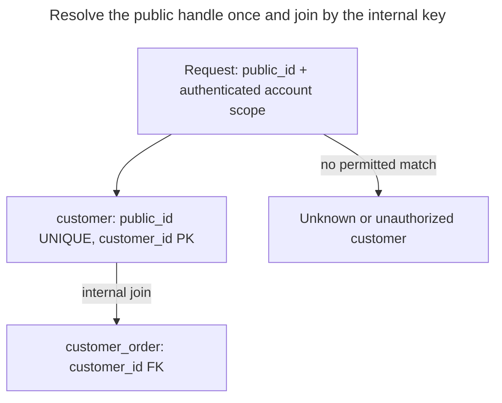

# Public Identifier

## Intent

A public identifier is the ID that leaves the database in URLs, API responses, support tickets and logs. Choose deliberately between exposing the internal key and adding a separate external identifier: sequential integers invite enumeration and can reveal allocation volume, while a separate random ID, optionally prefixed like `cus_...`, can identify the object kind, support controlled rotation, and stay out of internal joins. Store and index the external ID, resolve it to the internal key, and treat a published ID as a contract that is hard to withdraw. [Paul Asjes's account of Stripe object IDs](https://dev.to/stripe/designing-apis-for-humans-object-ids-3o5a) explains the enumeration and prefix rationale.

## Also known as

External ID; opaque object ID; prefixed ID when the representation carries a type hint. Stripe's [object-ID article](https://dev.to/stripe/designing-apis-for-humans-object-ids-3o5a) uses Customer IDs such as `cus_...`. A prefix describes a representation; it does not define an authorization boundary.

## Problem

Your application joins orders to customers by an integer key. Returning that integer in an API is convenient, but clients then persist it, include it in bookmarks and copy it into support tickets. Replacing or merging the storage layer now requires preserving the meaning of every published number.

A consecutive-looking URL also gives a caller an obvious next candidate to request. Gaps mean that differences between IDs are not exact row counts, but you may still prefer not to publish the allocation pattern. Conversely, adding a second ID means another index and another identity to diagnose. If your internal key already meets the external contract, exposing it can be a reasonable decision.

## Solution

Keep `customer_id` for internal references. Add a mandatory unique `public_id`, generated independently of the internal key, and return only that handle at the API boundary. Use it to find the customer under the caller's account scope, then join internally by `customer_id`. The two-key schema here is a design example, not a claim about Stripe's private database schema.

For an API you own, choose a documented representation such as `cus_` followed by a random UUIDv4. PostgreSQL 18's [`uuidv4()`](https://www.postgresql.org/docs/18/functions-uuid.html) supplies the random UUID. Give consumers an opaque-string contract: store and return the complete value, without deriving permissions, timestamps or internal IDs from it. You can use the prefix for your own validation and support tooling while reserving the right to evolve the format through your API's compatibility policy.

## Alternatives and selection

| Sibling | Relationship | Deciding requirement |
| --- | --- | --- |
| [Surrogate Key](surrogate-key.md) | Complement; exposing it directly replaces the separate public column | Publish the internal ID only if its stability, disclosure and representation meet your external contract |
| [Natural Key](natural-key.md) | Complement; publishing it is a replacement external handle | The business key is already public, stable and safe to disclose |
| [Time-Ordered Identifier](time-ordered-identifier.md) | Implementation option for internal identity or an alternative public value | Accept embedded generation time before exposing it |

See the [Decision Atlas](decision-atlas.md) for the full comparison. Avoid [Mandatory Surrogates](mandatory-surrogates.md): two keys are justified by distinct contracts, not by a rule that every table needs both.

## Structure



Many orders reference one customer by its internal key. A public lookup must include the authenticated account scope; knowing a valid handle alone is insufficient. The example includes the account filter but leaves credential verification to the application.

## Tables and invariants

- **`customer`** has one globally unique `public_id` per row, enforced by `customer_public_id_key`. `customer_public_id_shape` accepts only this API's chosen prefix and lowercase UUIDv4 shape.
- **`customer_order`** refers to `customer_id`, so public-ID rotation does not rewrite order references.
- **Account ownership** is checked when resolving a handle. `account_id` is a required ownership attribute here; the sample does not model an account table or implement database-level authorization.
- **String equality** is explicit: PostgreSQL's [`C` collation](https://www.postgresql.org/docs/18/collation.html) compares byte values. The schema's local format rule is not suitable for storing arbitrary third-party identifiers.

## When to use

- You want to change internal key allocation or merge databases while keeping published references stable.
- You want random external handles while retaining small integer foreign keys.
- Operators benefit from a type hint when copying IDs among logs and tools.
- You have a concrete rotation or alias policy and can maintain it for existing clients.

## Consequences and trade-offs

- ➕ Internal joins and public representation can evolve independently.
- ➕ You can replace a public handle without changing internal references.
- ➖ Each insert maintains another unique index, and each boundary lookup resolves another key.
- ➖ Rotation invalidates old links unless you retain aliases; aliases add lifecycle and uniqueness rules.
- ➖ A random handle does not authorize access. Continue checking ownership on reads and writes.

## Implementation

The [complete script](../assets/public-identifier/public-identifier.sql) demonstrates generation, scoped lookup, uniqueness rejection and rotation. The prefix is illustrative; this is not Stripe's ID generator:

```sql
CREATE TABLE customer (
    customer_id bigint GENERATED ALWAYS AS IDENTITY PRIMARY KEY,
    account_id bigint NOT NULL,
    public_id text COLLATE "C" NOT NULL
        DEFAULT ('cus_' || uuidv4()::text),
    display_name text NOT NULL,
    CONSTRAINT customer_public_id_key UNIQUE (public_id),
    CONSTRAINT customer_public_id_shape CHECK (
        public_id ~ '^cus_[0-9a-f]{8}-[0-9a-f]{4}-4[0-9a-f]{3}-[89ab][0-9a-f]{3}-[0-9a-f]{12}$'
    )
);
CREATE TABLE customer_order (
    order_id bigint GENERATED ALWAYS AS IDENTITY PRIMARY KEY,
    customer_id bigint NOT NULL REFERENCES customer (customer_id)
);
CREATE INDEX customer_order_customer_idx ON customer_order (customer_id);
```

Get the generated handle for the response with `RETURNING`. The next insert supplies a fixed handle so you can reproduce the lookup. In a request, bind the handle as a parameter and obtain account `42` from authenticated server context:

```sql
INSERT INTO customer (account_id, display_name)
VALUES (42, 'Northwind') RETURNING public_id;
INSERT INTO customer (account_id, public_id, display_name)
VALUES (42, 'cus_550e8400-e29b-41d4-a716-446655440000', 'Contoso');
INSERT INTO customer_order (customer_id)
SELECT customer_id FROM customer
WHERE public_id = 'cus_550e8400-e29b-41d4-a716-446655440000'
  AND account_id = 42;
SELECT c.customer_id, o.order_id FROM customer AS c
JOIN customer_order AS o USING (customer_id)
WHERE c.public_id = 'cus_550e8400-e29b-41d4-a716-446655440000'
  AND c.account_id = 42;
```

The empty-database example returns `(2, 1)`. The uniqueness rule is global even if a second row claims another account:

```sql
INSERT INTO customer (account_id, public_id, display_name)
VALUES (99, 'cus_550e8400-e29b-41d4-a716-446655440000', 'Duplicate');
```

PostgreSQL 18.6 raises SQLSTATE `23505`: `ERROR: duplicate key value violates unique constraint "customer_public_id_key"`, with `DETAIL: Key (public_id)=(cus_550e8400-e29b-41d4-a716-446655440000) already exists.` A controlled rotation changes only the external handle:

```sql
UPDATE customer SET public_id = 'cus_550e8400-e29b-41d4-a716-446655440001'
WHERE public_id = 'cus_550e8400-e29b-41d4-a716-446655440000'
  AND account_id = 42;
SELECT customer_id FROM customer_order WHERE order_id = 1;
```

The order still references customer `2`; the old public handle no longer resolves. This single-column implementation deliberately invalidates old handles. If compatibility requires old links to work, retain them in an alias table with global handle uniqueness and a foreign key to the customer. Route all resolution through that table so an old handle cannot be reassigned to another customer.

## Engine support

- **PostgreSQL 18:** use the shown text column and [`uuidv4()`](https://www.postgresql.org/docs/18/functions-uuid.html). An unprefixed external UUID can instead use native `uuid` storage.
- **MySQL 8.4:** do not assume the default string collation matches an external provider's equality rules. Stripe's [integration guidance](https://docs.stripe.com/api-versions) specifically recommends case-sensitive storage for its IDs, with `VARCHAR(255) COLLATE utf8_bin` as an example. MySQL's [`UUID()`](https://dev.mysql.com/doc/refman/8.4/en/miscellaneous-functions.html#function_uuid) generates v1, so it is not a drop-in replacement for this random-v4 default.
- **SQL Server 2025 (17.x):** [`uniqueidentifier`](https://learn.microsoft.com/en-us/sql/t-sql/data-types/uniqueidentifier-transact-sql?view=sql-server-ver17) stores a 16-byte GUID; a prefixed ID needs character storage instead. Do not use [`NEWSEQUENTIALID()`](https://learn.microsoft.com/en-us/sql/t-sql/functions/newsequentialid-transact-sql?view=sql-server-ver17) when unpredictability is the reason for the public handle: Microsoft explicitly warns that subsequent values can be guessed.
- **Oracle AI Database 26ai:** [`SYS_GUID()`](https://docs.oracle.com/en/database/oracle/oracle-database/26/sqlrf/SYS_GUID.html) is a 16-byte globally unique value, not a documented random-v4 substitute. Supply a suitable random external ID from the application if you need this example's disclosure properties.
- **SQLite 3:** use application-generated text handles and a unique constraint; choose [`BINARY` collation](https://www.sqlite.org/datatype3.html#collation) for bytewise identity. Keep the generated internal integer separate.

## Failure and concurrency

Create the row and its public handle in the same transaction. Let the unique constraint catch a collision; PostgreSQL [waits and rechecks conflicting concurrent inserts](https://www.postgresql.org/docs/18/index-unique-checks.html). A genuinely new random-handle collision calls for a fresh handle. A retry after an uncertain commit calls for resolving the original operation, for example through an [Idempotency Record](idempotency-record.md), rather than blindly allocating another customer. These uniqueness rules need no higher isolation level by themselves.

For concurrent rotations, use a conditional update including the previous handle, as shown, and require one affected row. If alias retention is required, make alias creation and current-handle selection one transaction and serialize rotations for the customer. Decide whether old handles redirect, continue resolving or become invalid before exposing rotation as an API operation.

## Migration

Add the external column nullable, arrange generation for new rows, and backfill in bounded batches. Build uniqueness [concurrently](https://www.postgresql.org/docs/18/sql-createindex.html#SQL-CREATEINDEX-CONCURRENTLY), verify completeness and make the column mandatory. Keep internal foreign keys unchanged. Deploy readers that accept both old and new routes before returning new handles to clients, then monitor old-route usage before retiring it. Plan short DDL lock windows rather than promising a completely lock-free change.

You can stop issuing new handles during rollback, but continue resolving handles already returned. Preserve their mapping through storage migrations and restores. Once a public ID identifies a customer in someone else's system, reassigning it identifies the wrong customer; dropping a column is no longer just an internal refactor. See [Expand and Contract](expand-contract.md).

## Anti-patterns and common mistakes

- Encoding an integer as text and calling it random. A representation change does not remove a predictable allocation pattern.
- Using possession of an ID as permission to access a row. Apply the same ownership checks to sequential and random handles.
- Treating prefixes as permanent third-party parsing rules. Store external IDs intact; enforce the regex above only for the API you control.
- Reusing a retired public handle, or rotating it without considering bookmarks and integrations.
- Adding public IDs to tables that never cross a boundary; see [Mandatory Surrogates](mandatory-surrogates.md).

## Known uses

- [Paul Asjes's Stripe article](https://dev.to/stripe/designing-apis-for-humans-object-ids-3o5a) describes type prefixes as aids to debugging and identifying the wrong object kind. It documents API behavior and tooling, not Stripe's internal key layout.
- Stripe's [official compatibility guidance](https://docs.stripe.com/api-versions) says integrations must accommodate object IDs up to 255 characters and case-sensitive lookup. Those are rules for consuming Stripe IDs, not requirements for every API's own generator.

## Related patterns

- [Surrogate Key](surrogate-key.md) supplies the internal identity used by joins.
- [Natural Key](natural-key.md) may remain a separate business constraint without becoming public.
- [Time-Ordered Identifier](time-ordered-identifier.md) explains the generation time you disclose by exposing ordered IDs.
- [Idempotency Record](idempotency-record.md) separates retry identity from object identity.
- [Mandatory Surrogates](mandatory-surrogates.md) challenges IDs that have no independent purpose.
