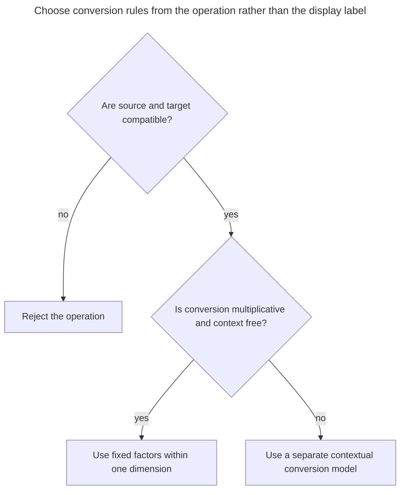
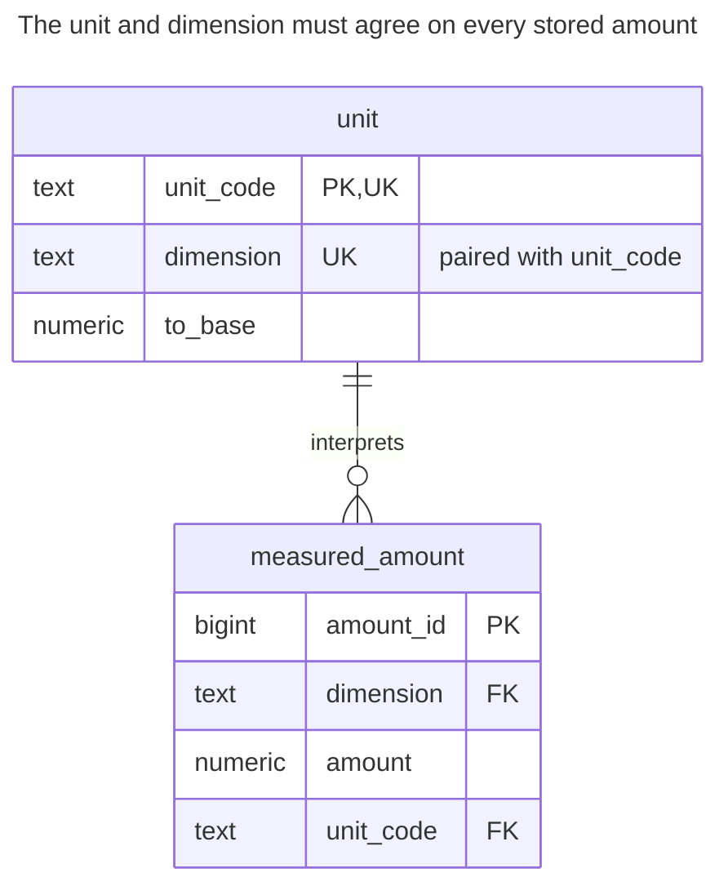
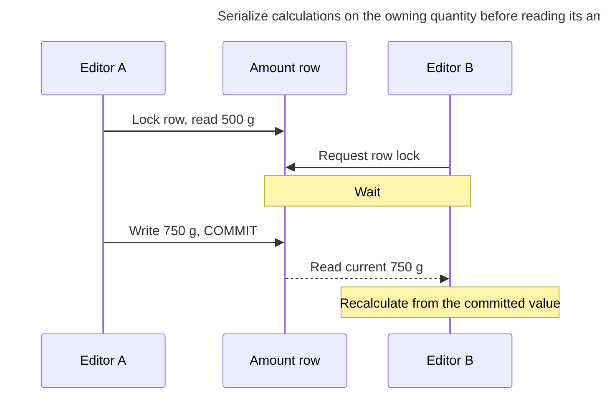
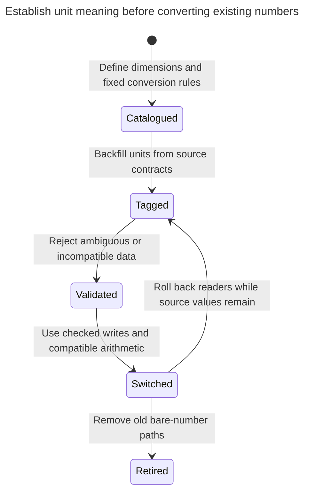

# Quantity

## Intent

A quantity stores a number together with its unit of measure — kilograms, pieces, hours, euros — instead of a bare number whose unit lives in a column name or in the developer's head. The chapter shows a units table, the unit reference on each amount, conversion factors between units of the same dimension, and arithmetic functions that reject incompatible dimensions. Money is the special case where the unit is the currency, and the exact decimal type and rounding rules matter as much as the amount.

## Also known as

Dimensioned value; amount with unit. Fowler's [Quantity](https://martinfowler.com/eaaDev/Quantity.html) combines amount and unit, requires compatible arithmetic and treats money as a specialized quantity. The conversion catalog and constraints below are this chapter's relational design.

## Problem

One supplier reports a package mass as `2`; another reports `500`. Adding the bare values produces `502`, although the intended sum is 2.5 kilograms. A later import labels a volume as mass. Exact decimal arithmetic cannot fix either error: the numbers are exact but the operations are meaningless.

Even compatible dimensions need an interpretation policy. Is a temperature a reading or a temperature difference? Is an amount an invoice currency amount or a converted reporting amount? The unit key must identify enough meaning for the operation you permit. Do not make the conversion table promise conversions that require a date, a market rate or a material-specific density.

## Solution

Store each amount with a unit key and dimension. Keep a small controlled unit catalog with a factor to one base unit per dimension. A composite foreign key checks that a stored unit belongs to the declared dimension. Normalize compatible quantities before aggregation; return the result with the selected unit, not as an unexplained scalar.

The worked converter supports only multiplicative conversions: `target_amount = source_amount × source_factor / target_factor`. It refuses different dimensions. Each currency has its own dimension key, so the unit converter cannot invent an exchange rate. Offset conversions, compound-dimension algebra and dated exchange quotes require separate models; this intentionally small catalog does not implement them.

## Alternatives and selection

| Sibling | Relationship | Deciding requirement |
| --- | --- | --- |
| Fixed `mass_kg` column | Replacement | One developer-controlled unit is sufficient and inputs are normalized at the boundary |
| [Observation](observation.md) | Complement | Amounts need method, observer, timestamps and correction history |
| [Double-Entry Ledger](double-entry-ledger.md) | Complement | Quantities move between holders and each movement must balance |
| Scaled integer amounts | Implementation option | A fixed resolution and bounded integer range meet the contract |
| [Inexact Arithmetic](inexact-arithmetic.md) | Anti-pattern to avoid for exact amounts | Binary approximation cannot satisfy your exact monetary or counting rules |

See the [Decision Atlas](decision-atlas.md) for the full table. Quantity supplies meaning and compatible arithmetic; it does not supply measurement provenance or conservation.



A shared display label is not sufficient evidence of compatibility. Currency conversion needs an explicit quote; converting volume to mass needs additional domain data.

## Structure



The two foreign-key columns form one checked reference. Different units can share a dimension, but `('L', 'mass')` is not a valid pair. This is an independent example table; in an application, put the amount and checked unit reference on the order line, package or other record that owns the value.

## Tables and invariants

- **`unit`** identifies one interpretation and a positive finite conversion factor. Factors for `kg`, `g`, `L` and `mL` are the example's catalog data. Keep definitions immutable once used, through a controlled catalog owner; the sample does not install catalog-update guards.
- **`measured_amount`** requires a finite exact decimal and a valid unit/dimension pair. The amount can be negative because this generic quantity is not specifically a physical stock count.
- **`convert_amount` / `add_quantities`** check compatibility on the approved arithmetic path. Raw SQL can still add two `amount` columns or discard their units; the foreign key cannot type-check arbitrary expressions.
- **Precision policy** is separate from dimension. The example uses unconstrained `numeric`, then rounds at the chosen output boundary. PostgreSQL documents [exact numeric storage, scale coercion and rounding](https://www.postgresql.org/docs/18/datatype-numeric.html); a fixed declared scale can round an input before a row check sees it.

## When to use

- Inputs or outputs use several units for the same kind of amount.
- You must reject incompatible units rather than silently normalize a mislabeled value.
- Currency, resolution and rounding are part of the stored contract.

## Consequences and trade-offs

- ➕ Values remain interpretable when copied into reports or exchanged between modules.
- ➕ A checked unit reference catches mislabeled dimensions at insertion.
- ➖ Generic numeric columns require disciplined arithmetic APIs; a bare `SUM(amount)` still loses meaning.
- ➖ A factor change can reinterpret every old value. Correct bad catalog data through a reviewed migration or introduce a new versioned unit definition.
- ➖ Exact decimals do not make every division terminate. Choose a result precision for conversions with repeating decimal expansions and round deliberately.

## Implementation

The [complete PostgreSQL 18.6 script](../assets/quantity/quantity.sql) checks compatible addition, incompatible addition, storage rejection and currency-conversion refusal. Define the storage contract:

```sql
CREATE SCHEMA quantity_example;
SET search_path = quantity_example, public;

CREATE TABLE unit (
    unit_code text PRIMARY KEY,
    dimension text NOT NULL,
    to_base numeric NOT NULL CHECK (to_base > 0 AND to_base < 'Infinity'::numeric),
    UNIQUE (unit_code, dimension)
);
CREATE TABLE measured_amount (
    amount_id bigint PRIMARY KEY,
    dimension text NOT NULL,
    amount numeric NOT NULL CHECK (amount > '-Infinity'::numeric AND amount < 'Infinity'::numeric),
    unit_code text NOT NULL,
    CONSTRAINT amount_unit_dimension_fk FOREIGN KEY (unit_code, dimension)
        REFERENCES unit (unit_code, dimension)
);
```

Keep conversion separate from persistence, so imports, calculations and display code can use the same rule:

```sql
CREATE FUNCTION convert_amount(value numeric, source_unit text, target_unit text)
RETURNS numeric LANGUAGE plpgsql STABLE STRICT SET search_path = quantity_example, pg_temp AS $$
DECLARE
    source unit%ROWTYPE;
    target unit%ROWTYPE;
BEGIN
    SELECT * INTO STRICT source FROM unit WHERE unit_code = source_unit;
    SELECT * INTO STRICT target FROM unit WHERE unit_code = target_unit;
    IF source.dimension <> target.dimension THEN
        RAISE EXCEPTION 'incompatible quantity dimensions' USING ERRCODE = '22023';
    END IF;
    IF NOT (value > '-Infinity'::numeric AND value < 'Infinity'::numeric) THEN
        RAISE EXCEPTION 'quantity must be finite' USING ERRCODE = '22023';
    END IF;
    RETURN value * source.to_base / target.to_base;
END $$;
CREATE FUNCTION add_quantities(left_value numeric, left_unit text, right_value numeric, right_unit text)
RETURNS numeric LANGUAGE sql STABLE STRICT SET search_path = quantity_example, pg_temp AS $$
    SELECT convert_amount(left_value, left_unit, left_unit)
           + convert_amount(right_value, right_unit, left_unit)
$$;
```

The functions return a numeric value in the requested target unit, or in the left operand's unit for addition. The caller must carry that unit in its result object. An unknown unit raises the lookup's `NO_DATA_FOUND`; it is not treated as a factor of one.

```sql
INSERT INTO unit VALUES
    ('kg', 'mass', 1), ('g', 'mass', 0.001),
    ('L', 'volume', 1), ('mL', 'volume', 0.001),
    ('EUR', 'currency:EUR', 1), ('USD', 'currency:USD', 1);
INSERT INTO measured_amount VALUES (1, 'mass', 2, 'kg'), (2, 'mass', 500, 'g');
SELECT round(add_quantities(2, 'kg', 500, 'g'), 3) AS kilograms;
SELECT a.dimension, sum(a.amount * u.to_base) AS base_amount
FROM measured_amount AS a JOIN unit AS u USING (unit_code, dimension)
GROUP BY a.dimension;
UPDATE measured_amount SET amount = 750 WHERE amount_id = 2;
SELECT round(convert_amount(amount, unit_code, 'kg'), 3)
FROM measured_amount WHERE amount_id = 2;
```

The addition returns `2.500` kilograms; the grouped sum returns `mass, 2.500` before the update. Changing the second amount to 750 grams makes its converted value `0.750` kilograms. Never aggregate distinct dimensions into one scalar total.

The schema rejects an amount labeled as mass with a volume unit:

```sql
INSERT INTO measured_amount VALUES (3, 'mass', 2, 'L');
```

PostgreSQL 18.6 raises SQLSTATE `23503`: `ERROR: insert or update on table "measured_amount" violates foreign key constraint "amount_unit_dimension_fk"`. The arithmetic path also rejects incompatible operands:

```sql
SELECT add_quantities(2, 'kg', 1, 'L');
```

It raises SQLSTATE `22023`: `ERROR: incompatible quantity dimensions`. Merely storing units without checking arithmetic would not catch this mistake.

For money, store the currency key with every amount and choose when rounding occurs: per line, per tax calculation or at the final total. PostgreSQL's [`numeric` rounds ties away from zero](https://www.postgresql.org/docs/18/datatype-numeric.html), demonstrated here:

```sql
SELECT round(1.005::numeric, 2), round(-1.005::numeric, 2);
```

The result is `(1.01, -1.01)`. If your contract requires a different tie rule, implement and verify that rule explicitly. The example's EUR and USD keys are illustrative; it does not define a currency-code standard, a universal two-decimal scale or an exchange-rate convention.

## Engine support

- **PostgreSQL 18:** `numeric` supports the shown exact decimal operations; the implementation also rejects special nonfinite numeric values.
- **MySQL 8.4:** [`DECIMAL` / `NUMERIC`](https://dev.mysql.com/doc/refman/8.4/en/fixed-point-types.html) provide exact fixed-point storage with declared precision and scale. Choose those bounds instead of copying unconstrained PostgreSQL `numeric` mechanically.
- **SQL Server 2025 (17.x):** [`decimal` and `numeric`](https://learn.microsoft.com/en-us/sql/t-sql/data-types/decimal-and-numeric-transact-sql?view=sql-server-ver17) have maximum precision 38. Review intermediate multiplication and division types as well as the stored amount.
- **Oracle AI Database 26ai:** [`NUMBER`](https://docs.oracle.com/en/database/oracle/oracle-database/26/sqlrf/Data-Types.html) is the numeric representation to assess when porting. Select its precision and scale for your accepted range and result precision.
- **SQLite 3:** [NUMERIC affinity](https://www.sqlite.org/datatype3.html) does not provide PostgreSQL exact-decimal semantics. Use scaled integers for a fixed resolution, or deliberately deploy its [decimal extension](https://www.sqlite.org/floatingpoint.html#decext), which computes on decimal text.

## Failure and concurrency

A dimension constraint prevents a unit mismatch, not a lost update. If two editors load 500 grams and independently replace it, the last accepted write can overwrite the first. Lock the owning amount row before a read–modify–write calculation, or use a version comparison if stale edits should fail. PostgreSQL's [row locks](https://www.postgresql.org/docs/18/explicit-locking.html#LOCKING-ROWS) remain held until the transaction ends.



Catalog changes are a separate risk. A report should not use factors that can change halfway through a multi-statement conversion. Keep this catalog fixed for ordinary writers; if factors really vary over time, store a version or quote identifier with the converted result. Retrying a failed operation must preserve the original source amount and selected conversion context.

## Migration

For columns already named `weight_kg`, backfill explicit unit `kg` from that documented contract. For a generic `value`, recover units from source specifications and quarantine ambiguous records; magnitude is not reliable evidence. Preserve raw inputs and normalize once, recording which conversion policy produced the stored result.



During rollout, compare normalized values rather than raw numerals. Keep old columns and their unit contract synchronized through the rollback window. Repeatedly converting already normalized values applies the factor twice; retain a migration marker or use an idempotent assignment from the original source.

## Anti-patterns and common mistakes

- Adding raw amounts merely because both columns are numeric.
- Using one `currency` dimension with fixed factors and silently treating it as foreign exchange.
- Applying the multiplicative converter to absolute temperatures or material-dependent conversions.
- Changing a unit's factor or meaning after historical values reference it.
- Assuming decimal storage defines the business rounding boundary.

## Known uses

- Fowler's [Quantity examples](https://martinfowler.com/eaaDev/Quantity.html) contrast incompatible addition with conversion between compatible units and discuss scalar versus compound-unit multiplication. This chapter implements the smaller multiplicative subset.
- PostgreSQL's [numeric documentation](https://www.postgresql.org/docs/18/datatype-numeric.html) recommends exact numeric arithmetic for monetary amounts; the unit and currency reference remains an application schema decision.

## Related patterns

- [Observation](observation.md) records where a measured quantity came from and whether it remains accepted.
- [Double-Entry Ledger](double-entry-ledger.md) conserves an amount within a currency or asset.
- [Inexact Arithmetic](inexact-arithmetic.md) describes the failure mode of approximate storage for exact amounts.
