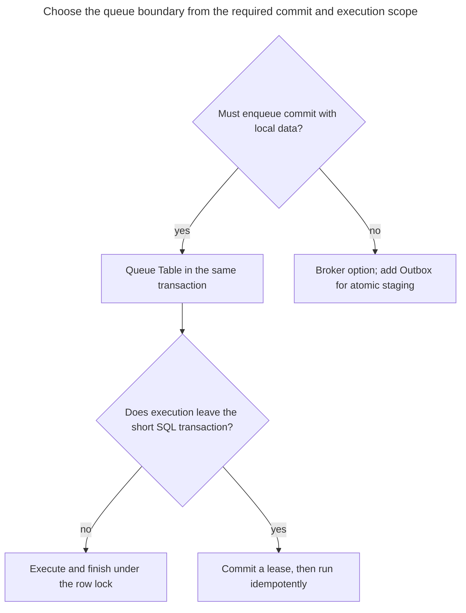
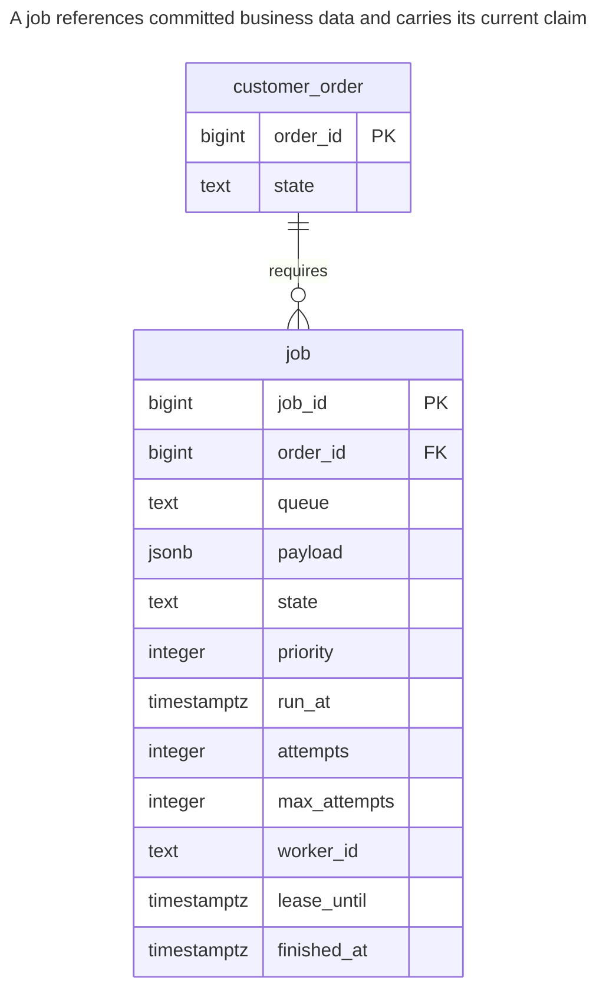
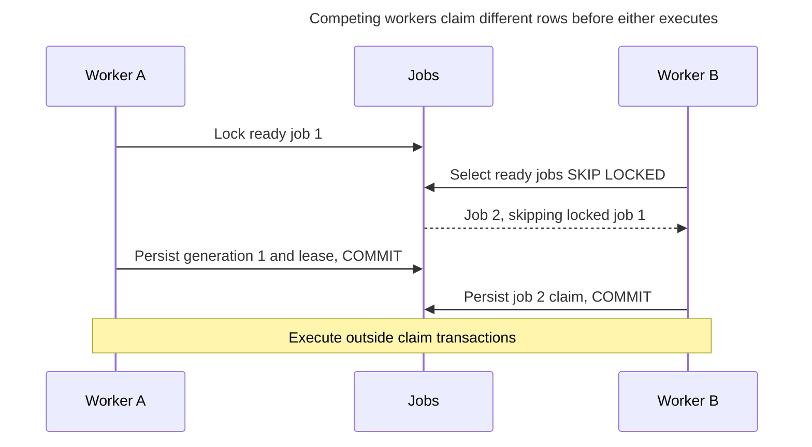
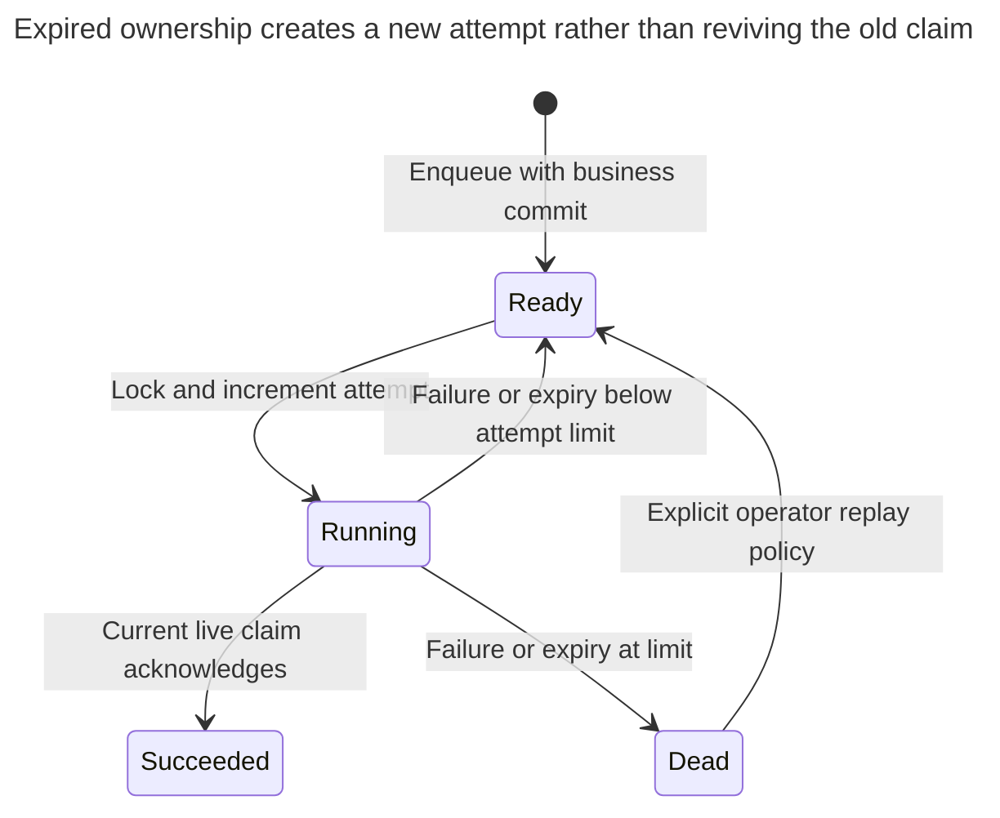

# Queue Table

## Intent

A queue table keeps background jobs in an ordinary table, and workers claim them with `SELECT ... FOR UPDATE SKIP LOCKED`, so competing workers skip rows already locked by a claim transaction. A queue in the same database as the data lets you enqueue a job in the same transaction as the change that requires it. The chapter covers job states, retries with backoff, timeouts for crashed workers, priorities, cleanup of finished jobs, and the load at which a dedicated broker becomes the better tool.

## Also known as

Database-backed job queue; work queue. PostgreSQL's [`SELECT` documentation](https://www.postgresql.org/docs/18/sql-select.html#SQL-FOR-UPDATE-SHARE) explicitly identifies a queue-like table as a use for `SKIP LOCKED`, while warning that skipping rows gives an inconsistent view unsuitable for general-purpose queries.

## Problem

An order commit requires an invoice to be generated later. Sending a job to another system before commit lets a worker see an order that is not committed; sending after commit leaves a crash gap. A job row in the same transaction closes that local gap.

Several workers then need to divide ready jobs. A plain `SELECT` followed by an unconditional update lets two workers choose the same row. Holding the claim transaction open throughout a slow remote call makes locks and connections last as long as the call. Committing the claim first requires another way to recover jobs abandoned by crashed workers.

## Solution

Store jobs with a due time, priority, attempt count, state and lease deadline. In one short transaction, lock a bounded set of eligible rows with `FOR UPDATE SKIP LOCKED`, change them to `running`, increment their attempt generation and assign ownership. Commit before doing slow work. A worker completes or renews only the generation it claimed, while its lease remains live.

A reaper moves overdue running jobs back to ready with a delay, or to a terminal failed state after the attempt limit. A later claim gets a new generation. This prevents an obsolete worker from acknowledging someone else's claim in the database; it cannot stop that worker from making a remote call after its lease expires. Give external effects a stable job-level idempotency key and cooperate with the destination.

## Alternatives and selection

| Sibling or mechanism | Relationship | Deciding requirement |
| --- | --- | --- |
| [Transactional Outbox](transactional-outbox.md) | Complement; replacement for the local execution destination | Publish integration events to a broker instead of executing jobs directly from this database |
| [Idempotency Record](idempotency-record.md) | Complement | A worker may repeat an external or local effect after an uncertain result |
| [Reservation](reservation.md) | Complement | A job schedules cleanup, but a domain hold owns capacity and its confirmation policy |
| Work entirely inside the claim transaction | Implementation option | The job is a short local database operation; effect and completion can commit together without a lease |
| Dedicated broker | Replacement for queue storage and distribution | Workload isolation, fan-out or transport capabilities justify another service and its delivery protocol |
| Existing database queue library | Implementation option | You want maintained scheduling, recovery and operational tooling rather than owning this minimal protocol |

See the [Decision Atlas](decision-atlas.md) for the full comparison. Moving jobs to another database or broker gives up same-transaction enqueue unless you add an outbox. A table called `jobs` on a separate connection is not enough.



A lease is the cost of releasing the database transaction before execution finishes. It changes crash recovery from rollback into a persisted retry lifecycle.

## Structure



An order can require several jobs. This typed example keeps the order until its referencing jobs are removed. Queue names and payloads are execution metadata; they do not replace the FK to the business object.

## Tables and invariants

- **`customer_order`** is inserted with its job in one transaction. Workers rely on that commit boundary for visibility.
- **`job`** requires a valid state, nonnegative attempt count and positive maximum. The claim check requires both worker and deadline exactly when running; the finish check requires a completion timestamp exactly in terminal states.
- **Claim generation** is the attempt count returned by the claim. Every new claim increments it, and completion, renewal and failure reports must match it.
- **Lifecycle authority** belongs to the writer protocol. Checks reject malformed combinations, but do not themselves prohibit an owner from resetting attempts or resurrecting a completed job.
- **Delivery semantics** permit repeated execution. The unique job ID prevents duplicate row identity, not duplicate external effects; add producer request deduplication if repeated enqueues must identify one logical job.

## When to use

- Background work naturally belongs to the same database transaction as its input data.
- Competing workers can execute independent jobs, and strict FIFO is not required.
- You can operate polling, lease recovery, bounded retries and retention alongside the main workload.

## Consequences and trade-offs

- ➕ Enqueue and business changes commit together without another service's commit protocol.
- ➕ Workers skip locked claims instead of waiting for one busy job.
- ➖ Priority order is a preference among eligible unlocked rows, not strict execution or completion order. A stream of high-priority work can starve older jobs.
- ➖ Polling, claim updates, cleanup and retained failures share database resources with application writes.
- ➖ Lease duration trades recovery latency against duplicate-execution risk. Longer leases recover slowly; shorter leases need reliable renewal and more tolerance of overlap.
- ➖ There is no universal jobs-per-second threshold for switching to a broker. Measure enqueue/claim latency, oldest-ready age, retry rate, table/index size and application impact under your payload and transaction sizes.

## Implementation

The [complete PostgreSQL 18.6 script](../assets/queue-table/queue-table.sql) checks claims, malformed-state rejection, completion, retry, expiry recovery and stale acknowledgements. Start with a pending-only selection index and a separate expiry index:

```sql
CREATE TABLE customer_order (
    order_id bigint PRIMARY KEY,
    state text NOT NULL
);
CREATE TABLE job (
    job_id bigint PRIMARY KEY,
    order_id bigint NOT NULL REFERENCES customer_order (order_id),
    queue text NOT NULL,
    payload jsonb NOT NULL,
    state text NOT NULL DEFAULT 'ready'
        CHECK (state IN ('ready', 'running', 'succeeded', 'dead')),
    priority integer NOT NULL DEFAULT 0,
    run_at timestamptz NOT NULL DEFAULT clock_timestamp(),
    attempts integer NOT NULL DEFAULT 0 CHECK (attempts >= 0),
    max_attempts integer NOT NULL DEFAULT 3 CHECK (max_attempts > 0),
    worker_id text,
    lease_until timestamptz,
    finished_at timestamptz,
    CONSTRAINT job_claim_shape CHECK (
        (state = 'running' AND worker_id IS NOT NULL AND lease_until IS NOT NULL)
        OR (state <> 'running' AND worker_id IS NULL AND lease_until IS NULL)
    ),
    CONSTRAINT job_finish_shape CHECK (
        (state IN ('succeeded', 'dead')) = (finished_at IS NOT NULL)
    )
);
CREATE INDEX job_ready_idx ON job (queue, priority DESC, run_at, job_id)
WHERE state = 'ready';
CREATE INDEX job_lease_idx ON job (lease_until) WHERE state = 'running';
BEGIN;
INSERT INTO customer_order VALUES (1, 'paid');
INSERT INTO job (job_id, order_id, queue, payload)
VALUES (1, 1, 'invoices', '{"schema_version":1}');
COMMIT;
```

The claim is one [data-modifying statement](https://www.postgresql.org/docs/18/queries-with.html#QUERIES-WITH-MODIFYING); the locking clause belongs inside its candidate query. Bind worker identity, queue and batch size in an application:

```sql
BEGIN;
WITH candidate AS (
    SELECT job_id FROM job
    WHERE queue = 'invoices' AND state = 'ready'
      AND run_at <= statement_timestamp() AND attempts < max_attempts
    ORDER BY priority DESC, run_at, job_id
    LIMIT 1 FOR UPDATE SKIP LOCKED
)
UPDATE job AS j
SET state = 'running', attempts = j.attempts + 1,
    worker_id = 'worker-a', lease_until = clock_timestamp() + interval '1 minute'
FROM candidate AS c WHERE j.job_id = c.job_id
RETURNING j.job_id, j.attempts, j.payload;
COMMIT;
```

This returns job `1`, generation `1`. Work starts after commit; the worker retains both values. An empty claim means no currently selectable work, not necessarily an empty queue. Keep batches small enough that their last job will start before its lease expires. The index favors priority ordering within a queue; many high-priority future jobs can still increase scanning before a due job is found, so inspect the actual plan rather than assuming bounded work from `LIMIT` alone.

A malformed running row is invalid:

```sql
-- Expected SQLSTATE 23514.
UPDATE job SET lease_until = NULL WHERE job_id = 1;
```

PostgreSQL 18.6 raises SQLSTATE `23514`: `ERROR: new row for relation "job" violates check constraint "job_claim_shape"`. To renew a long-running claim, lock the job first, then check its generation and current deadline in the next statement. This keeps time spent waiting for the lock outside the deadline decision:

```sql
BEGIN;
SELECT job_id FROM job WHERE job_id = 1 FOR UPDATE;
UPDATE job SET lease_until = clock_timestamp() + interval '1 minute'
WHERE job_id = 1 AND state = 'running' AND attempts = 1 AND worker_id = 'worker-a'
  AND lease_until > clock_timestamp()
RETURNING job_id;
COMMIT;
```

For successful work, acquire the same lock and acknowledge only the current unexpired claim:

```sql
BEGIN;
SELECT job_id FROM job WHERE job_id = 1 FOR UPDATE;
UPDATE job SET state = 'succeeded', worker_id = NULL, lease_until = NULL,
               finished_at = clock_timestamp()
WHERE job_id = 1 AND state = 'running' AND attempts = 1 AND worker_id = 'worker-a'
  AND lease_until > clock_timestamp()
RETURNING job_id, state;
COMMIT;
```

The result is `(1, succeeded)`. Zero rows means ownership has been lost or the job has already transitioned; do not overwrite its new state. A voluntary failure report uses the same lock-then-check protocol to release or terminate the claim. PostgreSQL's [row locks](https://www.postgresql.org/docs/18/explicit-locking.html#LOCKING-ROWS) serialize these decisions with replacement claims and expiry recovery.

An expiry reaper locks a bounded set of overdue jobs and moves them to ready or dead. This example uses a fixed 30-second retry delay; the full script also demonstrates an explicit worker failure. To add exponential backoff, calculate a bounded delay from the attempt count and add jitter in your worker; it is scheduling policy, not a uniqueness guarantee.

```sql
WITH overdue AS (
    SELECT job_id FROM job
    WHERE state = 'running' AND lease_until <= statement_timestamp()
    ORDER BY lease_until, job_id
    LIMIT 100 FOR UPDATE SKIP LOCKED
)
UPDATE job AS j
SET state = CASE WHEN j.attempts >= j.max_attempts THEN 'dead' ELSE 'ready' END,
    run_at = clock_timestamp() + interval '30 seconds',
    worker_id = NULL, lease_until = NULL,
    finished_at = CASE WHEN j.attempts >= j.max_attempts THEN clock_timestamp() END
FROM overdue AS o WHERE j.job_id = o.job_id
RETURNING j.job_id, j.state;
```

It changes no rows after the successful example, because the only job is terminal. After a real timeout, the next claim increments attempts; an old worker's generation can no longer match. The reaper must not reset the count. Keep terminal jobs out of claiming. Operator replay needs an explicit additional attempt budget or a new submission with the same logical effect identity; understand earlier side effects before making that decision.

## Engine support

- **PostgreSQL 18:** [`SKIP LOCKED`](https://www.postgresql.org/docs/18/sql-select.html#SQL-FOR-UPDATE-SHARE) skips row-lock conflicts, not every possible wait. Keep Read Committed claim transactions short; table locks and other database resources can still cause waits.
- **MySQL 8.4 / InnoDB:** [`FOR UPDATE SKIP LOCKED`](https://dev.mysql.com/doc/refman/8.4/en/innodb-locking-reads.html) supports competing consumers. Use an explicit transaction for select-and-update, and account for its warning about statement-based replication.
- **SQL Server 2025 (17.x):** [`READPAST`](https://learn.microsoft.com/en-us/sql/t-sql/queries/hints-transact-sql-table?view=sql-server-ver17) is intended for work queues, commonly with `UPDLOCK` in the claim protocol. It skips row locks, not page locks, and has restrictions with snapshot-based Read Committed; verify the configured isolation before porting.
- **Oracle AI Database 26ai:** [`FOR UPDATE SKIP LOCKED`](https://docs.oracle.com/en/database/oracle/oracle-database/26/sqlrf/SELECT.html) targets multiconsumer queues. Translate bounded selection against that version's row-limiting restrictions rather than copying PostgreSQL's `LIMIT`.
- **SQLite 3:** use a short [`BEGIN IMMEDIATE`](https://www.sqlite.org/lang_transaction.html) claim transaction, handling `SQLITE_BUSY`. Its single writer replaces per-row concurrent claim locking, so increasing worker count does not give PostgreSQL's independent-row write concurrency.

## Failure and concurrency



The row lock protects the transition into running. The stored state and lease protect the period after that lock is released. Without the state update before commit, another worker could claim the same ready row immediately.



Every new running period has a new generation. Operator replay must preserve stable effect identity when the old attempt may have succeeded externally.

A worker can finish its external action, crash before acknowledgement and then have its lease reclaimed. The replacement worker repeats that action. An [Idempotency Record](idempotency-record.md) or destination-side equivalent should key the effect by stable `job_id`, **not** by the changing attempt generation. A generation predicate only fences writes to this job row; a remote service must enforce its own deduplication or fencing contract.

For purely local work, perform its effect and completion in one transaction under the job lock. If you cannot make the whole job atomic, commit idempotent checkpoints and define which ones survive retry. Avoid holding a long database transaction merely to avoid designing recovery.

## Migration

Add the job table and writer, then move one job kind at a time. Capture the enqueue cutoff and stable source identity so old and new workers do not independently execute the same work. Backfill only work known to be outstanding; the existence of an old order does not prove its invoice still needs generation.

Switch workers after verifying payload compatibility, retry recovery and oldest-ready age. Drain the old queue and retain a route for old payload versions before retiring it through [Expand and Contract](expand-contract.md). During rollback, stop new enqueue to the new table but keep or explicitly transfer its accepted backlog; deleting ready jobs loses promised work.

Delete finished jobs in bounded batches after the diagnostic and deduplication windows you need. Retain dead jobs long enough for an operator to inspect the cause. PostgreSQL's [vacuum documentation](https://www.postgresql.org/docs/18/routine-vacuuming.html) explains maintenance for space from updated and deleted rows; watch churn and vacuum progress under realistic load. Move to another queue service when measured resource competition or required transport features justify it, preserving enqueue reliability with an outbox.

## Anti-patterns and common mistakes

- Claiming with a plain read followed by a separate unguarded write.
- Treating one exclusive claim as proof of exactly-once execution.
- Renewing or finishing by job ID alone, letting an obsolete worker change a replacement claim.
- Expiring jobs based on worker-local clocks without a clear clock policy; the example evaluates deadlines in the database.
- Polling an empty queue in a tight loop, or retaining every completed payload indefinitely.
- Reordering priority as though it established strict FIFO or fairness.

## Known uses

- [River's transactional enqueueing guide](https://riverqueue.com/docs/transactional-enqueueing) documents inserting jobs with business data so a worker receives only committed inputs. It supports the commit-boundary argument, not a benchmark for this schema.
- Rails [Solid Queue](https://github.com/rails/solid_queue) separates ready, scheduled and claimed executions in its [queue schema](https://raw.githubusercontent.com/rails/solid_queue/main/lib/generators/solid_queue/install/templates/db/queue_schema.rb) and uses `SKIP LOCKED` where supported. Its recommended separate-database deployment means you must choose the documented single-database configuration before depending on shared transaction atomicity with application rows.

## Related patterns

- [Transactional Outbox](transactional-outbox.md) stages messages for a separate transport.
- [Idempotency Record](idempotency-record.md) prevents retries from repeating logical effects.
- [Reservation](reservation.md) gives domain capacity claims their own lifecycle.
- [Missing Foreign Keys](missing-foreign-keys.md) explains the typed reference retained by this example.
- [Expand and Contract](expand-contract.md) stages payload and worker upgrades while preserving accepted jobs.
