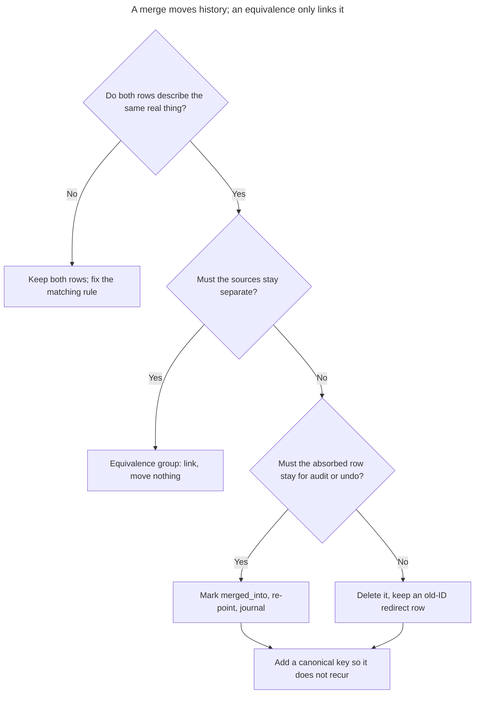
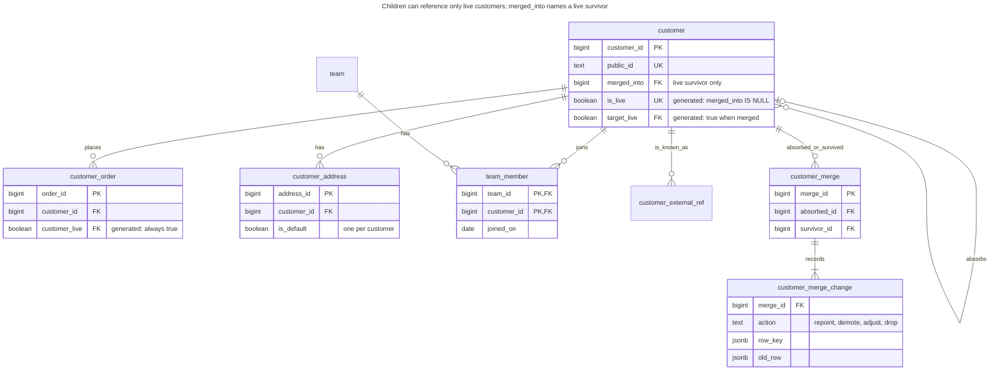
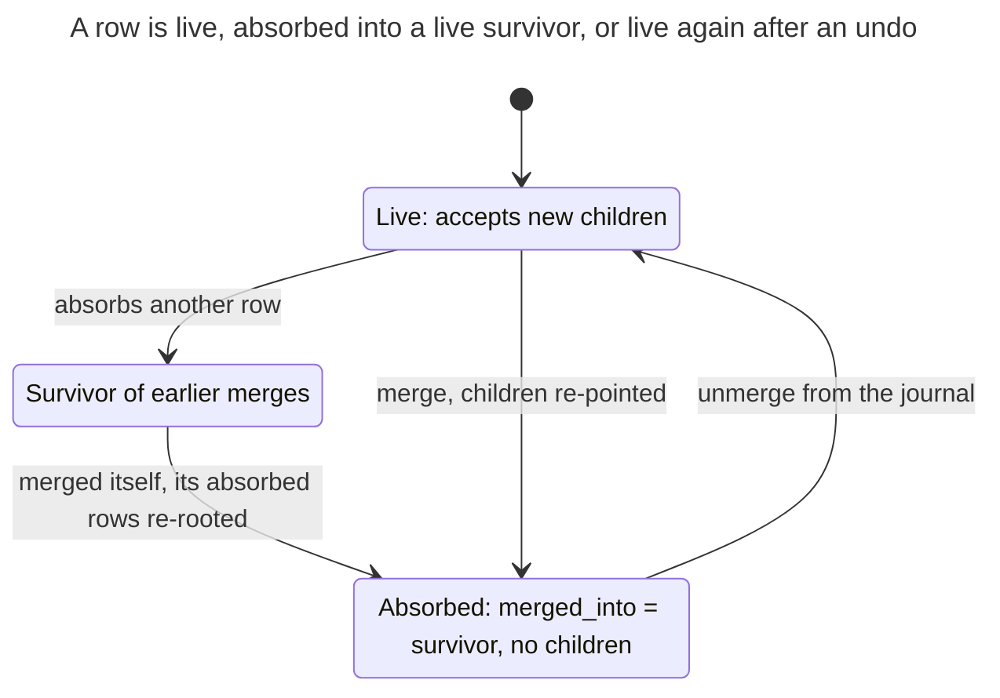
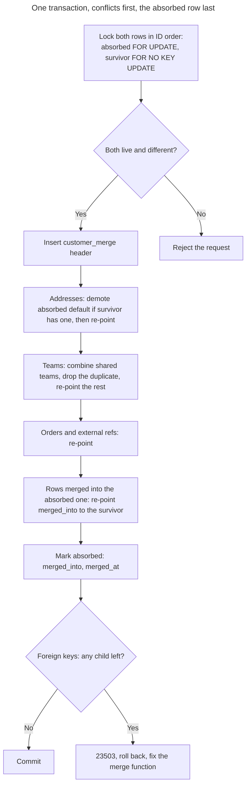
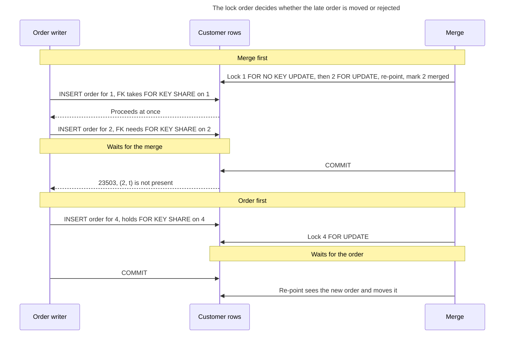

# Record Merge

## Intent

A record merge turns two rows that describe the same real thing, such as two customer records for one person, into one. One row survives. The other is kept and marked `merged_into` the survivor, every reference to it is re-pointed to the survivor in one transaction, and its old ID keeps resolving, so URLs, API clients and external systems that still send it are redirected instead of getting "not found". The chapter shows how foreign keys guarantee that no reference is left behind, how to settle unique conflicts between the two rows' children, how to move foreign IDs, how a merge journal makes a wrong merge reversible, how to keep a new order from landing on a row that is being absorbed, and when linking records as equivalent is enough.

## Also known as

Deduplication; merge and purge; survivorship (the rule that picks which values survive). Fowler's Analysis Patterns has patterns named Object Merge and Object Equivalence. CRMs call the rows the master or primary record and the merged or secondary record.

## Problem

Ann Lee signs up twice: once as `ann@old.example`, once from a new address after she changed jobs. Support finds the duplicate when she asks why half her orders are missing. A matching job finds others: same phone number, same name, same delivery address. Each pair has orders, addresses, team memberships and a Stripe customer ID, and each has a public ID that already sits in bookmarks, invoices and partner systems.

The obvious fix is to update the orders and delete the duplicate row. It goes wrong in several ways. A child table nobody remembered still references the deleted ID, or it never had a foreign key and now points at nothing. Both customers had a default address, and moving the second one violates the "one default per customer" index; both were members of the same team, and moving the membership violates its primary key. The duplicate's ID disappears, so a partner's webhook that sends it fails, and an old link returns 404. A new order placed by the duplicate's still-open session arrives a millisecond after the re-pointing and lands on the row the merge is about to retire. And a week later support learns that the two Ann Lees were different people, but nobody recorded which rows were moved, so the merge cannot be undone.

## Solution

Merge by marking and moving, never by deleting:

- **Choose a survivor.** Usually the older row, the one with more history, or the one an external system treats as primary. The rule is a business decision; record it with the merge.
- **Mark the absorbed row.** Set `merged_into` to the survivor and stamp `merged_at`. A `CHECK` forbids merging a row into itself. A composite foreign key lets `merged_into` name only a live row, so chains cannot form; when a row that has already absorbed others is itself merged, its absorbed rows are re-pointed to the new root in the same transaction. `resolve(id)` is then always one hop: `coalesce(merged_into, customer_id)`.
- **Re-point every reference in one transaction.** Children reference `(customer_id, customer_live)` where `customer_live` is always `true`, and the parent exposes `(customer_id, is_live)` as a unique key. Marking a row merged changes its `is_live` to `false`, so the foreign keys refuse the merge while any child still points at it: a forgotten table is an error, not an orphan. The same key rejects new children for a merged row.
- **Journal the merge.** Record a header `(merge_id, absorbed_id, survivor_id, reason)` and one row per changed child: table, key, action and, where a row was changed or deleted, its old values. Without it a merge cannot be undone.
- **Keep the absorbed ID resolvable.** The absorbed row stays, with its public ID and its old attribute values. Lookups by an old ID resolve to the survivor; the API answers with a [`308 Permanent Redirect`](https://www.rfc-editor.org/rfc/rfc9110.html#name-308-permanent-redirect) to the survivor's URL, or returns the survivor with its canonical ID.

Re-pointing can collide. A unique constraint on a child table that includes the customer fails when both rows have a child with the same key, so each such table needs its own rule, decided once and coded in the merge:

| Child | Conflict | Rule in the example |
| --- | --- | --- |
| `customer_address` | Both have a default address; one default per customer | Keep the survivor's default, demote the other |
| `team_member` | Both belong to the same team; key `(team_id, customer_id)` | Combine: keep one membership with the earlier join date |
| `customer_order` | None | Move |
| `customer_external_ref` | None: the key `(system, scope, external_id)` has no customer | Move; the survivor may now hold two IDs in one system |

Other tables need other rules: keep the newest preference row, add up loyalty points, keep both notes.

## Alternatives and selection

| Choice | Relationship | Deciding requirement |
| --- | --- | --- |
| Merge with `merged_into` (this chapter) | Default | One record must own the history; old IDs must keep working; a wrong merge must be reversible |
| Redirect table, absorbed row deleted | Implementation option | Old IDs must resolve, but nothing else about the absorbed row needs to stay; MusicBrainz keeps such redirect tables |
| Equivalence group ("same as" links) | Lighter replacement | The sources must stay separate: different legal entities, different source systems, records you may not edit, or a match you are not sure of |
| Merge in a downstream copy only | Replacement | Only reports need one row per person; the operational system keeps both |
| [External Reference](external-reference.md) | Complement | Foreign IDs move to the survivor; the mapping key stays unique |
| [Dependent Table](dependent-table.md) | Complement | Decides delete and update actions; a merge is an update of every reference |
| [Canonical Value](canonical-value.md) | Prevention | Duplicates come from spelling variants that one comparison rule would have caught |
| [Soft Delete](soft-delete.md) | Related lifecycle | A deleted row has no successor; a merged row has exactly one |

See the [Decision Atlas](decision-atlas.md) for the identifier family.



The equivalence branch keeps every reference where it was and answers "everything about this person" by reading the group. Choose it when you cannot or must not move history, for example between two subsidiaries' customer accounts that bill separately.

## Structure



Every business child references the pair `(customer_id, true)`, so it can exist only next to a live customer. The journal tables reference the plain primary key on purpose: they must point at absorbed rows.

## Tables and invariants

- **`customer`** keeps absorbed rows. `customer_not_self` forbids `merged_into = customer_id`; `customer_merged_at_set` keeps `merged_at` and `merged_into` set together. `is_live` and `target_live` are stored generated columns, so no writer can make them disagree with `merged_into`. `customer_merged_into_fkey` on `(merged_into, target_live)` references `(customer_id, is_live)`, so the survivor must be live, which rules out chains and cycles. `customer_live_email_key` is a partial unique index over live rows only: an absorbed row keeps its e-mail without blocking it, the same technique [Soft Delete](soft-delete.md) uses for deleted rows.
- **`customer_order`**, **`customer_address`**, **`team_member`**, **`customer_external_ref`** each carry `customer_live boolean GENERATED ALWAYS AS (true) STORED` and a foreign key on `(customer_id, customer_live)`. Their own keys and unique indexes (`customer_address_one_default`, `team_member_pkey`, `customer_external_ref_pkey`) are what the conflict rules must respect.
- **`customer_merge`** is the merge header. A partial unique index allows one active merge per absorbed row; `unmerged_at` marks an undone merge.
- **`customer_merge_change`** has one row per changed child: `table_name`, `action` (`repoint`, `demote`, `adjust`, `drop`), `row_key` and, for `adjust` and `drop`, `old_row`. A table name plus a JSON key is a descriptive reference, not a foreign key, as [Audit Log](audit-log.md) explains for generic logs; the merge and unmerge functions are its only writers and readers.



An absorbed row never accepts children and never becomes a survivor. It leaves that state only through an undo of its own merge.

## When to use

- People or imports create duplicate records that later turn out to describe one customer, supplier, patient or product.
- Other rows, other systems or published URLs already reference both duplicates.
- Support must be able to undo a merge made on wrong evidence.
- Use it together with [Party](party.md), where one person or organization may arrive through several workflows.

## Consequences and trade-offs

- ➕ The foreign keys turn "did we move every reference?" into a check the database runs on the final `UPDATE`.
- ➕ Old IDs keep working; external systems migrate at their own pace.
- ➕ The journal makes a merge reversible and explains it to an auditor.
- ➖ Every child table carries a constant generated column and a composite key, and the parent an extra unique index. A new child table that uses the plain primary key escapes the check.
- ➖ Every read that lists customers must filter `merged_into IS NULL`, and every lookup by ID must resolve first.
- ➖ A merge locks the absorbed row and rewrites all its children in one transaction; a customer with millions of rows needs a batched plan.
- ➖ An unmerge restores references, not decisions made after the merge: orders placed against the survivor, attribute values copied from the absorbed row, messages sent to other systems.

## Implementation

The [complete PostgreSQL 18.7 script](../assets/record-merge/record-merge.sql) checks the constraints, both merges, chain flattening, the conflict rules, the journal, redirects, the unmerge with a before-and-after comparison of every child table, the migration of a plain key, the equivalence group and four concurrent races. The key parts of the schema:

```sql
CREATE TABLE customer (
    customer_id bigint GENERATED ALWAYS AS IDENTITY PRIMARY KEY,
    public_id text NOT NULL UNIQUE,
    display_name text NOT NULL,
    email text,
    merged_into bigint,
    merged_at timestamptz,
    is_live boolean GENERATED ALWAYS AS (merged_into IS NULL) STORED,
    target_live boolean
        GENERATED ALWAYS AS (CASE WHEN merged_into IS NOT NULL THEN true END) STORED,
    CONSTRAINT customer_live_key UNIQUE (customer_id, is_live),
    CONSTRAINT customer_not_self CHECK (merged_into <> customer_id),
    CONSTRAINT customer_merged_at_set CHECK ((merged_into IS NULL) = (merged_at IS NULL)),
    CONSTRAINT customer_merged_into_fkey FOREIGN KEY (merged_into, target_live)
        REFERENCES customer (customer_id, is_live)
);
CREATE UNIQUE INDEX customer_live_email_key ON customer (email) WHERE merged_into IS NULL;

CREATE TABLE customer_order (
    order_id bigint PRIMARY KEY,
    customer_id bigint NOT NULL,
    customer_live boolean GENERATED ALWAYS AS (true) STORED,
    placed_at timestamptz NOT NULL DEFAULT now(),
    CONSTRAINT customer_order_customer_fkey FOREIGN KEY (customer_id, customer_live)
        REFERENCES customer (customer_id, is_live)
);
CREATE INDEX customer_order_customer_idx ON customer_order (customer_id);

CREATE FUNCTION resolve_customer(p_customer_id bigint) RETURNS bigint
LANGUAGE sql STABLE
RETURN (SELECT coalesce(merged_into, customer_id) FROM customer
        WHERE customer_id = p_customer_id);
```

`target_live` is `NULL` for a live row, so under the default `MATCH SIMPLE` its self-reference is not checked. Write `STORED`: PostgreSQL 18 makes [generated columns virtual by default](https://www.postgresql.org/docs/18/ddl-generated-columns.html), and the script shows that a virtual `customer_live` fails with SQLSTATE `0A000`: `ERROR: foreign key constraints on virtual generated columns are not supported`.

A merge that forgets a table cannot finish. Marking customer `2` merged while its orders still point at it:

```sql
UPDATE customer SET merged_into = 1, merged_at = now() WHERE customer_id = 2;
```

PostgreSQL 18.7 raises SQLSTATE `23503`: `ERROR: update or delete on table "customer" violates foreign key constraint "customer_order_customer_fkey" on table "customer_order"`, with `DETAIL: Key (customer_id, is_live)=(2, t) is still referenced from table "customer_order".` Merging customer `3` into itself fails `customer_not_self` with `23514`; naming an absorbed row as survivor fails `customer_merged_into_fkey` with `23503` and `DETAIL: Key (merged_into, target_live)=(6, t) is not present in table "customer".`

The merge itself is one function, run in one transaction. Its steps follow the diagram below; the address step shows the pattern every step uses, a data-modifying `WITH` that changes rows and journals them in one statement:

```sql
WITH changed AS (
    UPDATE customer_address SET is_default = false
    WHERE customer_id = p_absorbed AND is_default
      AND EXISTS (SELECT FROM customer_address
                  WHERE customer_id = p_survivor AND is_default)
    RETURNING address_id)
INSERT INTO customer_merge_change (merge_id, table_name, action, row_key)
SELECT v_merge, 'customer_address', 'demote', jsonb_build_object('address_id', address_id)
FROM changed;
```

The team step combines duplicates: it moves the earlier `joined_on` onto the survivor's membership and journals the old value with PostgreSQL 18's [`RETURNING old.joined_on`](https://www.postgresql.org/docs/18/dml-returning.html), then deletes the absorbed membership and journals the whole row.



Each step writes its journal rows as it goes. The final `UPDATE` is the only step that can fail on a forgotten reference, and the whole transaction rolls back with it.

The script first merges customer `6` into `2`, then `2` into `1`. After the second merge `resolve_customer(2)` and `resolve_customer(6)` both return `1`: the first merge's row was re-pointed from `2` to `1`, so the chain never forms. Orders `100` to `103` belong to customer `1`; of four addresses only `11` is default; team `10` has one membership dated `2024-06-01`, the earlier of the two; the Stripe ID `cus_Q8sZa` now finds customer `1`. The journal holds `customer/repoint=1, customer_address/demote=1, customer_address/repoint=3, customer_external_ref/repoint=2, customer_order/repoint=3, team_member/adjust=1, team_member/drop=1, team_member/repoint=1`. An old public ID resolves through one join:

```sql
SELECT s.public_id, c.merged_into IS NOT NULL AS moved
FROM customer AS c
JOIN customer AS s ON s.customer_id = coalesce(c.merged_into, c.customer_id)
WHERE c.public_id = 'cus_ann2';
```

It returns `cus_ann1` and `true`: answer with a redirect to `cus_ann1`. A new order for the absorbed customer is rejected with `23503` and `DETAIL: Key (customer_id, customer_live)=(2, t) is not present in table "customer".` Resolve the ID and retry against the survivor, or let the API do that for the client.

### External IDs

The foreign-ID mappings from [External Reference](external-reference.md) move like any other child. Their key `(system, scope, external_id)` does not contain the customer, so moving them never conflicts and every foreign ID still maps to exactly one customer. The survivor may now hold two Stripe customer IDs in the same scope. The provider still has two objects; decide which one you charge (a primary flag, or the newest), and merge on the provider's side if it offers that. HubSpot, for example, has a [merge endpoint](https://developers.hubspot.com/docs/api-reference/latest/crm/objects/contacts/merge-contacts) that takes `primaryObjectId` and `objectIdToMerge`.

### Undoing a merge

`unmerge_customer(merge_id)` locks both rows, refuses if the merge was undone already or if the survivor has since been merged itself (undo the later merge first), clears `merged_into`, and replays the journal backwards: re-points rows that still point at the survivor, re-promotes demoted defaults, restores adjusted values and re-inserts dropped rows. Every restore carries the same guard, shown here for orders:

```sql
UPDATE customer_order AS o SET customer_id = m.absorbed_id
FROM customer_merge_change AS j
WHERE j.merge_id = p_merge_id AND j.table_name = 'customer_order'
  AND o.order_id = (j.row_key ->> 'order_id')::bigint
  AND o.customer_id = m.survivor_id;
```

The script snapshots every child table before the second merge, then, after it, places order `105` against the survivor and has support move order `101` to customer `3`. It undoes the merge and compares with `EXCEPT` in both directions: every other row is back, order `105` stays with customer `1`, and order `101` stays with customer `3`, because the last condition no longer matches.

What cannot be undone from this journal:

- Rows created against the survivor after the merge. Nothing says which person they belong to; list orders with `placed_at > merged_at` for review.
- Changes the merge did not record. The script copies the absorbed e-mail to the survivor after the merge, then tries to unmerge: the absorbed row becomes live again with the same e-mail and fails with `23505`, `ERROR: duplicate key value violates unique constraint "customer_live_email_key"`, `DETAIL: Key (email)=(ann@new.example) already exists.` Record attribute choices in the journal or the [Audit Log](audit-log.md), or undo them by hand first.
- Rows deleted after the merge, and anything already sent to other systems: e-mails, webhooks, a provider-side merge.

An audit log that records each re-pointing `UPDATE` with the merge's correlation ID holds the same information; the dedicated journal is smaller, typed by action, and read by one function.

### Equivalence instead of merge

When the records must stay apart, link them instead: `customer_equivalence (customer_id PRIMARY KEY, group_id)` references `customer` and an `equivalence_group` table that holds the reason. The primary key puts a customer in at most one group; a second group for customer `5` fails with `23505`. Reports read through the group (orders of customers `4` and `5` together), while each order still belongs to its own customer. Linking two groups means merging the groups, which touches only this table.

## Engine support

- **PostgreSQL 18:** stored generated columns may take part in unique and foreign keys; virtual ones, the default, may not. `RETURNING old.*` and `new.*` are new in 18. `FOR NO KEY UPDATE` lets the survivor keep accepting children during a merge, because a foreign key check takes `FOR KEY SHARE`; see [row-level locks](https://www.postgresql.org/docs/18/explicit-locking.html#LOCKING-ROWS).
- **MySQL 8.4:** has composite foreign keys and `CHECK` constraints. A foreign key check [sets shared record-level locks](https://dev.mysql.com/doc/refman/8.4/en/innodb-locks-set.html) on the parent records it reads, and InnoDB's two [locking reads](https://dev.mysql.com/doc/refman/8.4/en/innodb-locking-reads.html) are `FOR SHARE` and `FOR UPDATE`; there is no `FOR NO KEY UPDATE`. Locking the survivor `FOR UPDATE` therefore also holds back new orders for it until the merge commits; a shared lock on the survivor does not conflict with those checks. There is no `RETURNING`, so write the journal from a `SELECT` before each update.
- **SQL Server 2025 (17.x):** lock the two rows with the [`UPDLOCK`](https://learn.microsoft.com/en-us/sql/t-sql/queries/hints-transact-sql-table?view=sql-server-ver17) table hint, which holds update locks until the transaction completes. The [`OUTPUT` clause](https://learn.microsoft.com/en-us/sql/t-sql/queries/output-clause-transact-sql?view=sql-server-ver17) returns `deleted.*` and `inserted.*`, the old and new values the journal needs.
- **Oracle AI Database 26ai:** [`SELECT ... FOR UPDATE`](https://docs.oracle.com/en/database/oracle/oracle-database/26/sqlrf/SELECT.html) locks the two rows.
- **SQLite 3:** composite [foreign keys](https://www.sqlite.org/foreignkeys.html) work after `PRAGMA foreign_keys = ON`. A database has [one writer at a time](https://www.sqlite.org/lockingv3.html), so the race below cannot interleave.
- **Everywhere:** where a generated column cannot carry a key, use plain columns: `customer_live boolean NOT NULL DEFAULT true CHECK (customer_live)` on children, and `is_live` maintained by the merge with `CHECK ((merged_into IS NULL) = is_live)` on the parent. The constraints, not the column kind, carry the guarantee.

## Failure and concurrency

The risky moment is a new order for the absorbed customer arriving while the merge runs. The script runs four orderings through two extra `dblink` sessions, the first three at Read Committed:



When the merge locks first, the late order waits and then fails with `23503`, `Key (customer_id, customer_live)=(2, t) is not present in table "customer"`; an order for the survivor is not blocked at all. When the order comes first, the merge waits on its lock, and its re-pointing statement, which starts after the lock is granted and therefore sees the committed order, moves it. Locking both rows in ascending ID order keeps two merges that share a customer from deadlocking.

Without the explicit lock the schema still protects you, but the merge fails instead. The third run re-points orders while an uncommitted order for customer `6` exists, then marks `6` merged. That `UPDATE` changes `is_live`, a key column, so it needs the row's `FOR UPDATE` lock and waits for the order's `FOR KEY SHARE`; after the order commits it fails with `23503`, `Key (customer_id, is_live)=(6, t) is still referenced from table "customer_order"`. Retry the whole merge.

The fourth run repeats the order-first case with the merge at Repeatable Read. Its snapshot is taken when the merge statement starts, before it waits for the lock, so the re-pointing does not see the order committed meanwhile. Marking the row merged then fails with the same `23503`, `Key (customer_id, is_live)=(8, t) is still referenced from table "customer_order"`, and the order stays with customer `8`. At that level the foreign key still keeps the data correct, but the merge has to be retried; run merges at Read Committed, where the re-pointing statement takes a fresh snapshot after the lock.

The final `UPDATE` cannot leave a partial merge behind: if any step fails, the journal rows roll back with the moves. Do not run a merge as several transactions unless you batch a huge child table; then move the children in batches first, with the absorbed row still live, and mark it merged last, so the foreign keys confirm nothing was missed. Children that arrive between batches make that last step fail; move them and retry it.

## Migration

From a schema with plain `customer_id` foreign keys:

1. Add `merged_into`, `merged_at` and the two generated columns to `customer`, then the `customer_live_key` unique constraint. The stored generated columns rewrite `customer` as described in the next step.
2. For each child, add `customer_live`, then the composite foreign key as `NOT VALID`, `VALIDATE` it in a second step as [Missing Foreign Keys](missing-foreign-keys.md) shows, and drop the old single-column key. The script does this to a `legacy_invoice` table and finds a new `pg_relation_filenode` after the `ADD COLUMN`: a stored generated column rewrites the table under an `ACCESS EXCLUSIVE` lock. On a large table, plan the window, or add a plain column with a default and a `CHECK` instead, which PostgreSQL adds without a rewrite.
3. Add the journal tables and the merge and unmerge functions. Switch readers to filter `merged_into IS NULL` and resolve IDs before a lookup, through [Expand and Contract](expand-contract.md).
4. Only then start merging. Duplicates that were deleted by hand before the migration cannot be resolved through this schema; their old IDs are gone.

Back out by stopping merges and unmerging the recorded ones; the composite keys can stay, since live rows satisfy them.

## Anti-patterns and common mistakes

- Deleting the absorbed row. Old IDs stop resolving, the journal has nothing to point at, and an undo is impossible.
- Re-pointing children in application code over a list of tables, with some references not declared as foreign keys. The forgotten table is found by a customer, not by the database; see [Missing Foreign Keys](missing-foreign-keys.md).
- `ON UPDATE CASCADE` from the absorbed key to the survivor's key. A merge changes which row children reference, not the value of a key; see [Dependent Table](dependent-table.md) for what cascades are for.
- Letting `merged_into` point at a merged row and resolving with an unbounded loop. Chains grow, cycles appear, and lookups slow down.
- One global rule for conflicts ("survivor wins everywhere"). Memberships, defaults and counters need different rules.
- Merging automatically on a weak match such as an equal name. Merge on evidence, and keep an undo.
- Forgetting the lists. Search results, exports and counters that do not filter `merged_into IS NULL` show the duplicate forever.

## Known uses

- HubSpot's [merge records](https://knowledge.hubspot.com/records/merge-records) by default creates a new record ID for the merged record and keeps the IDs of every record merged into it in a "Merged [record] IDs" property, so that old IDs can still be searched. The primary record's property values are prioritized, and the article states that it's not possible to unmerge records.
- [MusicBrainz identifiers](https://musicbrainz.org/doc/MusicBrainz_Identifier): "When an entity is merged into another, its MBIDs redirect to the other entity." The [server schema](https://github.com/metabrainz/musicbrainz-server/blob/master/admin/sql/CreateTables.sql) keeps them in tables such as `artist_gid_redirect (gid, new_id)`, the redirect-table variant.

## Related patterns

- [Party](party.md) is the usual subject of a merge: one person or organization recorded twice.
- [External Reference](external-reference.md) supplies the foreign-ID mappings a merge moves.
- [Dependent Table](dependent-table.md) chooses the delete and update actions of the keys a merge relies on.
- [Surrogate Key](surrogate-key.md) explains why two generated IDs do not prove two real customers.
- [Public Identifier](public-identifier.md) is the published ID that must keep resolving after a merge.
- [Audit Log](audit-log.md) records who merged what and why, and can hold the undo data.
- [Soft Delete](soft-delete.md) uses the same partial unique indexes for rows that leave the live set.
- [Canonical Value](canonical-value.md) prevents the duplicates that typed spelling variants create.
