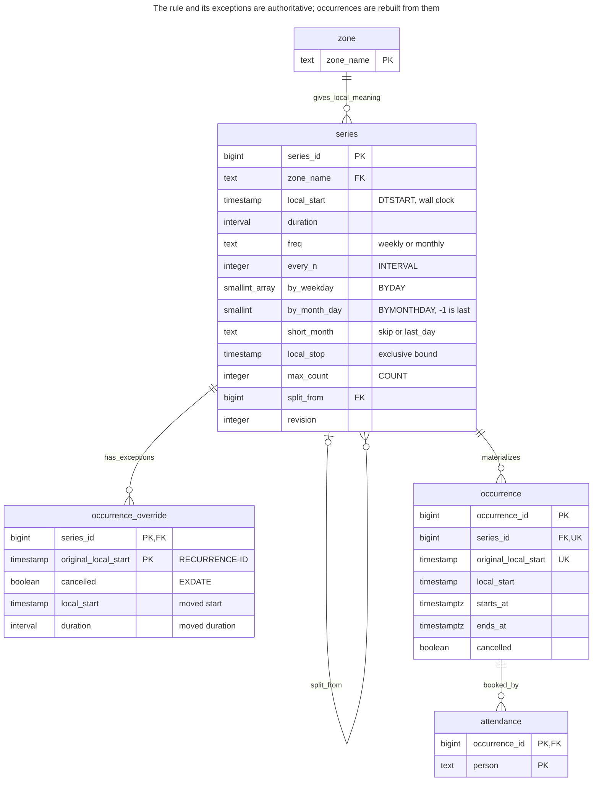
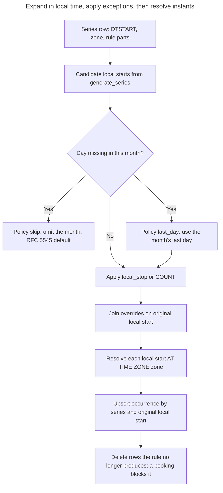
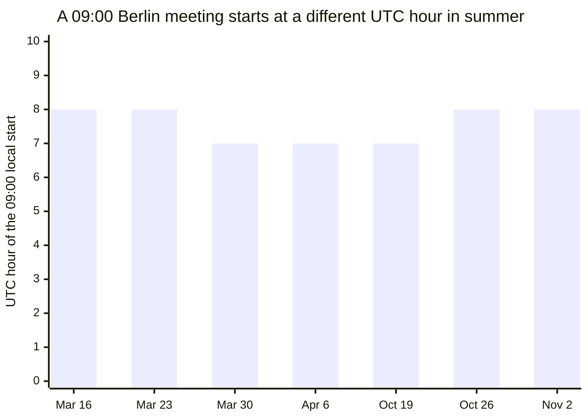
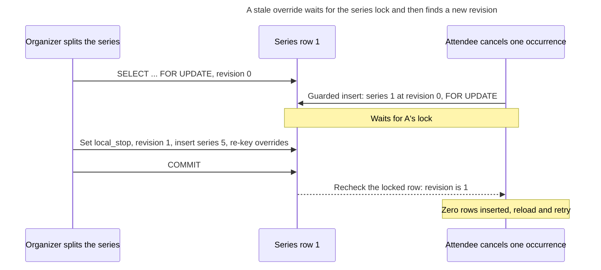

# Recurrence Rule

## Intent

A recurrence rule stores a repeating event as one series row instead of many event rows. The row holds the rule, the first local start and the IANA zone. One extra row records each cancelled or moved occurrence, and an optional table holds occurrences materialized for a horizon. Examples are a weekly meeting at 09:00 Berlin time, an invoice on the 31st of every month, and a class every Tuesday and Thursday until June. The chapter expands the rule with `generate_series` in local time, decides what the 31st means in February, and splits a series for a "this and following" edit. It also rebuilds materialized occurrences after a rule edit or a tzdata update without losing exceptions or bookings. The vocabulary comes from [RFC 5545](https://www.rfc-editor.org/rfc/rfc5545) (iCalendar). How a local time and a zone name become an instant is covered in [Time Point](time-point.md).

## Also known as

Recurring event; repeating event; recurrence set, the RFC 5545 term for the complete set of instances. RFC 5545 names the parts this chapter stores: [`RRULE`](https://www.rfc-editor.org/rfc/rfc5545#section-3.8.5.3) for the rule, [`EXDATE`](https://www.rfc-editor.org/rfc/rfc5545#section-3.8.5.1) for excluded instances, and [`RECURRENCE-ID`](https://www.rfc-editor.org/rfc/rfc5545#section-3.8.4.4) for the original start of an instance that a separate component overrides. Martin Fowler's paper [Recurring Events for Calendars](https://martinfowler.com/apsupp/recurring.pdf) calls the object that answers on which days an event occurs a **Schedule**. Each **Schedule Element** in it links an event to a temporal expression, and expressions such as "second Monday of the month" combine by union, intersection and difference. The paper works at day granularity and lists holiday cancellations and substitute dates as patterns still to be developed.

## Problem

Generating one row per meeting at creation time looks simple until something changes. A weekly meeting has no natural last row, so someone picks a cutoff. Moving the meeting from 09:00 to 10:00 means updating hundreds of rows, and nothing tells the rows a person edited by hand apart from the rows the generator wrote. If the rows hold UTC instants generated as "first instant plus seven days", the 09:00 Berlin meeting becomes a 10:00 meeting on the first Monday of summer time. A tzdata update that changes a future transition leaves every stored instant wrong.

Storing only the rule fails in the opposite direction. "What is on Tuesday?" then requires expanding every series. A booking or an attendance record has nothing to reference, and cancelling one meeting needs a place to live. That place must survive the next expansion, so that an edit to the rule or a rebuild does not bring the cancelled meeting back.

Calendar arithmetic adds its own trap. "Monthly on the 31st" has no answer in February: RFC 5545 [ignores invalid dates](https://www.rfc-editor.org/rfc/rfc5545#section-3.3.10), which skips the month entirely, while a billing team usually expects the last day. Adding `interval '1 month'` repeatedly gives a third answer, which neither team wants: the 31st drifts to the 28th and stays there.

## Solution

Split the data by authority:

- **Series** — the rule. The first occurrence (`DTSTART`) as a local `timestamp`, the zone name, the duration and the rule parts: frequency, interval, weekdays or day of month, a policy for short months, and either an end bound or a count. The series is authoritative and is edited only through a locked writer.
- **Override** — one row per changed occurrence, keyed by the series and the occurrence's **original local start**, which is RFC 5545's `RECURRENCE-ID`. A row either cancels the occurrence (`EXDATE`) or moves it and changes its duration. Overrides are authoritative too.
- **Occurrence** — an optional derived projection for a horizon: the rule expanded in local time, the overrides applied, and each local start resolved to an instant with `AT TIME ZONE`. It is upserted by `(series_id, original_local_start)`, so an occurrence keeps its ID across rebuilds and bookings can reference it with an ordinary foreign key.

Expand in local time and convert each local start separately; never step an instant. Identify an occurrence by its original local start, never by its computed instant or its position in the sequence: a rule edit renumbers positions and a tzdata update changes instants. Model a "this and following" edit as the end of one series and the start of a successor. Every writer locks the series row: rule edits, override writers and the materializer.

## Alternatives and selection

| Choice | Relationship | Deciding requirement |
| --- | --- | --- |
| Explicit occurrence rows only | Replacement | Few occurrences, irregular dates, or every occurrence is planned and edited on its own; there is no rule to keep |
| Rule and overrides, expanded on read | Implementation option | Nothing references a concrete occurrence and reads cover short windows of a few series |
| Rule, overrides and materialized occurrences | Implementation option, the full form here | Bookings or attendance need foreign keys, or "what is on Tuesday" across many series must use an index |
| `RRULE` text column | Implementation option | You exchange events with iCalendar clients and expand them with a library; the database cannot check the rule parts |
| [Effective Dating](effective-dating.md) | Complement | Versions of a rule apply over business periods; a split is effective dating of the rule |
| [Reservation](reservation.md) | Complement | Each materialized occurrence consumes scarce capacity such as a room, so claims need an overlap or quantity rule |
| [Status History](status-history.md) | Complement | You must keep who cancelled or moved an occurrence, when and why |
| [Summary Table](summary-table.md) | Complement with the same contract | Treat the materialized occurrences as a projection with a defined freshness and a full rebuild path |

See the [Decision Atlas](decision-atlas.md) for the full comparison. Structured columns and `RRULE` text can coexist: keep the imported text as a record of what the client sent and generate from the columns your database validates.

## Structure



The override has no foreign key to `occurrence`: it must exist before and beyond the materialized horizon, and it outlives every rebuild. `attendance` references the stable `occurrence_id`, which the upsert keeps for the same `(series_id, original_local_start)`. `split_from` records which series a "this and following" edit replaced.

## Tables and invariants

- **`zone`** lists the server's tzdata names, as in [Time Point](time-point.md); a misspelled zone is rejected at write time.
- **`series`** stores the rule as typed columns. `series_weekly_shape` and `series_monthly_shape` allow only the parts that belong to the frequency. `series_until_or_count` rejects an end bound together with a count, which RFC 5545 forbids. `series_start_matches_rule` requires `local_start` to be an occurrence of the rule: a listed weekday, or the stated day of month, or the last day for `-1`. RFC 5545 leaves the result undefined when `DTSTART` does not match the rule. `local_stop` is exclusive, so a split ends one series exactly where its successor starts. `revision` changes with every rule edit.
- **`occurrence_override`** has the primary key `(series_id, original_local_start)`, so one occurrence has at most one exception, and `override_cancel_or_move` makes it either a cancellation or a move. The schema does not check that `original_local_start` is produced by the rule. The guarded writer below checks it, and the materializer ignores an override whose original start the rule no longer produces.
- **`occurrence`** is derived. `occurrence_natural_key` on `(series_id, original_local_start)` makes materialization idempotent; `starts_at` and `ends_at` are cached instants that a rebuild recomputes.
- **`attendance`** references a concrete occurrence. Its foreign key stops a rebuild from deleting an occurrence that someone booked.

## When to use

- People think of the events as one thing with a rule: "the Monday meeting", "the monthly invoice run".
- Edits apply to the whole series or to everything after a date more often than to single occurrences.
- Occurrences are promised in local time in a zone with daylight-saving transitions.
- You exchange events with iCalendar clients, which send `RRULE`, `EXDATE` and `RECURRENCE-ID` anyway.

## Consequences and trade-offs

- ➕ One row change edits the future of a series, and the rule records what the organizer asked for.
- ➕ Exceptions are explicit rows, so a rebuild cannot lose a cancellation or a move.
- ➕ Materialized occurrences give ordinary indexes and foreign keys while staying rebuildable from authoritative data.
- ➖ The generator is code you own. This chapter supports weekly and monthly rules with one day of month; full RFC 5545 (`BYSETPOS`, yearly rules, `RDATE`) belongs in a library or a much larger function.
- ➖ Reads past the materialized horizon return nothing, which looks the same as "nothing scheduled". Extend the horizon with a job and record how far each series is materialized.
- ➖ An edit to the rule has to reconcile overrides and bookings that refer to occurrences the new rule no longer produces.
- ➖ Cached instants go stale after a tzdata update until the materializer runs again.

## Implementation

The [complete PostgreSQL 18.7 script](../assets/recurrence-rule/recurrence-rule.sql) checks the daylight-saving behavior, both month-end policies, the drift of a monthly step, `COUNT` with a cancelled instance, the shape and alignment checks, overrides, idempotent materialization, a tzdata rebuild, a refused rule edit, the split and the guarded override writer. It sets `search_path` to its schema, so the names below are unqualified. The series table, shortened:

```sql
CREATE TABLE series (
    series_id bigint PRIMARY KEY,
    zone_name text NOT NULL REFERENCES zone (zone_name),
    local_start timestamp(0) NOT NULL,       -- DTSTART, wall clock
    duration interval NOT NULL CHECK (duration > interval '0'),
    freq text NOT NULL CHECK (freq IN ('weekly', 'monthly')),
    every_n integer NOT NULL DEFAULT 1,      -- INTERVAL
    by_weekday smallint[],                   -- BYDAY, ISO 1 = Monday
    by_month_day smallint,                   -- BYMONTHDAY, -1 = last day
    short_month text CHECK (short_month IN ('skip', 'last_day')),
    local_stop timestamp(0),                 -- exclusive, unlike UNTIL
    max_count integer CHECK (max_count > 0), -- COUNT
    split_from bigint REFERENCES series (series_id),
    revision integer NOT NULL DEFAULT 0,
    CONSTRAINT series_until_or_count CHECK (local_stop IS NULL OR max_count IS NULL),
    CONSTRAINT series_start_matches_rule CHECK (CASE freq
        WHEN 'weekly' THEN extract(isodow FROM local_start)::smallint = ANY (by_weekday)
        WHEN 'monthly' THEN CASE WHEN by_month_day = -1
            THEN local_start::date = (date_trunc('month', local_start)
                                      + interval '1 month' - interval '1 day')::date
            ELSE extract(day FROM local_start) = by_month_day END
        END)
);
```

`expand_series(series_id, until)` returns the original local starts. For a weekly rule it walks days with [`generate_series`](https://www.postgresql.org/docs/18/functions-srf.html) over `timestamp` from the Monday of the first week, keeps the listed weekdays in every `every_n`-th week and adds the start's time of day. For a monthly rule it steps over first days of months, which always exist, and only then picks the day:

```sql
SELECT m + make_interval(days => picked.day_no - 1) + s.local_start::time
FROM s,
     generate_series(date_trunc('month', s.local_start), p_until,
                     make_interval(months => s.every_n)) AS m,
     LATERAL (SELECT extract(day FROM m + interval '1 month' - interval '1 day')::int
              AS month_days) AS len,
     LATERAL (SELECT CASE
                  WHEN s.by_month_day = -1 THEN len.month_days
                  WHEN s.by_month_day <= len.month_days THEN s.by_month_day
                  WHEN s.short_month = 'last_day' THEN len.month_days
              END AS day_no) AS picked
WHERE s.freq = 'monthly' AND picked.day_no IS NOT NULL
```

The function then drops candidates before `local_start` or at and after `local_stop`, numbers the rest and keeps the first `max_count`. Overrides are not applied here. RFC 5545 builds the recurrence set from the rule and then [excludes the `EXDATE` values](https://www.rfc-editor.org/rfc/rfc5545#section-3.8.5.1), so a cancelled instance still uses up one of the `COUNT`. The script cancels March 31 in a `COUNT=3` series on the 31st and checks that the series still ends on May 31.



The time zone enters only at the end, once per occurrence. Everything before that step works on wall-clock values, so a meeting at 09:00 is 09:00 in every week.

The team meeting is weekly on Mondays at 09:00 in `Europe/Berlin` from March 16, 2026:

```sql
INSERT INTO series (series_id, title, zone_name, local_start, duration, freq, by_weekday)
VALUES (1, 'Team meeting', 'Europe/Berlin', '2026-03-16 09:00', '30 minutes',
        'weekly', '{1}');
SELECT e.original_local_start, e.original_local_start AT TIME ZONE s.zone_name AS starts_at
FROM series AS s, expand_series(s.series_id, TIMESTAMP '2026-04-07') AS e
WHERE s.series_id = 1;
```

Every row has a local time of 09:00, while `starts_at` is `08:00+00` on March 16 and 23 and `07:00+00` from March 30, after Berlin moves to summer time. The script also checks the autumn side, where October 26 returns to `08:00+00`.



The local value never changes; only its instant does. A generator that stepped the instant would keep the bars level and move the meeting to 10:00 local time all summer. That is what `generate_series(TIMESTAMPTZ '2026-03-23 08:00+00', ..., interval '7 days')` does in a UTC session: it returns `2026-03-30 08:00+00`, which is 10:00 in Berlin. Since PostgreSQL 16 the `timestamptz` form takes a zone argument, and `generate_series(..., interval '7 days', 'Europe/Berlin')` returns `07:00+00` instead. It still has no place for weekdays, month-end policies or exceptions, so the series keeps local values.

A local start can fall into a spring-forward gap. A weekly job at 02:30 on Sundays has an occurrence at 02:30 on March 29, 2026, which does not exist in Berlin. This schema keeps that occurrence and lets `AT TIME ZONE` resolve it to 03:30 summer time, by the rule [Time Point](time-point.md) describes. RFC 5545 says such an instance [must be ignored](https://www.rfc-editor.org/rfc/rfc5545#section-3.3.10), so an iCalendar client would not show it. Choose one behavior and state it. The round trip `(local AT TIME ZONE zone) AT TIME ZONE zone <> local` finds the affected occurrences, and the script checks that it returns exactly March 29.

For the 31st, the two policies give different sets between January and June 2026:

| Series | Occurrences |
| --- | --- |
| `by_month_day = 31`, `short_month = 'skip'` | Jan 31, Mar 31, May 31 |
| `by_month_day = 31`, `short_month = 'last_day'` | Jan 31, Feb 28, Mar 31, Apr 30, May 31, Jun 30 |
| `generate_series(TIMESTAMP '2026-01-31', ..., interval '1 month')` | Jan 31, Feb 28, Mar 28, Apr 28 |
| `TIMESTAMP '2026-01-31' + n * interval '1 month'` | Jan 31, Feb 28, Mar 31, Apr 30 |

`generate_series` adds the step to the previous value, so once February clamps the 31st to the 28th, every later month stays on the 28th. Multiplying the step from the anchor clamps each month independently. [RFC 7529](https://www.rfc-editor.org/rfc/rfc7529) standardizes the choice as `SKIP=OMIT`, `BACKWARD` or `FORWARD`, but only together with its `RSCALE` element; plain RFC 5545 always omits the month.

Exceptions are rows keyed by the original local start. Easter Monday's meeting moves to Tuesday at 11:00, and the evening class on Ascension Day is cancelled:

```sql
INSERT INTO occurrence_override (series_id, original_local_start, local_start)
VALUES (1, '2026-04-06 09:00', '2026-04-07 11:00');
INSERT INTO occurrence_override (series_id, original_local_start, cancelled)
VALUES (2, '2026-05-14 18:00', true);
```

`materialize(series_id, from, to)` locks the series row, upserts the occurrences in the window and deletes the ones the rule no longer produces. The upsert uses [`ON CONFLICT`](https://www.postgresql.org/docs/18/sql-insert.html) on the natural key and changes a row only when its values differ:

```sql
INSERT INTO occurrence AS oc
    (series_id, original_local_start, local_start, starts_at, ends_at, cancelled)
SELECT s.series_id, e.original_local_start, x.local_start,
       x.local_start AT TIME ZONE s.zone_name,
       (x.local_start + coalesce(o.duration, s.duration)) AT TIME ZONE s.zone_name,
       coalesce(o.cancelled, false)
FROM series AS s
CROSS JOIN LATERAL expand_series(s.series_id, p_to) AS e
LEFT JOIN occurrence_override AS o
       ON o.series_id = s.series_id AND o.original_local_start = e.original_local_start
CROSS JOIN LATERAL (SELECT coalesce(o.local_start, e.original_local_start)
                    AS local_start) AS x
WHERE s.series_id = p_series_id AND e.original_local_start >= p_from
ON CONFLICT (series_id, original_local_start) DO UPDATE
SET local_start = EXCLUDED.local_start, starts_at = EXCLUDED.starts_at,
    ends_at = EXCLUDED.ends_at, cancelled = EXCLUDED.cancelled
WHERE (oc.local_start, oc.starts_at, oc.ends_at, oc.cancelled)
      IS DISTINCT FROM
      (EXCLUDED.local_start, EXCLUDED.starts_at, EXCLUDED.ends_at, EXCLUDED.cancelled);
```

Cancelled occurrences stay as rows with `cancelled = true`, so a booking on them stays valid and the calendar can show the cancellation. "What is on Tuesday, April 7, in Berlin?" is now an index range over a local day, as in [Time Point](time-point.md):

```sql
SELECT s.title, o.local_start
FROM occurrence AS o JOIN series AS s USING (series_id)
WHERE NOT o.cancelled
  AND o.starts_at >= TIMESTAMP '2026-04-07 00:00' AT TIME ZONE 'Europe/Berlin'
  AND o.starts_at <  TIMESTAMP '2026-04-08 00:00' AT TIME ZONE 'Europe/Berlin';
```

It returns the moved meeting at 11:00 and the class at 18:00. Running the materializer for the same window a second time changes nothing. A plain insert of an existing occurrence is rejected with SQLSTATE `23505`: `ERROR: duplicate key value violates unique constraint "occurrence_natural_key"`, `DETAIL: Key (series_id, original_local_start)=(1, 2026-03-16 09:00:00) already exists.`

To stand in for a tzdata update, the script shifts every cached instant of the meeting by an hour and runs the materializer again. The instants are corrected, the moved occurrence is still on Tuesday at 11:00, and it keeps its `occurrence_id` and its booking. A real update needs the same step: run the materializer over the whole horizon after every server upgrade that changes tzdata.

A rule edit that removes a booked occurrence is refused. Changing the class from Tuesday and Thursday to Tuesday only while a Thursday in May is booked makes the materializer's delete fail with SQLSTATE `23503`: `ERROR: update or delete on table "occurrence" violates foreign key constraint "attendance_occurrence_id_fkey" on table "attendance"`, with `DETAIL: Key (occurrence_id)=(26) is still referenced from table "attendance".` The edit then needs a decision about those bookings: move them, cancel the occurrence instead of deleting it, or notify the people.

The schema rejects malformed rules too. A Tuesday and Thursday class that starts on a Wednesday, or a series on the 31st that starts on the 15th, fails with SQLSTATE `23514`: `ERROR: new row for relation "series" violates check constraint "series_start_matches_rule"`. Setting `local_stop` on a series that has `max_count` fails `series_until_or_count` with the same SQLSTATE.

A "this and following" edit moves the meeting to 10:00 from April 20. Inside one transaction, the writer:

1. Locks series 1 and sets its `local_stop` to `2026-04-20 09:00`.
2. Inserts series 5 with the same rule, `local_start = '2026-04-20 10:00'` and `split_from = 1`.
3. Re-keys the overrides at or after the boundary to series 5, shifting their original start by the same hour. This follows RFC 5545's `RANGE=THISANDFUTURE`, where later instances are rescheduled by the same time difference.
4. Materializes series 5 and re-points bookings from each old occurrence to the new occurrence with the shifted original start.
5. Materializes series 1 from the boundary, which deletes the old future occurrences now that nothing references them.

```mermaid
---
title: A split ends the old series at the boundary and moves exceptions and bookings forward
config:
  gantt:
    useWidth: 900
    fontSize: 16
    sectionFontSize: 16
---
gantt
    dateFormat YYYY-MM-DD
    axisFormat %b %d
    section Series 1
    Mondays 09:00 until the boundary :done, s1, 2026-03-16, 2026-04-20
    section Series 5
    Mondays 10:00 from the boundary :active, s5, 2026-04-20, 2026-06-30
    Booking re-pointed to Apr 27 10:00 :milestone, bk, 2026-04-27, 0d
    Cancellation re-keyed to May 4 10:00 :crit, ov, 2026-05-04, 1d
```

The past part of series 1 is untouched, so attendance on April 6 and 13 still points to 09:00 occurrences. If the old series was bounded by `COUNT`, give the successor the remaining count: the old count minus the occurrences before the boundary. Overrides whose original start the new rule does not produce, for example after a change of weekday, cannot be shifted mechanically; list them for the organizer instead of dropping them.

## Engine support

- **PostgreSQL 18:** `generate_series` over `timestamp` produces local candidates; the [`timestamptz` form](https://www.postgresql.org/docs/18/functions-srf.html) takes an optional zone and computes days and daylight-saving adjustments in it. `timestamp + n * interval '1 month'` clamps to the last day of a short month, as the script checks. A unique key and `ON CONFLICT` make materialization idempotent.
- **MySQL 8.4:** there is no `generate_series`; use a [recursive CTE](https://dev.mysql.com/doc/refman/8.4/en/with.html), whose depth is limited by `cte_max_recursion_depth`, 1000 by default. [`DATE_ADD` with `MONTH`](https://dev.mysql.com/doc/refman/8.4/en/date-and-time-functions.html) adjusts a missing day to the last day of the month, so add months to the anchor rather than to the previous result. `CONVERT_TZ` with zone names needs the time zone tables loaded.
- **SQL Server 2025 (17.x):** [`GENERATE_SERIES`](https://learn.microsoft.com/en-us/sql/t-sql/functions/generate-series-transact-sql?view=sql-server-ver17) generates numbers only and needs compatibility level 160; add them to an anchor with `DATEADD`. [`DATEADD(month, ...)`](https://learn.microsoft.com/en-us/sql/t-sql/functions/dateadd-transact-sql?view=sql-server-ver17) returns the last day of the month when the day does not exist. Zone conversion uses Windows zone names, as described in [Time Point](time-point.md).
- **Oracle AI Database 26ai:** [`ADD_MONTHS`](https://docs.oracle.com/en/database/oracle/oracle-database/26/sqlrf/ADD_MONTHS.html) returns the last day of the resulting month when the input is the last day of its month. Chaining it from February 28 therefore jumps to March 31; add months to the anchor.
- **SQLite 3:** shifting a date by months is [ambiguous by design](https://www.sqlite.org/lang_datefunc.html): the default `ceiling` modifier rolls a missing day into the next month, and `floor` gives the last day of the month. SQLite knows no zone names, so expand rules in the application and store local values with the zone.

## Failure and concurrency

An override written against an old version of the rule is the typical race. The organizer splits the series while an attendee's client cancels one occurrence it displayed before the split:



The override writer selects the series row with [`FOR UPDATE`](https://www.postgresql.org/docs/18/explicit-locking.html#LOCKING-ROWS), the revision its client read and a check that the original start is an occurrence of the current rule, and inserts only if that select returned a row. After the wait, PostgreSQL rechecks the `revision` predicate against the committed row, so the stale writer inserts nothing. Without `FOR UPDATE` the writer reads revision 0 from its snapshot, waits only on the foreign key check, and inserts an override that the split has already re-keyed past. The lab asserts the guard in one session; the two-session race was checked separately against PostgreSQL 18.7, with and without the lock clause. This is the [Version Column](version-column.md) pattern applied to the series.

The materializer takes the same lock, so it never combines a new rule with half of an edit's re-keyed overrides. Two materialization jobs for the same series serialize on that lock, and the unique key on `(series_id, original_local_start)` is the backstop for any writer that forgets it: a duplicate insert fails, and the upsert turns a second run into no-ops. Run each series in its own transaction so that a crash leaves whole series either rebuilt or untouched, and record the horizon reached per series so that a restarted job knows where to continue.

Readers of `occurrence` see committed projections only. Between a rule edit and the end of its transaction they see the old occurrences; that is correct, because the edit commits the rule, overrides, bookings and projection together.

## Migration

From one row per occurrence, group the rows into candidate series by title, weekday or day of month, local time of day and zone. For each candidate, expand the proposed rule and compare it with the existing rows. A generated start with no row becomes a cancellation override, a row at a different time becomes a move override, and a row that matches no rule stays a single event. Insert the existing rows into `occurrence` keyed by `(series_id, original_local_start)` and keep their IDs, so bookings do not move. Switch writers to the series and override tables, then turn the old generator off through [Expand and Contract](expand-contract.md).

From UTC instants, first recover the local start and zone for each event as [Time Point](time-point.md) describes; without the zone the rule cannot be reconstructed. From imported `RRULE` text, parse the parts your generator supports into columns, keep the text, and leave rules with unsupported parts to a library until you extend the generator. To back out, keep materializing a long horizon and serve reads from `occurrence` alone; the rows remain ordinary event rows.

## Anti-patterns and common mistakes

- Stepping an instant by `interval '7 days'` in UTC, which moves a local meeting by an hour twice a year.
- Identifying an occurrence by its computed instant or its ordinal number, which a tzdata update or a rule edit changes.
- Editing a materialized row to cancel or move an occurrence; the next rebuild restores the rule's value.
- Repeating `+ interval '1 month'`, or a monthly `generate_series` step, from the 31st, which drifts to the 28th.
- Editing the rule in place for a "this and following" change, which also rewrites past occurrences and their attendance.
- Treating an empty result beyond the materialized horizon as "nothing scheduled".
- Exporting the exclusive `local_stop` as `UNTIL` unchanged: RFC 5545's [`UNTIL`](https://www.rfc-editor.org/rfc/rfc5545#section-3.3.10) is inclusive and, for a `DTSTART` with a zone, must be written in UTC, which depends on the tzdata in use at export.
- Storing an `RRULE` string without its `DTSTART` and zone; the rule alone does not say when or where.

## Known uses

- The Google Calendar API [Events resource](https://developers.google.com/workspace/calendar/api/v3/reference/events) keeps `recurrence` as a list of `RRULE`, `EXRULE`, `RDATE` and `EXDATE` lines per RFC 5545. An instance carries `recurringEventId` and `originalStartTime`, which identifies it within the series even after it is moved: the same key as `original_local_start` here.
- Python's [dateutil `rrule`](https://dateutil.readthedocs.io/en/stable/rrule.html) implements the iCalendar recurrence rules, with `rruleset` for exclusion dates; it is the kind of library to use when the generator must cover the full RFC.
- [RFC 7529](https://www.rfc-editor.org/rfc/rfc7529) adds the `SKIP` element because omitting invalid dates surprises users, for example a leap-day birthday that appears only every four years.

## Related patterns

- [Time Point](time-point.md) explains local time plus an IANA zone and how gaps and overlaps resolve.
- [Effective Dating](effective-dating.md) models a rule's versions over business periods; a split is one such boundary.
- [Reservation](reservation.md) adds capacity rules when an occurrence claims a room or a seat.
- [Status History](status-history.md) records who cancelled or moved an occurrence and why.
- [Version Column](version-column.md) supplies the revision check that rejects stale overrides.
- [Summary Table](summary-table.md) treats a derived projection with the same rebuild and freshness contract.
- [Expand and Contract](expand-contract.md) moves writers from generated rows to the series without downtime.
